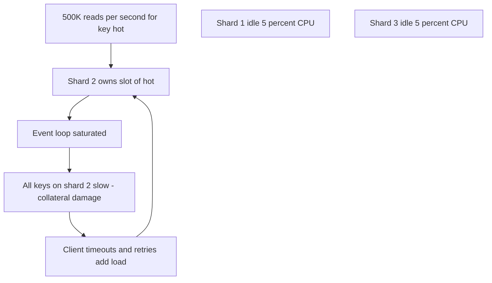
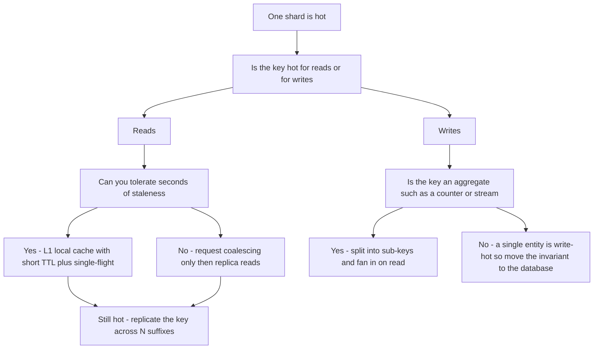

# Hot Key Problem

Sharding distributes *keys* evenly; it cannot distribute *one key's traffic* at all. When a single key — the celebrity's profile, the flash-sale product, the global config blob — attracts a disproportionate share of requests, every one of those requests lands on the one shard that owns it, while the rest of the cluster idles. The cluster's aggregate capacity is irrelevant: **your ceiling is one node's capacity for that key**, and in Redis's case one single-threaded event loop ([[Redis Internals]]). This is the hot key problem: the cache-layer (and generally key-value-layer) incarnation of the broader [[Hot Partition Problem]].

## Why this matters

The same Zipfian skew that makes caching work ([[Why Caching Works]]) guarantees hot keys exist: the head of the distribution is always disproportionately hot, and hashing — [[Consistent Hashing]] or Redis Cluster's CRC16 slots ([[Redis Cluster and Sentinel]]) — places each key on exactly one shard *by design*. So a scaled-out cluster inherits a single-node bottleneck precisely on its most important data. Worse, hot keys are **event-driven and sudden**: a tweet goes viral, a sale starts, a push notification fans out — traffic to one key jumps 100× in seconds, no capacity planning catches it, and the blast radius is wrong-sized: one melting shard degrades every other key co-located on it, so unrelated parts of the product slow down. Real-world scar tissue: celebrity activity famously stressed Twitter's timeline infrastructure (the canonical case study — [[Twitter Timeline Design]]), and every serious KV store (DynamoDB's adaptive capacity, Redis enterprise offerings) ships machinery for exactly this.

## How it works

### Anatomy of a melt

A Redis Cluster node comfortably serves on the order of 100K simple ops/s with I/O threads off (one core for execution; as of 2026 — measure your own). A viral event drives 500K GET/s to one key:



The failure compounds: saturation → latency → client timeouts → retries → *more* load ([[Timeouts Retries and Exponential Backoff]] retry amplification). If the hot key is also *large* (a mega-hash read with HGETALL, a big JSON blob), network bandwidth on that node saturates before CPU does — "hot + big" is the worst combination. And if the hot key *expires* under this traffic, the stampede ([[Cache Stampede and Thundering Herd]]) piles onto the origin too: the two problems are cousins — stampede is a herd *through a missing* key; hot key is a herd *on a present* one.

### How much imbalance does one key actually cause

Put numbers on it, because the intuition is wrong in a specific direction. Let total traffic be `T` across `N` shards, with a fraction `f` of all requests going to one hot key and the remaining `1 − f` spread evenly:

```
load on a normal shard = (1 − f) × T / N
load on the hot shard  = (1 − f) × T / N  +  f × T
imbalance ratio        = 1 + f × N / (1 − f)
```

Worked: 1M req/s over 10 shards, with 30% of traffic on one key. Normal shards carry `0.7 × 1M / 10 = 70K/s`; the hot shard carries `70K + 300K = 370K/s` — **5.3× its peers**, and it is the number the ratio formula gives (`1 + 0.3 × 10 / 0.7 = 5.29`).

The counter-intuitive part is the `N` in the numerator: **the bigger your cluster, the less skew it takes to break it.** On a 100-shard cluster, a key taking just **1%** of all traffic already runs its shard at `1 + 0.01 × 100 / 0.99 ≈ 2.0×` everyone else — a key you would never look at twice in a top-keys report. Scaling out spreads the *other* 99% thinner while leaving the hot key exactly where it was, so each shard added makes the hottest key relatively hotter. This is the arithmetic behind the first misconception below, and it is why hot-key defence is a design-time concern on large clusters rather than an incident-time one.

### Detection — you can't fix what you can't see

Hot keys hide inside aggregate metrics: cluster-average CPU looks fine while one node burns. Detection is about **per-node and per-key visibility**:

- **Per-node imbalance:** one shard's CPU/ops/network far above the rest — the first signal on any dashboard that splits by node. In Redis Cluster, per-slot stats (`CLUSTER` info and, from Redis 8.2, `CLUSTER SLOT-STATS`) localize it further.
- **Redis built-ins:** `redis-cli --hotkeys` scans the keyspace using the LFU access counters (requires `maxmemory-policy` set to an LFU variant — [[Cache Eviction Policies]]); `MONITOR` on a suspect node shows the live command stream (seconds only — it costs real throughput); `SLOWLOG` catches hot-and-big keys.
- **Client-side sampling:** the most scalable approach — sample 1-in-N cache requests in the app (or a proxy/sidecar) into a streaming top-k (count-min sketch); this is how large fleets spot hot keys in near-real-time and can trigger automatic mitigation, and it is the only method that keeps working when the keyspace is too big to scan and the node is too busy to `MONITOR`.
- **Provider metrics:** managed stores expose it directly — e.g. per-node `EngineCPUUtilization` divergence on ElastiCache; DynamoDB's CloudWatch "contributor insights" names your hottest partition keys.

### The detection runbook, in the order you would actually run it

1. **Confirm it is imbalance, not load.** Plot CPU and ops/s per node as separate series. If one node is pinned and the rest are idle, you have a hot key or a hot slot; if all nodes climb together, you have a capacity problem and this note is the wrong one.
2. **Narrow to a slot, then to keys.** `CLUSTER NODES` maps slot ranges to nodes, so the hot node's ranges are your search space. `CLUSTER COUNTKEYSINSLOT <slot>` and `CLUSTER GETKEYSINSLOT <slot> <count>` enumerate what lives in a specific slot, and `CLUSTER KEYSLOT <key>` confirms a suspect in one round trip — useful for proving "yes, `config:global` really is on the burning node." Redis 8.2 added `CLUSTER SLOT-STATS` (key count always; CPU and network per slot only with `cluster-slot-stats-enabled yes`), and Redis 8.6 added a server-side `HOTKEYS` command that ranks keys by CPU time and network bytes over a tracking window — check whether your server version offers them before building the equivalent yourself.
3. **`redis-cli --hotkeys`.** Understand what it does before trusting it: it walks the whole keyspace with `SCAN` and calls `OBJECT FREQ` on each key, so it requires an LFU `maxmemory-policy` ([[Cache Eviction Policies]]) and it reports **approximate, decayed access counters — not request rates**. A key hammered for thirty seconds and a key steadily warm all day can report similarly. The scan also takes real time on a large keyspace. Treat the output as a shortlist, not a verdict.
4. **`MONITOR`, briefly and carefully.** It streams every command the node receives, which is the ground truth — and Redis's own documentation notes a benchmark where running it cut throughput by more than half. Rules: run it for a few seconds, pipe straight into a counting pipeline rather than a terminal, and never on a node that is already saturated (you will finish the job it started). The subtle trap: `MONITOR` shows only the commands *that node itself* receives — replicated writes plus whatever replica-read traffic your clients send it — so pointing it at a replica to be safe will not reveal reads that your clients are sending to the primary.
5. **Check for hot *and* big.** `redis-cli --bigkeys` / `--memkeys` and `SLOWLOG GET` — a 2 MB value fetched 5,000 times a second saturates the NIC long before the CPU, and the fix is different (stop fetching the whole structure: `HGET` the field you need, not `HGETALL`).
6. **Attribute by command shape.** `INFO commandstats` gives per-command call counts and total microseconds on that node, which often identifies the *access pattern* (one expensive `ZRANGE`, a flood of `GET`) even before you know the key.
7. **Make it permanent.** Everything above is archaeology. The durable answer is client-side sampling into a top-k sketch, emitted as a metric, so that next time the dashboard names the key before anyone opens a terminal.

### Mitigation 1 — Local / L1 caching (first resort)

Cache the hot value *in each application instance* (Caffeine in-JVM, 1–5 s TTL). Reads for the hot key are absorbed across the whole app fleet — which scales horizontally — and Redis sees each app instance once per TTL instead of once per request. The hotter the key, the better this works: a key read 500K/s by 50 instances with a 1 s L1 TTL becomes ~50 Redis reads/s. Costs: up to TTL seconds of staleness ([[Cache Invalidation]] — keep L1 TTLs tiny), per-instance memory, and a coherence story if the value changes mid-sale (pub/sub invalidation hints help, best-effort — [[Redis Beyond Caching]]).

### Mitigation 2 — Key replication with read spread

Write N copies — `hot:1` … `hot:N` (the suffix moves each copy to a different slot/shard); readers pick a random replica. Read load divides by N across shards. Writes must now update all N (or let short TTLs converge them), so this fits **read-heavy, rarely-written** hot keys — configs, catalog entries, celebrity profiles. In Redis Cluster you can also let *reads* hit the shard's own replicas (`READONLY` mode / client replica-reads), trading replication-lag staleness for 2–3× read capacity without any key changes — a smaller, simpler version of the same idea.

### Mitigation 3 — Key splitting (for hot *aggregates*)

When the key is hot because it *aggregates* — a global counter, one giant leaderboard, a single stream — split the structure itself: `counter` becomes `counter:0..15`, writers INCR a random sub-key (write load spreads), readers SUM the 16 (read cost rises). This is sharding-within-the-keyspace, identical in spirit to the salting/suffixing fix for [[Hot Partition Problem]], and the write-side dual of mitigation 2 (replicate for hot *reads*, split for hot *writes*). Costs: read fan-out, loss of single-key atomicity across the whole aggregate, and irreversibility without migration.

### Mitigation 4 — Request coalescing

Collapse concurrent identical reads *inside each app instance* into one outbound call (single-flight; Caffeine's loading cache does it per key). Where L1 caching absorbs repeats *over time* (TTL window), coalescing absorbs repeats *in flight* — valuable when even 1 s of staleness is unwelcome but duplicate concurrent fetches are pure waste. Same machinery as stampede protection ([[Cache Stampede and Thundering Herd]]) — one mechanism, two problems.

### Choosing

| Mitigation | Attacks | Staleness cost | Write cost | Best for |
|---|---|---|---|---|
| L1 local cache | read volume at source | seconds (L1 TTL) | none | any hot read key; do this first |
| Key replication / replica reads | read volume via spread | small (lag or converge-TTL) | N× writes (or none for replica reads) | read-heavy, rarely written |
| Key splitting | write volume on aggregates | none | read fan-out | counters, leaderboards, streams |
| Request coalescing | concurrent duplicates | none | none | spiky identical reads, stampede overlap |

Layered defaults for a read-hot key: coalescing + short-TTL L1 in every service, replica reads at the cluster, key replication only if still needed. For a write-hot aggregate: splitting is the only lever that helps.



The one branch with no cache-layer answer is the bottom right: a single entity taking heavy writes is not a caching problem at all. Serialise it where the data lives, partition the work by entity so each writer owns a disjoint set ([[Message Ordering]]), or accept the throughput ceiling as a product constraint.

## Common misconceptions

- **"Add more shards."** Resharding moves *keys around*; the hot key still lives wholly on one shard. More nodes = more idle nodes. (It helps only the collateral damage, by giving the hot key a lonelier shard.) The imbalance arithmetic above shows it is worse than neutral: `N` sits in the numerator, so adding shards *raises* the imbalance ratio while barely moving the hot node's absolute load.
- **"Consistent hashing prevents hot spots."** It balances key *placement*, not key *popularity*. A perfect hash puts the celebrity on exactly one node, perfectly.
- **"Our cluster average CPU is 20%, we're fine."** Averages launder hot spots; the p-max node is the metric. One node at 100% with nine at 10% averages 19%.
- **"Hot keys are a Redis problem."** The same physics hits DynamoDB partitions, Kafka partitions (one hot partition key — [[Message Ordering]]), MongoDB shards, and CDN origins. Redis just hits the wall fastest because one key = one event loop.
- **"We'll detect it when it happens."** Without per-key/per-node telemetry wired *in advance*, the incident presents as "shard 2 is mysteriously slow" and the hot key is found by MONITOR archaeology at 2 a.m. Detection is a build-ahead investment.

## In your stack

- Your prime suspects: JWKS/public keys read on every authenticated request, global feature-flag and product-config keys, and any per-tenant key for a whale tenant. The JWKS case is textbook L1: it changes on key rotation only — cache in-JVM with a short refresh and Redis barely sees it.
- Services pinned at 1 replica cut both ways: fewer instances means L1 caching concentrates (one JVM absorbs everything — great), but it also means *your app* is likelier to be the bottleneck before Redis is. Check app-side connection pool saturation before blaming the cache.
- Hash-tagging by `{tenantId}` for multi-key ops ([[Redis Cluster and Sentinel]]) manufactures hot shards for big tenants — if you adopt tags, pair them with per-node monitoring from day one.
- The planned [[Redis Streams]] backbone: one stream = one key = one shard. A single high-volume event stream is a *structural* hot key — plan sharded streams (`events:0..N` by entity hash) before volume forces it, since splitting later migrates consumer groups too ([[Consumer Groups and Rebalancing]]).
- At 1 replica, **every deploy is an L1 cold start for the whole service** — there is no second pod holding a warm Caffeine cache while the first rolls. For the first seconds after each rollout, the full request rate for your hottest keys goes straight to Redis, so a deploy during a traffic peak looks exactly like a hot-key incident. Either accept it knowingly (short L1 TTLs mean the gap closes in seconds) or pre-warm the handful of known-hot keys in a startup hook before the readiness probe passes.
- Blast radius is the part to argue in design review: a shared Redis means a hot key belonging to a low-stakes service degrades every money path whose keys sit on the same node, because they share one event loop. That is a [[Bulkheads and Isolation]] problem, and the cheap mitigation is separation — correctness-critical key families (locks, idempotency markers, limits) on an instance that no marketing-dashboard key can ever saturate. Cost shape: a second small Redis is a fixed monthly cost that buys isolation proportional to your worst co-tenant.
- Autoscaling will not rescue you here: the saturated resource is one Redis node's event loop, not your pods' CPU, so an HPA sees nothing to scale ([[Autoscaling]]) — and at 1 replica there is no HPA anyway. Hot keys must be designed against, not scaled against.
- Fintech wrinkle: L1 caching trades staleness for survival. For flags gating money movement, a 1 s L1 TTL is usually defensible; document it as a decision, because "how stale can this be" is an auditor question. Correctness beats latency where they conflict.

## Interview angle

The 60-second version: *"Hashing spreads keys, not popularity: one viral key sends all its traffic to the one shard that owns it, so the ceiling is a single node, the shard's other keys suffer collateral damage, and retries amplify the melt. Detect with per-node imbalance metrics, Redis --hotkeys via LFU counters, and client-side top-k sampling. Mitigate in layers: request coalescing and a seconds-TTL local cache in every app instance absorb read volume where the fleet scales; key replication with random-suffix read spread divides what remains across shards; and for write-hot aggregates like counters, split the key into sub-keys — spreading writes, summing on read. It's the cache-layer face of the hot partition problem — same salting and splitting logic as in databases and Kafka."*

Classic follow-ups: "Why doesn't adding nodes help?" (the key is atomic to one shard). "Celebrity posts on your social app — walk the whole path" (this is [[Twitter Timeline Design]] / [[Design a News Feed]]: hot key in cache *and* fan-out strategy change for high-follower accounts). "How does DynamoDB handle it?" (adaptive capacity shifts throughput toward hot partitions and can isolate a hot item — helps, within item-level limits; [[DynamoDB Design]]). "What's the staleness cost of your L1 fix, and who signs off on it?" (the trade is explicit — bring it, don't bury it).

## Check yourself

> [!question]- Q: Explain why a 10-node Redis Cluster at 15% average CPU can still be melting, and what single dashboard change exposes it.
> Slot assignment maps each key to exactly one node; a hot key drives all its traffic there. Nine nodes idle at ~5% while the owner pins at 100% — the average (≈15%) looks healthy. Everything co-located on the hot node slows (collateral damage), and client retries add further load. The fix in observability: plot per-node CPU/ops as individual series or show max-over-nodes, never only the average; alert on node-to-node divergence.

> [!question]- Q: Scenario — flash sale at 12:00; product:4711 gets 300K reads/s and its price updates every few minutes. Design the layered defense and state each layer's cost.
> (1) Request coalescing in each service instance: concurrent identical fetches collapse to one — no staleness, removes in-flight duplicates. (2) L1 Caffeine cache, TTL 1–2 s: fleet absorbs the read volume; cost = up to 2 s price staleness, acceptable mid-sale (price changes propagate within seconds; add a pub/sub invalidation hint as best-effort). (3) Replica reads or N suffixed copies in Redis for the residual load; cost = replication lag or N× write on the occasional price update. (4) Jittered TTLs plus single-flight on the origin loader so an expiry during the spike doesn't stampede Mongo ([[Cache Stampede and Thundering Herd]]). Pre-warm the key before 12:00 — never let the sale start cold.

> [!question]- Q: When does key splitting beat key replication, and what do you permanently give up?
> Splitting is for *write*-hot aggregates: replication multiplies writes (every writer updates N copies), so a 100K INCR/s counter gets worse with replication but linearly better split into counter:0..15 with random-sub-key writes. You give up: single-key atomicity over the whole aggregate (no one INCR holds the true total; reads SUM 16 keys and race in-flight writes — the total is momentarily approximate), simple key management, and easy reversibility — merging sub-keys later is a migration. Replication, conversely, fits read-hot/rarely-written data where copies converge via TTL.

> [!question]- Q: Scenario — a 6-shard cluster serves 600K req/s; one key takes 25% of all traffic and its shard sits at 95% CPU while the others sit near 30%. The team doubles the cluster to 12 shards. Predict the result with the arithmetic, then say what you would actually do.
> Before: the other 75% spreads as `0.75 × 600K / 6 = 75K/s` per shard; the hot shard carries `75K + 150K = 225K/s`, an imbalance of 3× (`1 + 0.25 × 6 / 0.75`). After doubling: normal shards drop to `0.75 × 600K / 12 = 37.5K/s`, but the hot shard still carries all 150K of hot-key traffic plus its share — `187.5K/s`. The hot node's load fell by only ~17%, while the **imbalance ratio got worse, from 3× to 5×** (`1 + 0.25 × 12 / 0.75`). The only thing resharding genuinely bought is reduced collateral damage: fewer innocent keys now share the burning node. Doubling the cluster also doubled the bill. What to do instead: attack the 150K/s directly — single-flight plus a short-TTL L1 cache in every app instance absorbs most of it at the source, replica reads or N suffixed copies divide whatever remains across shards, and if the key is an aggregate, split it. Reshard for capacity; never reshard for skew.

> [!question]- Q: Mini design — your top-k sampling says one tenant's session-lookup key family is 40% of all Redis traffic, because that tenant's mobile app polls every 2 s. Options beyond the cache layer?
> Fix demand, not just supply: (a) protocol — replace polling with push ([[WebSockets Server-Sent Events and Long Polling]]) or honor caching headers client-side; (b) edge — serve the poll from Kong/CDN with a 2 s TTL so it never reaches Redis ([[CDN]], [[API Gateway]]); (c) per-tenant [[Rate Limiting]] as a contractual backstop; (d) only then the standard supply-side layers (L1, replica reads). A hot key caused by a client behavior bug is cheapest to fix at the client — cache-layer mitigations would merely subsidize it.

## Sources

- Redis documentation — `redis-cli --hotkeys` (LFU-based), MONITOR and SLOWLOG caveats; Redis Cluster spec on slot-to-node ownership (redis.io).
- "Scaling Memcache at Facebook" (NSDI 2013) — regional pools, replicated pools for hot items, and leases: the canonical production treatment of hot reads.
- AWS documentation — DynamoDB adaptive capacity & CloudWatch Contributor Insights for hot partition keys; ElastiCache per-node EngineCPUUtilization guidance.
- Cormode and Muthukrishnan, "An Improved Data Stream Summary: The Count-Min Sketch and its Applications" — the sublinear frequency sketch underneath client-side top-k hot-key detection.
- Twitter engineering on timeline delivery for high-follower accounts (the celebrity fan-out problem) — via [[Twitter Timeline Design]].
- *Designing Data-Intensive Applications*, Kleppmann — Ch. 6 ("Skewed Workloads and Relieving Hot Spots") — the salting/splitting pattern this note applies to caches.
