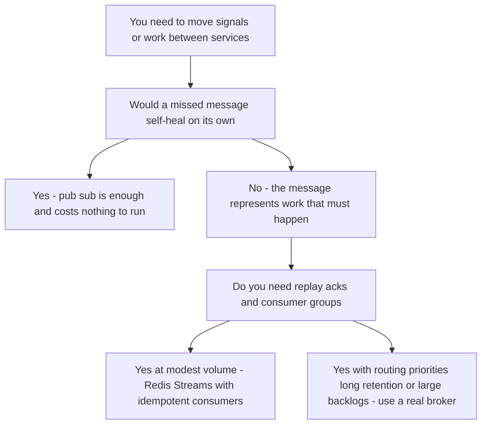

# Redis Beyond Caching

Redis calls itself a "data structure server," not a cache, and teams discover why: once it's deployed for caching, its atomic single-threaded operations ([[Redis Internals]]) make it the easiest place to build counters, locks, queues, leaderboards, and sessions. Most of these uses are legitimate — some are the industry-standard implementation. But each one quietly changes the deal: a cache can lose everything and merely get slower, while a lock, a dedup marker, or a message backbone that loses data produces *incorrect behavior*. This note walks the common patterns, what each actually guarantees given async replication and tunable-but-probabilistic durability ([[Redis Cluster and Sentinel]]), and where stretching Redis crosses into misuse.

## Why this matters

The central question for every pattern below is: **what happens when Redis loses this key?** — via eviction ([[Cache Eviction Policies]]), restart with persistence gaps, or failover dropping acknowledged writes. For a cache the answer is "a miss." For a rate limiter, "a brief over-admit." For a lock or idempotency marker, "possible double execution." Sorting patterns by that answer — rather than by what's technically possible — is what separates deliberate engineering from the slow accretion of a Redis that has become an unacknowledged single point of correctness.

## How it works

### The atomicity primitives everything else is built on

Every pattern below rests on the same property: Redis executes commands on a single thread, so each command — and each *group* of commands you hand it as a unit — runs to completion with nothing interleaved ([[Redis Internals]]). Three ways to claim that unit, with genuinely different semantics:

- **A single command.** `INCR`, `SET … NX`, `ZADD`, `LMOVE` are already atomic read-modify-writes. Most "do I need a lock for this?" questions dissolve once you find the single command that expresses the whole operation.
- **`MULTI` / `EXEC`.** Commands are queued and then executed as one uninterrupted batch. The trap worth naming explicitly: **Redis transactions do not roll back**. If a command fails at runtime — wrong type for the key, say — the remaining queued commands still run and the earlier ones stay applied. There is no undo, because there is no log to undo from. This is nothing like an [[ACID Transactions|ACID]] transaction, and treating it as one is a real source of corrupted state. (A command that is malformed enough to be rejected at *queue* time does abort the whole transaction; the no-rollback rule is about errors discovered during execution.) `WATCH` adds optimistic concurrency: watch a key, and the `EXEC` aborts if anyone modified it in the meantime — a compare-and-set you retry in a loop.
- **Lua scripts, and Functions.** `EVAL` runs a script as one unit, which is what makes read-compute-write logic — token buckets, conditional releases, atomic pops — expressible at all. Redis 7 added **Functions** (`FUNCTION LOAD`): the same execution model, but the library is persisted with the dataset and replicated, so it survives a restart and exists on the replica rather than being something each client must remember to re-load. The cost of both is shared: a script occupies the single thread for its entire duration, so a slow script is an outage for every other client. Keep them short, loop-free, and measured.

### Counters and rate limiting — sound

`INCR` is atomic for free, making Redis the default fleet-wide counter: page views, API quotas, login attempts. The classic [[Rate Limiting|rate limiter]] is a fixed window — `INCR rate:{user}:{minute}`, set `EXPIRE 60` on first increment, reject above the limit — upgraded to sliding windows with a zset of timestamps or token buckets in a Lua script (atomic read-compute-write in one event-loop turn). Loss semantics: counters reset → a window of over-admission. For abuse protection that's acceptable; fail-open is usually the right posture for a limiter anyway (a dead Redis shouldn't take the API down with it). If a *billing* number depends on the counter, Redis is the fast path, not the ledger.

### Leaderboards — the showcase

The zset was practically built for this: `ZINCRBY` on score events, `ZRANGE board 0 99 REV WITHSCORES` for top-100 (`ZREVRANGE`, deprecated since 6.2, in older code), `ZREVRANK` for "where am I" — the point operations are O(log N), and the range read is O(log N + M) for the M entries it actually returns, so a top-100 slice stays cheap however large the board grows ([[Redis Internals]]). No relational database serves "rank of user X among 10M by score, live" this cheaply; doing it in SQL means window functions over millions of rows per query. Caveats: a zset is one key, so it lives on one shard — big boards shard by league/region, and rank queries across shards need merge logic. Loss semantics: scores are usually re-derivable from the source events; persist accordingly.

### Distributed locks — sound only in its narrow lane

The correct single-node recipe — `SET lock:resource <unique-token> NX PX 30000`, release via a Lua script that deletes only if the token matches — gives **mutual exclusion most of the time**: expiry can release a lock whose holder is merely paused (GC, long I/O), and failover can resurrect or vaporize a lock. Fine for *efficiency* (avoid duplicate work); not sufficient alone for *correctness* (prevent double money movement). The full argument — including Redlock and Kleppmann's critique, fencing tokens, and when to use DB locks or [[Idempotency]] instead — lives in [[Distributed Locking]]; the headline here: a Redis lock is a performance optimization wearing a safety device's costume.

### Pub/Sub vs Streams — know which you're holding

**Pub/Sub** (`PUBLISH`/`SUBSCRIBE`) is **fire-and-forget**: messages go only to *currently connected* subscribers; nothing is stored; a subscriber that is disconnected, slow (past `client-output-buffer-limit`, which kills it), or restarting simply misses messages — no replay, no acks, at-most-once. In Cluster, published messages propagate cluster-wide (sharded pub/sub in Redis 7 scopes them to a shard). Right uses: ephemeral signals where a missed message self-heals — cache-invalidation hints (TTL backstops the misses, [[Cache Invalidation]]), presence/typing indicators, config-reload nudges. Wrong use: anything where a missed message means lost work.

**[[Redis Streams]]** (Redis 5.0) is the durable sibling: an append-only log (`XADD`) with IDs, range reads (`XRANGE`), **consumer groups** (`XREADGROUP`) with per-message acks (`XACK`), a pending-entries list for crashed consumers, and `XAUTOCLAIM` for reclaiming stuck messages — at-least-once delivery with replay, the [[Message Queues vs Event Logs|event-log]] model in miniature. Still bounded by Redis's nature: memory-resident (cap with `MAXLEN ~`), persistence only as good as your AOF/RDB config, failover can drop the acknowledged tail, and one stream = one key = one shard's throughput.

| | Pub/Sub | Streams |
|---|---|---|
| Persistence | none | in-memory log, persisted per Redis config |
| Missed messages | gone | replayable from any ID |
| Delivery | at-most-once | at-least-once (acks, PEL) |
| Consumer model | broadcast to connected | consumer groups, work-sharing |
| Backpressure | disconnect slow clients | pending list grows (monitor XPENDING) |

The decision reduces to one question asked in order:

### Session store — sound, with a durability decision

Low-latency reads on every request, TTL = session expiry for free, shared across stateless app replicas ([[Stateless vs Stateful Services]]) — this is why "move sessions out of the JVM into Redis" is the standard first step to horizontal scaling. The decision to make consciously: eviction/restart logs users out. Use a `volatile-*` policy (sessions have TTLs by design), persistence if mass re-login is unacceptable, and never `allkeys-lru` on an instance holding sessions.

### Dedup and bloom-ish membership — sound within TTL honesty

"Have I seen this before?" — `SET dedup:{id} 1 NX EX 86400` as an idempotency check, a plain set for exact membership, or probabilistic structures for scale: **HyperLogLog** (`PFADD`/`PFCOUNT`) counts distinct elements in ~12 KB at ~0.81% error (unique visitors, not exact billing); bitmaps for per-user daily-active flags; `BF.*` Bloom and cuckoo filters for real set membership — historically the separate RedisBloom module, bundled into Redis Open Source from 8.0, so confirm what your server actually ships before designing around them. Loss semantics are the sharp edge: an evicted/lost dedup marker means the duplicate *passes*. For webhook dedup that's an occasional double-process — pair it with downstream [[Idempotency]]; for payment dedup, the deterministic check is a unique constraint in the database, with Redis as the fast pre-filter only.

The bitmap case deserves its arithmetic, because it is startlingly cheap when it fits. One bit per user id means **1,000,000 users occupy ~125 KB** — a daily-active flag for a million users costs less than a single cached JSON document. `SETBIT dau:2026-10-01 <userId> 1` on activity, `BITCOUNT dau:2026-10-01` for the day's total, and `BITOP AND` across two day-keys followed by `BITCOUNT` gives next-day retention without touching the database. The condition that makes it work is **dense, sequential integer ids**: Redis allocates the string up to the highest offset you set, so one user with id 4,000,000,000 allocates the full bitmap for everyone below them. Sparse or random ids (UUIDs especially) make this pattern a memory trap rather than a bargain — map them to a dense sequence first, or use HyperLogLog and accept estimates.

### Delay queues and scheduling — the zset trick

A pattern hiding in plain sight: a zset whose **score is a timestamp** is a time-ordered index, which makes it a delay queue. To schedule work: `ZADD delayq <executeAtMillis> <jobId>`. A poller loop runs `ZRANGE delayq 0 <now> BYSCORE LIMIT 0 100` (the pre-6.2 `ZRANGEBYSCORE` form is deprecated) to fetch due jobs, processes them, and `ZREM`s them. Uses: retry-with-backoff scheduling ([[Timeouts Retries and Exponential Backoff]]), delayed notifications, order-expiry timers ("cancel unpaid order after 15 min"), visibility-timeout emulation.

Two sharp edges to engineer around:

- **Fetch-and-remove is not atomic across poller instances** — two pollers can both read the same due job before either removes it. Fix with a Lua script that pops due entries atomically (`ZRANGE … BYSCORE` + `ZREM` in one event-loop turn), or `ZPOPMIN` variants where ordering fits, or accept duplicates and rely on [[Idempotency]] downstream.
- **Loss semantics again:** a scheduled job is acknowledged future work — eviction or failover silently cancels it. For "nice to have" timers that's fine; for contractual timers (regulatory notification deadlines), the schedule belongs in a durable store with Redis as the fast dispatcher at most.

The same score-as-timestamp zset also powers sliding-window rate limiters and "recently active users" queries — it is the most reusable composite pattern in the Redis toolbox beyond plain KV.

### Geospatial indexes — another zset wearing a costume

`GEOADD riders <lon> <lat> <riderId>` followed by `GEOSEARCH` for "everyone within 2 km of this point" looks like a specialised index, and underneath it is the same sorted set: the coordinate pair is encoded into a single **geohash** integer used as the score, so proximity in 2D becomes adjacency in a 1D ordered range that zset operations can scan. That is why it inherits zset economics — O(log N) inserts, cheap bounded-radius queries — and zset limitations too.

Know the edges before building on it: a geo index is one key, so it is one shard's memory and throughput ([[Hot Key Problem]]); you get radius and box queries, not arbitrary polygons or combined attribute filters ("drivers within 2 km *who are available and rated above 4.5*" means fetching candidates and filtering in the application); and coordinates are stored at finite geohash precision, so distances carry a small documented error and membership exactly at the edge of a radius should not be treated as authoritative. For a live "who is nearby right now" index over ephemeral positions this is an excellent fit — the data is small, hot, and re-derivable from the next position update, which is exactly the heuristic at the end of this section. For a durable spatial store with rich query predicates, it is not ([[Design a Ride Sharing Service]] works the full problem).

### Keyspace notifications — events about keys, with pub/sub's caveats

Redis can publish events when keys change or expire (`notify-keyspace-events` config): a client subscribing to `__keyevent@0__:expired` learns when TTLs fire. Teams use this for session-expiry hooks ("do cleanup when the session dies") and as cache-coherence hints for L1 caches ([[Hot Key Problem]] mitigation). Two honest caveats: delivery is **pub/sub**, so every limitation above applies — a disconnected subscriber misses events, permanently; and expiry events fire when Redis *notices* the expiry (lazy/active cycle — [[Redis Internals]]), not at the TTL instant, so timing is approximate. Use notifications as best-effort acceleration, never as the only trigger for required work — pair them with a polling sweep or the zset delay-queue above.

### The loss-semantics table

This is the note's thesis in one place. For every key family you keep in Redis, fill in the second column honestly, and the third and fourth follow mechanically.

| Pattern | What a vanished key means | Deterministic backstop required | Can it share an `allkeys-lru` instance? |
|---|---|---|---|
| Cache entry | a miss; repopulate from source | none | yes — this is what the policy is for |
| Session | forced re-login | none; tune persistence if mass logout is unacceptable | no — `volatile-*` with TTLs |
| Abuse rate-limit counter | brief over-admission | none; fail open | tolerable, but prefer `volatile-*` |
| Money-velocity limit | the limit silently resets | ledger-side check in the database; fail closed | no |
| Distributed lock | two holders possible | fencing token or idempotent effect ([[Distributed Locking]]) | no |
| Dedup / idempotency marker | the duplicate passes | unique constraint where the effect is recorded | no |
| Leaderboard zset | rankings disappear | rebuild from the source events | tolerable if genuinely rebuildable |
| Delay-queue zset | scheduled work is silently cancelled | periodic sweep for overdue rows in the database | no |
| Stream | the unacknowledged tail is lost | idempotent consumers plus upstream replay | no |
| Pub/Sub message | the message is simply gone | TTL backstop, or a durable transport instead | not applicable — nothing is stored |

Read the fourth column as the operational summary: **everything whose loss causes incorrect behaviour must not share an instance with things that are supposed to be evicted.** That single sentence resolves most "which Redis should this go in" arguments, and it is cheaper to honour at design time than to retrofit during an incident ([[Cache Eviction Policies]]).

### When stretching becomes misuse

The pattern behind all misuse: **relying on guarantees Redis doesn't make** — or ignoring costs it does impose.

- **Primary source of truth** for business records: durability is tunable-but-probabilistic, failover loses acknowledged writes; no audit story. Misuse, full stop, for regulated data.
- **The job queue that grew up:** `LPUSH`/`BRPOP` is a fine toy queue, but no acks means a consumer crash loses the popped job (the `LMOVE` reliable-queue pattern patches this; Streams do it properly). If you're rebuilding acks, retries, DLQs and backpressure on lists — you're writing a worse [[RabbitMQ]].
- **Querying by value:** Redis indexes nothing but keys. `KEYS pattern` / `SCAN`-and-filter as a query layer means O(N) scans on the shared thread — the "database" smell. (The Redis Query Engine — formerly the RediSearch module, bundled into Redis Open Source from 8.0 — exists; at that point evaluate it as a database on its own merits.)
- **Large blobs / unbounded structures:** multi-MB values and million-member collections monopolize the event loop and blow replication buffers ([[Hot Key Problem]] adjacent). Object storage and databases exist.
- **Kafka cosplay:** Streams with multiple groups and replay is genuinely log-shaped, but memory-bound retention, single-slot throughput, and failover tail-loss mean it replaces Kafka only at modest scale with idempotent consumers — the honest comparison lives in [[Redis Streams]] and [[Choosing a Message Broker]].

The heuristic: Redis excels when the data is **small, hot, expirable, and re-derivable-or-loss-tolerant** — the further a use case drifts from those four, the more infrastructure you'll bolt on to compensate, and the better a purpose-built system becomes.

## Common misconceptions

- **"It's in Redis, so it's fast and safe."** Fast, yes. Safe is a configuration *and* topology question, and even at best, failover can lose acknowledged writes.
- **"Pub/Sub lost my message — Redis is broken."** Pub/Sub is at-most-once *by design*; choosing it was the decision to tolerate loss. Streams was the other option.
- **"We use Redis locks, so double-execution can't happen."** See [[Distributed Locking]] — expiry under pause and failover resurrection both break that claim; locks without fencing or idempotent effects are best-effort.
- **"HyperLogLog counts are counts."** They're estimates (±~1%). Dashboards yes; invoices no.
- **"One more use case won't hurt."** Each pattern added to a shared instance couples failure domains: the leaderboard's O(log N) churn, the queue's memory growth, and the locks now share one event loop and one maxmemory — and one incident ([[Cache Eviction Policies]] covers the eviction cross-fire).

## In your stack

- You already run cache + more on Redis; the highest-value audit is the loss-semantics table: for each key family — cache, session, lock, counter, dedup — write down "what happens if this key vanishes," and check the eviction policy and persistence of the instance it lives on matches. Mixed concerns on one `allkeys-lru` instance is the classic silent bug.
- The SQS → [[Redis Streams]] migration is exactly the pub/sub-vs-streams decision at fleet scale: SQS gives managed durability and per-message redelivery; Streams gives you lower latency and one less vendor, but durability becomes *your* AOF/replica configuration and consumers must be idempotent because failover can drop acknowledged tails. Budget memory for retention (`MAXLEN` per stream) — it's RAM now, not S3-backed queue storage.
- Rate limiting at Kong (edge) vs. in Redis (app): per the org convention, generic limits belong at the edge; Redis-backed limiters earn their place for business-rule limits (per-account transaction velocity) where the limit is domain logic. Fail-open vs fail-closed is a per-limiter decision — abuse limits fail open, money-velocity limits fail closed.
- With many services at 1 replica, in-process coordination is doing more work than anyone has written down: a scheduled job, a cache refresher, or a single-flight loader that is correct today is correct *because there is one JVM*. The moment a service is scaled to 2 replicas for availability, several of these quietly become distributed-coordination problems and land in Redis. Make "what in this service assumes a single instance?" a required question on any replica-count change, before the Redis lock gets written under time pressure.
- Lua scripts and Functions deserve the same review scrutiny as a database migration: they run on the shared single thread, so a script that loops over a large collection stalls every other service using that instance. Keep them bounded, and prefer Functions over ad-hoc `EVAL` strings scattered through the codebase — a persisted, replicated library is reviewable and survives a failover, whereas a script each client re-loads on startup is a deployment artefact nobody tracks.
- Reuse the existing Redis client rather than adding a second library for one pattern — the connection pool, timeout policy, and topology-refresh configuration are all per-client, and a second client means a second set of settings that nobody tunes until they cause the incident ([[Redis Cluster and Sentinel]]).
- Fintech line in the sand: Redis may *accelerate* idempotency and dedup for payment flows, but the deterministic control — unique constraint, DB transaction — must exist beneath it. An auditor asking "what if Redis lost that marker" needs a boring answer.

## Interview angle

The 60-second version: *"Redis is a data-structure server, so it moonlights well: atomic INCR makes counters and rate limiters; zsets make leaderboards cheap at O(log N); SET NX PX plus a token makes a decent efficiency lock; pub/sub is fire-and-forget at-most-once signaling, while Streams is a durable at-least-once log with consumer groups; TTL'd keys make natural sessions and dedup markers. The discipline is loss semantics: eviction, restart, and failover can each lose keys, so every pattern must answer 'what breaks when this key vanishes.' Caches miss, limiters briefly over-admit, sessions re-login — acceptable. Locks and dedup double-execute — needs fencing or downstream idempotency. Source-of-truth records — misuse."*

Classic follow-ups: "Pub/sub vs Streams for X?" (does a missed message self-heal?). "Design a sliding-window limiter" (zset of timestamps or Lua token bucket — [[Design a Rate Limiter]]). "Why is the leaderboard hard in SQL but easy in Redis?" (live rank = ordered index maintained incrementally vs. window-function scans). "When would you refuse Redis?" (durability-critical, query-rich, or large-blob workloads).

## Check yourself

> [!question]- Q: Explain the "what happens when Redis loses this key" discipline and apply it to five patterns.
> Redis keys can vanish three ways: eviction under memory pressure, restart beyond the persistence window, failover dropping acknowledged writes. So each use must tolerate disappearance: cache → a miss, repopulate ([[Caching Strategies]]); rate-limit counter → brief over-admission, acceptable for abuse control; session → forced re-login, annoying, tune persistence; lock → two holders possible, so the protected effect needs fencing or idempotency; dedup marker → duplicate passes, so a deterministic downstream check must exist for anything money-shaped. If the honest answer is "incorrect behavior with no backstop," the pattern is misuse.

> [!question]- Q: Scenario — you move cache-invalidation fan-out from SQS to Redis pub/sub for latency. Two weeks later, one service intermittently serves stale data for hours. What happened and why is the system still mostly fine?
> Pub/sub is at-most-once to *connected* subscribers: during that service's restarts/deploys or a Redis failover, invalidation messages published in the gap were simply dropped — no queue, no replay. Hours-long staleness means the affected keys had long TTLs. The system mostly survives because TTL is the backstop ([[Cache Invalidation]]): staleness is bounded, not permanent. Fixes: shorten TTLs on sensitive keys, or move invalidation to [[Redis Streams]]/SQS where a reconnecting consumer replays what it missed.

> [!question]- Q: Why is LPUSH/BRPOP insufficient as a work queue, and what in Redis fixes each gap?
> BRPOP removes the job atomically with delivery: a consumer that crashes mid-processing loses the job forever — no ack, no redelivery. No retry counts, no dead-lettering, no per-consumer tracking. Partial fix: the `LMOVE` pattern (pop into a per-consumer processing list, remove on success, sweep orphans) — hand-rolled at-least-once. Real fix: Streams consumer groups — XREADGROUP delivers without deleting, XACK confirms, XPENDING exposes stuck work, XAUTOCLAIM reassigns it. If you find yourself also needing routing, priorities, and delayed delivery, that's a broker ([[RabbitMQ]], [[SQS and SNS]]).

> [!question]- Q: You need "cancel this order if unpaid after 15 minutes" for 50K orders/hour. Sketch the zset delay-queue design and name its two failure points.
> `ZADD order:expiry <now+15min> <orderId>` at order creation; on payment, `ZREM`. A poller (one per service, coordinated or idempotent) runs every few seconds: a Lua script atomically pops entries with score ≤ now and returns them; the service transitions each popped order `PENDING → EXPIRED` with a conditional update (`WHERE status = PENDING`) so a race with a just-arrived payment resolves deterministically in the database. Failure point 1: non-atomic fetch/remove across pollers → duplicate cancellation attempts — the Lua pop or the conditional DB update absorbs it. Failure point 2: Redis loss (eviction, failover) silently drops timers → a slow background sweep in Mongo for overdue PENDING orders is the deterministic backstop; Redis makes the common case fast, the sweep makes the guarantee.

> [!question]- Q: Mini design — "seen this webhook before?" dedup for a payment webhook consumer, 5K/s, 24 h window. Design it honestly for a fintech.
> Fast path: `SET dedup:{provider}:{eventId} 1 NX EX 86400` — NX atomically claims first-seen; duplicates get nil and are skipped. 5K/s with ~432M keys/day of small strings: size memory, use a dedicated instance with `noeviction` or `volatile-ttl` (never `allkeys-lru` — evicting markers re-admits duplicates). Honest layer: Redis markers can be lost on failover, so the processing itself must be idempotent — a unique index on eventId in MongoDB where the effect is recorded, insert-or-ignore in the same transaction as the business effect. Redis saves the DB round trip 99.9% of the time; the constraint is what the auditor hears about ([[Idempotency]]).

## Sources

- Redis documentation — data types tutorial, "Redis Pub/Sub" (delivery semantics, sharded pub/sub), "Redis Streams" (consumer groups, PEL, XAUTOCLAIM), HyperLogLog docs with the 0.81% error figure, redis.io.
- Antirez — "Redis Streams introduction" blog post (design rationale, Kafka comparison caveats).
- Redis documentation — "Transactions" (`MULTI`/`EXEC`/`WATCH` and the explicit statement that Redis does not support rollbacks), "Redis programmability" / Functions and `EVAL` scripting, bitmap commands (`SETBIT`, `BITCOUNT`, `BITOP`), and the geospatial command reference, redis.io.
- *Designing Data-Intensive Applications*, Kleppmann — Ch. 11 (logs vs queues framing that maps pub/sub vs streams).
- Stripe engineering blog — idempotency keys design (the DB-backed pattern Redis accelerates but doesn't replace).
