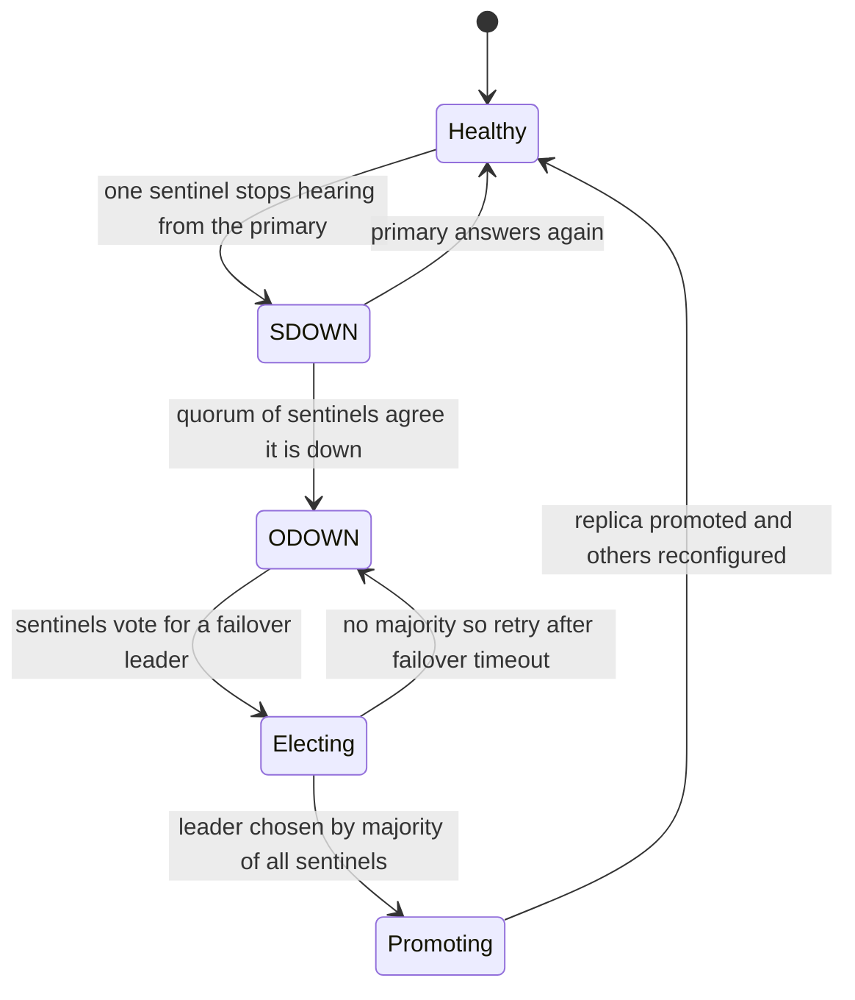
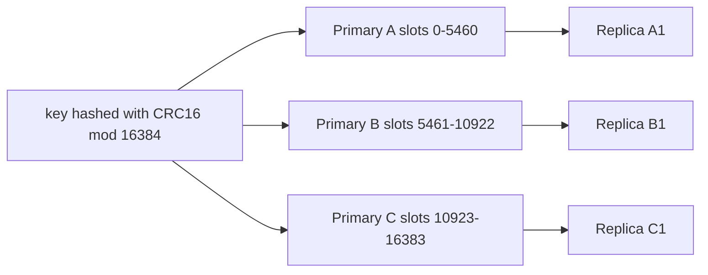

# Redis Cluster and Sentinel

A single Redis is one process on one machine: it dies with the machine and is capped by one box's RAM and one core's command throughput ([[Redis Internals]]). Redis offers two separate answers that people constantly conflate: **Sentinel** gives *high availability* for an unsharded dataset (watch the primary, promote a replica when it dies), while **Cluster** gives *horizontal scaling* by sharding the keyspace across 16384 hash slots (and includes its own failover). Sentinel answers "what if the machine dies"; Cluster answers "what if the data or traffic outgrows one machine" — and both share one hard truth: replication is asynchronous, so failover can lose acknowledged writes.

## The problem that created it

The story every growing system repeats: Redis starts as one instance. First scare — a reboot takes the cache (or worse, sessions and locks) with it, so you add a replica (`REPLICAOF`). But promotion is manual: someone gets paged, runs commands at 3 a.m., and reconfigures clients. Sentinel (2012-era) automated exactly that: monitoring, quorum agreement that the primary is down, promotion, and client redirection. Second scare — the dataset hits the RAM ceiling of affordable machines, or one core's throughput limit. Replicas don't help writes at all and only help reads if you accept stale reads. You need to *split the keyspace*: that is [[Sharding]], and Redis Cluster (GA in Redis 3.0, 2015) is Redis's native implementation, replacing an era of client-side hashing (Ketama-style [[Consistent Hashing]]) and proxies (Twemproxy, Codis) that each solved routing but left resharding and failover ad hoc.

## What it solves

- **Sentinel:** automatic failure detection by a quorum of observers, automatic replica promotion, and a discovery endpoint so clients find the current primary — HA for a dataset that fits one machine.
- **Cluster:** keyspace sharded across many primaries (RAM and write throughput scale horizontally), slot-by-slot live resharding, per-shard replicas with automatic failover, and client-side routing with no proxy hop.

## How it works

### Sentinel — HA for one dataset

Sentinels are small processes (run ≥3, odd number, across failure domains) that continuously ping the primary, replicas, and each other. Failure handling has two stages: one Sentinel marking the primary unresponsive (**SDOWN**, subjective) and a quorum agreeing (**ODOWN**, objective). On ODOWN, Sentinels elect a leader among themselves (a Raft-like vote — see [[Consensus and Raft]]), which picks the best replica (by replication offset, priority), promotes it, reconfigures other replicas, and updates the registry. Clients don't connect to Redis directly at startup: they ask any Sentinel "who is the primary for `mymaster`?" and subscribe to switch notifications. Lettuce/Jedis support this natively.

**What the quorum actually decides.** This is the most misunderstood Sentinel setting, and the answer is narrow: `quorum` is the number of Sentinels that must independently mark the primary SDOWN before it is declared **ODOWN** — that is, it authorises *starting* a failover. It does **not** authorise performing one. Whichever Sentinel wants to run the failover must still win a leader election requiring votes from a **majority of all known Sentinels**, which is a separate and usually larger number.

Work an example with 5 Sentinels. Set `quorum 2`: two Sentinels can declare ODOWN quickly, but the eventual leader still needs 3 votes — so detection is sensitive while promotion stays safe, and a 2-node minority partition can agree the primary is dead yet is mathematically unable to promote anyone. Set `quorum 5` instead and you have made the system *less* available: a single Sentinel being down or slow now blocks every failover, because ODOWN can never be reached. The useful mental model is **quorum tunes detection sensitivity; majority is the hard safety floor you cannot configure away**. Deploy an odd number, at least 3, spread across failure domains so no single zone outage removes the majority.

The other Sentinel knobs worth knowing by name: `down-after-milliseconds` (how long silence counts as failure — your detection latency floor), `failover-timeout` (how long before a stalled failover may be retried), and `parallel-syncs` (how many replicas synchronise with the new primary at once — raise it and more of them do so simultaneously, which in the worst case means several full resyncs, each a fork plus an RDB transfer on a primary that has only just started serving traffic).

Still, Sentinel + async replication means the promoted replica may be missing the old primary's last writes (below), and a partitioned old primary can accept doomed writes until it learns of the new regime (`min-replicas-to-write` narrows this window at an availability cost — see [[Split Brain and Fencing]]).

### Cluster — sharding + HA

**Slots.** The keyspace is divided into **16384 slots**: `slot = CRC16(key) mod 16384`. Each primary owns a subset (3 primaries ≈ ~5461 slots each); each primary has replicas. 16384 was chosen as a balance: fine-grained enough to rebalance smoothly, small enough that the slot bitmap in every heartbeat stays compact (2 KB).

**Routing: MOVED and ASK.** There's no router; **clients route**. A smart client caches the slot→node map. Ask the wrong node and you get `MOVED 3999 10.0.0.7:6379` — a *permanent* redirect: update your map (the slot has a new owner). During a live slot migration, keys are moved one by one; the source answers for keys still present and replies `ASK <slot> <target>` for keys already moved — a *one-request* redirect (preceded by `ASKING` on the target) that does **not** update the map, because ownership hasn't flipped yet. MOVED = "re-learn the topology"; ASK = "just this once, try over there."

**Inside a live slot migration.** Resharding is slot-by-slot and online, which is why the two redirects exist at all. The operator marks the slot `IMPORTING` on the target and `MIGRATING` on the source (`CLUSTER SETSLOT`), then keys are moved individually. While the slot is in that state the source node applies a rule per request: *if the key is still here, serve it; if it is gone, reply `ASK`*. The client then sends `ASKING` followed by the command to the target — `ASKING` grants a one-shot exemption, because the target does not own the slot yet and would otherwise reply `MOVED` straight back. Only when the last key has moved does `CLUSTER SETSLOT … NODE` flip ownership, and from then on the source replies `MOVED` and clients permanently update their maps.

A third reply exists for the awkward case: a multi-key command on a migrating slot whose keys are **split** between source and target gets `TRYAGAIN`, meaning "this is temporarily unserveable — retry shortly." Clients are expected to back off and repeat. The practical lesson for application code is that during resharding your client library will transparently handle MOVED and ASK, but a `TRYAGAIN` surfaces as a transient error on multi-key operations — so resharding windows are exactly when a pipeline of `MGET`s discovers it has no retry policy.

**Node discovery and the cluster bus.** Each node listens on a second port for the **cluster bus** — a binary gossip protocol, by default the client port plus 10000 (6379 → 16379). Nodes exchange heartbeats carrying the slot bitmap and each other's perceived health; this is how failure detection and topology changes propagate without any coordinator. Two operational consequences: your network policy must allow *both* ports between all nodes, and nodes identify each other by address, so an address that changes underneath a running node breaks cluster membership (see the EKS note below).

**Failover inside Cluster.** Nodes gossip health; when a majority of primaries agree a primary is failed (`cluster-node-timeout`), its replicas request votes from the other primaries and the winner promotes itself and claims the slots. A cluster needs ≥3 primaries for this voting to work. If a shard loses primary *and* replicas, its slots are uncovered: by default the whole cluster stops serving (`cluster-require-full-coverage yes`) — many cache deployments flip this to keep serving the surviving keyspace.

**The multi-key limitation.** Commands touching multiple keys (`MGET`, `SUNION`, transactions, Lua with several keys) only work if **all keys map to the same slot**; otherwise you get `CROSSSLOT` errors. The escape hatch is **hash tags**: only the substring inside `{…}` is hashed, so `user:{42}:profile` and `user:{42}:orders` share a slot and can be MGET'd or scripted together. The cost is self-inflicted skew: putting a whole tenant inside `{tenant1}` pins all its data and traffic to one shard — a manufactured [[Hot Partition Problem]]. Also gone in Cluster: multi-database `SELECT` (database 0 only), and `KEYS`/`SCAN` become per-node operations.

The hash-tag rule is worth memorising exactly, because "I added braces and it still CROSSSLOTs" is a common afternoon lost. Redis looks for the **first** `{`; if there is a `}` somewhere to its right **and at least one character between them**, only that substring is hashed. Anything else — no brace, no closing brace, or an empty `{}` — falls back to hashing the entire key. So `{user1000}.orders` and `user:{user1000}:profile` share a slot; `user:{}:profile` does not tag at all; and `{a}{b}` tags on `a` only, since the first brace pair wins. Two keys hashing to the same slot is what Cluster actually checks — not whether they "look related" — so the only reliable test is `CLUSTER KEYSLOT` on both.

One more cluster behaviour that surprises people: **replica migration**. If a primary is left with no replicas while another shard has spares, a spare can reassign itself to the orphaned primary (governed by `cluster-migration-barrier`, which sets how many replicas a shard must keep before it may donate one). The cluster quietly rebalances its own redundancy — good for availability, and a reason your "node X replicates node Y" diagram goes stale without anyone deploying anything.

### Why failover can lose acknowledged writes (both modes)

[[Replication]] in Redis is **asynchronous**: the primary acknowledges the client *before* replicas receive the write. If the primary dies in that gap, the promoted replica never saw the write — the client holds an ack for data that no longer exists. Second loss path: a partitioned-away primary keeps accepting writes until it discovers the new configuration and demotes itself; everything it accepted meanwhile is discarded on rejoin. The Redis Cluster specification says this plainly: Redis Cluster does not guarantee **strong consistency** and "can lose writes that were acknowledged." `WAIT` (block until N replicas have the write) narrows the window but is not a synchronous-commit guarantee, and Cluster failover doesn't consult it.

In [[CAP Theorem]] terms this is an **AP-leaning** design: during partitions and failovers, Redis chooses availability (the majority side keeps serving; a promoted replica serves possibly-behind data) over consistency (it will not block writes waiting for replica acknowledgment, and it has no quorum-write path like [[Quorum Reads and Writes]]). It isn't a clean AP system either — the minority side eventually stops serving — "AP-leaning with bounded windows of lost writes" is the honest label. Design consequence: anything stored in Redis must tolerate rare disappearance of recent writes, which is exactly why [[Distributed Locking]] on Redis has sharp edges and why a Redis-backed message backbone needs idempotent consumers ([[Idempotency]]).

### Operating it: what to look at when it misbehaves

- **`CLUSTER INFO`** — `cluster_state` (`ok` or `fail`), `cluster_slots_assigned` (should be 16384), `cluster_slots_pfail`/`cluster_slots_fail`, `cluster_known_nodes`, `cluster_size` (number of primaries serving slots). A `cluster_state:fail` with slots short of 16384 is the uncovered-slot failure mode, not a client bug.
- **`CLUSTER NODES`** / **`CLUSTER SHARDS`** — the authoritative topology: who is primary, who replicates whom, which slot ranges each owns, and which nodes are flagged `pfail`/`fail`. Compare what the *client* believes (most libraries expose their cached slot map) against this; a mismatch is a stale-topology incident.
- **`redis-cli --cluster check <host:port>`** — walks every node and reports slot coverage, open migration states, and disagreements between nodes about who owns what. The first command to run after a resharding that "finished".
- **`INFO replication`** on each node — `role`, `master_link_status` (`up`/`down` on a replica), and the gap between the primary's `master_repl_offset` and the replica's offset, which is your replication lag measured in bytes. That gap is literally the size of the write window a failover could discard.
- **`CLUSTER FAILOVER`** on a replica performs a *coordinated* handoff: the primary pauses, the replica catches up fully, then they swap. Unlike a crash failover this one does not lose writes, which makes it the right tool for planned maintenance — and a good thing to rehearse before you need it.
- **Sentinel side:** `SENTINEL master <name>` shows the current primary and the Sentinel's view of its health; `SENTINEL get-master-addr-by-name <name>` is exactly what your client calls at startup; `SENTINEL replicas <name>` and `SENTINEL sentinels <name>` reveal whether every Sentinel actually knows about every other one — a Sentinel that cannot see its peers cannot contribute to the majority it needs.

## Trade-offs

| | Sentinel | Cluster |
|---|---|---|
| Scales | reads (via replicas) only | RAM, writes, reads — horizontally |
| Keyspace | full, all commands work | sharded: CROSSSLOT limits, no SELECT, hash tags needed |
| Topology | primary + replicas + 3 sentinel processes | ≥3 primaries + replicas (6+ nodes typical minimum) |
| Client | sentinel-aware discovery | cluster-aware, maintains slot map, handles MOVED/ASK |
| Failover | sentinel quorum + leader election | primary-majority gossip + replica election |
| Lost-write window on failover | yes (async replication) | yes (async replication) |
| Operational surface | modest | resharding, slot coverage, per-node scans |

## Failure modes

- **Lost acknowledged writes on failover** (both modes, as above). Detection is nasty: nothing errors; data is simply gone. Mitigation: `min-replicas-to-write 1` + `min-replicas-max-lag` (refuse writes when replication is too far behind — trades availability), `WAIT` for critical writes, idempotent/re-derivable data design.
- **Split brain during partitions:** old primary accepts writes on the minority side until node-timeout elapses; those writes are discarded on rejoin. See [[Split Brain and Fencing]].
- **Full resync storms:** a replica that falls too far behind the replication backlog triggers a full sync — a fork + RDB transfer on a loaded primary ([[Redis Internals]] COW cost), which can cascade on big instances. Size `repl-backlog-size` generously.
- **Uncovered slots:** losing a whole shard halts the entire cluster under full-coverage default — surprising teams who assumed "we lose a third of the cache." Decide the flag deliberately.
- **Hash-tag hot shards:** `{tenant}`-style tags concentrate a big tenant onto one primary; CPU/memory skew shows up as one node hot, the rest idle ([[Hot Key Problem]]).
- **Cluster-unaware clients/tools:** pipelines, batch MGETs and old libraries break on MOVED mid-stream; `SCAN`-based maintenance scripts silently cover one node.

## When NOT to use it

- **Cluster for small datasets that fit one box:** if ≤ one machine's RAM and ≤ ~100K ops/s, Sentinel (or a managed equivalent) gives HA without CROSSSLOT constraints, client complexity, or 6-node footprints. Cluster is for when you've outgrown vertical options, not a default.
- **Sentinel when you actually need write scaling:** replicas don't take writes; no number of replicas fixes a write-throughput ceiling.
- **Either, as a strongly consistent store:** if a lost acknowledged write is unacceptable (ledger state, source-of-truth records), Redis's replication model is the wrong tool regardless of topology — use a database with synchronous commit or quorum writes.
- **Cluster when your access pattern is inherently multi-key across entities:** heavy cross-entity transactions/Lua will fight CROSSSLOT forever; reconsider data modeling or the tool.

## In your stack

- Managed Redis (ElastiCache et al.) wraps these exact mechanics — "cluster mode disabled" is primary/replica with managed Sentinel-equivalent failover; "cluster mode enabled" is Redis Cluster with slots, MOVED, and CROSSSLOT constraints. The failover lost-write window exists in both; a managed service does not change the replication model.
- Your Lettuce clients handle MOVED/ASK and Sentinel discovery natively, but verify topology-refresh settings — stale slot maps after a managed failover are a classic "Redis is up but our service errors" incident.
- For the [[Redis Streams]] message-backbone plan: a stream lives entirely in **one slot** (one key), so Cluster doesn't scale a single stream's throughput — you'd shard across multiple stream keys yourself, and failover can drop the tail of acknowledged messages (async replication). Idempotent consumers are non-negotiable; that's your [[Exactly-Once Delivery Is a Lie]] homework applied.
- **At 1 replica, a stale topology is a total outage for that service.** With several pods, some refresh their slot map sooner than others and a post-failover incident looks like a partial error rate; with one pod, that pod's stale map *is* 100% of the service's traffic. Make topology refresh explicit rather than default-shaped — periodic refresh plus adaptive refresh triggered on `MOVED` and reconnect events — and treat "errors persisted after the failover completed" as a client-configuration bug, not a Redis one.
- **If you run Redis inside EKS rather than using a managed service**, the cluster's address-based identity collides with Kubernetes' disposable pod IPs: reschedule a node and it comes back at a new address that its peers do not recognise. The shape of the fix is stable identity — a StatefulSet with a headless service for stable DNS names, plus the `cluster-announce-ip` / `cluster-announce-port` / `cluster-announce-bus-port` settings so each node advertises an address its peers can actually reach — and a NetworkPolicy that opens the cluster bus port alongside the client port. Managed Redis exists precisely so you do not have to get this right; weigh the cost shape honestly, since self-managing trades a per-node monthly bill for ongoing operator attention.
- Classify Redis errors deliberately in your metrics and retry logic: `MOVED`, `ASK` and `TRYAGAIN` are *topology* signals that the client should absorb, while connection timeouts during a failover are the window where requests genuinely fail. Carrying `x-correlation-id` through to those logs is what lets you prove, afterwards, that a spike of failures lined up with a failover rather than with your deploy.
- Fintech honesty: any lock, dedup marker, or idempotency key in Redis can vanish in a failover. Every flow using them needs a story for "the marker disappeared" — usually a DB-level uniqueness check as the deterministic backstop (correctness beats latency).

## Interview angle

The 60-second version: *"Two different problems. Sentinel is HA for an unsharded Redis: three-plus sentinel processes monitor the primary, agree by quorum it's down, elect a leader, promote the best replica, and tell clients. Cluster is sharding: CRC16 of the key mod 16384 slots, slots assigned to primaries, clients hold the slot map and follow MOVED — permanent, re-learn topology — or ASK — one-shot during live migration. Multi-key commands need all keys in one slot, hash tags force that at the risk of manufacturing a hot shard. Both failover via replica promotion over async replication, so both can lose acknowledged writes — the Cluster spec says so explicitly — making Redis AP-leaning: store only what tolerates that."*

Classic follow-ups: "MOVED vs ASK?" (permanent ownership change vs. mid-migration one-shot). "Why 16384 slots?" (heartbeat bitmap size vs. rebalancing granularity). "How would you run a cross-shard transaction?" (you don't — hash-tag the keys together, or move the invariant into a real database). "What does WAIT give you?" (bounded replication confidence, not synchronous durability, and failover ignores it).

## Check yourself

> [!question]- Q: Explain to a teammate why Redis failover can lose a write the client was told succeeded — in both Sentinel and Cluster modes.
> Replication is asynchronous in both: the primary replies OK to the client as soon as *it* has applied the write, before any replica has it. If the primary dies in that gap, the promoted replica is behind — the acknowledged write never reaches the new timeline. A second path: a primary cut off by a partition keeps accepting writes until it times out and demotes; on rejoin those writes are thrown away. Topology (Sentinel vs Cluster) changes who detects and promotes, not the replication model that causes the loss.

> [!question]- Q: Scenario — after a managed failover, one service gets errors on every MGET while plain GETs work. Other services are fine. Diagnose.
> MGET across keys in different slots → CROSSSLOT error — this service's keys lack a common hash tag while the healthy services either use single-key ops or tagged keys. Possibly masked before by a lucky topology or a client that silently split MGETs. Fix: hash-tag related keys (`order:{42}:x`), split the MGET into per-slot batches client-side, or drop the multi-key pattern. Also verify the client refreshed its slot map post-failover — persistent MOVED loops look similar but affect all commands.

> [!question]- Q: When would you choose Sentinel over Cluster, concretely?
> When the dataset and throughput fit one machine comfortably — say tens of GB and under ~100K ops/s — and what you need is surviving machine death, not scaling. Sentinel keeps the full command surface (multi-key ops, transactions, Lua across keys, SELECT databases), needs fewer nodes, and demands nothing special from data modeling. Choose Cluster only when RAM or write throughput demonstrably exceed one node, or you need shard-level blast-radius isolation — and accept CROSSSLOT discipline and heavier clients as the price.

> [!question]- Q: Scenario — five Sentinels, `quorum` set to 5. One Sentinel host is down for patching when the primary crashes. No failover happens and the service stays down until a human intervenes. Explain exactly which gate blocked it, and say what you would ship instead.
> Two independent gates exist. The **detection** gate is quorum: that many Sentinels must mark the primary SDOWN before it is declared ODOWN and a failover may begin. The **safety** gate is the leader election, which always needs votes from a majority of all known Sentinels — here 3 of 5 — and is not configurable. With `quorum 5` and only four Sentinels alive, ODOWN is arithmetically unreachable, so the failover never even starts; the safety gate was never consulted and was never the problem. Raising quorum above the majority therefore buys nothing against split brain — the majority vote already guarantees that a minority partition can never promote anyone — while it does cost availability, one Sentinel outage at a time. All the extra agreement adds is a higher bar for *starting* a failover on a flapping primary, and `down-after-milliseconds` tunes that far more directly. Ship `quorum 3` (or even 2 if you want fast detection): ODOWN becomes reachable while promotion still requires 3 votes, so a 2-Sentinel minority partition can declare the primary dead and remain unable to promote anything. Then verify with `SENTINEL sentinels <name>` that all five actually see each other, and spread them across at least three failure domains so no single zone outage removes the majority.

> [!question]- Q: Mini design — multi-tenant SaaS on Redis Cluster; you hash-tag everything by `{tenantId}` for multi-key ops. A tenant 100× bigger than the rest signs up. What breaks and what are your options?
> All of that tenant's keys share one slot, hence one primary: its RAM, CPU, and command throughput become the ceiling — one hot shard while others idle; resharding can't help because a slot is indivisible. Options: (1) drop tenant-wide tags for the big tenant and tag at a finer grain (`{tenantId:entityId}`), giving up cross-entity multi-key ops for them; (2) isolate the whale on its own dedicated Redis (common and honest); (3) split the tenant's data across N sub-tags with app-side fan-out. This is the [[Hot Partition Problem]] — shard-key choice, not infrastructure, is the fix.

## Sources

- Redis Cluster Specification (redis.io) — slots, MOVED/ASK, hash tags, and the explicit statement on acknowledged-write loss and consistency guarantees.
- Redis documentation — "Scale with Redis Cluster" tutorial, "High availability with Redis Sentinel" (SDOWN/ODOWN, quorum vs majority).
- *Designing Data-Intensive Applications*, Kleppmann — Ch. 5 (async replication and failover loss), Ch. 6 (partitioning/rebalancing), Ch. 9 (consistency framing).
- Kyle Kingsbury (aphyr), Jepsen analyses of Redis — empirical demonstrations of lost writes under partition in Sentinel-era setups.
