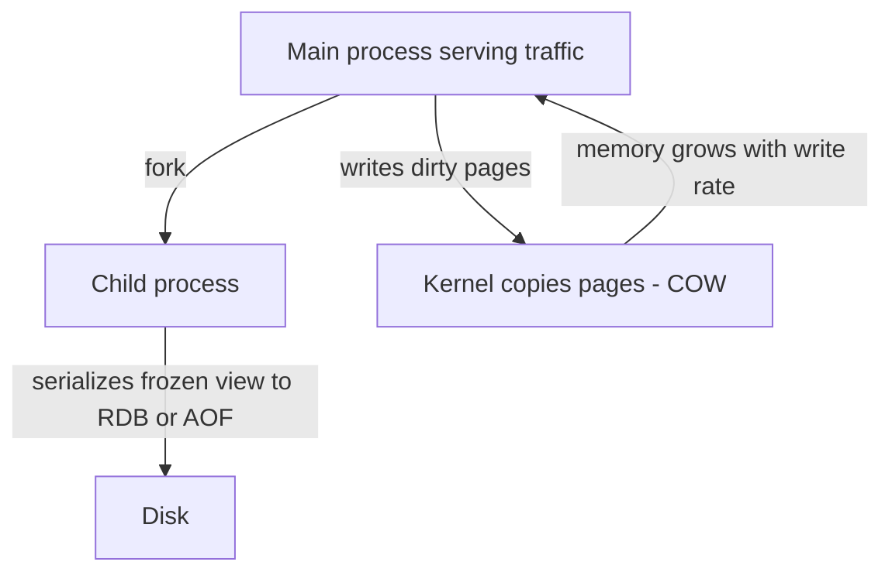

# Redis Internals

You use Redis daily; this note is about what is actually happening inside the process — because every production Redis surprise (a `KEYS` command freezing the fleet, memory doubling during a save, a failover losing writes) traces back to three design decisions: **one thread executes all commands**, **data structures are chosen per-key and switch representations by size**, and **durability is grafted on via fork-based snapshots and an append-only log**, not built in like a database's WAL. Understand those three and Redis stops surprising you.

## Why this matters

Redis's performance model is unusual: it is fast *because* it is single-threaded over in-memory data — no locks, no context switches, every operation a pure memory manipulation. That same choice means **one slow command stalls every client**, and capacity planning is about keeping every operation tiny. Its durability model is equally unusual: persistence exists, but with windows of loss that a database would never accept — and whether that matters depends entirely on what you've stored ([[Caching Strategies|write-behind]] data vs. re-derivable cache). Misjudging either model is how teams turn "Redis is down for 2 seconds" into "we lost acknowledged writes" or "p99 went to 800 ms because someone ran SMEMBERS on a 10M-member set."

## How it works

### The single-threaded event loop

One thread runs an event loop (epoll/kqueue under the hood, via Redis's own `ae` library): accept connections, read request bytes, parse the RESP protocol, **execute the command**, write response bytes, repeat. Commands therefore execute strictly one at a time — which is why `INCR`, `SETNX`, and Lua scripts are atomic *without any locking*: atomicity falls out of the architecture for free. It's also why Redis pipelining works so well (batch many commands per network round trip) and why a single Redis instance saturates at roughly one CPU core for command execution — typically on the order of 100K+ simple ops/s per instance, network and payload permitting (benchmark your own; never quote a number you haven't measured).

The flip side: **latency is a shared fate.** A single O(N) command over a large N — `KEYS *`, `SMEMBERS` on a huge set, `LRANGE 0 -1`, `DEL` of a multi-GB hash — blocks every other client for its duration. Production hygiene: `SCAN` instead of `KEYS`, `UNLINK` instead of `DEL` for big keys (lazy-freeing in a background thread, Redis 4.0+), `SLOWLOG` monitored, and the `latency-monitor` enabled.

**What Redis 6's IO threads actually do:** with `io-threads N`, Redis uses extra threads for the network-I/O halves of the loop, which at high throughput dominate CPU. Read the default before assuming it covers both halves: in Redis 6 and 7, `io-threads-do-reads` defaults to **no**, so out of the box only **writing responses back to sockets** is threaded, and socket reads plus RESP parsing stay on the main thread until you turn that on. **Command execution remains on the single main thread either way.** So IO threads raise throughput on workloads whose cost is dominated by moving bytes, but do nothing for a slow command blocking the instance, and atomicity guarantees are unchanged. "Redis is multithreaded now" is wrong in the way that matters. (Background threads have long existed for fsync, lazy-free, and close — also not command execution.)

### Core data structures and their costs

Every key maps to a value of a specific type; each type has multiple internal encodings, switching from a compact form to a scalable form as it grows (thresholds configurable, e.g. `hash-max-listpack-entries`).

| Type | Typical operations | Complexity | Internal encodings | Canonical uses |
|---|---|---|---|---|
| **String** (binary-safe, up to 512 MB) | GET/SET O(1); INCR O(1) | O(1) | int, embstr, raw | cache values, counters, locks |
| **Hash** | HGET/HSET O(1); HGETALL O(N) | O(1) per field | listpack → hashtable | objects with fields; memory-efficient small maps |
| **List** (doubly-linked of blocks) | LPUSH/RPUSH/LPOP/RPOP O(1); LINDEX/LRANGE O(N) | O(1) at ends | quicklist (listpack nodes) | queues, recent-N lists |
| **Set** | SADD/SISMEMBER O(1); SINTER O(N×M) | O(1) per member | intset / listpack → hashtable | tags, dedup, membership |
| **Sorted set (zset)** | ZADD/ZSCORE O(log N); ZRANGE O(log N + M); ZRANK O(log N) | O(log N) | listpack → skiplist + hashtable | leaderboards, delay queues, sliding windows |
| **Stream** | XADD O(1); XRANGE O(log N + M) | O(1) append | radix tree of listpacks | event log with consumer groups ([[Redis Streams]]) |

Also in the family: **Bitmaps** and **HyperLogLog** (both built on strings — HLL counts distinct elements in ~12 KB with ~0.81% standard error), and **geospatial** commands built on zsets. The zset's **skiplist** is the interesting one: a probabilistic layered linked list giving O(log N) ordered operations — chosen over a balanced tree for implementation simplicity and cheap range traversal.

The sizing intuition that matters operationally: **"big key" problems are type-agnostic** — a 5M-member zset makes `ZRANGEBYSCORE` ranges fine but `ZRANGE 0 -1` catastrophic; a huge hash makes `HGETALL` a stall. Per-key size discipline (and `MEMORY USAGE key` spot checks) beats instance-level tuning.

### What actually blocks the event loop

Since one thread does everything, the only capacity question that matters operationally is *how long does each individual command take*. The dangerous commands are the ones whose cost scales with collection size or keyspace size, and they stay dangerous at any frequency: a once-an-hour `HGETALL` is an hourly outage, not a rounding error.

| Command | Complexity | What it costs | Reach for instead |
|---|---|---|---|
| `KEYS pattern` | O(N) over the whole keyspace | stall proportional to total key count | `SCAN` with a `COUNT` hint, cursor-paged |
| `HGETALL` / `SMEMBERS` / `LRANGE key 0 -1` | O(N) in collection size | stall **plus** serializing a huge RESP reply | `HSCAN`/`SSCAN`, bounded `LRANGE` ranges |
| `ZRANGE key 0 -1` | O(log N + M), here M = N | same | bounded ranges, `ZRANGEBYSCORE … LIMIT` |
| `SINTER` / `SUNION` / `SDIFF` | `SINTER` is O(N×M) worst case — N the smallest set's cardinality, M the number of sets | can reach seconds on large sets | precompute, `SINTERCARD` (Redis 7.0+) when only the count is wanted, or intersect in the app |
| `SORT` | O(N + M log M) | sorts inside the shared thread | sort in the application |
| `DEL bigkey` | O(N) for collections, O(1) for strings | frees N elements synchronously | `UNLINK` — Redis 4.0+ lazy-frees in a background thread |
| `FLUSHALL` / `FLUSHDB` | O(N) | synchronous by default | `FLUSHALL ASYNC` (Redis 4.0+) |
| Lua / `EVAL` | unbounded — whatever the script does | see below | keep scripts O(small) |
| `DEBUG SLEEP` | exactly as long as you asked for | blocks everything; a test tool only | — |

**Lua is the sharpest edge**, because a script has no complexity bound at all. `lua-time-limit` (default 5,000 ms; renamed `busy-reply-threshold` in Redis 7) is **not a timeout** — the script keeps running past it. What changes after it elapses is that Redis begins answering *other* clients with a `BUSY` error and accepts `SCRIPT KILL`. And `SCRIPT KILL` only works while the script has performed no write; once it has written, killing it would break atomicity, so the only escape is `SHUTDOWN NOSAVE` — which exits without persisting, discarding everything since the last save. A long-running *writing* script is therefore an instance-level incident, not a slow query. Keep scripts to a handful of O(1) commands, which is all the lock and limiter recipes ([[Distributed Locking]], [[Rate Limiting]]) actually need.

**How you find all of this in production**, roughly in the order you would reach for it:

- `SLOWLOG GET 128` — the slowest recent commands *with their arguments*, so you see the offending key name. `slowlog-log-slower-than` defaults to 10,000 µs.
- `INFO commandstats` — calls, total µs and µs-per-call per command; this is where a command that looks cheap but averages badly shows itself.
- `LATENCY LATEST` and `LATENCY DOCTOR`, once `latency-monitor-threshold` is set — these attribute spikes to a *cause* (`fork`, `expire-cycle`, `command`), which is the distinction that decides whether you are looking at a slow command or a background operation.
- `redis-cli --bigkeys` — a `SCAN`-based pass reporting the largest key per type; `--hotkeys` does the same for access frequency but requires `maxmemory-policy` to be set to an LFU policy.
- `OBJECT ENCODING key` — confirms whether a hash is still a compact listpack or has flipped to a hashtable.

### Persistence: RDB, AOF, hybrid

Redis is memory-first; persistence is for restart recovery, not transactional durability.

**RDB (snapshotting).** Periodically write the entire dataset as a compact binary file (`SAVE` points like "every 300 s if ≥100 writes", or explicit `BGSAVE`). Compact, fast to load, ideal for backups. **Loss window: everything since the last snapshot** — minutes of writes.

**AOF (append-only file).** Log every write command; replay on restart. The loss window is set by `appendfsync`: `always` (fsync per command — durable, slow), **`everysec` (the common choice — at most ~1 s of loss)**, or `no` (OS decides, ~30 s). The AOF grows forever, so Redis periodically **rewrites** it: rather than compacting the log textually, it snapshots current state in AOF form (a background rewrite) and swaps. Slower restarts than RDB (replay vs. load), larger files, slightly lower write throughput.

**Hybrid (the modern default direction).** `aof-use-rdb-preamble yes` (introduced in Redis 4.0, on by default in modern versions): the rewritten AOF begins with an RDB-format dump of the state at rewrite time, followed by the AOF tail of subsequent commands — RDB's fast load plus AOF's small loss window. Redis 7 reorganized the AOF into a manifest + base + incremental files, same idea.

**Fork-based snapshotting and the memory bill.** Both `BGSAVE` and AOF rewrite work by **fork()**: the child process sees a frozen copy of memory via the kernel's **copy-on-write** pages and serializes at leisure while the parent keeps serving. Two costs: (1) the fork syscall itself pauses the parent while page tables are copied — proportional to RSS, can reach hundreds of ms on very large instances; (2) **every page the parent dirties during the snapshot gets physically copied** — under write-heavy load, worst case approaches **2× memory usage** during the save. This is why a "Redis at 60% memory" can OOM during BGSAVE, why `maxmemory` should leave fork headroom, and why cloud Redis instances want `vm.overcommit_memory=1`. The same fork underlies full-sync to replicas ([[Redis Cluster and Sentinel]]), so a replica resync on a busy, large instance is the perfect storm.

**Honest summary:** even AOF `everysec` can lose ~1 s of acknowledged writes on a crash, and replication is asynchronous, so failover can lose more. Treat Redis as a store whose durability is *tunable but probabilistic* — fine for cache, sessions, counters; a deliberate risk decision for anything you can't re-derive.

### Memory: what you are actually paying for

`INFO memory` reports two different numbers that people routinely conflate. **`used_memory`** is what Redis asked the allocator for; **`used_memory_rss`** is what the operating system has actually resident for the process. Their ratio is **`mem_fragmentation_ratio`**, and it reads in both directions:

- Meaningfully **above 1** — the allocator is holding pages Redis is no longer using. Common after a large mass deletion or eviction; `activedefrag yes` lets Redis compact in the background, at CPU cost on the shared thread.
- **Below 1** — part of the process has been **swapped to disk**. For a single-threaded in-memory server this is the worst state available: one page fault on the command path stalls every client for a disk seek. Swap on a Redis host is not a tuning opportunity, it is an incident.

Per-key cost is not the payload. A key carries its name string, a dictionary entry, the value object header, and — if it has a TTL — a second entry in the expires dictionary. This is precisely why a million tiny top-level keys cost dramatically more than one hash holding a million fields, and why the compact listpack encodings exist at all. Measure with `MEMORY USAGE key`; do not estimate from the value's size.

Two configuration facts that decide behaviour at the ceiling:

- **`maxmemory-policy` defaults to `noeviction`.** An unconfigured Redis used as a cache does not start evicting when full — it starts returning OOM errors on writes while reads continue to succeed. The symptom is "writes to Redis are failing but Redis is up", which reads like a bug anywhere but the config file. Pick a policy deliberately ([[Cache Eviction Policies]]).
- **`maxmemory` must leave fork headroom.** It bounds the dataset, not the process — the copy-on-write spike during `BGSAVE`, AOF rewrite, or a replica full-sync lands *on top* of it.

**Transparent huge pages make the fork problem worse.** With THP enabled on x86-64, copy-on-write copies happen in 2 MB units instead of 4 KB, so the same write rate during a save dirties far more physical memory and each copy costs more latency. Redis's own documentation recommends disabling THP on hosts running Redis; it is one of the few host-level settings that changes Redis's behaviour qualitatively rather than marginally.

### How key expiration actually runs

A TTL'd key is **not** removed at its expiry instant; Redis has no timer per key. Two mechanisms clean up:

- **Lazy expiry:** every access checks the key's expiry first; an expired key is deleted on touch and the command proceeds as a miss. A key nobody reads can sit expired-but-resident indefinitely under lazy expiry alone.
- **Active expiry:** a background cycle (roughly 10 times per second) samples a small batch of keys from the TTL-bearing set, deletes the expired ones, and — if more than a threshold of the sample was expired — immediately samples again, looping until the expired fraction drops. This adapts effort to how much garbage exists without ever scanning everything.

Operational consequences: memory from mass expiries is reclaimed gradually, not instantly (watch `expired_keys` rate vs. memory); a huge synchronized expiry (see [[Cache Stampede and Thundering Herd]] — jitter your TTLs) makes the active cycle work hard on the shared thread; and replicas don't expire keys themselves — the primary expires and propagates explicit `DEL`s, so a replica can briefly serve an expired-but-not-yet-deleted value (reads on replicas do filter logically expired keys in modern Redis, but the memory stays until the DEL arrives).

### Replication internals — the backlog and the two syncs

Redis [[Replication]] is a single-leader, asynchronous stream: the primary applies a write, acknowledges the client, then forwards the command to replicas. Two synchronization paths matter operationally:

- **Partial resync:** the primary keeps a circular **replication backlog** (`repl-backlog-size`, default **1 MB** — small enough that the default is the problem on any write-hot instance). A replica that disconnects briefly reconnects with its last offset (`PSYNC`); if that offset is still inside the backlog, the primary replays just the gap — cheap and invisible.
- **Full resync:** if the gap has scrolled out of the backlog (long disconnect, small backlog, high write rate), the primary must send *everything*: it forks (the same copy-on-write fork as BGSAVE, with the same memory-spike warning), produces an RDB, transfers it, and streams the delta accumulated during transfer. On a large, write-hot instance this is the single most expensive routine operation Redis performs, and several replicas resyncing at once (after a network blip) compounds it.

Sizing `repl-backlog-size` generously relative to write throughput × plausible disconnect duration is the cheap insurance; the metric pair to watch is `sync_full` vs `sync_partial_ok` in `INFO stats` — rising full syncs mean your backlog is too small for your network reality. This machinery is the substrate that [[Redis Cluster and Sentinel]] failover sits on, and the reason an acknowledged write can die with a failing primary: the ack never waited for the stream.

### What this looks like at 3am

At 02:40 the pager fires for four services at once — p99 latency over 1 s on all of them, alerts landing within the same thirty seconds. The services share no code, no database and no deploy. The only thing they have in common is a Redis instance, and that is the clue, not a coincidence.

**The dashboard that settles it.** Redis `instantaneous_ops_per_sec` is *flat or slightly down*, while client-side Redis call latency is up tenfold. That combination is diagnostic, and it is the opposite of what overload looks like: a saturated Redis shows ops/sec climbing to a ceiling; a **blocked** Redis shows throughput stalling while clients queue. CPU on the instance is pegged at roughly one core, not spread across them — again consistent with one thread doing one expensive thing.

**Confirming it takes one command.** `SLOWLOG GET 32` comes back with a run of `HGETALL recon:merchant:…` entries in the hundreds of milliseconds. `MEMORY USAGE` on one of those keys, and `HLEN`, show a hash with hundreds of thousands of fields. A reconciliation job shipped that evening had begun accumulating the day's transactions per merchant into a single hash and reading it back whole. Each `HGETALL` walks every field and serializes the entire reply on the thread that every other service's commands are waiting behind.

**Why it hit four services.** Two multipliers compound. First, the blocked instance delays every client, not only the offender. Second, the Lettuce client in each Spring service multiplexes many application threads over a small number of Redis connections — so one slow command in a pipeline delays all the requests queued behind it in that same connection, turning a Redis stall into an application-wide one.

**What does not fix it:** giving Redis a bigger instance type. Extra cores do nothing for a single-threaded bottleneck, and extra memory lets the offending key grow further. The fix is to bound the key — page it with `HSCAN`, split it by merchant and hour, or keep the aggregate outside Redis entirely. The durable fix is a review rule: no unbounded collection under one key.

## Common misconceptions

- **"Single-threaded means slow."** Command execution being single-threaded is *why* it's fast: zero lock contention, pure memory ops. Network I/O — the actual bottleneck — is parallelized (IO threads) or amortized (pipelining).
- **"IO threads made Redis multithreaded."** Only the socket work — reply writing by default, plus reads and parsing if you explicitly enable `io-threads-do-reads`. Execution, atomicity, and the one-slow-command-stalls-all hazard are unchanged.
- **"AOF means no data loss."** Only `appendfsync always` approaches that, at severe throughput cost; `everysec` loses up to a second, and async replication can lose more on failover.
- **"Expired keys are gone at the expiry instant."** They're removed lazily on access plus by the sampling cycle above; memory reclaim lags, and `DBSIZE`-style counts can include corpses briefly.
- **"Everything in Redis is O(1)."** Per-element operations mostly are; whole-collection operations (HGETALL, SMEMBERS, LRANGE 0 -1, SINTER, KEYS) are O(N) or worse, executed on the thread everyone shares.
- **"An empty-looking instance can't OOM."** Fork + heavy writes during BGSAVE/rewrite can nearly double resident memory; fragmentation (watch `mem_fragmentation_ratio`) adds more.
- **"`lua-time-limit` kills a runaway script."** It only makes Redis start replying `BUSY` to other clients and accept `SCRIPT KILL`. The script runs to completion regardless, and once it has written anything, `SCRIPT KILL` is refused — your remaining option is `SHUTDOWN NOSAVE`.
- **"Redis is full, so it will start evicting."** Only if `maxmemory-policy` says so. The default `noeviction` returns errors on writes instead, which presents as a half-broken application rather than a full cache.
- **"We scaled the Redis instance up, so latency will improve."** Bigger instances add cores and memory; command execution uses one core. Vertical scaling helps memory capacity and network, and does nothing at all for a command that blocks the loop.

## In your stack

- Your Spring services (Lettuce client) multiplex many requests over few connections — one blocked Redis thread stalls *all* of them at once. Ban `KEYS` in code review (use `SCAN`); prefer `UNLINK` for large deletes; watch `SLOWLOG GET` in incident response before blaming the network.
- Atomicity-for-free is why your [[Rate Limiting|rate limiters]], [[Distributed Locking|locks]], and counters work with no transactions: `INCR`/`SET NX`/Lua are serialized by the event loop itself.
- Before the [[Redis Streams]] migration, size the persistence question: SQS persists messages as a service guarantee; Streams persist only as well as your RDB/AOF/replication config. An `everysec` AOF + replica is the sane floor for a message backbone, and fork headroom must be re-budgeted because Streams grow memory linearly with retained entries.
- If any instance both holds big data and takes heavy writes, schedule-sensitive ops (BGSAVE, replica attach) belong in low-traffic windows — the COW memory spike is real money on EKS node sizing.
- **A shared Redis is undeclared shared fate across teams.** One service's unbounded hash sets the p99 of every other service on that instance, and no amount of care in your own code protects you from it. If Kong's rate-limiting counters live on the same instance, a stall takes the limiter with it, and the edge either starts rejecting or starts admitting everything depending on your fail-open/closed choice ([[Rate Limiting]]). Separate instances by blast radius, not by convenience, and make per-key size a code-review item fleet-wide.
- **The 1-replica reality cuts both ways here.** With one pod per service, there is no healthy sibling to absorb traffic while the blocked pod's connection pool drains, so a Redis stall is a full outage window for that service rather than a latency bump — and a failing readiness probe pulls the only pod out of the Service while a failing liveness probe restarts it outright; on a cold JVM either one extends the incident. The honest mitigation is not resilience through replicas you don't have; it is making sure no command can stall the instance in the first place.
- **No replica also means no safe restart.** Without a replica to promote, every Redis upgrade is an in-place restart: either you have persistence enabled and come back warm, or every service behind the cache cold-starts simultaneously ([[Cache Stampede and Thundering Herd]]). Decide that before the maintenance window, not during it.

## Interview angle

The 60-second version: *"Redis runs one event loop thread that parses, executes, and responds — commands are serialized, which gives atomic INCR/SETNX/Lua with zero locks, and means one O(N) command stalls everyone. Redis 6 IO threads offload only socket I/O and parsing; execution stays single-threaded. Data types switch internal encodings by size — small hashes are listpacks, big ones hashtables; zsets are skiplist+hashtable giving O(log N) ordered ops. Persistence: RDB snapshots via fork with copy-on-write — compact, fast restart, minutes of loss, and memory can near-double under write load during a save; AOF logs every write, everysec fsync loses at most a second; modern default is hybrid, RDB preamble plus AOF tail. Durability is tunable, never absolute — replication is async on top."*

Classic follow-ups: "Why is a Lua script atomic?" (the event loop runs it to completion; nothing interleaves). "Why did your Redis OOM at 55% memory?" (BGSAVE fork + write-heavy COW). "Skiplist vs B-tree for zsets?" (simpler, no rebalancing, great sequential range walks; no disk-page optimization needed in RAM).

## Check yourself

> [!question]- Q: Explain to a teammate why INCR needs no lock to be a correct concurrent counter.
> Redis executes commands on a single thread, one at a time, to completion. Two clients' INCRs on the same key are serialized by the event loop — read-modify-write never interleaves, so there is no race to lock against. The same property makes SETNX and entire Lua scripts atomic. The cost of this free atomicity is that everything shares that one thread, so every command must be fast.

> [!question]- Q: Scenario — p99 latency on all Redis operations spikes to 500 ms every night at 02:00 for a minute, across unrelated keys. Memory also balloons then settles. What's your first hypothesis and how do you confirm?
> A scheduled fork-based operation: BGSAVE (an RDB save point), AOF rewrite, or a replica full-sync kicking off at 02:00 — the fork pause plus COW page-copying under concurrent writes degrades everything on the shared thread and inflates memory. Confirm via `INFO persistence` (`rdb_bgsave_in_progress`, `rdb_last_save_time`, `aof_rewrite_in_progress`) plus `INFO stats` for `latest_fork_usec` — the fork pause itself — and the `sync_full` counter, then correlate with any nightly batch writing heavily at the same time. Fix: move/stagger the save schedule, add fork headroom, or shift backups to a replica.

> [!question]- Q: You must choose persistence for (a) a pure cache-aside cache, (b) sessions, (c) the planned Redis Streams event backbone. Pick and justify.
> (a) None, or RDB-only for faster warm restarts — data is re-derivable; avoid cold-start stampedes rather than guarantee durability ([[Cache Stampede and Thundering Herd]]). (b) RDB or hybrid — losing a few minutes of sessions forces some re-logins, annoying not catastrophic; AOF everysec if re-login pain is high. (c) AOF everysec with hybrid format at minimum, plus a replica — messages are acknowledged work owed to consumers; even then be explicit that ~1 s crash loss and async-replication failover loss exist, versus SQS where durability is the managed guarantee ([[Exactly-Once Delivery Is a Lie]] covers the consumer-side implications).

> [!question]- Q: Scenario — every key your service writes carries a TTL, yet Redis memory climbs steadily for a week and never falls back. Nothing is leaking in the application. What is happening, and which three numbers do you look at?
> Three mechanisms compound, and the first is the usual culprit. (1) **Expiry is lazy plus sampled, not scheduled.** Keys nobody reads again are only reclaimed when the active cycle happens to sample them; a large population of write-once, never-read keys drains slowly. (2) **Fragmentation.** After bursts of expiry and overwrite, the allocator holds pages Redis no longer uses, so RSS stays high even as the logical dataset shrinks. (3) **Something is genuinely unbounded** — a collection under one key keeps growing, and because the TTL sits on the whole key, none of its contents are reclaimed until that entire key expires. The numbers: `INFO keyspace` (compare `keys` against `expires` per database — a gap means TTL-less keys you did not intend), the `expired_keys` rate in `INFO stats` against your write rate, and `mem_fragmentation_ratio` in `INFO memory`. Then `redis-cli --bigkeys` to find anything unbounded. Note the ordering: confirm the dataset is actually shrinking logically *before* blaming fragmentation, or you will enable `activedefrag` and burn CPU on the shared thread for nothing.

> [!question]- Q: Mini design — a leaderboard needs top-100 queries and rank lookups for 10M players with heavy score updates. Which structure, what are the costs, and what operation must you forbid?
> A zset: ZADD O(log N) per update, ZREVRANGE 0 99 O(log N + 100) for top-100, ZREVRANK O(log N) for a player's rank. Costs: skiplist+hashtable memory overhead per member (tens of bytes beyond the payload — budget it at 10M members), and all ops on the shared thread. Forbid unbounded scans — ZRANGE 0 -1 or ZRANGEBYSCORE over the whole range — which are O(N) stalls; cap ranges and paginate. At larger scale, shard by league/region before sharding the zset itself, because a zset lives wholly on one node ([[Redis Cluster and Sentinel]], [[Hot Key Problem]]).

## Sources

- Redis documentation — "Redis persistence" (RDB/AOF/hybrid, fsync policies), "Diagnosing latency issues" (fork cost, `latest_fork_usec`, the transparent-huge-pages recommendation), "Memory optimization", "Key eviction" (`maxmemory-policy`), "Redis data types" and the per-command complexity notes in the command reference, redis.io.
- Redis documentation — "Scripting with Lua" (`EVAL` atomicity, `busy-reply-threshold`/`lua-time-limit`, `SCRIPT KILL` restrictions) and the `SCAN` guarantees page.
- Redis 6.0 release notes and `io-threads` config documentation — the exact scope of threaded I/O.
- Antirez's blog — posts on lazy freeing (UNLINK), LFU/LRU, and the single-threaded design rationale.
- William Pugh, "Skip Lists: A Probabilistic Alternative to Balanced Trees" (CACM 1990) — the zset's underlying structure.
- *Designing Data-Intensive Applications*, Kleppmann — Ch. 3 (in-memory stores and durability spectrum).
