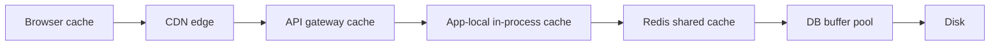

# Why Caching Works

A cache is a small, fast store that holds copies of data whose authoritative home is somewhere slower. Caching works not because of clever engineering but because of two empirical facts about real workloads: the same data gets asked for again and again (**locality**), and a tiny fraction of keys receives most of the traffic (**skew**). Because of those two facts, a cache that holds 1% of your data can often serve 90%+ of your reads — and the math in this note shows exactly when that trade pays off and when it quietly doesn't.

## Why this matters

Caching is the single highest-leverage performance tool in system design: no other change turns a ~1 ms operation into a ~100 µs one by adding one component. It is also the fastest way to serve **stale** data, double your operational surface, and hide a database that can no longer survive on its own. Every later note in this module — [[Caching Strategies]], [[Cache Invalidation]], [[Cache Stampede and Thundering Herd]] — is about managing the costs of the trade you make here. You cannot reason about any of them until you can answer two questions: *why do caches hit at all*, and *how much does a given hit ratio actually buy me*?

Interviewers also use caching as a litmus test. Saying "add a cache" is free; knowing that going from a 90% to a 99% hit ratio reduces database read load by **10×** (10% of traffic reaching the DB versus 1%) is the difference between a buzzword and a design.

## How it works

### Locality: the reason caches hit

Caches exploit two kinds of locality, terms borrowed from CPU design but true at every layer:

- **Temporal locality** — data accessed recently is likely to be accessed again soon. A user who opened their account summary will refresh it; a JWT public key fetched once is needed on every request.
- **Spatial locality** — data near recently accessed data is likely to be accessed. Reading one row of a page usually means the rest of the page is wanted soon; this is why databases cache whole pages (see [[How Databases Store Data]]) rather than single rows.

A workload with no locality — uniformly random reads over a dataset far larger than the cache — cannot be cached effectively. That case is rare in practice, which is the whole point.

### Skew: the 80/20 rule and Zipf's law

Real access distributions are **heavily skewed**. The folk version is the **80/20 rule**: roughly 80% of requests touch roughly 20% of keys. The more precise model is a **Zipfian distribution**: if you rank keys by popularity, the k-th most popular key gets traffic roughly proportional to 1/k. The most popular key gets twice the traffic of the second, three times the third, and a long tail of keys is touched almost never. Web traffic, social feeds, product catalogues, and user profiles all measure out roughly Zipfian.

The consequence: a cache sized for a small fraction of the keyspace captures a large fraction of the traffic, because the head of the distribution is tiny and hot. This is also the seed of the [[Hot Key Problem]] — skew helps your cache and hurts whichever single shard holds the head key.

#### How much of the keyspace do you actually need? Do the arithmetic

The folk claim "1% of the keys serve 90% of the traffic" is worth checking rather than repeating, because the model it comes from does not support it. Under a pure Zipf distribution with exponent 1, the share of traffic going to the top *k* of *N* keys is the ratio of harmonic numbers `H_k / H_N`, and `H_n ≈ ln(n) + 0.5772` (the Euler–Mascheroni constant) is accurate enough for any real *n*. For a keyspace of N = 10 million:

| Keys cached | *k* | `H_k / H_N` | Traffic covered |
|---|---|---|---|
| 0.1% | 10,000 | 9.788 / 16.695 | **59%** |
| 1% | 100,000 | 12.090 / 16.695 | **72%** |
| 10% | 1,000,000 | 14.393 / 16.695 | **86%** |

Two uncomfortable readings fall straight out. First, **the returns diminish logarithmically**: ten times the memory moves you from 72% to 86%, which halves origin load rather than cutting it by ten. Second, reaching a 99% hit ratio under this model would require `H_k = 0.99 × 16.695 = 16.528`, so `ln k = 15.951` and `k ≈ 8.5 million` — roughly **85% of the entire keyspace**. Pure Zipf(1) does not give you a 99% hit ratio from a small cache, at any budget.

Real caches do far better than this, and knowing *why* is the useful part:

- **The exponent is not 1.** Breslau et al. measured web request popularity as Zipf-*like* with an exponent below 1, and the exponent is a property of your workload that you can measure rather than assume. Different exponents move these numbers substantially in both directions.
- **The denominator is wrong.** N should be the number of *distinct keys requested inside the cache's retention window*, not every key in the database. A 10-million-document collection where 200,000 documents are touched per hour has an effective N of 200,000 for an hour-long TTL, and every row of that table shifts.
- **Stationary popularity is not the only source of hits.** Zipf models a fixed popularity ranking; real traffic is bursty, and a key read five times in one minute and never again is four hits that no stationary analysis predicts. This is exactly the temporal locality above, and it is why LRU-family policies beat pure popularity models in practice ([[Cache Eviction Policies]]).

The practical lesson is not pessimism, it is that **hit ratio is measured, never derived**. Sample real reads, rank the keys, plot cumulative traffic against distinct keys, and read your own curve.

### The hit-ratio math

Define the **hit ratio** *h* as the fraction of lookups answered by the cache. Then:

```
effective latency = h × T_cache + (1 − h) × (T_cache + T_origin)
```

A miss pays for **both** the failed cache lookup and the origin read — misses are not free. Worked example with realistic numbers (see [[Latency Numbers Every Engineer Should Know]]): Redis lookup ≈ 0.5 ms over the network, MongoDB read ≈ 5 ms.

| Hit ratio | Effective read latency | Reads hitting the DB (at 10k reads/s) |
|---|---|---|
| 0% (no cache) | 5.0 ms | 10,000/s |
| 50% | 0.5 + 0.5 × 5 = 3.0 ms | 5,000/s |
| 90% | 0.5 + 0.1 × 5 = 1.0 ms | 1,000/s |
| 99% | 0.5 + 0.01 × 5 = 0.55 ms | 100/s |

Two observations worth memorizing:

1. **Load relief scales with (1 − h), not h.** Going 90% → 99% looks like "9% better" but cuts origin traffic by 10×. Conversely, a cache flush that drops h from 99% to 0% multiplies DB load by 100× instantly — the root of [[Cache Stampede and Thundering Herd]].
2. **Tail latency is dominated by misses**, and the relationship is exact rather than vague. Assuming every miss is slower than every hit, misses occupy the top `(1 − h)` of the latency distribution — so they begin at the h-th percentile. At h = 0.99 the slowest 1% of requests are precisely the misses: p99 sits exactly on the boundary, and is therefore the slowest *hit*, while p99.5 lands at the median of the miss distribution (`(99.5 − 99) ÷ 1 = 0.5`). Drop to h = 0.95 and the slowest 5% are all misses, so p99 is now the 80th percentile of the miss path (`(99 − 95) ÷ 5 = 0.8`). This is why a cache can transform the mean while the tail barely moves or even worsens: misses pay for the failed lookup *on top of* the origin read. Quote averages and tails separately (see [[Latency vs Throughput vs Bandwidth]]).

### The cache only speeds up the part you cached

The hit-ratio table measures the *read*, not the request. If the read is a small share of the request's time budget, a perfect cache produces a small improvement, and the arithmetic is worth doing before the work rather than after.

Take a 50 ms endpoint containing one 5 ms MongoDB read, replaced by a 0.5 ms Redis hit:

- `50 − 5 + 0.5 = 45.5 ms`. You saved 4.5 ms — **9%** — for a new dependency, a new failure mode and a staleness contract.
- The same endpoint making **three** such reads: 15 ms of the 50 is cacheable, so `50 − 15 + 1.5 = 36.5 ms`, a saving of 13.5 ms or **27%**.
- An endpoint that is 40 ms of MongoDB inside a 50 ms budget, with all eight reads cached at 0.5 ms each: `50 − 40 + 4 = 14 ms`, a saving of **72%**. This is the case worth building.

Same cache, same hit ratio, three completely different verdicts — decided entirely by what fraction of the request the cached operation represents. Get that fraction from a trace's span breakdown rather than from intuition ([[Distributed Tracing]]); teams routinely cache the 5 ms database read inside a request whose real cost is a 300 ms downstream HTTP call.

### Measuring hit ratio without fooling yourself

Redis reports `keyspace_hits` and `keyspace_misses` in `INFO stats`, and the ratio between them is **instance-wide**. On a shared instance that number is close to meaningless for any individual decision: one high-volume, trivially cacheable family — JWKS keys, feature flags, config — can be 95% of all lookups and pin the instance ratio at 99.9% while the key family you are actually trying to improve sits at 40%. The counters are also Redis-level: they count read commands that found no key, with no idea which of those were your cache-aside misses and which were deliberate existence checks.

Emit the hit ratio **per key family from the application**, where you know which family you asked for and whether a miss was expected. That is also the only granularity at which the (1 − h) origin-load math means anything, since each family loads a different query against a different collection.

### Where caches live: the hierarchy

Caching is not one component but a ladder, each rung closer to the user and smaller than the last:



| Layer | Scope | Typical latency | Invalidation control |
|---|---|---|---|
| Browser (HTTP cache headers) | one user | 0 ms (local) | weakest — you set max-age and hope |
| [[CDN]] edge | one region, all users | ~10–50 ms | purge APIs, versioned URLs |
| Gateway cache (e.g. Kong proxy-cache) | one cluster | ~1 ms | plugin-level TTL/purge |
| App-local (Caffeine/Guava in-JVM) | one process | ~100 ns–1 µs | per-instance only — N replicas hold N copies |
| Redis / Memcached | all services sharing it | ~0.3–1 ms | full programmatic control |
| DB buffer pool | the database itself | saves disk I/O, not query cost | automatic, transparent |

The deeper the layer, the more control you have and the less latency you save. A request answered by the browser never touches your infrastructure at all; a request answered by the buffer pool still paid for parsing, planning, and a network round trip. Good designs push cacheable data as far up the ladder as its freshness requirements allow.

A detail people miss: **the DB buffer pool means your database is already a cache**. A "slow query" that is slow only on a cold buffer pool is a different problem from one that is always slow, and adding Redis in front of a DB whose working set already fits in its buffer pool buys less than the hit-ratio math naively suggests — you are replacing a memory read with a network hop plus a memory read.

## Trade-offs

| You gain | You pay |
|---|---|
| 5–100× lower read latency on hits | **Staleness** — every cached byte is a potential lie about current state ([[Cache Invalidation]]) |
| Origin load reduced by (1 − h) | A second system to operate, monitor, size, and fail over |
| Cheap absorption of read spikes | New failure modes: stampedes, hot keys, cold starts |
| Origin can be smaller/cheaper | **Capacity-masking**: the DB can no longer survive without the cache — losing Redis at h = 99% means 100× DB load, which is an outage, not a degradation |
| | Memory cost — RAM runs at least an order of magnitude dearer per GB than SSD, so the cache tier is priced by working-set size, not by traffic |

The capacity-masking point deserves emphasis because it is invisible until the day it isn't: a system that grew up behind a 99% hit ratio has a database provisioned for 1% of real traffic. The cache is no longer an optimization; it is a load-bearing wall.

## Common misconceptions

- **"A cache makes the system more available."** It makes the system faster, and past a certain hit ratio it makes it *less* available: you have added a dependency whose loss multiplies origin load by `1 / (1 − h)`. At h = 0.99 that is 100×, which is not a degradation but an outage. A cache improves availability only where it is explicitly permitted to serve stale data while the origin is unavailable — a design decision someone has to make on purpose ([[Load Shedding and Graceful Degradation]]).
- **"Hit ratio is the metric."** Hit ratio is an input. The outputs are origin load, which scales with (1 − h), and effective latency — and an instance-wide hit ratio hides the per-family number that determines both.
- **"Going from 90% to 99% is a marginal gain."** It is a 10× reduction in database read traffic and, in the table above, cuts effective latency from 1.0 ms to 0.55 ms. The hit ratio moved 9 points; the thing you provision against moved by an order of magnitude.
- **"In-process beats Redis, because it's a thousand times faster per lookup."** True per lookup, and almost never the deciding factor. N replicas hold N copies with N independent stale windows, N cold starts, and N times the memory — inside a JVM heap that then has to garbage-collect it. The real choice is about coherence and footprint.
- **"This query is slow, so we should cache it."** Caching accelerates *repeat* reads. A slow query that is never repeated becomes slightly slower, because you added a lookup in front of it. The prerequisite is re-access, not slowness.
- **"A high hit ratio proves the cache helped."** It proves keys were present. If the working set already fits in the database's own buffer pool, a cache hit replaces a local memory read with a network round trip plus a memory read — a 99% hit ratio is entirely compatible with an end-to-end regression. The honest test is a before-and-after on request latency, not on cache statistics.

## In your stack

- Your read path already traverses most of the ladder: CloudFront (CDN) → Kong (gateway) → Spring Boot service → Redis → MongoDB (whose WiredTiger storage engine has its own internal cache, default roughly 50% of RAM minus 1 GB). When you measure "is caching helping", identify *which* layer hit.
- Fintech skews the trade: for balances, KYC status, or transaction state, a stale read can be a correctness bug and a regulatory problem, not a UX blemish. Cache aggressively for reference data (IFSC codes, product configs, feature flags); be deliberately conservative for money state. Correctness beats latency.
- JWT validation is a textbook win: the IAM service's public keys (JWKS) change rarely and are read on every authenticated request — ideal for an app-local cache with a short refresh, saving a network hop per request.
- With many services pinned at 1 replica, an app-local (Caffeine) L1 in front of Redis is unusually attractive for you: no cross-replica incoherence to worry about, and it shields Redis from your hottest keys ([[Hot Key Problem]]).
- **But state the 1-replica L1 assumption out loud**, because it expires silently. The coherence you get for free today comes from there being exactly one copy; the first scale-out to 2 replicas gives every pod its own stale window and its own cold start, and the symptom — a value that alternates between old and new on refresh — looks nothing like a cache bug ([[Caching Strategies]]). Make "does this service hold an in-process cache?" a question on every replica-count change.
- **One Redis with no replica is a correlated dependency for the whole fleet.** Losing it does not degrade one service by (1 − h); it simultaneously multiplies every service's MongoDB load by `1 / (1 − h)` while every pod's connection pool fills. Either size Mongo and its pools against a stated goal — "survive h → 0 for ten minutes" — or write down explicitly that losing Redis is a total outage, which is a legitimate cost decision but only if it is a decision ([[Redis Cluster and Sentinel]]).
- **Name the cost shape when this comes up in a design review**, because the two axes are different: Redis memory scales with the *working set* plus per-key overhead and is indifferent to traffic, while MongoDB capacity scales with `(1 − h) × traffic`. That is the sentence that makes a caching proposal reviewable rather than a vibe.
- The JWKS case deserves one more line of care than the others: it is consulted on **every** authenticated request, so a lapse is instantly fleet-wide. The correct shape is a long-lived in-process cache refreshed in the background, with the last-known-good keys retained if the IAM service is unreachable — not a bare TTL that can expire during an IAM incident and convert it into a total authentication failure ([[How JWT Works]], [[JWT Pitfalls]]).

## Interview angle

The 60-second version: *"Caches work because real traffic is skewed — roughly Zipfian — so a small cache holding the hot head of the keyspace serves most reads. Effective latency is h·T_cache + (1−h)·(T_cache + T_origin), and the key insight is that origin load scales with the miss rate, so 90% → 99% hit ratio is a 10× reduction in DB traffic. Caches live in a hierarchy from browser to CDN to app to Redis to the DB's own buffer pool, and you cache as high up as freshness allows."*

Classic follow-ups:

- "Your hit ratio is 99%. What happens if the cache cluster restarts?" → 100× DB load; leads to cold-start stampedes and cache warming ([[Cache Stampede and Thundering Herd]]).
- "Why not cache everything forever?" → staleness and memory; leads to [[Cache Invalidation]] and [[Cache Eviction Policies]].
- "When is adding a cache the wrong move?" → low-locality workloads, write-heavy data, working set already in the DB buffer pool, or data where staleness is unacceptable.

## Check yourself

> [!question]- Q: Explain to a new teammate why a cache holding only 1% of your data can serve 90% of reads.
> Real access patterns are skewed, approximately Zipfian: rank keys by popularity and the k-th key gets ~1/k of the head key's traffic. The hot head — a tiny fraction of distinct keys — receives the large majority of requests, and temporal locality means recently read keys are read again soon. A cache only needs to hold that head to intercept most traffic. A uniformly random workload would break this, but almost no real workload is uniform.

> [!question]- Q: Scenario — your Redis hit ratio drops from 99% to 95% after a deploy. The cache "only" got 4% worse. Why is your DBA paging you?
> Database load scales with the miss rate, not the hit rate. Misses went from 1% to 5% — the database is now taking **5× the read traffic** it was provisioned for. If the DB was sized assuming a 99% hit ratio, 5× load may push it past its ceiling: slow queries, connection-pool exhaustion, then timeouts that look like an application outage.

> [!question]- Q: What two properties must a workload have for caching to be effective, and give one workload that lacks them.
> Temporal locality (re-access of recent data) and/or skew (a hot subset of keys). A counter-example: a nightly batch job that scans every record exactly once — each key is touched once, so every lookup is a miss and the cache adds latency and memory cost for nothing. Sequential one-pass scans are the classic cache-hostile workload.

> [!question]- Q: Scenario — you put Redis in front of a MongoDB query. Hit ratio settles at 97%, Redis p99 is 0.4 ms, and the endpoint's p99 has not moved at all. Give three explanations and say how you would tell them apart.
> (1) **The cached read was a small share of the request.** If the 5 ms Mongo call sits inside a 50 ms budget dominated by a downstream HTTP call, a perfect cache removes 9% of the time and p99 moves by less than the noise. (2) **p99 *is* the miss path.** At h = 0.97 the slowest 3% of requests are exactly the misses, so the 99th percentile lies inside the miss distribution — and a miss now costs the Redis lookup *plus* the full Mongo read, so the tail is marginally worse than before even as the mean improves. (3) **The database was already serving this from memory.** If the working set fits in WiredTiger's cache, you replaced a local memory read with a network hop plus a memory read, and the hit ratio is high while the latency is unchanged or slightly worse. Telling them apart: look at the mean and p99 as separate numbers — explanation 2 shows a clearly improved mean with a flat or worse tail, while explanation 1 shows both flat. Then read a trace's span breakdown for the endpoint ([[Distributed Tracing]]): explanation 1 is visible immediately as a small Mongo span inside a large total. For explanation 3, compare the Mongo call's own latency before caching against the Redis call's latency now — if they were already comparable, the cache was never going to help this path, though it may still be worth keeping for the origin-load reduction rather than the latency.

> [!question]- Q: Mini design — you have 10 TB of product data and budget for 100 GB of Redis. Is that useless at 1% of the data? How would you decide?
> Not useless — the question is what fraction of *traffic* the hottest 100 GB of *data* covers, not what fraction of bytes. Measure the access distribution (sample reads, rank keys, plot cumulative traffic vs. distinct keys). If it is near-Zipfian, 1% of keys may cover 80–95% of reads. Then run the effective-latency and DB-load math at the predicted hit ratio to size the win; also check the DB buffer pool isn't already absorbing the same hot set.

## Sources

- *Designing Data-Intensive Applications*, Martin Kleppmann — Ch. 1 (load parameters, skewed workloads) and Ch. 3 (storage engines and caching layers).
- Redis documentation — "Key eviction" and general caching guidance (redis.io).
- Jeff Dean, "Latency Numbers Every Programmer Should Know" (via [[Latency Numbers Every Engineer Should Know]]).
- Breslau et al., "Web Caching and Zipf-like Distributions: Evidence and Implications" (INFOCOM 1999) — the classic measurement of Zipfian web access patterns.
- "Scaling Memcache at Facebook" (NSDI 2013) — the canonical industrial study of a planet-scale look-aside cache tier.
