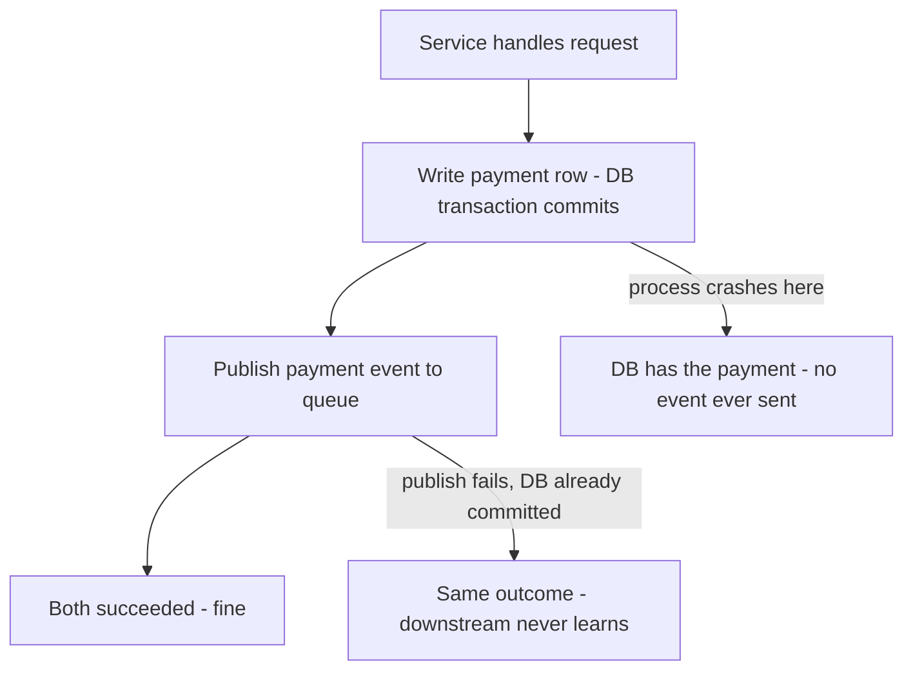

# ACID Transactions

A **transaction** groups several reads and writes into one unit that either fully happens or fully doesn't, that other transactions can't observe half-done, and that survives a crash once confirmed. ACID — atomicity, consistency, isolation, durability — names the four guarantees, but the acronym is marketing from a 1983 paper, and the four letters are wildly unequal: two are hard engineering (A, D), one is a whole field of trade-offs (I), and one is mostly *your* job (C). This note pins down each letter precisely, because fuzzy ACID intuitions produce real money bugs.

## Why this matters

In fintech, the transaction is the unit of correctness: "debit account A and credit account B" must never half-happen. But the guarantees are narrower than the folklore. Developers routinely believe ACID means "my data is always consistent" (it doesn't — C is the weakest letter), or that isolation means "concurrent transactions can't interfere" (only at the strictest level, which you're probably not running — see [[Transaction Isolation Levels]]), or that a transaction can span the payments service and the ledger service (it cannot — that's the distributed-transactions problem, a different and much harder beast). Knowing exactly where the guarantees end is what tells you when you need [[The Outbox Pattern]], [[Saga Pattern]], or [[Idempotency]] instead.

## How it works

### The letters at a glance

| Letter | Guarantees | Does NOT guarantee | Who provides it |
|---|---|---|---|
| **A**tomicity | A failed/aborted transaction leaves no partial writes | That others see your writes "all at once" (that's isolation) | Database (undo/MVCC) |
| **C**onsistency | Declared constraints are enforced at commit | That your business invariants hold — most can't be declared | Mostly **your application** |
| **I**solation | Concurrent transactions don't observe in-flight state, *to the degree of the configured level* | Serializability, unless you explicitly run serializable | Database (locks + MVCC), level chosen by you |
| **D**urability | An acknowledged commit survives a process/OS crash | Survival of disk or machine death without replication | Database (WAL + fsync) + your replication choices |

### A — Atomicity: all-or-nothing, not all-at-once

Atomicity says: if a transaction makes five writes and then fails — an error, a constraint violation, a crash, a deadlock abort — **all five are rolled back**, leaving no trace. Commit is the only door out that keeps changes; everything else leads to a state as if the transaction never started.

Common misreading: atomicity does *not* mean the writes appear to others "all at once" or "instantaneously" — that's isolation's department (and even isolation only approximates it). Kleppmann suggests "abortability" as the honest name: the database can always abandon a half-done transaction cleanly. Mechanically this comes from undo information: PostgreSQL keeps old row versions (MVCC) so aborting just marks new versions dead; InnoDB maintains explicit undo logs.

Why it's precious: **error handling collapses.** Without atomicity, every failure mid-sequence leaves you writing compensation code to detect and repair half-applied writes. With it, you retry the whole unit. (Safe retries then also need [[Idempotency]] at the application boundary — the client might retry a transaction that actually committed but whose ack was lost.)

### C — Consistency: the application-level one

Consistency here means: **if your invariants hold before a transaction, they still hold after it.** Invariants like "debits equal credits across the ledger", "stock is never negative", "every order references an existing customer."

The uncomfortable truth: the database cannot know most of your invariants. It gives you tools — primary keys, foreign keys, `UNIQUE`, `NOT NULL`, `CHECK` constraints — and those it will enforce ruthlessly. But "debits equal credits" lives in your application code; if your transaction writes a debit and forgets the credit, the database commits it happily. **C is a property of your transactions, achieved *using* A, I and D — not a guarantee the database hands you.** It was arguably tossed into the acronym to make it pronounceable (the term comes from Härder & Reuter's 1983 paper "Principles of Transaction-Oriented Database Recovery").

Also not to be confused with: consistency in [[CAP Theorem]] (linearizability — a distributed-reads property) or eventual consistency in [[Consistency Models]]. Three unrelated meanings, one overloaded word.

Practical rule: push every invariant you *can* express into declared constraints (they're your last line of defence against buggy code paths), and treat the rest as code that deserves tests.

### I — Isolation: concurrent transactions don't trip over each other

Isolation addresses concurrency: many transactions touching the same rows at once. The textbook ideal is **serializability** — the outcome is as if transactions ran one at a time in some order. Real databases ship weaker levels by default (PostgreSQL: read committed; MySQL InnoDB: repeatable read) because full serializability costs throughput, and each weaker level readmits specific anomalies — dirty reads, non-repeatable reads, phantoms, lost updates, write skew.

This letter is big enough to own a note: [[Transaction Isolation Levels]]. The headline for here: **isolation is a dial, not a boolean, and the default setting of that dial has let real systems double-spend.**

### D — Durability: committed means fsynced

Durability says: once the database confirms a commit, the data survives a crash or power loss. Mechanically, this is the write-ahead log: the commit record is appended to the WAL and **fsynced to stable storage before the client gets its acknowledgement** — see [[How Databases Store Data]] for why this is affordable.

The fine print that matters:

- **Durability is only as honest as the fsync.** Disks and controllers with volatile write caches can lie about persistence; cloud block storage and battery-backed controllers are the usual answers.
- **It's configurable, and people configure it off.** The knobs, explicitly:

| Setting | Effect | Loss window on crash |
|---|---|---|
| Postgres `synchronous_commit = on` (default) | commit waits for WAL fsync | none |
| Postgres `synchronous_commit = off` | commit returns before fsync | up to ~3x `wal_writer_delay` of commits |
| InnoDB `innodb_flush_log_at_trx_commit = 1` (default) | fsync per commit | none |
| InnoDB `= 2` | write to OS at commit, fsync ~per second | ~1 s on OS crash |
| InnoDB `= 0` | write + fsync ~per second | ~1 s on process crash |

  Fine for a clickstream table; not for a ledger. The point is that "ACID database" tells you nothing until you know how these are set.
- **Single-node durability doesn't survive machine death.** The WAL protects against crashes; a dead disk or a dead availability zone needs [[Replication]] — and specifically *synchronous* replication if the guarantee must be "committed means on two machines". Async replication reintroduces a loss window at [[Failover]].

### What ACID does NOT promise across services

Every guarantee above is scoped to **one transaction on one database**. The moment a business operation spans two systems, all four letters silently evaporate.

The canonical dual-write, drawn out:

There is no transaction that covers both arrows, and no ordering of the two steps fixes it — swap them and you get the mirror-image failure (event sent for a payment that never committed). The specific cases:

- Writing your database **and** calling another service's API: no atomicity — the dual-write problem. The DB commit can succeed while the call fails, or vice versa.
- Writing your database **and** publishing to Kafka/SQS: same problem. The fix is [[The Outbox Pattern]] or [[Change Data Capture]], which re-derive the event from the single committed write.
- Transactions in two services' databases: no isolation or atomicity across them. [[Two-Phase Commit and Distributed Transactions]] exists but blocks on coordinator failure and is widely avoided; the practical patterns are [[Saga Pattern]] (sequence of local transactions + compensations) and [[Idempotency]] everywhere.
- Even two transactions on the *same* database, issued by your service in sequence, are not one atomic unit — anything between them can observe the gap, and a crash between them leaves the first committed alone.

The design instinct to build: **find the one database write that is the system of record, make it transactional and idempotent, and derive everything else from it asynchronously.**

## Common misconceptions

- **"ACID means my data is always consistent."** C is your application's invariants; the database only enforces the constraints you declared.
- **"Transactions mean concurrent requests can't interfere."** Only at serializable isolation. At read committed — Postgres's default — two concurrent "check balance then deduct" transactions can both pass the check. See [[Transaction Isolation Levels]].
- **"Atomicity means other transactions see all my writes at once."** Atomicity is about failure (all-or-nothing); visibility is isolation.
- **"Committed data can't be lost."** It survives a *crash*. Whether it survives a dead machine depends on replication mode; async replication + failover can lose acknowledged commits.
- **"We use ACID databases, so our microservices are consistent."** Each service's transactions are locally ACID; the system as a whole is eventually consistent at best, and only if you engineered it to be ([[The Outbox Pattern]], [[Saga Pattern]]).
- **"BASE databases have no transactions."** Blurry in practice: MongoDB has had multi-document ACID transactions since 4.0 (2018), extended to sharded clusters in 4.2 (2019), with real costs — see [[MongoDB Architecture]] — and single-document updates were always atomic.

## In your stack

- MongoDB as primary store: single-document updates are atomic, which is why idiomatic Mongo modelling puts each consistency boundary inside one document. Multi-document transactions exist but are expensive on sharded clusters — reach for them knowingly, not habitually.
- Your RabbitMQ → Kafka → SQS → Redis Streams journey keeps one invariant: **"save to DB and publish event" is never atomic on any broker.** Every service that does both needs the outbox pattern or must tolerate the inconsistency explicitly.
- RBI-auditable flows (money movement, KYC state): durability settings are compliance surface. Know each datastore's answer to "what exactly has been fsynced — and replicated — when we ack the client?" For Mongo that's write concern (`w: "majority"`, `j: true`).
- Spring's `@Transactional` marks the ACID boundary — and a remote HTTP/queue call *inside* that boundary is both a dual-write bug and a connection-hogging bug ([[Connection Pooling]], [[N+1 Queries and ORM Pitfalls]]).
- Services pinned at 1 replica: the honest durability story is "WAL/journal fsync survives a process crash; node death relies on the datastore's own replication, not the service's" — worth writing down per datastore.

## Interview angle

The 60-second version: *"Atomicity: a failed transaction rolls back completely — all-or-nothing, implemented via undo/MVCC. Consistency: application invariants are preserved; the DB enforces declared constraints but C is mostly the app's responsibility. Isolation: concurrent transactions don't observe each other's intermediate states — in practice a spectrum of levels with specific anomalies, and defaults are weaker than people think. Durability: commit means the WAL record is fsynced, so a crash can't lose it — though machine death needs replication. And all of it is single-database: across services you need outbox, sagas, idempotency."*

Classic probes:

- "Which letter is the weakest guarantee and why?" — C; the database can only enforce declared constraints, the rest is your transactions' discipline.
- "What does atomicity NOT mean?" — simultaneous visibility; that's isolation's job.
- "A transaction committed, the node died, the data is gone — how is that possible?" — async replication + failover; durability was local-crash durability.
- "Can a transaction span two databases?" — natively no; 2PC exists with heavy caveats; practical systems use outbox/saga/idempotency.
- The payments follow-up — "how do you debit here and credit in another service?" — is a bridge to [[Saga Pattern]] and [[Stripe and Payment System Design]].

## Check yourself

> [!question]- Q: Explain each ACID letter in one sentence each, with the standard misreading of each.
> Atomicity: a transaction either fully commits or fully rolls back on any failure — not "writes appear simultaneously to others". Consistency: your invariants survive each transaction — not a database-provided guarantee beyond declared constraints. Isolation: concurrent transactions don't see each other's in-flight state — not absolute, it's a configurable level with named anomalies. Durability: an acknowledged commit survives a crash via fsynced WAL — not proof against disk death or async-replication failover.

> [!question]- Q: Your service writes a payment row and then publishes a "payment completed" event to SQS, inside one `@Transactional` method. What can go wrong?
> The DB commit and the SQS publish are two systems — no shared atomicity. If publish happens inside the transaction and the transaction later rolls back, a false event was already sent. If publish happens after commit and the process dies in between, the payment exists but the event never fires — downstream never learns. Fix: write the event into an outbox table in the same DB transaction, and let a relay/CDC publish it — [[The Outbox Pattern]]. Consumers still need [[Idempotency]] because the relay is at-least-once.

> [!question]- Q: A database confirmed a commit; thirty seconds later the primary's disk died and the replica took over without that row. Which ACID letter failed, and did the database lie?
> None failed and nobody lied — durability was delivered as configured: the WAL was fsynced locally (crash-safe), but replication was asynchronous, so the commit hadn't reached the replica when [[Failover]] promoted it. Single-node durability and machine-death durability are different guarantees; the second requires synchronous replication, paid for in commit latency.

> [!question]- Q: Which invariants should live in database constraints vs application code, and why do both layers matter for a ledger?
> Constraints take everything they can express: `NOT NULL`, uniqueness (e.g. one row per idempotency key), foreign keys, `CHECK (balance >= 0)` style range rules. They matter because they hold against *every* code path — including the buggy one someone ships next quarter and the manual fix-up script run during an incident. Application code owns the invariants SQL can't state ("debits equal credits across these two rows", "KYC must be verified before first transaction"), which therefore need tests and, in money systems, reconciliation jobs that re-verify them after the fact. The layering is deliberate defence in depth: app code is the enforcement you intend; constraints are the enforcement that survives your mistakes.

> [!question]- Q: Why can't you rely on a `SELECT` balance check followed by an `UPDATE` deduction inside a transaction to prevent overdrafts at default isolation?
> At read committed (and for plain reads at InnoDB repeatable read), two concurrent transactions can both read balance 100 and both decide a 70 deduction is fine, because a snapshot is a view and not a reservation. What breaks depends on the `UPDATE` you write: an app-computed `SET balance = 30` loses one deduction outright — the account paid out 140 and shows 30 — while `SET balance = balance - 70` applies both decrements and lands at −40, nothing lost but the overdraft check decided on stale data. Fixes: `SELECT ... FOR UPDATE` to lock the row, a single atomic conditional `UPDATE ... WHERE balance >= 70` checking affected rows, a `CHECK (balance >= 0)` constraint as backstop, or serializable isolation — see [[Transaction Isolation Levels]].

## Sources

- *Designing Data-Intensive Applications*, Kleppmann — Chapter 7 (Transactions): the sharpest published treatment of what each letter means and doesn't.
- Härder, T. & Reuter, A. (1983), "Principles of Transaction-Oriented Database Recovery" — the paper that coined ACID.
- PostgreSQL documentation: "Transactions" tutorial chapter, "Reliability and the Write-Ahead Log", `synchronous_commit` notes.
- MySQL 8.0 Reference Manual: "InnoDB and the ACID Model", `innodb_flush_log_at_trx_commit`.
