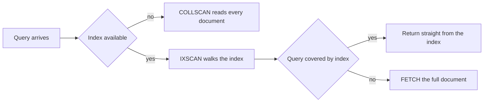

# Database Indexes

An index is a sorted, separately maintained structure over some of a table's columns, built so the database can find matching rows by touching a handful of pages instead of all of them. Treat it as a black box — "add an index, queries get faster" — and you will eventually add one that does nothing, or one that quietly taxes every write for a query nobody runs anymore. This note starts from the physical problem (pages on disk), builds the B+-tree up from first principles — including the question most tutorials skip, why not just use a binary search tree — covers how MySQL and Postgres store rows differently underneath their indexes, and gives MongoDB, your actual production datastore, equal space: compound indexes, the ESR rule, covered queries, and the RAM wall.

## The problem that created it

A table — and a MongoDB collection — is not an in-memory array. It's a set of fixed-size pages sitting on disk ([[How Databases Store Data]] covers the full page/heap/WAL picture). `SELECT * FROM transactions WHERE user_id = 42` with no index gives the engine exactly one algorithm: read every page, inspect every row, keep what matches. That's a full scan — `Seq Scan` in Postgres, `COLLSCAN` in MongoDB.

A worked hypothetical — the inputs are illustrative, the shape is universal. A 10 GB table at 8 KB pages is 10 GB / 8 KB ≈ **1.3 million pages**. A full scan issues roughly that many page reads. Sequential throughput runs from ~2 GB/s on a max-provisioned cloud volume (EBS gp3) to ~14 GB/s on a local PCIe 5.0 NVMe drive (2026 figures, see [[Latency Numbers Every Engineer Should Know]]), so reading 10 GB sequentially costs roughly 0.7–5 seconds of pure I/O — before any CPU cost of evaluating the predicate row by row. That is already too slow for a query an interactive user is waiting on.

The deeper problem is that a 10 GB table rarely fits entirely in the buffer pool alongside every other table's hot pages: a full scan pulls in pages the cache doesn't have and evicts whatever else was resident, degrading every other query sharing that cache, not just this one.

Put a number on the "evicts whatever else was resident" claim: if the buffer pool holds, say, 2 GB and the table is 10 GB, at most a fifth of that scan's pages were already cached — roughly 80% of the 1.3 million page reads are genuine disk I/O, and every one of them pushes out a page some *other* query had cached. A full scan doesn't just cost the query running it; it taxes every concurrent query sharing that cache, which is why "one slow report" can make unrelated endpoints slow at the same moment.

This is why the index exists: **disk pages and I/O, not slow comparisons.** A CPU compares an integer to 42 in nanoseconds; an NVMe random read costs tens of microseconds (~20–100 µs, more under queue pressure — see [[Latency Numbers Every Engineer Should Know]]) — four to five orders of magnitude slower. The entire discipline of indexing is about minimizing pages touched, because pages, not comparisons, are the expensive resource.

## What it solves

- **Point lookups** (`WHERE id = ?`) and **range scans** (`WHERE created_at > ?`) in a handful of page reads instead of a full scan.
- **Sorted retrieval** (`ORDER BY`) and efficient `JOIN`s without sorting at query time — the index *is* the sort.
- **Uniqueness enforcement** — a unique constraint is implemented as an index.
- **Covering reads**: serving a query entirely from the index without visiting the table at all.
- **Cheap existence checks** (`WHERE EXISTS (...)`, foreign-key validation) — confirming a row exists is a lookup, not a scan.

## How it works

### Why not a binary search tree?

Given the above, the obvious structure is a balanced binary search tree (BST): O(log₂ n) lookups, taught before databases are. Databases don't use one, and the reason is depth measured in page reads, not depth measured in comparisons.

A balanced BST over 100 million rows has depth ⌈log₂(100,000,000)⌉ ≈ **27 levels**. In memory that's irrelevant — following 27 pointers is nanoseconds. On disk it's a different story: a classic BST node holds one key and two child pointers, far smaller than a page, with no guarantee a node's children live anywhere near it physically.

In the worst case — and the typical case, for a tree built up incrementally — **each level is a separate page read**, so one lookup costs up to 27 page reads. Multiplying anything by 27 disk reads is a bad trade.

So the actual design goal was never "logarithmic time" in the abstract — it's minimizing depth, because depth is paid in pages. Depth and fanout trade off directly: fanout is how many keys fit in one node. A BST's fanout is 2. Let a node hold hundreds of keys — as many as fit in one page — and the tree gets dramatically shallower for the same row count.

Illustrative arithmetic: suppose an 8 KB page holds on the order of 400 key-plus-pointer entries for a typical internal-node key width (the exact count depends on key size — this is illustrative, not a fixed constant). A tree with fanout 400 needs depth log₄₀₀(100,000,000) ≈ 18.42 / 5.99 ≈ 3.1 → **4 levels**, covering the row count a BST needed 27 levels for.

And because the top one or two levels of that 4-level tree — the root and its immediate children — are reused by every query against the table, they stay resident in the buffer pool almost permanently. In practice a lookup is often **1-2 actual disk reads**, the rest served from RAM.

Minimize depth by maximizing fanout, because depth is paid in page reads: that is the entire reason databases use wide, shallow trees instead of the balanced binary trees from algorithms class. The B+-tree below is that wide tree with the remaining details nailed down.

### Why depth barely moves as the table grows

The fanout result has a consequence worth stating on its own, because it is the single most
counter-intuitive fact about indexes and it answers the interview question *"what breaks when your
data grows 10x?"*

Each level multiplies capacity by the fanout, so capacity climbs by powers of 400:

| Levels | Rows addressable at fanout 400 |
|---|---|
| 1 | 400 |
| 2 | 160,000 |
| 3 | 64,000,000 |
| 4 | **25,600,000,000** |

Read that as a growth curve. Ten million rows fit in 3 levels. Grow the table 10x to a hundred
million and 3 levels no longer suffice, since 64 million is the ceiling — so you pay **one extra
level**. One additional page read, for ten times the data. And the fourth level then carries you to
roughly 25 billion rows: you could grow another 250x without needing a fifth.

So **indexed lookup cost is close to flat as data grows.** It is logarithmic with a base in the
hundreds, which over any realistic range of table sizes behaves like a constant. A query that takes
3 page reads at ten million rows takes 4 at a hundred million — about 33% slower, not 10x slower.

The useful corollary is knowing what *does* break when a table grows ten-fold, because indexed point
lookups are the wrong answer:

- **Writes.** Every insert writes an entry into every index, and updates maintain them too — with
  engine-specific nuances for updates and deletes. This cost scales with write volume and index
  count, and it does not flatten out. See *Every index taxes writes* below.
- **The working set versus RAM.** Lookups stay cheap only while the upper tree levels and the hot
  leaves stay resident in the buffer pool. When the working set stops fitting, the same 3-4 page
  reads start hitting disk instead of memory and latency jumps by orders of magnitude. This is a
  cliff, not a slope, and it is the wall [[Discord Message Storage Evolution|Discord hit with MongoDB]].
- **Anything that is not a point lookup.** Full scans, large range scans and aggregations scale with
  table size no matter how well you have indexed, which is where [[Query Planning and EXPLAIN]] and
  eventually [[Database Scaling Patterns]] take over.

### B+-tree mechanics, precisely

Internal pages hold only separator keys and child pointers — enough to decide which child to descend into, nothing else. **All the actual entries live in leaf pages**, and those leaf pages are **linked left-to-right in sorted order**, forming a chain.

That linked chain is what makes range scans and `ORDER BY` cheap, not just equality lookups: finding the first row satisfying `created_at > X` costs one descent to the right starting leaf (the 3-4 page reads above), and every subsequent matching row is the *next* entry in the leaf chain — a sequential walk needing no further tree descents. The sort order isn't computed at query time; it's the physical layout of the leaf chain. This is why `BETWEEN`, `ORDER BY ... LIMIT`, and "latest N" queries are cheap on an index and expensive without one.

Inserts descend to the correct leaf and add the entry; a full leaf **splits** in two, occasionally propagating a split upward. The tree self-balances by construction — and this is also where fragmentation from a badly chosen key comes from, covered next. (The write-optimized alternative to all of this is the LSM-tree — see [[B-Tree vs LSM-Tree]].)

Put next to the arithmetic that opened this note: the same lookup that cost ~1.3 million page reads as a full scan costs **3-4 page reads** through the index — a reduction of roughly five orders of magnitude for a predicate that matches only a few rows. That single number is the entire value proposition; everything else in this note is about not losing it by accident.

### Clustered vs heap: what a leaf entry actually points at

This differs by engine, and it drives real decisions — primary-key choice, update cost, what "covering" buys you.

**InnoDB (MySQL) clusters the table by primary key.** The table itself *is* a B+-tree, physically ordered by the PK, with leaf pages holding full rows — not pointers to rows elsewhere. (A table with no explicit PK clusters on its first `UNIQUE NOT NULL` index instead; only lacking both does InnoDB fall back to a hidden, internally generated row ID.) The consequence: a PK lookup is one descent and you already have the row. (InnoDB's default page is 16 KB against Postgres's 8 KB; the arithmetic above used 8 KB, and a larger page only raises fanout and lowers depth further.)

A **secondary** index — on `email`, say — is a separate B+-tree whose leaves store the indexed column plus the **primary key value**, not a physical pointer. So a secondary-index lookup is **two traversals**: descend the secondary index to get the PK, then descend the clustered index to fetch the row. Invisible in the SQL, visible in `EXPLAIN`, and exactly why a covering secondary index is worth more here than the SQL alone suggests.

Clustering also makes PK choice an insert-*locality* decision. A monotonic PK (`AUTO_INCREMENT`) sorts after every existing key, so inserts always land on the already-warm rightmost leaf, filling predictably before one split at the end.

A **random PK** (UUIDv4) sorts nowhere in particular — each insert's target leaf is a near-uniform random pick across the whole tree, which is very likely cold in the buffer pool on a large table (forcing a read just to find where to insert) and scatters splits throughout the tree instead of once at the end, leaving many leaf pages half-full. This is a well-documented InnoDB anti-pattern: random UUID primary keys on large, insert-heavy tables measurably cost insert throughput and storage — which is why time-ordered identifiers (ULID, UUIDv7 per RFC 9562, 2024; Postgres 18 ships a native `uuidv7()`) exist: global uniqueness with a monotonic prefix, restoring append-mostly locality.

**PostgreSQL is a heap, not clustered.** Rows live in an unordered heap file at whatever page the free-space map hands out; every row's physical location is a **TID** (page number + slot). Every Postgres index — including the one backing a `PRIMARY KEY` constraint — stores a TID in its leaves, not the row itself; there's no "the index is the table" structure. (`CLUSTER` can physically re-sort the heap to match an index once, but nothing maintains that order afterward.) One consequence: a random PK doesn't fragment the table heap the way it does in InnoDB (the heap was never PK-ordered to begin with) — but it still fragments the PK's *own* index pages for the identical locality reason, so sequential/time-ordered keys still help, just the index rather than the whole table.

Postgres also gets **HOT (Heap-Only Tuple) updates**: if an update touches no indexed column and the new row version fits on the same heap page, Postgres links old → new version in place and skips every index entirely — one more reason indexing only the columns actually filtered or sorted on pays off twice in Postgres.

**Index-only scans** need one more piece: the **visibility map**, a bitmap of which heap pages hold only row versions visible to every transaction. Only for pages marked all-visible can the engine trust the index without checking heap visibility — a table under heavy churn with vacuum lagging will quietly lose index-only scans back to full table fetches until vacuum catches up.

### Composite indexes and the leftmost-prefix rule

An index on `(a, b, c)` is one sort: by `a`, then `b` within equal `a`, then `c` within equal `a, b`. It is *not* three indexes. The consequence is the **leftmost-prefix rule** — a predicate on `b` alone cannot seek, because rows with equal `b` are scattered throughout the sort order. (A phone book sorted by last name, then first name: finding every "Priya" with no last name means reading the whole book.)

What each predicate shape can actually do against `(a, b, c)`:

| Predicate | Seeks on | What happens |
|---|---|---|
| `a = 1` | `a` | Direct seek to the `a=1` range |
| `a = 1 AND b = 2` | `a, b` | Seeks further into the `(a=1, b=2)` sub-range |
| `a = 1 AND b = 2 AND c = 3` | `a, b, c` | Seeks to at most one entry |
| `a = 1 AND c = 3` | `a` only | Seeks to `a=1`, then scans that range filtering on `c` — `b` was skipped, so `c` can't be seeked |
| `b = 2` alone | nothing | `b=2` rows are scattered across every `a`-group — no narrowing at all |
| `a = 1 AND b > 2 AND c = 3` | `a, b` | The range on `b` "uses up" the index; `c=3` is a filter applied across the scan, not a further seek |
| `a > 1` | `a` | Seeks to the start of the range and scans forward; `b`, `c` carry no useful order once `a` varies |

The rule to internalize: everything after the first *range* predicate degrades from seek to filter — which is exactly why **equality columns first, range column last** is a design rule, not a style preference. One more pair of consequences: an index on `(a, b)` makes a separate index on `(a)` redundant (the prefix already does its job) but not one on `(b)`; and `ORDER BY` is satisfied for free when it matches the index order after the equality prefix — `WHERE user_id = ? ORDER BY created_at DESC LIMIT 20` is a dream query for `(user_id, created_at)`. One modern caveat: MySQL (8.0.13+) and Postgres (18+, 2025) can *skip scan* — probe each distinct leading value in turn — so `b = 2` alone can still use the index when `a` has few distinct values; it's a cost-based fallback, not a licence to ignore column order.

### Covering indexes

If the index contains *every* column a query needs, the database answers from the index alone — an **index-only scan** in Postgres, `Using index` in MySQL's `EXPLAIN` — skipping the table fetch (the dominant cost in InnoDB's two-traversal secondary lookup, or Postgres's TID hop) entirely.

- PostgreSQL: put the columns in the key, or use `INCLUDE (col)` (v11+, 2018) for non-searchable payload columns; still gated by the visibility map above.
- InnoDB: every secondary index implicitly carries the primary key, so `SELECT id FROM t WHERE email = ?` is covered by an index on `(email)` for free.

The habit: for the handful of truly hot queries, look at the `SELECT` list, not just the `WHERE` clause.

### Selectivity

**Selectivity** is how sharply a predicate narrows the table — a *highly selective* predicate matches a tiny fraction of rows. Indexes shine when that fraction is tiny and hurt when it isn't: fetching 40% of a table through an index means millions of random page hops, slower than one sequential scan. Indexing a `status` column with three values rarely helps alone; `(status, created_at)` might, if queries always combine them and the interesting status is rare. The optimizer estimates selectivity from **statistics**, gathered differently per engine — Postgres's `ANALYZE` samples rows into most-common-value lists, histograms and distinct-value estimates, while InnoDB estimates index cardinality by sampling index pages (persistent stats, refreshed by `ANALYZE TABLE`) and supports optional column histograms from 8.0. Stale statistics are a common reason "the index exists but isn't used."

Put a number on "slower than one sequential scan": the cost model here is per *row*, not per page. At an illustrative ~100 rows per 8 KB page, the same 1.3-million-page table holds roughly 130 million rows — so a predicate matching 40% of rows means ~52 million index-driven lookups, each a random hop into the table, against the ~1.3 million *sequential* page reads a full scan would do instead. Fifty-two million random hops losing badly to 1.3 million sequential reads is the crossover the optimizer is pricing, even before accounting for per-seek cost.

Sequential I/O on spinning disks was dramatically cheaper per page than random I/O, which is the historical reason this crossover exists; NVMe narrows the gap but doesn't erase it, since random access still defeats read-ahead and prefetching that sequential scans get for free. This is exactly the comparison the optimizer is trying to make when it rejects your index.

### Every index taxes writes

An index is a redundant sorted copy, maintained *synchronously, inside the writing transaction*:

- Every `INSERT` writes an entry into **every index**. `DELETE` is engine-specific: InnoDB delete-marks the record in each index immediately; Postgres only marks the heap tuple dead, leaving index entries for vacuum to reclaim later.
- An `UPDATE` touches every index whose columns changed — and in Postgres, any non-HOT update (an indexed column changed, or the page is full) inserts a new entry into *all* indexes, changed or not.
- More indexes → more dirtied pages per write → more WAL, more buffer-pool pressure, slower writes, bigger storage, longer maintenance windows.

A table with eight indexes pays roughly eight extra page modifications per insert. Unused indexes are pure tax — `pg_stat_user_indexes` (Postgres) and `sys.schema_unused_indexes` (MySQL) both name the ones nobody reads.

### Index types beyond the B+-tree

The B+-tree is the default, not the only option — each of these earns its place for a specific shape of query:

**Hash indexes** (`CREATE INDEX ... USING HASH (col)` in Postgres) give O(1) equality lookups with no ordering at all — no range, no sort, no multi-column composition. Postgres hash indexes became WAL-logged (crash-safe) in v10 (2017); MySQL's InnoDB has an internal adaptive hash index but no user-chosen hash index type. Right call: rare in practice, since a B+-tree's equality lookup is already fast and flexible enough that giving up range/sort support for a marginal gain is a bad trade.

**Partial (Postgres) / filtered (SQL Server) indexes** index only rows matching a predicate: `CREATE INDEX idx_pending ON orders (created_at) WHERE status = 'PENDING';`. Smaller, cheaper to maintain, and far more selective than a full index on a low-cardinality column — MySQL has no native equivalent (a generated-column-plus-index trick is the usual workaround). Right call: one rare status value that's queried constantly on a column where most rows are something else.

**Expression (functional) indexes** index a computed expression instead of the raw column: `CREATE INDEX ON users (lower(email));` in Postgres, `CREATE INDEX idx_email_lower ON users ((LOWER(email)));` in MySQL. This exists specifically because a plain index can't be used once a query wraps the column in a function (the optimizer-ignores-you failure mode below). Postgres has long supported these; MySQL added them in 8.0.13.

**GIN (Generalized Inverted Index, Postgres)** fits values with *multiple* component values per row — arrays, `jsonb`, full-text `tsvector` — mapping each component to the rows containing it, like a search engine's inverted index: `CREATE INDEX idx_tags ON posts USING GIN (tags);`. The cost is on the write side: a single-row update can touch many inverted postings, so GIN is markedly more expensive to maintain than a B+-tree of the same row count. Right call: `@>` containment on `jsonb`/arrays, full-text search.

**GiST (Generalized Search Tree, Postgres)** is a framework for tree indexes over types with no natural total order: `CREATE INDEX idx_geom ON places USING GIST (geom);` for PostGIS geometry. Right call: geometry, range-overlap (`&&` on `daterange`), nearest-neighbor (`<->`) search — faster to build and update than GIN, slower to look up.

### When the optimizer ignores your index

Index-specific reasons your index loses, even though it exists — the full story of how the optimizer costs and chooses plans is [[Query Planning and EXPLAIN]]:

- **Low selectivity** — predicted to match a large fraction of the table, so a scan is genuinely cheaper.
- **A function or expression wraps the column** — `WHERE lower(email) = ?`, `WHERE DATE(created_at) = ?`. Fix: index the expression, or rewrite the predicate as a range.
- **Type mismatch / implicit cast** — comparing `VARCHAR` to a number, or mismatched collations in a join, forces a cast on the column side — same effect as a function.
- **Leading wildcard** — `LIKE '%gmail.com'` can't seek (no sorted prefix to descend by); `LIKE 'abc%'` can, though in Postgres only under the `C` locale or `text_pattern_ops`/`varchar_pattern_ops`.
- **Leftmost prefix violated** — filtering only a non-leading column of a composite index.
- **Stale statistics** after a bulk load or mass delete — `ANALYZE` the table.
- **Tiny tables** — a one-page table is cheapest to scan; that's fine.

### Index maintenance

- **Bloat**: heavy update/delete churn leaves half-empty leaf pages (dead entries awaiting cleanup), so the index grows and slows relative to the row count it covers. A ledger index sized for 10M rows quietly growing well past its original footprint under months of update churn, with lookup latency climbing in step and no row-count growth to explain it, is the shape to watch for.
- **Detecting and fixing bloat**: the `pgstattuple` extension (`SELECT * FROM pgstattuple('idx_name');` reports `free_percent` — a rule of thumb, not a hard threshold, is that anything well above 20-30% free space is worth investigating), or tracking index-size-vs-row-count drift over time. Fix with `REINDEX INDEX CONCURRENTLY idx_name;` (Postgres 12+, 2019 — avoids blocking reads or writes during the rebuild) or `pg_repack`. MySQL's `OPTIMIZE TABLE` rebuilds the table and its indexes, but isn't instant on a large table — schedule it, don't fire it ad hoc.
- **Unused-index detection**: `pg_stat_user_indexes` (`idx_scan = 0` over a representative window — long enough to span month-end/settlement-cycle traffic, not just a quiet day) and `sys.schema_unused_indexes` tell you which indexes are pure write tax with no read benefit — the first thing to check before adding a new one, not just after. MongoDB's equivalent is the `$indexStats` aggregation stage, which reports a per-index access count since the server last restarted.

### MongoDB indexing

Everything above transfers to MongoDB nearly unchanged — WiredTiger's indexes are B+-trees too, same fanout arithmetic, same leftmost-prefix shape (Mongo calls it ESR), same write tax. The vocabulary and a few specifics are worth stating precisely, since this is your production datastore.

**Single-field, compound, multikey.** A single-field index works exactly like the plain B+-tree above, including on a nested path (`address.city`). A compound index is one sort across multiple fields, leftmost-prefix rule intact.

A **multikey** index is what you get when the indexed field holds an array: Mongo indexes *every element* as a separate leaf entry pointing at the same document, so a 5-element array produces 5 entries. The restriction worth knowing cold: **no single document may have arrays in two of a compound index's keys** — indexing "parallel arrays" would require a per-document Cartesian product of every element-pair, exploding index size unpredictably, so Mongo refuses it. The refusal is per document, not per index definition: the index build fails if an existing document violates it, and afterwards the offending *insert or update* fails with `cannot index parallel arrays`.

**The ESR rule — Equality, Sort, Range.** Order compound-index fields: equality fields first (narrow to a sub-tree, cheapest), the sort field second (walk the index in its own order and skip an in-memory `SORT` stage entirely), range field last (apply as a filter across the already-narrowed scan).

Worked example — a `transactions` collection, query: find an account's `SETTLED` transactions in a date window, newest-by-amount first:

```js
db.transactions.find({
  accountId: "ACC123",                      // Equality
  status: "SETTLED",                        // Equality
  createdAt: { $gte: start, $lte: end }     // Range
}).sort({ amount: -1 })                     // Sort
```

ESR gives the index `{ accountId: 1, status: 1, amount: -1, createdAt: 1 }`: equality fields seek to the `(accountId, status)` sub-tree, the index is already sorted by `amount` within it (no `SORT` stage — a blocking sort that MongoDB caps at 100 MB of memory, erroring past it, or spilling to disk instead from 6.0 onward, 2022), and `createdAt` is applied as a filter across that scan rather than a further seek.

The alternative ordering — range before sort, `{ accountId: 1, status: 1, createdAt: 1, amount: 1 }` — seeks tightly on the date window instead, but then needs a real blocking `SORT` on `amount` for every result set, running straight into that 100 MB cap on a large window. ESR is this trade-off made explicit: avoiding the blocking sort stage usually beats a tighter range seek.

**Covered queries, and the `_id` gotcha.** A query is covered when every filtered field and every returned field is in the index. `_id` is returned by default even when never mentioned — and `_id` is not part of a custom index unless explicitly added — so an otherwise-covered query still triggers a document fetch unless the projection excludes it: `{ _id: 0, ... }`. A multikey index also can't cover a query over its array field — the index holds elements, not the array itself, so the document is fetched anyway.

**`explain()` stage vocabulary.** `COLLSCAN` — full collection scan, the Mongo name for the scan this note opened with. `IXSCAN` — walking an index. `FETCH` — given an index entry, going to get the full document (Mongo's analogue of InnoDB's second clustered traversal). `IXSCAN` immediately followed by `FETCH` is a real index lookup that is *not* covered; a covered query shows `IXSCAN` alone.



**The index-must-fit-in-RAM wall.** WiredTiger indexes are shallow B+-trees, but shallow only pays off if the pages you need are resident in the WiredTiger cache (by default the larger of 50% of (RAM minus 1 GB), or 256 MB). An index that fits behaves like the 1-2-read figure earlier in this note: fast, nearly constant with collection size. An index that has outgrown the cache does not degrade gracefully — needed pages get evicted and reread from disk, and because secondary-index access is effectively random, that's random I/O at a scale the tree's shallow depth can no longer hide.

This is literally act one of [[Discord Message Storage Evolution]]: secondary indexes over a message collection outgrowing available RAM turned lookups into disk-bound random reads and forced the migration off MongoDB. Habit: check index size against WiredTiger cache size for your largest collections, not just against disk space — an index that "fits on disk" can already be past the wall that matters.

## Trade-offs

| You gain | You pay |
|---|---|
| Page-bound lookups and cheap range scans | Every write updates every index, synchronously |
| Free `ORDER BY` / efficient joins | Storage — large indexes can rival the table |
| Index-only scans for covered queries | Buffer pool / WiredTiger cache shared between data and index pages |
| Uniqueness enforcement | Slower bulk loads, more WAL/oplog, bloat needing maintenance |
| Specialized types (partial, expression, GIN/GiST) fit exact workloads | Each specialized type is one more thing to design, build, and monitor — not a free upgrade over B-tree |

## Failure modes

- **The index that silently stopped being used.** A release changes `WHERE status = ?` to wrap it in a function, swaps an ORM-generated type, or just shifts data distribution enough that stale statistics mislead the optimizer — nothing was deployed to the index itself, yet the plan flips and p99 degrades. Detected by comparing `EXPLAIN` output before and after, never by guessing; see [[Query Planning and EXPLAIN]].
- **Write amplification from over-indexing.** An insert-heavy table accretes ten-plus indexes over years of "quick fixes"; write latency climbs and replication lag follows ([[Replication]]). Nobody remembers which indexes are load-bearing until `pg_stat_user_indexes` is actually checked.
- **The cost compounds, it doesn't just add up.** The extra page modification each index adds per insert doesn't sit politely at the end of the queue under load — it pushes back on every insert behind it, so the relationship between index count and p99 write latency is worse than linear, not a flat per-row tax.
- **A migration locks the table building an index.** Plain `CREATE INDEX` in Postgres blocks writes for the full build; `CREATE INDEX CONCURRENTLY` avoids that at the cost of scanning the table twice, not running inside a transaction block, and possibly leaving an `INVALID` index to drop and retry if it fails midway. Before 5.6, an `ALTER TABLE ... ADD INDEX` in MySQL blocked writes to the table for the whole build; Online DDL (`ALGORITHM=INPLACE`, 5.6+, 2013) allows concurrent DML for most index builds, still with a brief metadata-lock stall at start and end.
- **The same failure mode exists in MongoDB.** A pre-4.2 foreground index build held an exclusive lock on the whole database for the duration, and the `background: true` alternative traded that away for a much slower build. MongoDB 4.2 (2019) removed the choice: there is now one build type, which takes an exclusive lock on the collection only briefly at the start and end and lets reads and writes proceed in between. On a regulated, always-on ledger table, picking the blocking variant wherever the engine still offers one is an availability incident waiting for a migration window.
- **Index bloat** under heavy update/delete churn — covered under maintenance above; it belongs here too because it shows up in production as "the same query, slowly getting slower" with no code change to blame.
- **The report-driven accretion trap.** Every new report or dashboard query gets its own "quick" index on a write-heavy table, and none are ever retired — the write tax compounds silently for years until someone audits `idx_scan` counts and finds half of them have never been read. The fix is procedural, not technical: review `idx_scan`/`$indexStats` on write-heavy tables on a schedule, not only when an incident forces the question.

## When NOT to use it

- **Write-dominated, rarely-read tables** — audit trails, raw event dumps. Index only what the rare reads need; consider whether the data belongs in an analytics store instead ([[Time Series and Analytics Stores]]).
- **Low-cardinality single columns** (`status`, booleans, enums) on their own — selectivity isn't there. A partial/filtered index on the one rare value is the honest version.
- **Speculative indexes** ("we might query by this someday") — permanent write tax for a hypothetical read.
- **As a substitute for query redesign** — an index rescuing `SELECT *` over a six-way join is treating the symptom; the fix may be a projection, a cache ([[Caching Strategies]]), or a precomputed table ([[Normalization vs Denormalization]]).
- **During a bulk load.** Building an index incrementally, one row at a time during a large `INSERT`/import, pays the full split-and-rebalance cost per row; dropping indexes before the load and rebuilding them once afterward is almost always faster for a one-time batch load, at the cost of the table being unindexed (and un-constrained) mid-load.

## In your stack

- MongoDB's ESR rule, multikey limits, covered-query `_id` rule, and the RAM wall above aren't background trivia here — they're the primary-datastore version of everything in this note, and `explain("executionStats")` is your `EXPLAIN`.
- In Spring/JPA, the write tax is invisible in code review: `@Index` annotations and Flyway migrations add indexes; nothing ever removes them. Auditing unused indexes is cheap and reliably finds dead weight.
- For fintech list screens — "last 20 transactions for user X" — the canonical shape is `(user_id, created_at)` (SQL) or `{accountId: 1, createdAt: -1}` (Mongo) matching the `ORDER BY`/`sort`; verify with a plan that pagination isn't scanning past offset rows (prefer keyset pagination over `OFFSET`/`skip()`).
- On MySQL services, default to a monotonic PK (`AUTO_INCREMENT` or a time-ordered id) rather than a random UUID — the InnoDB clustering cost above is real and measurable at ledger-table volumes.
- On a table that can't take an outage for a migration, use `CREATE INDEX CONCURRENTLY` / Online DDL explicitly rather than the blocking default — this is a one-line choice with an availability consequence on regulated tables.
- Watch for ORM-generated predicates that defeat indexes: implicit casts from mismatched Java/SQL types, `upper()`/`lower()` wrappers without a matching expression index. [[N+1 Queries and ORM Pitfalls]] covers the neighbouring traps.
- Because write correctness on ledger and KYC tables is the kind of thing an auditor reads, review a new index on those tables with the same rigor as a schema migration — it's a change to the write path, not only the read path, and "add an index" is not exempt from the review a column rename would get.

## Interview angle

The 60-second version: *"An index is a wide, shallow B+-tree over chosen columns. The reason it's wide and shallow rather than a plain binary search tree is that depth equals disk-page reads: a BST over 100M rows is ~27 levels deep, a B+-tree with few-hundred fanout is 3-4, and the top levels stay cached. Leaves are linked, so range scans and ORDER BY walk the chain instead of re-descending. InnoDB clusters the table by primary key, so a secondary lookup is two traversals and a random UUID PK fragments the whole table; Postgres is heap-organized with TIDs, so every index is 'secondary', updates can skip indexes entirely via HOT, and index-only scans need the visibility map. Composite indexes are one sort order — leftmost prefix, range column last. The price for all of it is that every write maintains every index synchronously. MongoDB runs the identical story under different names: ESR instead of leftmost-prefix, and a RAM wall where index performance falls off a cliff instead of degrading gradually."*

Classic probes: why doesn't a BST work as a disk index? Why does a random UUID primary key slow down inserts in MySQL but not break Postgres the same way? Why doesn't an index on `(b)` help `WHERE a = ? AND b = ?` as much as `(a, b)`? What's missing from a MongoDB query plan when it's *not* covered? Design follow-up: pick indexes (relational or Mongo) for a given query mix and justify the write tax.

## Check yourself

> [!question]- Q: Why can't you just use a balanced binary search tree as a database index?
> A BST's fanout is 2, so over 100 million rows it's ~27 levels deep — and on disk, each level is typically a separate page read with no guarantee of physical locality between a node and its children, so one lookup can cost up to 27 disk reads.
> A B+-tree instead maximizes fanout (hundreds of keys per page) to minimize depth: the same 100 million rows fit in 3-4 levels, and the top levels stay resident in the buffer pool. The design goal was never "logarithmic" in the abstract — it's minimizing page reads, because pages, not comparisons, are what's expensive.

> [!question]- Q: Explain the leftmost-prefix rule using the phone-book analogy.
> A composite index on `(last_name, first_name)` is a phone book: sorted by last name, and by first name only *within* each last name. Finding "Sharma, Priya" or every "Sharma" is a direct seek. Finding every "Priya" regardless of last name means reading the entire book, because Priyas are scattered — the sort order gives no way to jump to them. An index on `(a, b)` therefore serves `a` and `a+b` queries, but not `b` alone.

> [!question]- Q: A team moves a MySQL ledger table's primary key from `AUTO_INCREMENT` to a random UUIDv4, and insert throughput drops within weeks on a 50M-row table. Why specifically, and what's the fix?
> InnoDB clusters the table by primary key — the table itself is a B+-tree ordered by PK, so every insert's target leaf page is chosen by the key. A monotonic key always targets the warm rightmost leaf; a random UUID targets a near-uniformly random leaf across the whole structure, which is usually cold in the buffer pool (forcing a read just to locate it) and scatters page splits throughout the tree instead of once at the end, leaving many leaf pages half-full.
> The same change on Postgres wouldn't fragment the table itself the same way — Postgres is heap-organized, not clustered — though it would still fragment the PK's own index pages. Fix: a time-ordered identifier (ULID or UUIDv7) that keeps global uniqueness but restores a monotonic, append-mostly prefix.

> [!question]- Q: Mini design — a `transactions` collection in MongoDB needs: find all of an account's `SETTLED` transactions created in the last 30 days, sorted by amount descending. Design the index and explain the ordering.
> Equality: `accountId`, `status`. Sort: `amount` (matching the query's `-1` direction). Range: `createdAt`. Index: `{ accountId: 1, status: 1, amount: -1, createdAt: 1 }`. The equality fields seek to the right sub-tree; because `amount` comes before `createdAt` in the key, the matching entries are already sorted by amount, so the query avoids an in-memory `SORT` stage entirely — `createdAt` is applied as a filter across that already-ordered scan rather than a further seek. Putting `createdAt` before `amount` would seek more tightly on the date range but reintroduce a blocking sort on `amount`, which runs into Mongo's 100 MB sort-memory cap on a wide window — erroring, or spilling to disk from 6.0 onward. ESR trades that away deliberately.

> [!question]- Q: A migration needs to add an index to a 200-million-row production ledger table that cannot take an outage. What happens if you run the naive `CREATE INDEX` / `ALTER TABLE ... ADD INDEX`, and what do you run instead?
> In Postgres, a plain `CREATE INDEX` holds a lock that blocks all writes to the table for the entire build — on 200M rows, that's a write outage lasting as long as the build. Run `CREATE INDEX CONCURRENTLY` instead: it avoids blocking writes, at the cost of scanning the table twice and not being usable inside a transaction block — and if it fails partway, it leaves an `INVALID` index that must be dropped and retried.
> In MySQL, modern InnoDB (5.6+) performs most secondary-index builds as Online DDL (`ALGORITHM=INPLACE`), allowing concurrent DML with only a brief metadata-lock stall at the start and end — but this isn't automatic on every MySQL version or every index type, so verify the chosen algorithm rather than assuming it.

## Sources

- Use The Index, Luke — Markus Winand's free book on SQL indexing; B+-tree anatomy, composite ordering, function-defeated indexes (also published as *SQL Performance Explained*).
- *Designing Data-Intensive Applications*, Kleppmann — Chapter 3, including the argument for why B-trees beat pointer-based binary trees on disk.
- PostgreSQL documentation: "Indexes" chapter (multicolumn, index-only scans, expression/partial indexes, GIN/GiST), "Routine Vacuuming" (visibility map, HOT), and `CREATE INDEX` (the `CONCURRENTLY` option).
- MySQL 8.0 Reference Manual: "Clustered and Secondary Indexes", "Multiple-Column Indexes", and "Online DDL Operations".
- MongoDB Manual: "Indexes" (single field, compound, multikey), "Indexing Strategies" (the ESR rule), and "Query Plans" (`explain()` stage names).
- RFC 9562 (2024) — UUID versions 6-8, including the time-ordered UUIDv7 that fixes the random-PK locality problem.
