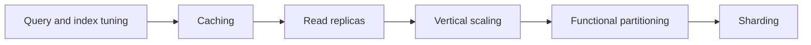

# Database Scaling Patterns

"The database is the bottleneck" has a well-worn escape ladder, and the rungs have an order: **tune → cache → read replicas → bigger box → functional split → shard.** The order isn't aesthetic — each rung is roughly 10x cheaper and 10x more reversible than the next, and each defers the day you need the one after it. Most systems retire before reaching the top; the ones that climb too fast carry sharding's permanent complexity while their real problem was a missing index. This note walks the ladder rung by rung, with the failure mode of skipping each.

## Why this matters

Databases are where scaling gets hard, because they hold **state**. Stateless app servers scale by copy-paste ([[Stateless vs Stateful Services]]); a database you cannot simply duplicate without answering "who has the truth?" That asymmetry makes database scaling decisions expensive to reverse, which is why the discipline of exhausting cheap rungs first is worth more than any individual technique. It's also a reliable interview frame: "walk me through scaling this from 1K to 100K QPS" is best answered as a ladder with measurements between rungs, not a leap to [[Sharding]] — interviewers specifically listen for whether you reach for the last resort first.

The ladder in one table:

| Rung | Scales | App changes | Reversible? | New failure modes |
|---|---|---|---|---|
| 1. Query/index tuning | everything, multiplicatively | queries only | trivially | plan flips if done carelessly |
| 2. Caching | repeated reads | read paths | easily (bypass) | staleness, stampedes, cache-down overload |
| 3. Read replicas | reads | read routing | easily (detach) | replication lag anomalies |
| 4. Vertical scaling | reads + writes, to a ceiling | none | easily (resize) | bigger blast radius, slow failover warm-up |
| 5. Functional partitioning | domains independently | cross-domain queries/transactions | painfully | lost joins, cross-DB consistency |
| 6. Sharding | writes + size of one table | every query on that table | practically no | hot partitions, scatter-gather, rebalancing |

## How it works

### Rung 1 — Query and index tuning: the free 10x

Before buying hardware, stop wasting the hardware you have. The usual finds: missing or wrong [[Database Indexes]] (a composite in the wrong column order, a filter wrapped in a function), N+1 query storms ([[N+1 Queries and ORM Pitfalls]]), `SELECT *` over wide rows, `OFFSET 100000` pagination, and a handful of queries doing 90% of total load (every database has a top-10; Postgres `pg_stat_statements` and MySQL `performance_schema` will name them).

This rung routinely yields 10–100x on specific paths, costs no architecture, and — the part people under-rate — **every later rung multiplies its value**: a cache in front of bad queries caches slowly-computed entries; replicas of an untuned database are N copies of waste; a shard of an untuned workload is the same waste with network hops. Tuning is the only rung whose benefits compound up the ladder.

### Rung 2 — Caching: stop asking the database

Most read traffic re-reads the same hot minority of data ([[Why Caching Works]]). Putting Redis (or an in-process cache) in front of the database converts repeated reads into memory hits and can strip 70–95% of read QPS off the primary for workloads with real skew.

Costs arrive as correctness questions, not performance ones: staleness budgets, [[Cache Invalidation]], [[Cache Stampede and Thundering Herd]] on hot-key expiry, and cold-cache restarts. Caching is also the first rung that *changes your failure modes* — a cache outage now becomes a database overload ([[Failure Modes in Distributed Systems|metastable failure]] territory). Strategy choices live in [[Caching Strategies]].

What caching cannot do: absorb writes, or serve reads that are never repeated (uniform access patterns cache poorly).

### Rung 3 — Read replicas: multiply the read path

[[Replication]] in leader-follower mode gives you N copies that serve reads while all writes still go to the leader. Great fit when the read:write ratio is lopsided (most OLTP is 10:1 or more), when heavy analytics/report queries should get off the primary's buffer pool, and as a bonus you've bought HA ([[Failover]]).

The tax is **replication lag**: async replicas trail the leader by milliseconds normally, seconds-to-minutes under load — so a user can write, then read a replica, and not see their own write. Mitigations (read-your-writes routing, sticky sessions, bounded-staleness checks) are a whole topic: [[Read Your Own Writes and Replica Lag Anomalies]]. Route by *query tolerance*: fresh-critical reads to the primary, staleness-tolerant reads to replicas — which means replicas help exactly as much as your workload is staleness-tolerant.

What replicas cannot do: scale writes at all (every replica applies every write), and each replica is a full copy (no storage scaling).

### Rung 4 — Vertical scaling: buy the bigger box

Double the cores, quadruple the RAM (a bigger buffer pool is often the single biggest lever — more of the working set in memory, see [[How Databases Store Data]]), move to faster NVMe. Zero application changes, an afternoon of planned failover, and modern cloud instances go remarkably far — hundreds of thousands of simple QPS on one well-tuned large box is realistic, and single machines with terabytes of RAM exist.

Why it sits here and not first: it's rented relief — cost grows super-linearly at the top of the instance range, and it buys headroom, not architecture. Why it's before the splits: it is *so* much simpler than them that exhausting it first is almost always right ([[Vertical vs Horizontal Scaling]]). The ceiling is real, though: the biggest instance is finite, failover of a giant box is slow (huge buffer pool to re-warm), and you still have a single write point.

### Rung 5 — Functional partitioning: split by domain, not by key

Before splitting one table across machines, split *different tables* onto different databases: orders DB, users DB, analytics DB — ideally along service boundaries ([[Service Boundaries and Domain-Driven Design]]). Each database is now smaller, independently tunable and scalable (each gets its own ladder!), and blast radii separate: the analytics workload can no longer evict the payments working set.

The price is the one you met in [[ACID Transactions]]: **cross-database joins and transactions stop existing.** Queries that joined orders to users become two lookups or a denormalized read model ([[Normalization vs Denormalization]]); invariants spanning the split need [[Saga Pattern|sagas]]/[[The Outbox Pattern|outbox]] machinery. This rung is often performed implicitly during a microservices migration — do it along real domain seams or you get the distributed monolith's data layer.

### Rung 6 — Sharding: the last resort, taken deliberately

When a *single table's* write volume or size exceeds any one machine — after tuning, caching, replicas, the big box, and functional splits — you split rows of the same table across machines by a shard key. That's [[Sharding]], with its own note covering key choice, range vs hash, [[Consistent Hashing]], [[Hot Partition Problem|hot partitions]], [[Rebalancing Partitions|rebalancing]] and [[Secondary Indexes on Sharded Data|scatter-gather indexes]].

It earns "last resort" because it's the first rung that is **practically irreversible** and taxes *everything after it*: every query must carry the shard key or fan out; cross-shard transactions and joins need application machinery; operations (backup, migration, rebalance) multiply per shard. It is absolutely survivable — planet-scale systems run on it ([[Why MySQL Does Scale]], [[How Facebook Scales MySQL]]) — but they pay a permanent engineering toll that only write volume justifies.

### The evidence that a rung is exhausted

Climb on measurements, not vibes. What "this rung is done" looks like:

- **Rung 1**: the top-10 statements by total time are all structurally sound (indexed, no N+1, no offset-pagination) and still the load is too high. Tooling: `pg_stat_statements` / `performance_schema`, `EXPLAIN ANALYZE` on each.
- **Rung 2**: hit rate is high (often 90%+ on skewed workloads) *and* the misses plus writes still overload the primary — or the workload genuinely lacks repetition to cache.
- **Rung 3**: replicas serve everything staleness-tolerant, and the primary is still hot — meaning the residual load is writes or fresh-critical reads, which replicas cannot take.
- **Rung 4**: you're at or near the largest sensible instance, the buffer pool already holds the working set, and the constraint is CPU on writes or fsync throughput.
- **Rung 5**: the hot table *is* the domain — there's nothing left to move off its database.
- Only then does rung 6 pay for itself.

### Why skipping rungs hurts

- Rungs are cheap insurance against the expensive ones: each one deflects load that would otherwise force the next. Teams that shard at 2K QPS buy years of toll for a problem a composite index solved.
- Lower rungs stay load-bearing after you climb: sharded systems still need tuned queries, caches, and per-shard replicas. Nothing is skipped, only deferred — skipping just means doing it later *and* under shard constraints.
- Skipping measurement is the real anti-pattern: each rung should be entered with evidence the previous one is exhausted (top-query profile flat, cache hit rate high and reads still heavy, replicas saturated by writes not reads, box at the instance ceiling). "We might need to shard someday" is a capacity-planning input ([[Capacity Planning]]), not an architecture.

The honest caveat: the ladder is a default, not dogma. A workload that is *born* write-heavy at huge scale (IoT ingestion, event firehoses) may justifiably start at a horizontally-partitioned store ([[Cassandra and Wide-Column Stores]], [[DynamoDB Design]]) — choosing a different database can beat climbing this ladder ([[Choosing a Database]]).

## Common misconceptions

- **"Scaling the database means sharding."** Sharding is the *last* rung; most systems never need it. Saying so in an interview is a feature, not a cop-out.
- **"Read replicas scale the database."** They scale *reads only*; writes replay on every replica. A write-bound system gains nothing from rung 3 — it goes 4 → 5 → 6.
- **"Vertical scaling is legacy thinking."** A bigger buffer pool is routinely the best price/performance move below the instance ceiling; horizontal pride is not a strategy ([[Vertical vs Horizontal Scaling]]).
- **"Caching will save us" (for writes).** Caches absorb reads. Write pressure passes straight through — write-behind exists ([[Caching Strategies]]) but trades durability questions for the privilege.
- **"We'll shard later with no prep."** Later is real, but cheap prep exists now: keep a candidate shard key (tenant/user id) on hot tables, avoid cross-tenant queries and DB-generated sequential ids where they'd block it. Optionality is nearly free; actual sharding is not.
- **"The ladder is one-way."** Load drops, products die, and rungs un-climb: caches get removed, replicas detached, instances downsized. Treating every rung as permanent is how systems accrete complexity they no longer need — only rung 6 genuinely resists descent.

## In your stack

- Your primary store being MongoDB doesn't change the ladder, only rung names: indexes/aggregation tuning → Redis cache → replica-set secondary reads (with the same staleness caveats) → bigger instances → per-service databases (you already do this) → sharded clusters as Mongo-native rung 6 ([[MongoDB Architecture]]).
- Redis is your rung 2 workhorse; its own scale story ([[Redis Cluster and Sentinel]], [[Hot Key Problem]]) mirrors this ladder one level down.
- Functional partitioning is largely done at Niyo (DB-per-service on EKS); the recurring cost is cross-service reads, which is why read models fed by events/[[Change Data Capture]] keep appearing.
- Fintech skew: correctness beats latency, so fresh-critical reads (balances, KYC status) belong on primaries, and the staleness-tolerant remainder is what replicas and caches may serve. The number of truly fresh-critical reads is usually smaller than teams assume — classifying them is free capacity.
- Services pinned at 1 replica: the app tier often saturates before the datastore does. Confirm *which* tier is the bottleneck before climbing any database rung — the ladder only helps if the database is actually the constraint.
- Cost shape per rung, since infra recommendations should name it: tuning costs engineer-time once; caching and replicas cost instances that scale with read volume; vertical scaling costs super-linearly with instance size; sharding costs engineer-time *forever* (every feature pays the toll). The cheapest capacity at Niyo's scale is almost always rung 1 and 2.

## Interview angle

The 60-second version: *"In order: first tune — top queries, indexes, N+1s; it's free and every later step multiplies it. Then cache the hot reads in Redis, accepting an explicit staleness budget. Then read replicas for the remaining read volume, handling replication lag with read-your-writes routing. Then scale the box vertically — RAM is a buffer pool and it's the cheapest honest capacity below the instance ceiling. Then functional partitioning: different domains to different databases, giving up cross-domain joins and transactions. Sharding is last — the only rung that scales writes on one table past one machine, and the only irreversible one, so it must be justified by write volume, not anxiety. Between every rung: measure, and prove the previous rung is exhausted."*

Classic probes:

- "Why not shard from day one?" — permanent toll on every query, and it's the one irreversible rung; the index you skipped was free.
- "Replicas aren't helping — why?" — the workload is write-bound, or the heavy reads are fresh-critical and pinned to the primary.
- "What breaks when you functionally partition?" — cross-domain joins and transactions; the replacements are read models and sagas/outbox.
- "What's your evidence a rung is exhausted?" — the measurement list above; naming `pg_stat_statements` beats naming architectures.
- The estimation follow-up — "at what QPS does each rung give out?" — wants [[Back of the Envelope Estimation]] reasoning against your actual read:write ratio, not memorized numbers.

## Check yourself

> [!question]- Q: Explain why the ladder is ordered by reversibility, and name the first irreversible rung.
> Each rung is roughly an order cheaper to adopt and to *undo* than the next: an index is dropped in seconds, a cache can be bypassed, replicas detach, an instance resizes back, and even a functional split can be re-merged painfully. Sharding is the first practically irreversible rung: once rows of one table are key-split across machines, every query, migration and operational procedure assumes it — un-sharding means a full re-architecture plus data migration under load. You order the ladder so that the mistakes you make early are the cheap, reversible ones.

> [!question]- Q: Reads are 20x writes, p99 is degrading, and the team proposes sharding. What do you check first, and what do you expect to find?
> Check, in order: the top-10 query profile (`pg_stat_statements` or equivalent) for tuning wins and N+1 patterns; cache hit rate and whether hot reads are cached at all; whether replicas exist and what fraction of reads could tolerate their lag; current instance headroom. With a 20:1 read ratio, the expected finding is that rungs 1–3 absorb it: a read-heavy workload degrading at p99 is almost never a write-capacity problem, and sharding wouldn't even target the symptom. Sharding becomes the answer only when *writes to one table* exceed a tuned, maximally-sized single primary.

> [!question]- Q: What happens if you add read replicas but skip the staleness classification (rung 3 without the homework)?
> Some reads that required freshness silently go stale: a user updates their address, the next page renders the old one from a lagged replica; a balance check reads stale and permits an action the primary would refuse. Under load, lag grows exactly when traffic peaks, so bugs appear only during incidents and vanish before you can reproduce them. The homework is routing by tolerance — fresh-critical to primary, rest to replicas — plus lag monitoring and a cap beyond which replicas eject from the read pool. See [[Read Your Own Writes and Replica Lag Anomalies]].

> [!question]- Q: Mini design: a payments platform grows from 50 to 5,000 write TPS on its `transactions` table over two years; reads are modest. Plot the ladder path and where it diverges from the read-heavy default.
> Write-bound workloads skip the read rungs' benefits: tuning still applies (fewer/smaller indexes — each one taxes every write, batch inserts, no N+1 writes), but caching and replicas barely help since they serve reads. Path: rung 1 write-side tuning → rung 4 early (vertical: NVMe, more cores, faster fsync path — write capacity is substantially a hardware property) → rung 5 (move analytics and non-payment domains off the primary) → rung 6 sharding by account/tenant id, justified here because single-table write volume is the one problem only sharding solves. Prep during rungs 4–5: idempotency keys and a shard-key-friendly schema so the final climb is a migration, not a rewrite ([[Stripe and Payment System Design]] territory).

## Sources

- *Designing Data-Intensive Applications*, Kleppmann — Chapter 5 (Replication) and Chapter 6 (Partitioning) for rungs 3 and 6; Chapter 1 for the load-parameters discipline between rungs.
- Use The Index, Luke (Markus Winand) — rung 1 in book form.
- PostgreSQL documentation: `pg_stat_statements`; MySQL 8.0 Reference Manual: `performance_schema` — the measurement tooling the ladder depends on.
- Engineering blogs for the top rungs lived honestly: Meta Engineering on sharded MySQL ([[How Facebook Scales MySQL]]), Vitess/PlanetScale material on MySQL sharding ([[Why MySQL Does Scale]]).
