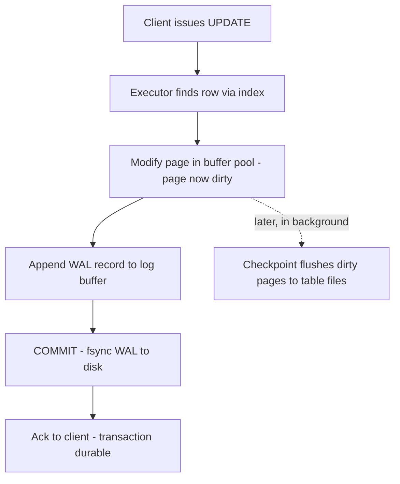

# How Databases Store Data

A relational database is, underneath everything, a program that manages fixed-size blocks of bytes on disk and a cache of those blocks in memory. Almost every performance behaviour you will ever observe — why one query is fast and another slow, why commits are cheap, why a restart can take minutes — falls out of three structures: **pages**, the **buffer pool**, and the **write-ahead log**. This note builds the mental model bottom-up so that [[Database Indexes]], [[ACID Transactions]] and [[Database Scaling Patterns]] have something to stand on.

## Why this matters

You can use a database for years without knowing any of this, because the SQL interface hides it. But system design questions — "why is this write slow?", "what happens if the server loses power mid-commit?", "why does the first query after a restart take 400 ms and the second take 2 ms?" — are unanswerable at the SQL level. They are answerable at the storage level, and the storage model is small enough to actually learn. It also transfers: the same page/log/cache triad appears, rearranged, in [[B-Tree vs LSM-Tree]], in [[Redis Internals]] persistence (RDB vs AOF), and in [[Kafka Architecture]] (which is essentially a WAL promoted to a first-class product).

## How it works

### Pages: the unit of all I/O

Databases never read or write individual rows from disk. They read and write **pages** (also called blocks) — fixed-size chunks, **8 KB by default in PostgreSQL** and **16 KB by default in MySQL's InnoDB**. A page holds a header, a set of row versions (tuples), and a small directory of pointers to them.

Consequences worth internalizing:

- **Fetching one 100-byte row costs a full page read.** Row locality matters: rows that are queried together are cheapest when they live in the same pages.
- **A tiny update dirties a whole page.** The unit of "something changed and must eventually reach disk" is the page, not the row.
- **Wide rows reduce rows-per-page**, which makes every scan proportionally more expensive. This is one honest argument for keeping rarely-read blobs in separate tables (or object storage — see [[How S3 Works]]).

### Heap files vs clustered storage

Where do table pages live, and in what order? The two mainstream answers:

| | **PostgreSQL: heap table** | **MySQL InnoDB: clustered primary key** |
|---|---|---|
| Table layout | Rows go wherever there is free space; no inherent order | The table *is* a B+-tree ordered by primary key; rows live in its leaves |
| Primary key lookup | PK index → page + offset → heap fetch | One B+-tree descent lands directly on the row |
| Secondary index leaf contains | Physical row address (page + offset, the "TID") | The **primary key value** of the row |
| Secondary index lookup | Index → heap page, one hop | Index → PK value → second B+-tree descent ("double lookup") |
| Practical implication | All indexes are equal citizens; row moves require index maintenance (mitigated by HOT updates) | PK choice is a physical design decision: a fat or random PK (e.g. UUIDv4) bloats *every* secondary index and causes page splits on insert |

Neither is "better". The clustered design makes PK-range scans beautifully sequential (`WHERE id BETWEEN …` reads adjacent pages); the heap design makes secondary indexes cheaper and PK choice low-stakes. But the InnoDB rule of thumb is real: **prefer short, monotonically increasing primary keys** (auto-increment, or time-ordered IDs like those from a [[Design a Distributed ID Generator|Snowflake-style generator]]), because every secondary index silently carries a copy of the PK.

### The buffer pool: the database's own page cache

Disk is orders of magnitude slower than RAM (see [[Latency Numbers Every Engineer Should Know]]), so the database keeps a large in-memory cache of pages: the **buffer pool** (PostgreSQL calls its version `shared_buffers`; InnoDB calls it the buffer pool and it is typically sized to a majority of the machine's RAM on a dedicated host).

Every read goes through it: if the page is cached, the query never touches disk. Every write goes through it too — and this is the surprising part: **writes modify the page in memory and do not immediately write the table page to disk.** A modified page is marked **dirty** and flushed later, in the background. A "hot" working set that fits in the buffer pool is why a database can serve tens of thousands of reads per second from what looks like disk.

This also explains **cold-start behaviour**: after a restart or a failover (see [[Failover]]), the buffer pool is empty, every query misses to disk, and latency is temporarily terrible. The same dynamic appears one layer up as the cold-cache problem in [[Why Caching Works]].

### The write-ahead log: durability made affordable

If committed changes live only in dirty memory pages, a crash loses them. The naive fix — flush every dirty page to disk at commit — is ruinously expensive: a transaction touching 10 rows might dirty 10 pages scattered randomly across the disk, and random writes (plus an `fsync` each) are the slowest thing storage can do.

The actual fix is the **write-ahead log** (WAL; InnoDB calls its equivalent the **redo log**). The rule: *before* a change is considered committed, a compact log record describing the change ("in page X, tuple Y became Z") is appended to a log file and flushed (`fsync`) to disk. The table pages themselves can be flushed whenever convenient — minutes later, in sorted batches.

Why this is cheap where page flushing is expensive:

- The log is **append-only**: every write goes to the current end of one file. Sequential writes are vastly faster than random ones on spinning disks and still meaningfully cheaper on SSDs.
- Log records are **small** — tens or hundreds of bytes per row change versus an 8–16 KB page.
- Many concurrent transactions can share one `fsync` (**group commit**): the log flusher gathers whatever has accumulated and syncs once, amortizing the most expensive operation across transactions.

Crash recovery is then mechanical: on restart, replay the log from the last checkpoint, redoing changes whose pages never made it to disk. Committed data survives because the log did. This is the "D" of [[ACID Transactions]] in one sentence: **durability = WAL record fsynced before acknowledging commit.**

(Both engines also defend against *torn pages* — a crash mid-way through writing one page: PostgreSQL writes a full page image to WAL on first modification after a checkpoint (`full_page_writes`); InnoDB routes page flushes through a doublewrite buffer.)

### The write path, end to end

The solid path is what the client waits for; note that it contains exactly one disk sync — the log. The dotted path is deferred housekeeping.

Terminology across the two engines, since the docs rarely translate for you:

| Concept | PostgreSQL name | InnoDB name |
|---|---|---|
| Page size default | 8 KB | 16 KB |
| Page cache | `shared_buffers` | buffer pool |
| Durability log | WAL | redo log |
| Old row versions | dead tuples in the heap, cleaned by vacuum | undo logs, cleaned by purge |
| Torn-page defence | `full_page_writes` | doublewrite buffer |
| Table layout | heap file | clustered index on the PK |

### Checkpoints

The log cannot grow forever: recovery time is proportional to how much log must be replayed, and disk fills. A **checkpoint** periodically flushes all dirty pages up to some log position and records "everything before here is safely in the table files" — after which older log segments can be recycled. Checkpoints trade recovery time against I/O smoothness: frequent checkpoints mean fast recovery but constant flushing; rare checkpoints mean calm steady-state I/O but long crash recovery and periodic flush storms. (PostgreSQL spreads checkpoint I/O over time precisely to avoid the storm.)

## Common misconceptions

- **"COMMIT writes my row to the table on disk."** No — commit fsyncs a *log record*. The table page may reach disk minutes later. Both facts are invisible at the SQL level and both matter for reasoning about I/O.
- **"Reading one row reads one row."** It reads at least one full page, through the buffer pool. Query cost is measured in pages touched, which is why [[Database Indexes]] (which minimize pages touched) dominate performance work.
- **"The WAL is overhead."** It is the opposite: the WAL is the *optimization* that lets the database give you durability at the price of one sequential append instead of many random page writes.
- **"Durability means the data can never be lost."** Single-node WAL durability survives a crash, not a dead disk or a dead machine. Surviving machine death requires [[Replication]]; the two guarantees are different layers.
- **"The OS page cache makes the buffer pool redundant."** They coexist (and PostgreSQL deliberately leans on both), but the database's own cache knows about pages, pins, and dirty state in a way the OS cannot.

## In your stack

- Your primary store is MongoDB, and the model transfers almost unchanged: WiredTiger has a cache (buffer pool), a write-ahead journal (WAL), and checkpoints — see [[MongoDB Architecture]]. `j: true` write concern is the `fsync`-the-journal knob.
- Where MySQL exists at Niyo, the InnoDB clustered-PK fact is actionable: tables keyed by random UUIDs pay a real insert and index-bloat tax; time-ordered IDs are kinder to the storage engine.
- Redis inverts this architecture — data lives in memory and the *log* (AOF) is the persistence story — which is why its durability settings deserve scrutiny for anything money-adjacent: [[Redis Internals]].
- Fintech framing: when an auditor asks "when is a ledger write durable?", the precise answer is "when the WAL record is fsynced, and replicated if we need machine-death durability" — see [[ACID Transactions]] and [[Replication]].
- Failovers and deploys restart database processes with cold buffer pools; the latency spike you see on dashboards right after is usually cache warm-up, not a regression.
- The page model prices your schema decisions: a rarely-read `metadata` blob on a hot MySQL table shrinks rows-per-page for every query that touches the table, cache included.

## Interview angle

The 60-second version: *"Databases store rows in fixed-size pages. Reads and writes go through an in-memory buffer pool; writes dirty pages in memory rather than hitting the table files. Durability comes from the write-ahead log: a small record is appended and fsynced at commit, which is cheap because it is sequential, while dirty pages flush lazily and checkpoints bound how much log replay recovery needs. Postgres stores tables as unordered heaps with indexes pointing at physical locations; InnoDB stores the table itself as a B+-tree on the primary key, so secondary indexes hold PK values and PK choice has physical consequences."*

Classic probes:

- "Why are sequential writes faster, and why does that matter to databases?" → the WAL argument above.
- "What's the difference between the buffer pool and the OS page cache?" → the database cache understands pages, dirty state and pinning; the OS sees opaque file bytes.
- "What happens on power loss between commit and page flush?" → redo from WAL at restart.
- "Why do people say UUID primary keys hurt MySQL?" → clustered index page splits + every secondary index carries the PK.
- Follow-up bridge: "what if your workload is write-heavy enough that even B-trees hurt?" → [[B-Tree vs LSM-Tree]].

## Check yourself

> [!question]- Q: Explain to a colleague why a database can acknowledge a commit without writing the updated table page to disk.
> Because durability is provided by the write-ahead log, not the table files. At commit the database appends a compact, sequential log record and fsyncs it; if the server crashes, recovery replays the log to reconstruct the page changes. Flushing the actual pages can be deferred to checkpoints, batching many random writes into calmer background I/O.

> [!question]- Q: What happens if the server loses power *after* the WAL fsync but *before* the dirty page is flushed? And if it loses power before the WAL fsync completes?
> After the fsync: the transaction is durable — recovery replays the WAL record and the page change is reconstructed; the client's "commit OK" was honest. Before the fsync: the transaction was never acknowledged as committed, and recovery ignores the incomplete log record — the transaction simply never happened. Either way, no acknowledged commit is lost and no half-applied state survives.

> [!question]- Q: Your MySQL table uses random UUIDv4 primary keys. Name two distinct storage-level costs.
> First, inserts land at random positions in the clustered B+-tree, causing page splits and poor page fill instead of cheap appends to the rightmost leaf. Second, every secondary index stores the primary key in its leaves, so the 16-byte random key bloats all indexes and worsens their cache behaviour. (Time-ordered IDs fix the first problem and shorter keys fix the second.)

> [!question]- Q: After a database failover, p99 latency is 10x normal for a few minutes, then recovers on its own. Storage-level explanation?
> The new primary starts with an empty (or stale) buffer pool. Queries that normally hit memory miss to disk until the working set is re-cached. Detection: disk read IOPS spike while query plans are unchanged. Mitigations include buffer-pool warm-up/dump-restore features and routing a trickle of traffic first.

> [!question]- Q: Mini design: you must log every balance change for audit, immutably and replayably. Which storage structure from this note is the right shape, and why?
> An append-only log — the WAL idea promoted to the application layer. Appends are cheap and ordered, the history is immutable by construction, and replaying it reconstructs state at any point. This is exactly the lineage from WAL to [[Event Sourcing]] and [[Kafka Architecture]], and to double-entry ledger design in [[Stripe and Payment System Design]].

## Sources

- *Designing Data-Intensive Applications*, Martin Kleppmann — Chapter 3 (Storage and Retrieval): pages, B-trees, WAL, and the storage-engine landscape.
- PostgreSQL documentation: "WAL Introduction" / "Reliability and the Write-Ahead Log", and "Database Page Layout".
- MySQL 8.0 Reference Manual: "InnoDB On-Disk Structures" (clustered and secondary indexes, redo log, doublewrite buffer).
- Use The Index, Luke (Markus Winand) — "Anatomy of an SQL Index" for the heap vs clustered contrast.
