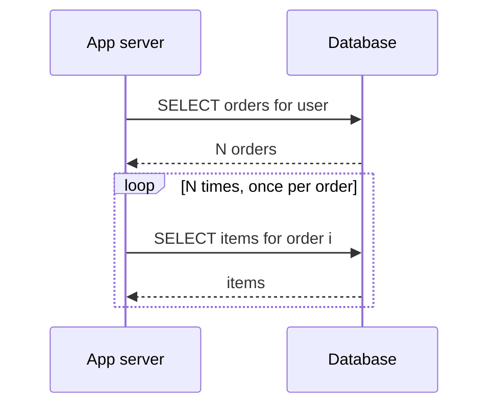

# N+1 Queries and ORM Pitfalls

An ORM maps rows to objects so well that database access disappears from view — and with it, the *count* of queries your code issues. The N+1 problem is the canonical result: code that reads as one loop silently executes one query plus one more per element. Nothing is wrong with any single query; the pathology is the multiplication. This note covers the shape, why ORMs manufacture it by default, the standard fixes, and the sibling traps that come from the same root cause: object-shaped thinking applied to a network-attached, set-oriented database.

## Why this matters

Each round trip to the database costs network latency plus parse/plan/execute overhead — call it 0.5–2 ms intra-VPC even for a trivial query ([[Latency Numbers Every Engineer Should Know]]). One query returning 100 rows: ~2 ms. One hundred and one queries: 100–200 ms, plus 101 borrow/return cycles against the [[Connection Pooling|connection pool]] and 101 units of database CPU on ceremony. The endpoint is now 50–100x slower *with perfectly indexed tables* — no `EXPLAIN` on any individual query will show a problem, which is exactly why N+1 survives code review and staging. It is probably the single most common database performance bug in production ORM applications.

## How it works

### The shape

```java
List<Order> orders = orderRepository.findByUserId(userId);   // 1 query
for (Order o : orders) {
    total += o.getItems().size();   // triggers 1 query PER order
}
```

What executes:

```sql
SELECT * FROM orders WHERE user_id = ?;          -- 1
SELECT * FROM order_items WHERE order_id = 1;    -- +1
SELECT * FROM order_items WHERE order_id = 2;    -- +1
-- ... N times
```



One logical read became N+1 network round trips. The database answers each in under a millisecond and looks healthy; the latency lives *between* the systems, in the sheer number of trips.

### How ORMs hide it: lazy loading

JPA/Hibernate (like most ORMs) defaults collection associations (`@OneToMany`, `@ManyToMany`) to **lazy loading**: the `items` field is a proxy, and the query fires at first *access*, not at load. This is a sane default — eagerly loading every association would drag whole object graphs into memory for callers that wanted two columns. But it moves query execution from the repository layer into arbitrary call sites: a getter in a loop, a Jackson serializer walking the object for JSON, a Thymeleaf template. The person who triggers the queries never wrote a query. (Eager fetching doesn't fix it either — `@ManyToOne` eager loads can fire per-row lookups, and graph-wide eager fetch trades N+1 for loading everything always.)

### The fixes

1. **Fetch the association in the same query — a join.** JPQL `JOIN FETCH` (`SELECT o FROM Order o JOIN FETCH o.items WHERE ...`) or an `@EntityGraph` on the repository method: one query, one round trip, ORM assembles the graph. Caveats: joining *multiple* collections multiplies rows (cartesian product; Hibernate refuses the worst cases with `MultipleBagFetchException`), and combining collection `JOIN FETCH` with pagination makes Hibernate paginate *in memory* (the infamous `HHH000104` warning) — a correctness-adjacent trap of its own.
2. **Batch fetching.** Hibernate `@BatchSize(size = 100)` or the global `hibernate.default_batch_fetch_size`: lazy loads coalesce into `SELECT ... WHERE order_id IN (?, ?, ..., ?)` — N+1 becomes 1 + N/100. Minimal code change, pagination-safe, and good enough for most cases; this is the pragmatic default fix.
3. **Projections: stop loading entities you don't need.** If the endpoint needs three fields, select three fields into a DTO (JPQL constructor expression, interface projection, or plain SQL). No entities → no lazy proxies → no N+1 possible, plus less data moved and no accidental dirty-checking. For read-heavy list endpoints this is usually the *right* fix, not just a workaround — it's [[CQRS]] thinking at micro scale.

The same loop, fixed each way:

```java
// Fix 1: fetch the graph in one query
@Query("SELECT o FROM Order o JOIN FETCH o.items WHERE o.userId = :userId")
List<Order> findWithItemsByUserId(Long userId);

// Fix 2: keep the lazy code, coalesce the loads
@OneToMany(mappedBy = "order")
@BatchSize(size = 100)          // N lazy loads become ceil(N/100) IN-queries
private List<OrderItem> items;

// Fix 3: ask for what the endpoint renders, nothing else
@Query("""
    SELECT new com.example.OrderSummary(o.id, o.createdAt, COUNT(i), SUM(i.amount))
    FROM Order o JOIN o.items i WHERE o.userId = :userId GROUP BY o.id, o.createdAt
    """)
List<OrderSummary> summariesByUserId(Long userId);
```

The three fixes side by side:

| Fix | Queries issued | Best for | Watch out for |
|---|---|---|---|
| `JOIN FETCH` / `@EntityGraph` | 1 | detail views needing the real object graph | row multiplication with multiple collections; in-memory pagination (HHH000104) |
| `@BatchSize` / global batch fetch | 1 + N/batch | retrofitting existing lazy code cheaply | still loads full entities; batch size vs IN-list limits |
| DTO projection | 1 | list/read endpoints — most endpoints | you give up entity features (dirty checking, lazy nav) — which is usually the point |

### Detection: make query counts visible

Detection beats cleverness, because N+1 is invisible in code and obvious in telemetry:

- **Dev**: log SQL with a counter — p6spy or datasource-proxy wraps the `DataSource` and prints per-request query counts; Hibernate's `generate_statistics` logs session-level query counts.
- **Tests**: assert a query budget per endpoint in integration tests (datasource-proxy exposes counts programmatically); a test that fails when 3 queries become 103 catches the regression at review time.
- **Production**: APM per-endpoint DB-call counts (not just DB time); the N+1 signature is *endpoint latency and query count scaling linearly with result-set size* while per-query time stays flat.

## Common misconceptions

- **"The database is slow."** The database is fine; each query is sub-millisecond. The latency is round-trip multiplication in the application tier. This misdiagnosis leads to index-tuning and [[Database Scaling Patterns|scaling work]] that cannot help.
- **"Lazy loading is bad; make everything eager."** Eager is N+1's other face: you load the entire object graph for every caller, including the ones that needed two columns. The fix is *per-query* fetch control, not a global setting.
- **"The ORM cache will absorb it."** First-level cache dedupes repeated loads of the *same* entity in one session; it does nothing for N distinct children. Second-level caches add their own invalidation problems ([[Cache Invalidation]]) and are not a substitute for writing one query.
- **"N+1 is just a performance issue."** At scale it's an availability issue: the extra queries consume pool slots and DB CPU, so one chatty endpoint degrades every other endpoint sharing the [[Connection Pooling|pool]].

### The sibling traps (same disease, other symptoms)

- **Chatty transactions.** A `@Transactional` method that interleaves queries with remote calls (HTTP to a partner, publish to a broker) holds a DB connection and open transaction for the whole wall-clock duration — pool exhaustion fuel, plus long-held locks blocking writers. Spring's Open-Session-In-View (on by default in Spring Boot MVC) extends entity sessions across view rendering, institutionalizing both lazy-load surprises and long connection holds: turn it off and load deliberately. Keep transactions datastore-only; publish events via [[The Outbox Pattern]].
- **Unbounded IN lists.** "Fix" N+1 by collecting 50,000 ids into one `WHERE id IN (...)`: giant statements that blow parse time, plan caches (each distinct arity is a new statement), parameter limits (notably ~2,100 parameters in SQL Server; Postgres and MySQL fail later but degrade sooner). Chunk IN lists (500–1,000), or use a temp table/`= ANY(array)` in Postgres.
- **Entity-graph bloat.** Mapping deep bidirectional graphs and loading an aggregate root drags megabytes of entities into memory per request — GC pressure, slow dirty-checking at flush (Hibernate scans every managed entity), and accidental lazy-load chains. Keep aggregates small; use DTO projections for reads.
- **Per-row writes.** The write-side N+1: saving a list entity-by-entity issues N INSERTs. Enable JDBC batching (`hibernate.jdbc.batch_size`) or use bulk statements.
- **Accidental updates.** A getter-mutated managed entity (or a mapper touching entities) gets flushed as an UPDATE nobody intended — dirty checking is a write path you don't see in code.

## In your stack

- Spring Data JPA against MySQL where it exists: repository methods returning entities with lazy collections are N+1 seeds; favour interface/DTO projections on list endpoints, `@EntityGraph` on detail endpoints, and set `spring.jpa.open-in-view=false` consciously.
- MongoDB with Spring Data does not dodge the disease: `@DBRef` lazy resolution, or app code looping `findById` per element, is the same N+1 with a different wire protocol. The fix is also the same shape — one `$in` query (bounded), an aggregation `$lookup`, or embedding the child data in the document, which is the Mongo-native answer ([[MongoDB Architecture]], [[Normalization vs Denormalization]]).
- Chatty transactions are the fintech-flavoured risk: a partner-bank call inside a transaction holds a pooled connection for the partner's full latency. At 1-replica services this single pattern can take the whole capability down — see [[Connection Pooling]]'s failure modes.
- Cheap guard: per-endpoint query-count assertions in integration tests (datasource-proxy exposes counts), and an APM dashboard of queries-per-request — a number that should be boring and single-digit.

## Interview angle

The 60-second version: *"N+1 is one query for a list plus one lazy-loaded query per element — the ORM hides it because associations are proxies that fire on access, so the loop looks like memory access but is N network round trips. Each query is fast; the multiplication kills you, and it consumes pool slots so it degrades neighbours too. Fixes in order of preference: DTO projections so you never load entities for reads; join fetch or entity graphs for genuine graph loads, minding pagination; batch-size so lazy loads coalesce into IN queries. And the same chattiness disease has siblings: remote calls inside transactions holding connections, unbounded IN lists, and loading megabyte object graphs to read one field."*

Classic probes: "how would you *detect* N+1 in production?" (latency linear in result size; queries-per-request metric); "why doesn't eager fetching fix it?"; "what breaks when you join-fetch a collection with pagination?" (in-memory pagination); "when is denormalizing/embedding the real fix?" — bridge to [[Normalization vs Denormalization]].

## Check yourself

> [!question]- Q: Explain to a junior engineer why their loop is slow even though every query in the slow-query log is under 1 ms.
> The loop triggers a lazy-loaded query per element: 1 query for N parents, then N child queries. Each round trip costs ~1 ms of network and overhead, so 200 parents means ~200 ms of accumulated trips — while no individual query is slow, which is why the slow-query log is empty. The database is healthy; the query *count* is the bug. Show them the SQL log with a counter: the fix is one join-fetched or batched query, or a projection that selects exactly the needed columns.

> [!question]- Q: What happens if you "fix" an N+1 on a paginated endpoint with JOIN FETCH on a collection?
> Hibernate cannot apply LIMIT/OFFSET to the SQL, because the join multiplies rows (one parent appears once per child) and row-level LIMIT would truncate mid-parent. It logs HHH000104, fetches the *entire* result set, and paginates in memory — correct output, but memory and latency now scale with the whole table. Correct fixes: two queries (page of parent ids, then fetch children for those ids), or `@BatchSize`, or a DTO projection with explicit pagination-safe SQL.

> [!question]- Q: An endpoint's p99 degrades from 80 ms to 4 s during month-end, and the connection pool alarms fire — but the DB dashboard is calm. The handler loads a user's accounts and, per account, calls a balance API, all inside one transaction. Diagnose.
> Two compounding chattiness bugs. Per-account remote calls inside the loop scale wall-clock time with account count — month-end users have more activity, so N grew. Because it's all one transaction, a DB connection is held for the full duration, so hold time exploded and the pool exhausted ([[Connection Pooling]]) — neighbours then starve, while the DB itself idles. Fix: move remote calls outside the transaction, batch them concurrently with a bounded executor and timeout, and make the DB work a single projection query.

> [!question]- Q: Why is a remote HTTP call inside a @Transactional method two distinct bugs, not one?
> Bug one is resource-holding: the method keeps a pooled DB connection and an open transaction for the remote call's full latency, so pool exhaustion and long-held row locks scale with a *third party's* response time ([[Connection Pooling]]). Bug two is the dual-write: the remote side effect and the local commit are not atomic — if the transaction rolls back after the call succeeded, the remote action already happened; if the process dies after commit but the call hadn't been made, it never happens. The fixes differ too: bug one wants the call moved outside the transaction boundary; bug two wants [[The Outbox Pattern]] or an explicit compensation/reconciliation story — moving the call alone fixes the pool but not the atomicity.

> [!question]- Q: Mini design: a "transactions list" screen needs 6 fields per row from 3 tables, 20 rows per page. Design the data access to be N+1-proof.
> One SQL/JPQL query with explicit joins projecting exactly those 6 columns into a DTO, ordered and paginated by keyset (`WHERE (created_at, id) < (?, ?) ORDER BY created_at DESC, id DESC LIMIT 20`), backed by a composite index on the sort key ([[Database Indexes]]). No entities, so no lazy proxies exist to fire. Query count per request: exactly 1, assertable in an integration test.

## Sources

- Hibernate ORM documentation: "Fetching" (lazy/eager, batch fetching, join fetch semantics) and the HHH000104 pagination warning.
- Vlad Mihalcea's blog — the canonical practitioner reference on N+1 detection, `JOIN FETCH` vs `@BatchSize` vs projections, and Open-Session-In-View ("The Open Session In View Anti-Pattern").
- Spring Data JPA reference: projections and `@EntityGraph`.
- Use The Index, Luke (Markus Winand) — the chapters on joins and pagination (keyset pagination) that the projection fix leans on.
