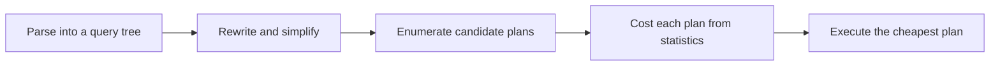

# Query Planning and EXPLAIN

[[Database Indexes]] covers what an index *is* — a sorted B+-tree copy the database could use. This note covers the other half: **how the database decides whether to actually use it, and how you find out.** That decision is invisible in your SQL text, it can change overnight with no deploy, and it is probably the single highest-leverage practical skill in working with any database — more queries are fixed by reading a plan than by adding an index. This note builds the habit from zero.

## The problem that created it

SQL (and MongoDB's query language) is **declarative**: you state *what* you want, not *how* to get it. `SELECT * FROM transactions WHERE account_id = 48213 AND created_at > now() - interval '30 days'` says nothing about which index to use, which order to apply the filters in, or whether to touch an index at all. Something has to turn that declaration into an actual sequence of operations — and for one query there is usually more than one mechanically valid way to answer it.

Make the gap concrete. A `transactions` table has 20 million rows across 50,000 accounts (~400 rows/account average), packed roughly 140 rows per page — cost is measured in pages touched, not rows, for the reasons [[How Databases Store Data]] lays out. Two candidate strategies for the query above:

- **Sequential scan**: read every page of the table, filter rows in memory. That's roughly 20,000,000 / 140 ≈ 143,000 pages touched, to find ~48 matching rows.
- **Index seek** on `(account_id, created_at)`: 3–4 B+-tree pages to find the leaf (see [[Database Indexes]]), then a handful of heap pages for the ~48 matching rows. Call it under 50 pages touched.

Same SQL, same correct answer, roughly a **3,000x difference in pages touched** — and that gap only grows as the table grows, while the SQL text never changes. Something inside the engine chose between these, and it chose *before* a single row was read. That something is the **query planner** (or **optimizer**), and the tool that shows you its choice is `EXPLAIN`. You cannot tune what you cannot see — that's the entire justification for this note.

## What it solves

- **Lets the engine choose a strategy without you hand-writing one.** You never specify "use the index on account_id, nested-loop into the heap" — the planner works that out per query, per table size, per statistics snapshot.
- **Replaces guessing with evidence.** Instead of "maybe this needs an index" or "maybe denormalize this," the plan names the exact operator that's expensive and why, before you change anything permanent and write-taxing ([[Database Indexes]] covers that tax).
- **Surfaces a whole category of bug invisible in the SQL text**: a query that was fine for a year and silently started choosing a different, worse plan — because statistics drifted, data skewed, or a cache of an old plan got reused for new data. None of that shows up by reading the query; all of it shows up in `EXPLAIN`.
- **Turns "it's slow" into a specific, falsifiable claim** — a number (rows examined), a cause (which operator, which predicate), and therefore a specific, testable fix.

## How it works

### The optimizer pipeline

A query goes through four stages before it executes a single operation:



**Enumeration** is combinatorial: joining N tables naively has N! possible orderings, before you even multiply in which index (if any) each table uses. PostgreSQL uses a dynamic-programming search (the classic "Selinger" approach from System R) for a practical number of tables; past a threshold, exhaustive search stops being affordable and Postgres switches to a genetic algorithm instead (`geqo_threshold`, default 12 tables) — a heuristic admission that enumerating every plan is itself a cost that has to be bounded.

**Costing is a row-count problem before it is anything else.** Every operator's cost is computed as some function of *how many rows it expects to process* — a sequential scan costs roughly (pages × page-cost) + (rows × per-row CPU cost); a nested loop costs (outer rows) × (cost of one inner probe). If the row estimate (the **cardinality estimate**) is wrong, every cost built on top of it is wrong, no matter how precise the arithmetic looks. This is the single most important fact in this note: **a wrong row estimate is the root cause of most bad plans**, because cost follows cardinality, and cardinality comes from statistics.

### Statistics: what the optimizer actually knows

The optimizer doesn't inspect your data at plan time — that would defeat the purpose of planning quickly. It consults a stored, periodically-refreshed summary:

| What's stored | Captures | Postgres | MySQL (InnoDB) | MongoDB |
|---|---|---|---|---|
| Histogram | bucketed distribution of column values | yes, `pg_stats` | MySQL 8.0+, opt-in per column (`ANALYZE TABLE ... UPDATE HISTOGRAM`) | no stored histogram |
| Most-common values (MCV) | the few values that dominate a skewed column, with exact frequencies | yes | no direct equivalent | no |
| n_distinct | estimated distinct values in a column (drives selectivity math) | yes | index cardinality, sampled | no |
| Null fraction | share of nulls | yes | partial | no |
| Refresh trigger | — | autovacuum (default: ~10% of rows changed, `autovacuum_analyze_scale_factor` 0.1, plus a 50-row floor) or manual `ANALYZE` | `innodb_stats_persistent` (on by default); with `innodb_stats_auto_recalc` on (also the default) stats are recalculated once roughly 10% of the table's rows have changed, or manually via `ANALYZE TABLE` | no stats-driven recalculation — see below |

MongoDB ([[MongoDB Architecture]]) has historically not had a cost-based optimizer in the Postgres/MySQL sense: it does not maintain histograms or most-common-value lists to estimate selectivity ahead of time. Instead, for a new query shape its classic query engine runs a handful of candidate plans in parallel for a small number of trial "works," measures which one satisfies the query fastest, and caches that winner — a **multi-plan race** rather than a statistics-driven estimate. (Since 8.3, a cost-based ranker backs up the race for eligible queries, estimating cardinality by sampling or heuristics rather than stored histograms; MongoDB's 9.0 docs, 2026, say it is invoked for only a small share of queries, and when it is, `explain()` shows `costEstimate`/`cardinalityEstimate` on the winning plan.) So for most queries there are no cost estimates to read in Mongo's `explain()` output — and no execution numbers either unless you ask for them: the default `queryPlanner` verbosity names the winning plan only, while `executionStats` re-runs the query and reports what it really did.

**The classic stale-statistics failure.** A `settlements` table normally averages 50 rows per `partner_id`. A one-time backfill migration loads 5 million historical rows for one newly onboarded partner bank. Statistics were last refreshed before the backfill, so the optimizer still believes "50 rows for this partner_id" and costs a nested-loop join accordingly — cheap, by its numbers. At execution, the inner side of that loop runs 5 million times instead of 50. A query that should take milliseconds takes minutes, with nothing in the SQL or the schema having changed — only the data distribution, and the stats hadn't caught up. `ANALYZE` after any bulk load is the fix; waiting for the next scheduled autovacuum is not.

### The plan operators you must recognize

| Operator | What it means | When it's correct, not alarming |
|---|---|---|
| Sequential / full scan | reads every row of the table/collection | the predicate matches a large fraction of rows, or the table is tiny — scanning is often genuinely cheaper than seeking |
| Index scan | descends the B+-tree ([[Database Indexes]]), then fetches each matching row from the heap/table | predicate is selective enough that the random heap fetches cost less than scanning everything |
| Index-only scan | answers from the index, skipping the table fetch | the index covers every selected column — and in Postgres, the visibility map must mark the pages all-visible, or it falls back to heap fetches anyway ([[Database Indexes]]) |
| Bitmap heap scan (Postgres) | builds a bitmap of matching pages from one or more indexes (can AND/OR several), then visits those pages in physical order | selectivity is too low for a plain index scan (would hop randomly) but too high for a full scan — the honest middle ground |
| Nested loop join | for each outer row, probe the inner side (often via an index) | outer side is small, inner side has a usable index to seek |
| Hash join | build an in-memory hash table from one side, probe with the other | larger inputs, equality join, no usable index — common for ad hoc analytics |
| Merge join | both inputs already sorted by the join key, walked in lockstep | both sides are pre-sorted (e.g. by an index) — rare but cheap when it applies |
| Sort | explicit sort step before a merge join, a `GROUP BY`, or an `ORDER BY` the index can't satisfy | fine if it fits in memory (`work_mem`); a disk-spilling sort on a hot query is a real cost |
| Aggregate | computes `COUNT`/`SUM`/`GROUP BY`, hash-based or sort-based | hash aggregate for unsorted input with enough memory; sort aggregate when input is already ordered |

The point of this list, echoing [[Database Indexes]]: **"seq scan" is not automatically a bug.** A seq scan over a 200-row config table, or over a predicate matching 60% of a table, is the optimizer doing its job correctly.

### Reading a real plan

**PostgreSQL** — `EXPLAIN (ANALYZE, BUFFERS) SELECT ...`:

- **Cost units are arbitrary** (`cost=0.00..512340.00`) — an internal currency (sequential page fetch = 1.0 unit by default, scaled by CPU-cost constants), useful only to rank candidate plans against each other, never as a real-world time prediction.
- **Estimated vs actual rows is the number to look at.** `rows=50` (estimate) next to `actual ... rows=48` (what really happened) means the statistics were right. A wide gap — estimate 50, actual 2,000,000 — means the plan was built on fiction, and no amount of index-adding fixes that; you `ANALYZE` the table first.
- **`loops`**: for the inner side of a nested loop, Postgres reports *per-loop average* time and rows, then `loops=N`. The true total cost of that node is the per-loop numbers **times** `loops` — reading the small per-loop figure as the total is the most common misread of a plan.
- **`ANALYZE` actually executes the query** — including any writes. Never run bare `EXPLAIN ANALYZE` on an `UPDATE`/`DELETE` against production; wrap it: `BEGIN; EXPLAIN (ANALYZE, BUFFERS) UPDATE ...; ROLLBACK;`
- **`BUFFERS`** (included automatically with `ANALYZE` from Postgres 18, 2025) reports `shared hit` (served from the buffer pool) vs `shared read` (went to the OS/disk) — a plan dominated by `read` is measuring cold-cache behaviour, not plan quality; run it twice before concluding the plan itself is bad.

**MySQL 8.x / 9.x** (8.0 reached end of life in April 2026; 8.4 and 9.7 are the LTS lines as of 2026):

- `EXPLAIN ANALYZE` (available since **8.0.18**) runs the query for real, same write caveat as Postgres.
- `EXPLAIN FORMAT=JSON` exposes per-operator cost estimates the classic tabular `EXPLAIN` hides.
- The `type` column, worst to best among the common values: `ALL` (full table scan), `index` (scans the *entire index*, in index order — still reads every entry), `range` (an index range scan — `BETWEEN`, `<`, `>`), `ref` (non-unique index equality lookup), `const` (single-row lookup on a primary/unique key — resolved essentially at plan time).
- `rows` is the **estimated** rows MySQL expects to examine at that step (not return) — `EXPLAIN ANALYZE` additionally reports actual rows and time alongside it.
- `filtered` is the percentage of those examined rows expected to survive a non-indexed condition after the access method already ran; `rows × filtered / 100` estimates what reaches the next join step.

**MongoDB** — `db.collection.find(...).explain("executionStats")`:

- **`totalDocsExamined` vs `nReturned`** is Mongo's version of examined-vs-returned. Both numbers are real measurements rather than estimates, because `executionStats` runs the query rather than costing it.
- **`winningPlan` vs `rejectedPlans`**: the array of candidates the race considered and discarded — useful for seeing *why* an index you expected wasn't chosen.
- **Plan cache**: the winner is cached keyed by query *shape* (not literal values), so the next query matching that shape skips the race entirely. If one parameter value's data distribution is very different from the one that won the race, the cached plan can be wrong for it — Mongo's own flavour of parameter sniffing (below).
- **`$indexStats`** aggregation stage reports per-index usage counters — the Mongo analogue of Postgres's `pg_stat_user_indexes` / MySQL's `sys.schema_unused_indexes`, both referenced in [[Database Indexes]].

### The diagnostic habit

Regardless of engine or vocabulary, one ratio matters more than any other: **rows examined, divided by rows returned.** Postgres calls it estimated/actual rows plus "Rows Removed by Filter"; MySQL calls it `rows`/`filtered`; MongoDB calls it `totalDocsExamined`/`nReturned`. A ratio near 1 means the access path matches the result — the engine did roughly as much work as the answer required. A ratio in the thousands or millions means the engine did vastly more work than the output justifies, even though the query returned the *correct* answer — correctness and efficiency are entirely separate questions, and `EXPLAIN` only answers the second one.

Worked example, reading an actual plan shape:

```
Seq Scan on transactions  (cost=0.00..512340.00 rows=50 width=120)
                          (actual time=0.031..1402.880 rows=48 loops=1)
  Filter: (account_id = 48213 AND created_at > now() - interval '30 days')
  Rows Removed by Filter: 19999952
Planning Time: 0.412 ms
Execution Time: 1403.102 ms
```

Read it in order: estimated rows (50) and actual rows (48) agree closely — statistics are *not* the problem here, despite 1.4 seconds of execution time. "Rows Removed by Filter: 19999952" is the tell: the engine read and discarded 19,999,952 rows to keep 48, a ratio of roughly **417,000:1**. Good estimate, catastrophic plan — which means the cause isn't stale statistics (that would show a bad estimate too), it's that no usable index on `account_id` exists, or an existing one isn't applicable (wrong type, wrong leading column, disabled). That distinction — *estimate vs actual disagree* → statistics problem, versus *estimate and actual agree but the ratio is still terrible* → missing or unusable index — is the fork every diagnosis runs through.

### Plan caching and parameter sniffing, mechanically

Planning a query from scratch — parse, rewrite, enumerate, cost — is itself work, so engines cache the result and skip it on repeat executions of the same parameterized query. That caching is exactly where parameter sniffing comes from, and it's worth seeing the actual mechanism once rather than treating it as folklore:

- **PostgreSQL prepared statements**: by default, the first five executions each get a fresh **custom plan**, planned using the *actual* parameter values that call supplied — so early executions are always well-estimated. From the sixth execution, Postgres compares the average cost of those custom plans to a **generic plan** (one planned without knowing the parameter values, using average selectivity across the whole column); if the generic plan looks competitive, Postgres switches to it and reuses it for every future call, regardless of parameter. A generic plan built around a typical `account_id` reused for a whale `account_id` is parameter sniffing's precise failure: nothing was misconfigured, the switch is working exactly as documented.
- **MySQL** has no custom-plan/generic-plan mechanism of this kind; a prepared statement is re-optimized at each `EXECUTE` with the supplied values, so this specific failure is a Postgres one. The neighbouring hazard in MySQL is statistics-driven: a single plan chosen from column statistics that describe the average value badly.
- **ORM frameworks routinely use server-side prepared statements under the hood**, often with statement caching added by the connection pool or JDBC driver rather than by the ORM — which means an endpoint that has been fast for years for 99% of accounts can degrade the moment a single outlier account exercises it, with no code change and no deploy to blame.

### Why plans go wrong

- **Stale statistics** after a bulk load or mass delete — covered above; the fix is `ANALYZE`, not a new index.
- **Parameter sniffing / cached plans for skewed data.** A parameterized query (prepared statement, or Mongo's plan-cache-by-shape) plans once, then reuses that plan for later calls with different parameter values. If the column is skewed — one tenant with 90% of rows, one status value that's rare — the plan built for a typical value can be badly wrong for an outlier, and vice versa: a plan built for the rare value (expecting an index seek) reused for the common value becomes a slow index scan against most of the table.
- **A function or expression wraps the indexed column** — the **sargability** problem (a predicate is "sargable" when the engine can apply it directly against the index's stored sort order, without transforming the column first). `WHERE lower(email) = ?` can't seek a plain index on `email`: the index is sorted by raw `email`, not by `lower(email)`, so the engine would need to compute `lower()` on every row to compare — which is a scan wearing an index's clothes. Fix: an expression index on `lower(email)`, or store the normalized form.
- **Implicit type coercion** — comparing a `VARCHAR` column to a number, or mismatched collations in a join, forces a cast on the column side. Same mechanism as wrapping it in a function: the index's stored values no longer match what's being compared against, one per row.
- **OR conditions** often can't be served by a single index seek the way `AND` can. Postgres can sometimes rewrite `a = ? OR b = ?` as a bitmap OR of two separate index scans; many shapes fall back to a scan regardless. Rewriting as a `UNION` of two independently-indexed queries is the classic escape hatch.
- **`LIKE '%foo'`** (leading wildcard) genuinely has no sorted prefix for a B+-tree to seek by — this isn't the optimizer failing, there is no cheaper plan available against a plain index, full stop (a trailing wildcard, `'foo%'`, usually can seek).
- **Correlated predicates the optimizer assumes are independent.** A cost-based optimizer estimates combined selectivity by *multiplying* each predicate's individual selectivity — correct only if the predicates are statistically independent. `WHERE city = 'Mumbai' AND pincode LIKE '400%'` are almost perfectly correlated (the pincode prefix determines the city); if each predicate alone matches 2% of rows, multiplying gives an estimated 0.04%, when the real combined match rate is still close to 2%. The row estimate is wrong for a reason no single-column statistic can catch. Postgres's answer is extended statistics (`CREATE STATISTICS ... (dependencies)`); MySQL and Mongo have no direct equivalent, so the practical fix is often a single combined, [[Normalization vs Denormalization|denormalized]] column instead of relying on the optimizer to notice the correlation.

## Trade-offs

| You gain | You pay |
|---|---|
| The engine picks a strategy per query, per data shape — you don't hand-write join algorithms | Costing is only as good as the statistics; stale stats produce confidently wrong plans |
| `EXPLAIN` makes a slow query's cause nameable and falsifiable | `EXPLAIN ANALYZE` *executes* the query — real time, real side effects on writes |
| Plan/statement caching avoids re-planning identical queries | Cached plans can go stale for skewed parameters — parameter sniffing |
| Arbitrary cost units let the optimizer compare apples to apples internally | Those same units are meaningless as an external performance prediction |

## Failure modes

- **"It worked in staging"**: staging's tiny table and production's 20-million-row table get genuinely different plans for identical SQL — the plan is a function of data volume and distribution, not just the query text.
- **Parameter-sniffed plan reuse**: a plan cached from one call's parameter distribution silently degrades for a later, differently-skewed call — nothing deployed, everything slow, exactly the symptom [[Database Indexes]] describes for plan flips in general.
- **Sargability violations shipped by convention**: a `lower(email) = ?` predicate added by a junior dev (or an ORM) quietly defeats an index that's been there for years — the index isn't gone, it's just inapplicable to this exact predicate shape.
- **Plan flips after routine maintenance**: an `ANALYZE` or autovacuum run updates statistics, and the optimizer — correctly, given new numbers — picks a different plan than yesterday. Correct per-run, alarming in aggregate if nobody is watching for it.
- **Diagnosing on a loaded primary**: running `EXPLAIN ANALYZE` on a slow query against the production primary, with no `LIMIT`, no transaction wrapper, and no replica — the diagnostic step becomes the incident.
- **A binding-layer change silently defeats an index**: a driver or ORM upgrade starts sending a parameter with a different type than the column (a `VARCHAR` bind for a `BIGINT` column, say) — the index that served that predicate for years stops applying, and nothing in the application's own code changed. This is the implicit-coercion failure mode from above, but arriving from a dependency bump instead of a hand-written query.

## When NOT to use it

- **Tiny tables and low-volume batch jobs.** A sequential scan over a few hundred rows is correct, and reading its plan teaches you nothing — plan literacy is for the queries that matter, not every query.
- **Don't run bare `EXPLAIN ANALYZE` on a write query in production.** It executes the write. Wrap it in a transaction and roll back, or run it against a replica/staging copy with representative data.
- **Don't compare cost numbers across engines, versions, or unrelated queries.** They're an internal, arbitrary currency valid only for ranking candidate plans *of the same query* against each other — not a capacity-planning metric and not comparable to wall-clock time except via the `actual time` figures `ANALYZE` adds.
- **Don't reach for query hints or plan pinning as the first move.** Forcing a specific plan fixes today's symptom and removes the optimizer's ability to adapt as data changes tomorrow — exhaust "give it better statistics" and "rewrite the predicate to be sargable" before overriding its choice.
- **It can't invent a missing index.** `EXPLAIN` tells you the cheapest plan *among the ones your current indexes make possible* — if the right index doesn't exist, the plan will faithfully show you the best available bad option. Reading the plan is the diagnosis; building the index ([[Database Indexes]]) is still a separate, deliberate step with its own write-tax trade-off.

## In your stack

- **Find the real offenders before you `EXPLAIN` anything**: Postgres `pg_stat_statements` (ranks queries by total time, calls, mean time) and MySQL's `performance_schema`/`sys` schema do the same job — the "top-10 by total time" profile [[Database Scaling Patterns]] leans on for rung 1. For MongoDB, the slow-query log (profiler, `slowms` threshold) plus `$indexStats` name the equivalent offenders in your primary datastore. Pick targets by evidence, not instinct.
- **Hibernate/JPA makes the generated SQL invisible by default.** `show_sql`/`format_sql` only shows you text — the discipline is to log the *actual* generated statement for a slow endpoint and `EXPLAIN` *that*, not the annotation that produced it. An ORM-generated plan is still a plan you own; "the framework wrote it" is not a reason it's exempt from this habit. [[N+1 Queries and ORM Pitfalls]] covers the neighbouring failure (too many queries) rather than this one (one query, bad plan) — audit for both.
- **MongoDB-primary reality**: the vocabulary differs (`totalDocsExamined`/`nReturned`, `winningPlan`, the plan cache) but the one question — rows examined vs rows returned — is identical to Postgres/MySQL. Teams fluent in SQL `EXPLAIN` but rusty on Mongo (or vice versa) should still reach for that one ratio regardless of which store is answering.
- **`EXPLAIN ANALYZE` holds a real connection for the query's full execution time**, including a slow seq scan you're trying to diagnose — against a pool sized for fast OLTP queries ([[Connection Pooling]]), running a slow diagnostic directly on the primary without a timeout or a replica can turn a diagnosis into a pool-exhaustion incident of its own.
- **RBI/fintech note**: never run `EXPLAIN ANALYZE` on a write query against a ledger-bearing production primary without the rolled-back-transaction wrapper — "it actually executes the query" is not a theoretical caveat when the query is a debit.
- **Services pinned at one replica** have no peer instance to shed load onto while a mis-planned query is diagnosed ([[Database Scaling Patterns]] covers the same one-replica honesty elsewhere in this vault) — a seq-scan regression on a hot endpoint consumes 100% of that one pod's available connections and CPU, not some fraction of a fleet. "The plan regressed" is a one-replica incident, not a one-query inconvenience, and is one more reason to catch it with `pg_stat_statements`/slow-query-log monitoring rather than a user ticket.

## Interview angle

The 60-second version: *"SQL is declarative, so something has to choose the execution strategy — that's the query planner, and it works in four steps: parse, rewrite, enumerate candidate plans, cost each from stored statistics, pick the cheapest. Cost is built on row-count estimates first, so a wrong cardinality estimate is the root cause of most bad plans — more than any missing index. EXPLAIN shows you the chosen plan; EXPLAIN ANALYZE actually runs the query and shows estimated versus actual rows side by side, which is the single most diagnostic comparison available. The operators — seq scan, index scan, index-only scan, nested loop, hash join — aren't good or bad in isolation; a seq scan over a low-selectivity predicate is the right plan. The habit that finds almost every real problem is the ratio of rows examined to rows returned: near 1 is healthy, in the thousands is a missing index or a sargability violation, and if the estimate was also wrong, it's stale statistics instead."*

Classic probes: "Why would an indexed column still produce a sequential scan?" (low selectivity, a function wrapping the column, implicit cast, leftmost-prefix violation, stale stats — name several before blaming the optimizer). "What's the difference between a stale-statistics problem and a missing-index problem, looking at the same plan?" (estimate vs actual agree-or-disagree is the fork). "Why is EXPLAIN ANALYZE dangerous to run carelessly?" (it executes the query). "What's parameter sniffing, and how would MongoDB's plan cache show the same symptom?"

## Check yourself

> [!question]- Q: A query returns the correct 50 rows in 2 seconds. Why might `EXPLAIN` still matter if the answer is already right?
> Correctness and efficiency are separate questions, and only `EXPLAIN` answers the second one. The plan might show the engine examined 18 million rows to find those 50 — a seq scan with a predicate filter, say — which means the query is one order-of-magnitude-of-data away from becoming a production incident, and is already wasting buffer-pool pages that other queries needed cached. "It returned the right answer" and "it did a reasonable amount of work to get there" are independent facts; EXPLAIN is how you check the second one before the data grows into it.

> [!question]- Q: Explain sargability using the `lower(email) = ?` example, and say what fixes it.
> A predicate is sargable when the engine can apply it directly against the index's stored sort order, with no transformation of the column first. A plain B+-tree index on `email` is sorted by the raw column value. `WHERE lower(email) = 'x@y.com'` asks the engine to compare `lower(email)` to a literal — but the index has no entry sorted by `lower(email)`, only by `email` itself, so there's no seek target; the engine would have to compute `lower()` on every stored value to check, which is a scan regardless of the index's existence. Fix: build an expression index on `lower(email)` (Postgres) or a functional index (MySQL 8), or normalize the column at write time so the stored value is already lowercase and the plain index applies.

> [!question]- Q: A plan shows estimated rows = 10, actual rows = 2,000,000, loops = 1. What's wrong, and what's the fix — and how would the diagnosis differ if estimated and actual rows had both been close to 2,000,000?
> Estimated and actual disagreeing by five orders of magnitude is a statistics problem: the optimizer costed this node believing it would process 10 rows, likely chose a nested loop or index-nested-loop appropriate for that size, and then actually processed 2 million through it — a plan that was cheap on paper and catastrophic in practice. The fix is `ANALYZE` (or its equivalent), not an index change — adding an index doesn't correct a wrong belief about row counts. If both numbers had agreed at ~2,000,000, the statistics would be exonerated; the question becomes whether a plan processing 2 million rows is actually the cheapest *available* option (maybe it is, if the predicate genuinely matches that many rows) or whether a missing index means there's no cheaper plan to find.

> [!question]- Q: What's MongoDB's version of parameter sniffing, and why can two application calls with the "same" query shape get different-quality plans?
> MongoDB's plan cache stores a winning plan keyed by *query shape* (which fields, which operators, which sort), not by the literal values passed in. The winner was chosen by actually racing a few candidate plans against one parameter value's data distribution. A later call with the same shape but a very different parameter value — a hot `account_id` with 500,000 documents versus a typical one with 50 — reuses the cached winner even though the data behind it is nothing alike, because the cache doesn't distinguish them. This is mechanically the same failure as a Postgres prepared statement planning once for a skewed column: a plan that was empirically or statistically justified for one input silently applied to a different one.

> [!question]- Q: Mini design: a `payments` table query — "all payments for account X in the last 30 days" — was fast for a year and became a seq scan overnight with no deploy. Walk the diagnosis.
> Pull the real plan first: `EXPLAIN (ANALYZE, BUFFERS)` on the exact query (or the ORM's actual generated SQL, not the annotation). Check estimated vs actual rows on the scan node — if they agree and both are small, but the plan is still a seq scan, suspect the index was dropped, disabled, or the predicate stopped being sargable (an ORM upgrade that started wrapping `account_id` in a cast, say). If estimated is tiny and actual is huge, it's statistics drift — likely a bulk load or mass update since the last `ANALYZE`/autovacuum, and the fix is to re-run it, not touch the schema. If the index exists, is sargable, and stats are fresh, check whether the data itself changed shape — one account now has 500,000 rows instead of 400 (a whale account), making the "equality on account_id, range on created_at" index genuinely more expensive per use even though nothing about the query changed. Each branch has a different fix; the plan, not a guess, tells you which branch you're in.

## Sources

- Use The Index, Luke — Markus Winand's free book on SQL indexing; the EXPLAIN chapters are the direct companion to this note's reading-a-plan sections.
- PostgreSQL documentation: "Using EXPLAIN" and "Planner Statistics Used by the Planner" chapters — cost units, `BUFFERS`, `ANALYZE`'s statistics tables, `geqo_threshold`.
- MySQL 8.0 Reference Manual: "EXPLAIN Output Format," "EXPLAIN ANALYZE," and "Optimizer Statistics" — the `type`/`rows`/`filtered` columns and persistent InnoDB statistics.
- MongoDB documentation: "Explain Results" and "Analyze Query Performance" — `executionStats`, the plan cache, and `$indexStats`.
