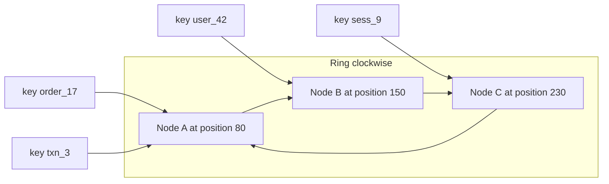

# Consistent Hashing

**Consistent hashing** is a technique for assigning keys to machines such that when a machine joins or leaves, only a small, predictable fraction of keys move — instead of nearly all of them, which is what naive `hash(key) mod N` does. It is the standard answer to "how do we [[Sharding|shard]] without a full reshuffle every time the cluster resizes", invented in 1997 for web caching and now inside Cassandra, DynamoDB's lineage, Memcached client libraries, and many load balancers. If an interviewer says "consistent hashing", they want the ring, virtual nodes, and the mod-N failure story.

## The problem that created it

You hash-partition a cache or database across N machines the obvious way: `server = hash(key) mod N`. It works beautifully until the day you add machine number N+1 — and the arithmetic betrays you. `hash(key) mod 4` and `hash(key) mod 5` give the same answer only when the hash lands on a value where both moduli agree — for roughly 1 in 5 keys. **About 80% of all keys now map to a different server.** In general, going from N to N+1 servers remaps about N/(N+1) of the keyspace.

For a cache fleet, that's a disaster in slow motion: ~80% of lookups suddenly miss, and the full read load lands on the database behind the cache at once — a self-inflicted stampede ([[Cache Stampede and Thundering Herd]]) that has taken real sites down. For a storage system it's worse: 80% of the *data* must physically move over the network before the cluster is healthy. One added machine should not cost a cluster-wide migration. The fix has to make key placement *mostly independent* of the number of servers — which is exactly what the ring does.

## What it solves

- **Minimal movement on resize**: adding or removing one of N nodes moves only ~1/N of the keys — the theoretical minimum (those keys must move *somewhere*).
- **Incremental scalability**: grow the cluster one machine at a time, continuously, without a "big reshard" event ([[Rebalancing Partitions]]).
- **Decentralised placement**: any client or node can compute key → owner locally from the ring metadata; no central lookup service per request.
- **Graceful failure absorption**: a dead node's keys spill to its ring successors rather than invalidating the whole mapping.

## How it works

### The ring

1. Take the output space of a hash function (say 0 to 2³²−1) and bend it into a **circle**: the maximum value wraps around to 0.
2. **Place each server on the circle** by hashing its identifier (name/IP): `position = hash(server_id)`.
3. **Place each key on the circle** the same way: `position = hash(key)`.
4. A key is owned by **the first server clockwise** from the key's position.

(Read the subgraph as the circle: A → B → C → back to A. Each key walks clockwise to the next node.)

Now resize-behaviour falls out geometrically:

- **Add node D** between A and B: D takes only the keys in the arc between A and D — keys that used to belong to B. Nothing else moves. Expected share moved: 1/N.
- **Remove node B** (crash or decommission): B's arc is absorbed by its clockwise successor C. Every other key stays put.

The mapping no longer contains "N" anywhere — that's the trick. `mod N` bakes the cluster size into every key's address; the ring makes each key's address a *position*, and servers merely claim arcs of positions.

### Virtual nodes (vnodes) — fixing the lumpy ring

Hashing N server names onto a circle produces *uneven arcs* — with a handful of nodes, one server can easily own several times its fair share, and when a node dies its *entire* load dumps onto one successor. The fix: give each physical server **many positions** on the ring — e.g. 100–1000 **virtual nodes** each (`hash(server_id + "#1")`, `hash(server_id + "#2")`, …).

- **Smoothness**: many random arcs per server average out to near-equal shares (law of large numbers).
- **Failure spreading**: a dead server's many small arcs scatter across *all* survivors instead of crushing one neighbor.
- **Heterogeneity**: a 2× bigger machine simply gets 2× the vnodes.
- Cost: ring metadata grows (thousands of entries — trivial), and lookups are a binary search over sorted positions — still microseconds.

Cassandra ships vnodes by default (historically 256 per node, lower in recent versions); [[The Dynamo Paper]] used the same idea in 2007.

### Bounded-load variant, in one line

**Consistent hashing with bounded loads** (Mirrokni, Thorup, Zadimoghaddam — Google, 2017): walk clockwise as usual, but if the owner is already above (1+ε)× average load, spill to the next node — guaranteeing no server exceeds the cap while keeping movement small; used in Google's Maglev-adjacent systems and Vimeo's HAProxy work.

### A note on what "consistent" buys — and doesn't

Consistent hashing solves *placement churn*. It does **not** balance *access* load: a single scorching-hot key still lives on exactly one node — see [[Hot Partition Problem]]. And it's not the only answer to resharding: many databases instead use **fixed partitions** (create 4096 partitions up front, move whole partitions between nodes — Redis Cluster's 16384 hash slots are exactly this, *not* a consistent-hash ring). Trade-offs in [[Rebalancing Partitions]].

### Who uses it

| System | How |
|---|---|
| **Dynamo / Cassandra / Riak / ScyllaDB** | Ring + vnodes for data placement ([[The Dynamo Paper]]) |
| **Memcached clients** (Ketama, 2007) | Client library hashes servers onto a ring so adding a cache node invalidates ~1/N of keys, not all — the original production use |
| **Load balancers / routers** | Consistent-hash balancing (e.g. Envoy's ring hash, NGINX `hash ... consistent`) to keep a client/session hitting the same backend for cache affinity, surviving backend churn ([[Load Balancers]]) |
| **CDNs** | Mapping URLs to edge cache machines (Akamai's founding use case, Karger et al. 1997) |
| **Chord DHT** (2001) | Peer-to-peer lookup; the ring plus finger tables for O(log N) routing |

## Trade-offs

| You gain | You pay |
|---|---|
| ~1/N key movement on resize (vs ~all with mod-N) | More complex than mod-N: ring metadata, vnode config, distribution/propagation of ring state |
| Any node/client computes placement locally | All participants must agree on the ring — stale views misroute (see failure modes) |
| Smooth load with vnodes; graceful node-death spreading | Still no cure for per-key hotness; range queries remain dead (it's hash partitioning) |
| Heterogeneous hardware via vnode counts | Slightly worse data locality vs fixed ranges; per-vnode overhead in repair/streaming |

## Failure modes

- **Ring-view disagreement**: two clients with different ring versions write the same key to different nodes → divergent copies. Dynamo-lineage systems patch this with gossip, read repair, and hinted handoff; client-side rings (Memcached) just eat brief inconsistency. Detection: elevated misses/stale reads right after topology changes.
- **Cascade from underprovisioned headroom**: node dies → its load spreads to survivors → if each was at 90%, several tip over → repeat. Vnodes spread the load but can't create capacity; keep N+1/N+2 headroom ([[Capacity Planning]]).
- **Too few vnodes**: visible imbalance (some node at 2× average), and node loss hammering few successors. Detection: per-node ownership percentage; fix: raise vnode count (requires data movement).
- **Hot key**: one key's traffic saturates its owner regardless of ring quality — mitigations live in [[Hot Partition Problem]] and [[Hot Key Problem]].

## When NOT to use it

- **Cluster size is fixed and known** (a stable 3-node setup): `mod N` or static config is simpler and debuggable; consistent hashing earns its complexity only when membership changes.
- **You need range queries**: it's hash placement — sorted scans fan out everywhere. Use range partitioning ([[Sharding]]) or a hybrid key design.
- **A coordinator already exists**: with a central metadata service (MongoDB config servers, Kafka's controller), moving *fixed partitions* around is simpler and gives finer operator control than a ring — this is the mainstream choice in brokered systems ([[Rebalancing Partitions]]).
- **Strict balance caps matter more than movement**: plain ring load varies a few percent even with vnodes; use the bounded-load variant or explicit partition assignment.

## In your stack

- **Redis Cluster is NOT consistent hashing** — 16384 fixed hash slots assigned to nodes, moved explicitly during resharding ([[Redis Cluster and Sentinel]]). Worth saying precisely in interviews; it's the fixed-partitions alternative.
- **Memcached-style client-side rings** are the pattern if you ever run a client-sharded Redis/cache fleet without Cluster mode — e.g. Jedis sharded mode historically used Ketama-style hashing.
- **Kafka/MSK**: `hash(key) mod partitionCount` over a *fixed* partition count — which is exactly why changing partition count breaks key→partition stability and per-key ordering ([[Kafka Architecture]], [[Message Ordering]]); the fixed count is doing the job the ring does elsewhere.
- **Kong / ALB**: consistent-hash upstream balancing is available (e.g. hash on `userId` header) when you want per-user backend affinity without sticky-session state.
- **DynamoDB** descends from Dynamo's ring design ([[DynamoDB Design]]) — though AWS manages placement invisibly; what you still own is the hot-key consequence.

## Interview angle

The 60-second version: *"With `hash mod N`, changing N remaps nearly every key — for a cache that means a cluster-wide miss storm, for storage a full data migration. Consistent hashing hashes both servers and keys onto a circle; a key belongs to the next server clockwise. Adding or removing a server only moves the keys in one arc — about 1/N of them, the minimum possible. Raw rings are lumpy, so each server gets hundreds of virtual nodes to smooth load and spread a dead node's keys across everyone. Cassandra and Dynamo use it for data placement, Memcached clients and load balancers for affinity; a bounded-load variant caps per-server load. It fixes placement churn — it does not fix hot keys."*

Classic follow-ups: "Why virtual nodes?" (smoothness, failure spreading, heterogeneity). "Exactly how much moves adding the N+1th node?" (~1/(N+1) of keys). "Does Redis Cluster use it?" (No — 16384 fixed slots.) "How do clients learn the ring?" (gossip/config service/static config; stale views → misroutes patched by read repair). "What about one hot key?" (ring can't help — replicate or split the key: [[Hot Partition Problem]]).

## Check yourself

> [!question]- Q: Explain to a teammate why `hash(key) mod N` is fine for a fixed fleet but catastrophic for an elastic one.
> `mod N` embeds the fleet size in every key's address, so any change of N re-derives almost every address — ~N/(N+1) of keys move when you add one node. With fixed N that cost is never paid; with elastic membership you pay a near-total reshuffle (cache-miss storm, or mass data migration) on every scale event. Consistent hashing removes N from the formula: servers own arcs of a hash circle, so membership changes only transfer one arc.

> [!question]- Q: What happens when a node dies in a ring WITHOUT virtual nodes, and how do vnodes change it?
> Its entire arc — all its keys and all their traffic — lands on exactly one clockwise successor, which now carries roughly double load and often fails too, starting a cascade. With vnodes, the dead server's hundreds of small arcs have different successors scattered across the fleet, so every surviving node absorbs a small, roughly equal slice.

> [!question]- Q: Your Memcached fleet on a Ketama ring grows from 10 to 11 nodes. Roughly what cache hit-rate impact do you expect, and what would mod-11 have done?
> Ring: ~1/11 ≈ 9% of keys change owner, so roughly a 9-point temporary dip in hit rate while those keys re-warm. mod-N: ~10/11 ≈ 91% of keys remap — effectively a cold cache, and the backing database absorbs nearly the full read load until it re-warms.

> [!question]- Q: Mini-design — session affinity for WebSocket servers behind a load balancer, where servers autoscale. Why consistent hashing, and what's the residual problem?
> Hash `userId` onto a ring of WebSocket servers: a user's connections and server-local state consistently land on the same server, and scale-in/out only redistributes ~1/N of users (who reconnect) instead of everyone. Residual problems: a hot "user" (shared/bot account) still pins one server, and every scale event still forcibly migrates the unlucky arc's users — so server-local state must be reconstructible ([[Stateless vs Stateful Services]], [[WebSockets Server-Sent Events and Long Polling]]).

## Sources

- Karger, Lehman, Leighton, Panigrahy, Levine, Lewin — *Consistent Hashing and Random Trees* (STOC 1997): the original paper (Akamai lineage).
- [[The Dynamo Paper]] — DeCandia et al. (2007), Section 4.2–4.3: ring + virtual nodes in production.
- Mirrokni, Thorup, Zadimoghaddam — *Consistent Hashing with Bounded Loads* (2017); Vimeo engineering blog write-up of deploying it in HAProxy.
- Stoica et al., *Chord: A Scalable Peer-to-peer Lookup Service* (2001).
- *Designing Data-Intensive Applications*, Kleppmann — **Chapter 6** (partitioning by hash, rebalancing discussion and why DDIA prefers fixed partitions for databases).
- last.fm blog / libketama — the Memcached consistent-hashing client that popularised the technique.
