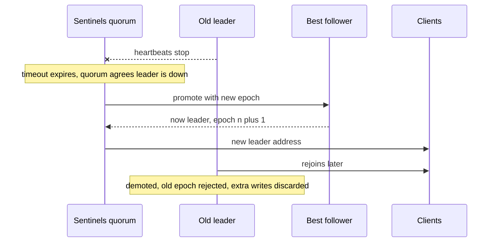

# Failover

**Failover** is the process of noticing that the leader of a [[Replication|replicated]] system has died and promoting a follower to take its place. It sounds like a checkbox feature — "automatic failover: yes" — but it is the single most dangerous routine operation in a database's life: every step (deciding the leader is dead, choosing a successor, redirecting clients) can go wrong in ways that lose acknowledged data or produce two simultaneous leaders. Understanding *why* failover is hard is understanding half of distributed systems; the other half is [[Consensus and Raft]].

## The problem that created it

You added followers for availability — the whole point was surviving leader death. Then the leader actually dies at 3 a.m. Someone must:

1. **Notice** it's dead — but "dead" is indistinguishable from "slow" or "unreachable from here" (see [[Network Partitions and Timeouts]]).
2. **Choose** a new leader among followers that may have different amounts of the data.
3. **Reconfigure** clients and replicas to follow the new leader.
4. **Deal with the old leader** when it comes back, possibly still believing it is the leader.

Doing this by hand means paging a human and eating minutes-to-hours of write downtime. Doing it automatically means encoding judgment calls — *how long is "dead"? is losing the last 2 seconds of writes acceptable?* — into software that will exercise them at the worst possible moment. Both options are bad; failover is choosing your poison deliberately.

## What it solves

- Restores **write availability** after leader failure without (or with bounded) human intervention.
- Bounds **recovery time** (RTO): a practiced failover takes seconds to a minute; an unpracticed manual one takes however long the on-call takes to be confident.
- Enables **planned handover**: upgrades and instance replacement without a write outage — the same machinery, exercised under calm conditions (which is why planned failovers should be routine: they rehearse the emergency).

## How it works

### Step 1 — Detection: heartbeats, timeouts, and the false-positive dilemma

Nodes exchange **heartbeats**; miss enough within a **timeout** and the leader is declared dead. There is no way to do this perfectly, because in an asynchronous network you cannot distinguish a crashed node from a slow one or from a broken network path — that is the core insight behind the impossibility results in distributed computing and the practical content of [[The Fallacies of Distributed Computing]].

The timeout is a dial between two failure modes:

- **Too short** → false positives: a GC pause, a load spike, or a transient network blip triggers failover against a *healthy* leader. Now you've taken an unnecessary failover risk (lost writes, client churn) during a load spike — the worst time. Failovers triggered by overload can also cascade: the promotion adds load, which times out the next leader.
- **Too long** → every real failure costs that much extra downtime.

There is no correct value; there is only a chosen trade-off (commonly single-digit seconds to ~30 s). Quorum-based detection (several observers must agree the leader is dead — not necessarily a majority; the majority gate is the election that follows) filters single-observer network issues — Redis Sentinel requires a configurable quorum of sentinels to agree before starting failover for exactly this reason.

### Step 2 — Election: choosing the new leader

The safest candidate is the follower with the **most complete copy of the leader's log**. Choosing it requires followers to compare positions (binlog/GTID position in MySQL, optime in MongoDB) and agree — which is a [[Consensus and Raft|consensus]] problem: a majority must agree on a single winner, and a node that can't reach a majority must *not* self-promote. MongoDB replica sets run a Raft-like election; Redis Sentinel has sentinels elect among themselves, then pick the best replica.

### Step 3 — The lost-writes problem

With asynchronous replication, even the best follower may be missing the leader's last moments of **acknowledged** writes. Promote it, and those writes are gone — the clients that received "success" hold receipts for transactions that no longer exist. Worse, if the old leader later rejoins, its extra writes conflict with the new timeline and are typically **discarded**.

A famous real-world shape of this: GitHub's September 2012 incident, where an automated failover promoted a lagging MySQL replica whose auto-increment counter was behind the old leader's — it reissued primary keys already handed out, Redis still referenced the old rows under those keys, and some private data was shown to the wrong users (the case DDIA cites). The standard mitigations:

- **Semi-synchronous replication** (MySQL semi-sync): the leader acks a transaction only after at least one replica has received it, so a replica with every acked write always exists. MySQL 5.7+'s `AFTER_SYNC` mode (sometimes called "lossless semi-sync") waits *before* committing locally, closing the window where the leader commits but no replica has the event; the older `AFTER_COMMIT` mode commits locally first, so other sessions can read a transaction that a leader crash plus failover then loses. Price: write latency includes a replica round trip, and if no replica responds within the timeout, semi-sync degrades to async (announce and alert on that).
- **Majority write concern** (MongoDB `w: "majority"`): an acked write exists on a majority, and elections only choose from the majority — acked writes survive any single failure.
- **Accepting the loss**: for data where the last N seconds are genuinely expendable, async + fast failover is a legitimate choice. Make it a *decision*, not a surprise.

### Step 4 — Split brain and fencing

If the old leader never actually died — it was partitioned away — it may still be accepting writes while the new leader also accepts writes. Two divergent histories, no clean merge: **split brain**, the worst outcome. Preventions (detail in [[Split Brain and Fencing]]):

- **Quorum**: a leader that cannot reach a majority stops accepting writes. This is why replica sets have odd member counts and why 2-node HA is a trap.
- **Fencing**: actively prevent the old leader from doing harm — revoke its storage access, block it at the network, or in the hardware-HA tradition **STONITH** ("Shoot The Other Node In The Head"): power-cycle it. Combined with **fencing tokens** (monotonically increasing leader epoch numbers checked by downstream systems) so a stale leader's writes are rejected even if it tries.
- **Epoch/term numbers**: every election increments a term; replicas and clients reject messages from older terms — Raft's mechanism, also MongoDB's, also Kafka's controller epoch.

### Why manual failover is still common

Many serious operations teams configure *detection* to be automatic but keep *promotion* behind a human decision, because:

- A human can tell "the leader is dead" from "the network is weird everywhere" using out-of-band evidence.
- The lost-writes decision (promote a lagging replica now, or wait and extend the outage?) is a business judgment — in payments, often "wait".
- Failover automation itself is code that runs rarely, under chaos, with maximal blast radius — the conditions under which software is least trustworthy. Several famous outages were caused by the failover system, not the failure.

The mature position: automate aggressively for stateless tiers and caches; for systems of record, automate detection and *preparation*, and decide promotion case by case unless you have majority-commit guarantees (Mongo-style) making promotion provably lossless.

### Worked examples

- **MySQL + semi-sync + orchestrator**: orchestrator (the failover tool used at GitHub; the upstream openark repo was archived in February 2025 and lives on as Percona's fork) detects failure via multiple observers, picks the most-advanced replica, repoints the others, and can be configured for fully-automatic or human-approved promotion.
- **Redis Sentinel**: N sentinel processes monitor the primary; quorum agreement marks it objectively down; sentinels elect a sentinel-leader to run the failover; clients discover the new primary by asking sentinels. Remember Redis replication is async — Sentinel failover can lose acked writes by design ([[Redis Cluster and Sentinel]]).
- **MongoDB replica sets**: built-in Raft-like elections, typically electing within ~12 s of primary loss (MongoDB's documented median with the default 10 s `electionTimeoutMillis`, as of 2026); with `w: "majority"` writes, failover does not lose acknowledged data.

## Trade-offs

| You gain | You pay |
|---|---|
| Bounded, automatic recovery from leader death | Risk of false-positive failovers under load/GC/network noise |
| No 3 a.m. human in the loop | The automation can lose acked writes (async) or refuse availability (quorum-less) |
| Rehearsable via planned handover | Clients need re-routing logic; connection storms on promotion |
| Foundation for zero-downtime maintenance | Complexity: epochs, fencing, quorum config — all must be *tested* |

## Failure modes

- **Flapping**: aggressive timeouts + unstable network → repeated failovers, each with client churn; mitigated by quorum detection, longer timeouts, cooldown windows.
- **Cascading overload failover**: leader was slow because of load; the new leader inherits the load plus cold caches plus reconnect storm, and fails too.
- **Split brain** (above) — detected by divergent histories/duplicate leader metrics; prevented by quorum + fencing, *recovered* only by discarding one side's writes.
- **Stale client routing**: clients keep writing to the demoted node (DNS TTLs, cached connection pools). Mitigated by epoch-checking at the server, smart clients (replica-set-aware drivers), or a routing proxy.
- **Failover that never triggers**: the leader is "up" (responds to pings) but broken (disk full, 100% errors). Health checks must measure *usefulness*, not liveness — see [[Health Checks and Service Discovery]].

## When NOT to use it

- **Don't automate promotion** where losing acked writes is unacceptable and your replication can't prove losslessness — keep a human on the promote button with good runbooks.
- **Don't deploy 2-node "HA"**: no majority exists; any partition is either downtime or split brain. Three nodes (or 2 + arbiter/witness) minimum.
- **Don't failover across regions automatically** on short timeouts — inter-region blips are routine; an unnecessary cross-region promotion is extremely expensive to undo. Cross-region is a [[Disaster Recovery]] decision, usually human-initiated.

## In your stack

- **MongoDB replica sets** give you tested automatic failover; the knob that decides whether it is *lossless* is your write concern. `w: 1` on money-movement writes + a failover = possible silent loss; `w: "majority"` closes it at a latency cost. Audit which services use which.
- **Redis**: with Sentinel or Cluster, failover exists but replication is async — treat anything in Redis as losable during failover. Fine for cache; design consciously for Redis Streams messaging (see [[Choosing a Message Broker]]).
- **Kafka/MSK**: per-partition leader election among the ISR; `unclean.leader.election.enable=false` is exactly the "refuse to promote a lagging replica" stance — availability sacrificed for no-data-loss.
- **Your 1-replica services on EKS**: Kubernetes restarting a crashed pod is a form of failover with zero data concerns only because services are stateless ([[Stateless vs Stateful Services]]); the stateful failover problem is concentrated in Mongo/Redis/MSK. During a Mongo election, drivers queue/fail writes for seconds — your retry + [[Idempotency]] story is what makes that invisible.

## Interview angle

The 60-second version: *"Failover is detection, election, and reconfiguration. Detection uses heartbeats with a timeout that trades false positives against recovery time, so good systems require a quorum of observers to agree. Election should pick the most up-to-date follower, via consensus. The two classic disasters: promoting a lagging replica loses acknowledged writes — mitigated by semi-sync replication or majority write concern — and split brain, two leaders at once, prevented by quorum plus fencing with epoch numbers. Because the stakes are losing committed data, many teams still keep a human in the promotion loop for systems of record."*

Classic follow-ups: "Why is a 2-node cluster problematic?" (no majority — partition means downtime or split brain). "How does semi-sync prevent lost writes?" (an ack implies ≥1 replica has the event; promote that replica). "What's a fencing token?" (monotonic epoch; downstream rejects stale leaders — [[Split Brain and Fencing]]). "Why might you disable automatic failover?" (false positives + lossy promotion worse than minutes of downtime for a ledger).

## Check yourself

> [!question]- Q: Explain why there is no "correct" heartbeat timeout.
> Declaring death requires distinguishing crashed from slow/unreachable, which an asynchronous network makes impossible. A short timeout misfires on GC pauses and load spikes (failover against a healthy leader); a long one extends every real outage. You can only pick a trade-off and reduce false positives with quorum agreement among multiple observers.

> [!question]- Q: What happens if an async leader dies, a follower missing the last 2 s of writes is promoted, and the old leader rejoins 10 minutes later?
> The promoted follower's timeline becomes authoritative; the old leader's unreplicated 2 s of writes conflict with it and are discarded (the node resyncs from the new leader). Clients that got acks for those writes have receipts for vanished data — the system must detect this (reconciliation) or have prevented it (semi-sync/majority writes).

> [!question]- Q: Redis Sentinel declared the primary down but the primary was alive and serving a partitioned subset of clients. What is this, and what limits the damage?
> Split brain: both the old primary and the promoted replica accept writes until the partition heals, then the old primary is demoted and its divergent writes are lost. Damage is limited by quorum detection (fewer false triggers), `min-replicas-to-write` on the primary (it stops accepting writes when it can't reach replicas), and keeping only losable data in Redis.

> [!question]- Q: Mini-design — payments ledger on MongoDB: configure failover for zero acknowledged-write loss and justify each choice.
> Replica set of 3+ members across AZs (majority survives one AZ loss); all ledger writes `w: "majority"` with `j: true` (acked ⇒ on a majority, journaled); default automatic elections are then safe because only majority-holding members win; drivers set retryable writes + idempotency keys so the seconds-long election window causes retries, not duplicates or losses; alert on election events and on any code path using weaker write concern.

## Sources

- *Designing Data-Intensive Applications*, Kleppmann — **Chapter 5** (leader failure: failover and its problems) and **Chapter 8–9** background on detection limits.
- MySQL Reference Manual — Semi-synchronous replication (`AFTER_SYNC` vs `AFTER_COMMIT`).
- Redis documentation — Sentinel (quorum, objective/subjective down, election).
- MongoDB Manual — Replica set elections, write concern.
- GitHub engineering post-mortems on MySQL failover (2012 incident; later "orchestrator" posts).
- Raft paper: Ongaro & Ousterhout, *In Search of an Understandable Consensus Algorithm* (2014) — the clean-room version of election + epochs.
