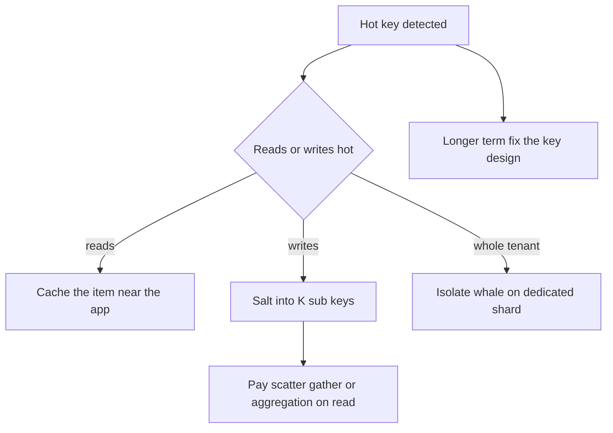

# Hot Partition Problem

A **hot partition** (or **hot key partition**, or **hot shard**) is when one partition of a [[Sharding|sharded]] system receives a wildly disproportionate share of the traffic or data, so that single partition's machine runs at 100% while the rest of the cluster idles. It is *the* defining failure mode of sharded systems, because sharding's whole promise — "N machines ≈ N× capacity" — silently assumes load spreads evenly, and real-world access patterns are never even. If someone asks "what is a hot key partition?", this note is the answer: **the partition that one popular key (or key range) lives on, melting under load that the hash function cannot spread, because a single key can only live in one place.**

## Why this matters

The math is brutal: a 100-shard cluster where one shard is saturated has the *throughput ceiling of one machine* for every request that touches that shard — you are paying for 100 machines and getting 1 for the traffic that matters. And hotness correlates with importance: the hot key is the viral post, the flash-sale product, your biggest enterprise tenant, the current hour's data. Systems fail on hot partitions precisely during their best moments (launch day, viral growth) and the resulting throttling or latency hits your most valuable traffic first. Interviewers love it because it cannot be fixed by "add more servers" — adding shards does nothing for a single hot key — so it reveals whether a candidate understands that **hashing spreads keys, not load**.

## How it works

### Why hashing doesn't save you

Hash partitioning ([[Sharding]]) assigns each *key* to a partition near-uniformly. But uniform placement of keys is not uniform *load* when accesses per key follow a power law — and they always do (the same 80/20 skew that makes [[Why Caching Works|caching work]] makes sharding uneven). One key getting 100k requests/sec lands all 100k on one partition; the hash function's quality is irrelevant.

### The arithmetic of one hot shard

"The cluster's capacity collapses to one machine" deserves actual numbers rather than assertion. A worked hypothetical — the inputs are assumptions, the shape is universal:

- **10 shards**, each machine comfortably serving **12,000 requests/sec** before latency degrades. Cluster capacity: 120,000 req/sec.
- Offered load: **100,000 req/sec** — 83% of cluster capacity. Tight, but fine.

**Even spread** (the case sharding was sold on). Each shard takes 100,000 / 10 = 10,000 req/sec, which is 83% of its own capacity. Everything works.

**One hot key.** Now a single key — a viral post, a flash-sale SKU, a settlement account every transaction touches — accounts for 30,000 req/sec of that 100,000. The remaining 70,000 spread evenly: 70,000 / 10 = 7,000 per shard.

| | Requests/sec | Share of that machine's capacity |
|---|---|---|
| Shard holding the hot key | 7,000 + 30,000 = **37,000** | **308%** |
| Each of the other 9 shards | 7,000 | 58% |
| Cluster average | 10,000 | 83% |

One shard is at three times its capacity — queueing, timing out, shedding — while nine sit a little over half loaded and the cluster-average dashboard reads an entirely unalarming 83%. **That gap between the mean and the maximum is why hot partitions are hard to see**, and why the detection section below leads with per-partition maxima before it reaches for any tool.

**"Just add shards."** Double the cluster to 20 machines. The non-hot 70,000 now spreads over 20 shards: 3,500 each. The hot shard carries 3,500 + 30,000 = **33,500** — still 279% of capacity. You doubled the infrastructure bill and removed 3,500 of the hot shard's 37,000 req/sec: a **9.5% improvement** on the only number that was failing. Resharding redistributes *keys*; it cannot redistribute a key.

**Salting.** Split the hot key into K = 8 sub-keys, each receiving 30,000 / 8 = 3,750 req/sec. Back at the original 10 shards, if those 8 sub-keys land on 8 different shards, the worst shard carries 7,000 + 3,750 = **10,750**, or 90% of capacity — inside the envelope, with no new machines bought. Two honest caveats: a random suffix gives no guarantee the sub-keys land on *distinct* shards, and two colliding on one shard put it at 14,500, back over the line — so K wants margin, or deterministic placement; and reads for "the whole entity" now fan out across 8 keys and merge.

The one-line version: **adding capacity scales the denominator, and a hot key is a problem in the numerator.** The DynamoDB example further down is this same lesson in a platform's own vocabulary, where the ceiling is per *item* rather than per machine — a different mechanism teaching the identical point.

Two distinct root causes produce hot partitions:

### Cause 1 — Skewed access: some entity is just that popular

- **Celebrity keys**: one user with 100M followers; every mention, like, or timeline fan-out touches their row. The canonical case study is [[Twitter Timeline Design]] — celebrity accounts broke fan-out-on-write and forced a hybrid design.
- **Viral objects**: a product on flash sale, a breaking-news article, a meme — hours-old keys taking a region's traffic.
- **Tenant whales**: in a B2B multi-tenant system sharded by `tenant_id`, one enterprise customer is 1000× the median tenant. Their partition is permanently hot; the key design was reasonable and the data still skews.
- **Operational keys**: a single counter, a global config row, a distributed-lock key — innocent-looking keys that every request touches ([[Hot Key Problem]] covers the cache-layer version).

### Cause 2 — Skewed key design: the writes aim themselves at one shard

- **Monotonic keys under range partitioning**: shard by timestamp, auto-increment ID, or any always-increasing value, and *every new write* lands on the last range — one shard takes 100% of inserts forever while the others hold cold history. Time-series workloads walk into this constantly; it's why HBase docs warn about monotonically increasing row keys and why "never use a plain timestamp as the leading key" is folklore in Bigtable-lineage systems.
- **Low-cardinality keys**: shard by `country` or `status` and the big value's partition is structurally hot.
- **Date-prefixed composite keys**: `2026-10-01#event_id` — all of today's traffic shares one range prefix. Same monotonic trap wearing a disguise.

The two causes matter because the fixes differ: cause 2 is fixed by *choosing a better key* (free, if done early); cause 1 cannot be fixed by key choice — the entity really is hot — and needs splitting, caching, or replication of the hot item.

### How you detect it

Hot partitions hide behind averages, so detection is a discipline of its own:

- **Max, not mean, per-partition metrics**: alert on `max(partition_cpu) / avg(partition_cpu)` or on any single partition's utilisation — a cluster-average CPU of 20% with one node at 98% *is* the incident. Same for queue depth, IOPS, and request latency per shard.
- **Top-k key sampling**: you rarely can afford to count every key, so sample. Space-efficient top-k sketches (count-min sketch + heap) in the request path, or periodic sampling at the proxy, surface the heavy hitters. Many systems ship this: Redis has `redis-cli --hotkeys` (works with an LFU eviction policy) and `MONITOR`-based sampling in dev; DynamoDB has **CloudWatch Contributor Insights**, with separate rules for the most-*accessed* and the most-*throttled* partition keys of a table or index — and, since August 2025, a throttle-events-only mode that makes leaving it on cheap.
- **Kafka**: per-partition consumer lag (`kafka-consumer-groups --describe`) and per-partition message-in rates — one partition's lag growing while siblings sit at zero is the signature of a hot message key.
- **MongoDB**: `sh.status()` chunk distribution, per-shard opcounters in Atlas/`mongostat`, and the balancer's migration history — a shard receiving a disproportionate share of writes despite balanced data per shard means a hot key *within* a chunk.
- **Client-side symptoms**: throttling errors concentrated on specific keys, or p99 latency degrading for a coherent subset of users while global p50 looks fine. Be clear about which tool answers "*which* key", though: DynamoDB's ordinary CloudWatch metrics are dimensioned by table, index and operation and never by key, so they tell you that throttling happened and nothing about who caused it — only Contributor Insights names the offender.

Detection matters because the cheap fixes (salting *the one hot key*, caching *the one hot item*, isolating *the one whale*) all require knowing *which* key is hot — a cluster-wide "it's slow" tells you nothing actionable.

### Confirming it, and ruling out the look-alikes

Every hot-partition symptom has a more boring twin, and the difference between them is usually one check. Making that check first is what separates a ten-minute diagnosis from an hour of theorising:

| What you see | Where you look | Confirms a hot partition | Points somewhere else |
|---|---|---|---|
| p99 up, p50 flat, average CPU normal | Per-shard **max** CPU/IOPS, never the cluster mean | One shard ≥ 90% while the rest sit under half | All shards evenly high → a genuine capacity shortfall; adding shards *will* help |
| Some writes throttle, most succeed | Per-key access report: DynamoDB Contributor Insights, Redis `--hotkeys`, proxy sampling | One key or key range dominates the top-k | Throttles spread across many keys → under-provisioning, not skew |
| Consumer lag climbing on one topic | `kafka-consumer-groups --describe`, per-partition lag | One partition's lag rises while siblings sit near zero | Every partition lagging → slow consumer logic or a stalled downstream |
| Writes skewed across Mongo shards | `getShardDistribution()` data per shard **plus** per-shard opcounters | Data balanced but writes skewed → a hot key *inside* a chunk | Data itself skewed past the balancer's threshold → balancer stalled, disabled, or mid-migration (since 6.0.3 it evens data size, not chunk count, so uneven chunk counts alone are normal) |
| One Redis node's CPU pinned, others idle | `INFO commandstats`, slowlog, `--hotkeys` | One key or slot dominates command volume | Memory pressure and evictions rather than CPU → a big-key or sizing problem |

The pattern repeats in every row: **the cluster mean is the enemy and the per-partition maximum is the measurement.** A dashboard that plots only averages structurally cannot show you this failure, which is why hot partitions are so often reported by a customer before they are noticed by monitoring.

### A worked DynamoDB example

Table provisioned at 6,000 WCU, data spread over (at least) 6 partitions, so each partition can serve at most 1,000 WCU — and remember an *item* lives on exactly one partition. A flash-sale product page starts writing 2,500 updates/sec to one `product_id` item, with items under 1 KB so one write costs one WCU:

- Requests against that item throttle at ~1,000 writes/sec (`ProvisionedThroughputExceededException`): 1,500 of the 2,500 are rejected, a 60% error rate on the hot item.
- Table-level consumed capacity reads ~3,500/6,000 WCU — the hot partition's 1,000 plus roughly 2,500 of ordinary traffic on the other five — so dashboards say "plenty of headroom" while the product page is on fire.
- Adaptive capacity has already done all it can: it shifts *unused table throughput* toward the hot partition and can isolate the item on its own partition, but the per-partition cap (1,000 WCU for writes) is a hard ceiling it cannot raise.
- Raising provisioned WCU to 60,000 changes nothing for this item — you'd pay 10× for the same 1,000 writes/sec ceiling on one key.
- The actual fixes: salt the item into K sub-items (writes spread, reads aggregate), or absorb the writes upstream (queue + batched apply), or make the counter approximate (in-memory aggregation flushed periodically).

The numbers make the core lesson concrete: **provisioned capacity is a table-level budget; a single key's ceiling is set by the partition, and no budget increase moves it.**

### What it looks like in production

- One partition's CPU, IOPS or queue depth pegged while cluster-average graphs look healthy — the shape the arithmetic above predicts.
- **In DynamoDB terms**: the per-partition caps of **3,000 RCU and 1,000 WCU** (AWS documented values, as of 2026) hold whatever the table is provisioned for, and an *item* can never exceed them because it lives on exactly one partition. "Provisioned ≠ what one key can use" is the lesson ([[DynamoDB Design]]).
- In Kafka: one partition's consumer lag grows unboundedly while siblings are at zero, because one key (e.g. a whale tenant used as the message key) dominates — the partition is the unit of consumer parallelism, so one consumer eats the whale alone ([[Kafka Architecture]], [[Consumer Groups and Rebalancing]]).
- p99 latency degrades for *some* users (those co-located with the hot entity) while overall dashboards look fine — hot partitions punish the hot key's *neighbors* too, which makes tickets confusing.

### What this looks like at 3am

02:40. The page is consumer lag on a settlement-events topic. The topic-level dashboard shows 1.2 million messages of lag and climbing, consumer pods at 25% CPU, no errors in the logs, no deploy in the last twelve hours — the three facts that make the first responder assume the alert is broken.

`kafka-consumer-groups --describe` ends that in one command: partition 11 holds essentially all the lag; the other 23 partitions are at zero. The producer keys messages by `partnerId`, and at midnight one aggregator partner submitted its nightly settlement batch. Every message in that batch hashes to the same partition.

The instinct is to scale the consumer group, so someone takes it from 6 pods to 24. **Partition 11's lag does not move.** Within a consumer group a partition is consumed by exactly one member, so the rescale merely redistributed the 23 *idle* partitions across more pods; the single consumer assigned to partition 11 is still grinding through one partner's backlog at its own single-threaded rate. Partitions, not pods, are the unit of consumer parallelism — which is also why partition count is the hard ceiling on consumer concurrency for a topic ([[Consumer Groups and Rebalancing]]).

What actually drains it is a decision about ordering, and there are only two honest answers. If per-partner ordering is not a real requirement — and for independent settlement records it usually is not — the key becomes something like `partnerId` plus `accountId`, and the batch spreads across partitions. If per-partner ordering genuinely is required, the hot partition's consumer hands work to an internal pool keyed by account, preserving per-account order while parallelising inside the partition, and commits offsets only once the pool has drained (getting that commit boundary wrong converts a lag incident into a [[Delivery Semantics|duplicate-processing]] incident).

Either way the real finding is that a key-design decision got made at 3am that should have been made at design time: **the partition key is not a labelling convention, it is the load-distribution function.**

### The fixes

**1. Better key choice (prevents cause 2).** Don't lead with time or sequence. Lead with a high-cardinality, evenly-accessed entity ID (`user_id`, `device_id`, `account_id`) and put time *second* (hash-partition by entity, sort by time within it — the Cassandra compound-key pattern from [[Sharding]]). This is free at design time and a full remigration later — hence the shard-key paranoia.

**2. Salting / key splitting (treats cause 1 for writes).** Split the hot key into K sub-keys by appending a random or derived suffix: `bieber#0` … `bieber#15`. Writes scatter across K partitions — write throughput for that entity multiplies by K. The cost is **scatter-gather on read**: reading "all of bieber" now queries all K sub-keys and merges. So salt when the hot path is *writes* (counters, event ingestion, time-series: write-sharded counters summed at read) and the read side can tolerate fan-out or aggregation. Variants: salt only *detected* hot keys (adaptive), or use a time-boxed salt so old data stays unsalted.

**3. Cache the hot item (treats cause 1 for reads).** A read-hot key is the best possible cache candidate: one entry absorbs the entire storm. Serve it from Redis or even in-process memory on each app instance — a hot key is, by definition, the thing local caches are great at. Details, including the "the cache node itself gets hot" recursion, in [[Hot Key Problem]] and [[Cache Stampede and Thundering Herd]].

**4. Isolate or dedicate (treats whales).** Give the whale tenant its own partition/shard/cluster (directed placement), so its load is budgeted rather than randomly co-located with smaller tenants. Many multi-tenant systems run "pool for the many, silo for the whales".

**5. Let the platform help — and know its limits.** **DynamoDB adaptive capacity** automatically shifts unused throughput toward hot partitions (instant as of 2019) and can even **isolate a hot item onto its own partition**. Reality check: it rebalances *within your provisioned/on-demand ceiling* and cannot push one item past the hard per-partition limits (3,000 RCU / 1,000 WCU) — adaptive capacity softens moderate skew; it does not repeal the single-key ceiling. Similarly an operator can split and migrate a hot MongoDB chunk by hand — the balancer reacts only to data size, never to traffic ([[Rebalancing Partitions]]) — but a *single* shard-key value can't be split below one chunk (hence Mongo's own docs push high-cardinality keys).

## Common misconceptions

- *"Add more shards."* Resharding spreads *keys*; the hot key still lives on exactly one shard and brings its full load there. More shards only help when the heat comes from several merely-warm keys sharing a partition by chance.
- *"Use a better hash function."* Uniformity of placement is not the issue; concentration of *access* is. A perfect hash puts the hot key on one perfectly chosen melting machine.
- *"Replicas solve it."* Read replicas genuinely help a read-hot partition (K replicas ≈ K× read capacity for it) — but do nothing for write heat, and they multiply cost for the whole shard, not just the hot item.
- *"DynamoDB adaptive capacity means hot keys are a solved problem."* It raises the pain threshold; the per-partition hard limits remain, and a truly hot single item still throttles. AWS's own guidance remains "design keys for even access".
- *"It only happens at Twitter scale."* A monotonic shard key makes a 2-shard system hot on day one; a flash sale makes a mid-size store hot for an afternoon. Scale changes the blast radius, not the mechanism.

## In your stack

- **Kafka/MSK**: choosing the message key IS choosing your partition-heat profile. Keying by `tenantId` with one whale = one lagging partition and one overwhelmed consumer; keying by `userId` spreads it. Changing partition count later also breaks key→partition mapping ([[Message Ordering]]).
- **Redis**: a hot cached key saturating one cluster node is the cache-flavored twin — [[Hot Key Problem]]; Redis Cluster's 16384 slots can't split a single key either, and large hot hashes make it worse.
- **MongoDB**: avoid monotonic shard keys (ObjectId leads with a timestamp — ranged-sharding on `_id` is the textbook mistake); use hashed sharding or a compound key leading with `accountId`. Watch per-shard write distribution in `sh.status()` / Atlas metrics.
- **Fintech shapes to watch**: a partner/aggregator account that participates in a large share of transactions (every settlement touches it) is a structural hot key — isolate it or shard its ledger entries with salting and periodic aggregation. Month-end/salary-day spikes make time-leading keys extra dangerous.
- **SQS today**: standard queues hide partitioning from you (one reason they're low-drama); FIFO queues reintroduce it via `MessageGroupId` — one hot group serialises.
- **One replica removes the escape valve.** A hot key that saturates a service pinned at a single pod has nowhere to shed: there is no peer instance to carry the non-hot traffic, so the hot entity degrades *every other caller* of that service rather than only its own requests. The 3am scenario above is the same shape — one hot Kafka partition consumed by one thread in one pod, with no slack anywhere in the chain. Be honest about what a second replica buys here: it does not fix the hot key, and it does not raise that partition's throughput at all. What it buys is that the hot key stops being a single-service outage.

## Interview angle

The 60-second version: *"A hot partition is when one shard takes disproportionate load — sharding assumes even spread, but real access follows power laws. Two causes: skewed access (a celebrity user, viral item, or whale tenant — the key really is hot) and skewed key design (monotonic timestamps or auto-increment under range partitioning aim all new writes at the last shard). Consequence: the cluster's effective capacity collapses to one machine — in DynamoDB you see throttling against per-partition limits even though table capacity looks fine. Fixes: design high-cardinality, evenly-accessed keys; salt a write-hot key into K sub-keys and pay scatter-gather reads; cache a read-hot item; isolate whale tenants; and platform features like adaptive capacity help but can't exceed per-partition hard limits."*

Classic follow-ups: "Key for time-series events?" (entity-leading compound key, time second — never time-leading). "How does Twitter handle celebrities?" (hybrid fan-out — [[Twitter Timeline Design]]). "Salting trade-off?" (K× write spread for K-way read fan-out). "How do you *detect* a hot key?" (per-partition max metrics, key-frequency sampling/top-k, e.g. Redis `--hotkeys`, DynamoDB CloudWatch contributor insights).

## Check yourself

> [!question]- Q: Explain "hot key partition" in two sentences, as if to someone who just learned what sharding is.
> Sharding splits data across machines by key, but one key can only live on one machine — so if a single key (a celebrity account, a viral product) gets a huge share of traffic, the machine holding it saturates while the rest of the cluster idles. That overloaded slice is the hot partition, and adding more machines doesn't help because the hot key still maps to exactly one of them.

> [!question]- Q: You shard analytics events by `event_timestamp` range. What happens and why, and what's the fix?
> Every incoming event has the current time, so all writes target the final range — one shard absorbs 100% of insert load while others hold cold history; as time advances the hotness just moves to each new last shard. Fix the key design: hash-partition on a high-cardinality field (`device_id`/`user_id`) and keep time as the within-partition sort key, so writes spread and per-entity time ranges stay cheap.

> [!question]- Q: What happens in DynamoDB when one item gets 5,000 *strongly consistent* reads/sec on a table provisioned for 50,000 RCU?
> The item lives on one partition, and a partition serves at most about 3,000 RCU regardless of table provisioning. A strongly consistent read of a sub-4 KB item costs 1 RCU, so 5,000 reads/sec asks for 5,000 RCU against a 3,000 RCU ceiling and the surplus throttles (`ProvisionedThroughputExceededException`) while the table consumes 3,000 of its 50,000 provisioned units — 6%, which is exactly why the table dashboard exonerates itself. Adaptive capacity shifts headroom toward that partition and may isolate the item, but it cannot raise the per-partition ceiling; the fix is caching (DAX/Redis) for read heat or key-splitting for write heat. Note the sensitivity to one word: *eventually* consistent reads cost 0.5 RCU each, so the same 5,000 reads/sec would be 2,500 RCU and would not throttle at all — on a hot item, consistency level is a capacity decision.

> [!question]- Q: Your Mongo cluster is hash-sharded on `accountId`, so key placement is uniform, and `sh.status()` shows chunk counts balanced within a few percent across all 8 shards. Yet shard 3's write opcounters are 6× every other shard's. What is happening, and what do you check next?
> Balanced chunks mean a balanced *key space*, not balanced *load* — the balancer measures data, not traffic. Hashing guarantees accounts are spread evenly across shards; it guarantees nothing about how often each account is written. So some account on shard 3 is being written far more than the median. In a payments system the usual shape is a partner, nodal, or settlement account that participates in a large share of transactions — a structural hot key rather than a key-design mistake, since `accountId` was the right choice. What to check next, in order: per-shard opcounters to confirm the skew really is in writes and not a reporting artifact; the profiler or a sampled write log on shard 3 to identify the dominant `accountId`; and then whether that one account explains the whole 6× or only part of it, because "one hot key" and "one chunk full of correlated keys" have different fixes. If it is a single key, note the dead end: a chunk cannot be split below one shard-key value, so the balancer can never relieve it no matter how long you wait. The options left act on the key itself — salt that account's ledger entries into K sub-keys with periodic aggregation, or move it to a dedicated shard and budget for it explicitly.

> [!question]- Q: Mini-design — a flash-sale inventory counter for one product must absorb 50k decrement requests/sec. Sketch an approach.
> A single counter row is a structural write-hot key. Split it: shard the stock into K salted counters (e.g. 20 sub-counters of 1/20th the stock each); each decrement picks a random sub-counter, retrying on an empty one; sum sub-counters for display (slightly stale is fine). Alternatives/complements: queue the decrements and serialise through one fast consumer ([[Why Async Messaging Exists]]), or hold the counter in Redis (a single node handles on the order of 100k simple ops/sec unpipelined, far more pipelined — redis.io benchmark examples) with durable reconciliation behind it — each trades consistency, cost, and complexity differently.

## Sources

- *Designing Data-Intensive Applications*, Kleppmann — **Chapter 6**, "Skewed Workloads and Relieving Hot Spots" (salting discussion).
- AWS DynamoDB Developer Guide — "Designing partition keys to distribute your workload" and "Understanding adaptive capacity"; AWS blog *How Amazon DynamoDB adaptive capacity accommodates uneven data access patterns* (2019 instant adaptive capacity announcement).
- [[The Dynamo Paper]] (2007) — uniform load assumptions and their limits.
- Twitter engineering on timeline fan-out and celebrities (see [[Twitter Timeline Design]]).
- HBase Reference Guide / Bigtable schema design docs — warnings on monotonically increasing row keys.
