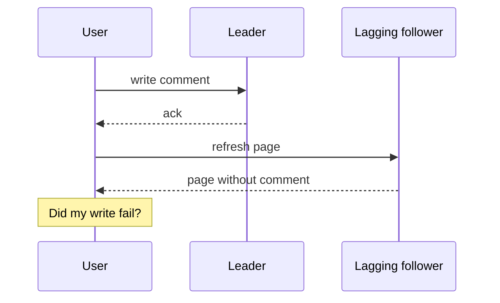

# Read Your Own Writes and Replica Lag Anomalies

Asynchronous [[Replication]] means followers are always slightly behind the leader. Usually nobody notices. But three specific, nameable anomalies leak through to users — the most famous being *"I just posted a comment, refreshed the page, and it's gone."* This note names the three anomalies, the **session guarantees** that rule each one out, and the practical fixes real systems use. These guarantees sit between strong and eventual consistency on the spectrum in [[Consistency Models]]: you don't promise everyone a consistent view, only that each *user's own experience* makes sense.

## Why this matters

Replication lag is invisible in dev (one node, or replicas microseconds behind) and intermittent in prod (lag spikes under load), so these bugs ship silently and surface as un-reproducible user complaints. Worse, the naive fix — "read everything from the leader" — quietly deletes the read-scaling benefit you added replicas for. Knowing the three anomalies by name lets you decide *per read path* how much consistency to pay for. In fintech this is not cosmetic: a user who submits a KYC document and then sees "no document uploaded" will submit it again; a balance page that shows a pre-debit number after a transfer confirmation looks like a lost transaction and generates a support ticket or worse.

## How it works

### The canonical anomaly: posting then refreshing

1. User writes a comment → goes to the **leader**. Leader acks. 
2. User refreshes → the read is load-balanced to a **follower** that hasn't applied the comment yet.
3. The comment is missing. The user assumes it failed and posts again (now it will appear twice), or loses trust.

The write did not fail and the data is not lost — the *read went to the past*.

### The three session guarantees

**1. Read-your-writes** (read-after-write consistency): after a user writes, that user's subsequent reads reflect the write. Says nothing about *other* users — your follower can show them the comment a second later; they never saw the before-state, so they can't tell.

**2. Monotonic reads**: a user who has seen some state never later sees *earlier* state. Violation: two successive refreshes hit two followers with different lag — the comment appears, then vanishes. Time moving backwards is more disorienting than consistent staleness.

**3. Consistent prefix reads**: readers see causally ordered writes in order. Violation: Asha asks "Did the transfer go through?", Dev answers "Yes, confirmed" — an observer reading from differently-lagged partitions sees the *answer before the question*. This anomaly needs partitioned/[[Sharding|sharded]] data (different writes landing on different nodes with different lag); within a single leader's replication stream order is preserved.

### Practical fixes

| Fix | Mechanism | Guarantee it buys | Cost |
|---|---|---|---|
| **Pin user to leader briefly after a write** | After any write, route that user's reads to the leader for a window comfortably exceeding typical lag (e.g. 30–60 s), tracked via a last-write timestamp in the session | Read-your-writes | Leader read load rises with write-active users; need the timestamp plumbed through |
| **Read-what-might-be-yours from leader** | Route reads of things the user *can* edit (own profile, own posts) to the leader; everything else to followers | Read-your-writes for own data | Requires knowing ownership per query; crude but zero session state |
| **Lag-aware routing** | Clients/proxy track each replica's lag; reads carrying a "must be fresher than T" requirement only go to replicas caught up past T. MySQL GTID wait (`WAIT_FOR_EXECUTED_GTID_SET`) and ProxySQL do this; MongoDB's causal consistency sessions (`afterClusterTime`) are the same idea built in | Read-your-writes and monotonic reads, precisely | Infrastructure: lag tracking, token plumbed from write response into subsequent reads |
| **Session stickiness** | Each user's reads always hit the *same* replica (hash user → replica) | Monotonic reads (not read-your-writes — the sticky replica can still lag the user's own write) | Rebalancing on replica failure breaks the guarantee momentarily; uneven load |
| **Client-side patching** | After a successful write, the client inserts the new item into its local view without re-fetching | *Appearance* of read-your-writes | Pure UI trick; diverges from server state; everyone does it anyway |

MongoDB (your primary store) packages the full set as **causally consistent sessions** — reads in a session carry the cluster time of prior writes and block until the chosen secondary catches up. That is lag-aware routing done for you, with one condition worth knowing before you rely on it: the guarantees hold for reads with read concern `majority` and writes with write concern `majority`. Open a causal session and then read with the default read concern and you have bought less than you think.

### What pinning to the leader actually costs

"Route the user to the leader for 60 s after a write" sounds free until you price it. A worked hypothetical — the inputs are assumptions, the arithmetic is the point:

- The service takes 5,000 reads/sec and 200 writes/sec against one primary with two secondaries.
- 50,000 users are active at any instant, so the average active user issues 5,000 / 50,000 = **0.1 reads/sec**.
- Before pinning: the primary takes 200 writes/sec and no reads; each secondary takes 2,500 reads/sec.

Now pin for 60 seconds after a write. The number of users inside a pin window at any instant is at most 200 × 60 = **12,000** — an upper bound, because it assumes every write comes from a different user; if writes cluster into sessions, the real figure is lower. Those users generate 12,000 × 0.1 = **1,200 reads/sec**, and every one of them moves to the primary:

| Routing policy | Primary load | Each secondary |
|---|---|---|
| No pinning | 200 w/s, 0 r/s | 2,500 r/s |
| 60 s pin window | 200 w/s + 1,200 r/s | 1,900 r/s |
| 10 s pin window | 200 w/s + 200 r/s | 2,400 r/s |

A 60-second window hands the primary **24%** of all reads (1,200 of 5,000); a 10-second window hands it 4%. That is the real knob, and it is squeezed from both ends: the window must *exceed* worst-case lag to be correct, and every second of it is primary read load you added secondaries to avoid. Three consequences worth internalising:

- The cost scales with your **write rate**, not your user count. A write-heavy service pins most of its own traffic and gets far less read scaling out of secondaries than the replica count suggests.
- Guessing the window is strictly worse than measuring the position. A causality token (MongoDB `afterClusterTime`, MySQL GTID wait) releases the read the moment the replica is genuinely caught up — usually milliseconds, not the 60 seconds you padded for the bad case.
- If correctness would require a window of *minutes* because tail lag is minutes, the honest reading is that secondary reads are not safe for that endpoint at all, and no window length fixes that.

### The cross-device trap

"Read-your-writes" is a guarantee about a *user*, but most implementations accidentally deliver it per *device or session*. The user posts from their phone, then opens the laptop: the laptop's session has no memory of the phone's write, no sticky replica in common, no last-write timestamp — every session-local technique silently fails, and the user still reports "my post vanished" (now only sometimes, which is worse to debug).

Making the guarantee truly per-user requires server-side state keyed to the user identity, not the connection:

- Store the user's **last-write position** (GTID / Mongo clusterTime / logical timestamp) server-side — in the user's session record, or a small Redis entry keyed by `userId` with a TTL comfortably above max lag.
- Every read for that user consults the position and routes to the leader or to a replica known to have passed it.
- Centralising this at the API gateway or a data-access layer keeps it out of every service's business logic — one interceptor stamps writes and constrains reads.

The cost is a metadata read on the hot path, which is why many products quietly decide that per-device read-your-writes is "good enough" — a legitimate call, as long as it's made consciously rather than discovered via support tickets.

### Lag is not just database replicas: derived views

Every *derived* copy of your data is a "replica" with lag, usually much larger lag than the database's own followers:

| Derived view | Typical lag | Anomaly it produces |
|---|---|---|
| Cache filled on read (cache-aside) | up to TTL | Write, then read the pre-write value from cache — read-your-writes violated for the TTL window |
| Search index fed by [[Change Data Capture]] | seconds | New record exists but is unfindable; edited record still matches old search terms |
| Analytics/warehouse pipeline | minutes–hours | Dashboards disagree with the app; fine, until someone *acts* on the dashboard |
| Downstream service's local copy (event-driven) | seconds | Service B rejects a reference to an entity Service A just created — consistent prefix violated across services |

The same three session guarantees and the same fixes apply, but the causality token must travel further: an event carrying "user updated, as of position X" lets a consumer wait for its own view to reach X, and write-through (rather than lazy) cache population shrinks the cache's window to near zero ([[Caching Strategies]]). The design habit: for every read path, ask "which copy am I reading, and how old can it be?" — the database's replicas are merely the first entry on that list.

### Measuring lag honestly

Every fix above depends on knowing the lag, and the built-in lag numbers mislead in specific, documented ways:

- **MySQL `Seconds_Behind_Master`** (renamed `Seconds_Behind_Source` from MySQL 8.0.22 onward, alongside `SHOW REPLICA STATUS`) compares the timestamp of the event the replica's **SQL thread** is applying against the replica's own clock. It measures how far the SQL thread trails the stream the **IO thread** has already fetched — so if the IO thread stalls or the network to the source is slow, the SQL thread drains the little it has and the field cheerfully reports **0 while the replica is minutes stale**.
- **MongoDB** reports lag as the difference between the primary's and a secondary's `optimeDate` (`rs.printSecondaryReplicationInfo()`, `replSetGetStatus`, the Atlas replication-lag chart). That is an oplog *position* difference. It is a good signal while writes flow steadily, and a weaker proxy for how stale a reader's view is during quiet periods, when there is little new oplog for the gap to show up in.
- **The ground truth in both systems is a heartbeat row.** A tiny job writes the current time into a one-row table or collection on the primary every second; a reader on the replica subtracts the value it sees from its own clock. That difference is true end-to-end staleness, independent of which internal thread is behind. Percona's `pt-heartbeat` is exactly this idea packaged for MySQL; the same twenty lines work against a Mongo secondary.

Then alert on the **maximum** lag across replicas and on its tail over time, never the average. The mean is near zero all day and says nothing about the ninety-second excursion that generates the support tickets.

### What does NOT fix it

- **Sync replication to every replica** fixes it by making lag zero, at the availability/latency cost described in [[Replication]] — almost never the right trade for this problem alone.
- **Retrying the read** works eventually but turns a design problem into user-visible flicker and extra load.
- **Caching** usually makes it *worse*: a cache populated from a lagging follower extends the staleness window beyond the lag itself (see [[Cache Invalidation]]).

### What this looks like at 3am

It does not arrive as a page. It arrives as a Slack message from the support lead: four customers in the last hour say their KYC document upload "didn't save" — yet the files are all in the bucket and all recorded in the database.

The dashboard tells the story in one chart. Secondary replication lag sits around 40 ms every day of the week, then steps to roughly 95 seconds at 02:55 and stays there. The 02:55 job is a nightly index build on the transactions collection; it saturates the secondaries' IO while they are also applying the oplog.

The root cause is six weeks old and has nothing to do with tonight. A latency push moved the KYC status endpoint to `readPreference: secondaryPreferred`. The upload write goes to the primary and is durable; the status read two seconds later goes to a secondary 95 seconds behind, which answers truthfully that it has never heard of this document. The app renders "no document on file", and the customer uploads it again — which is how you end up with duplicate KYC documents to reconcile on top of everything else.

How you confirm it in five minutes instead of arguing for an hour:

1. **Reproduce it on one identity.** Take an affected `userId`, read the document with `readPreference: primary` — present. Read it with `secondaryPreferred` — absent. The anomaly is now on demand, which closes the "are we losing data?" branch of the conversation immediately.
2. **Overlay complaint timestamps on the lag chart.** If every complaint falls inside the lag step, the causal link is established; if complaints predate the step, you are chasing the wrong thing and should go looking for a deploy instead.
3. **Check the shape, not the endpoint.** A write to the primary followed within seconds by a read carrying any non-primary preference is the signature. Grep the service for read-preference overrides and you will usually find more than the one that paged you.

The fix that night is to flip that endpoint back to primary reads. The fix that week is to decide *per endpoint* which reads are permitted to see the past, and to write it down — so that the next nightly index build is not the mechanism that discovers the answer for you.

## Common misconceptions

- *"Eventual consistency means the data might be wrong."* No — the data on the leader is correct and durable; followers converge. The anomaly is about *which copy your read hit*, not data corruption.
- *"We read from the primary, so we're immune."* Until someone adds `readPreference: secondaryPreferred` to shed load during an incident — the setting migrates, the assumption doesn't. Also caches and search indexes fed by [[Change Data Capture]] are "replicas" with lag too; the anomaly applies to any derived view, not just DB replicas.
- *"Lag is a few milliseconds, users can't notice."* Typical lag is milliseconds; *tail* lag during bulk loads, failover, or replica rebuilds is seconds to minutes — exactly when traffic is weird and users are retrying.
- *"This is [[CAP Theorem]] stuff, pick C or A."* CAP is about partitions; these anomalies happen on perfectly healthy networks. The relevant trade is latency-vs-consistency on the normal path — [[PACELC]]'s "else" branch.

## In your stack

- **MongoDB**: `readPreference: primary` (the default) gives read-your-writes trivially. If you shed reads to secondaries, use causal sessions or accept these anomalies knowingly per endpoint. `w: "majority"` alone does *not* give it — a secondary read can still lag a majority-committed write.
- **Redis cache in front of Mongo**: cache-aside fill from a lagging secondary bakes staleness into the TTL window. Fill correctness-sensitive keys from the primary.
- **SQS / event-driven flows**: a consumer that reads a message "user X updated" and then queries a lagging replica may not see the update it was told about — consistent-prefix violated across systems. Either read from the primary in consumers, or put the needed data *in the event*.
- **Fintech framing**: balances, limits, KYC state → primary reads, always. Transaction history lists, analytics, notification content → replica reads are fine; a 2-second-stale history page harms nobody.
- **One replica makes the wrong implementation look correct.** With many services pinned at a single pod, an in-process map of `userId → last write position` passes every test and works in production — then silently stops working the first time that service scales to two pods, because half the user's reads land on an instance that never saw their write. The failure arrives as "it worked for months" and is attributed to the scale-out rather than the design. The position belongs in Redis keyed by `userId` with a TTL above max lag — which you already run — not in a field on the instance.

## Interview angle

The 60-second version: *"Async replication makes followers lag the leader, which creates three user-visible anomalies: you can miss your own just-written data (fixed by read-your-writes), see time go backwards across refreshes (fixed by monotonic reads — e.g. session stickiness), and see effects before causes across partitions (fixed by consistent prefix). These are session guarantees — weaker than linearizability, much cheaper, and usually all a product needs. Standard fixes: route a user's reads to the leader briefly after they write, or make reads wait for a causality token, like MongoDB causal sessions or MySQL GTID waits."*

Classic follow-ups: "User posts on their phone, checks on their laptop — does session stickiness help?" (No — the guarantee must be per *user*, not per device/session; needs a server-side causality token keyed to the user.) "How would you implement read-your-writes at the load balancer?" (Write responses set a token/timestamp; subsequent reads carrying it get routed to leader or a caught-up replica.) "Which anomaly needs sharding to even occur?" (Consistent prefix violations.)

## Check yourself

> [!question]- Q: Explain the difference between read-your-writes and monotonic reads in one sentence each.
> Read-your-writes: after I write something, my own later reads include it. Monotonic reads: once I've seen the database in some state, I never see an older state afterwards — the two can be violated independently.

> [!question]- Q: What happens if you implement read-your-writes with "pin to leader for 60 s after write" and your p99 replication lag is 3 minutes during nightly batch jobs?
> The window no longer covers the lag: a user who writes, waits 61 seconds, and reads can hit a follower still 2+ minutes behind and miss their write. Fixed windows must exceed worst-case lag you're willing to tolerate — or better, use an actual causality token (GTID/clusterTime) that waits for the real position rather than guessing with wall-clock time.

> [!question]- Q: A service takes 400 writes/sec and 2,000 reads/sec, and the average active user issues 0.05 reads/sec. You add "pin that user's reads to the primary for 30 seconds after a write." Roughly what fraction of reads lands on the primary, and what should you conclude?
> At most 400 × 30 = 12,000 users sit inside a pin window at any instant — an upper bound, since it assumes every write comes from a different user. Those users generate 12,000 × 0.05 = 600 reads/sec, which is **30%** of the 2,000 reads/sec total. Two conclusions. First, the pin's cost scales with the *write* rate, so at a 1:5 write-to-read ratio nearly a third of your reads have just been taken back off the secondaries — most of the read scaling you added them for. Second, the tempting response ("shorten the window until it's cheap") is the wrong one: the window is a correctness device and shrinking it below worst-case lag silently reintroduces the anomaly. The right move is to stop guessing with wall-clock time and use a causality token, which releases each read at the actual replica position — typically milliseconds, instead of the 30 seconds you padded for the worst case.

> [!question]- Q: A support agent and the customer look at the same account simultaneously and see different balances. Which guarantee is violated, and does it matter?
> None of the three — session guarantees are per-user; cross-user agreement needs stronger consistency (linearizability). Whether it matters is a product call: for a view-only support screen, seconds of divergence are usually acceptable; for an agent *acting* on the balance, route that read to the primary.

> [!question]- Q: Mini-design — the Niyo app shows "Transfer successful" and then navigates to the transactions list. Design the read path so the new transaction always appears.
> Options, cheapest first: (1) client-side patch — insert the transaction into the list from the write response while the fetch happens; (2) read the list from the Mongo primary for N seconds after a money-movement write for that user; (3) causal session — the write returns a clusterTime, the list read passes `afterClusterTime` so even a secondary read waits until it's caught up. In practice ship (1) + (3): instant UI plus a correct backend guarantee.

## Sources

- *Designing Data-Intensive Applications*, Kleppmann — **Chapter 5**, "Problems with Replication Lag" (reading your own writes, monotonic reads, consistent prefix).
- Terry et al., *Session Guarantees for Weakly Consistent Replicated Data* (1994) — the original paper naming these guarantees (Bayou project).
- MongoDB Manual — Causal consistency and client sessions.
- MySQL Reference Manual — GTID functions (`WAIT_FOR_EXECUTED_GTID_SET`).
