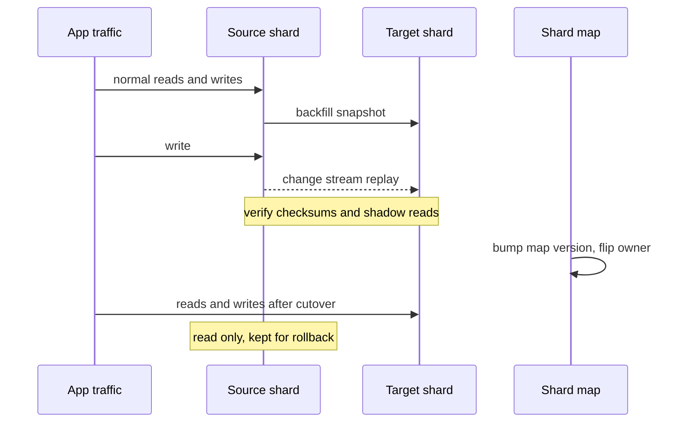

# Rebalancing Partitions

**Rebalancing** is moving data and request load between nodes of a [[Sharding|sharded]] system — because a node was added, a node died, or load skewed — while the system keeps serving reads and writes. It is where sharding designs earn or lose their keep: the partitioning scheme you chose on day one determines whether "add a shard" is a routine background operation or a months-long migration project. This note covers the three mainstream schemes (fixed many-partitions, dynamic splitting, consistent hashing), the live-migration playbook (dual writes → backfill → cutover), and the operational guardrails that stop a rebalance from becoming an outage.

## The problem that created it

Your 4-shard cluster needs to become 5. Three requirements collide:

1. **Move no more data than necessary** — data transfer costs network, disk IO, and time; at terabytes, moving 80% of the data is days to weeks of degraded performance (8 TB at a throttled 20–100 MB/s is ~1–5 days of copy alone, before verification).
2. **Stay online** — reads and writes continue against keys that are mid-flight between owners.
3. **End balanced** — roughly even data *and* load per node afterwards.

The naive scheme fails requirement 1 instantly: with `hash(key) mod N`, changing N remaps nearly every key (~N/(N+1) of them — the arithmetic in [[Consistent Hashing]]). **Mod-N makes every resize a near-total reshuffle**: for a 4→5 node, 10 TB cluster, that's ~8 TB over the network while production traffic runs, with cache hit rates destroyed and every key's location ambiguous during the move. The entire design space of rebalancing is "how do we assign keys so that resizing moves only a small, controlled amount?"

## What it solves

- **Elasticity**: grow (or shrink) the cluster with bounded, predictable data movement.
- **Failure recovery**: a dead node's partitions re-home to survivors.
- **Skew correction**: split or relocate hot/oversized partitions ([[Hot Partition Problem]]).
- **Hardware refresh**: drain a node by moving its partitions, then retire it — no downtime.

## How it works

### Scheme 1 — Fixed number of partitions, created up front (Kafka/Elasticsearch/Redis Cluster style)

Create far more partitions than nodes on day one — say 1024 partitions for a 10-node cluster (~100 each). Keys map to partitions by hash (**partition count never changes**, so the mapping is stable forever); *partitions* map to nodes by an assignment table that the operator or system edits. Rebalancing = reassigning whole partitions and copying them — key→partition never changes, only partition→node.

- Add a node: it *steals* a few partitions from each existing node until even; ~1/N of data moves in node-sized chunks.
- This is Elasticsearch (primary shard count fixed at index creation; the `_split`/`_shrink` APIs change it only by writing a new index), Redis Cluster (16384 hash slots moved explicitly via `MIGRATE`), Couchbase vBuckets, and effectively [[Kafka Architecture]] (partition count set per topic; partition reassignment moves replicas between brokers).
- **The catch**: choosing the count. Too few = ceiling on future nodes (can't have more nodes than partitions) and huge per-partition size (slow moves/recovery); too many = per-partition overhead (file handles, metadata, recovery bookkeeping) on day one. You're sizing for a future you can't see. Kafka's related sharp edge: you *can* add partitions to a topic, but that changes key→partition mapping and breaks per-key ordering, so in practice the count is sacred once keyed data flows ([[Message Ordering]]).

### Scheme 2 — Dynamic splitting (HBase/MongoDB/Bigtable style)

Start with few (even one) partitions; when a partition exceeds a size threshold (e.g. HBase's 10 GB default region size, as of 2026), **split** it into two at a key midpoint; a balancer process migrates regions/chunks to even out nodes. Merging handles shrinkage. MongoDB was the textbook example until 6.0.3, which stopped auto-splitting: its balancer now evens out *data size* per shard, migrating a range (default 128 MB since 5.2; 64 MB before) once two shards differ by three range sizes — 384 MB at the default.

- Partition count tracks data volume automatically — no up-front guess.
- MongoDB: config servers hold the chunk→shard map; the balancer moves chunks while `mongos` routers follow the versioned map ([[MongoDB Architecture]]).
- **Catches**: a fresh collection with a *ranged* key starts as *one* chunk on *one* shard — cold-start writes all hit one node until the balancer catches up (Mongo answers with pre-splitting; hashed keys on an empty collection are pre-split across shards automatically); split/migrate storms can ignite under load exactly when you least want IO spent on housekeeping; and a single never-ending-growth key value can't be split below one chunk (hot whale — [[Hot Partition Problem]]).

### Scheme 3 — Consistent hashing with virtual nodes (Cassandra/Dynamo style)

Nodes own many arcs of a hash ring; adding a node claims arcs (~1/N of data), removing one spills arcs to many survivors. Decentralised — no assignment table service — at the cost of ring-state propagation. Full treatment in [[Consistent Hashing]].

### A note on "automatic vs manual"

Fully automatic rebalancing sounds strictly better and isn't: rebalancing is expensive IO, and an automatic balancer reacting to a *transient* condition (node slow under load → declared dead → its data re-replicated → extra IO makes others slow → …) can cascade. Mature systems either keep a human approving the plan (Kafka's reassignment tooling, Redis Cluster resharding) or automate with heavy damping (Mongo balancer windows, Elasticsearch allocation throttles). DDIA's dry phrasing: it can be a good thing to have a human in the loop for rebalancing.

### Moving data live: the dual-write / backfill / cutover playbook

Schemes 1–3 answer *what* moves; this is *how* a unit of data moves while being written to — the same playbook whether it's one Mongo chunk or a whole hand-rolled MySQL resharding project:

1. **Snapshot + backfill**: copy the partition's existing data from source to target while writes continue on the source.
2. **Dual writes / change capture**: new writes during the copy go to both source and target — either literal application dual writes (dangerous without idempotency and ordering care — the dual-write problem from [[The Outbox Pattern]]) or, better, replaying the source's change stream onto the target ([[Change Data Capture]]) until the target converges.
3. **Verify**: checksum/count/row-compare source vs target; run shadow reads (read both, compare, serve source) to measure divergence with zero user risk.
4. **Cutover**: flip the routing map (versioned!) so the target owns the key range; briefly fence or queue writes at the moment of flip to avoid a lost tail. Keep the source read-only for rollback until confidence is earned.
5. **Clean up**: drop source data, retire dual-write code promptly (zombie dual-write paths are a classic source of later divergence).

### Operational guardrails

- **Rate-limit movement**: cap migration bandwidth/concurrency so rebalancing never starves production IO (Elasticsearch recovery throttles, Cassandra stream throughput caps, Mongo balancer windows "only rebalance 2 a.m.–6 a.m."). An unthrottled rebalance is a self-inflicted DoS.
- **Move one unit at a time per node**, with backoff on latency regression — rebalancing should be boring and slow.
- **Versioned routing maps**: every request carries/checks the map version; a shard answering "I don't own this (anymore)" triggers a client map refresh rather than silent wrong-shard reads.
- **Observability before action**: per-partition size/load metrics drive *which* partitions move; alert on balancer activity so humans know IO is being spent.
- **Rollback plan**: cutovers are per-partition and reversible until source deletion; never burn the boats in the same change that flips traffic.

## Trade-offs

| Scheme | Movement on resize | Up-front decision | Hot-spot handling | Complexity lives in |
|---|---|---|---|---|
| Fixed many partitions | ~1/N, whole partitions | Partition count (hard to change) | Move hot partitions apart; can't split one | Choosing the count; assignment tooling |
| Dynamic splitting | Only split/moved chunks | Thresholds only | Split hot ranges (not hot single keys) | Balancer behaviour; cold start |
| Consistent hashing + vnodes | ~1/N, scattered arcs | Vnode count | None inherent (see [[Hot Partition Problem]]) | Ring propagation; repair |
| hash mod N | ~everything | none | none | Don't. |

## Failure modes

- **Rebalancing storm**: balancer IO degrades the cluster → more timeouts → (with automatic failure detection) more "failures" → more rebalancing. Detected by migration metrics correlating with latency; mitigated by throttles, damping, and human-approved plans.
- **Lost or doubled writes at cutover**: flipping routing without fencing the tail of in-flight writes → tail lands on the old owner post-flip (lost) or dual-apply without idempotency (doubled). Mitigated by brief write pause/queue at flip + idempotent replay ([[Idempotency]]).
- **Stale routers**: a client with an old map writes to the old owner indefinitely. Mitigated by ownership checks at the data node + map version in the protocol (Mongo's shard versioning does exactly this).
- **Backfill divergence**: schema drift or clock-skewed conflict resolution makes target ≠ source silently; caught only by checksums/shadow reads — verification is not optional.
- **Cold-start single chunk** (dynamic scheme): a new high-traffic collection hammers one shard until splits catch up; pre-split if launch traffic is predictable.

## When NOT to use it

- **Don't rebalance reactively during an incident** — mid-incident data movement adds IO and ambiguity precisely when the system is least able to pay; stabilise first (shed load, cache), move data calmly after.
- **Don't reshard to fix a single hot key** — movement spreads *partitions*, not one key's load; that's salting/caching territory ([[Hot Partition Problem]]).
- **Don't build migration machinery for a cluster that will never resize** — a fixed 3-node internal tool with mod-3 and a documented "we reshuffle if we resize" is honest simplicity.
- **Don't add Kafka partitions to a keyed topic casually** — that "rebalance" silently breaks per-key ordering; plan it as a real migration (new topic, replay) instead.

## In your stack

- **MongoDB does scheme 2 for you**: chunks, balancer, versioned `mongos` routing. Your levers: shard key quality, pre-splitting for new hot collections, and balancer windows aligned to Indian-traffic off-hours.
- **Kafka/MSK is scheme 1**: topic partition counts are near-permanent once keyed data flows; broker-level rebalancing is `kafka-reassign-partitions` (or Cruise Control) with throttles — human-planned, as it should be.
- **Redis Cluster**: 16384 slots moved explicitly (`CLUSTER SETSLOT` + `MIGRATE`) — operator-driven scheme 1; during a slot move Redis bounces clients with `ASK`/`MOVED` redirects, its version of versioned routing.
- **Consumer-group rebalancing** (Kafka; Redis Streams groups have no partitions to reassign — entries are handed out per read) is the same word for a different thing — reassigning *partitions to consumers*, not data to nodes ([[Consumer Groups and Rebalancing]]); it still exhibits the storm failure mode (rebalance loops).
- **Fintech angle**: a resharding cutover that can lose a tail of acked ledger writes is an auditable event; the fence-pause-verify step isn't optional polish, it's the control. Favour CDC-replay over app dual-writes for the audit trail.

## Interview angle

The 60-second version: *"Rebalancing is moving partitions between nodes as a cluster grows, shrinks, or skews — while serving traffic. Hash-mod-N is catastrophic because changing N remaps almost every key, so real systems decouple key→partition from partition→node: either a fixed large partition count with partitions reassigned as units — Kafka, Elasticsearch, Redis Cluster's 16384 slots — or dynamic splitting where partitions split at a size threshold and a balancer moves them — HBase, MongoDB — or consistent hashing with virtual nodes — Cassandra. Live moves follow snapshot, backfill, change replay, verify, then a versioned-map cutover with the tail fenced. Guardrails: throttle movement, one migration at a time, ownership checks for stale routers, humans approving large plans."*

Classic follow-ups: "Why not mod N?" (near-total reshuffle). "How does Mongo move a chunk while it's being written?" (backfill + catch-up of writes made during the copy + a brief critical section and commit on the config servers, routers follow chunk versions). "Fixed count: how do you pick it?" (bound future node count × headroom vs per-partition overhead; err high within reason). "Can you rebalance a Kafka topic from 12 to 24 partitions?" (you can add, but key mapping and ordering break — treat as migration).

## Check yourself

> [!question]- Q: Explain why `hash(key) mod N` makes adding one node catastrophic, and name the two mainstream designs that avoid it.
> mod N bakes the node count into every key's address, so going N→N+1 changes the answer for ~N/(N+1) of keys — nearly all data must move and every cache of location goes stale at once. Avoided by (1) fixed many-partitions: hash keys into a large constant number of partitions and move whole partitions between nodes, and (2) consistent hashing: nodes own ring arcs so a membership change moves only ~1/N of keys. (Dynamic splitting also qualifies by making partition boundaries data-driven rather than N-driven.)

> [!question]- Q: During a chunk migration, what prevents a write made mid-copy from being lost at cutover?
> The move isn't copy-then-flip: after the snapshot backfill, the source's ongoing changes are continuously replayed to the target (change stream/oplog), so the target converges; at cutover, writes are briefly fenced/queued while the final tail is drained and the routing map version is bumped, then writes resume on the target. Idempotent replay makes the overlap safe; verification (checksums/shadow reads) proves convergence before the flip.

> [!question]- Q: What happens if the balancer is allowed to move data at full speed during peak traffic?
> Migration IO competes with production reads/writes: latency rises, timeouts fire, and in systems with automatic failure detection, slow nodes get declared dead, triggering *more* re-replication — a rebalancing storm that can cascade into an outage. Hence rate limits, migration windows, and damping are first-class guardrails, not nice-to-haves.

> [!question]- Q: Mini-design — your hand-sharded MySQL fleet (mod 8, app-level routing) must go to 12 shards with zero downtime. Plan it.
> Don't mod-12 (would remap ~2/3 of keys). Introduce an indirection: define 4096 logical buckets, `bucket = hash(key) mod 4096` (stable forever), with a bucket→shard map in config; initially recreate the current layout: bucket b → shard b mod 8, valid because 8 divides 4096 (so buckets 0, 8, 16, … → shard 0 — contiguous ranges like 0–511 → shard 0 would not match mod-8 placement and would move 7/8 of the data). Then migrate bucket groups to the 4 new shards one group at a time: backfill + binlog replay ([[Change Data Capture]]), checksum, flip that group's map entry with a brief write fence, keep source read-only for rollback. Throttle to one group per shard-pair at a time. This is Vitess's resharding model in miniature ([[Why MySQL Does Scale]]).

## Sources

- *Designing Data-Intensive Applications*, Kleppmann — **Chapter 6**, "Rebalancing Partitions" (fixed vs dynamic vs mod-N, automatic vs manual).
- Vitess documentation — resharding (VReplication workflow: copy, replicate, verify, cutover).
- MongoDB Manual — sharded cluster balancer, chunk migration procedure, pre-splitting.
- Kafka documentation — partition reassignment; Cruise Control project docs.
- Redis documentation — Cluster spec (slot migration, ASK/MOVED redirects).
- Elasticsearch reference — shard allocation and recovery throttling.
