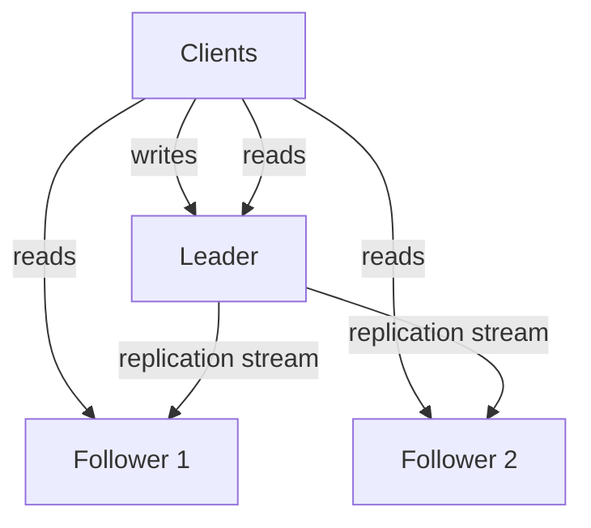

# Replication

**Replication** means keeping a copy of the same data on multiple machines connected by a network. It is the first thing every serious system does to its database, before sharding, before exotic datastores — because a single copy of data on a single machine is one disk failure away from not existing. Almost every production database you have touched (MongoDB replica sets, MySQL with read replicas, Redis with replicas, Kafka with in-sync replicas) is running one of the three replication designs in this note. The hard part is not copying data; it is keeping copies consistent while the system keeps accepting writes.

## The problem that created it

Picture a growing product with one database server. Three separate pains appear, in roughly this order:

1. **The machine will die.** Disks fail, instances get terminated, data centres lose power. With one copy, a dead machine means downtime at best and permanent data loss at worst. You need a second copy just to sleep at night.
2. **Reads outgrow one box.** Most applications read far more than they write (often 10:1 to 100:1). One machine has a fixed ceiling of CPU, memory, and IOPS. You want to spread read traffic across several machines that all hold the data.
3. **Users are far away.** A user in India talking to a database in Virginia pays ~200 ms round trip *per query* — physics, not engineering (see [[Latency Numbers Every Engineer Should Know]]). Putting a copy of the data near each user population cuts that to single-digit milliseconds.

All three pains have the same shape of answer — more copies — and the same new problem: **the copies must agree with each other while data keeps changing**. If data never changed, replication would be `rsync` and this module would not exist.

## What it solves

- **High availability**: the system survives the death of any single node; a replica takes over (see [[Failover]]).
- **Read scalability**: read queries fan out across replicas, multiplying read throughput without touching the write path.
- **Geo-latency**: a replica in each region serves nearby users fast.
- **Durability**: an acknowledged write exists on more than one disk, so a single machine loss does not lose data — *if* replication is synchronous enough (see below; this "if" is the crux of the whole note).

What it does **not** solve: write throughput. Every replica must still apply every write. To scale writes you need [[Sharding]].

## How it works

There are three fundamental designs, distinguished by one question: **who is allowed to accept writes?**

### 1. Leader-follower (single-leader) — the default

One node is the **leader** (historically "master", "primary"). All writes go to the leader; it writes locally, then streams the changes to **followers** (replicas), which apply them in the same order. Reads can go to the leader or any follower. This is MySQL replication, PostgreSQL streaming replication, MongoDB replica sets, and Redis replication.

Why it is the default: with exactly one writer there are **no write conflicts** — the leader serialises all writes into one order, and every follower applies that same order. The price is that the leader is a write bottleneck and a single point of failure that needs [[Failover]].

### 2. Multi-leader — multiple writers, hello conflicts

More than one node accepts writes (typically one leader per datacentre/region), and leaders replicate to each other asynchronously. Useful for multi-region write latency and for offline-capable clients (your phone's calendar is effectively a leader that syncs later).

The fundamental cost: **write conflicts**. Two leaders can accept conflicting writes to the same record at the same moment, and both have already told their client "OK" before either hears about the other. Someone must resolve the conflict after the fact:

- **Last-write-wins (LWW)**: pick the write with the latest timestamp. Simple, and silently **discards data** — plus clock skew makes "latest" unreliable (see [[Logical Clocks and Ordering]]).
- **Merge**: keep both values and merge them (siblings in Riak, CRDTs in modern systems). Correct but pushes complexity to the application.
- **Application callback**: hand both versions to app code and make it decide.

Rule of thumb: avoid multi-leader unless you genuinely need multi-region writes; conflict resolution is where correctness bugs hide.

### 3. Leaderless (Dynamo-style)

No leader at all. The client (or a coordinator node) sends each write to **all N replicas** in parallel and considers it successful once **W** of them acknowledge; reads query **R** replicas and take the newest version. If `R + W > N`, every read set overlaps every write set, so a read sees at least one up-to-date copy. This is [[The Dynamo Paper]] design, used by Cassandra, Riak, and ScyllaDB — mechanics in [[Quorum Reads and Writes]].

There is no failover (no leader to fail), writes keep working through node outages, but you accept eventual consistency and need repair machinery (read repair, anti-entropy, hinted handoff).

### Sync vs async vs semi-sync

Orthogonal to topology: **when does the leader tell the client "your write is saved"?**

| Mode | Leader acks after | You gain | You risk |
|---|---|---|---|
| **Synchronous** | at least one (or all) followers confirm | An acked write survives leader death — real durability | Write latency includes the slowest required follower; a dead sync follower **blocks all writes** (with "all followers" sync, any node down = system down) |
| **Asynchronous** | writing locally only | Fastest writes; followers can die with zero write impact | Leader dies before followers catch up → **acknowledged writes are lost**. The client was told "saved"; it wasn't |
| **Semi-synchronous** | one designated follower confirms; the rest are async | Guaranteed second copy without waiting for everyone | Still only tolerates patterns where leader and the sync follower don't die together; sync follower lag still slows writes |

In practice fully-sync is rare; most deployments are async or semi-sync. MySQL's **semi-sync** plugin and MongoDB's `w: "majority"` write concern are the mainstream middle ground. Kafka's `acks=all` with `min.insync.replicas` is the same idea wearing a different hat ([[Kafka Architecture]]).

### Replication lag

With async replication, followers are always *somewhat* behind — normally milliseconds, but under load, during bulk writes, or after a network blip it can stretch to seconds or minutes. Lag is not a bug; it is the design. But it produces user-visible anomalies — you post a comment, refresh, and it's gone — covered in [[Read Your Own Writes and Replica Lag Anomalies]]. Monitor lag as a first-class metric (e.g. MySQL `Seconds_Behind_Source`, Mongo `replication lag` in `rs.status()`).

### What actually travels over the wire

Three levels of abstraction for shipping changes, concept-level:

- **Statement-based**: ship the SQL text (`UPDATE accounts SET ...`). Compact, but nondeterministic statements (`NOW()`, `RAND()`, auto-increment races) produce different results on replicas. Mostly abandoned as a default.
- **Logical / row-based**: ship the *effect* — "row with PK 42 changed from X to Y". Deterministic, decoupled from storage engine internals; MySQL's default binlog format, and what [[Change Data Capture]] tools like Debezium consume.
- **WAL / physical shipping**: ship the storage engine's write-ahead log — literal byte-level page changes ([[How Databases Store Data]]). Exactly what PostgreSQL streaming replication does. Extremely faithful, but replicas must run a compatible engine version, since the bytes describe physical pages.

## Trade-offs

| You gain | You pay |
|---|---|
| Survive machine loss | Every replica is a full copy — N× storage cost |
| Read throughput multiplies | Writes do not scale at all; every node applies every write |
| Low read latency per region | Async lag → stale reads, anomalies, app-level complexity |
| Durability (if sync enough) | Sync replication → higher write latency, availability coupling |
| Online maintenance (upgrade a follower, promote, repeat) | Failover machinery — the genuinely dangerous part ([[Failover]]) |

## Failure modes

- **Lost writes on failover**: async leader dies; the promoted follower is missing the last seconds of acknowledged writes. In fintech this is the nightmare scenario — detailed in [[Failover]].
- **Split brain**: two nodes both believe they are leader and both accept writes; data diverges irreconcilably. See [[Split Brain and Fencing]].
- **Runaway lag**: a follower falls so far behind it becomes useless for reads and dangerous to promote; detected by lag monitoring, mitigated by throttling bulk writes and sizing replicas like the leader (an undersized "read-only" replica is a classic false economy).
- **Replication stream breakage**: a statement that applies on the leader errors on the follower (schema drift, duplicate key) and replication halts silently until someone notices the lag graph going vertical.
- **Reading your own missing write**: not an outage, but the most *frequent* failure in practice — see [[Read Your Own Writes and Replica Lag Anomalies]].

## When NOT to use it

- Almost never "don't replicate" for production data — unreplicated prod data is a decision someone will regret. The real anti-recommendations are about *which kind*:
- **Don't use multi-leader** when a single region's write latency is acceptable — you'd be importing conflict resolution for nothing.
- **Don't read from async followers** for correctness-critical reads (balance checks before money movement) — route those to the leader or use majority-read semantics.
- **Don't treat replicas as backups.** Replication faithfully copies your `DROP TABLE` within milliseconds. Backups and point-in-time recovery are a separate, mandatory mechanism (see [[Disaster Recovery]]).

## In your stack

- **MongoDB replica sets** are leader-follower with automatic failover: one primary, N secondaries, Raft-like elections. Your write/read concern settings (`w: "majority"`, `readPreference`) are exactly the sync-vs-async dial in this note.
- **Redis replication is asynchronous, full stop.** A Redis primary acks before replicas have the data; failover can lose acked writes. Fine for cache, a real design constraint if Redis Streams becomes a system of record for messaging (see [[Redis Streams]], [[Redis Cluster and Sentinel]]).
- **Kafka/MSK**: partitions replicated across brokers; `acks=all` + `min.insync.replicas=2` is semi-sync replication by another name.
- **Correctness beats latency** at Niyo: for money-movement reads, prefer leader/majority reads and accept the milliseconds. Save replica reads for dashboards, history screens, and anything idempotent to staleness.
- Many of your services run **1 replica by cost decision** — worth internalising that the *database* layer (Mongo replica set) is usually the only truly replicated tier in such services, so its replication settings carry the whole durability story.

## Interview angle

The 60-second version: *"Replication keeps copies of data on multiple machines for availability, read scaling, geo-latency, and durability. The main design is leader-follower: one node takes writes and streams them to followers. The key dial is sync vs async: async is fast but can lose acknowledged writes on leader failure; sync is durable but couples availability to followers; semi-sync is the common compromise. Replication lag causes stale reads, which need read-your-writes techniques. Multi-leader adds write conflicts; leaderless (Dynamo) replaces the leader with quorums."*

Classic follow-ups: "What happens if the leader dies?" (→ [[Failover]], lost-write risk). "Can a user not see their own write? Why?" (→ lag anomalies). "How does this scale writes?" (it doesn't — → [[Sharding]]). "How does Kafka decide a write is committed?" (ISR, `acks`).

## Check yourself

> [!question]- Q: Explain to a new teammate why async replication can lose a write the client was told succeeded.
> The leader writes locally, acks the client immediately, and streams the change to followers in the background. If the leader dies in the window between acking and the followers receiving the change, and a follower is promoted, the promoted node never saw that write. The client holds a success response for data that no longer exists anywhere.

> [!question]- Q: Your product is read-heavy at 50:1 and the single DB is CPU-saturated. Does replication help? What if it were write-saturated?
> Read-heavy: yes — add followers and route reads to them; read capacity multiplies with each replica. Write-saturated: no — every replica still applies every write, so write capacity is unchanged. Write saturation needs [[Sharding]] (or writing less).

> [!question]- Q: What happens if you require ALL followers to confirm every write (fully synchronous)?
> Durability is maximal, but availability inverts: any single follower being down or slow blocks every write. One flaky node can halt the system. This is why real systems use semi-sync (one sync follower) or majority quorums instead.

> [!question]- Q: Mini-design — a banking ledger in one region: pick topology and sync mode, and justify.
> Leader-follower (no need for multi-leader conflicts in one region), with semi-sync/majority acknowledgement (e.g. Mongo `w: "majority"`): an acked debit must survive leader death, so pure async is unacceptable; fully-sync-all couples uptime to every node. Reads for money decisions go to the leader; statement/history reads can use followers.

## Sources

- *Designing Data-Intensive Applications*, Kleppmann — **Chapter 5 (Replication)**: the canonical treatment of all three topologies, sync/async, and lag anomalies.
- MySQL Reference Manual — Replication (binlog formats, semi-synchronous replication plugin).
- PostgreSQL docs — Streaming replication (WAL shipping).
- MongoDB Manual — Replica sets, read/write concerns.
- [[The Dynamo Paper]] (DeCandia et al., 2007) for the leaderless design.
