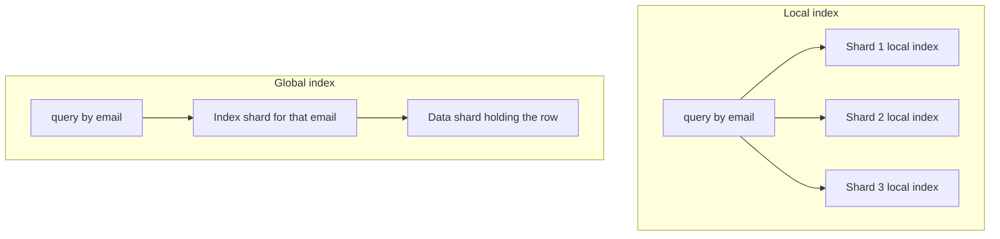

# Secondary Indexes on Sharded Data

On a single machine, a **secondary index** — an index on any field other than the primary key ([[Database Indexes]]) — is cheap and unremarkable: "find users by email" is one B-tree lookup. [[Sharding|Shard]] the data and the same index becomes a genuine design decision, because the index entries for one *value* (everyone named "Asha") are scattered across shards that were partitioned by a *different* field (`user_id`). There are exactly two places the index can live — next to the data (**local**) or partitioned by its own term (**global**) — and the choice is a clean, symmetric trade: local indexes make writes cheap and reads scatter; global indexes make reads targeted and writes scatter.

## The problem that created it

You sharded `users` by hashed `user_id` ([[Sharding]]) — the right key, since 95% of queries are by user ID. Then product asks for login by email, support asks for search by phone number, and compliance asks for "all accounts opened from this device". None of these contain the shard key. Without an index strategy, each such query must ask **every shard** "do you have anyone with this email?" — N queries to answer what used to be one B-tree lookup, with latency pinned to the slowest shard. The question "how do I query by a field I didn't shard on?" is unavoidable in every real sharded system — the partition key can match only one access pattern, and real applications have several.

## What it solves

- **Queries on non-shard-key fields** without resorting to full scatter table scans.
- **Multiple access patterns** on one dataset — the shard key serves the dominant pattern; secondary indexes serve the rest.
- **Uniqueness enforcement** on non-key fields (unique email across shards) — only solvable with a global structure (a global unique index or an equivalent lookup table).

## How it works

### Option A — Local secondary indexes (document-partitioned)

Each shard maintains its own index covering **only its own rows**. The index entry for a row always lives on the same shard as the row — so a write touches exactly one shard: row + its index entries update together, locally, often atomically.

The price appears on read: shard 3's email index knows nothing about shard 7's users. A query by email must be sent to **all shards**, each consults its local index (fast individually), and the router merges results — **scatter-gather**.

- Latency = max over shards (tail amplification: one slow shard slows every indexed query — the same effect as in [[Sharding]]).
- Cost = N index lookups for one logical query; cluster-wide query throughput for these reads *doesn't grow* as you add shards (every shard participates in every query).
- But: writes stay single-shard and index updates can be transactional with the row.

This is Cassandra's native secondary indexes, Elasticsearch querying all index shards, MongoDB's regular secondary indexes within a sharded collection, and DynamoDB's **LSI** (Local Secondary Index — same partition key, different sort key, co-located with the base partition).

### Option B — Global secondary indexes (term-partitioned)

Build one logical index over *all* the data, then shard **the index itself** — by the indexed term. All index entries for `email = "asha@example.com"` live on one known index shard (hash of the email decides which).

Reads become targeted: hash the email → one index shard → it returns the matching row's primary key + shard → fetch. Two hops, but only two — no fan-out, and read throughput scales with index shards.

The price moves to writes: updating one user row now updates index entries that live on **other shards** (old email value removed on one index shard, new value inserted on another, row written on a third). Choices:

- **Synchronous/transactional update** → a distributed transaction per write ([[Two-Phase Commit and Distributed Transactions]]) — slow and fragile, so few systems do it by default.
- **Asynchronous update** (the common choice) → the write returns after the base row commits; index shards update via a replicated change stream shortly after. The index becomes **eventually consistent**: a just-created user may be invisible by-email for milliseconds-to-seconds — all the anomalies of [[Read Your Own Writes and Replica Lag Anomalies]], now *inside* one database.

### The symmetric trade, in one table

| | **Local (document-partitioned)** | **Global (term-partitioned)** |
|---|---|---|
| Write path | One shard; can be atomic with row | Multi-shard; usually async → eventually consistent |
| Read by indexed field | Scatter-gather to all shards | Targeted: 1 index shard + data fetch |
| Read latency profile | Max of N shards (tail-bound) | Two sequential hops, no fan-out |
| Read scalability | Doesn't improve with more shards | Scales with index shards |
| Index freshness | Always consistent with local data | Lags writes (typically ms, unbounded under stress) |
| Hot spots | Spread (index follows data) | Index shard for a hot *term* can melt ([[Hot Partition Problem]]) |
| Good when | Write-heavy; indexed reads rare/latency-tolerant | Read-heavy on the indexed field; freshness lag acceptable |

### What scatter-gather actually costs

Two numbers turn that table from a preference into a decision. Take a 50-shard cluster serving 500 lookups/sec by email, where email is not the shard key.

**Work.** With a local index, every lookup becomes 50 index probes — one per shard — so the cluster absorbs 500 × 50 = **25,000 index probes/sec** to answer 500 logical queries. With a term-partitioned global index, each lookup is one probe on the index shard plus one fetch on the data shard: 500 × 2 = **1,000 operations/sec**. Same answers, 25× the cluster work. The asymmetry that matters is what happens next: double the cluster to 100 shards and the local cost becomes 50,000 probes/sec for the *same* 500 lookups, while the global cost does not move. Adding shards makes every scatter query more expensive, never less.

**Tail latency.** Suppose each shard independently answers in 1 ms at p50 and 10 ms at p99. A scatter query completes only when the slowest of the 50 responses arrives. Treating the shards as independent — an idealisation, since shards share networks, routers, and maintenance windows, so real correlation makes this worse rather than better — the chance that all 50 land below their p99 is 0.99⁵⁰ ≈ 0.605. So roughly **40% of scatter queries contain at least one shard answering at or above its p99**. This is the arithmetic underneath [[Sharding]]'s rule of thumb that a fan-out query's p50 behaves like a single shard's p99.

The honest counterweight: if those 500 lookups/sec are your entire non-shard-key workload and the cluster has headroom, 25,000 cheap index probes may be entirely affordable — and you have built, maintained, and monitored nothing extra. The arithmetic is not an argument against local indexes. It is how you find out which side of the trade you are on *before* the cluster doubles and decides for you.

### How real systems embody it

- **DynamoDB GSIs** are the textbook global index: you declare a new partition key (+ optional sort key) for the index; DynamoDB maintains it **asynchronously** (eventually consistent reads only — a GSI read can miss a write that just returned), it has **its own throughput**, and — the classic outage — **if a GSI is under-provisioned or takes a hot term, it throttles writes to the base table**, because the async pipeline applies backpressure. (Most visible in provisioned mode, where the GSI's capacity is a number you set and can get wrong; a hot index partition can backpressure base writes on-demand too.) GSIs also make you choose a **projection** — which attributes are copied into the index (`KEYS_ONLY`, `INCLUDE` a list, or `ALL`): project more and every indexed query is answered from the index alone but you pay its storage and write cost on every update of a projected attribute; project less and queries needing other fields must do a second fetch against the base table per result. A GSI is, very literally, a second table you pay for — storage, write units, and its own hot-partition exposure. LSIs, by contrast, are local: same partition key, strongly-consistent-capable, but capped by the 10 GB per-partition-key limit ([[DynamoDB Design]]).
- **MongoDB**: ordinary secondary indexes on a sharded collection are local — queries without the shard key scatter to all shards (visible in `explain()` as `SHARD_MERGE` across all shards). Mongo's design pushes you to either include the shard key in queries or deliberately accept scatter. What it does not offer is a user-facing term-partitioned index to reach for instead (see the uniqueness misconception below for why). So the global index teams actually deploy is a **manual** one: a separate lookup collection (`email → userId`) sharded by email — exactly a term-partitioned index you maintain yourself. Maintaining it has three grades of rigour: (1) update it in the same multi-document transaction as the base write — strongest, costs a cross-shard transaction per change, acceptable when the indexed field changes rarely (emails, phone numbers); (2) drive it from the collection's change stream — no extra write-path latency, but eventually consistent and needs idempotent apply; (3) app dual-writes — simplest and worst, because a crash between the two writes leaves silent drift with no stream to replay. Whichever grade you pick, a periodic reconciliation job comparing index to base data is the backstop that turns "drift" from a latent correctness bug into a metric.
- **Cassandra**: native secondary indexes are local and infamous for scatter cost at scale; the idiomatic answer is a **denormalised second table** keyed by the query field, maintained by the application or materialized views — again, a hand-rolled global index ([[Cassandra and Wide-Column Stores]], [[Normalization vs Denormalization]]).
- **Search offload**: many architectures punt entirely — ship changes via [[Change Data Capture]] to Elasticsearch/OpenSearch and serve all non-key queries there, accepting seconds of lag. This is "global index as a separate system".

## Trade-offs

Beyond the local-vs-global table above, the meta-trade-offs:

| You gain | You pay |
|---|---|
| Non-key access patterns survive sharding | Every secondary index multiplies write amplification ([[Database Indexes]] — now across the network for global) |
| Uniqueness across shards (global only) | Global index = one more eventually-consistent replica to reason about, monitor, and repair |
| Read throughput scaling (global) | Hot terms (status=ACTIVE, popular hashtag) concentrate on one index shard |
| Keep OLTP shard key optimal for the main pattern | Scatter reads (local) burn cluster-wide capacity per query |

## Failure modes

- **GSI backpressure throttling the base table** (DynamoDB): the index's capacity, not the table's, becomes the write ceiling; detected via GSI-specific throttle metrics; mitigated by provisioning GSIs ≥ base write rate and choosing high-cardinality index keys.
- **Hot index term**: millions of rows share one indexed value (`country = IN`, `status = PENDING`) → that term's index shard is a permanent hot partition and the query returning millions of PKs is a resource bomb. Low-cardinality fields usually deserve *no* index — filter-after-fetch or analytics stores instead.
- **Index-entry orphans/drift** (async global, hand-rolled especially): crash between base write and index update leaves a dangling or missing entry — lookups return a deleted user, or miss a live one. Mitigations: idempotent index updates from a change stream (not app dual-writes — the [[The Outbox Pattern]] dual-write lesson), periodic reconciliation sweeps, and tolerating-then-verifying reads (fetch base row, confirm the field still matches).
- **Scatter amplification under shard growth** (local): queries that were "fan out to 4" quietly become "fan out to 40" as the cluster grows; per-query cost rises with cluster size and nobody notices until p99 does. Track fan-out query rates as a first-class metric.
- **Unique constraint races**: two shards concurrently accept `INSERT email=x` and the async global index discovers the conflict *after* both committed. Uniqueness needs a synchronous check against the index shard (reserve-then-write) or acceptance of after-the-fact repair.

Each of those has a signal that distinguishes it from the thing it is usually mistaken for, and the distinguishing check is what makes a 3am diagnosis quick:

| Failure | Symptom you notice first | The signal that confirms it | What it would be instead |
|---|---|---|---|
| GSI backpressure | Base-table writes throttle | Throttle metrics dimensioned by *index name* non-zero while the table's own are zero | Table genuinely under-provisioned — then both are non-zero together |
| Hot index term | One index partition saturated; queries on that term slow | Contributor Insights or equivalent shows one index key dominating accesses | Broad load growth — top-key distribution stays flat |
| Index drift | A lookup returns a deleted entity, or misses a live one | Reconciliation sweep reports a non-zero delta between index and base data | Replication lag — the delta disappears on re-read seconds later, drift does not |
| Scatter amplification | p99 on non-shard-key queries climbed with no code change | Fan-out count per query rose with shard count; per-shard latency unchanged | A slow shard — then one shard's own latency moved, not the fan-out |
| Uniqueness race | Two live entities share a "unique" value | Both base rows exist with different primary keys, created within the index lag window | A bad backfill — then creation timestamps are unrelated and clustered differently |

### What this looks like at 3am

Writes to the base table start failing at 02:10 with throttling errors. The table's own capacity graph shows it consuming about a third of its provisioned write units — plenty of headroom — so the first ten minutes go into disbelieving the error message.

The thing that ends the confusion is per-index metrics: DynamoDB publishes consumed-capacity and throttle metrics dimensioned by index name, separately from the table's own, and one GSI is pinned. A nightly job has begun backfilling a `status` field across millions of items. `status` is projected into a GSI partitioned on a four-value field, so every one of those millions of updates lands on the same index partition. The GSI's maintenance pipeline cannot keep up and, in provisioned mode, that backpressure surfaces as throttling on the **base table** — the index's capacity has quietly become the table's write ceiling.

Two checks make it conclusive rather than suggestive: index-dimensioned throttles non-zero while the table's own are zero, and a top-key report showing one index key dominating. The mitigation that night is to throttle the backfill. The actual fix is that a four-value field should never have been an index partition key in the first place — which is the hot-term failure above, arriving disguised as a capacity problem.

## When NOT to use it

- **Don't index low-cardinality or extremely hot terms** — you're building a dedicated hot partition.
- **Don't hand-roll a global index with app dual-writes** when a CDC-driven one is feasible — the dual-write window is a drift factory.
- **Don't serve analytics with OLTP secondary indexes** — "all transactions over ₹10k last month, grouped by merchant" belongs in a warehouse/columnar store fed by CDC ([[Time Series and Analytics Stores]]), not in scatter-gather against production shards.
- **Don't add a global index when the query is rare and tolerant** — a nightly scatter query costs less than a permanently-maintained index.

## Common misconceptions

- *"An index on a sharded collection is global, the way it is on one machine."* In MongoDB it is not. A secondary index on a sharded collection is built independently on each shard, over that shard's own documents only. The word "index" is unchanged; the structure, and therefore the query plan, is completely different. `explain()` is where you find out — a query lacking the shard key shows a merge across every shard rather than a targeted one.
- *"A unique index gives me uniqueness across the cluster."* MongoDB supports a unique index on a sharded collection only when the shard key is a prefix of that index; otherwise there is nothing to enforce it with, because shards cannot see each other's keys at write time. Even `_id` uniqueness is enforced **per shard**, not cluster-wide, unless `_id` is the shard key. Global uniqueness on an arbitrary field is a separate problem with a separate solution — the reservation-style lookup collection described above.
- *"A GSI is just an index, so it's cheap."* A DynamoDB GSI is a second physical table holding the projected attributes: its own storage bill, its own write capacity, its own partitions, its own hot-key exposure. Every update to a projected attribute is written twice. "Add a GSI" is a capacity decision, not a schema tweak.
- *"Adding shards will speed up my scatter queries."* It shrinks the data and work *per shard*, which is real — but it also increases the number of participants, leaves aggregate throughput for that query class flat (every shard is in every query), and widens the latency tail, because the query now waits on the slowest of a larger sample. The fan-out-to-4 query that became fan-out-to-40 is the same query getting steadily worse while every individual shard looks healthier.
- *"Eventually consistent means a few milliseconds."* That is the healthy case, not the guarantee. An async index's lag is bounded by the health of the pipeline maintaining it, not by a published number: a backfill, a throttled index partition, or a stalled change stream turns milliseconds into minutes with no error raised anywhere. Design for "unbounded under stress" and the healthy case looks after itself.
- *"The index and the base data can't disagree — it's the same database."* Any asynchronously maintained index is a derived copy, and derived copies drift. The real question is not whether drift can happen but whether you would ever find out; without a reconciliation sweep, the answer is no, and silent drift in a lookup table is a correctness bug that presents as a support ticket.

## In your stack

- **MongoDB**: every query lacking the shard key on a future sharded collection is a fan-out — audit your query patterns *before* choosing the shard key; include the shard key in queries wherever possible. For `email → user` style lookups, a dedicated lookup collection sharded by email (maintained transactionally with the user write, or via change streams) is the Mongo-idiomatic global index.
- **DynamoDB** (if used for any service): budget GSI capacity as deliberately as table capacity; remember GSI reads are eventually consistent — never read-back-after-write via a GSI in a money flow.
- **Elasticsearch/OpenSearch via CDC** is your likely "global index as a system" for support-search and compliance queries — accept and *state* its lag SLO; never treat it as the source of truth for balances or KYC state.
- **Fintech uniqueness** (one account per PAN/phone): enforce via a dedicated, synchronously-written lookup table/collection keyed by the identifier — the audit trail wants a deterministic reservation record, not an eventually-consistent index race ([[Idempotency]]).

## Interview angle

The 60-second version: *"Once data is sharded by one key, queries on any other field need a strategy. Local indexes live with the data: writes stay single-shard and consistent, but a query by the indexed field must scatter-gather across every shard, so read cost scales with cluster size. Global indexes partition the index by the indexed term: reads go to exactly one index shard then fetch the row — but now a single row write updates multiple shards, so global indexes are maintained asynchronously and are eventually consistent. DynamoDB GSIs are the canonical global example — async, own capacity, can throttle base-table writes; MongoDB's regular indexes on sharded collections are local, with scatter for non-shard-key queries. Write-heavy favours local; read-heavy on the indexed field favours global."*

Classic follow-ups: "How do you enforce unique email across shards?" (synchronous reservation against a term-partitioned lookup — not an async index). "Why can a DynamoDB GSI throttle writes to the table?" (async maintenance pipeline applies backpressure when the GSI partition is over capacity). "What happens to local-index queries as you double the shard count?" (every query does 2× the lookups; per-query latency tail worsens; aggregate indexed-read capacity doesn't grow).

## Check yourself

> [!question]- Q: Explain the local-vs-global index trade as "where does the fan-out go?"
> Local: fan-out on *read* — each shard indexes only its own rows, so a non-shard-key query asks all shards; writes touch one shard. Global: fan-out on *write* — the index is partitioned by the indexed value, so reads hit one index shard, but a row write must update index entries on other shards (hence usually async). You choose which side of your workload pays.

> [!question]- Q: A user registers, the API returns 201, and an immediate "find by email" via a DynamoDB GSI returns nothing. Why, and is the data lost?
> GSIs are maintained asynchronously: the base-table write committed (data is safe), but the index entry propagates after acknowledgement, and GSI reads are only eventually consistent. Nothing is lost — the lookup is early. Fix the flow: read by primary key after a write, carry the data forward in the response/session, or poll with tolerance; never gate a correctness decision on an immediate GSI read.

> [!question]- Q: What happens if you add a local secondary index on `status` (4 possible values) in a 50-shard system and dashboards query `status = PENDING` every second?
> Each dashboard query fans out to all 50 shards; each shard's index returns a huge posting list for a 4-value field (low cardinality ≈ scanning anyway), results merge centrally — massive aggregate cost for trivial selectivity, repeated every second. The index was the wrong tool: use pre-aggregated counters, a CDC-fed analytics store, or a work-queue pattern for PENDING items.

> [!question]- Q: Your Mongo cluster grows from 4 shards to 40 to cope with data volume. A support screen that looks accounts up by phone number — not the shard key — was comfortably fast before and now times out intermittently, yet every per-shard dashboard looks healthy. What changed, and what are the options?
> No individual shard changed; the query's *shape* did. The phone-number index is local, so the lookup is a scatter-gather, and it went from 4 participants to 40. Three things degraded at once. Aggregate work per query is 10× what it was. The query now waits on the slowest of 40 responses instead of the slowest of 4, so its latency tracks the shards' bad percentile rather than their typical one — which is precisely why the per-shard dashboards look innocent while the client times out. And cluster-wide capacity for this query class did not grow at all, because every shard participates in every one of these lookups. Options, cheapest first: include the shard key in the query wherever the caller already has it; raise the client timeout and accept the tail if the screen is genuinely tolerant; build a term-partitioned lookup collection `phone → accountId` sharded by hashed phone, turning a 40-shard fan-out into two targeted reads; or move support search wholesale to a CDC-fed search cluster and publish its lag SLO. The first is free and more often available than people expect; the third is the right default once phone lookup is a permanent access pattern rather than a one-off screen.

> [!question]- Q: Mini-design — Niyo shards `accounts` by hashed `accountId` but support needs lookup by phone number with sub-second latency and strong-ish freshness. Design it.
> Build a term-partitioned lookup collection `phone → accountId`, sharded by hashed phone. Maintain it in the same transaction as phone-number changes (Mongo multi-document transaction — phone changes are rare, so the write cost is fine), giving uniqueness enforcement and zero lag; lookup = 1 read to the lookup shard + 1 read to the account shard. Backstop with a nightly reconciliation sweep comparing the two collections. (If transactions were unacceptable, fall back to change-stream-driven async maintenance plus verify-on-read.)

## Sources

- *Designing Data-Intensive Applications*, Kleppmann — **Chapter 6**, "Partitioning and Secondary Indexes" (document-partitioned vs term-partitioned — the local/global vocabulary of this note).
- AWS DynamoDB Developer Guide — Global Secondary Indexes, Local Secondary Indexes (consistency, provisioning, base-table throttling behaviour).
- MongoDB Manual — sharded collection query routing (targeted vs scatter-gather), unique constraints on sharded collections.
- Cassandra documentation — secondary indexes and their limitations; materialized views caveats.
