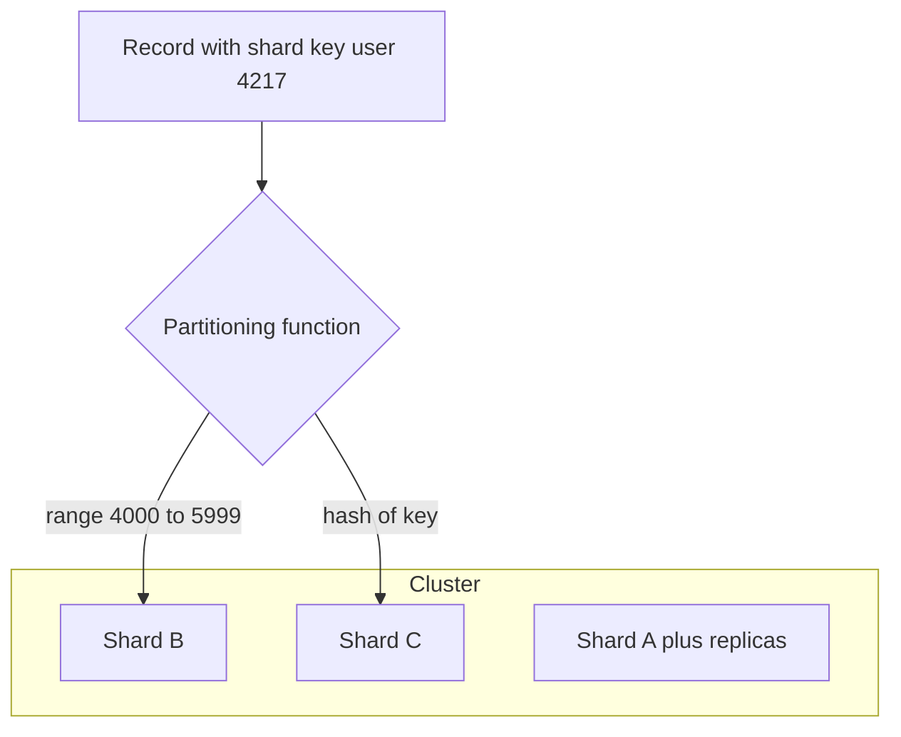

# Sharding

**Sharding** (also called **horizontal partitioning**) means splitting one logical dataset into pieces — **shards** — and placing each piece on a different machine, so that no single machine has to store all the data or handle all the writes. Each shard holds a *subset of the rows* of the same tables (that's the "horizontal": you cut across rows, not columns). Where [[Replication]] gives every machine a *full copy*, sharding gives every machine a *different slice* — and in real systems you do both: each shard is itself a replicated group. Sharding is how every planet-scale system you've heard of stores data; it is also the single biggest complexity jump a data architecture ever takes, which is why the rule is: **don't shard until you must**.

## The problem that created it

A growing system, again. You've already done the cheap things in order ([[Database Scaling Patterns]]): indexes, query tuning, a bigger box ([[Vertical vs Horizontal Scaling]]), read replicas, caching. Three walls remain, and none of those tools touch them:

1. **Data size**: the dataset is 10 TB and growing. The biggest box you can rent holds it, barely, but backups take a day, migrations lock for hours, and the price curve for ever-bigger machines is super-linear.
2. **Write throughput**: replicas multiplied your *reads*, but every write still goes through one leader, and every replica still applies every write. At tens of thousands of writes/second a single leader saturates — CPU, lock contention, IOPS, replication fan-out — and no amount of replicas helps, because replication copies writes, it doesn't divide them.
3. **Working set**: the fraction of data touched frequently no longer fits in one machine's RAM, so the cache hit rate collapses and every query becomes a disk read ([[Why Caching Works]]).

The only move left is to make each machine responsible for *less data and fewer writes*: split the dataset. That's sharding. Users A–M on one database, N–Z on another, is the folk version; everything in this note is that idea made rigorous.

## What it solves

- **Write scalability**: writes divide across shards — 10 shards ≈ 10× write capacity (if, and only if, load spreads evenly — see [[Hot Partition Problem]]).
- **Data volume**: no machine stores more than its slice; total capacity grows by adding shards.
- **Working-set-in-RAM**: each shard's hot data fits its machine's memory again.
- **Blast radius and parallelism** (secondary wins): one shard down ≠ everything down; maintenance, backups, and batch jobs parallelise per shard.

What it does **not** solve: availability (that's [[Replication]], which each shard still needs) and query speed for queries that must touch *all* shards (it makes those worse).

## How it works

Everything flows from one decision: **the partitioning function** — given a record, which shard owns it? The input to that function is the **shard key** (one or more fields of the record, e.g. `user_id`). Two families of function exist.

### Range partitioning

Sort by shard key; assign contiguous ranges to shards, like encyclopedia volumes: shard 1 holds keys A–F, shard 2 G–P, shard 3 Q–Z (boundaries chosen to balance *data*, not the alphabet).

- **Wins**: **range scans are cheap** — "all transactions for user X between March and May" lives on one shard, in order. Great for time-series and anything queried by intervals.
- **Loses**: **skew by key design** — sorted keys mean nearby keys colocate. If the key is a timestamp or auto-increment ID, *all new writes land on the last shard* while the others sit idle; the dataset grows a hot tail forever. This is the classic self-inflicted [[Hot Partition Problem]].
- Used by: HBase, Bigtable ([[Bigtable and Spanner]]), MongoDB ranged sharding, Spanner.

### Hash partitioning

Run the shard key through a hash function; the hash decides the shard. Adjacent keys scatter uniformly.

- **Wins**: **even spread** by construction — sequential IDs and timestamps stop being dangerous (celebrity-style single-key skew still exists; hashing a key that is itself hot doesn't help — again [[Hot Partition Problem]]).
- **Loses**: **range queries die** — keys 1,2,3 live on three different machines, so "last hour of events" touches every shard. You also give up sorted locality for pagination.
- **Trap**: naive `hash(key) mod N` makes adding a machine reshuffle nearly all data; the fix is [[Consistent Hashing]] or the fixed-partitions scheme in [[Rebalancing Partitions]].
- Used by: Cassandra and [[The Dynamo Paper]] lineage, MongoDB hashed sharding, most hand-rolled MySQL sharding, [[Kafka Architecture]] for partitioning topics by key.

Hybrids exist and are often best: Cassandra's compound key — hash on a **partition key** to pick the shard, then sort by a **clustering key** within it — gives even spread across shards *and* cheap ranges within one entity ("user 42's messages by time" = one shard, sorted).

### Choosing the shard key — the decision that haunts you

The shard key is near-impossible to change later without a full resharding migration, so it's the highest-stakes line in the design doc. Criteria:

1. **High cardinality**: many distinct values. Sharding by `country` caps you at ~200 shards with one shard ("IN" or "US") holding half the data.
2. **Even load distribution**: not just many values — evenly *accessed* values, over time. Monotonic keys (timestamps, auto-increment) fail this under range partitioning; a key where one tenant is 100× the others fails it under any scheme.
3. **Matches the access pattern** (the big one): the queries you run most should include the shard key, so they route to **one** shard. If 95% of queries are "by user", shard by `user_id` and those queries stay single-shard; sharding by `transaction_id` would make "user's transactions" hit every shard.
4. **Aligns transaction boundaries**: records you must update atomically together should share a shard (e.g. account + its ledger entries), because cross-shard transactions are the expensive exception (below).

For a fintech ledger, `account_id` (or `user_id`) is the archetypal choice: high cardinality, most queries are per-account, debits/credits within an account stay single-shard.

### Routing: who knows where the data lives?

Someone must map key → shard and send the query there. Three architectures:

- **Application-level**: the app computes the shard (a lookup table or hash in a shared library) and holds a connection pool per shard. Simple, no new infrastructure; but every service must embed the logic, and resharding means coordinating a library change everywhere. This is how most home-grown MySQL sharding starts (and how Facebook's largely works — [[Why MySQL Does Scale]]).
- **Middleware / proxy**: a router tier speaks the database protocol, consults shard metadata, and forwards queries — apps connect as if to one giant database. **Vitess** (YouTube's MySQL sharding layer, now CNCF-graduated) and **Citus** (Postgres extension) are the famous ones; MongoDB's `mongos` is the same role built in.
- **Natively sharded stores**: Cassandra, DynamoDB ([[DynamoDB Design]]), Elasticsearch — any node can take a request and route internally; the cluster manages placement and rebalancing itself. Easiest operationally; least control, and you inherit the store's data model limits.

### The real price no. 1: cross-shard queries, joins, and transactions

Everything that stays on one shard is as easy as before. Everything that doesn't becomes a distributed-systems problem *you* now own:

- **Multi-shard queries** (no shard key in the WHERE clause) become **scatter-gather**: send to all N shards, merge results. Latency = the *slowest* shard (tail latency amplification — one slow shard out of 50 slows every scatter query); cost = N× the work. Aggregations, global sorts, and pagination across shards are all painful.
- **Joins across shards** effectively don't exist; you denormalise ([[Normalization vs Denormalization]]), duplicate reference data to every shard, or join in the application.
- **Cross-shard transactions**: atomically debiting an account on shard A and crediting one on shard B needs [[Two-Phase Commit and Distributed Transactions]] (slow, blocking, fragile) or the [[Saga Pattern]] with compensation. Most sharded architectures restructure to avoid them: choose keys so hot transactions are single-shard, and treat the rare cross-shard case as a workflow with [[Idempotency]], not a transaction.
- **Secondary indexes** need their own strategy — local vs global, a big enough topic for its own note: [[Secondary Indexes on Sharded Data]].
- **Unique constraints and auto-increment** stop being free: uniqueness across shards needs a global ID scheme ([[Design a Distributed ID Generator]]).

### The real price no. 2: resharding

Shard counts are not forever: data grows, load grows, one shard gets hot. Moving data between shards while serving traffic — dual writes, backfill, cutover, and why `mod N` makes it catastrophic — is its own discipline: [[Rebalancing Partitions]]. The headline: with naive design, resharding is a months-long migration project; with good design (many fixed partitions, or consistent hashing, or a store that splits automatically), it's routine.

## Trade-offs

| You gain | You pay |
|---|---|
| Writes and data volume scale ~linearly with shards | Single-shard-or-bust query model; scatter-gather for everything else |
| Working set fits RAM again | Cross-shard joins and transactions: avoided, denormalised, or sagas |
| Smaller blast radius, parallel ops | Operational surface × N: backups, failovers, schema migrations per shard |
| No super-linear big-box pricing | Shard key is near-irreversible; wrong choice = re-migration |
| | A whole class of new failure modes (skew, resharding, routing staleness) |

## Failure modes

- **Hot shard**: skewed key or celebrity entity drives one shard to 100% while others idle — the cluster's capacity collapses to one machine's. The defining failure of sharded systems: [[Hot Partition Problem]].
- **Scatter-gather tail latency**: p99 of a fan-out query ≈ worst shard's p99; one degraded shard poisons every multi-shard query ([[Latency vs Throughput vs Bandwidth]]).
- **Routing staleness**: after a shard split/move, a stale router sends queries to the old owner — reads miss, writes land in the wrong place. Mitigated by versioned shard maps and ownership checks at the shard ("I don't own this key anymore").
- **Resharding gone wrong**: dual-write bugs, backfill drift — see [[Rebalancing Partitions]].
- **Per-shard failover multiplication**: 50 shards × 3 replicas = 150 nodes; *something* is always failing over. [[Failover]] correctness becomes a statistical certainty requirement, not an edge case.

## When NOT to use it

- **Your data fits one big box with replicas** — which today means multiple TB and tens of thousands of writes/sec. Most companies never truly need sharding; a well-tuned Postgres/MySQL with replicas and caching carries further than intuition says ([[Why MySQL Does Scale]] — ironically, the myth-killer cuts both ways).
- **The pain is reads, not writes/volume**: add replicas and caching instead — far cheaper ([[Caching Strategies]]).
- **Your workload is inherently relational-global**: lots of ad-hoc joins and cross-entity transactions (back-office/BI shapes). Consider a columnar warehouse for analytics ([[Time Series and Analytics Stores]]) before mutilating OLTP with scatter-gather.
- **You can archive instead**: if 90% of data is cold history, tiering it to S3/warehouse postpones sharding for years.

## In your stack

- **MongoDB is natively sharded** — `mongos` routers + config servers + shards ([[MongoDB Architecture]]). If/when Niyo's data outgrows one replica set, the machinery exists; the shard-key decision (hashed `userId` vs ranged compound keys) is still entirely on you, and Mongo's documented shard-key-mistake stories are legion.
- **You already run sharded systems**: Kafka/MSK topics are hash-partitioned by message key ([[Kafka Architecture]]); Redis Cluster splits its keyspace into 16384 slots ([[Redis Cluster and Sentinel]]). Same concepts, same hot-key risks, different vocabulary.
- **Fintech shard key instinct**: `accountId`/`userId`, so that a user's money operations are single-shard and atomic locally; cross-user transfers become sagas with idempotency keys — which your RBI-auditable flows want to be explicit workflow records anyway.
- **SQS-based flows** sidestep partitioning entirely (SQS standard queues have no user-visible partitions) — one reason they're operationally gentle; you re-inherit partition thinking when moving to Redis Streams (single stream = single node's throughput in Cluster: shard streams by key if needed).

## Interview angle

The 60-second version: *"Sharding is splitting one dataset across machines by a shard key, because replication scales reads but not writes or data volume. Two partitioning families: range — keeps ranges contiguous, great for scans, risks hot tails from monotonic keys — and hash — even spread, kills range queries. The shard key must have high cardinality, even access, and match the dominant query pattern so queries stay single-shard. The price: cross-shard queries become scatter-gather, joins and transactions get restructured or become sagas, and resharding is a major operation unless designed for upfront. Route via app logic, middleware like Vitess, or a natively sharded store."*

Classic follow-ups: "Shard key for a chat app?" (`conversation_id`, not `message_id` — conversations are read together; see [[Design a Chat System]]). "What if one user is Justin Bieber?" (→ [[Hot Partition Problem]], [[Twitter Timeline Design]]). "How do you add a shard without downtime?" (→ [[Rebalancing Partitions]], [[Consistent Hashing]]). "Unique email check across shards?" (global index or a dedicated lookup shard — [[Secondary Indexes on Sharded Data]]).

## Check yourself

> [!question]- Q: Explain sharding to a junior engineer in three sentences, including what it does that replication can't.
> Sharding splits a dataset into slices and puts each slice on a different machine, so each machine stores and writes only a fraction of the total. Replication can't do this — it gives every machine a full copy, so it multiplies reads but every write still hits every machine. Sharding is the only way to scale write throughput and total data volume horizontally.

> [!question]- Q: You shard transactions by `created_at` ranges. What happens, and what key would you pick instead?
> All new transactions have "now"-ish timestamps, so every insert lands on the final range — one shard takes 100% of writes while the rest store cold history: a textbook hot tail. Shard by hashed `account_id` instead (even write spread, per-account queries stay single-shard), keeping `created_at` as a sort/clustering component within each account's data.

> [!question]- Q: What happens to a query that doesn't include the shard key, and why does p99 suffer disproportionately?
> It can't be routed, so it fans out to every shard and merges results (scatter-gather). The response completes only when the slowest shard answers, so the query's latency is the max of N samples — at N shards, hitting at least one shard's bad-percentile moment becomes near-certain, so the fan-out query's p50 behaves like a single shard's p99.

> [!question]- Q: Mini-design — Niyo outgrows one Mongo replica set for transactions (5 TB, 20k writes/s). Sketch the sharding plan.
> Shard key: hashed `accountId` — high cardinality, even spread, and statements/balance queries are per-account so they stay single-shard. Each shard is a 3-node replica set with majority writes (durability through [[Failover]]). Cross-account transfers: saga with idempotency keys, recorded as explicit workflow state (audit-friendly). Ops: start with enough shards to avoid early splits, alert on per-shard write skew to catch whales ([[Hot Partition Problem]]), and keep analytics off the OLTP cluster via CDC to a warehouse.

## Sources

- *Designing Data-Intensive Applications*, Kleppmann — **Chapter 6 (Partitioning)**: partitioning schemes, skew, rebalancing, routing.
- Vitess documentation (vitess.io) — sharding concepts, vindexes, resharding workflows.
- MongoDB Manual — Sharding (shard keys, hashed vs ranged, `mongos`).
- Citus documentation — distributed Postgres tables.
- Meta Engineering blog — posts on MySQL sharding at Facebook scale (see [[Why MySQL Does Scale]], [[How Facebook Scales MySQL]]).
