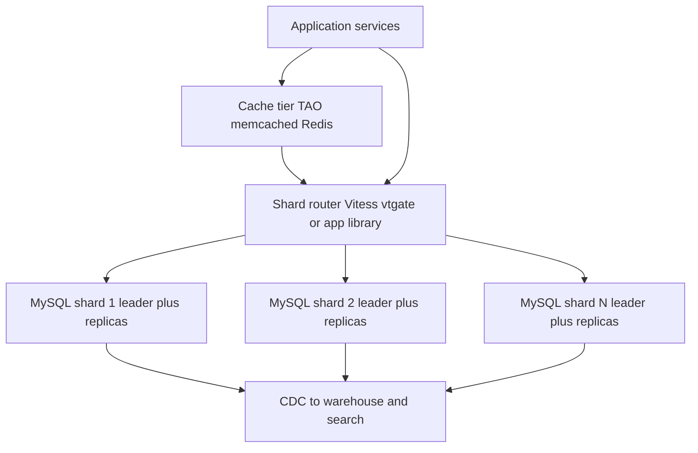

# Why MySQL Does Scale

"MySQL doesn't scale" is one of the most repeated and most wrong lines in backend engineering. Facebook serves billions of users off thousands of MySQL servers; YouTube grew through its hyper-growth years on MySQL behind Vitess; Shopify processes Black Friday on sharded MySQL "pods". The claim was never really about MySQL — it was about **any single database machine**, and it stopped being an argument against MySQL the moment teams learned to layer [[Sharding]], [[Replication]], and caching *around* a database instead of demanding the database do everything itself. This note is the myth-killer: what the giants actually run, the pattern they share, and what the myth was originally (half-)true about.

## Why this matters

Because the myth drives bad decisions in both directions. Teams prematurely abandon boring relational databases for exotic distributed stores — paying eventual consistency, weak transactions, and operational novelty — to solve a scale problem they don't have and that MySQL-plus-architecture solves anyway ([[Choosing a Database]]). Conversely, understanding *how* MySQL scales teaches the single most reusable architecture lesson in this module: **scalability is a property of the system, not of the datastore**. The same pattern — reliable storage brick + sharding layer + cache layer + replication — is how you'd scale Postgres, Mongo, or anything else. In interviews, "would MySQL scale for this?" is a trap question: the strong answer names Facebook/Vitess/Shopify and explains the layering.

## How it works

### The pattern all three share

A small, boring, battle-tested core (MySQL/InnoDB) used as a **reliable storage brick** — single-box durability, crash recovery, B-trees, local [[ACID Transactions]] — with the "distributed" concerns handled by infrastructure *above* it:

| Layer | Responsibility | Facebook | YouTube | Shopify |
|---|---|---|---|---|
| Storage brick | Durable single-node OLTP | MySQL (InnoDB, later MyRocks) | MySQL | MySQL |
| Sharding | Split data across bricks ([[Sharding]]) | Application-level, by user ID, thousands of shards | **Vitess** middleware | **Pods**: shop-sharded, full stacks |
| Caching | Absorb read volume ([[Caching Strategies]]) | memcached fleet + **TAO** graph cache | App-level memcached (Vitess caches query *plans*, not results) | App caches / Redis-tier |
| Replication | Survive failures, serve regions ([[Replication]]) | Async/semi-sync, cross-region replicas | MySQL replication managed by Vitess | Per-pod replicas and failover |

### Facebook: sharded MySQL + TAO

Facebook's social graph lives in MySQL sharded by ID across thousands of instances — but almost no application code talks to MySQL. Reads hit **TAO** (The Associations and Objects — their 2013 paper), a write-through, graph-aware cache tier that replaced the earlier memcache lookaside layer for graph data and serves the overwhelming majority of reads; MySQL is the durable system of record underneath. Facebook also invested heavily in the brick itself (their own MySQL branch; **MyRocks**, an LSM-based storage engine ([[B-Tree vs LSM-Tree]]) that roughly halved storage vs compressed InnoDB for their workload) and in failover tooling. The division of labour is total: MySQL does per-shard durability and transactions; distribution, caching, and graph semantics are infrastructure. Full story: [[How Facebook Scales MySQL]].

### YouTube: Vitess — the sharding middleware that became infrastructure

YouTube hit MySQL's single-box and operational limits during hyper-growth (~2010) and built **Vitess**: a proxy layer (`vtgate`) that speaks the MySQL protocol to applications, routes queries by shard key (vindexes), manages connection pooling (killing MySQL's thundering-herd connection problem — [[Connection Pooling]]), and automates [[Rebalancing Partitions|resharding]] via VReplication (backfill + change-replay + cutover). Applications see "one giant MySQL"; Vitess sees thousands of shards. It was open-sourced and is now a **CNCF-graduated project** (graduated 2019) running at Slack, Cash App (Square), HubSpot, and others (as of 2026), and it is the engine inside PlanetScale's managed MySQL service — the strongest possible evidence that "MySQL at planet scale" is a solved, packaged problem rather than a Facebook-only art. (GitHub, notably, scales MySQL mainly through its own application-level functional partitioning — using Vitess at first only to move table groups between clusters, per its 2021 post, and by its 2023 MySQL 8.0 post also for horizontally sharded clusters where a domain outgrew one primary — with `orchestrator` for failover and `freno` for replication-lag-aware throttling — a reminder that the layering pattern matters more than any one tool.)

Every box except the MySQL bricks is infrastructure added *around* the database — the diagram is the whole thesis of this note.

### Shopify: pods

Shopify shards by shop into **pods** — self-contained units (MySQL + Redis + memcached + workers) each hosting a set of shops, with no cross-pod dependencies on the hot path. A pod is a blast-radius boundary: one pod's failure or one whale shop's flash sale ([[Hot Partition Problem]] — mitigated by moving hot shops to quieter or dedicated pods) doesn't touch other pods, and capacity grows by stamping out more pods. It's [[Sharding]] elevated to the whole-stack level — closer to cell-based architecture ([[Bulkheads and Isolation]]) than to database sharding alone, and it carried them through world-record checkout peaks on MySQL.

### The tooling timeline that closed the gap

The myth froze in people's heads around 2008; here is what changed underneath it. Dates are MySQL GA releases (8.0 itself reached end of life in April 2026; the supported LTS lines are now 8.4 and 9.7):

| Era | What you had | What it meant operationally |
|---|---|---|
| ≤ 5.1 (2008) | MyISAM common, statement-based replication the norm (row-based arrived in 5.1 but was little used), single-threaded replica apply, no GTIDs | Crash-unsafe tables, replicas lagging on any write-heavy leader, failover = hand-edited binlog coordinates at 3 a.m. |
| 5.5 (2010) | InnoDB becomes the default engine; semi-sync replication plugin | Crash safety and row-level locking by default; a durability option beyond pure async ([[Replication]]) |
| 5.6 (2013) | **GTIDs** (global transaction identifiers), row-based replication matured, basic parallel replica apply | Replicas addressable by transaction set, not file offsets — automated failover tooling becomes *possible* to write correctly |
| 5.7 (2015) | Lossless semi-sync (`AFTER_SYNC`), much better parallel replication (logical clock) | Acked writes provably on a replica before commit ([[Failover]]); replicas keep up with busy leaders |
| 8.0 (2018) | Atomic DDL, better JSON, InnoDB redo/undo improvements | Online schema changes and mixed workloads stop being adventures |
| Ecosystem (2010s) | **Vitess**, **orchestrator**, gh-ost/pt-online-schema-change, ProxySQL | Sharding, failover, online migrations, and connection pooling as installable software instead of in-house heroics |

Someone whose mental model of MySQL is "replication lags and failover is terrifying" is describing pre-5.6 MySQL. The architecture pattern (brick + layers) was always sound; the 2010s made the layers commodity.

### What actually breaks first on one box

"A single MySQL tops out" is usually imagined as running out of rows or writes. In practice something cheaper breaks first — and *which* wall you hit decides whether sharding is even the right response:

| Wall | What it looks like | What you do about it | Does sharding help? |
|---|---|---|---|
| **Connections** — often the first wall | Thousands of app threads each hold a connection; community MySQL uses a thread per connection, so scheduling and per-thread memory bite before CPU does. Latency climbs with *connection count*, not query rate | A pooler in front — ProxySQL, Vitess's `vtgate`, or disciplined app-side pools ([[Connection Pooling]]). MySQL Enterprise, Percona Server and MariaDB offer a thread pool | No — sharding multiplies the connection problem by the shard count |
| **Working set vs buffer pool** | InnoDB buffer pool hit rate falls, reads become disk IO, p99 degrades long before any throughput number looks alarming | Bigger box, better indexes, or a cache tier absorbing reads ([[Caching Strategies]]) | Eventually yes — each shard's hot data fits its own RAM again |
| **Lock and row contention** | A few hot rows — a counter, a nodal account, a sequence table — serialise everything that touches them; throughput stops rising as you add hardware | Restructure the write pattern: queue and batch, split the hot row, make the counter approximate | Only if contending rows land on *different* shards. A single hot row is a [[Hot Partition Problem]] and sharding does nothing for it |
| **Schema migrations** | `ALTER TABLE` on a large table blocks or runs for hours; releases queue behind DDL | Online schema change tooling — gh-ost, pt-online-schema-change; MySQL 8.0 adds atomic DDL and `ALGORITHM=INSTANT` for some alterations | Makes it worse operationally — the migration now runs N times |
| **Backup and restore time** | Backups take most of a day; restore-time RTO quietly stops meeting the number in the DR document ([[Disaster Recovery]]) | Snapshot-based backups, restore-from-replica, archiving cold data | Yes — one of the most underrated reasons to shard |
| **Replication lag under write bursts** | Replicas fall behind during batch jobs, so read replicas stop being usable for fresh reads ([[Read Your Own Writes and Replica Lag Anomalies]]) | Parallel replica apply, throttling batch writers, lag-aware routing | Yes — each shard's leader emits a fraction of the write stream |
| **Write throughput on one leader** | The wall everyone pictures: CPU and IOPS on the leader saturate, and no replica configuration helps | Nothing left but splitting the write stream | Yes — this is the wall sharding exists for |

The practical point: most teams who announce that "MySQL stopped scaling" have hit connections, migrations, or backups — none of which sharding fixes, and two of which it worsens. [[Database Scaling Patterns]] is the ordered ladder; sharding is the last rung for a reason.

### What "MySQL doesn't scale" actually meant

The myth has a real historical core — about **one box** and **one era**:

1. **Single-box vertical limits** (true of every DBMS): one machine caps writes, data volume, and working-set RAM ([[Vertical vs Horizontal Scaling]]). MySQL has no built-in transparent sharding; pre-Vitess you wrote your own routing. "MySQL doesn't scale" accurately meant "MySQL won't shard *for* you" — in 2008. 
2. **Pre-2010 engine and tooling weakness**: crash-unsafe MyISAM tables still common, InnoDB still maturing, single-threaded replica apply, and failover by hand-rolled script. This was a real complaint in its decade — and the timeline table above is precisely the list of what closed it, essentially all of it by 5.7.
3. **NoSQL-era marketing** (~2009–2013): "web scale" stores defined themselves against relational databases, and the comparison stuck culturally long after MySQL's tooling gap closed — and after several famous NoSQL adopters quietly moved core data *back* to relational (or to Vitess-style setups).

What remains honestly true: a **single** MySQL (like a single anything) tops out — very roughly, around low-tens-of-TB datasets and tens of thousands of writes/sec on big hardware, workload-dependent — and *someone* must provide the sharding layer. The myth-killer is that this layer exists, is open source, is CNCF-graduated, and is proven at the largest scales on earth.

### A worked ceiling check — are you anywhere near it?

All of the above is useless unless you can tell whether it applies to *you*, so do the arithmetic before the architecture. A worked hypothetical for a mid-size fintech — substitute your own numbers; the method is the deliverable:

- **5 million users**, each averaging 10 ledger-affecting transactions per month → 50 million writes/month.
- A 30-day month is 30 × 86,400 = 2,592,000 seconds, so the mean write rate is 50,000,000 / 2,592,000 ≈ **19 writes/sec**.
- Traffic is never flat. Assume a 10× peak factor for salary day and evening hours: **≈190 writes/sec at peak**. Even a pathological 50× spike stays under 1,000 writes/sec.
- Storage: at roughly 500 bytes per row including indexes, 50 million rows/month ≈ **25 GB/month**, so about **300 GB/year** of transaction data.

Hold that against the honest single-box figure above — low-tens-of-TB and tens of thousands of writes/sec. This workload sits **one to two orders of magnitude** below the write ceiling and years away from the storage one. Three conclusions follow, and they are what the arithmetic is for:

1. **Sharding is not the answer to this system's problems**, whatever its problems turn out to be. If it is slow, the cause is on the earlier-walls list: a missing index, an N+1 query pattern ([[N+1 Queries and ORM Pitfalls]]), connection exhaustion, a cold cache.
2. **The date that matters is the storage one, not the throughput one.** At 300 GB/year the conversation to schedule is about archiving cold history and about backup/restore time — both of which arrive long before write throughput becomes interesting.
3. **Readiness is cheap even though sharding is not.** You do not need to shard, and you can still make it cheap later for almost nothing today: keep `accountId` on every table that would eventually be sharded by it, keep hot transactions inside one account, and avoid queries that depend on a cross-entity join you could not reproduce per shard. That is the whole of "shard-ready", and it costs a design review rather than a migration.

## Common misconceptions

- *"Facebook-scale needs a distributed database, not MySQL."* Facebook-scale **is** a distributed database — whose storage nodes are MySQL. The distribution lives in TAO, the sharding layer, and ops tooling. (Google went the other way and built [[Bigtable and Spanner|Spanner]]; both are valid — one buys distribution as a database, the other composes it.)
- *"Sharded MySQL means giving up SQL and transactions."* Within a shard you keep full SQL and ACID — and good shard keys put the hot transactions inside one shard ([[Sharding]]). What you give up is *cross-shard* joins/transactions, which every horizontally-scaled store also gives up or pays dearly for.
- *"NoSQL exists because relational can't scale."* NoSQL stores trade away relational features for *specific* gains (schema flexibility, write-optimised LSM paths, built-in partitioning — [[NoSQL Taxonomy]]). Scale alone was never a reason to leave MySQL; access-pattern fit is the real decision ([[Choosing a Database]]).
- *"MySQL scales, so we don't need to plan."* The opposite lesson: MySQL scales because those companies built/adopted serious layering. If you won't run Vitess/Citus-class tooling or do app-level sharding, a single MySQL's ceiling is still your ceiling — it's just a high ceiling most companies never reach.
- *"Postgres is different."* Same story, same pattern: single-box limits, scaling by layering (Citus for sharding, PgBouncer for pooling, replicas + caching). The brick brand matters less than the architecture.

## In your stack

- **MySQL already exists in places at Niyo** — this note is the argument against both "we must migrate off MySQL to scale" and "we must move everything to Mongo for growth". The scaling conversation is about *layers* (cache hit rate, read routing, shard key readiness), not brands.
- **MongoDB is Niyo's primary store** and ships the Vitess-equivalent built in (`mongos`, chunks, balancer — [[MongoDB Architecture]]): you bought the sharding layer with the database. The trade: less pain to start sharding, less control over it than Vitess-style explicit workflows.
- **The TAO lesson maps directly**: your Redis-in-front-of-Mongo pattern is the same shape — absorb reads in a cache tier, keep the database as the durable brick. Cache hit rate is a scaling feature, not an optimisation ([[Why Caching Works]]).
- **The Shopify pod lesson** maps to fintech multi-tenancy: partner banks/programs as isolation cells bound blast radius — attractive where a regulator will ask "how was programme X isolated from programme Y's incident?"
- **The 1-replica reality cuts both ways.** With many services pinned at a single pod, the component most likely to saturate first is the service, not the datastore: one JVM with a modest connection pool cannot generate enough concurrency to trouble a well-sized MySQL or Mongo. Before entertaining "the database doesn't scale", confirm the bottleneck is not the single replica's thread pool or connection pool. The flip side is the connection wall above — scaling that service out to k pods multiplies connections against a fixed server-side limit, so horizontal app scaling and database connection budgeting are the same conversation.
- **Name the cost shape when someone says "scale the database".** A cache tier costs memory proportional to the working set and buys read throughput; a replica costs a full data copy each and buys read throughput plus failover; a shard costs a full stack each and buys write throughput and volume. Only the last scales writes, and only the last multiplies your operational surface by N. Which of the three is being proposed is the first question, not a detail.

## Interview angle

The 60-second version: *"The myth confuses a database with a deployment. A single MySQL box tops out — like any single box — but MySQL as a storage brick scales as far as anyone has needed: Facebook runs the social graph on thousands of MySQL shards behind the TAO cache, with MySQL as the durable system of record; YouTube scaled on Vitess, a MySQL sharding middleware that's now CNCF-graduated and runs Slack and Cash App; Shopify shards by shop into pods and does record Black Fridays on MySQL. The shared pattern: keep the database boring and local — durability and per-shard ACID — and layer sharding, caching, and replication on top as infrastructure. 'MySQL doesn't scale' was true of 2008 single-box deployments with weak tooling; the tooling gap closed a decade ago."*

Classic follow-ups: "So why did Google build Spanner?" (they wanted cross-shard transactions and global consistency *in* the database — a different trade, see [[Bigtable and Spanner]]). "What do you lose with sharded MySQL?" (cross-shard joins/transactions, ops complexity ×N — [[Sharding]]). "When would you *not* use MySQL+Vitess?" (when the data model is genuinely non-relational, the team can't run the tooling, or a managed store like DynamoDB fits the access pattern — [[Choosing a Database]]).

## Check yourself

> [!question]- Q: Explain in three sentences why "MySQL doesn't scale" is wrong, with one named example.
> A single MySQL machine has limits, but that's true of every database — scale comes from architecture: sharding data across many instances, caching reads, and replicating for availability. MySQL has been the storage brick for some of the largest systems ever built — YouTube scaled through hyper-growth on Vitess, a MySQL sharding layer that is now a CNCF-graduated project running Slack and Cash App. The myth described 2008's missing tooling, not the database's ceiling.

> [!question]- Q: In Facebook's architecture, what does MySQL do and what does it explicitly NOT do?
> Does: durable, crash-safe, transactional storage of each shard's slice of the social graph — the system of record. Does not: serve most reads (TAO/memcached absorb them), route queries (the sharding layer maps IDs to shards), handle cross-shard concerns, or do cross-region distribution by itself (layered replication + tooling). The database is deliberately kept a local, boring component.

> [!question]- Q: What happens if a startup at 500 GB and 2,000 writes/sec abandons MySQL for a distributed NoSQL store "for scale"?
> They pay immediately — new operational surface, weaker transactions/joins, new failure modes, team retraining — to solve a problem they're nowhere near: that load fits a single well-tuned MySQL with replicas and a cache, roughly an order of magnitude below the write ceiling named above. Scale pressure, when it ever arrives, has proven paths (Vitess/Citus/app sharding). Premature distribution is paying the sharding tax ([[Sharding]]) without being made to.

> [!question]- Q: A team reports that "MySQL has stopped scaling" — p99 on their main API tripled over two months — and proposes a six-month sharding project. What do you ask before agreeing?
> Ask which wall they have actually hit, because the wall decides the fix and only one of them is sharding. What is the peak write rate, and how far is it from the leader's saturation point? Does latency track query rate or *connection count* — if it climbs with connections while CPU stays moderate, the problem is the thread-per-connection model and the answer is a pooler, not shards. What is the InnoDB buffer pool hit rate — a falling hit rate means the working set outgrew RAM, which a bigger box or a cache tier fixes far more cheaply. Are the slow queries genuinely slow, or are there thousands of fast ones per request ([[N+1 Queries and ORM Pitfalls]])? Is a hot row serialising writes, which sharding would carry across to the new cluster unchanged ([[Hot Partition Problem]])? And what happened two months ago — a tripling over eight weeks is almost always a release, a data-volume threshold crossed on one index, or a new batch job, not a gradual approach to a hardware ceiling. Sharding is defensible only when the answer is "the leader's write throughput, and we have exhausted replicas, caching, and vertical scaling" — and even then the next question is whether Vitess or a managed equivalent removes most of the six months.

> [!question]- Q: Mini-design — you're at the whiteboard: "Design storage for a social app expected to reach 100M users; the interviewer says 'surely not MySQL?'". Respond.
> Push back with the pattern: shard MySQL by `user_id` (hashed, via Vitess for routing/resharding), 3-node semi-sync replica sets per shard for durability and [[Failover]], a TAO-style cache tier (Redis/memcached) absorbing >90% of reads, async cross-region replicas for geo-latency, and CDC into a warehouse for analytics. Name the real costs — cross-shard queries become scatter or precomputed feeds ([[Twitter Timeline Design]]), resharding is an operation to design for ([[Rebalancing Partitions]]) — and note the alternative (Dynamo-style store) trades those for eventual consistency and a narrower query model. Precedent: Facebook, YouTube, Shopify.

## Sources

- Bronson et al., *TAO: Facebook's Distributed Data Store for the Social Graph* (USENIX ATC 2013).
- Meta Engineering blog — MySQL at Facebook posts (MyRocks announcement; "MyRocks: a space- and write-optimized MySQL database", 2016; MySQL 8.0 migration post, 2021).
- Vitess documentation (vitess.io) — history (YouTube origins), architecture, resharding; CNCF graduation announcement (2019).
- Shopify Engineering blog — pod architecture and Black Friday/Cyber Monday scaling posts.
- GitHub Engineering blog — *Partitioning GitHub's relational databases to handle scale* (2021); orchestrator and freno posts.
- MySQL Reference Manual — release notes for 5.5–8.0 (the tooling-timeline claims above).
- *Designing Data-Intensive Applications*, Kleppmann — Chapters 5–6 for the underlying replication/partitioning mechanics this pattern composes.
- [[How Facebook Scales MySQL]] — the in-depth case study in Module 14.
