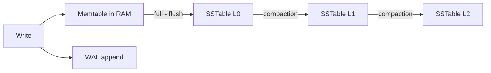

# B-Tree vs LSM-Tree

Underneath every database — relational or NoSQL — sits a **storage engine**: the code that decides how bytes are arranged on disk and how a write physically happens. Almost all of them descend from one of two designs. **B-trees** update data in place, page by page, and have run the relational world since the 1970s. **LSM-trees** (log-structured merge-trees) never update in place: they buffer writes in memory, flush them as sorted immutable files, and clean up later. Which one a database uses explains most of its performance personality, so this note is the foundation for everything else in this module.

## Why this matters

- When someone says "Cassandra has cheap writes" or "Postgres can slow down on heavy insert load", they are really describing LSM vs B-tree behavior. Knowing the engine lets you *predict* a database's behavior instead of memorizing product trivia.
- The choice is a genuine trade-off, not an upgrade: LSM trades read cost and background work for write throughput; B-trees trade write cost for predictable reads. Interviewers probe whether you understand this as a triangle, not a ranking.
- Every note later in this module — [[Cassandra and Wide-Column Stores]], [[DynamoDB Design]], [[Bigtable and Spanner]], [[Time Series and Analytics Stores]] — assumes you know this distinction.

## How it works

### The B-tree path: update in place, protected by a WAL

A B-tree breaks the database into fixed-size **pages** (typically 4–16 KB) arranged as a balanced tree: a root page points to interior pages, which point to leaf pages holding the actual rows or index entries (see [[How Databases Store Data]] and [[Database Indexes]]). A lookup walks root → interior → leaf, usually 3–4 page reads for even very large tables, and most of the upper levels stay cached in the buffer pool.

A write finds the leaf page that owns the key and **overwrites that page in place**. Two complications follow:

1. **Crash safety.** Overwriting a page is not atomic — power can fail mid-write, leaving a torn page. So every B-tree engine first appends the change to a **write-ahead log (WAL)**: a sequential file replayed on restart. Every write is therefore physically written at least twice (WAL + page).
2. **Page splits.** When a leaf page fills up, it splits into two and the parent is updated. Splits cascade upward occasionally, and random inserts gradually fragment pages, leaving them part-empty.

Reads are the strength: data lives in exactly one place, so a read is a short, bounded tree walk.

### The LSM path: memtable → SSTable → compaction

An LSM engine refuses to touch old data on disk. Instead:

1. A write appends to a WAL (crash safety again) and inserts into a **memtable** — an in-memory sorted structure, usually a skip list or balanced tree. This is why LSM writes are fast: the disk only sees a sequential log append.
2. When the memtable reaches a threshold, it is flushed to disk as an **SSTable** (Sorted String Table): an immutable file of key-value pairs in sorted order. Sequential write, no in-place edits ever.
3. Over time many SSTables accumulate, possibly holding different versions of the same key. **Compaction** runs in the background: it merge-sorts several SSTables into fewer, larger ones, keeping only the newest version of each key and physically dropping deleted entries.
4. A **delete** is just another write — a **tombstone** marker saying "this key is dead" — which compaction eventually resolves. (This has sharp consequences in Cassandra; see [[Cassandra and Wide-Column Stores]].)

A read must check the memtable, then SSTables from newest to oldest, until it finds the key. That could mean touching many files, so two optimizations are standard:

- **Bloom filters** — a tiny probabilistic bitmap per SSTable that answers "is this key *definitely not* in this file?" with no false negatives and a small false-positive rate (around 1% at ~10 bits per key). Most SSTables are skipped without a disk read. Bloom filters do not help **range scans**, only point lookups.
- **Leveling/tiering strategies** — compaction policies that bound how many SSTables can overlap a given key range, capping worst-case read fan-out.

### The amplification triangle

Storage-engine design is a three-way trade. You cannot minimize all of these at once:

| Amplification | Definition | B-tree | LSM-tree |
|---|---|---|---|
| **Write** | Bytes physically written per byte of logical write | Moderate — WAL + whole-page writes even for a 100-byte row | High over time — each key is rewritten by every compaction level (often 10–30x total), but each write is *sequential* |
| **Read** | Work done per logical read | Low and predictable — one bounded tree walk | Higher — multiple structures to consult; bloom filters and compaction keep it tolerable |
| **Space** | Disk used vs live data size | Moderate — fragmented, part-empty pages | Temporarily high — old versions and tombstones persist until compaction reclaims them |

The reason LSM still wins for write-heavy loads despite high write amplification: it converts random I/O into sequential I/O, and sequential writes are vastly cheaper on both spinning disks and SSDs (on SSDs they also reduce internal flash garbage collection and wear). See [[Latency Numbers Every Engineer Should Know]] for the underlying ratios.

### The amplification numbers, worked

Abstract amplification becomes intuitive the moment you put sizes on it.

**B-tree, worst case.** Updating one 100-byte row on a 16 KB page physically writes the whole page: 16,384 ÷ 100 ≈ **164 bytes written per byte intended**, plus the WAL record. That worst case rarely materialises, because the buffer pool keeps the dirty page in memory and absorbs many updates before a single flush — so the real figure is 164 divided by however many updates share that flush. This is exactly why B-tree write amplification collapses when updates have locality and explodes when they are uniformly random across a dataset larger than the buffer pool: random updates mean roughly one page flush per update.

**LSM, by level.** Under leveled compaction each level holds about T times more data than the one above it (T = 10 is a common default). A key entering L0 is rewritten when it merges into L1, again into L2, and so on — and each merge rewrites not just the incoming key but the overlapping slice of the destination level, which is where the factor of roughly T per level comes from. A handful of levels therefore lands total write amplification in the tens. The crucial difference from the B-tree's 164 is *when* it is paid: in the background, sequentially, off the request path — until compaction falls behind, at which point it arrives all at once on the request path.

**Bloom filters are not free either.** At the standard ~10 bits per key for a ~1% false-positive rate, a billion keys costs 10⁹ × 10 bits = 10¹⁰ bits = **1.25 GB of RAM** per replica, before a single data block is cached. Tightening the false-positive rate costs roughly another 1.44 bits per key for each halving, so the memory budget, not the math, is what caps how selective the filter gets.

### Which engines use which

| Engine family | Design | Used by |
|---|---|---|
| **InnoDB** | B+tree, clustered on primary key — table *is* the tree | MySQL |
| **Postgres** | Heap tables + B-tree secondary indexes | PostgreSQL |
| **WiredTiger** | B-tree (default engine) | MongoDB — see [[MongoDB Architecture]] |
| **LevelDB / RocksDB** | LSM | Embedded; RocksDB underpins Kafka Streams state stores, CockroachDB (historically), TiKV, many others |
| **Cassandra / ScyllaDB / HBase** | LSM | Wide-column stores — direct Bigtable descendants |
| **Lucene segments** | LSM-like immutable segments + background merges | Elasticsearch |

## Trade-offs

| You gain with LSM | You pay with LSM |
|---|---|
| High sustained write throughput; sequential disk I/O | Reads touch multiple structures; tail latency depends on compaction health |
| Immutable files — simple backups, cheap snapshots, good compression (sorted runs compress well) | Background compaction consumes CPU, disk I/O and temporary disk space, competing with foreground traffic |
| Deletes and updates never block on finding the old copy | Deletes are deferred (tombstones) — space is reclaimed late, and range scans wade through dead entries |
| No page fragmentation | Write stalls if compaction falls behind |

B-trees are the mirror image: predictable point-read latency and mature transactional machinery (row locks attach naturally to in-place pages), at the cost of random-write I/O and page-split overhead under heavy insert load.

## Common misconceptions

- **"LSM is just better — it's newer."** The LSM paper is from 1996 and B-trees from 1970; neither is "the modern one". LSM rose with write-heavy, distributed workloads; B-trees still back the overwhelming majority of transactional systems. Pick by workload, not vintage.
- **"B-trees can't handle writes."** They handle enormous write volumes — every bank runs on them. They pay *random* I/O per write and degrade under sustained random-insert firehoses; that's a different claim.
- **"LSM reads are slow."** With healthy compaction, bloom filters, and a RAM-resident memtable plus block cache, point reads are typically single-digit milliseconds. The honest statement: LSM read *latency depends on background-work health*, while B-tree read latency is structurally bounded. Tail behavior, not averages, is the real difference.
- **"Compaction is overhead you can disable."** Compaction *is* the database. Turning it down indefinitely trades deferred work for unbounded read and space amplification — the system borrows against the future on every write.
- **"The WAL is the same thing as the LSM log structure."** Different layers: the WAL is a short-lived crash-recovery device in both designs; the LSM's SSTables are the *permanent* data layout. "Log-structured" refers to the latter.

## Failure modes

- **Compaction debt (LSM).** Under sustained write bursts, flushes outpace compaction; L0 file counts grow, reads slow down as more files must be consulted per lookup, and eventually the engine throttles or stalls writes to let compaction catch up. *Signal:* read p99 degrading while write rate is flat and CPU is unremarkable. *Confirm:* L0/SSTable file counts and pending-compaction bytes climbing monotonically — the distinguishing feature is that the *backlog*, not the traffic, is what is growing. This is the classic "Cassandra was fine, then p99 reads exploded" incident.
- **Tombstone pileups (LSM).** Delete-heavy workloads where compaction can't keep up make scans grind through thousands of tombstones per live row. *Signal:* scan latency rising while the live row count is flat or falling — the cost is proportional to deleted rows, which no business metric tracks. *Confirm:* tombstone-per-read counters, or a query returning few rows after reading enormous numbers of cells.
- **Buffer-pool thrash (B-tree).** When the working set outgrows RAM, every read becomes a random disk I/O and throughput falls off a cliff — the knee is sharp, not gradual. *Signal:* cache hit ratio dropping a few points while latency multiplies, often after a seemingly harmless data-growth milestone or a new index competing for the same cache. *Confirm:* page-read I/O rate rising faster than query rate.
- **WAL/fsync bottleneck (both).** Both designs serialize on log fsyncs; a slow disk or misconfigured `fsync` setting caps write throughput regardless of engine. *Signal:* write throughput pinned at a flat ceiling that does not move when you add CPU or memory. *Confirm:* fsync latency or log-flush wait metrics dominating the write path.

### What this looks like at 3am

The page is read latency, not writes: p99 on a read path has gone from 8 ms to 400 ms over about forty minutes. Nothing was deployed. Request volume is normal — in fact reads are *down*, because callers are timing out and giving up.

The write dashboard is the one that explains it. A backfill job started at 02:10 and has been pushing several times the usual write rate ever since. Writes still look healthy, because in an LSM engine they are *designed* to look healthy: the memtable accepts them, the commit log appends, and the cost is deferred. What moved is the backlog — L0 file count climbing, pending compaction bytes climbing, both graphs a straight diagonal. Every read now has to consult far more files than usual, and bloom filters only skip the files that definitely lack the key, not the ones that might have it.

Left alone, the next event is a write stall: the engine stops accepting writes to let compaction catch up, converting a read-latency incident into a write outage. The fix at 3am is to throttle or pause the backfill and let compaction drain; the fix in the design review is that a bulk writer against an LSM store needs a rate limit sized against compaction throughput, not against how fast the writer *can* go. The general lesson generalises past LSM: when a system defers work, its health metric is the size of the deferred queue, not the latency of the operation that deferred it.

## In your stack

- **MongoDB (your primary datastore)** uses WiredTiger, a B-tree engine — MongoDB's write behavior is closer to MySQL's than to Cassandra's. Its durability knob is the journal (its WAL) plus write concern; see [[MongoDB Architecture]].
- **MySQL/InnoDB** at Niyo is a clustered B+tree: the primary key ordering *is* the physical row order, which is why monotonically increasing keys insert cheaply and random UUIDs fragment pages.
- **Kafka** (your former broker) is not an LSM database, but it rides the same physics: append-only sequential log writes are the entire reason a broker can absorb enormous write rates. The insight transfers.
- **Redis** sidesteps the question by being in-memory; its persistence files (RDB snapshots, AOF) are again sequential appends — see [[Redis Internals]].
- **The practical consequence for your bulk jobs.** Because both your primary stores are B-tree engines, your version of the amplification problem is not compaction debt — it is the buffer-pool knee. A migration that rewrites documents in random `_id` order evicts the live working set and makes the knee arrive during business hours; the same migration ordered by the index it walks keeps locality and barely registers. Ordering a backfill by its scan key is free and routinely skipped.
- **At 1 replica, the knee has nowhere to hide.** A B-tree store whose working set has just outgrown cache serves every read from disk, and a single-replica service has no peer to absorb the resulting latency — the queue forms inside the only pod. Working-set growth is therefore worth a capacity alert of its own, not just a dashboard, because the degradation is a cliff rather than a slope and you want warning before it, not during.

## Interview angle

The 60-second version: *"B-trees keep one copy of each record in fixed-size pages and overwrite in place, protected by a WAL — reads are a bounded tree walk, writes pay random I/O. LSM-trees buffer writes in a memtable and flush immutable sorted files, merging them later via compaction — writes are sequential and cheap, reads must consult several structures, mitigated by bloom filters. It's a read/write/space amplification triangle: LSM won the write-heavy, horizontally scaled world; B-trees still rule transactional point-read workloads."*

Classic follow-ups:

- *Why are LSM writes fast if write amplification is higher?* Sequential vs random I/O; amplification is paid in background, off the latency path.
- *How does an LSM delete work?* Tombstone write, resolved at compaction — leads naturally to the Cassandra tombstone problem.
- *What's a bloom filter and its limits?* No false negatives, tunable false positives, useless for range scans.
- *Which would you pick for an audit-event store vs an account-balance table?* Events: LSM (append-heavy, rare point reads). Balances: B-tree (point reads/updates, transactions).

## Check yourself

> [!question]- Q: Explain to a new teammate why the same row might exist in four places on disk in Cassandra but only one place in MySQL.
> Cassandra is LSM: each update writes a new version into the memtable, which flushes into a new immutable SSTable — so four updates can leave versions in four SSTables until compaction merges them. InnoDB is a B-tree: the update finds the page owning that primary key and overwrites it in place (after logging to the WAL), so there is always exactly one current on-disk location.

> [!question]- Q: What happens if compaction is paused on a busy LSM database for six hours?
> Flushes continue, so SSTable count grows unbounded. Point reads slow down because more files must be checked (bloom filters limit but don't eliminate this); range scans degrade worse; disk usage climbs because obsolete versions and tombstones aren't reclaimed. Eventually the engine hits its L0 file threshold and throttles or stalls incoming writes. Recovery requires a long compaction catch-up burn of CPU and I/O.

> [!question]- Q: Both designs use a WAL. Why does each need it?
> The B-tree needs it because in-place page overwrites aren't atomic — a crash mid-write tears the page, and the WAL replays the intended change. The LSM needs it because the memtable lives in RAM — a crash loses everything since the last flush unless each write was first appended to the log. Same mechanism, two different holes being plugged.

> [!question]- Q: Two teams report "slow reads". Team A runs MongoDB on WiredTiger, team B runs Cassandra. Both say the write rate is unchanged. What do you check first in each, and why are they different questions?
> For team A (B-tree) the first hypothesis is the buffer-pool knee: the working set has outgrown cache, so reads that used to be memory hits are now random disk I/O. Check cache hit ratio and disk read IOPS against query rate — if reads per query jumped, the dataset or an index grew past RAM, and the fix is memory, a smaller working set, or dropping indexes that are evicting it. For team B (LSM) the first hypothesis is compaction debt: check L0 file count and pending compaction bytes. If the backlog is growing, something upstream is writing faster than compaction can merge, and read cost is rising because each lookup now spans more files. The questions differ because the two engines degrade from different causes — B-trees from the size of the *live* working set, LSM trees from the size of the *deferred work queue* — and each engine's symptom is invisible on the other's dashboard.

> [!question]- Q: Mini-design — you're building a metrics-ingestion service taking 500K writes/sec, with reads that are mostly recent-time-range scans. Which engine family, and what would you watch in production?
> LSM, without hesitation: the workload is append-dominated and sequential-write friendly; B-trees would die on random-insert I/O at that rate. Watch compaction backlog (pending compactions, L0 file count), write-stall counters, disk headroom for compaction scratch space, and tombstone counts if the retention policy deletes old series. A columnar time-series store is an even better fit — see [[Time Series and Analytics Stores]].

## Sources

- Kleppmann, *Designing Data-Intensive Applications*, ch. 3 "Storage and Retrieval" — the definitive comparison this note follows.
- O'Neil, Cheng, Gawlick, O'Neil — "The Log-Structured Merge-Tree (LSM-Tree)", 1996 (the original paper).
- Chang et al. — "Bigtable: A Distributed Storage System for Structured Data", OSDI 2006 (SSTable/memtable design as deployed at Google).
- RocksDB documentation — compaction styles, write stalls, bloom filter tuning.
- Bloom — "Space/Time Trade-offs in Hash Coding with Allowable Errors", 1970.
