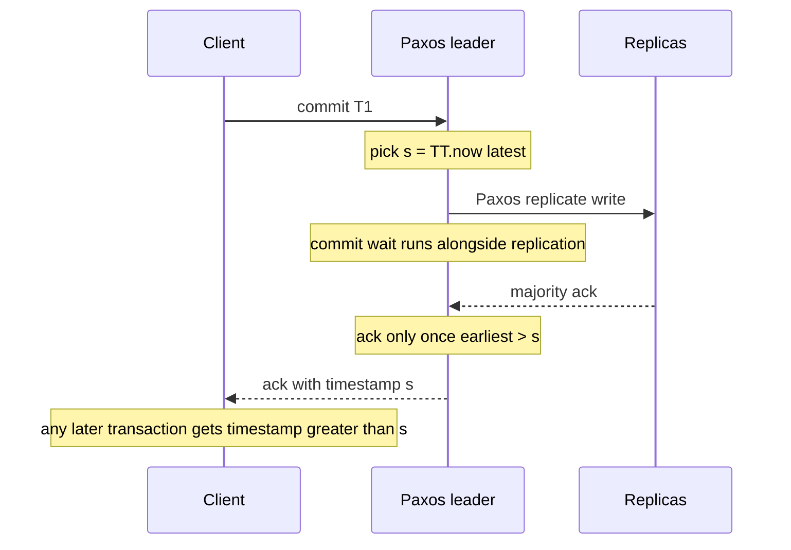

# Bigtable and Spanner

Google's storage systems form a 15-year argument with itself. **GFS** (2003) stored huge files on cheap machines. **Bigtable** (2006) put a sorted, structured table on top — massively scalable, but with transactions no bigger than a single row. Teams suffered without transactions, bolted **Megastore** on top for them, and found it painfully slow. **Spanner** (2012) is the conclusion: a globally replicated database with schemas, full transactions, and — by the 2017 follow-up paper — a complete SQL engine, made possible by **TrueTime**, hardware-backed clocks that admit their own uncertainty. The lineage matters because the industry walked the same road a decade behind: NoSQL for scale, then regret about transactions, then "NewSQL" systems (CockroachDB, YugabyteDB) rebuilding Spanner in the open.

## Why this matters

- This is the cleanest historical proof of a module theme: **dropping transactions and schemas is a loan, not a gift** — Google took the loan to scale in 2006 and spent six years paying it back.
- Spanner is the standard counterexample waved at naive [[CAP Theorem]] arguments ("you can't have consistency *and* availability") — understanding *precisely* in what sense that's true inoculates you against both the hype and the dismissal.
- TrueTime is the one genuinely new idea: replacing "clocks are untrustworthy" ([[Logical Clocks and Ordering]]) with "clocks are untrustworthy *by a measured, bounded amount*" — and extracting global ordering from that bound.

## How it works

### Bigtable (2006): a sorted map at planet scale

Bigtable's data model is "a sparse, distributed, persistent multi-dimensional sorted map": `(row key, column, timestamp) → value`. Rows are kept **sorted by key** and split into **tablets** (contiguous row ranges, ~100–200 MB), each served by one tablet server; data lives in **SSTables** on GFS with an in-memory memtable — the design that named the [[B-Tree vs LSM-Tree]] LSM components, and the direct parent of HBase and of [[Cassandra and Wide-Column Stores]]' data model.

Its guarantees were deliberately minimal: **atomicity per single row**, no cross-row transactions, no joins, no SQL. For web indexing and crawl data that was enough; the sorted row space gave locality (URLs stored reversed — `com.google.www` — so a domain's pages sit adjacently), and single-row atomicity gave read-modify-write per entity.

The pain arrived with interactive products, which unlike crawl data need invariants across rows. **Megastore** (2011 paper) layered entity groups with synchronous Paxos replication over Bigtable — correct, widely used inside Google, and slow: its own paper reports average write latencies of 100–400 ms, with throughput bounded per entity group. The Spanner paper is blunt that Megastore's poor write performance was a direct motivator.

#### Row-key design in a sorted store

Because rows are sorted and split into contiguous tablets, the row key decides both locality and load distribution — the same tension you meet in every sorted partitioned store; Bigtable simply gets there first.

- **Sorting gives you locality for free.** Reversing domain names so `www.google.com` is stored as `com.google.www` places every page of a domain in adjacent rows, so a per-domain scan reads one tablet sequentially instead of touching the whole keyspace.
- **Sorting also gives you hotspots for free.** A key that begins with a timestamp or a monotonic counter directs every new write to the single tablet owning the current maximum — the write path stops scaling at one server no matter how many you add ([[Hot Partition Problem]]).
- **The two cures conflict.** Prefixing the key with a hash spreads writes perfectly and destroys range scans, because adjacent logical records are now scattered. Compounding instead — `entity#timestamp` — keeps scans *within* an entity while spreading writes across entities, which is why that shape recurs in Cassandra clustering keys, DynamoDB sort keys and MongoDB compound shard keys alike.

If this feels identical to the shard-key discussion in [[MongoDB Architecture]], that is the point: the constraint belongs to sorted partitioned storage, not to any one product.

### Spanner (2012): global SQL with external consistency

Spanner shards data into **splits** (key ranges, like tablets). Each split is replicated across datacenters by its own **Paxos group** ([[Consensus and Raft]] — same job, different protocol); one replica acts as the split's leader, holding locks and sequencing writes. Transactions within one split commit via its Paxos group; transactions spanning splits run **two-phase commit over the Paxos leaders** — 2PC's classic fragility ([[Two-Phase Commit and Distributed Transactions]]) is tamed because each "participant" is a replicated state machine that survives individual machine death.

On top: real **SQL, schemas, and secondary indexes** — the 2017 "Spanner: Becoming a SQL System" paper describes the full query engine. Google's message to itself and the industry: scale was never a reason to abandon the relational interface.

### TrueTime: the bounded-uncertainty clock

The hard problem for a *global* database is ordering: if transaction T1 commits in Mumbai and T2 later commits in Virginia, every observer should agree T1 precedes T2 — **external consistency** (linearizability for transactions, the strictest point on the [[Consistency Models]] spectrum). Wall clocks can't promise this — they skew. Logical clocks order only *communicating* events.

**TrueTime** attacks the physics: GPS receivers and atomic clocks in every datacenter, with an API that returns not a timestamp but an **interval**: `TT.now() → [earliest, latest]`, guaranteed to contain true time. The uncertainty **ε** is typically small — on the order of a few milliseconds (the paper reports averages around 4 ms in 2012; Google reported under 1 ms at the 99th percentile in April 2023).

The trick is **commit wait**: a transaction takes its commit timestamp `s = TT.now().latest`, then *deliberately waits* until `TT.now().earliest > s` before releasing locks and acknowledging. After the wait, every clock everywhere agrees `s` is in the past — so any transaction that starts afterwards necessarily gets a later timestamp. Real-time order equals timestamp order, globally, at the price of roughly 2ε extra commit latency (the wait runs from `latest` until `earliest` passes it; the paper puts the expected wait at at least 2ε̄ and overlaps it with Paxos communication). Bounded uncertainty is *paid for in waiting*, converting a clock guarantee into an ordering guarantee.

The paper describes ε as a **sawtooth**: it grows between polls of the time masters at an assumed worst-case drift rate of 200 microseconds per second, and resets when a poll succeeds — roughly 1 to 7 ms across a 30-second poll interval, averaging around 4 ms in 2012.

Bonus: timestamps give **lock-free snapshot reads** — a read at timestamp t can be served by any replica caught up to t, including reads of the consistent global past.

#### External consistency vs serializable — the anomaly that separates them

Serializability says the outcome equals *some* serial order of the transactions. External consistency says that order must also match real time. The gap between the two is observable, which is why it is worth a paragraph rather than a definition.

A user makes a payment from their phone, committing through a node in one region. They then telephone a colleague, who refreshes a dashboard served from another region. Under serializability alone the dashboard's read may legitimately be placed *before* the payment in the chosen serial order and show the old balance — nothing in the isolation guarantee forbids it, because the two operations never touched each other's data in a way the database can observe, and the causal link travelled outside the system entirely, through a phone call. External consistency forbids exactly this: the payment's commit timestamp is already in the past everywhere by the time the client was acknowledged, so any read that starts afterwards must receive a later timestamp and must therefore see it.

The practical reading: serializable is enough when every causal path runs through the database, and external consistency is what you need when humans, queues and other systems carry causality around it ([[Consistency Models]]).

#### What the write latency is actually made of

Commit wait is the famous part of Spanner's write cost and the smaller part. Physics dominates. Light in fibre travels at roughly 200,000 km/s — about two-thirds of its vacuum speed — so a round trip between regions 4,000 km apart covers 8,000 km and cannot complete faster than 8,000 ÷ 200,000 = **40 ms**, before any routing, queueing or processing is counted. A write replicated to a majority spread across such regions pays that floor on every commit.

Against that, commit wait adds the clock-uncertainty term — about 2ε, so roughly 8 ms at the 2012 paper's 4 ms average, and partly hidden because it overlaps the Paxos round. So the honest summary of "Spanner is slow for writes" is that it is *distance* that is slow, and TrueTime's contribution is a few milliseconds on top in exchange for an ordering guarantee. This is also why single-region Spanner-class deployments feel unremarkable and multi-region ones feel expensive: the same software, a different value of distance.

### "CP and highly available" — resolving the CAP tension

Spanner is, formally, **CP**: during a partition that separates a Paxos group's majority from a minority, the minority side refuses writes — consistency wins ([[CAP Theorem]]). So how do people say it's "effectively CA"? Eric Brewer's 2017 paper ("Spanner, TrueTime and the CAP Theorem") answers: Google runs Spanner on its **private global network** with redundant paths and engineering such that partitions are extraordinarily rare, and Paxos majorities mask individual failures — measured availability is so high (5+ nines) that users *observe* a system that is both consistent and available. CAP isn't violated; the P row of the truth table almost never executes, and when it does, Spanner picks C. The honest lesson: **CAP describes behavior during partitions; it says nothing about how often partitions happen — and you can spend money to make them rare.** (PACELC adds the everyday cost: Spanner pays latency — commit wait, cross-region Paxos — for consistency even with no partition; see [[PACELC]].)

### Open descendants

- **CockroachDB** and **YugabyteDB** copy the architecture ("open" by lineage more than licence: YugabyteDB's core is Apache 2.0, while CockroachDB retired its free Core edition in November 2024 and stopped publishing new source in September 2026) — ranges/tablets replicated by [[Consensus and Raft|Raft]] groups, distributed SQL, serializable transactions — but *without* TrueTime hardware. They use hybrid logical clocks with an assumed max clock offset (default 500 ms in CockroachDB, as of 2026): correctness degrades if clocks actually exceed the bound, and they deliver serializable isolation while renouncing Spanner's full external-consistency guarantee (CockroachDB documents the gap as the price of commodity clocks; reads may pay "uncertainty restarts" instead of commit waits).
- **Cloud Spanner** is the GCP product (Google previewed a downloadable, self-hosted edition, Spanner Omni, in April 2026); AWS's **Aurora DSQL** (GA May 2025) and others continue the genre. The genre name "NewSQL" simply means: distributed, replicated, horizontally scalable — and unapologetically SQL.

| | Spanner | CockroachDB | YugabyteDB |
|---|---|---|---|
| Clock source | GPS receivers and atomic clocks, exposed as TrueTime | Commodity NTP with hybrid logical clocks | Commodity NTP with hybrid logical clocks |
| Clock uncertainty | *Measured* — the API returns the bound | *Assumed* — a configured maximum offset, 500 ms by default | *Assumed* — a configured maximum offset |
| Replication unit | Split, replicated by Paxos | Range, replicated by Raft | Tablet, replicated by Raft |
| Where uncertainty is paid | Commit wait, on writes | Read restarts when a timestamp lands in the uncertainty window | The same restart mechanism |
| Strongest guarantee | External consistency | Serializable | Serializable |
| Client interface | SQL — GoogleSQL or a PostgreSQL dialect | PostgreSQL wire protocol | PostgreSQL wire protocol |

Read the table as one trade repeated: Google spent hardware to turn uncertainty into a *measured* quantity it could wait out on the write path; the open descendants spend nothing on hardware and pay instead on the read path, in retries, under an assumption they must monitor rather than observe.

### The lineage at a glance

| System | Year | What it added | What it still lacked |
|---|---|---|---|
| GFS | 2003 | Huge files on cheap, failing machines | Any structure — it's a filesystem |
| Bigtable | 2006 | Sorted structured map, tablets, SSTables, single-row atomicity | Cross-row transactions, SQL, schemas |
| Megastore | 2011 | Transactions within entity groups, synchronous wide-area Paxos | Acceptable write latency and throughput |
| Spanner | 2012 | TrueTime, external consistency, Paxos per split, 2PC across splits | — (SQL engine matured by the 2017 paper) |

Each system exists because real teams hit the previous one's "still lacked" column.

## Trade-offs

| You gain with Spanner-class systems | You pay |
|---|---|
| Global strong consistency + SQL + transactions | Write latency floor: Paxos across regions + commit wait — physics, not implementation debt |
| Scale-out without giving up schemas or invariants | Cost: specialized infrastructure (or managed pricing); multi-region replication is expensive by design |
| Lock-free consistent snapshot reads anywhere | Hot ranges from monotonic keys, same as every sorted store ([[Hot Partition Problem]]) |
| Survives machine and zone loss transparently | Minority partitions refuse writes — CP behavior when partitions do happen |

## Common misconceptions

- **"Spanner disproves CAP."** It doesn't, and Brewer (CAP's author) says so explicitly: under an actual partition Spanner chooses consistency and loses availability on the minority side. The claim is that partitions are engineered to be rare enough that the choice almost never activates.
- **"TrueTime makes clocks perfectly synchronized."** The opposite — TrueTime's contribution is *admitting* desynchronization as a measured interval. Correctness comes from waiting out the uncertainty, not eliminating it.
- **"Commit wait makes every query slow."** It delays *write acknowledgments* by roughly 2ε (milliseconds, overlapped with replication); reads — the bulk of most workloads — are snapshot reads that never commit-wait, and can be served by local replicas.
- **"CockroachDB = open-source Spanner."** Architecturally close; guarantee-wise weaker (serializable, not externally consistent) because commodity NTP can't bound uncertainty the way GPS + atomic clocks do. For most applications the difference never bites — but it exists.

## In your stack

- Nothing at Niyo runs Spanner, but the lineage reads as a warning label for your own architecture: MongoDB-for-scale is the Bigtable move, and the pressure you feel for cross-document invariants on money paths is the Megastore pain, arriving on schedule. The industry's answer was "bring back SQL where invariants live" — worth remembering when a ledger design review comes up ([[Choosing a Database]]).
- **The latency arithmetic is the number to bring to a multi-region design review.** Niyo's data stays in-region for RBI localisation reasons, which conveniently also keeps you on the cheap side of the distance term above: a single-region consensus-replicated store pays milliseconds, a cross-continent one pays tens. If a future design proposes replicating a write path across regions "for availability", the 40 ms floor is the cost line that must appear next to the benefit.
- **The row-key lesson is the one that applies to you today.** You will never tune TrueTime, but you will choose a MongoDB shard key, and the hot-tablet failure Bigtable documented in 2006 is byte-for-byte the hot-chunk failure a monotonic `_id` or `createdAt` produces on your cluster. The entity-then-time compound key is the same answer in both systems.
- CockroachDB/YugabyteDB are the realistic "Spanner for us" options if a globally consistent store were ever required (e.g. multi-region expansion with RBI data-localisation constraints keeping Indian data in-region — note that *geo-partitioning* features in these systems exist precisely for such regulatory shapes).

## Interview angle

The 60-second version: *"Bigtable, 2006: a sorted key-value map in tablets on GFS, SSTables and memtables, atomic only per row — it scaled but exported the transaction problem to every team; Megastore patched transactions on top and was slow. Spanner, 2012: splits replicated by per-split Paxos groups, 2PC across splits, full SQL and schemas. The new idea is TrueTime — GPS and atomic clocks exposing a bounded uncertainty interval — plus commit wait: take the latest bound as your timestamp and wait out the uncertainty before acking, so timestamp order equals real-time order globally: external consistency. It's formally CP, but on Google's network partitions are so rare it's 'effectively CA' — Brewer's own framing. CockroachDB and YugabyteDB rebuild it on commodity clocks with weaker ordering guarantees."*

Classic follow-ups: *why can't vector clocks give external consistency?* (they order only causally related events; two independent transactions through different coordinators need a global arbiter — see [[Logical Clocks and Ordering]]); *what breaks if TrueTime's ε is violated?* (ordering — external consistency silently fails; Google treats clock integrity as an engineering invariant); *why did Google bother with transactions again?* (the Spanner paper's famous line is that it's better to have application programmers deal with performance problems as bottlenecks arise, rather than always coding around the lack of transactions).

## Check yourself

> [!question]- Q: Explain commit wait to a teammate in three sentences, including what it buys.
> TrueTime gives an interval guaranteed to contain true time, so a committing leader picks its timestamp as the interval's upper bound. It then holds the acknowledgment until TrueTime's lower bound everywhere has passed that timestamp — a wait of roughly twice the uncertainty, 2ε, overlapped with Paxos replication. After that, any transaction starting anywhere on Earth will receive a strictly later timestamp, so ordering timestamps equals ordering by real time: external consistency, bought with a few milliseconds of deliberate waiting.

> [!question]- Q: What happens to a Spanner split during a network partition that isolates its Paxos leader with only one of five replicas?
> The leader's side has no majority: it cannot replicate writes and its leader lease expires; writes on that side fail — CP behavior. The majority side (three replicas) elects a new leader and continues serving reads and writes. Clients routed to the minority see unavailability for that split until the partition heals, whereupon the old leader's side rejoins and catches up via Paxos. No split-brain: at most one side ever holds a valid majority ([[Split Brain and Fencing]]).

> [!question]- Q: Why was single-row atomicity enough for Bigtable's original users but not for later product teams?
> Web-index and crawl workloads update one entity at a time — a page's row — with no cross-entity invariants, so per-row read-modify-write sufficed. Product teams (ads budgets, user accounts) have invariants spanning rows: debit one row, credit another; maintain an index row consistent with a data row. Without transactions, every team hand-built fragile coordination (retry queues, cleanup jobs) — the distributed-systems tax paid in application code, which Megastore then Spanner moved back into the database.

> [!question]- Q: A colleague says "serializable is the strongest isolation level, so external consistency is marketing". Give them the concrete counterexample.
> Serializable guarantees the outcome matches *some* serial order; it says nothing about which one, so that order may disagree with real time. Concretely: a payment commits through a node in Mumbai and is acknowledged to the user; the user phones a colleague, who loads a dashboard served from a node in Virginia. Under serializability alone the dashboard's read may be ordered *before* the payment and show the stale balance — legally, because the two transactions have no data dependency the database can see, and the causality that links them travelled through a telephone, outside the system. External consistency rules this out by construction: commit wait ensures the payment's timestamp is in the past everywhere before the client is told "done", so any later-starting read takes a later timestamp and must observe it. The distinction is marketing only in systems where every causal path runs through the database — which is almost no real system, because queues, caches and humans all carry causality around it.

> [!question]- Q: CockroachDB claims Spanner's architecture without atomic clocks. What exactly did it give up, and how does it stay safe?
> It replaces measured bounded uncertainty with an *assumed* maximum clock offset (default 500 ms) and hybrid logical clocks. Within the assumption it provides serializable transactions, but not Spanner's external consistency — causally unrelated transactions through different nodes can commit with timestamps that disagree with real-time order (the anomaly Spanner's commit wait eliminates). Reads that encounter timestamps inside their uncertainty window pay retries ("uncertainty restarts"), and if real clock skew ever exceeds the configured bound, nodes self-eject to avoid serving inconsistent data — an assumption enforced by monitoring rather than by GPS hardware.

## Sources

- Ghemawat, Gobioff, Leung — "The Google File System", SOSP 2003.
- Chang et al. — "Bigtable: A Distributed Storage System for Structured Data", OSDI 2006.
- Baker et al. — "Megastore: Providing Scalable, Highly Available Storage for Interactive Services", CIDR 2011.
- Corbett et al. — "Spanner: Google's Globally-Distributed Database", OSDI 2012; and Bacon et al. — "Spanner: Becoming a SQL System", SIGMOD 2017.
- Brewer — "Spanner, TrueTime and the CAP Theorem", Google whitepaper, 2017.
- CockroachDB documentation/blog — "Living Without Atomic Clocks" (the clearest explanation of the commodity-clock trade-off).
- Kleppmann, *Designing Data-Intensive Applications*, ch. 8–9 (clocks, ordering, consistency) — the theory backdrop; continued in [[Google Spanner Deep Dive]].
