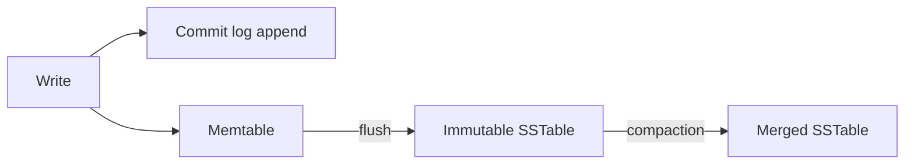

# Cassandra and Wide-Column Stores

Apache Cassandra (built at Facebook for inbox search, open-sourced 2008) is the best-known **wide-column store**, and the cleanest way to understand it is as a marriage: **Dynamo's distribution layer** (ring, replication, quorums, gossip — see [[The Dynamo Paper]]) carrying **Bigtable's data model and storage engine** (partitions of sorted rows on an LSM engine — see [[Bigtable and Spanner]] and [[B-Tree vs LSM-Tree]]). It is masterless, write-optimized, and linearly scalable — and it demands that you model your data around your queries, not the other way round. ScyllaDB (a C++ reimplementation) and HBase (Bigtable's direct open-source clone, with a different, leader-based consistency design) are its siblings.

## The problem that created it

Facebook circa 2007 needed to index message inboxes: enormous write volume (every message updates indexes), data far beyond one machine, and a hard requirement to stay writable across datacenter failures — while relational stores wanted single masters and random-I/O B-tree writes. Dynamo had shown how to stay available and scale writes; Bigtable had shown a data model richer than pure key-value (sorted rows within partitions) that fits time-ordered data. Cassandra fused them. The same shape of problem — "massive, append-heavy, per-entity time-ordered data that must always accept writes" — is why Netflix (viewing history), Discord (messages — see [[Discord Message Storage Evolution]]), and Apple (reportedly among the largest deployments) adopted it.

## What it solves

- **Write throughput that scales linearly** with node count — no leader bottleneck, LSM-cheap writes.
- **No single point of failure**: every node is equal (masterless); any node coordinates any request.
- **Multi-datacenter replication as a first-class feature** (per-DC replication factors, `LOCAL_QUORUM`).
- **Per-query consistency choice**: dial each read/write between fast-and-loose and strict ([[Quorum Reads and Writes]]).
- **Time-ordered per-entity data** served by one sequential partition scan.

## How it works

### Data model: partition key + clustering columns

A Cassandra primary key has two parts: the **partition key** decides *which nodes* hold the row (hashed onto the ring — [[Consistent Hashing]]); the **clustering columns** decide *the sort order within the partition*. 

```
CREATE TABLE messages (
  conversation_id uuid,     -- partition key: locates the partition
  sent_at timeuuid,         -- clustering column: sort order inside it
  sender_id uuid,
  body text,
  PRIMARY KEY ((conversation_id), sent_at)
) WITH CLUSTERING ORDER BY (sent_at DESC);
```

"Messages in conversation X, newest first, limit 50" is then one partition lookup plus a sequential scan of a sorted run — the entire performance model in one query. Rows are **sparse**: each row stores only the columns it has, which is where "wide-column" historically comes from (early Cassandra let a partition be a huge sorted map of arbitrary columns).

### Query-first data modeling

Relational modeling normalizes entities, then writes any query over them. Cassandra inverts this: **enumerate the queries first, then create one table per query**, denormalizing data into each. Need messages by conversation *and* by sender? Two tables, both written on every send (batched, or via materialized views — which have a troubled reliability history and are commonly avoided). Disk is cheap; cross-partition queries are not. The discipline:

1. List every access pattern.
2. Design a table whose partition key matches each pattern's lookup and whose clustering columns match its ordering.
3. Writes fan out to all tables; the application owns their consistency ([[Normalization vs Denormalization]] taken to its endpoint).
4. Keep partitions bounded — the standard rule of thumb is under ~100 MB and ideally under ~100,000 rows per partition (the hard ceiling, 2 billion cells, is far above where performance already hurts); unbounded partitions (e.g. partitioning by `sensor_id` alone, forever) are the classic modeling bug. Fix with **bucketing**: `((sensor_id, day))` — the same cure as [[Hot Partition Problem]].

#### Partition sizing is arithmetic, not instinct

"Keep partitions bounded" becomes actionable the moment you multiply. Take a row of about 200 bytes and a two-year retention:

- Partitioned by `sensor_id` alone at 100 rows/day: 100 × 730 = 73,000 rows × 200 B ≈ **14.6 MB**. Comfortable.
- The same key at 10,000 rows/day: 10,000 × 730 = 7.3 million rows × 200 B ≈ **1.46 GB**. That partition is now a liability — reads of it pressure the heap, repairs and node moves stream it as an indivisible unit, and one hot copy can dominate a node.
- Bucketed by day as `((sensor_id, day))`, the busiest partition is 10,000 × 200 B = **2 MB**, independent of retention. Extending retention now adds *more* partitions rather than enlarging any one.

The general lesson applies to every partitioned store, not just Cassandra: a partition key with no time or hash bucket encodes "grows forever", and growth rate × retention is the single number that decides whether that is fine or fatal. Do the multiplication in the design review, where it costs a minute.

### Tunable consistency

Replication factor **N** (typically 3 per datacenter) with per-operation consistency levels:

| Level | Meaning | Use |
|---|---|---|
| `ONE` | One replica acks | Fast, available, stale-tolerant reads/writes |
| `QUORUM` | ⌈(N+1)/2⌉ ack | R+W>N overlap: QUORUM writes + QUORUM reads see latest acknowledged write |
| `LOCAL_QUORUM` | Quorum within the local DC | The multi-DC workhorse — avoids cross-DC latency on the hot path |
| `ALL` | Every replica | Strictest and most fragile — one dead replica fails the op |

Cassandra inherits Dynamo's repair toolbox — hinted handoff, read repair, Merkle-tree anti-entropy (`nodetool repair`) — but replaced vector clocks with **last-write-wins by cell timestamp**: concurrent writes to the same column are resolved by timestamp, silently discarding one. Simpler than siblings; dependent on sane clocks; wrong for read-modify-write data. (Lightweight transactions using Paxos exist for compare-and-set, at a steep latency cost.)

### The write path: why writes are cheap

A write hits the coordinator → each replica appends to its **commit log** (sequential) and inserts into its **memtable** (memory) → ack. No read, no seek, no index update on the write path — an update doesn't even check whether the row exists. Memtables flush to immutable **SSTables**; compaction merges them in the background. This is the pure [[B-Tree vs LSM-Tree]] LSM story, and it's why Cassandra sustains write rates that would melt a B-tree engine. Reads pay the bill: merge memtable + several SSTables, mitigated by bloom filters and compaction strategy choice (size-tiered for write-heavy, leveled for read-heavy, time-window for time series).



### Tombstones and the delete problem

In an immutable-file world a delete cannot remove anything — it *writes* a **tombstone** marking the value dead. The tombstone must persist long enough for every replica to learn of it, controlled by `gc_grace_seconds` (default **10 days**): compaction may only drop a tombstone (and the data it shadows) after that grace period. Two production-grade consequences:

- **Resurrection**: if a replica is down longer than `gc_grace_seconds` and rejoins after others compacted the tombstone away, it still holds the "live" value and anti-entropy happily spreads the deleted data back. Hence the operational law: **run `nodetool repair` on every node at least once per `gc_grace_seconds`**.
- **Tombstone scans**: queue-like workloads (insert, consume, delete, repeat in one partition) make reads wade through thousands of tombstones per live row; Cassandra emits tombstone warnings and will abort queries past a threshold. *Cassandra is a famously terrible queue* — use a queue ([[Message Queues vs Event Logs]]).

### The read path, for contrast

A read at `QUORUM` goes coordinator → R replicas; each replica merges its memtable and candidate SSTables (bloom filters pruning most), returns its newest version per cell; the coordinator reconciles by timestamp, triggers read repair on any stale replica, and responds. Every step that the write path skipped — locating, merging, reconciling — the read path pays. Remember it as: *Cassandra writes blind and reads careful.*

### The wide-column family, side by side

The four systems people compare in the same sentence are not interchangeable, and the differences are structural rather than cosmetic:

| | Cassandra | ScyllaDB | HBase | DynamoDB |
|---|---|---|---|---|
| Lineage | Dynamo distribution + Bigtable model | Cassandra re-implemented in C++, CQL wire-compatible | Direct Bigtable clone, on HDFS | AWS service in the Dynamo lineage |
| Topology | Masterless ring, any node coordinates | Same ring model | One RegionServer owns each region; HDFS replicates underneath | Leader per partition, fully managed |
| Consistency | Tunable per operation; last-write-wins conflict resolution | Same | Strongly consistent per row by construction | Eventual or strong per read; no user-visible conflicts |
| Chosen for | Multi-DC writes, no leader, operator control | Cassandra semantics without JVM garbage-collection pauses | You already run Hadoop | Zero operations |
| Standing tax | Repairs, compaction tuning, JVM care | Smaller ecosystem and community | HDFS plus ZooKeeper operational surface | Access patterns frozen; proprietary API |

Note what *doesn't* vary: all four make you choose the partition key up front, and all four punish getting it wrong in the same way.

## Trade-offs

| You gain | You pay |
|---|---|
| Linear write scaling, masterless availability | Queries limited to what you modeled; ad-hoc = `ALLOW FILTERING` = full scan = pain |
| Multi-DC replication with per-DC quorums | Application-side consistency across denormalized tables |
| Tunable per-op consistency | Last-write-wins can silently drop concurrent updates; no real transactions |
| Excellent fit for time-ordered, append-heavy data | Tombstone and compaction care-and-feeding; repairs are a standing operational chore |

## Common misconceptions

- **"Eventually consistent means you cannot trust a read."** Consistency is per operation. `QUORUM` writes plus `QUORUM` reads overlap and return the latest acknowledged write; `ONE`/`ONE` does not. Cassandra's reputation for looseness is mostly a reputation for defaults nobody changed.
- **"Masterless means no coordination."** Every request still has a coordinator node, gossip still has to converge, and anti-entropy repair is a mandatory scheduled chore. What is absent is a *leader election* and the failover pause that comes with it — not coordination itself.
- **"Adding nodes always adds capacity."** It adds aggregate throughput and storage. It does nothing for a single oversized or scorching partition, which lives on exactly N replicas no matter how large the ring grows — the same ceiling DynamoDB has per partition, reached by a different route.
- **"Last-write-wins resolves conflicts."** It *picks* one by cell timestamp and discards the other with no record kept. That is a resolution policy only where losing one of two concurrent writes is acceptable; for read-modify-write data it is silent corruption with good latency.
- **"Secondary indexes work like SQL indexes."** A Cassandra secondary index is local to each node, so a query using one fans out across the ring and then merges — acceptable for low-cardinality filtering within a known partition, pathological as a general access path ([[Secondary Indexes on Sharded Data]]).
- **"`ALLOW FILTERING` makes the query work."** It makes the query *run*. The clause is the database asking you to confirm you intend a scan, and the usual correct answer is to add a table modelled for that query instead.

## Failure modes

- **Unbounded/hot partitions**: one celebrity partition grows past memory-friendly size — read latency spikes, heap pressure, streaming problems during node moves. *Signal:* per-node latency diverging, with one or two nodes consistently worst, rather than a cluster-wide rise. *Confirm:* partition-size metrics (`nodetool tablehistograms` reports partition size and cell count percentiles) — a p99 partition orders of magnitude above the median is the diagnosis. Signature of a missing bucket in the key ([[Hot Partition Problem]]).
- **Tombstone overload**: *Signal:* reads getting slower on a table whose live row count is flat or shrinking, then `TombstoneOverwhelmingException`s and aborted queries. *Confirm:* the tombstone warn/fail threshold messages in the logs name the table and the offending partition directly. Usually a queue-shaped anti-pattern or over-aggressive TTL churn.
- **Compaction debt**: sustained write bursts outpace compaction; pending compactions climb, read p99 degrades. *Signal and confirmation:* the backlog graph, not the traffic graph — see the worked incident in [[B-Tree vs LSM-Tree]], which is the same failure wearing Cassandra's clothes.
- **Repair neglect → resurrection**: deleted data reappearing after a node rejoins. *Signal:* by nature, a business-logic complaint — a cancelled mandate active again, a deleted record back in a list — never an error. *Confirm:* compare the row's write timestamps (`WRITETIME`) against the deletion's time and the node's downtime window. Mitigation is the repair cadence rule above; detection after the fact is reconciliation, not monitoring.
- **Clock skew + last-write-wins**: writes "lost" to a replica whose clock runs ahead. *Signal:* an update that "didn't take" and cannot be reproduced. *Confirm:* NTP offset metrics per node, plus `WRITETIME` on the surviving cell sitting in the future relative to the write that disappeared. NTP discipline is part of correctness here, not hygiene ([[Logical Clocks and Ordering]]).

## When NOT to use it

- **Ad-hoc queries, analytics, exploration** — no joins, no aggregations worth using, secondary indexes are weak ([[Secondary Indexes on Sharded Data]]); pair it with a columnar store instead ([[Time Series and Analytics Stores]]).
- **Transactional invariants** — balances, inventory, anything read-modify-write; LWT Paxos rounds are too slow as a primary pattern ([[ACID Transactions]]).
- **Small data** — below hundreds of GB and tens of thousands of writes/sec, a replicated Postgres/MySQL/MongoDB is simpler to run and to query.
- **Queue semantics** — the tombstone section is the proof.
- **Teams without ops appetite** — repairs, compaction tuning and JVM care are a real tax; managed options (Astra, Keyspaces — which differs semantically underneath) change but don't erase it.

## In your stack

- Niyo's workloads mostly fail Cassandra's entry test: money movement and KYC want read-modify-write correctness and flexible back-office queries — precisely the two things Cassandra trades away. MongoDB with majority writes is the saner default there ([[MongoDB Architecture]]).
- Where it *would* fit at Niyo: transaction-event history / audit trails and notification logs — append-only, per-user time-ordered, high volume, queried as "latest N for user X". That's the Discord-messages shape ([[Discord Message Storage Evolution]]).
- The modeling discipline transfers even if you never run Cassandra: "enumerate queries first, denormalize per query, bound your partitions" is exactly how you should pick MongoDB shard keys and design DynamoDB tables ([[DynamoDB Design]]).
- `LOCAL_QUORUM` vs `QUORUM` is the same latency-vs-consistency dial you'll meet as [[PACELC]]'s ELC branch — one concrete instance of Module 8's theory.
- **The tombstone-queue lesson transfers to your planned Redis Streams move.** "Cassandra is a terrible queue" generalises to "a store whose deletes are deferred, or whose entries are retained by policy, makes a bad queue" — and a Redis Stream that is consumed but never `XTRIM`-med or acknowledged grows the same way, with memory rather than disk as the ceiling. When you migrate off SQS, the acknowledgement-and-trim policy is the part to design first, because the broker will not reclaim anything you do not tell it to ([[Redis Streams]]).
- **Honest 1-replica note.** Nothing about Cassandra's availability story helps a consumer pinned at one replica: a masterless store that accepts writes through any node still delivers them to a single pod that can be restarted, drained or evicted. Cassandra's design removes the *database's* single point of failure, not your deployment's — worth saying out loud when an availability argument is being made from the datastore's properties.

## Interview angle

The 60-second version: *"Cassandra is Dynamo's ring — masterless, consistent hashing, quorums, gossip — carrying Bigtable's data model: a partition key that locates data and clustering columns that sort it, on an LSM engine, so writes are sequential appends and scale linearly. You model query-first: one denormalized table per access pattern, partitions kept bounded. Consistency is tunable per operation — QUORUM reads plus QUORUM writes overlap; LOCAL_QUORUM is the multi-DC workhorse. Conflicts resolve by last-write-wins timestamps. Deletes write tombstones that survive gc_grace_seconds, which is why repairs are mandatory and queues are an anti-pattern. Wrong tool for ad-hoc queries and transactions."*

Classic follow-ups: *why are writes faster than reads?* (write path never reads; read path merges structures); *what happens with QUORUM when one of three replicas is down?* (still succeeds — 2 of 3; `ALL` would fail); *design Discord's message store* (partition by `(channel_id, bucket)`, cluster by message time — then discuss why Discord later left Cassandra for ScyllaDB: GC pauses and hot-partition repair pain).

## Check yourself

> [!question]- Q: Explain to a teammate why a Cassandra write never checks whether the row already exists — and what that implies for correctness.
> Writes are blind appends: commit log + memtable, later flushed to immutable SSTables; "the row" only materializes at read time, when all versions are merged by timestamp. That's why writes are O(append) and fast. Implication: Cassandra cannot natively enforce read-modify-write invariants — two concurrent "set balance = balance - 100" writes don't conflict, they just both land and the later timestamp wins. Counters and lightweight transactions exist as special cases; real invariants belong elsewhere.

> [!question]- Q: What happens if a node is offline for 12 days (gc_grace_seconds = 10 days) and then rejoins without intervention?
> Tombstones older than 10 days may already be compacted away on the healthy replicas. The returning node still carries pre-delete "live" data; read repair or anti-entropy can now copy that data back to the other replicas — deleted rows resurrect. Correct operations: either run repair before the grace period elapses, or treat the node as dead and rebuild it from scratch rather than letting it rejoin with stale SSTables.

> [!question]- Q: With N=3, you write at ONE and read at QUORUM. Can the read miss the write? What if both are QUORUM?
> Yes: W=1, R=2 gives R+W=3 = N, not > N — the single written replica may be excluded from the read's two, returning stale data until read repair/anti-entropy propagates. With both at QUORUM (2+2 > 3) any read set overlaps any *acknowledged* write set, so the read sees the write — the [[Quorum Reads and Writes]] overlap argument, with the usual caveats (it's not full linearizability under failure and concurrency edge cases).

> [!question]- Q: A table is keyed `PRIMARY KEY ((device_id), event_time)` and holds 18 months of events. Rows average 300 bytes and a busy device emits 2,000 events a day. Is the partition size acceptable, and what does the answer change?
> Multiply it out: 2,000 × 547 days ≈ 1,094,000 rows, × 300 B ≈ **328 MB** for one device's partition. That is well past the ~100 MB rule of thumb — reads of that device pressure the heap, and repairs or node replacements have to stream the whole 328 MB as an indivisible unit, so the slowest operation in the cluster is set by the busiest device. Bucketing by month gives 2,000 × 30 × 300 B = 18 MB per partition, which is comfortable, and bucketing by week gives about 4.2 MB. The thing the answer changes is the *read* code, not just the schema: "latest N events" now has to walk buckets backwards and may span two of them, and a date-range query has to compute which buckets it touches. That read-side cost is exactly why people skip bucketing, and exactly why they regret it — adding a bucket later means rewriting the table, because the partition key cannot be altered in place.

> [!question]- Q: Mini-design — store 90 days of card-transaction events for 10M users, queried as "latest 20 for user X" and "user X's events for a given day". Sketch the table and name the two biggest risks.
> `PRIMARY KEY ((user_id, month), event_time)` with `CLUSTERING ORDER BY (event_time DESC)` — sort direction is a table property, not something the key clause accepts. Month bucketing bounds partitions (a whale user's events split across months); "latest 20" reads the current month's partition (occasionally spilling to the previous one); per-day queries add an `event_time` range on the right bucket. TTL = 90 days handles retention. Risks: (1) TTL churn generates mass tombstones — use time-window compaction so whole expired SSTables drop cheaply; (2) whale users still make hot monthly partitions — shrink the bucket (week/day) if partition-size metrics say so. And the ops-dashboard query "all users' events above ₹X" goes to the analytics store, not here.

## Sources

- Lakshman, Malik — "Cassandra: A Decentralized Structured Storage System", ACM SIGOPS Operating Systems Review, 2010 (the Facebook paper).
- DeCandia et al. — "Dynamo", SOSP 2007; Chang et al. — "Bigtable", OSDI 2006 (the two parents).
- Apache Cassandra documentation — data modeling, consistency levels, compaction strategies, `gc_grace_seconds` and repair.
- Kleppmann, *Designing Data-Intensive Applications*, ch. 3 (LSM), ch. 5 (leaderless replication), ch. 6 (partitioning).
- Discord Engineering — "How Discord Stores Billions of Messages" (2017) and "How Discord Stores Trillions of Messages" (2023) — the canonical production case study, continued in [[Discord Message Storage Evolution]].
