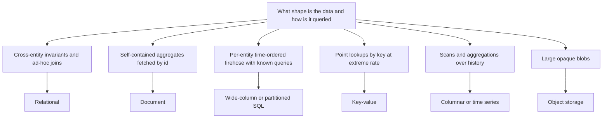

# Choosing a Database

After nine notes on individual systems, this one is the synthesis: how to actually choose. The honest headline is that database selection is **requirements analysis, not a popularity contest** — the right answer falls out of a handful of questions about your data and your team, and the most common failure is answering a different question ("what's exciting", "what does the blog post use") instead. The second honest headline: for most workloads, most of the time, the right answer is the boring one you already run.

## Why this matters

- Databases are the **stickiest** choice in a system: stateless services redeploy in minutes; migrating a datastore is a months-long project with data-integrity risk ([[Discord Message Storage Evolution]] is three acts of exactly this). You will live with this decision longer than with any other.
- "Which database and why" is a guaranteed interview segment — and interviewers grade the *framework*, not the brand name.
- Wrong choices fail slowly: the demo works in every database; the mismatch surfaces at 100x load or at the first "can we query by X?" that the model can't answer.

## How it works

### The seven questions

Work through these in order; later questions only matter among candidates that survive earlier ones.

1. **Shape of data and access pattern** — the dominant question; it picks the family ([[NoSQL Taxonomy]]). Flat rows with cross-entity queries and invariants → relational. Self-contained aggregates fetched by ID → document. Per-entity time-ordered firehose with known queries → wide-column. Point lookups by key at extreme rate → key-value. Traversals → graph. Measurements over time → time series ([[Time Series and Analytics Stores]]). Blobs → object storage ([[How S3 Works]]). *Enumerate your top queries first; a database you can't express your queries in is disqualified regardless of its other virtues.*
2. **Read/write ratio and volume** — read-heavy favors B-tree engines, caches and replicas ([[Why Caching Works]], [[Database Scaling Patterns]]); write-heavy favors LSM engines ([[B-Tree vs LSM-Tree]]); analytical scan-heavy favors columnar. Put rough numbers on it ([[Back of the Envelope Estimation]]) — "high volume" without arithmetic is vibes.
3. **Consistency and transaction needs** — do invariants span entities? Is a stale read a UX blemish or a regulatory incident? Strong-consistency, multi-row-invariant workloads point relational (or Spanner-class at global scale — [[Bigtable and Spanner]]); merge-tolerant, always-writable workloads tolerate AP stores ([[The Dynamo Paper]], [[CAP Theorem]], [[Consistency Models]]).
4. **Scale horizon** — size *today* and the credible 3-year curve, not the fantasy one. Single-node Postgres/MySQL handles far more than folklore says (hundreds of GB to TBs, tens of thousands of QPS with care); sharding anything is expensive ([[Sharding]], [[Why MySQL Does Scale]]). Choosing Cassandra "for future scale" you never reach is paying the distributed tax with no distributed income.
5. **Query flexibility over time** — will next quarter's features ask new questions of old data? Relational and document models absorb new queries with an index; query-first stores (Cassandra, DynamoDB single-table) freeze your access patterns at design time ([[Cassandra and Wide-Column Stores]], [[DynamoDB Design]]).
6. **Operational budget** — who carries the pager and the patching? Managed services trade money for ops; self-hosted distributed stores (Cassandra, Kafka-sized systems) are a standing headcount cost. An excellent database your team can't operate is a bad database.
7. **Team skill and ecosystem** — existing expertise, driver maturity in your language, hiring pool. A familiar 90%-fit beats an unfamiliar 100%-fit in delivered reliability.

Question 1 is the only one that genuinely branches — everything after it narrows a shortlist rather than selecting from the whole field:

### A decision table

| Workload | First choice | Because | Watch out |
|---|---|---|---|
| Transactional core (orders, ledgers, inventory) | Postgres/MySQL | [[ACID Transactions]], joins, invariants, 50 years of tooling | Plan [[Database Scaling Patterns]] before you need them |
| Aggregate entities, evolving schema (profiles, catalogs, KYC cases) | MongoDB / document | Aggregate = document; indexes on anything ([[MongoDB Architecture]]) | Write concern discipline; cross-document invariants |
| Cache / session / hot key-value | Redis | Memory speed, TTLs, structures ([[Redis Internals]]) | Durability is not the point; see [[Cache Invalidation]] |
| Massive single-key lookups, serverless ops | DynamoDB | Managed, predictable p99 ([[DynamoDB Design]]) | Access patterns frozen; key design is destiny |
| Append-heavy per-entity timelines (events, messages, audit) | Cassandra/ScyllaDB — or just partitioned SQL at modest scale | LSM writes, linear scale ([[Cassandra and Wide-Column Stores]]) | Query-first modeling; tombstones; ops tax |
| Analytics, BI, scans | ClickHouse / BigQuery / Redshift / Parquet+Athena | Columnar physics ([[Time Series and Analytics Stores]]) | It's a copy — pipeline + lag are part of the system |
| Metrics/monitoring | Prometheus(+Thanos/Mimir), InfluxDB, Timestream for InfluxDB | Append-mostly + retention by policy | Cardinality limits; check the managed option is still open to new customers — Timestream for LiveAnalytics closed to them in June 2025 |
| Global strong consistency | Spanner / CockroachDB / Yugabyte | Consensus-replicated SQL ([[Bigtable and Spanner]]) | Latency floor + cost; most systems don't need it |
| Files, media, archives | S3 | Durability as a service ([[How S3 Works]]) | Not a database; request-cost shape |
| Deep relationship traversals (fraud rings, graphs) | Neo4j/Neptune — only if traversals dominate | Edges first-class | Scales worst horizontally ([[NoSQL Taxonomy]]) |

### The boring technology principle

Dan McKinley's essay "Choose Boring Technology" (2015) gives the framework its spine: a team has a limited budget of **innovation tokens**, and every non-boring component spends one — not on the happy path, but on the *unknown failure modes* you haven't met yet. Boring (Postgres, MySQL, Redis, S3) means the failure modes are documented, the hiring pool is deep, and 3 a.m. answers are on the first page of results. Spend tokens where your product actually differentiates — which is almost never the datastore. Corollary: **the best database is usually the one your team already operates well**, and the burden of proof sits on the new one.

### Polyglot persistence — and its bill

Real systems end up with several stores (you run MongoDB + MySQL + Redis + S3 today), and that's correct: question 1 gives different answers for different workloads. But each additional store costs, permanently:

- **Operational surface**: another thing to patch, back up, monitor, secure, and restore-test — per environment.
- **Consistency seams**: data crossing stores (DB → cache, DB → search, DB → warehouse) is eventually consistent by construction, and the sync machinery ([[Change Data Capture]], [[The Outbox Pattern]]) is now load-bearing infrastructure with its own failure modes.
- **Cognitive and hiring load**: every engineer must be non-dangerous in every store on the call path.
- **Duplicated data governance**: PII now lives in N places; audits, retention and deletion (think DPDP/GDPR erasure) multiply.

The discipline: add a store only when a workload *fails* the current stores' physics (per this framework), not when it merely *suits* a new one slightly better.

### Question 4 with actual arithmetic

"Scale horizon" is where proposals bluff hardest, and it is the question most easily settled on a napkin. Take a ledger-style table growing by 2 million rows/day at roughly 400 bytes per row:

- 2,000,000 × 400 B = **800 MB/day**, so 800 × 365 = 292,000 MB ≈ **292 GB/year**, or about **876 GB over three years** — call it 1.5 TB once indexes are counted.
- Peak read load 3,000 QPS, of which the overwhelming majority are point lookups by `(userId, time)` served from one index.

That is a large single instance, not a sharding project. One primary, read replicas for the lag-tolerant reads, and monthly partitioning to keep index maintenance and archival cheap will carry it for the full horizon ([[Database Scaling Patterns]], [[Why MySQL Does Scale]]). The sharding conversation is premature by about three years, and three years of unnecessary distributed-systems tax is an enormous amount of engineering.

Now change one input. At 50 million rows/day the same arithmetic gives 50,000,000 × 400 B = **20 GB/day** and 20 × 365 = **7.3 TB/year** — and the answer flips: that is a partitioning-or-sharding design from day one, with analytical reads offloaded to a columnar copy rather than served from the write path. The framework is only as good as the numbers fed into it, which is precisely why question 2 refuses to accept "high volume" as an input ([[Back of the Envelope Estimation]]).

### What migrating actually costs

Question 4 asks for the *credible* curve rather than the comfortable one because the escape route is expensive. A datastore migration done properly has five phases, and none are optional:

1. **Dual write** — write to old and new, read from old. Every write path now has two failure modes and you own the divergence between them.
2. **Backfill** — copy history while live traffic continues, at a rate that does not damage the source; the bulk-writer failure modes in [[B-Tree vs LSM-Tree]] are exactly what goes wrong here.
3. **Reconcile** — prove continuously that the two stores agree, with a job nobody volunteers to own. This phase is where the months actually go.
4. **Read cutover** — shift reads per endpoint behind a flag, with a rehearsed way back.
5. **Decommission** — stop dual-writing and delete the old store. Teams routinely never finish this, so the bill and the operational surface persist long after the "migration" was declared done.

Budget that before choosing, not after. "We can migrate later" is true, and it is a quarters-scale commitment of the same engineers who would otherwise be shipping product — see [[Strangler Fig Migration]] for the pattern and [[Discord Message Storage Evolution]] for a team that did it twice.

### Anti-patterns worth naming

- **Resume-driven choice** — the inverse of boring technology.
- **Scale cosplay** — adopting planet-scale machinery at startup scale; you inherit Google's costs without Google's traffic.
- **One database to rule them all** — forcing analytics onto the OLTP primary or queues into Cassandra because "we already have it" ([[Time Series and Analytics Stores]], tombstone queues).
- **Benchmark shopping** — vendor benchmarks measure the vendor's workload; only your access pattern on your data counts.
- **Deciding by CAP label alone** — CAP is one axis of several, and most products sit in configurable middles ([[PACELC]] is the more useful lens).

### A worked example of the framework

"Store support tickets: agents search by customer, status, date and free text; ~50K tickets/month; strong consistency unnecessary beyond read-your-writes; 5-person team already running MongoDB and MySQL."

1. Shape: document-ish aggregates (ticket + messages) with *flexible* queries — document or relational both survive.
2. Volume: trivially small — ~600K rows/year; everything survives.
3. Consistency: modest — everything survives.
4. Scale horizon: no credible path past one node — distributed stores add cost for nothing; Cassandra/DynamoDB drop out (query flexibility killed them anyway at step 5).
5. Query flexibility: high and growing — single-table DynamoDB out; free text suggests a search index *later, if measured need appears*.
6/7. Ops and skill: team runs MongoDB and MySQL — either wins over anything new.

Answer: MongoDB or MySQL, whichever the owning team knows better; revisit *only* when a measured limit appears. Most real decisions deflate exactly like this — the framework's main output is permission to be boring.

### Red flags in a database proposal

- No enumerated queries, or "we'll figure out access patterns later" with a query-first store.
- Scale justification without arithmetic ([[Back of the Envelope Estimation]]).
- A consistency requirement asserted but not traced to a user-visible or regulatory consequence.
- No named owner for backups, upgrades and the pager.
- Migration *into* the store designed, migration *out* never mentioned.
- The proposal's examples are the vendor's benchmark workloads, not yours.

## In your stack

- Niyo's estate maps cleanly onto the framework: **MongoDB** for aggregate-shaped domains (question 1), **MySQL** where relational invariants live, **Redis** for hot key-value, **S3** for documents — a defensible polyglot, with the standing obligation to keep the seams (cache invalidation, CDC, reconciliation) healthy.
- The framework's fintech bias: question 3 dominates. For money movement and KYC, correctness beats latency — which rules out merge-later AP stores for ledger-like data regardless of their throughput charms, and makes `w:majority`-class durability settings non-negotiable ([[MongoDB Architecture]]).
- Regulatory scope is a hidden eighth question at Niyo: data localisation (RBI) constrains *regions*; audit immutability constrains *storage features* (WORM, retention); DPDP erasure constrains *how many stores hold PII*. A database choice can create regulatory scope — flag it in design reviews.
- Cost shape summary for infra reviews: OLTP scales with request rate, warehouses with bytes scanned/retained, time series with cardinality, S3 with bytes + requests + egress. Name the axis when you recommend the store.
- **Every store is a client library inside the pod, and at 1 replica that matters.** A service talking to MongoDB, Redis and S3 carries three connection pools, three timeout configurations and three retry policies in one process. With a single replica there is no peer to absorb a stall, so the *slowest-configured* client sets the service's worst case: a 30-second driver timeout behind a 10-second gateway timeout means the gateway gives up first and the pod's threads stay parked. Adding a store adds a failure mode to the pod, not only to the architecture diagram — line up every client's timeout budget under the upstream timeout before adding the next one ([[Timeouts Retries and Exponential Backoff]], [[Connection Pooling]]).
- **Question 6 has a Niyo-specific answer: the pager is yours.** Managed services (DocumentDB-style Mongo, ElastiCache, SQS, S3) move patching and failover to AWS but not the *design* failures — hot keys, bad shard keys, oplog windows, unbounded growth. Each of those is still an application-design bug that a managed control plane cannot see, which is why "it's managed" never closes the operational-budget question, only shrinks it.

## Interview angle

The 60-second version: *"I pick databases with a requirements checklist, in order: data shape and the actual queries — that selects the family; read/write ratio and volume with real numbers; consistency and transaction needs; the credible scale horizon; how much query flexibility the future needs; operational budget; team skill. Then I default to the boringest thing that passes — usually Postgres or whatever the team already runs well — because innovation tokens are scarce and datastores are the stickiest choice in the system. Polyglot is fine and inevitable, but every extra store is a permanent ops, consistency and governance bill, so a new store must be justified by a workload the current ones physically can't serve."*

Classic follow-ups: *"Why not MongoDB/Cassandra for everything?"* (cross-entity invariants and ad-hoc queries respectively — show the failing query); *"When would you move off Postgres?"* (when a measured bottleneck survives [[Database Scaling Patterns]] — replicas, caching, partitioning — or a workload's physics is wrong, e.g. analytics); *"SQL vs NoSQL?"* (reject the framing — it's seven axes, not one binary; see [[NoSQL Taxonomy]]).

## Check yourself

> [!question]- Q: Explain the "innovation tokens" argument to a teammate who wants ScyllaDB for a service currently fine on MySQL.
> Every technology the team doesn't already operate spends a scarce token — paid not at the demo but at the first unfamiliar 3 a.m. failure, the first bad upgrade, the first mis-tuned compaction. Those tokens should buy product differentiation, and the datastore rarely is one. So the burden of proof is on ScyllaDB: name the measured bottleneck MySQL fails (numbers, not vibes), show it surviving replicas/caching/partitioning, and show the query model fitting Scylla's query-first constraints. If any step is hand-waved, the boring incumbent wins.

> [!question]- Q: A startup picks Cassandra on day one "because we'll be huge". What actually happens over the next 18 months?
> They pay the distributed tax immediately: query-first modeling fights every pivot (each new feature's query needs a new table or can't be asked), no ad-hoc queries for product/ops questions, repairs and compaction become somebody's job, and local development is heavier. Meanwhile their data would fit in one Postgres instance for years. Most likely outcome: a painful migration *to* boring technology — the mirror image of the migration they feared — having spent their innovation tokens on undifferentiated plumbing. Scale horizon means the credible curve, not the aspiration.

> [!question]- Q: What breaks organizationally — not technically — when a team runs six datastores?
> On-call must be competent in six failure vocabularies; backup/restore testing, patching and security review sextuple; hiring filters narrow or onboarding lengthens; PII governance (retention, erasure, audit) must be proven six times; and the seams between stores — cache sync, CDC, reconciliation — become permanent infrastructure that no single store's documentation covers. The marginal store is cheap to adopt and expensive to own; the bill arrives as organizational drag rather than as an outage, which is why nobody sees it in the design review.

> [!question]- Q: A proposal says "our events table will be huge, so we need Cassandra". You are given 3 million events/day at about 600 bytes each, 24-month retention, and reads that are always "latest 50 for one user". Settle it with arithmetic.
> 3,000,000 × 600 B = 1,800,000,000 B = **1.8 GB/day**. Over 24 months that is roughly 1.8 × 730 ≈ **1,314 GB**, about 1.3 TB before indexes. A single well-provisioned relational or document instance holds 1.3 TB; partitioning by month keeps index maintenance and archival cheap, and "latest 50 for one user" is one index lookup, not a scan. The write rate is 3,000,000 ÷ 86,400 ≈ **35 writes/sec** average — a rounding error, and even a 10× peak is 350/sec. So the proposal fails question 4 on its own numbers: there is no scale problem to solve. It also fails question 5, because a query-first store would freeze the access patterns of a table whose whole purpose is to answer questions nobody has asked yet. The correct response is not "Cassandra is bad" — it is "show me the number that makes a single instance insufficient", and here that number does not exist.

> [!question]- Q: Mini-design — Niyo launches a rewards feature: users earn points per transaction (must never double-credit), see their balance instantly, browse point history, and marketing wants weekly redemption analytics. Choose the stores.
> Points ledger + balance: the invariant store — relational (MySQL) or MongoDB-with-discipline: append-only ledger records keyed by an [[Idempotency]] key derived from the transaction id (double-credit fails closed on the unique constraint), balance updated transactionally with the ledger append, `w:majority`/committed reads. Balance display: read from the invariant store; add a Redis cache only if p99 demands it, invalidation thought through ([[Cache Invalidation]]). History: paginated reads from the ledger by `(userId, time)` index — no new store needed at launch scale. Analytics: CDC/events into Parquet-on-S3 + Athena, weekly freshness is easy ([[Time Series and Analytics Stores]]). Net: one new cache at most, zero exotic stores — the framework mostly said "use what you have, correctly".

## Sources

- Kleppmann, *Designing Data-Intensive Applications* — ch. 2 (data models), ch. 3 (OLTP vs OLAP, engines); the whole book is this note's long form.
- Dan McKinley — "Choose Boring Technology", 2015 (mcfunley.com; the innovation-tokens framing).
- Martin Fowler — "PolyglotPersistence" (martinfowler.com bliki, 2011); Sadalage and Fowler — *NoSQL Distilled* (2012).
- Werner Vogels — "A one size fits all database doesn't fit anyone", All Things Distributed, 2018 (AWS's purpose-built-database argument — read alongside the polyglot-cost caveats here).
- The preceding notes of this module — [[B-Tree vs LSM-Tree]] through [[Time Series and Analytics Stores]] — are the evidence base this framework compresses.
