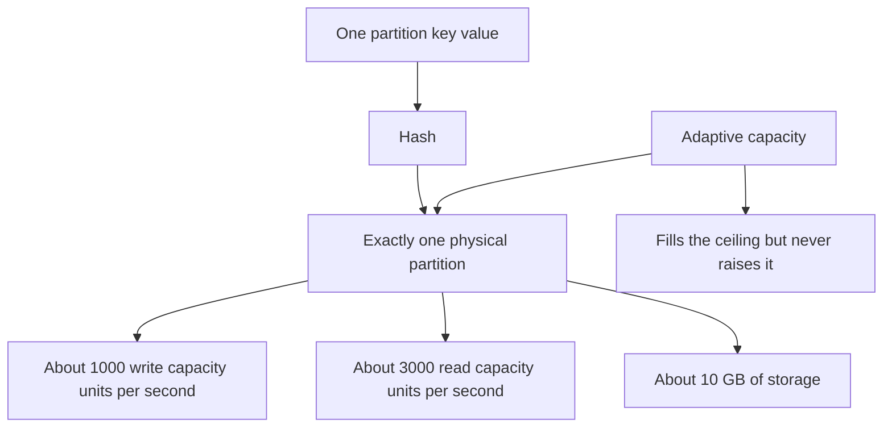

# DynamoDB Design

DynamoDB (launched 2012) is AWS's fully managed key-value/document database: you create a table, choose a partition key, and AWS handles the servers, replication across three AZs, and scaling. It promises single-digit-millisecond reads and writes at any table size — *provided you design for its rules*. Those rules are strict and unforgiving: DynamoDB gives you planet-scale mechanics in exchange for giving up query flexibility, and most production pain with it traces back to a partition key chosen without understanding partitions.

## The problem that created it

Amazon's own story explains the product. By the mid-2000s, Amazon's Oracle installations were buckling — scaling relational databases for amazon.com's traffic meant heroic sharding projects and painful operations. [[The Dynamo Paper]] (2007) solved availability and scale internally, but Dynamo-the-system was hard to operate: teams had to run their own clusters, tune quorums, and handle version conflicts. Meanwhile SimpleDB, AWS's first database service, had crippling limits (small domains, unpredictable latency). DynamoDB (2012) was the synthesis: Dynamo's partitioning-first scale philosophy, repackaged as a **zero-operations multi-tenant service** with a cleaner consistency story — and a pricing model that charges for throughput, not servers.

## What it solves

- **Operational burden**: no servers, no patching, no capacity-planning cluster math; replication across 3 AZs is automatic.
- **Predictable latency at any scale**: the design goal is that a table with 10 TB behaves like a table with 10 MB, because every operation is routed to one partition.
- **Elasticity**: throughput scales up and down (on-demand mode) without resharding projects.
- **Availability**: 99.99% SLA for a single-region table (99.999% for global tables), no maintenance windows.

## How it works

### Partitions and keys

Every table has a **partition key** (hash key); optionally a **sort key** (range key). Items with the same partition key form an **item collection**, stored together and ordered by sort key — the same two-level model as wide-column stores ([[Cassandra and Wide-Column Stores]]).

Under the hood the table is split into **partitions** — each a replicated storage unit (a leader and replicas across AZs, consensus-replicated; unlike Dynamo-the-paper there are no sloppy quorums, and strongly consistent reads are an option served by the leader). Each physical partition has hard per-partition limits — as documented: roughly **3,000 read capacity units, 1,000 write capacity units, and 10 GB** of storage. The table's total throughput is the sum over partitions, but *no single key can ever exceed one partition's share*. That sentence is the root of all hot-partition grief — see [[Hot Partition Problem]].

The partition key is hashed to choose the partition ([[Consistent Hashing]] in spirit); partitions split as data or traffic grows.

### Capacity modes

- **Provisioned**: you declare read/write capacity units (RCU/WCU) per table. 1 RCU = one strongly consistent read of up to 4 KB per second (two eventually consistent); 1 WCU = one 1 KB write per second. Cheaper at steady load; you can attach auto-scaling, but it reacts in minutes, not milliseconds — bursts beyond provisioned capacity are throttled (`ProvisionedThroughputExceededException`).
- **On-demand**: pay per request, no capacity declaration. It absorbs most spikes (it maintains headroom of roughly double the previous peak; growing beyond that quickly can still throttle), and costs more per request. The right default for spiky or unknown workloads; switch to provisioned when traffic is predictable and high.

### Adaptive capacity — what it can and can't rescue

**Adaptive capacity** lets a hot partition borrow unused throughput from the rest of the table (since 2019, instantly rather than after minutes), and DynamoDB can also **split a hot partition** across the sort-key or key-hash space to isolate heat.

What it *can't* rescue: traffic concentrated on a **single partition-key value**. One key lives in exactly one partition forever — adaptive capacity can give that partition the whole table's budget, but never more than the per-partition maximum (~3,000 RCU / 1,000 WCU). A celebrity user, a `date=today` key, or a tenant-ID key with one giant tenant will throttle no matter what you pay. The fix is key design (salting/sharding the key, write distribution), not capacity — the same medicine as [[Hot Partition Problem]].

### Secondary indexes: GSI and LSI

DynamoDB queries only by key. Any other access pattern needs an index — the managed version of [[Secondary Indexes on Sharded Data]]:

| | **GSI** (global secondary index) | **LSI** (local secondary index) |
|---|---|---|
| Keys | Any partition + sort key | Same partition key, different sort key |
| Consistency | **Eventually consistent only** (async replication from base table) | Strongly consistent reads available |
| Capacity | Own RCU/WCU — a throttled GSI **back-pressures writes to the base table** | Shares the table's capacity |
| Limits | Created anytime | Only at table creation; item collection capped at 10 GB |

GSIs are effectively materialized copies of the table with a different key — they have their own partitions and thus their own hot-partition risks.

### Single-table design

The philosophy: because DynamoDB has no joins, model **all** entities of an application in one table using generic `PK`/`SK` attributes and composite values (`PK=USER#123, SK=ORDER#2026-09-01#789`), so every access pattern is one query against one item collection. Advocated by Rick Houlihan's re:Invent talks and Alex DeBrie's *The DynamoDB Book*.

What it buys: fewer round trips (fetch a user and their orders in one query), fewer tables to manage, access patterns made explicit. What it costs: the table is **write-time-bound to the access patterns you enumerated** — a new query pattern means a new GSI or a data migration; the data is illegible without the design doc; analytics are impossible in place (export to S3/Athena); onboarding engineers read `PK/SK` soup. It is schema-on-read taken to its logical extreme — brilliant for stable, known access patterns, hostile to exploration. You are allowed to use multiple tables; even AWS's guidance has softened to "model per access patterns", not "one table always".

### DynamoDB Streams and transactions

- **Streams**: an ordered change log per item (24-hour retention) — insert/modify/remove events, consumable by Lambda or Kinesis adapters. This is managed [[Change Data Capture]], and the standard way to build read models, search indexing, or cross-service propagation (pairs naturally with [[The Outbox Pattern]] thinking).
- **Transactions** (since 2018): `TransactWriteItems`/`TransactGetItems` give ACID across up to 100 items (raised from 25 in 2022), implemented with a coordinator doing two-phase commit internally; they cost double the capacity units and can be aborted under contention. Good for occasional invariants (uniqueness via a dedicated item, debit-credit pairs); wrong as a default pattern — contention-heavy transactional workloads belong in a relational store ([[ACID Transactions]]).

### The cost model, briefly

You pay along three axes, and each has a design lever:

- **Request volume x item size** — RCU/WCU consumption rounds up per 4 KB (reads) / 1 KB (writes): a 5 KB item costs 2 RCU per strong read, and a 1.1 KB write costs 2 WCU. Lever: keep items small; store blobs in S3 with a pointer ([[How S3 Works]]).
- **Index copies** — every GSI re-stores (projected attributes of) every item and re-pays every write. Lever: project only needed attributes; prune unused GSIs.
- **Consistency choices** — eventually consistent reads cost half of strong ones; transactions cost double. Lever: default to eventual consistency wherever the product tolerates it, which is more places than teams assume.

Scans price the anti-pattern honestly: a scan reads *every byte of the table* in RCU terms, which is why "just scan and filter" designs die in the bill before they die in latency.

### Capacity arithmetic, worked

Take a notification-delivery table: 500 writes/sec of 2.5 KB items, 2,000 reads/sec of the same items, and two GSIs projecting all attributes.

- **Writes.** WCU rounds *up* per 1 KB, so a 2.5 KB item costs 3 WCU. Base table: 500 × 3 = **1,500 WCU**. Each all-attribute GSI re-stores the item and re-pays the write, so the two indexes add 2 × 1,500 = 3,000 WCU. Total **4,500 WCU** — three times what "500 writes per second" suggests, and the indexes are the entire difference.
- **Reads.** RCU rounds up per 4 KB, so a 2.5 KB item is 1 RCU strongly consistent, 0.5 eventually consistent. At 2,000 reads/sec that is **2,000 RCU** strong or **1,000 RCU** eventual — choosing eventual consistency where the product tolerates it halves the line item outright.
- **The per-key ceiling.** One partition sustains roughly 1,000 WCU. At 3 WCU per write that is about 333 writes/sec (1,000 ÷ 3 ≈ 333) for *any single partition-key value*, permanently, no matter what the table is provisioned at. If one key is expected to exceed that, the design is already wrong and capacity cannot fix it.
- **The scan somebody will propose.** A full scan of a 100 GB table reads roughly 100 × 1,048,576 ÷ 4 ÷ 2 ≈ **13.1 million RCU** at eventual consistency. At any price per unit, that is a number somebody notices.

Item size is the lever that moves every row at once: get the item under 1 KB and the base write drops from 3 WCU to 1, dragging both GSIs down with it.

## Trade-offs

| You gain | You pay |
|---|---|
| Zero ops, 3-AZ replication, predictable p99 at scale | Query model limited to key access + pre-declared indexes; no ad-hoc queries, no joins |
| Elastic throughput (on-demand) | Cost scales with request volume *and* item size; scans are ruinously expensive |
| Per-item strong consistency on demand | GSIs are always eventually consistent; cross-item consistency only via costly transactions |
| Access patterns made explicit (single-table) | Access patterns *frozen* — new query = new index/migration; vendor lock-in is real |

## Common misconceptions

- **"On-demand means unlimited."** On-demand removes capacity *planning*, not physics. It carries headroom of roughly double the previous peak; grow past that faster than it adapts and you throttle exactly like a provisioned table. The per-partition ceilings are untouched by it.
- **"Adaptive capacity solved hot partitions."** It solved *uneven* partitions, by letting a busy one borrow from idle ones. A single scorching key-value is not an unevenness problem, it is a ceiling problem — and borrowing stops at the ceiling.
- **"DynamoDB is the Dynamo paper."** Different systems: the product is leader-per-partition with optional strongly consistent reads and no user-visible conflict machinery; the paper is leaderless with sloppy quorums and vector clocks ([[The Dynamo Paper]]).
- **"Single-table design is the best practice."** It is *a* practice, optimal when access patterns are known and stable. A second table is not a design failure; an unanswerable query is.
- **"A GSI is just an index."** It is an asynchronously maintained copy of the table with its own partitions, its own capacity and its own hot-key risk — and it can throttle writes to the table it indexes. Price it like a table, because that is what it is.
- **"Strongly consistent reads fix staleness."** They apply to base-table reads only. GSIs are eventually consistent with no option, so any read path routed through an index inherits that staleness whatever you request.

## Failure modes

Each entry names the signal and the confirming check, because every one of these presents as something else first.

- **Hot partition throttling.** *Signal:* p99 spikes and throttled-request metrics climb while *table-level* consumed capacity sits comfortably under the limit — throttling is enforced per partition, dashboards aggregate per table. *Confirm:* CloudWatch Contributor Insights, which ranks the most-accessed keys; a single key at the top of that list is the diagnosis. *Fix:* key redesign — salt the key, shard the hot value across suffixes, or cache the celebrity item in front ([[Why Caching Works]]). Raising capacity changes nothing.
- **GSI back-pressure.** *Signal:* writes to the base table throttle while the base table's own capacity looks fine. *Confirm:* compare `WriteThrottleEvents` on the index against the table; an index at 100% consumed while the table is at 40% is conclusive. *Fix:* size GSI capacity like table capacity, and prune projections so the index absorbs less per write.
- **Item-size and collection limits.** 400 KB per item; unbounded "append to a list in one item" designs die here. *Signal:* `ValidationException` on update for the item cap, or an LSI item collection refusing writes as it approaches 10 GB. *Confirm:* the returned `ItemCollectionMetrics` size estimate on writes into an LSI-bearing collection.
- **Stream consumer lag.** Downstream Lambdas that error retry with the shard blocked — ordered-per-key semantics mean one poison record stalls its shard ([[Dead Letter Queues and Poison Messages]]). *Signal:* `IteratorAge` on the stream climbing monotonically while invocation errors stay low in absolute count. *Confirm:* one shard's iterator age rising while its siblings stay flat — a stuck shard, not a slow consumer. *Fix:* a failure destination or on-failure DLQ plus bisect-on-error so one bad record cannot hold a batch hostage.
- **On-demand cold spikes.** Doubling traffic faster than the headroom rule allows still throttles. *Signal:* throttling at the start of a campaign or batch run that disappears minutes later without anybody changing anything — "on-demand" is not "infinite instantly". *Fix:* pre-warm by ramping, or provision for known events.

## When NOT to use it

- **Ad-hoc or evolving query needs** — analysts, back-office tools, "filter by any field" admin screens. You will fight the key model daily.
- **Relational integrity and multi-row invariants as the core workload** — ledgers with constraints, heavy cross-entity transactions ([[ACID Transactions]], [[Two-Phase Commit and Distributed Transactions]]).
- **Analytics/aggregations in place** — no GROUP BY; export to columnar stores instead ([[Time Series and Analytics Stores]]).
- **Tight budgets with large items and high read volume** — RCU math on 300 KB items is sobering; S3 + a pointer is often the answer ([[How S3 Works]]).
- **Multi-cloud/portability requirements** — the API is proprietary.

## In your stack

- Your serving databases are MongoDB and MySQL, but you live on AWS — DynamoDB is the default suggestion in AWS-centric design reviews, so knowing *when to decline it* matters: Niyo's regulated, audit-heavy, evolving-query workloads (KYC case review, ops dashboards) are exactly its weak spots.
- Where it would genuinely fit at Niyo: idempotency-key stores, session/device state, per-user feature flags — single-key lookups at scale with TTL ([[Idempotency]]).
- The hot-partition lesson transfers directly to your MongoDB sharding decisions: a shard key of `createdDate` or one giant tenant misbehaves identically — see [[Hot Partition Problem]] and [[MongoDB Architecture]].
- DynamoDB Streams is conceptually the same pattern as MongoDB change streams, which you can use for [[Change Data Capture]] today.
- **Throttling meets 1 replica badly.** The AWS SDK absorbs throttled requests with internal retries and backoff. On a service pinned at a single replica, a hot-partition episode becomes every request thread on the only pod asleep inside a retry loop — so a dependency that is merely *throttled* presents as a pod that is entirely unresponsive, and Kong reports your service as down. Cap SDK retry attempts, set an SDK request timeout below the gateway's upstream timeout, and alert on throttled-request counts directly rather than letting the SDK swallow them.
- **The capacity arithmetic above is the cost conversation to have in a design review.** DynamoDB's cost shape is request volume × item size × index count — three multipliers, all set at design time. Naming which one a proposal scales with is more useful than arguing about whether DynamoDB is "expensive".

## Interview angle

The 60-second version: *"DynamoDB is a managed key-value store where everything follows from partitions: the partition key is hashed to a physical partition with hard limits — roughly 3,000 RCU, 1,000 WCU, 10 GB — so uniform key distribution is the whole game. Adaptive capacity moves budget toward hot partitions but can never push one key past a single partition's ceiling. Query flexibility comes only from GSIs and LSIs — GSIs are eventually consistent copies with their own capacity. Single-table design collapses entities into one table keyed by composite PK/SK, great for frozen access patterns, hostile to exploration. Streams give you CDC; transactions exist but cost double. Design the keys right and it's magic; design them wrong and no money fixes it."*

Classic follow-ups: *How is DynamoDB different from the Dynamo paper?* (leader-per-partition, optional strong consistency, no vector clocks/sloppy quorums — see [[The Dynamo Paper]].) *Partition key for a multi-tenant SaaS with one whale tenant?* (tenant+entity composite or write-sharded suffix — never bare tenant ID.) *Why did your GSI throttle table writes?* (GSI capacity back-pressure.)

## Check yourself

> [!question]- Q: Explain why adaptive capacity cannot save a table whose partition key is `country` for an India-dominant fintech app.
> Nearly all traffic hashes to the single `country=IN` key value, which lives in exactly one partition (splitting can spread its *sort-key range* across partitions for storage, but a single key's write throughput is still bounded). Adaptive capacity can route the whole table's unused budget to that partition, but the per-partition ceiling (~1,000 WCU) is a hard wall. The key must carry more entropy — e.g. `country#userId` — so load spreads across many partitions.

> [!question]- Q: What happens if a GSI is provisioned at 100 WCU while the base table sustains 500 writes/sec?
> Every base-table write that touches indexed attributes must propagate to the GSI. The GSI can't absorb 500 WCU, its replication falls behind, and DynamoDB responds by throttling *writes to the base table* — the application sees throttling it can't explain from table metrics. GSI capacity must be sized like table capacity, and this coupling is a standard production surprise.

> [!question]- Q: Your p99 write latency is fine, table consumed capacity is 40% of provisioned, yet you see throttled requests. Diagnose.
> Textbook hot partition: throttling is enforced per partition, while consumed-capacity graphs aggregate per table. Some key (or small key set) exceeds its partition's share. Confirm with Contributor Insights or access logs; fix with key salting/sharding, caching the hot item, or absorbing bursts via a queue — capacity increases alone won't help if one key value is the concentrator.

> [!question]- Q: A table takes 800 writes/sec of 3.2 KB items and carries three GSIs that each project all attributes. What does the workload actually consume, and what is the cheapest lever?
> A 3.2 KB item rounds up to 4 WCU, so the base table consumes 800 × 4 = 3,200 WCU. Each all-attribute GSI re-pays the same write, so three of them add 3 × 3,200 = 9,600 WCU — **12,800 WCU total**, four times the figure anyone wrote in the design doc. Cheapest lever: projection. A GSI projecting only its keys plus the two attributes a query actually returns both stores and writes far less than one projecting everything. Second lever: item size — moving a large payload field to S3 and keeping a pointer can take the item under 1 KB, which cuts all four lines by a factor of four simultaneously ([[How S3 Works]]). Adding capacity is not a lever; it is the bill.

> [!question]- Q: Mini-design — model "user places orders; fetch a user with their 10 most recent orders in one call" in single-table style.
> One table: user item `PK=USER#<id>, SK=PROFILE`; order items `PK=USER#<id>, SK=ORDER#<ISO-timestamp>#<orderId>`. Query `PK=USER#<id>` with `ScanIndexForward=false, Limit=11` returns profile plus newest orders in one request (profile sorts last or first depending on SK prefix design — a known trick is `SK=#PROFILE` to sort before `ORDER#`). "All orders over ₹10,000 last month across users" then needs a GSI or an export — demonstrating exactly what single-table design trades away.

## Sources

- DeCandia et al. — "Dynamo: Amazon's Highly Available Key-value Store", SOSP 2007 (the ancestor; the product differs — see note body).
- Elhemali et al. — "Amazon DynamoDB: A Scalable, Predictably Performant, and Fully Managed NoSQL Database Service", USENIX ATC 2022 (the modern paper on the product's internals, including adaptive capacity and partition management).
- AWS documentation — "Partitions and data distribution", "Read/write capacity modes", "Best practices for designing and using partition keys effectively".
- Alex DeBrie — *The DynamoDB Book* (single-table design's standard reference).
- Rick Houlihan — AWS re:Invent "Advanced design patterns for DynamoDB" talks (2017–2019).
