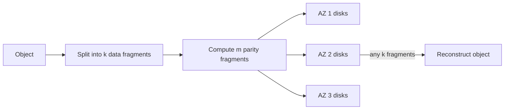

# How S3 Works

Amazon S3 (Simple Storage Service, launched 2006) is **object storage**: you PUT a blob of bytes under a key in a bucket and GET it back later, over HTTP, with no filesystem, no servers, and effectively no capacity limit. It has become the de-facto data plane of the cloud — the place where backups, data lakes, ML training sets, static sites, log archives and media all end up — because it made two hard promises cheap: near-perfect durability and unbounded scale. This note explains the model and the engineering behind those promises.

## The problem that created it

Before S3, storing large amounts of data meant filesystems on servers (NFS/SAN appliances) or databases. Both break at scale in the same ways: filesystems carry heavy semantics — directories, rename, locking, POSIX permissions — that are expensive to make distributed; capacity is bound to the machines you bought; durability is your RAID array's problem; and sharing data across the internet requires building a serving tier. Amazon, building out AWS, bet that most stored bytes don't need filesystem semantics at all — they need *put, get, list, delete, over HTTP, forever, cheaply*. Dropping the hard semantics is precisely what lets the rest scale without bound.

## What it solves

- **Durability as a service**: designed for **99.999999999% (11 nines)** annual durability — data loss becomes an engineering rounding error rather than an operational worry.
- **Unbounded capacity and throughput**: no volume to resize; scale is per-prefix and grows with your key design.
- **Internet-native access**: every object is an HTTP resource with auth (IAM/presigned URLs), versioning, encryption and lifecycle policies attached.
- **Cost tiering**: storage classes let cold data cost roughly an order of magnitude less than hot data without changing the API.

## How it works

### Objects, buckets, keys — and the flat namespace

An **object** = key + bytes (up to 5 TB) + metadata. A **bucket** is a namespace for keys. Crucially, the namespace is **flat**: `invoices/2026/01/inv-123.pdf` is just a key containing slashes. There are no directories — the console merely renders prefixes as folders. Consequences: no rename (a "move" is copy + delete), no atomic directory operations, and LIST works by prefix scan.

Objects are **immutable**: you cannot append to or edit byte 5,000 of an object — you overwrite the whole key with a new version. This immutability is a scaling feature, not a limitation: it makes replication, caching and erasure coding radically simpler.

### Prefix-based request-rate scaling

S3's index (the key→location mapping) is itself partitioned by key prefix. Each partition sustains, as documented, at least **3,500 PUT/COPY/POST/DELETE and 5,500 GET/HEAD requests per second per prefix**, and S3 repartitions automatically as traffic grows. Two implications:

- Throughput is effectively unlimited *if your keys spread across prefixes* — parallel readers across many prefixes aggregate linearly.
- Sequential key designs (`2026-10-01-000001`, `-000002`, …) concentrate writes on one index partition — the [[Hot Partition Problem]] again, in storage-service clothing. Since a 2018 change S3 no longer requires manual key randomization for most workloads, but burst-heavy pipelines still benefit from spreading keys (e.g. hash prefix first).

The arithmetic is worth doing before the pipeline is written, because it tells you how many prefixes the key design must produce. To sustain 50,000 GET/s you need at least 50,000 ÷ 5,500 ≈ 9.09, so **10 prefixes**; to sustain 20,000 PUT/s, 20,000 ÷ 3,500 ≈ 5.71, so **6 prefixes**. A two-hex-character hash prefix yields 256 of them, which is why `kyc/3f/<userId>/...` is a one-line fix and `kyc/2026-10-01/...` is a throughput ceiling you discover during a migration.

### Durability engineering: 11 nines

Eleven nines means: store 10 million objects and statistically expect to lose one every 10,000 years. No single disk is remotely that reliable (annual disk failure rates are on the order of 1%), so durability is *engineered* on top of unreliable parts:

1. **Redundancy across machines and AZs.** Every object is stored redundantly across multiple devices in at least 3 Availability Zones (for standard classes) — separate buildings, power, and networks. An AZ-wide loss leaves enough copies to reconstruct everything.
2. **Erasure coding** instead of plain 3x replication for the bulk data. The idea, simply: split an object into **k** data fragments and compute **m** extra *parity* fragments using polynomial math (Reed–Solomon codes); any **k** of the **k+m** fragments reconstruct the object. Toy example: with k=4, m=2, you store 6 fragments and survive any 2 losses while spending only 1.5x storage — plain triple replication survives the same 2 losses but costs 3x. AWS does not publish S3's exact k and m values; the principle, not the parameters, is what's documented.
3. **Constant repair.** Durability math only holds if failed fragments are rebuilt faster than new failures accumulate. S3 continuously audits checksums (detecting silent bit rot, not just dead disks) and re-replicates degraded objects in the background. Durability is a *process* — redundancy plus detection plus repair rate.
4. **End-to-end checksums** on ingest and read, catching corruption in transit and at rest.

Note what 11 nines does **not** cover: deleting the wrong object, an application bug, or a compromised credential. Versioning, MFA-delete, Object Lock (WORM) and replication to another account/region exist because *you* remain the biggest threat to your data — relevant wherever audit immutability is required.

### Consistency: strong since December 2020

For its first 14 years S3 was eventually consistent for overwrites and lists — you could PUT an object and not see it in a LIST, or GET a stale version after overwrite, forcing pipelines to carry workaround layers (consistent external manifests, retry loops). Since **December 2020, S3 is strongly consistent**: after a successful PUT/DELETE, any subsequent GET, HEAD or LIST sees the change ("strong read-after-write", at no extra cost or latency). This quietly deleted a whole genre of data-pipeline bugs. Concurrent writers to the same key still race by default — last writer wins; there are no locks. S3 did add **conditional writes** in 2024: `If-None-Match` to create only if the key is absent (August 2024), then `If-Match` on an ETag to overwrite only if the object is unchanged (November 2024), which is a genuine compare-and-swap. See [[Consistency Models]] for the vocabulary.

### Multipart upload

Objects above ~100 MB should upload in parts: initiate, upload N parts in parallel (each 5 MB–5 GB, up to 10,000 parts), complete. Benefits: parallel bandwidth, per-part retry (a dropped connection costs one part, not the whole file), and pause/resume. The 5 TB maximum object size is a separate service limit, not a consequence of these numbers — 10,000 parts at 5 GB would arithmetically allow far more. Incomplete multipart uploads invisibly accrue storage cost — a lifecycle rule to abort them after N days is standard hygiene.

The part-count cap is also a sizing constraint people meet late. Uploading a full 5 TB object within 10,000 parts requires each part to be at least 5 × 1,048,576 ÷ 10,000 ≈ **524 MB**; a client hard-coded to 8 MB parts tops out at 8 MB × 10,000 = 80,000 MB, roughly 78 GB, and fails on anything larger. Production uploaders therefore choose part size from the object size rather than from a constant.

### Storage classes and lifecycle

One API, several price/latency tiers: **Standard** (hot), **Intelligent-Tiering** (auto-moves objects between tiers by access pattern), **Standard-IA / One Zone-IA** (infrequent access, retrieval fees; One Zone drops the multi-AZ redundancy), **Glacier Instant / Flexible / Deep Archive** (archival; Deep Archive retrieval takes hours, costs roughly 20–25x less than Standard per GB stored). **Lifecycle rules** transition or expire objects by age/prefix/tag automatically — the mechanism that turns "keep everything forever" from a cost disaster into a policy line.

The colder tiers carry billing floors that quietly invert the saving if you ignore them: the infrequent-access classes bill a **minimum of 30 days** per object and a **minimum billable size of 128 KB**, Glacier Flexible Retrieval bills a minimum of 90 days, and Deep Archive 180. So a lifecycle rule that moves 20 KB thumbnails to Standard-IA after 10 days bills each one as 128 KB for 30 days, plus a transition request per object — reliably more expensive than leaving them in Standard. Tiering pays on large, genuinely cold objects; it loses on small, short-lived ones.

### Object vs file vs block — the three storage interfaces

| | Block storage | File storage | Object storage |
|---|---|---|---|
| Unit | Fixed-size blocks on a volume | Files in a directory tree | Whole objects under keys |
| Semantics | Read/write any byte range | POSIX: open, append, rename, lock | PUT/GET/DELETE whole objects |
| Consumer | One machine's filesystem/DB | Machines sharing a mount | Anything speaking HTTP |
| Scale ceiling | A volume | An appliance/cluster | Effectively none |
| AWS example | EBS | EFS | S3 |

Databases sit on block storage because they update bytes in place ([[How Databases Store Data]]); shared tooling uses file storage when legacy software demands POSIX; everything else — the vast majority of bytes — fits objects. The weaker the interface, the further it scales: that is the single organizing idea of this table.

## Trade-offs

| You gain | You pay |
|---|---|
| 11-nines durability, zero storage ops | No filesystem semantics: no append, no rename, no partial update |
| Unlimited capacity, per-prefix scalable throughput | First-byte latency in tens of ms — not a database, not a cache |
| HTTP-native: presigned URLs, IAM, static hosting, [[CDN]] origin | Request pricing: millions of tiny objects cost more in PUTs than in storage; LIST at scale is slow and costly |
| Tiering cuts cold-storage cost ~10–25x | Retrieval fees and latency on cold tiers; egress bandwidth is the famous bill shock |

## Common misconceptions

- **"Buckets have folders."** The namespace is flat; the console invents folders from prefixes. Consequences that surprise people: deleting a "folder" is N individual DELETE operations (free of request charge, but N round trips and N chances to fail halfway), moving a "folder" is a billed COPY plus a DELETE for every object, and there is no atomic operation over a prefix at all.
- **"11 nines means I don't need backups."** Eleven nines describes S3 losing your bytes to hardware failure. It says nothing about *you* deleting them, an application bug overwriting them, or a stolen credential wiping them — all of which are far likelier than the hardware event. Versioning, Object Lock and replication into a separate account exist precisely because the durability number does not cover the realistic threat model.
- **"S3 is cheap."** Storage per GB is cheap; S3 bills on three independent axes — bytes stored, requests made, bytes egressed. A million 10 KB objects is only about 10 GB of storage but a million PUTs plus a million GETs, and the request line can dwarf the storage line. "Cheap" is a property of a usage pattern, not of the service.
- **"Strong consistency means transactional."** Since December 2020 a successful write is immediately visible to subsequent reads and lists. It does not make writes atomic across multiple keys, does not order concurrent writers to one key, and does not lock anything.
- **"S3 is slow."** First-byte latency is tens of milliseconds and will not improve — but aggregate throughput is effectively unbounded through parallel ranged requests across prefixes. Confusing those two is the classic [[Latency vs Throughput vs Bandwidth]] error; S3 is a high-throughput, moderate-latency system, which is a different thing from a slow one.
- **"One Zone-IA is just cheaper Standard."** It stores one copy in a single Availability Zone. The 11-nines figure does not apply; losing that AZ loses the data. It is correct only for data you can regenerate.

## Failure modes

- **Hot prefixes.** *Signal:* `503 SlowDown` responses during bursty writes to adjacent keys, before repartitioning catches up. *Confirm:* the failing keys share a long common prefix, and the error rate tracks burst onset rather than total volume. *Fix:* spread key prefixes and retry with backoff and jitter ([[Timeouts Retries and Exponential Backoff]]).
- **Millions-of-small-objects anti-pattern.** *Signal:* a bill where request charges exceed storage charges, and LIST pagination that takes minutes. *Confirm:* divide total bytes by object count — an average object size in the low kilobytes is the tell. *Fix:* batch or compact objects; the data-lake world invented table formats partly for this.
- **Orphaned multipart uploads** silently billing storage. *Signal:* bucket storage metrics exceeding the sum of visible object sizes. *Confirm:* `ListMultipartUploads` shows initiated-but-never-completed uploads, often years old. *Fix:* a lifecycle rule that aborts incomplete uploads.
- **Versioning without an expiry rule for noncurrent versions.** Versioning is enabled for safety and then every overwrite silently retains the previous version forever. *Signal:* storage growth that tracks *write* volume rather than net new objects, and a bucket whose object count in the console bears no relation to its billed size. *Confirm:* `ListObjectVersions`, or the storage metrics broken down by current versus noncurrent. *Fix:* a lifecycle rule expiring noncurrent versions after a retention window — chosen deliberately, since on an Object Lock bucket that window *is* your compliance guarantee.
- **Misconfigured access** — the classic "public bucket" breach genre; S3 Block Public Access exists because of it. *Signal:* ideally from a config scanner or AWS Config rule, not from a journalist.
- **Region-level S3 incidents are rare but real** (the 2017 us-east-1 outage took large parts of the internet down with it) — cross-region replication is the mitigation where the business case supports it ([[Disaster Recovery]]).

## When NOT to use it

- As a **database**: no queries, no transactions, latency too high for OLTP point reads (S3 Select has been closed to new customers since mid-2024; use real stores, or Athena over the bucket).
- For **high-frequency small updates** to the same logical record — immutability makes each "update" a full-object rewrite.
- As a **filesystem** for software that needs POSIX (locking, append, rename) — adapters exist (Mountpoint, EFS is the actual product for that).
- For **sub-10 ms serving** without a cache/CDN in front.

## In your stack

- At Niyo, S3 is the natural home for KYC documents, statements, and audit exports: versioning + Object Lock (WORM) aligns with the "audit evidence immutable or replayable" requirement, and lifecycle rules push aged documents to Glacier tiers. Data-localisation rules (RBI) make *region choice* (Mumbai, ap-south-1) a compliance decision, not a latency one.
- **Presigned URLs** are the standard pattern for user document upload/download: clients talk directly to S3 with a time-boxed signed URL, so documents never stream through your Spring Boot services — saving pod bandwidth and memory on EKS.
- [[CDN|CloudFront]]-in-front-of-S3 is the canonical static-content architecture you already run at the edge; see [[CDN]].
- Cost shape to remember in design reviews: storage cost scales with bytes retained (lifecycle policy is the lever), request cost with object *count*, egress with bytes served — three different axes, three different optimizations.
- **At 1 replica, presigned URLs are a resilience decision, not just a bandwidth one.** A single-replica Spring Boot pod that proxies a 20 MB document upload holds that request's bytes and thread for the whole transfer; a handful of concurrent uploads from slow mobile connections can occupy the only pod's entire request capacity while CPU sits idle. Handing the client a presigned URL moves the transfer out of your process entirely, so a burst of uploads can no longer starve the API paths that share the pod.
- **S3 is also the escape hatch for oversized records.** MongoDB's 16 MB document cap and DynamoDB's 400 KB item cap both have the same fix: store the payload in S3 and keep a key plus a checksum in the record. For Niyo that also separates the retention clocks — the document obeys the KYC retention policy in S3 while the metadata row stays small and queryable.

## Interview angle

The 60-second version: *"S3 is object storage: immutable blobs under keys in a flat namespace, over HTTP. Scale comes from partitioning the key index by prefix — thousands of requests per second per prefix, repartitioned automatically. Durability — 11 nines — is engineered: objects are erasure-coded into k data plus m parity fragments spread across 3+ AZs, any k reconstruct, with continuous checksum auditing and background repair. It dropped filesystem semantics — no append, no rename — and that's exactly why it scales. Eventually consistent for 14 years, strongly consistent since December 2020. Multipart upload parallelizes big objects; storage classes and lifecycle rules tier cost down for cold data."*

Classic follow-ups: *explain erasure coding vs replication* (same fault tolerance, ~1.5x vs 3x storage; cost: reconstruction needs k fragments — more network and compute on read-under-failure); *why is rename missing?* (flat namespace — rename would be a copy under another key, non-atomic); *how would you serve a 100 GB video to a million users?* (multipart upload in, [[CDN]] out, range requests for seeking); *if S3 is strongly consistent, why can't I use it as a lock?* (read-after-write visibility is not mutual exclusion — unconditional writers to one key both succeed and last writer wins; conditional writes do give compare-and-set, but a compare-and-set is not a *lease* — nothing expires if the holder dies mid-operation — so a real lock still needs a real lock service with fencing, see [[Distributed Locking]]).

## Check yourself

> [!question]- Q: Explain to a teammate how S3 can promise 11 nines of durability using disks that fail ~1% per year.
> Redundancy, detection and repair. Each object is erasure-coded: k data fragments plus m parity fragments placed on independent disks across 3+ AZs, so losing any m fragments loses nothing — reconstruction needs only k survivors. Checksum audits run continuously to catch dead disks *and* silent corruption, and degraded objects are rebuilt in the background faster than failures accumulate. Multiply independent failure probabilities within the repair window and the chance of losing more than m fragments of one object before repair lands below 10^-11 per year. The claim is probabilistic engineering, not disk quality.

> [!question]- Q: What happens if two services PUT different content to the same key at the same instant?
> No locking exists: both succeed and the last writer wins the current version (with versioning on, both are retained as versions, one becoming latest). Strong consistency since Dec 2020 guarantees readers see the final state after the writes complete, but it does not arbitrate the race. If the workload needs coordination, use conditional writes — `If-Match` on the ETag turns "overwrite" into compare-and-swap, so the loser gets a precondition failure instead of silently winning — or serialize writers through a queue.

> [!question]- Q: Why did pre-2020 eventual consistency break data pipelines, concretely?
> A job writes `output/part-0001.csv`, then a downstream job LISTs `output/` — and may not see the object yet, silently processing a partial dataset. Or step A overwrites a manifest and step B GETs the stale version. Pipelines carried manifest files, retries and "consistency layers" (e.g. EMRFS consistent view backed by DynamoDB) purely to paper over this. Strong read-after-write made LIST/GET reflect completed writes immediately, deleting that failure class.

> [!question]- Q: A nightly export writes 40,000 objects per second under keys like `exports/2026-10-01/part-000001`. It starts clean, then returns `503 SlowDown` on a growing fraction of PUTs. What is happening, and how many prefixes does the fix need?
> Every key in that run shares one prefix, so every PUT lands on one index partition, which sustains about 3,500 PUT/s. S3 does repartition automatically, but it reacts to sustained load — a burst that arrives at ten times the per-prefix rate outruns the adaptation and gets `503 SlowDown` in the meantime. The fix is spreading the keys: 40,000 ÷ 3,500 ≈ 11.4, so at least **12 prefixes** are required just to meet the rate, and you would design for comfortably more. Putting a short hash first — `exports/<2 hex>/2026-10-01/part-...` — gives 256 prefixes from a one-line change, with no effect on how the objects are later read, since consumers read by manifest rather than by listing a date. Keep the retry-with-backoff as well: it is the correct response to `SlowDown` even once the key design is right.

> [!question]- Q: Mini-design — Niyo must store KYC documents for 10 years: written once, read occasionally for 90 days, then almost never, but must be producible for audit and provably untampered. Sketch the S3 design.
> Bucket in ap-south-1 (data localisation), SSE-KMS encryption, versioning + **Object Lock in compliance mode** (WORM — nobody, including admins, can delete within retention). Keys like `kyc/<hash-prefix>/<userId>/<docId>` to spread prefixes. Upload via presigned URLs; multipart for large files with an abort-incomplete lifecycle rule. Lifecycle: Standard → Standard-IA at 90 days → Glacier Flexible/Deep Archive later; retention expiry at 10 years. Access logging + CloudTrail data events for the audit trail; cross-account replication of the audit copy guards against account compromise. Cost shape: dominated by retained bytes, so the lifecycle policy is the main cost lever.

## Sources

- AWS documentation — "Amazon S3 data consistency model" (strong consistency announcement, Dec 2020), "Best practices design patterns: optimizing Amazon S3 performance" (per-prefix request rates), "Storage classes", "Multipart upload".
- AWS re:Invent talks — "Deep dive on Amazon S3" (the architecture-and-durability series, e.g. 2021–2023 editions, where the erasure-coding and repair framing comes from).
- Werner Vogels, All Things Distributed — posts on S3's design evolution and the strong-consistency launch (2020–2021).
- Patterson, Gibson, Katz — "A Case for Redundant Arrays of Inexpensive Disks", 1988 (the ancestral redundancy math; Reed–Solomon coding dates to 1960).
- Kleppmann, *Designing Data-Intensive Applications*, ch. 3 (storage) and ch. 5 (replication) for the surrounding theory.
