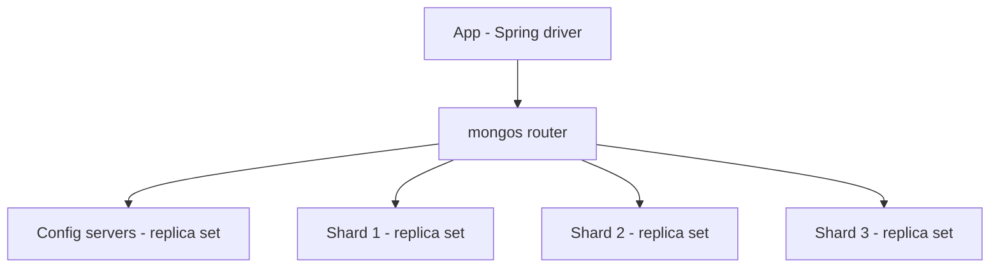

# MongoDB Architecture

MongoDB (2009; current stable series 9.0, released September 2026) is the dominant **document database**: JSON-like documents (BSON) in collections, indexed and queried by any field, replicated via replica sets and scaled out via sharding. It is also your primary datastore at work, which makes this the module's most practically important note: the difference between `w:1` and `w:majority`, or a good and bad shard key, is the difference between an incident and a non-event. MongoDB's history includes an era of unsafe defaults and lost writes; the modern system (multi-document transactions since 4.0, `w:majority` as the default write concern since 5.0) is a much more serious database — *if* you hold the knobs correctly.

## The problem that created it

MongoDB came out of the 2000s web-startup world: teams iterating fast on object-shaped data, tired of object-relational impedance (an in-memory `User` object exploding into seven joined tables) and of migration ceremony for every added field. The pitch: store the aggregate as one document, query it by any field, change shape freely, and scale horizontally later without re-architecting. It deliberately traded the relational model's guarantees for development speed and built-in [[Replication]]/[[Sharding]] — then spent a decade earning back the guarantees (journaling, majority write concern, multi-document transactions) as it moved upmarket.

## What it solves

- **Aggregate-shaped storage**: an entity and its children travel as one document — one read, no joins, atomic single-document updates (see [[NoSQL Taxonomy]]).
- **Query flexibility within the document model**: secondary indexes on any field (compound, partial, TTL, text, geo), a rich aggregation pipeline — far beyond key-value stores.
- **HA out of the box**: replica sets with automatic [[Failover]].
- **Horizontal scale**: sharding as a built-in, not a bolt-on.
- **Schema agility**: schema-on-read, with opt-in JSON Schema validation when you want the database to push back.

## How it works

### Storage: documents on WiredTiger

Documents are BSON (binary JSON with types), max 16 MB. The default engine since 3.2 is **WiredTiger** — a **B-tree** engine, not LSM ([[B-Tree vs LSM-Tree]]): document-level concurrency control (MVCC), snapshot reads, compression (snappy/zstd), and a WAL called the **journal** (fsynced roughly every 100 ms by default, immediately for writes requesting `j:true`). Single-document updates are atomic always — the unit of atomicity is the document, which is why good MongoDB modeling embeds what must change together.

WiredTiger keeps hot pages in its own **cache**, sized by default at the larger of 50% of (RAM − 1 GB), or 256 MB. That number is the single best predictor of whether a MongoDB instance feels fast or feels broken: while the **working set** — the indexes and documents your queries actually touch — fits the cache, reads are memory-speed; once it does not, every miss becomes a random disk read and latency degrades in a knee rather than a slope ([[B-Tree vs LSM-Tree]] calls this buffer-pool thrash, and it is the same phenomenon). The practical consequence for schema design: indexes compete with documents for the same cache, so an unused compound index is not free storage — it is evicted working set.

### Replica sets: elections and the oplog

A **replica set** is one primary plus secondaries (typical: 3 members). All writes go to the primary, which records each change in the **oplog** — a capped collection of idempotent operations that secondaries tail and apply, asynchronously by default ([[Replication]], leader-follower). Reads default to the primary; you *can* read from secondaries (`readPreference`) at the price of [[Read Your Own Writes and Replica Lag Anomalies]].

If the primary dies, secondaries hold an **election** — a Raft-influenced protocol (protocol version 1): term numbers, majority votes, the member with the newest oplog among eligible voters wins ([[Consensus and Raft]], [[Failover]]). Typical failover is seconds to tens of seconds; during it, writes fail and the driver retries (`retryWrites` is on by default in modern drivers). A majority of voting members must be reachable to elect anyone — a 2-member set therefore cannot survive either member's loss, which is why arbiters/odd counts exist and why a partitioned old primary **steps down** rather than running split-brain ([[Split Brain and Fencing]]); any writes it accepted that never reached the majority are **rolled back** on rejoin (dumped to rollback files, not silently kept).

#### Oplog mechanics

The oplog (`local.oplog.rs`) is a **capped collection** — a fixed-size ring that overwrites its oldest entries. Three properties follow, and all three bite in production:

- **Entries are idempotent by construction.** The primary does not log "increment balance by 100"; it rewrites the operation into a form whose replay is harmless, logging the resulting value rather than the relative change. That is what lets a secondary crash mid-apply and resume without arithmetic drift.
- **Its size defines a time window, not a count.** The default on WiredTiger is 5% of free disk space, floored at 990 MB and capped at 50 GB — and a write-heavy cluster can burn through 50 GB in hours. The number that actually matters is the **oplog window**: how far back in wall-clock time the oldest surviving entry reaches. Since 3.6 the oplog can be resized online with `replSetResizeOplog`, without restarting the member.
- **Falling off the oplog is expensive.** A secondary offline longer than the window cannot catch up incrementally; it must perform a full **initial sync** — copy the entire dataset from another member, rebuild indexes, then tail from that point. On a large dataset that is hours of extra load on a healthy member, usually at the worst possible moment. The same window bounds how long a [[Change Data Capture|change stream]] consumer may be down before its resume token is unusable.

Sizing the window is arithmetic, not intuition. A collection absorbing 2,000 writes/sec of ~500-byte documents generates at least 2,000 × 500 B = 1 MB/sec of oplog, so about 3.6 GB/hour — meaning even a maximum-size 50 GB oplog holds under 14 hours of history (50 ÷ 3.6 ≈ 13.9). That is a *lower* bound, since every entry carries its own metadata and an update to an indexed field can log more than the document's own size. Run the calculation against your real write rate and you will usually find the window is shorter than the maintenance you were planning to perform inside it.

#### Election timing — what "a few seconds of failed writes" is made of

Members heartbeat each other every 2 seconds (`heartbeatIntervalMillis`). A secondary that has not heard from the primary within `electionTimeoutMillis` — **10 seconds by default** — calls an election: it increments the term, requests votes, and needs a strict majority of *voting* members to win. The winner then runs a catch-up phase, pulling any newer oplog entries from the most up-to-date reachable member, before it accepts writes.

Three consequences for application behaviour:

- Detection alone can consume the full `electionTimeoutMillis`. Shortening it shortens outages at the cost of spurious elections on a jittery network — the same tuning tension as every failure detector ([[Health Checks and Service Discovery]]).
- During the window there is **no primary**, so writes fail rather than block indefinitely. Drivers mark the topology unknown, rediscover via heartbeats, and with `retryWrites` enabled — the default in current drivers — retry a failed write **once** against the new primary. One retry covers a clean failover; it does not cover a repeated-stepdown storm, which is why money-path writes still need their own [[Idempotency|idempotency keys]].
- An administrator-initiated `rs.stepDown()` is the polite version: the primary stops accepting writes and hands over deliberately, which is why planned maintenance costs seconds rather than a full detection timeout.

### Read and write concerns — the durability knob

This is the section to internalize for a fintech:

| Write concern | Ack means | Risk |
|---|---|---|
| `w:1` (fast) | Primary applied it in memory | Primary dies before replication → **write rolled back, silently gone** from the application's view |
| `w:majority` (default since 5.0, except primary-secondary-arbiter sets, which default to `w:1`) | A majority of members have it | Survives any single-node loss and any failover; the election winner must have it |
| `j:true` | Journaled to disk before ack | Survives process/power crash on the acking node |

`w` and `j` are orthogonal axes: `w` counts *members*, `j` asks whether those members hardened the write to the journal instead of merely applying it in memory. With the default `writeConcernMajorityJournalDefault: true`, `w:majority` already implies journaling on the acknowledging majority, which is why you rarely write `j:true` explicitly.

One trap worth naming on its own: **`wtimeout` does not cancel the write.** A `{w:"majority", wtimeout:500}` call that times out returns an error while the write sits applied on the primary and will replicate moments later. The honest reading of a `wtimeout` error is "durability unconfirmed", never "this did not happen" — and that distinction is the difference between a retry and a double payment.

#### What each combination admits losing

Read the grid as *what a user could observe that you did not intend*:

| Write / read pair | What it admits | Where it belongs |
|---|---|---|
| `w:1` + `local` on primary | An acknowledged write can vanish in a rollback; a read can see a write that later vanishes | Caches, derived data you can recompute, scratch collections |
| `w:1` + `majority` | Reads never show a doomed write — but the write itself can still be rolled back after you told the user "saved" | Almost never right; the asymmetry usually means somebody tuned one side only |
| `w:majority` + `local` | Nothing acknowledged is lost, but a read may see a *newer* write not yet majority-committed, which could still roll back | Acceptable where a rare rewind of the very latest value is harmless |
| `w:majority` + `majority` | Neither acknowledged writes nor observed reads can disappear | **The money-and-identity default** |
| `w:majority` + `linearizable` | Also excludes reading from a primary that has already been deposed and does not know it yet | The rare read whose answer must be provably current |
| Any `w` + secondary read | Staleness bounded only by replication lag | Reporting, exports, explicitly lag-tolerant paths |

Read side: `readConcern: local` (may read data that could later roll back), `majority` (only majority-committed data — no phantom reads of rolled-back writes), `linearizable` (strongest, primary-only, slow — real [[Consistency Models]] linearizability for single-document reads). **Causal consistency** sessions give read-your-own-writes across members. Deciding these per path at design time — "this endpoint tolerates lag, this one must not" — costs a sentence in a design doc; discovering them from a support ticket costs an investigation.

**Multi-document transactions** exist (replica sets 4.0+, sharded 4.2+), snapshot-isolated, with real limits: keep them short (60s default), small, and rare — they take locks and cost throughput. The design pressure remains "model so a document is your transaction" ([[ACID Transactions]]).

### Sharded clusters

Three moving parts ([[Sharding]]):

- **Shards**: each is itself a replica set holding a subset of data.
- **Config servers** (a replica set): the authoritative map of which **chunk** (contiguous shard-key range) lives where.
- **mongos**: stateless routers the app talks to; they cache the chunk map and route each query to the owning shard — or **scatter-gather** to all shards when the query lacks the shard key (expensive; see [[Secondary Indexes on Sharded Data]]).

The **balancer** migrates chunks between shards to even out data; since 6.0.3 it compares *data size* per shard rather than chunk counts, and from 6.0.3 the separate auto-splitting process was removed in favour of splitting a range as part of migrating it. **Shard key choice is destiny**: it must appear in your hot queries (else scatter-gather), distribute writes (else [[Hot Partition Problem]] — monotonic keys like `ObjectId`/timestamps funnel all inserts to one "max-key" chunk), and have enough cardinality to split. Hashed shard keys fix write distribution but turn range queries into scatter-gather. Since 5.0 you can reshard a live collection — possible, but a heavyweight operation you'd rather avoid by choosing well.

#### Shard-key decisions you cannot cheaply undo

This is the one MongoDB decision with no cheap escape hatch. Four specific traps:

- **The prefix is frozen.** `refineCollectionShardKey` can *append* fields to an existing shard key — turning `{accountId}` into `{accountId, createdAt}` — but it cannot remove or reorder the existing prefix. If the prefix is wrong, refining cannot save you.
- **Low cardinality produces jumbo chunks.** A chunk is a shard-key *range*; when every document in a range shares one shard-key value there is nothing left to split on. MongoDB marks such a chunk **jumbo**, and jumbo chunks are skipped by the balancer — that shard stays lopsided no matter how many shards you add. A key like `status` or `country` guarantees this outcome.
- **Resharding is a full rewrite.** `reshardCollection` copies the collection into a new key layout while applying ongoing writes, then cuts over. It works, but it needs free space and I/O headroom on *every* shard for the duration, and on a large collection it is measured in hours — a planned project, not an incident remedy.
- **Queries that cannot name the key stay expensive forever.** Scatter-gather gets *worse* as you add shards: p99 becomes the slowest shard's p99, and mongos merges results it fetched from every shard redundantly.

The cheap version of all four is twenty minutes spent listing your top ten queries *before* sharding, and checking that each one can name the candidate key.

### Change streams

`watch()` on a collection/database/cluster yields an ordered, resumable stream of majority-committed changes — built on the oplog, with resume tokens for exactly-where-you-left-off restarts. This is MongoDB's native [[Change Data Capture]] and the honest building block for [[The Outbox Pattern]]-style event propagation without dual writes.

## Trade-offs

| You gain | You pay |
|---|---|
| Aggregate reads/writes with no joins; atomic documents | Cross-document consistency is your job (or costly transactions) |
| Flexible schema, fast iteration | Schema-on-read: readers carry every historical shape; validation is opt-in |
| Built-in HA and sharding | Failover pauses writes; shard-key mistakes are expensive to unwind |
| Rich secondary indexes + aggregation pipeline | 16 MB document cap; unbounded-array growth is a classic modeling bug; working set should fit RAM for predictable latency |
| Tunable durability per operation | Tunable also means *mis-tunable* — `w:1` on money paths is a latent incident |

## Common misconceptions

- **"MongoDB loses data."** It shipped unsafe defaults in its early years and Jepsen found real bugs, so the reputation was earned. The modern system with `w:majority` and `readConcern:majority` holds the guarantees it claims. What remains true is narrower and more dangerous: MongoDB still *lets you choose* to be unsafe, per operation, and the unsafe choice is the shorter thing to type.
- **"It is schemaless, so there is no schema."** There is always a schema; it has merely moved into every reader. Three years of shape drift means your Java POJO must tolerate documents written by five earlier versions of the code. JSON Schema validators exist so the database can refuse the sixth.
- **"WiredTiger is an LSM engine like Cassandra's."** It is a B-tree engine with MVCC ([[B-Tree vs LSM-Tree]]). MongoDB's write personality is closer to MySQL's than to Cassandra's: random I/O per write, a working set that wants to fit in cache, and no compaction debt to fall behind on.
- **"Replica sets scale reads."** They scale *lag-tolerant* reads. Every secondary applies the full write stream, so secondaries add no write capacity and buy read capacity only where [[Read Your Own Writes and Replica Lag Anomalies|stale reads]] are acceptable. Sharding is the scaling mechanism; replication is the availability mechanism.
- **"Multi-document transactions make it Postgres."** They are real and snapshot-isolated, but they take locks, abort under write conflict, and carry a 60-second default lifetime. They are the escape hatch for the small minority of operations that need one, not a modelling strategy.
- **"An arbiter is a cheap third replica."** An arbiter votes but stores no data. In a primary-secondary-arbiter set, losing the secondary still leaves a voting majority to elect a primary — but `w:majority` needs two acknowledgements and only data-bearing members can give one, so majority writes stall until the secondary returns. Arbiters buy election arithmetic, not durability.

## Failure modes

Each entry names the signal that reveals it and how you confirm it, because the fix is rarely the hard part.

- **Rollback after failover with `w:1`** — the signature production horror: the app logged success and the data is absent afterwards. *Signal:* a reconciliation mismatch or a support ticket, never a monitor — nothing errored. *Confirm:* BSON files under the former primary's `rollback/` directory in its dbPath, timestamped at the election, with the stepdown visible in `rs.status()` and the member log at the same instant. *Prevent:* `w:majority` on anything that matters; those rollback files are evidence, not a recovery procedure.
- **Replica lag + secondary reads** — user updates profile, next read shows old data ([[Read Your Own Writes and Replica Lag Anomalies]]). *Signal:* `rs.printSecondaryReplicationInfo()` or the replication-lag metric climbing, with complaints clustered on read-after-write screens. *Confirm:* reproduce with `readPreference=primary` and watch the anomaly disappear. *Fix:* causal sessions or primary reads on those paths.
- **Oplog window collapse** — a bulk migration or index build floods the oplog and the window drops from hours to minutes. *Signal:* the oplog-window metric falling; secondaries entering RECOVERING; change-stream consumers unable to resume. *Confirm:* compare the oldest oplog entry's timestamp against the lagging member's last applied optime. *Fix:* resize the oplog *before* bulk work and throttle the bulk writer.
- **Hot shard from a monotonic shard key** — all inserts land on one shard, so insert throughput stops scaling with shard count. *Signal:* per-shard write ops diverging sharply while the cluster total looks healthy — the same aggregate-hides-the-hotspot shape as every [[Hot Partition Problem]]. *Confirm:* `sh.status()` chunk distribution alongside per-shard `opcounters`. *Fix:* hashed or compound keys; resharding if it is already live.
- **Scatter-gather creep** — queries missing the shard key fan out to every shard. *Signal:* p99 tracking the slowest shard and degrading as shards are added. *Confirm:* `explain()` on mongos showing a merge across all shards rather than a single targeted shard.
- **Unbounded arrays** — `$push`-forever documents swell toward 16 MB, each update rewriting more. *Signal:* average document size and update latency rising on one collection, ending in hard `BSONObjectTooLarge` errors. *Fix:* move children to their own collection; the bucket pattern is the midpoint.
- **Election storms under flaky networking** — repeated stepdowns from heartbeat timeouts; writes stall again and again. *Signal:* bursts of `NotWritablePrimary` driver errors and the term number climbing in `rs.status()`. *Fix:* fix the network first, keep an odd number of voters spread across failure domains, and resist shortening `electionTimeoutMillis` on a network that is already unstable.

### What this looks like at 3am

A reconciliation job flags eleven KYC records whose status is `PENDING` in MongoDB but `APPROVED` in the vendor's callback log. The service's own logs show clean 200s for all eleven, inside the same ninety seconds. Nothing paged: error rate flat, latency flat, no pod restarts.

The dashboard that tells the story is the replica set's. There was a primary stepdown and election in exactly that minute, triggered by an AZ network blip. The eleven writes had been acknowledged by the old primary at `w:1`, never reached a secondary, and the election chose a member that had never seen them. On the old primary's disk sits a `rollback/` directory containing eleven BSON documents — the database preserved the evidence and told nobody, because from its point of view nothing went wrong.

Root cause was one line of configuration: that service built its connection string without a write concern, on a deployment predating the `w:majority` default. The fix took minutes. The cost was the four hours spent proving the application had not dropped the writes — because the application had done nothing wrong.

## When NOT to use it

- **Genuinely relational workloads**: many-to-many entities queried from every direction, heavy multi-row invariants, reporting joins — a relational store does this natively ([[Normalization vs Denormalization]]).
- **High-volume analytics/aggregations**: the aggregation pipeline is capable but it's row-oriented OLTP storage underneath — ship data to a columnar store instead ([[Time Series and Analytics Stores]]).
- **Extreme append-only write firehoses** where LSM engines shine ([[Cassandra and Wide-Column Stores]]).
- **Strict multi-entity financial invariants as the core pattern** — possible with transactions, but you're fighting the grain; consider SQL for the ledger itself ([[Stripe and Payment System Design]]).

## In your stack

- **This is your primary datastore**, so the honest assessment: the document model fits Niyo's aggregate-shaped domains (a KYC application, a user profile with devices and preferences) and the free-form query need of ops tooling. The risks that matter most to you are the knobs, not the model.
- **Write concern is a compliance question at Niyo**: anything feeding money movement, KYC state, or audit evidence must be `w:majority` (and read with `majority`) — "fail closed where value or identity is at stake" translates literally to "never `w:1` on those paths". Latency cost is a few ms within one region; cheap insurance.
- **Many services pinned at 1 replica (app tier) still depend on MongoDB's 3-member replica sets** for data HA — your data layer is more redundant than your app layer. During a Mongo election, a single-replica service has nowhere to shed load: expect a seconds-long window of failed writes; make writes retryable (`retryWrites`) and [[Idempotency|idempotent]].
- **Two 1-replica consequences worth writing down.** First, a readiness probe that touches MongoDB will deregister the *only* pod during an election: the Service drops to zero endpoints and callers get connection-refused instead of an interpretable 5xx — keep shared-datastore checks out of readiness where there is no peer to shed to. Second, the driver's default server-selection timeout is 30 seconds, comfortably longer than most Kong/ALB upstream timeouts, so the gateway gives up on your pod long before the driver gives up on MongoDB; lower `serverSelectionTimeoutMS` below the upstream timeout so an election surfaces as fast 503s rather than as a thread pool silently filling with waiters.
- **Oplog window is a shared budget at Niyo.** Bulk KYC backfills and index builds on a busy collection shorten the window for *everything* on that replica set — including change-stream consumers, whose resume tokens expire with it. Resize before the backfill, not after the consumer fails to resume.
- **Change streams** are your cleanest path to event propagation (outbox-style) given the SQS/Redis Streams messaging estate — no Debezium infra needed for Mongo sources.
- Shard-key thinking applies *before* you shard: choosing `_id` (ObjectId, time-prefixed, monotonic) as a future shard key would funnel inserts; design candidate keys early ([[Sharding]], [[Hot Partition Problem]]).

## Interview angle

The 60-second version: *"MongoDB stores BSON documents on WiredTiger — a B-tree engine with MVCC and a journal. HA comes from replica sets: single primary, oplog tailed by secondaries, Raft-style elections on failure; writes during failover fail and retry. Durability is per-operation: w:1 acks can vanish in a rollback, w:majority survives failover — that's the knob that matters. Scale-out is sharding: mongos routers, config servers holding the chunk map, a balancer migrating chunks; the shard key must match hot queries and distribute writes or you get scatter-gather and hot shards. Change streams give resumable CDC off the oplog. Model aggregates so the document is your transaction; reach for multi-document transactions rarely."*

Classic follow-ups: *what exactly happens to a `w:1` write when the primary dies?* (rolled back on rejoin if the majority never saw it, with the discarded documents written to rollback files); *how long is a failover, and what dominates it?* (detection dominates — up to `electionTimeoutMillis`, 10 s by default — then voting and catch-up; name detection as the tunable and the spurious-election risk of shrinking it); *what does `wtimeout` expiring tell you?* (nothing about whether the write happened — only that durability is unconfirmed); *ObjectId as shard key?* (monotonic → hot chunk — hash it or compound it); *can you change a shard key later?* (append fields with `refineCollectionShardKey`, or rewrite the whole collection with `reshardCollection` — you cannot alter the existing prefix in place); *MongoDB vs Postgres JSONB?* (Postgres gives you transactions+joins+JSON; MongoDB gives you native sharding/replica-set ergonomics and the richer document toolkit — the real answer is workload shape and team ops skill, see [[Choosing a Database]]).

## Check yourself

> [!question]- Q: Explain the full life of a `w:majority` write in a 3-member replica set, and why it survives any failover.
> Driver sends to primary → primary applies the op and appends to its oplog → secondaries tail the oplog and apply → each ack; when 2 of 3 members (a majority) have it, the primary acks the client. If the primary then dies, the election requires a majority of voters, and the winner is the most up-to-date eligible member — any electable majority necessarily intersects the write's majority, so the winner has the write. A `w:1` write lacks that intersection guarantee: a new primary may not have it, and the old primary rolls it back on rejoin.

> [!question]- Q: What happens if you shard a payments-events collection on `createdAt`?
> Timestamps are monotonic, so every insert targets the current max-range chunk on one shard: write throughput stays single-shard no matter how many shards exist, that shard's disk and CPU run hot, and the balancer perpetually chases the hot edge by splitting/migrating the newest chunk. Range queries by time are nicely targeted — but the write path is broken. Fix: hashed `createdAt` (kills time-range targeting), or a compound key like `(accountId, createdAt)` that spreads writes while keeping per-account time queries local.

> [!question]- Q: A user updates their KYC status; the next API call reads it from a secondary and sees the old status. Name the anomaly and two fixes.
> Stale read from an asynchronously replicating secondary — a read-your-own-writes violation ([[Read Your Own Writes and Replica Lag Anomalies]]). Fixes: read that path from the primary (readPreference primary), or use a causally consistent session (server tracks the write's cluster time and the read waits for it); writing with `w:majority` plus reading `readConcern: majority` on the primary also closes the rollback-phantom variant. For KYC state, primary reads are the simple, auditable answer.

> [!question]- Q: A payment write issued with `{w:"majority", wtimeout:500}` returns a timeout error. The service treats that as a failure and retries under a fresh request id. What goes wrong?
> `wtimeout` bounds how long the primary waits for the majority to acknowledge; it does not roll anything back. The original write is already applied on the primary and will almost certainly replicate a moment later. Reading the timeout as "it did not happen" and retrying under a *new* request id therefore double-books the payment: two durable writes for one user intent. The correct reading is "durability unconfirmed", and the correct response is to retry the same logical operation under the same [[Idempotency|idempotency key]], or to read back with `readConcern:majority` and decide. A `wtimeout` short enough to fire routinely is also tuned against the wrong thing — its only job is to bound a pathological wait, so it should sit far above normal replication time.

> [!question]- Q: Mini-design — model "wallet with transactions" in MongoDB for Niyo. Where do you put the balance, and how do you keep it correct?
> Wallet document holds the current balance; transactions live in their own collection (unbounded growth — never an embedded array). Correctness options: (1) single-document atomicity — update balance with a guarded `findAndModify` (`{$inc: ...}` with a `balance: {$gte: amount}` filter) so overdrafts fail closed, and insert the transaction record via a multi-document transaction with the balance update; (2) ledger-first — append the transaction as the source of truth, derive balance, accept eventual balance materialization. For RBI-audited money movement: `w:majority`, `j:true`, idempotency keys on the API ([[Idempotency]]), and an immutable ledger collection — and seriously evaluate MySQL for the ledger itself.

## Sources

- MongoDB official documentation — Replication (elections, oplog, rollbacks), Read/Write Concern, Sharding (shard keys, balancer, mongos), Change Streams, WiredTiger.
- Kleppmann, *Designing Data-Intensive Applications* — ch. 5 (leader-based replication, failover, rollback semantics), ch. 6 (partitioning/rebalancing), ch. 2 (document model).
- Zhou and Mu — "Fault-Tolerant Replication with Pull-Based Consensus in MongoDB", NSDI 2021 (protocol version 1's Raft lineage and pull-based oplog sync).
- Jepsen analyses of MongoDB (Kyle Kingsbury, 2013–2020) — the primary-source history of why write/read concern defaults matter; the 4.2.6 report is the most instructive.
- MongoDB docs and the MongoDB "Building with Patterns" blog series — schema design patterns (bucket, outlier, computed) for the modeling sections.
