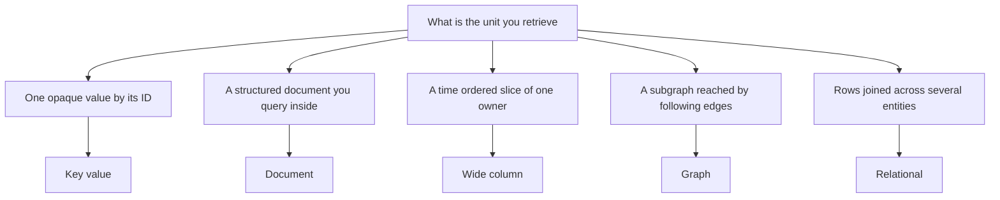

# NoSQL Taxonomy

"NoSQL" is a terrible name for a useful idea. It lumps together four genuinely different data models — key-value, document, wide-column, and graph — whose only shared trait is that they dropped some relational guarantees to gain something else, usually horizontal scale or a more natural fit for a particular data shape. This note gives you the map: what each family models well, what it quietly gives up, and why the honest expansion of the term is "**not only SQL**", not "SQL is dead".

## Why this matters

- Databases are chosen by **data shape and access pattern**, not by fashion. If you can't name which family a product belongs to, you can't predict its failure modes or its query limits.
- The late-2000s NoSQL wave happened for a specific reason: companies like Amazon and Google hit the ceiling of single-machine relational databases and needed **horizontal scale by design** — [[Sharding]] and [[Replication]] as built-in primitives rather than painful retrofits. The data-model changes were largely in service of that goal.
- Interviews love the question "which database and why" — and the strong answer is always phrased in terms of this taxonomy plus the framework in [[Choosing a Database]].

## How it works

### Key-value stores

The simplest possible contract: `put(key, value)`, `get(key)`, `delete(key)`. The value is an opaque blob; the database never looks inside it, so it cannot query by anything except the key.

- **Data shape:** anything you can serialize, addressed by exactly one identifier.
- **Access pattern:** point lookups and writes by primary key. No joins, no secondary filtering (some products bolt on secondary indexes, but that's leaving the family's home turf).
- **Why it scales:** because the key is the only access path, the store can partition by key hash — [[Consistent Hashing]] — and every operation touches exactly one partition. This is the family that scales most mechanically.
- **Examples:** Redis (in-memory), DynamoDB and Riak (Dynamo lineage — see [[The Dynamo Paper]]), etcd (consensus-backed config store).
- **Canonical uses:** sessions, caches, shopping carts, feature flags, per-user state.

### Document stores

Key-value where the value is **structured** — JSON/BSON — and the database can see inside it: index individual fields, query by them, update one field without rewriting the whole document.

- **Data shape:** self-contained aggregates — a user *with* their addresses, an order *with* its line items. One document holds what a relational design would spread across five joined tables.
- **Access pattern:** fetch/update a whole aggregate by ID, plus secondary-index queries on fields. Joins across documents are weak or absent by design; the model expects you to **denormalize** ([[Normalization vs Denormalization]]).
- **Why it scales:** documents shard by a key just like key-value pairs, as long as queries stay within one shard's documents.
- **Examples:** MongoDB (see [[MongoDB Architecture]]), CouchDB, Amazon DocumentDB, Firestore.
- **Canonical uses:** product catalogs, user profiles, content management, anything where "the entity and its children travel together".

### Wide-column stores

Despite the name, think "**two-level key-value**": a partition key locates a partition, and inside it rows are stored sorted by a clustering key. You get efficient range scans *within* a partition and nothing resembling a join across them.

- **Data shape:** huge, sparse tables — billions of rows, where each row can have its own subset of columns.
- **Access pattern:** known-in-advance queries of the form "give me rows for partition X, ordered by Y, between Y1 and Y2". You design tables *per query* — see [[Cassandra and Wide-Column Stores]].
- **Why it scales:** partitions distribute across nodes; the sorted clustering key gives time-series-like scans without global indexes.
- **Examples:** Cassandra, ScyllaDB, HBase, Google Bigtable (the ancestor — see [[Bigtable and Spanner]]).
- **Canonical uses:** messages by conversation, events by device, sensor readings by sensor-and-day — anything shaped "many items per owner, read in order".

### Graph databases

The inverse bet of the other three: instead of avoiding relationships, make relationships first-class. Data is **nodes and edges**, both carrying properties, and queries are traversals ("friends of friends who work at X").

- **Data shape:** highly connected data where the connections are the point — the relationship count rivals or exceeds the entity count.
- **Access pattern:** multi-hop traversals of unbounded depth, which in SQL would be recursive self-joins of unpredictable cost.
- **Why it's different on scale:** traversals resist [[Sharding]] — any edge can cross a partition boundary, so graph databases are the *hardest* family to scale horizontally, not the easiest. They earn their place on query expressiveness, not scale.
- **Examples:** Neo4j, Amazon Neptune, ArangoDB.
- **Canonical uses:** fraud rings, social graphs, recommendations, dependency and knowledge graphs.

### The family portrait

| Family | Unit of data | Query sweet spot | Scaling story | Representative |
|---|---|---|---|---|
| Key-value | Opaque blob by key | Point get/put | Excellent — hash partitioning | Redis, DynamoDB |
| Document | Self-contained JSON aggregate | Aggregate by ID + field queries | Good — shard by key, mind cross-shard queries | MongoDB |
| Wide-column | Partition of sorted rows | Range scan within partition | Excellent — designed for it | Cassandra, Bigtable |
| Graph | Nodes + edges | Deep traversals | Hard — edges cross partitions | Neo4j |

### From data shape to family: a decision table

The family portrait reads left to right — "here is a family, here is what it does". You will more often need to read it right to left: *I have this data and these queries, which family?* Start from the shape, not the product.

| Shape of the data | Dominant access pattern | Family | Named examples | The query that disqualifies it |
|---|---|---|---|---|
| An opaque value addressed by exactly one identifier | `get`/`put`/`delete` by that identifier, at very high rate and very low latency | **Key-value** | Redis, Memcached, DynamoDB, Riak, etcd | "Find every value whose field X equals Y" — there is no field |
| An aggregate that travels as one unit: entity plus its children | Fetch or replace the whole aggregate by ID; secondary queries on a few of its fields | **Document** | MongoDB, Couchbase, Amazon DocumentDB, CouchDB, Firestore | "Join three collections and enforce an invariant across them" |
| Many items per owner, naturally ordered — events, messages, readings | "Rows for owner X, in order, between Y1 and Y2", and the query list is known at design time | **Wide-column** | Cassandra, ScyllaDB, HBase, Google Bigtable | "Filter on a column that isn't part of the key" — it means a full scan |
| Entities whose connections carry the meaning; a node's neighbours matter more than its fields | Multi-hop traversal whose depth you do not know when you write the query | **Graph** | Neo4j, Amazon Neptune, ArangoDB, JanusGraph | "Shard this across fifty nodes" — edges cross every boundary |
| Flat entities with invariants that span them, and questions you have not thought of yet | Joins, ad-hoc aggregates, multi-row transactions | **Relational** — frequently the correct answer | PostgreSQL, MySQL | "Ingest 500K writes/sec of append-only events on one node" |

Two honest caveats on this table. First, the last row is in it deliberately: "which NoSQL family" is the wrong first question, because the relational answer wins more often than the taxonomy's existence suggests. Second, several important stores are *specialisations* rather than families — search indexes (Elasticsearch, OpenSearch), time-series stores (Prometheus, InfluxDB, TimescaleDB) and object storage (S3) each optimise one access pattern hard. They belong to the product-level decision in [[Choosing a Database]], not to the data-model taxonomy here.

### Telling the families apart in the wild

Product marketing blurs these lines ("multi-model!"), so classify by asking three questions of any store you meet:

1. **What's the unit of retrieval?** An opaque value → key-value. A structured document the engine can index into → document. A sorted slice of a partition → wide-column. A subgraph → graph.
2. **What's the cheapest query?** `get(key)` → key-value. "Documents where field = X" → document. "Partition X between Y1 and Y2" → wide-column. "Neighbors of N, 3 hops" → graph.
3. **What does the store refuse to do?** Refusals are more honest than features: no cross-item queries (key-value), no joins (document), no ad-hoc filters (wide-column), no horizontal scale without pain (graph).

Edge cases worth knowing: **Redis** blurs key-value with data-structure semantics (the value is a list/set/stream the server understands); **DynamoDB** is key-value with wide-column bones (partition + sort key — see [[DynamoDB Design]]); **Postgres JSONB** gives a document model *inside* a relational engine; **Elasticsearch** is a document store specialized into a search index (and a poor primary datastore). Multi-model products exist, but each workload inside them still lands in exactly one family's physics.

### What NoSQL promised, and what it delivered

A short history, because the marketing claims of 2010 are still quoted as facts in 2026 design reviews. The word itself is older than the movement: Carlo Strozzi used "NoSQL" in 1998 for a relational database that simply had no SQL interface. It was revived for a San Francisco meetup in June 2009 organised by Johan Oskarsson — the name was reportedly suggested by Eric Evans — as a label for a cluster of new open-source distributed stores. The intellectual parents were two papers from companies that had genuinely outgrown one relational machine: Google's **Bigtable** (OSDI 2006) and Amazon's **Dynamo** (SOSP 2007). The stores that gave the label its meaning — CouchDB, Cassandra, HBase, MongoDB, Redis, Riak — all first appeared in roughly the 2005–2009 window, and the distributed ones among them are direct descendants of those two papers.

Then the claims outran the engineering. Here is the scorecard, and the dates matter because the walk-backs are the evidence:

| The promise, circa 2009–2012 | What actually happened |
|---|---|
| "Scale horizontally by adding nodes" | **Largely delivered** — and it is the movement's real legacy. [[Sharding]] and [[Replication]] became built-in primitives instead of retrofits. The bill was paid elsewhere: access patterns frozen at design time, and rebalancing that is anything but hands-off ([[Rebalancing Partitions]]). |
| "Schema-free — no more migrations" | **Not delivered.** The schema moved into application code; migrations became backfill jobs. Write-time validation came back: MongoDB added `$jsonSchema` validators in 3.6. |
| "Joins are unnecessary if you denormalize" | **Half true.** Denormalization moved the cost from read time to write time and introduced update anomalies. The joins returned anyway — MongoDB added `$lookup` in 3.2 around 2015. |
| "Applications don't need transactions" | **Not delivered.** Cassandra added Paxos-based lightweight transactions in 2.0 around 2013; DynamoDB added transactions in November 2018; MongoDB added multi-document ACID transactions in 4.0 in 2018 and extended them to sharded clusters in 4.2 in 2019. |
| "Eventual consistency is good enough" | **Workload-dependent, and much harder for developers than advertised.** Nearly every store added stronger options: DynamoDB strongly consistent reads, MongoDB read and write concerns plus causally consistent sessions, Cassandra tunable quorums ([[Quorum Reads and Writes]]). Independent verification work — Jepsen being the best known — found consistency violations across many distributed stores, which pushed the whole field toward testable claims. |
| "SQL is dead" | **Inverted.** SQL absorbed the document model — PostgreSQL `JSONB` in 9.4 around 2014, MySQL's JSON type in 5.7 around 2015 — while distributed systems circled back to SQL with Spanner (paper 2012), CockroachDB and YugabyteDB. Even the NoSQL stores adopted SQL-shaped query languages, such as Cassandra's CQL. |

The fair verdict: NoSQL delivered **horizontal scale as a design property**, the **aggregate-oriented model** (which is a genuinely better fit for a lot of application data), **managed and serverless data** as a product category, and — most durably — the licence to run more than one datastore. What it oversold was that you could have those things *for free*, without giving up joins, transactions, or enforced structure. You give all three up; you just pay for them somewhere else.

### Schema-on-read, made concrete

"Schema-on-read" is the single most consequential trade in this taxonomy, and it is usually described too abstractly to be useful. Concretely, two things happen.

**The application becomes the schema registry.** There is no `CREATE TABLE`, so the only authoritative statement of what a `User` document contains is the code that deserializes it. When one collection is read by four services, there are four partial, privately-maintained definitions, and they drift. Nobody can answer "what fields does a KYC case have?" without grepping. Two concrete MongoDB consequences, both of which produce *successful queries with wrong results* — the worst failure shape there is:

- **Missing is not false.** A query `{ isKycVerified: false }` matches documents where the field is explicitly `false`, and **not** documents where the field is absent. Ship a new boolean in release 12, run the "users not yet verified" report, and it silently excludes every user created before release 12. The correct form is `{ isKycVerified: { $ne: true } }`. Note the matching asymmetry that catches people the other way round: `{ field: null }` *does* match both explicit null and missing.
- **Type drift.** The v1 service wrote `amount` as a string, the v2 service writes it as a number. BSON orders values across types, so `{ amount: { $gt: 1000 } }` quietly skips every string-typed document. No error, no warning, a shorter result set.

**Migrations become code you own forever.** The three options and their real costs:

1. **Lazy migration on read** — upcast old shapes in the repository layer. Cheapest to ship, and the compatibility branch never gets deleted, because you can never prove the last v1 document is gone.
2. **Backfill job** — rewrite every document. At a few hundred million documents this is a multi-day job that must be resumable, idempotent, and throttled so it does not starve production traffic; it needs its own progress tracking and its own rollback story.
3. **Dual-write and dual-read window** — write both shapes, read whichever exists, cut over, clean up. Correct and the most work.

And notice what you no longer have: a `schema_migrations` table. There is no artefact that says *this migration ran, on this date, against this database*. For an RBI-auditable system, "every reader tolerates every historical shape" is not a sentence you can evidence.

The discipline that claws it back: a `schemaVersion` field on every document from day one, a single shared model library rather than per-service DTOs, and MongoDB's `$jsonSchema` collection validators with `validationLevel` and `validationAction` set so the database rejects bad writes. That is write-time schema enforcement — re-adopting what was discarded, which is exactly the point. Schema-on-read was never free; it was deferred, and the interest rate is high.

### Graph databases: where they genuinely win, and where a join is fine

Graph databases attract more enthusiasm than deployments, so be precise about the boundary.

**They genuinely win when:**

- **Traversal depth is unknown at query time.** "Find every account reachable from this one through a shared device, phone number or beneficiary, to any depth, and tell me if it forms a ring." You cannot write that as a fixed number of joins because you do not know the number.
- **The relationship structure is itself the predicate.** Fraud and money-mule rings, beneficial-ownership chains (a genuinely regulated fintech problem), permission inheritance through nested groups, dependency and impact analysis.
- **The question is a graph algorithm, not a query.** Shortest path, all paths, connected components, centrality. Expressing these in SQL means reimplementing the algorithm in the query language.
- **The implementation reason** is *index-free adjacency* — Neo4j's term for storing direct physical references from a node to its edges, so one hop is a pointer dereference whose cost depends on the node's degree rather than on the size of the dataset. A relational join resolves each hop through an index lookup, so a k-hop query is k index traversals over a table that keeps growing.

**A relational join is completely fine when:**

- **The depth is fixed and shallow.** Order → customer → address is two joins. A well-indexed relational engine handles that at least as well as a graph store, and better on all the surrounding non-traversal queries. Most data that people call "a graph" is just joins.
- **The structure is a bounded tree.** Org charts, category hierarchies, comment threads: a materialized path, a nested set, or a closure table solves these with no new database, and PostgreSQL's `ltree` extension exists precisely for it.
- **Recursion is modest.** Recursive common table expressions are standard SQL, supported in PostgreSQL and in MySQL 8.0 and later, and they handle hierarchies of moderate depth and fan-out perfectly well. The thing that kills them is unbounded fan-out over a large graph, not recursion itself.
- **The graph fits in memory.** A few million edges load into an in-process graph library in seconds. You may not need a graph database; you may need an afternoon of code.

The operational honesty: because edges cross partitions, graph stores scale horizontally worst of the four families. So the common production shape is not "replace the system of record with Neo4j" — it is to keep the authoritative data relational or document and feed a graph engine, or an offline graph job, for the traversal workload. That is another polyglot seam with its own lag and its own sync machinery ([[Change Data Capture]], [[Choosing a Database]]).

## Common misconceptions

- **"NoSQL means no schema."** False — it means **schema-on-read**: not freedom from schema but *decentralized, unenforced* schema, living in application code rather than in the database. Five years in, the cost shows up as `if (doc.has("newField"))` scattered through the codebase and as wrong-but-successful queries; the worked detail is above under *Schema-on-read, made concrete*.
- **"NoSQL means giving up consistency."** Orthogonal. Some NoSQL stores are strongly consistent (HBase, etcd, DynamoDB with strong reads); some relational setups serve stale replica reads. The consistency spectrum is its own axis — see [[Consistency Models]] and [[CAP Theorem]].
- **"NoSQL is faster."** Only for the access pattern it was shaped for. A document store asked to do ad-hoc cross-aggregate joins is *slower* and more painful than Postgres.
- **"The relational model lost."** It didn't — SQL absorbed the hits (JSON columns in Postgres/MySQL) and the distributed world circled back to SQL with NewSQL systems like Spanner and CockroachDB ([[Bigtable and Spanner]]). "Not only SQL" was the accurate reading all along.

## In your stack

- **MongoDB is your primary datastore** — the document family. The fit is genuine for aggregate-shaped fintech entities (a KYC application with its nested documents and status history travels as one unit), but the schema-on-read cost is real: an RBI-auditable system can't shrug at "every reader handles every historical shape". Field-level validation (JSON Schema validators in MongoDB) pulls some enforcement back to the database.
- **Redis** is your key-value family member — sessions, caches, counters, and more ([[Redis Beyond Caching]]).
- **MySQL still exists in places** at Niyo, which is itself a taxonomy lesson: polyglot persistence is the norm, and [[Choosing a Database]] is a per-workload decision, not a company-wide religion.
- Your messaging journey (Kafka → SQS → Redis Streams) is adjacent: an event log is yet another data model — append-only, consumed in order — covered in [[Message Queues vs Event Logs]].

## Interview angle

The 60-second version: *"NoSQL is four families, not one thing. Key-value stores do point lookups and scale mechanically by hashing. Document stores hold self-contained JSON aggregates and query inside them. Wide-column stores are two-level key-value — partition key plus sorted clustering key — built for huge write-heavy tables with known queries. Graph databases make relationships first-class for deep traversals, and ironically scale worst. The movement was really about horizontal scale by design; the price was joins, cross-entity transactions, and enforced schema — which moves into the application as schema-on-read."*

Classic follow-ups:

- *Where would you put an order with line items — document or relational?* Document if it's always read/written as a unit; relational if line items are queried independently (analytics by SKU) or shared across orders.
- *Why do graph databases scale poorly?* Traversals follow edges; edges cross partitions; multi-hop queries become distributed scatter-gather — see [[Secondary Indexes on Sharded Data]] for the same disease elsewhere.
- *What does schema-on-read cost in year three?* Readers carrying compatibility code for every historical document shape; migrations done lazily per document; no single source of truth for "what does a User look like".

## Check yourself

> [!question]- Q: Explain "schema-on-read" and who pays for it.
> The database stops enforcing structure at write time; documents of different shapes coexist in one collection. The schema still exists — it has moved into application code, where every reader must tolerate every shape ever written. The application team pays, continuously: compatibility branches, lazy migrations, and bugs when an old shape surfaces. Write-time validators claw some enforcement back.

> [!question]- Q: What happens if you model a social network's friend graph in a document store, embedding each user's friend list in their document?
> Writes fan out — one friendship touches two documents, so you either coordinate in the application or reach for the multi-document transactions document stores added back later (MongoDB 4.0), which are the expensive path and not what the aggregate model is shaped for. Mutual-friend and friends-of-friends queries become N round trips of ID lookups. Celebrity users create giant documents that hit size limits and become hot spots ([[Hot Partition Problem]]). The data's shape is a graph; forcing it into aggregates moves the join into your service code.

> [!question]- Q: Why does the key-value family scale the most mechanically of the four?
> Because the key is the *only* access path, every operation names its partition up front: hash the key, route to the owning node, done. No cross-partition queries exist to coordinate, so adding nodes is nearly linear capacity. The moment you add secondary access paths — field queries, traversals — operations stop being single-partition and scaling gets conditional.

> [!question]- Q: A teammate proposes Neo4j for a feature showing a user's referral network — who referred them, and whom they referred. Is that a graph problem?
> No. The depth is fixed at one hop in each direction and known when you write the query, so two indexed lookups on a `referrals` table answer it, and a well-indexed relational engine handles that at least as well as a graph store. It *becomes* a graph problem when the question changes to unbounded depth — "every account connected to this one through any chain of referrals, shared devices or shared beneficiaries; does it form a ring?" — because there is no fixed number of joins that expresses it. The test is never "does my data have relationships" (all data does); it is "is the traversal depth unknown at query-writing time, and is the structure itself the predicate?"

> [!question]- Q: Mini-design — a fintech needs to store card transactions: written once, queried as "all transactions for account X in date range", plus monthly analytics across all accounts. Which families, and why plural?
> The serving query is textbook wide-column: partition key = account, clustering key = timestamp — one partition range scan per query ([[Cassandra and Wide-Column Stores]]). The analytics query must not run on that store (it scans everything); ship transactions to a columnar analytics store via CDC or events — see [[Time Series and Analytics Stores]] and [[Change Data Capture]]. Two workloads, two engines: polyglot persistence with eyes open.

## Sources

- Kleppmann, *Designing Data-Intensive Applications*, ch. 2 "Data Models and Query Languages" (document vs relational vs graph) and ch. 3 (storage underpinnings).
- DeCandia et al. — "Dynamo: Amazon's Highly Available Key-value Store", SOSP 2007.
- Chang et al. — "Bigtable: A Distributed Storage System for Structured Data", OSDI 2006.
- Martin Fowler — *NoSQL Distilled* (with Pramod Sadalage), 2012: source of the "aggregate-oriented" framing used here.
- MongoDB documentation — schema validation (`$jsonSchema`, `validationLevel`/`validationAction`), `$lookup`, and the 4.0/4.2 release notes on multi-document transactions.
- Jepsen (jepsen.io) — Kyle Kingsbury's safety and consistency analyses of distributed databases; the work that pushed vendors toward testable consistency claims.
- Neo4j documentation — index-free adjacency and Cypher traversal; PostgreSQL documentation — recursive CTEs and the `ltree` extension, for the "a join is fine" side of the argument.
