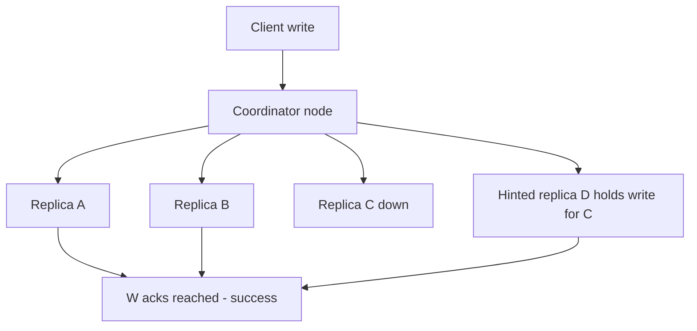

# The Dynamo Paper

In 2007 Amazon published "Dynamo: Amazon's Highly Available Key-value Store" (DeCandia et al., SOSP 2007), describing the internal system behind, among other things, the shopping cart. It is arguably the most influential systems paper of its era — not because any single technique was new, but because it assembled six known techniques into one coherent design and stated the business requirement with unusual bluntness: **a customer must always be able to add to their cart**, even during network partitions and server failures, because a refused write is lost revenue. Everything in the design flows from that one sentence.

## Why this matters

- Dynamo is the canonical **AP system** in [[CAP Theorem]] terms: it chooses availability during partitions and accepts that replicas may temporarily disagree, resolving conflicts later. If you understand Dynamo, you understand what "eventually consistent" concretely costs and buys.
- Its toolkit — [[Consistent Hashing]], [[Quorum Reads and Writes]], hinted handoff, vector clocks, Merkle-tree anti-entropy, gossip — became the shared blueprint for Cassandra, Riak, and Voldemort, and the vocabulary of half of Module 8.
- "Design a key-value store" ([[Design a Key-Value Store]]) is a classic interview capstone, and the expected answer is essentially a guided tour of this paper.

## How it works

The paper's design is best understood as six problems, each answered by one mechanism.

### 1. Placing data: consistent hashing with virtual nodes

Keys are hashed onto a **ring**; each node owns ranges of the ring, and a key is stored on the **N** nodes found by walking clockwise from its hash (the *preference list*, N typically 3). Naive one-token-per-node placement distributes load unevenly and makes a joining node take its entire range from one neighbor, so Dynamo gives each physical node many **virtual nodes** (tokens) scattered around the ring: load spreads statistically, heterogeneous hardware gets proportional token counts, and a node's arrival or departure shifts many small slices instead of one big one. Full treatment in [[Consistent Hashing]].

### 2. Reading and writing: N/R/W quorums

Each operation contacts the preference list with tunable thresholds: a write succeeds after **W** replicas acknowledge, a read consults **R** replicas. If **R + W > N**, read and write sets overlap, so a read sees at least one copy of the latest acknowledged write — see [[Quorum Reads and Writes]]. Amazon's common setting was N=3, R=2, W=2. The knobs trade latency and availability against staleness, and the configurations genuinely enumerate — at N=3 there are only a handful worth considering:

| N | W | R | R+W > N | What you get | What it costs |
|---|---|---|---|---|---|
| 3 | 1 | 1 | No — 2 is not greater than 3 | Lowest latency on both paths; a write still succeeds with two of three replicas unreachable | Reads are routinely stale; no overlap guarantee at all |
| 3 | 2 | 2 | Yes — 4 > 3 | A read sees the latest acknowledged write under a strict quorum, and either path tolerates one failed replica | Both paths wait for the second-slowest replica |
| 3 | 3 | 1 | Yes — 4 > 3 | Fastest possible reads; every replica is current | One unreachable replica blocks *every* write — the opposite of the cart requirement |
| 3 | 1 | 3 | Yes — 4 > 3 | Fastest, most available writes | One unreachable replica blocks every read |
| 3 | 2 | 1 | No — 3 is not greater than 3 | Fast reads with two-replica write durability | The read quorum can miss the latest write; the inequality is strict for a reason |

Two things fall out of the table. First, the overlap test is a strict inequality — W=2, R=1 at N=3 feels like it should work and does not. Second, W=N is the configuration that quietly abandons Dynamo's founding requirement: the moment a single replica is unreachable, writes stop.

### 3. Staying writable through failures: sloppy quorum and hinted handoff

A strict quorum refuses writes when too few of the *home* replicas are reachable — exactly what the shopping-cart requirement forbids. Dynamo instead uses a **sloppy quorum**: if a home node is down, the write goes to the next healthy node on the ring, tagged with a **hint** naming the intended owner. The stand-in stores the write in a separate space and periodically retries delivering it; when the owner recovers, the hinted write is **handed off** and the stand-in deletes its copy. Availability improves; the cost is that R+W>N no longer guarantees overlap during failures — the read quorum and the (displaced) write quorum may not intersect. Sloppy quorums buy "always writable" by paying in consistency.

### 4. Detecting and resolving conflicts: vector clocks and read repair

Because writes are accepted on both sides of a partition, two versions of a key can exist with neither derived from the other. Dynamo tracks causality with **vector clocks** ([[Logical Clocks and Ordering]]): each version carries a list of (node, counter) pairs. If one clock dominates another, the older version is discarded automatically. If the clocks are **concurrent**, both versions are kept, and a subsequent `get` returns *all* of them — pushing resolution to the application. The shopping cart resolves by **merging** (union of items: a deleted item can resurface — Amazon accepted that over losing an added item). On reads, **read repair** writes the winning/merged version back to stale replicas, healing them opportunistically along the hot path.

#### A vector clock, traced step by step

The rule is precise: clock X **dominates** clock Y when every counter in Y is less than or equal to the matching counter in X — treating a missing node entry as zero — and at least one is strictly greater. If neither dominates, the versions are **concurrent**. Walk one key, `cart:42`, through five steps with coordinators A, B and C:

| Step | What happens | Resulting clock | Verdict |
|---|---|---|---|
| 1 | Client writes via A | `[A:1]` | First version, D1 |
| 2 | Same client writes again via A | `[A:2]` | Dominates `[A:1]`, so D1 is discarded automatically |
| 3 | Partition; one client writes via B | `[A:2, B:1]` | D3 |
| 4 | Simultaneously another writes via C | `[A:2, C:1]` | D4 — has C:1 which D3 lacks, and lacks B:1 which D3 has, so **neither dominates**: concurrent |
| 5 | Partition heals; a read returns both; the app merges and writes back via A | `[A:3, B:1, C:1]` | Dominates both D3 and D4, so the siblings collapse |

Step 4 is the whole mechanism in one row: the database can *prove* the two versions were not derived from one another, which is strictly more information than a timestamp comparison would have given it — and strictly less than knowing which one is correct. That remaining gap is the application's to close, every time.

#### Sibling explosion — the failure the descendants actually hit

Vector clocks only shrink when somebody merges. A client that reads a key, ignores the returned versions, and writes back *without* passing the causal context it was given is telling the system "this write is unrelated to anything you hold" — so the write becomes yet another sibling rather than superseding the previous ones. Repeat that on a hot key and the stored versions multiply.

The signature is distinctive: a handful of specific keys grow steadily in stored size and read latency while the rest of the keyspace is unaffected, and the growth tracks *write* volume on those keys rather than data volume. It is confirmed by fetching one and counting the returned versions. The fix is never operational — no amount of repair or compaction removes siblings — it is a client that always writes back with the context from its read, plus a merge function that is associative and commutative so the order of resolution does not matter. CRDTs, which Riak later added, are exactly the formalisation of "a merge function you cannot get wrong".

### 5. Healing cold data: anti-entropy with Merkle trees

Read repair only heals keys that get read. For the rest, replicas periodically run **anti-entropy**: each builds a **Merkle tree** (a hash tree — leaves hash key ranges, parents hash their children) over a range; two replicas compare root hashes, descend only into subtrees that differ, and sync only the divergent keys. Comparing terabytes costs only the differing branches' transfers.

### 6. Membership: gossip

No central coordinator tracks which nodes exist. Each node periodically exchanges membership and liveness information with a random peer — **gossip** — and views converge in O(log n) rounds. Failure detection is local and pragmatic: a node that fails to respond is treated as down *for that caller's purposes*, with no global agreement required. There is no master to elect, hence no [[Failover]] event and no [[Split Brain and Fencing]] drama — by design, every node can serve any request as coordinator.

### The six problems and six mechanisms, in one table

| Problem | Mechanism | Lives on in |
|---|---|---|
| Where does a key live? | Consistent hashing + virtual nodes | Cassandra, Riak (Redis Cluster solves the same problem with 16384 fixed hash slots instead — not a ring; see [[Consistent Hashing]]) |
| How many replicas confirm an op? | N/R/W quorums | Cassandra consistency levels, [[Quorum Reads and Writes]] |
| Staying writable when replicas die? | Sloppy quorum + hinted handoff | Cassandra hints |
| Detecting conflicting versions? | Vector clocks | Riak; Cassandra swapped in last-write-wins |
| Healing stale replicas? | Read repair + Merkle-tree anti-entropy | Cassandra `nodetool repair` |
| Who's in the cluster? | Gossip protocol | Cassandra, Redis Cluster, Consul (Serf) |

## Trade-offs

| You gain | You pay |
|---|---|
| Always-writable: writes succeed through node failures and most partitions | Eventual consistency: reads can return stale or *multiple* versions |
| No single point of failure, no leader election pause | Conflict resolution leaks into application code (merge logic per data type) |
| Incremental, operator-friendly scaling via the ring | Sloppy quorums weaken the R+W>N overlap guarantee precisely when things fail |
| Symmetric nodes — simple operational model | Vector clocks grow and must be pruned (losing some causality information); the whole model suits only single-key operations — no transactions, no joins |

## Common misconceptions

- **"Dynamo = DynamoDB."** The paper describes a leaderless, eventually consistent internal system from 2007; the AWS product (2012) is leader-per-partition, offers strong reads, and hides all conflict machinery. Same name, different system — the contrast section below is interview gold.
- **"R+W>N gives you strong consistency."** It gives read-set/write-set *overlap* for acknowledged writes under strict quorums. Sloppy quorums break the overlap during failures, and even strict quorums admit edge cases under concurrency and partial writes that fall short of linearizability — see [[Quorum Reads and Writes]].
- **"Vector clocks resolve conflicts."** They only *detect* them (concurrent versions). Resolution is the application's job — Dynamo's cart merges; your domain might not have a safe merge.
- **"Eventual consistency means data loss."** It means *temporary disagreement* plus a convergence protocol. Dynamo goes to great lengths (hints, read repair, anti-entropy) to lose nothing — what it sacrifices is *agreement at read time*, not durability.

## Its descendants — and how DynamoDB differs from Dynamo

- **Cassandra** (Facebook, open-sourced 2008) = Dynamo's distribution layer + Bigtable's data model and LSM storage engine — see [[Cassandra and Wide-Column Stores]]. Notably it replaced vector clocks with last-write-wins timestamps per column (simpler, but can silently drop concurrent writes).
- **Riak** was the most faithful implementation (vector clocks, later CRDTs for automatic merging). **Voldemort** was LinkedIn's take.
- **DynamoDB (the AWS product, 2012)** shares the name and the partitioning spirit but is a **different system**: a fully managed, multi-tenant service where each partition has a leader and replicates via a consensus protocol; it offers **strongly consistent reads** as an option, exposes no vector clocks and no sibling versions to users, uses no sloppy quorums, and adds tables, secondary indexes and transactions. Dynamo-the-paper is an architecture you can build ([[Design a Key-Value Store]]); DynamoDB-the-product is covered in [[DynamoDB Design]]. Conflating the two is a classic interview mistake.

## In your stack

- You run **MongoDB, not a Dynamo descendant** — a leader-based design philosophically opposite to Dynamo: it pauses writes during [[Failover]] elections rather than accepting conflicting writes. For money movement and KYC, that's the right side of the trade: a fintech usually prefers a briefly unavailable write path over two replicas holding different truths about a balance.
- The paper's ideas still surface piecemeal around you: **Redis Cluster** uses hash-slot partitioning (a cousin of the ring) and gossip for membership; [[Consistent Hashing]] appears in client-side load balancing and cache sharding.
- The shopping-cart merge story is a useful lens at Niyo: "which of our writes could tolerate merge-later semantics?" Almost none that touch money — which is itself the answer to "why don't we run Cassandra for ledgers".
- **The "is there a safe merge?" question is the reusable half of the paper.** Ask it of any data you replicate or cache: a set of added items merges safely by union; a counter merges safely only if you track per-source increments; a *balance* has no safe merge at all, because union, max and last-write-wins are each wrong in a different way. That question decides whether an AP store is viable for a given collection far more sharply than any CAP label does ([[CAP Theorem]], [[PACELC]]).
- **Honest 1-replica note.** Dynamo's symmetry — every node can coordinate, no leader, no failover pause — is a property of the *datastore*, and it does not propagate upward. A service pinned at one replica in front of the most available database on Earth is still a single point of failure during a rollout, an eviction or an OOM kill. When an availability argument is being made from a datastore's properties, check which tier the argument is actually about.
- Your `x-correlation-id` discipline is the operational cousin of the paper's causal-context idea: both are small pieces of metadata that travel with a request so a later observer can reconstruct what caused what. Dynamo makes the database carry it; you make the call chain carry it ([[Distributed Tracing]]).

## Interview angle

The 60-second version: *"Amazon needed a cart that never refuses a write, so Dynamo chooses availability over consistency. Keys are placed on a consistent-hash ring with virtual nodes, replicated to N nodes, accessed with R/W quorums. When home replicas are down, sloppy quorum plus hinted handoff keeps writes flowing. Divergent versions are detected with vector clocks, merged by the application, healed by read repair on the hot path and Merkle-tree anti-entropy in the background; membership spreads by gossip. Cassandra and Riak descend from it — DynamoDB the product keeps the name but is leader-based with optional strong consistency."*

Classic follow-ups:

- *What does R+W>N actually guarantee, and when does it break?* Overlap between read and write sets — broken by sloppy quorums during failures, and it guarantees "sees the latest *acknowledged* write", not linearizability under concurrency.
- *Why vector clocks instead of timestamps?* Wall clocks skew across nodes; last-write-wins silently discards one of two concurrent writes. Vector clocks detect concurrency instead of guessing an order.
- *Why both read repair and anti-entropy?* Read repair heals only what's read; anti-entropy catches cold keys; Merkle trees make that cheap.
- *Would you build on this today?* Mostly no — managed products (DynamoDB, Cassandra) exist; but the techniques remain the standard parts bin for any distributed store you design.

## Check yourself

> [!question]- Q: Explain sloppy quorum + hinted handoff to a teammate, including what guarantee it sacrifices.
> Strict quorum requires W of the N *designated* replicas — unreachable replicas can block writes. Sloppy quorum lets the coordinator substitute the next healthy ring nodes, each storing the write with a hint naming the real owner, delivered when the owner recovers. Writes stay available through failures. Sacrificed: the R+W>N overlap guarantee — during the failure window, a read quorum drawn from home replicas may miss writes parked on stand-ins, so reads can be stale even with "quorum" settings.

> [!question]- Q: Two users share an Amazon account. During a network partition, one adds a book on each side of the partition. Walk through what Dynamo does when the partition heals.
> Both writes were accepted by different replica sets, each producing a version whose vector clock does not dominate the other — concurrent versions. After healing, a read gathers both; Dynamo returns both siblings to the application, which merges by union (both books stay in the cart) and writes back the merged version with a clock descending from both. Read repair propagates it to stale replicas. If an item had been *deleted* in one branch, the union resurrects it — the paper explicitly accepts that anomaly.

> [!question]- Q: What happens if gossip is partitioned such that two halves of the cluster each believe the other half is dead?
> Each half keeps serving — coordinators route to reachable nodes, sloppy quorums park writes for "dead" owners as hints. Both halves accept writes for the same keys, so concurrent versions accumulate on both sides. On healing: hints deliver, anti-entropy and read repair surface the divergence, vector clocks mark the versions concurrent, applications merge. Availability preserved, at the price of a conflict-resolution bill — Dynamo's entire philosophy in one scenario.

> [!question]- Q: A team runs N=3 with W=2, R=1 and insists it is "a quorum setup". Show them the case that breaks, then say what you would change and why not simply R=2.
> R + W must be *strictly* greater than N; here 1 + 2 = 3, which is not greater than 3, so the sets need not intersect. The concrete break: a write is acknowledged by replicas A and B while C lags; a subsequent read with R=1 is served by C and returns the previous value — no failure, no partition, no error, just a stale read that the configuration permits by arithmetic. Raising R to 2 restores the overlap (2 + 2 = 4 > 3) at the cost of waiting for the second-fastest replica on every read, which is usually the right trade and is exactly why Amazon's common setting was N=3, R=2, W=2. The reason "just set R=2" is not automatically the answer: if the workload is read-dominated and latency-critical, raising W to 3 instead gives R=1 reads — but it also means any single unreachable replica blocks all writes, which abandons the always-writable requirement the whole system exists to satisfy. Pick which side you want to pay on; you cannot avoid paying.

> [!question]- Q: Mini-design — sketch a mini-Dynamo for user session blobs where losing a session is annoying but acceptable. Which of the six mechanisms would you keep, and which would you drop?
> Keep: consistent hashing with virtual nodes (placement), N=3 with R=1/W=1 (sessions tolerate staleness; latency matters), gossip membership, hinted handoff (stay writable). Drop or simplify: vector clocks — last-write-wins is fine because a session conflict just means one device's update wins; Merkle anti-entropy could be replaced by TTL expiry since sessions die quickly anyway. The exercise shows the paper is a menu, not a monolith — [[Design a Key-Value Store]] walks the full version.

## Sources

- DeCandia et al. — "Dynamo: Amazon's Highly Available Key-value Store", SOSP 2007 (the paper itself; §4 "System Architecture" and §6 "Experiences" are the heart).
- Kleppmann, *Designing Data-Intensive Applications* — ch. 5 (leaderless replication, quorums, read repair) and ch. 6 (partitioning); the clearest modern retelling.
- Karger et al. — "Consistent Hashing and Random Trees", 1997 (the hashing technique Dynamo adopted).
- Lamport — "Time, Clocks, and the Ordering of Events in a Distributed System", 1978 (causality foundations behind vector clocks).
- Werner Vogels — "Eventually Consistent", ACM Queue, 2008 (Amazon's CTO explaining the consistency philosophy).
