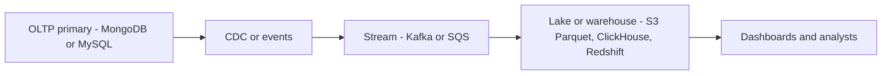

# Time Series and Analytics Stores

Every database question so far in this module has been about **serving**: find one user's data, fast, correctly. Analytics asks the opposite question: scan *everyone's* data and aggregate it — "average transaction value by state, by month, for two years". These two workloads — **OLTP** (online transaction processing) and **OLAP** (online analytical processing) — are not two tunings of one database; they are different physics, and they led to differently *shaped* storage: row-oriented engines for serving, **columnar** engines for analytics, and **time-series stores** as a specialized middle species for metrics. This note explains the shapes and the single most important operational rule that follows: don't run analytics on the OLTP primary.

## Why this matters

- Sooner or later every product team asks the serving database an analytics question, and the database answers by falling over. Knowing *why* (physics, not tuning) lets you say no early and design the pipeline instead.
- Columnar storage is behind every tool in the modern data stack — ClickHouse, Redshift, BigQuery, Snowflake, Parquet files on S3 — one idea explains all of them.
- Observability (Prometheus at work) is a time-series storage problem; understanding append-mostly + downsampling + retention explains both its power and its limits.

## How it works

### OLTP vs OLAP: the workloads

| | OLTP | OLAP |
|---|---|---|
| Typical query | "Order 123, with its items" | "Revenue by category by month, FY25" |
| Rows touched | A handful, by index | Millions to billions, scanned |
| Columns touched | Most of the row | 2–5 of possibly hundreds |
| Writes | Constant small inserts/updates | Bulk loads, append-mostly |
| Latency bar | Milliseconds | Seconds acceptable |
| Users | The product, at request rate | Analysts, dashboards, finance |

A row store ([[How Databases Store Data]]) lays each row's bytes contiguously — perfect for "fetch order 123's whole row", terrible for "sum one column over a billion rows", because every page read drags along all the columns of each row the query doesn't want, and the working set is the whole table, evicting the OLTP cache.

### Columnar layout: store columns, not rows

A columnar store writes each **column's values contiguously**: all `amount`s together, all `merchant_category`s together. Three compounding wins:

1. **I/O skipping** — a query touching 3 of 100 columns reads ~3% of the bytes.
2. **Compression** — a column holds values of one type with low variety, which compresses brutally well: run-length encoding ("IN x 2,000,000"), dictionary encoding (map each merchant category to a small integer), delta encoding for sorted/timestamp columns. 10x+ compression is routine, and compressed bytes mean fewer disk reads *and* better cache use. Min/max metadata per block lets whole blocks be skipped ("zone maps").
3. **Vectorized execution** — operators process columns in batches of thousands of values in tight CPU loops (SIMD-friendly, branch-poor), instead of interpreting one row at a time. Modern engines add just-in-time compilation of query fragments.

The cost: point lookups and single-row updates are awkward (a "row" is scattered across every column file), so columnar engines batch writes into immutable sorted chunks merged in the background — LSM thinking again ([[B-Tree vs LSM-Tree]]), with analytics-sized runs.

**Who's who:** ClickHouse (open-source, self-hostable, the MergeTree engine), Amazon Redshift (2012, warehouse-as-a-service), Google BigQuery (serverless, rooted in the 2010 Dremel paper), Snowflake (separated storage/compute), DuckDB (embedded, "SQLite for analytics"), and **Parquet** — the columnar *file format* that makes S3 a warehouse floor ([[How S3 Works]]).

### Time series: a specialized species

Metrics and sensor data have a sharper profile still: **append-mostly** (new points, almost never updates), timestamp-ordered, enormous ingest rates, queries that are nearly always "this metric, this label set, this recent time window, aggregated". That profile allows aggressive specialization:

- **Delta-of-delta timestamp compression and XOR float compression** (popularized by Facebook's Gorilla paper, 2015 — the basis of Prometheus's TSDB format): regular intervals compress to almost nothing; points cost on the order of 1–2 bytes.
- **Downsampling**: raw 15-second points matter for a week; after that, 5-minute averages (or min/max/avg rollups) answer every realistic question at a fraction of the cost. Precision decays with age by *policy*.
- **Retention**: time series data expires — drop whole time-partitioned chunks rather than deleting rows (no tombstone problem; the unit of delete is a file).
- **Cardinality is the real capacity limit**: every unique label combination (`service x endpoint x status x pod`) is its own series with its own index entry. A `user_id` label turns thousands of series into millions and kills the store — the famous **cardinality explosion**.

**Who's who:** **Prometheus** — pull-based scraper + local TSDB, default 15-day retention, deliberately single-node; it does **not** natively downsample — long-term storage and HA come from Thanos, Cortex or Mimir layered on top (typically backed by S3), and of those only Thanos downsamples. **InfluxDB** — push-based with per-database retention periods and rollup machinery. **Amazon Timestream for LiveAnalytics** — managed, with a memory tier for recent data and a magnetic tier for history, each with its own retention; closed to new customers since June 2025, with AWS pointing new workloads at Timestream for InfluxDB. **TimescaleDB** — Postgres extension using time-partitioned "hypertables", for when SQL-on-time-series matters more than peak ingest.

### Getting data from OLTP to OLAP

The primary serves the product; analytics gets a **copy**: 

The respectable routes: [[Change Data Capture]] (Debezium, MongoDB change streams) into a stream, landed as columnar files; or domain events ([[Event Sourcing]]-adjacent) doing the same; or scheduled batch exports when freshness in hours is fine. Each adds **lag** — the warehouse is minutes-to-hours behind, which is a feature to communicate, not a bug to hide ([[Consistency Models]]: this is eventual consistency by construction).

### Why you don't run analytics on the OLTP primary

Worth stating as mechanics, since the request will come:

1. **Cache eviction** — a full-table scan flushes the buffer pool/working set; every product query afterwards goes to disk; p99 detonates.
2. **Resource starvation** — the scan saturates disk I/O and CPU that point reads were budgeted on.
3. **Lock/MVCC pressure** — long-running reads hold back MVCC garbage collection (vacuum bloat in Postgres, cache pinning in WiredTiger/MongoDB), degrading everything.
4. **Blast radius** — an analyst's bad query becomes a customer-facing incident.

"Run it on a read replica" is the first-aid version: it protects the primary's latency, but the replica is still a row store (the query is still slow), and long scans can stall replication apply, growing lag ([[Read Your Own Writes and Replica Lag Anomalies]], [[Database Scaling Patterns]]). It buys isolation, not performance. The real fix is a columnar copy.

## Trade-offs

| You gain with a columnar/TS store | You pay |
|---|---|
| 10–1000x faster scans and aggregations; 10x+ compression | A second system: pipeline, lag, reconciliation, cost |
| OLTP primary protected by construction | Data freshness is minutes/hours, not now |
| Cheap retention of years of history (especially Parquet-on-S3) | Point lookups and updates are weak; no OLTP serving from it |
| Time-series: tiny per-point cost, retention by policy | Cardinality limits; downsampling destroys detail by design |

## Common misconceptions

- **"A read replica solves analytics."** It solves *isolation* only; the query is still a row-store scan, still slow, and still able to stall replication apply.
- **"Columnar databases are just row databases with an index per column."** No — the physical layout, compression and execution model differ; a row store with many indexes gets *slower* to write and still scans rows.
- **"Time-series data is small — it's just numbers."** Per-point cost is tiny; *series count* (cardinality) and retention are what explode. The bill is multiplicative: series x resolution x retention.
- **"We need real-time analytics."** Usually the requirement is "fresh within minutes", which is far cheaper than seconds. Interrogate the freshness number before architecting for streams.

## Failure modes

- **Cardinality explosion** (time series): memory/index blow-up from a high-cardinality label; detected by series-count metrics; fixed by dropping/aggregating the label at ingest.
- **Pipeline lag or breakage**: dashboards silently show yesterday; treat CDC lag as an SLO with alerts ([[Logs Metrics and Traces]]).
- **Small-files problem**: streaming tiny Parquet files to S3 makes queries slow and request-bills large; compaction jobs are part of the design ([[How S3 Works]]).
- **Schema drift**: an OLTP field changes shape and the pipeline drops or corrupts the column downstream — schema contracts/registries guard this ([[Event Schema Evolution]]).
- **The "quick query on prod" incident**: someone bypasses the pipeline and scans the primary — prevented by permissions and by the pipeline actually being good enough that nobody needs to.

## When NOT to use it

- **Don't add a warehouse before you have warehouse questions** — at small scale, a read replica plus indexes answers the finance team honestly ([[Choosing a Database]]: boring first).
- **Don't serve product features from the warehouse** — its latency and freshness are wrong for request paths; if a product feature needs aggregates, precompute them back into the serving store.
- **Don't use a time-series store as a general database** — no entities, weak joins; it stores *measurements*, not state.
- **Don't keep raw forever because storage is cheap** — cost shape: warehouse cost scales with bytes scanned per query (BigQuery's on-demand pricing bills exactly that) and retained bytes; downsampling and lifecycle policies are the levers.

## In your stack

- **MongoDB is your OLTP primary; everything in this note argues it must stay that way.** Ops/finance questions ("transaction volume by corridor by day") belong in a columnar copy fed by change streams ([[Change Data Capture]]) → your messaging estate (SQS today, Redis Streams tomorrow) → Parquet on S3 queried by Athena, or ClickHouse if dashboards need interactivity.
- **Prometheus runs your observability** on EKS: remember it keeps ~15 days locally, doesn't downsample natively, and every label is a cardinality decision — never `user_id` or `correlation_id` as a metric label (those belong in logs/traces, which is exactly the [[Logs Metrics and Traces]] division of labor).
- **RBI/audit angle**: regulators ask historical questions ("all transactions matching X over 18 months"). Answering from an immutable columnar archive (Parquet on S3 with Object Lock) is both cheaper and more auditable than torturing the serving store.
- Cost shape to quote in reviews: OLTP cost scales with *request rate*; warehouse cost with *bytes scanned and retained*; time-series cost with *active series count*. Three systems, three different bills.

## Interview angle

The 60-second version: *"OLTP touches a few rows by index and wants milliseconds; OLAP scans millions of rows but only a few columns. Row storage serves the first; columnar storage wins the second — contiguous columns mean you read only the columns you need, one-type data compresses 10x via run-length/dictionary/delta encoding, and vectorized engines chew through batches. That's ClickHouse, Redshift, BigQuery, Parquet. Time series specializes further: append-mostly, Gorilla-style compression, downsampling by age, retention by dropping time chunks — and cardinality, not volume, is the limit. You never run analytics on the OLTP primary — scans evict its cache and starve its I/O — so you copy data out via CDC or events and accept the lag."*

Classic follow-ups: *why does columnar compress so well?* (homogeneous type + low entropy per column); *why is Prometheus single-node?* (deliberate simplicity — scale/HA/long-term storage delegated to Thanos/Mimir on object storage); *your PM wants "real-time" dashboards — what do you ask?* (how fresh is fresh: seconds means streaming aggregation, minutes means CDC-to-OLAP, and the price difference is large).

## Check yourself

> [!question]- Q: Explain to a teammate why `SELECT AVG(amount) FROM transactions` over a billion rows is fast in ClickHouse and dangerous on your MongoDB primary.
> MongoDB stores each document's fields together (row-oriented, B-tree pages): averaging `amount` means reading every document in full — a full-collection scan that evicts the working set from cache and saturates disk, so product queries start missing cache and p99 spikes. ClickHouse stores `amount` as one contiguous, compressed column: it reads only those bytes (a few GB instead of hundreds), skips blocks via min/max metadata, and aggregates them in vectorized batches. Same question, ~100x less I/O, and crucially on a system whose only job is scans.

> [!question]- Q: What happens if someone adds `user_id` as a Prometheus label on a request-counter metric at Niyo?
> Every active user multiplies the series count: each unique label combination is a separate time series with its own index entry and memory footprint. Series count jumps from thousands to millions; Prometheus memory and index size balloon, scrapes and queries slow, and the node eventually OOMs — a cardinality explosion. Per-user data belongs in logs or traces keyed by correlation id, not metric labels. Mitigation after the fact: drop the label via relabeling at ingest and wait out retention, since historical blocks keep the old series until they expire.

> [!question]- Q: Why does downsampling make sense for metrics but would be unacceptable for a financial transaction ledger?
> Metrics answer statistical questions — trends, percentiles, capacity — where a 5-minute average preserves the decision-relevant signal long after per-scrape detail stops mattering; precision is a depreciating asset. A ledger is evidence: each record is individually legally meaningful forever, and "average of transactions" cannot reconstruct any one of them. Ledgers get immutable archival (cheaper *storage tiers*, never lossy *summaries* — [[How S3 Works]] lifecycle to Glacier); metrics get lossy rollups. Retention economics by aggregation vs retention economics by tiering.

> [!question]- Q: Mini-design — Niyo finance wants daily and monthly transaction aggregates by product and corridor, fresh within 15 minutes, with 2 years of history. Sketch the pipeline and name the failure mode you'd alert on first.
> MongoDB change streams on the transactions collection → a small consumer publishing to the stream (SQS/Redis Streams) → a lander batching into Parquet on S3 partitioned by date (with periodic compaction of small files) → Athena or ClickHouse for queries; a scheduled job materializes the daily/monthly rollup tables dashboards actually read. 15-minute freshness permits micro-batching — no heavy streaming engine needed. First alert: **pipeline lag** (change-stream resume-token age / landing delay), because stale-but-plausible dashboards silently mislead finance — worse than an obvious outage. Second: reconciliation counts between source and warehouse per day, since an auditor will ask.

## Sources

- Kleppmann, *Designing Data-Intensive Applications*, ch. 3 — the "Column-Oriented Storage" half: OLTP vs OLAP, compression, vectorization.
- Melnik et al. — "Dremel: Interactive Analysis of Web-Scale Datasets", VLDB 2010 (BigQuery's ancestor; nested columnar storage).
- Pelkonen et al. — "Gorilla: A Fast, Scalable, In-Memory Time Series Database", VLDB 2015 (the compression scheme behind modern TSDBs).
- Abadi, Madden, Hachem — "Column-Stores vs. Row-Stores: How Different Are They Really?", SIGMOD 2008.
- Prometheus documentation — storage/TSDB format and retention; Thanos docs for downsampling, Thanos/Mimir docs for long-term storage.
- ClickHouse documentation — MergeTree engine, sparse indexes, compression codecs.
