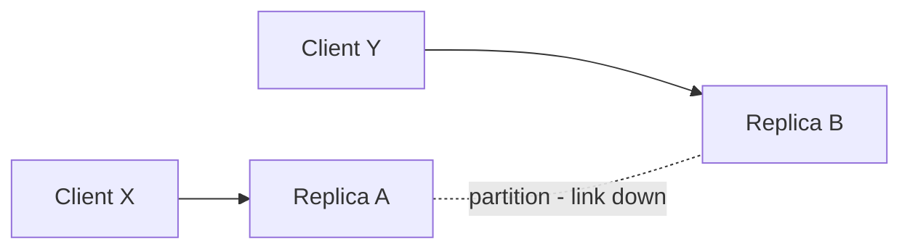

# CAP Theorem

CAP is the most quoted and most misquoted result in distributed systems. What it actually says is narrow: **when a network partition happens, a replicated system must sacrifice either linearizable consistency or availability** — it cannot keep both. It does not say "pick two of three", it does not classify whole databases, and it says nothing about how systems behave when the network is healthy (that's [[PACELC]]'s job). Learn the precise statement once and you'll immediately spot when someone is using CAP to hand-wave.

## Why this matters

Any system that replicates data ([[Replication]]) across machines will eventually experience a **network partition**: the machines are up, but messages between some of them are lost ([[Network Partitions and Timeouts]]). At that moment a replica receiving a request faces a forced choice:

- **Answer anyway** using the data it has — staying *available* but risking a stale or conflicting answer (not linearizable).
- **Refuse or block** until it can coordinate with the other side — staying *consistent* but becoming unavailable for those requests.

There is no third option; that is the theorem. Conjectured by Eric Brewer in his 2000 PODC keynote and proven by Seth Gilbert and Nancy Lynch in 2002. Every design conversation about multi-region databases, failover behaviour, and quorums is secretly a conversation about which side of this choice you take — so you need the precise terms.

## How it works

The three letters, precisely:

- **C — Consistency** means **linearizability**: the system behaves as if there were a single copy of the data, and every operation appears to take effect atomically at some instant between its start and end. After a write completes, every subsequent read (from any node) sees that write. This is the *strongest* consistency model on the spectrum in [[Consistency Models]] — much stronger than what "consistent" means casually (and unrelated to the C in [[ACID Transactions]]).
- **A — Availability** means every request arriving at a **non-failed node** receives a non-error response, without a guarantee that it reflects the latest write. Note how strict this is: *every* node, *every* request, no timeouts-as-errors.
- **P — Partition tolerance** means the system keeps operating (in whatever degraded mode it chose) when the network drops or delays arbitrary messages between nodes.

**Why "pick 2 of 3" is wrong:** P is not a menu option. Networks partition whether you like it or not — choosing "CA" would mean choosing to never have a partition, which is not within your power on a real network (fallacy 1 of [[The Fallacies of Distributed Computing]]). The real content of the theorem is a conditional: **IF a partition occurs, THEN choose C or A.** A single-node MySQL is not "CA" in any useful sense; it is simply not a replicated distributed system, so CAP doesn't describe it.

A two-replica picture of the forced choice:

Client X writes `balance=100` to Replica A. The A–B link is down. Client Y now reads from Replica B. Replica B can answer with its stale value (available, not linearizable) or refuse/wait (linearizable, not available). Both behaviours exist in real products; neither is "wrong" — they are different promises.

### The forced choice, as a timeline

The theorem is easiest to believe once you have watched the single decision point go by. Same two replicas, with real times attached:

| Time | What happens | A's view | B's view |
|---|---|---|---|
| 10:00:00 | Both replicas hold `balance = 1000` | 1000 | 1000 |
| 10:00:05 | The A–B link goes down; neither node notices yet | 1000 | 1000 |
| 10:00:07 | Client X writes `balance = 100` to A; A cannot reach B | **100** | 1000 |
| 10:00:08 | A must answer X: ack the write, or refuse it? | — | — |
| 10:00:09 | Client Y reads from B: answer `1000`, or refuse? | 100 | 1000 |

At 10:00:08 and 10:00:09 there are exactly two defensible behaviours, and no node can tell which fault it is facing — B cannot distinguish "A is down" from "the link is down and A is happily serving X".

- **Choose availability:** A acknowledges the write and B answers `1000`. X believes the balance is 100; Y is told 1000. Both clients got a fast, non-error response, and the system has two truths. Reconciling them later is now the application's problem — and if the two sides accepted *conflicting* writes, some of them must be discarded or merged, because arithmetic on divergent balances does not commute.
- **Choose consistency:** the side without a majority refuses. With only two replicas neither side has a majority, so *both* refuse and the system is wholly unavailable — which is why production CP deployments use three or five nodes across three failure domains, so a partition leaves one side able to proceed ([[Quorum Reads and Writes]]).

Notice what the theorem does *not* let you do: wait. "Block until the link comes back" is the consistency choice with a nicer name — a request that never returns is not an available response, and from the client's side it is indistinguishable from an error plus a timeout ([[Network Partitions and Timeouts]]).

### Why the proof works

Gilbert and Lynch's argument is short enough to carry in your head, and holding it stops you from hoping for a clever escape. Suppose a system claims all three properties. Split the nodes into two groups, G1 and G2, with every message between them lost. A client writes a new value to a node in G1. By availability, that node must respond without error — and it cannot have consulted G2, because no message crosses. Another client now reads from a node in G2. By availability, *that* node must also respond without error, and it has no way to know the write happened. So it returns the old value. But linearizability requires that a read starting after a completed write returns that write. Contradiction — so no system has all three.

The structure of the argument is what matters: the impossibility comes from **information, not implementation**. It is not that engineers have failed to build the clever system; it is that the node in G2 does not possess the fact it would need, and no code can conjure it. This is the same shape as the Two Generals argument in [[Exactly-Once Delivery Is a Lie]] — both are theorems about what a node can *know* when messages are lost.

Two corollaries fall straight out. First, **the proof needs no exotic fault — only the messages around one write and one read lost**, so "we have redundant links" changes probability, not possibility. Second, the proof says nothing about how *long* the partition lasts, which is why the only real levers are the detection timeout and what you do in partition mode — not avoidance.

### The three phases of a partition

Brewer's 2012 retrospective reframes CAP as something operational rather than a label: a partition is an *event with a lifecycle*, and the engineering lives in managing it.

1. **Detect.** Something — missed heartbeats, a failed quorum check, a lease that could not be renewed — tells a node it may be isolated. Detection is a guess bounded by your timeouts, and the timeout length is itself a CAP decision: short timeouts declare partitions that were only latency spikes; long timeouts leave you serving under an undetected partition.
2. **Enter partition mode.** The system restricts what it will do. CP systems stop accepting writes on the minority side. AP systems keep accepting them but *record enough information to reconcile later* — version vectors, operation logs, conflict metadata ([[Logical Clocks and Ordering]]). The AP choice is only survivable if this step was designed in; a system that accepts conflicting writes while keeping no record of the conflict has not chosen AP, it has chosen data loss.
3. **Recover.** The link heals and the divergence must be resolved: replay, merge, last-write-wins, or ask a human. Compensating external effects — the emails sent, the payments initiated on both sides — belongs here too, and is usually the hardest part because the outside world does not roll back.

The useful design question is therefore rarely "are we CP or AP?" but **"what exactly do we do in each of those three phases?"** A team that can answer phase 3 has made a real choice; a team that cannot has chosen AP by accident.

### CP-leaning vs AP-leaning systems in practice

| Choice during partition | Behaviour | Examples |
|---|---|---|
| **CP** — refuse rather than lie | Minority side rejects or blocks; only a quorum side serves writes | ZooKeeper, etcd ([[Consensus and Raft]]), HBase, MongoDB's replica set majority behaviour ([[MongoDB Architecture]]) |
| **AP** — answer rather than refuse | All reachable nodes keep serving; conflicts resolved later | Cassandra at low consistency levels ([[Cassandra and Wide-Column Stores]]), Riak, the original Dynamo design ([[The Dynamo Paper]]), DNS ([[How DNS Works]]) |

The quorum mechanics behind CP behaviour are in [[Quorum Reads and Writes]]; what happens when a CP system elects two leaders anyway is in [[Split Brain and Fencing]].

## Common misconceptions

Martin Kleppmann's 2015 post "Please stop calling databases CP or AP" is the canonical corrective. Its key caveats:

- **CAP's definitions are narrower than people assume.** C is specifically linearizability; A is specifically "every request to every non-failed node gets a response". Many systems billed as "CP" are not linearizable under all faults, and many billed as "AP" are not CAP-available (e.g. if a partitioned minority node returns errors, the system already fails CAP's A).
- **Most real systems are neither CP nor AP** by the strict definitions. A leader-based database during failover ([[Failover]]) is briefly neither consistent nor available. The labels describe *design leanings*, not proven properties.
- **CAP considers only one fault: a network partition.** It says nothing about crashed nodes, disk corruption, slow nodes (often worse than dead ones), or human error — see [[Failure Modes in Distributed Systems]].
- **CAP says nothing about latency**, yet latency drives most real-world consistency compromises. That's precisely the gap [[PACELC]] fills.
- **"Eventual consistency" is not the A in CAP.** It's a (weak) consistency model — see [[Consistency Models]]. A system can be CAP-unavailable *and* eventually consistent.
- **Databases aren't one point on the spectrum.** The same system moves with configuration: Cassandra at `QUORUM` behaves very differently from Cassandra at `ONE`; MongoDB with `readConcern: linearizable` differs from default reads. Classify *operations under a configuration*, not logos.

Brewer's own 2012 retrospective ("CAP Twelve Years Later") makes the same point from the other direction: the "2 of 3" framing is misleading, partitions are rare but must be managed explicitly, and the interesting engineering is in partition *recovery*.

Three more worth holding onto:

- **"A partition means the network is cut in half."** Partitions are rarely clean. The common shapes are asymmetric (A can reach B, B cannot reach A), partial (one of five links degrades), and — most deceptive — *grey*: nothing is severed, but latency rises enough that every timeout fires. A system that handles clean splits and not grey ones handles the rare case and not the common one.
- **"Availability means uptime."** CAP's A is a per-request property, not a percentage. A system with 99.99% uptime that returns errors to the minority side during partitions is CAP-unavailable, and a system that always answers — possibly with stale data — is CAP-available even while being useless. CAP's A and your SLO's availability ([[SLA SLO SLI and Error Budgets]]) are different quantities that share a word.
- **"We can avoid the choice by making partitions impossible."** Redundant links, multiple NICs, and multi-AZ meshes make partitions rarer, which is worth doing and changes nothing about the theorem. Rarer events get less practice and therefore more surprising failures; the choice still has to be designed, just exercised less.

### What this looks like at 3am

A real partition rarely announces itself as a partition. It arrives as a **cluster of symptoms that do not agree with each other**: one service's error rate spikes while a neighbour's is clean, a dashboard shows a primary that another dashboard shows as stepped down, writes fail from one pod and succeed from another. The underlying event is usually smaller than "the network split" — one AZ's link degrading, or a security-group change, or a single overloaded NAT path.

The diagnostic move is to stop asking "is the service up?" and start asking **"up according to whom?"** Check reachability from several vantage points rather than one, and check the datastore's own view of its membership — in a CP store, who holds a majority right now, and which members believe they are isolated? The incident resolves one of two ways. If the store chose consistency, the symptom is errors, the data is intact, and the fix is networking; you lose availability but owe nobody an apology about correctness. If the store chose availability, the symptom is that *everything looked fine* and the real work starts after the heal, when you discover which writes conflicted. The second incident is shorter at 3am and far longer over the following week — which is the honest reason regulated systems lean CP.

## In your stack

- MongoDB replica sets lean CP: during a partition, the side without a majority steps down its primary and stops accepting writes — your services on that side see errors, not stale writes. With many services at 1 replica, the *service* tier is down anyway if its pod is on the wrong side; the database choosing C costs you little extra.
- Redis used as a cache is effectively AP-by-usage: a stale cache entry is tolerable because MongoDB is the source of truth. Redis used for [[Distributed Locking]] is a different story — a lock service must be CP, and Redis Sentinel/Cluster failover can violate that (see [[Redis Cluster and Sentinel]] and [[Split Brain and Fencing]]).
- For money movement, the default posture is CP: a ledger that refuses writes during a partition creates a support ticket; a ledger that accepts conflicting writes creates a reconciliation nightmare and a regulator conversation. Correctness beats availability at Niyo, and CAP is the vocabulary for saying so in a design doc.
- SQS and Kafka don't escape CAP — they make the broker someone else's CP/AP problem and give you at-least-once delivery as the interface; see [[Delivery Semantics]].
- Your timeout settings are CAP decisions you have already made without calling them that. Every client timeout, every readiness probe period, every Mongo `serverSelectionTimeoutMS` is a rule for *how long we tolerate silence before declaring a partition* — and declaring one early is choosing availability-affecting behaviour over waiting. Reviewing those numbers as a set, rather than one service at a time, is more valuable than any amount of CAP vocabulary.
- A sharp consequence of 1-replica services: a partition that isolates one node takes *that service* out entirely, regardless of how your databases behave. The database's CP/AP posture only matters for data correctness; your service-tier availability during a partition is decided by replica count and placement, which is a separate and currently deliberate cost trade ([[Bulkheads and Isolation]]).
- Where the CP choice is most likely to bite you in practice is not the database but the **gateway and IAM path**: if Kong must reach the central IAM service to validate a token — introspection, a revocation check, or a signing-key fetch it cannot serve from cache — and cannot, every downstream request fails even though the downstream services are healthy. That is a CAP decision about *authentication* — fail closed — and it is the right one for money movement, but it means IAM's availability is a ceiling on everything ([[Designing an IAM Service]]).

## Interview angle

Interviewers use CAP as a filter: weak candidates recite "pick 2 of 3"; strong candidates state the conditional correctly and then immediately reach for [[PACELC]] because it explains more.

The 60-second version: "CAP, proven by Gilbert and Lynch in 2002, says that during a network partition a replicated system must choose between linearizability and availability. Partition tolerance isn't optional — networks fail — so the theorem is really a forced choice *during* partitions. C and A have strict technical meanings, so whole databases can't honestly be labelled CP or AP; behaviour depends on configuration and operation. And CAP says nothing about normal operation, where the real trade-off is latency vs consistency — which is why PACELC is the more useful framing."

A trap worth naming: when an interviewer says "we need high availability *and* strong consistency", the weak answer argues with them and the strong answer scopes them. Both are achievable — just not simultaneously for the same operation during the same partition. Split by operation (display reads available, decision reads consistent), split by data (session state available, ledger consistent), and state the partition behaviour for each. That reframing is the signal they are looking for.

Classic follow-ups: "Is a single-node Postgres CA?" (CAP doesn't apply — no replication, and it's unavailable when it crashes). "Where does eventual consistency fit?" (a consistency model, orthogonal to CAP's A). "Give me a system that's CP and one that's AP and what their users experience during a partition."

## Check yourself

> [!question]- Q: Explain the CAP theorem precisely, including what C and A technically mean.
> During a network partition, a replicated system cannot provide both linearizability and availability; it must sacrifice one. C = linearizability: the system behaves like a single copy of the data, and every operation appears atomic at some point between its invocation and response. A = every request to any non-failed node receives a non-error response. P = the system tolerates arbitrary message loss between nodes. Because partitions cannot be prevented, the theorem is a conditional forced choice, not a "pick 2 of 3" menu.

> [!question]- Q: Scenario — a 5-node CP datastore is split 3 / 2 by a partition. What does each side do, and what do clients experience?
> The 3-node side holds a majority (quorum), so it continues to elect/retain a leader and serve linearizable reads and writes. The 2-node minority cannot form a quorum: it stops accepting writes (and strict reads), so clients routed there get errors or timeouts — unavailability, by design. When the partition heals, the minority catches up from the majority's log. This is exactly how [[Consensus and Raft]]-based systems like etcd behave, and it's what prevents [[Split Brain and Fencing]] scenarios.

> [!question]- Q: Why does Kleppmann argue you should stop calling databases "CP" or "AP"?
> Because CAP's C and A are precise, narrow properties that few systems actually satisfy under all faults — many "CP" systems aren't strictly linearizable, and many "AP" systems aren't CAP-available (any node returning errors breaks strict A). Behaviour also varies per operation and configuration within one database. The labels compress a multi-dimensional, configurable behaviour into a binary that misleads more than it informs.

> [!question]- Q: Scenario — an AP store served both sides of a two-hour partition. The link heals. Walk through what you now have to do, and why this work has no equivalent in the CP case.
> You have two divergent histories for every key written on both sides. Work through it in layers. (1) *Detect the overlap*: which keys were written on both sides during the window? Version metadata — vector clocks or version vectors — answers this; without it you cannot even enumerate the conflicts, only guess ([[Logical Clocks and Ordering]]). (2) *Resolve each conflict* by a rule you chose in advance: last-write-wins silently discards one side and is only acceptable where losing an update is harmless; application merges are correct but must be written per data type; surfacing siblings to the user is honest but needs product support. (3) *Compensate the external effects*: both sides may have sent emails, called partner APIs, or published events. Those cannot be merged, only reversed or apologised for — this is usually the longest tail. (4) *Reconcile the ledger* against the system of record and file what you found. In the CP case none of this exists: the minority side refused service, so there is one history and the recovery is "the minority catches up from the majority's log". You traded two hours of partial unavailability for zero reconciliation work — which is why the CAP choice should be made by whoever owns the consequences, not by whoever picks the database.

> [!question]- Q: Mini design prompt — you're designing the account-balance read path for a fintech app. During a partition, do you serve a possibly-stale balance or an error? Defend the choice.
> Reads that merely *display* a balance can tolerate brief staleness (with a "as of" timestamp) — favouring availability improves UX harmlessly. But any read that *gates a decision* — "does the user have enough balance to authorize this debit?" — must be linearizable or fail closed, because acting on a stale balance can overdraw an account. So: split the paths. Display reads may be served from a replica or cache; authorization reads go through the CP path and return an error during partition rather than guess. The split-by-operation answer is exactly the "classify operations, not databases" insight.

## Sources

- Seth Gilbert, Nancy Lynch, "Brewer's Conjecture and the Feasibility of Consistent, Available, Partition-Tolerant Web Services", ACM SIGACT News, 2002 — the proof.
- Eric Brewer, PODC keynote "Towards Robust Distributed Systems", 2000 — the conjecture; and "CAP Twelve Years Later: How the 'Rules' Have Changed", IEEE Computer, 2012.
- Martin Kleppmann, "Please stop calling databases CP or AP", martin.kleppmann.com, May 2015.
- Martin Kleppmann, *DDIA*, Chapter 9 "Consistency and Consensus" — linearizability and "The Unhelpful CAP Theorem" section.
- Daniel Abadi, "Consistency Tradeoffs in Modern Distributed Database System Design", IEEE Computer, 2012 — the bridge to [[PACELC]].
