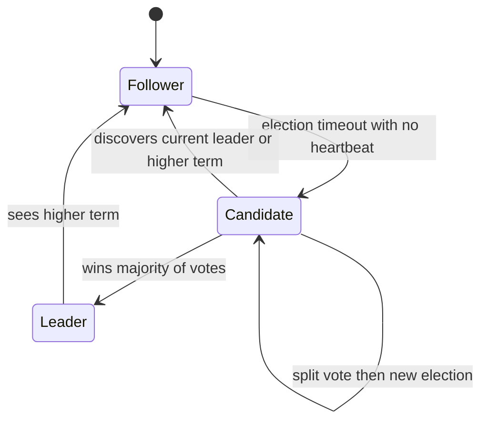

# Consensus and Raft

**Consensus** is the problem of getting a group of machines to agree on a value — or, in the form systems actually use, on the *contents and order of a shared log* — even while some machines crash and messages get lost. It is the bedrock under leader election, distributed locks, and configuration stores: every "there must be exactly one X" guarantee in a distributed system bottoms out in consensus. **Raft** (Ongaro & Ousterhout, 2014) is the algorithm that made consensus understandable enough to be implemented correctly and widely — it powers etcd, Consul, CockroachDB, Kafka's KRaft mode, MongoDB's election protocol (Raft-inspired), and more.

## The problem that created it

Your growing system acquires singletons: one primary database accepting writes, one holder of a lock, one owner of partition 7. On one machine, "exactly one" is trivial. Replicate for fault tolerance and it becomes treacherous: when the leader stops responding, is it dead, or just slow or partitioned? Nodes that guess differently elect two leaders — [[Split Brain and Fencing]] — and two primaries accepting writes will diverge and corrupt data, the classic [[Failover]] disaster.

Naive fixes fail in sequence. "Node with lowest ID is leader" — fails when that node partitions away. "Ask all nodes to vote" — what if voters crash mid-vote? "Use timeouts" — a timeout can't distinguish dead from slow ([[Network Partitions and Timeouts]], fallacy 1 of [[The Fallacies of Distributed Computing]]). Worse, theory says there is no perfect fix: the **FLP impossibility result** (Fischer, Lynch, Paterson, 1985) proves that in an asynchronous system — one with no bound on message delays — no deterministic algorithm can guarantee consensus terminates if even a single process may crash. In plain language: with unbounded delays you can never be *sure* a silent node is dead, and any algorithm can be stalled forever by adversarial timing. Real systems live with FLP rather than refute it: they use timeouts and randomness to make non-termination vanishingly unlikely, guaranteeing **safety always** (never two decisions) and **liveness in practice** (progress whenever the network behaves for a while).

Paxos (Lamport, 1989/1998) solved consensus correctly but was famously hard to understand and harder to implement completely. Raft was designed in 2013–14 with understandability as an explicit goal — same guarantees, same quorum math, but decomposed into legible parts.

## What it solves

- **Single agreed leader** per term, with proof of authority — the foundation for safe [[Failover]].
- **A replicated log**: every node applies the same commands in the same order (a replicated state machine), giving linearizable state ([[Consistency Models]]).
- **Tolerance of minority failure**: a cluster of 2f+1 nodes survives f crashes (3 nodes tolerate 1; 5 tolerate 2).
- **No split brain**: majority quorums ([[Quorum Reads and Writes]]) ensure two leaders cannot both commit, since two majorities always overlap.
- As **consensus-as-a-service** (ZooKeeper, etcd): locks, leases, leader election, service registry, and config for the rest of your stack ([[Health Checks and Service Discovery]], [[Distributed Locking]]) — so applications outsource consensus instead of implementing it.

## How it works

Raft nodes are always in one of three states:

**Terms.** Time is divided into numbered **terms**; each begins with an election. Terms are Raft's logical clock ([[Logical Clocks and Ordering]]): every message carries the sender's term, any node seeing a higher term immediately updates and steps down to follower, and stale-term messages are rejected. A term has at most one leader — the term number doubles as a fencing token ([[Split Brain and Fencing]]).

**Leader election.** Followers expect periodic heartbeats from the leader. If none arrives within a randomized **election timeout** (e.g. 150–300 ms), the follower increments the term, becomes a candidate, votes for itself, and requests votes. Each node votes for at most one candidate per term (persisted to disk), and only for candidates whose log is **at least as up-to-date** as its own — this restriction is what stops a stale node from being elected and losing committed data. Majority of votes → leader. Split vote → nobody wins → randomized timeouts make a quick retry collision unlikely. The randomness is exactly Raft's answer to FLP.

**Log replication.** Clients send commands to the leader. The leader appends the entry to its log and sends `AppendEntries` to followers, which also serve as heartbeats. Each entry is identified by (term, index). Consistency check: every `AppendEntries` carries the previous entry's term+index; a follower that doesn't match rejects, and the leader walks backwards until logs agree, then overwrites the follower's divergent suffix. Leaders never overwrite their own log — data flows strictly leader → follower.

**Commit rules.** An entry is **committed** once the leader has replicated it on a majority — then it's applied to the state machine and acknowledged to the client. One subtlety worth knowing: a new leader only commits entries *from its own term* by counting replicas; entries left over from prior terms become committed indirectly, when a current-term entry committed after them covers them. (This closes a genuinely subtle bug — figure 8 in the paper — where counting replicas of an old-term entry could let a committed entry be overwritten.)

**Log repair, worked.** The consistency check sounds abstract until you watch it run. A follower rejoins after missing entries and its log has diverged — it holds entries from a term that never committed:

| Index | 1 | 2 | 3 | 4 | 5 |
|---|---|---|---|---|---|
| Leader, term 4 | t1 | t1 | t2 | t3 | t4 |
| Follower | t1 | t1 | t2 | **t2** | — |

The leader sends `AppendEntries` for index 5, carrying "previous entry is index 4, term 3". The follower checks index 4, finds term 2 instead of 3, and **rejects**. The leader decrements its guess and tries index 4 with "previous is index 3, term 2". The follower checks index 3, finds term 2 — match. It accepts, **overwriting** its index-4 entry with the leader's, and the leader streams the rest forward. The follower's divergent entry is simply gone.

Three properties hide in that walkthrough. Entries are identified by **(term, index) together**, so a matching index with a mismatched term is correctly detected as divergence rather than agreement. The flow is strictly **one-directional** — the leader never takes entries from a follower, which is what makes "whose log is right?" a question with a fixed answer. And discarding the follower's entry is safe precisely because of the election restriction: a candidate whose log is behind cannot win, so anything the leader is about to overwrite was never committed.

**Reads are harder than they look.** A leader can serve a write by replicating it; serving a *read* correctly is subtler, because the leader may have been deposed seconds ago and not yet know. Three approaches, in increasing cheapness and decreasing rigour: confirm leadership with a quorum round trip before answering (`ReadIndex`); hold a time-based **leader lease** and answer locally while it is valid, which trades a clock assumption for the round trip; or read from any follower and accept staleness. Many "linearizable" claims in the wild are quietly the third option — if a system lets you read from followers for scale, ask what that does to its consistency guarantee ([[Consistency Models]]).

**Membership changes.** Adding/removing nodes can't be done atomically everywhere, so naive switching can create two disjoint majorities (old config and new config each electing a leader). Raft handles it either by **joint consensus** (an interim config requiring majorities of *both* old and new sets) or, in most practical implementations, by **single-server changes** — add or remove one node at a time, which guarantees old and new majorities overlap.

**What consensus does not give you.** Three limits worth stating plainly, because each is routinely assumed away. It assumes **crash faults, not Byzantine ones**: a node may die or be slow, but not lie, send contradictory messages to different peers, or be malicious. Byzantine fault tolerance is a different and far more expensive problem, relevant to blockchains and mutually distrusting parties, not to machines you operate. It gives **agreement, not correctness**: the cluster will faithfully replicate a bad command to every node, in order. And it does not make writes *always* available: a cluster that loses its majority stops accepting writes even though the surviving nodes are up, healthy, and perfectly capable of answering. Adding nodes raises how many failures you survive but never removes the majority requirement, so firm CP behaviour is permanent, not a tuning oversight ([[CAP Theorem]]). What consensus buys is that replicated state survives failures *without diverging* — availability during partitions is exactly what it spends to get there.

**Consensus-as-a-service.** You will almost never implement Raft; you'll use it through etcd (Raft; backs all Kubernetes control-plane state), Consul (Raft), or ZooKeeper (ZAB — a distinct but Paxos-family protocol with the same role). These expose primitives — compare-and-swap, watches, leases, ephemeral nodes — from which leader election and locks are built.

## Trade-offs

| You gain | You pay |
|---|---|
| Linearizable, fault-tolerant state | Every write is a quorum round trip — latency floor of one RTT to the median node ([[PACELC]]: firmly PC/EC) |
| Survives minority failure | Majority required: a 3-node cluster partitioned 1/1/1 or losing 2 nodes is fully unavailable for writes |
| No split brain | Throughput bottlenecked through one leader; scaling writes means sharding into multiple Raft groups (how CockroachDB/TiDB work) |
| Simple mental model (vs Paxos) | Operational care: odd node counts, disk fsync on votes/entries, cross-AZ placement, careful timeout tuning |

## Failure modes

- **Leader loss:** no heartbeats → election after the timeout → brief write unavailability (sub-second when tuned). Clients need retries with [[Idempotency]], since a command may have committed just before the leader died but never been acknowledged.
- **Partitioned minority:** keeps electing candidates futilely (terms climb); on heal, the higher term forces a harmless re-election. The majority side never stopped. A deposed leader on the minority side serves at most stale reads — which is why linearizable reads require a leader lease or a quorum check (`ReadIndex`), not blind trust in leadership.
- **Split votes / flapping:** too-short or insufficiently random election timeouts, or a flaky network, cause repeated elections and no progress — FLP showing its face. Symptom: terms incrementing rapidly; fix: longer, well-jittered timeouts relative to RTT. The "pre-vote" extension stops a rejoining partitioned node from disrupting a stable leader with its inflated term.
- **Slow disk:** Raft must fsync votes and log entries before answering; a degraded disk on the leader slows every commit, and on a follower it slows commits once that follower is needed to make the majority (the quorum waits for the median node). Detected via commit-latency metrics.
- **Even node counts / wrong placement:** 4 nodes tolerate 1 failure, same as 3, with less availability headroom; 3 nodes across 2 AZs puts a majority in one AZ — lose it, lose the cluster. Spread 3 or 5 across 3 AZs.
- **Unbounded log growth:** the replicated log must be compacted into snapshots, and snapshotting competes with serving for disk and memory. A cluster whose log outgrows its storage stops accepting writes — and an out-of-space consensus store takes down everything that depends on it, which in a Kubernetes cluster is everything.
- **A node restored from a backup:** reviving a member from a stale snapshot reintroduces old state and, worse, old vote records. Members are meant to be *replaced*, not restored; the correct recovery is to remove the dead member from the configuration and add a fresh one that catches up from the leader.

**Cluster sizing, as a table.** The arithmetic is simple enough that getting it wrong is embarrassing, and common enough to be worth memorising:

| Nodes | Majority | Failures tolerated | Verdict |
|---|---|---|---|
| 1 | 1 | 0 | Not fault tolerant; a single point of failure with extra steps |
| 2 | 2 | 0 | **Worse than one node** — either failure stops writes, and you pay two machines |
| 3 | 2 | 1 | The default. Spread across three failure domains |
| 4 | 3 | 1 | Same tolerance as 3, more cost, more latency |
| 5 | 3 | 2 | For control planes that must survive a node loss *during* maintenance |
| 7 | 4 | 3 | Rare; every write now waits for the 4th-fastest node |

The row people are most surprised by is 2, and it generalises: **adding an even-numbered node never increases fault tolerance**, it only adds a machine whose failure is another thing that can happen. The row worth choosing deliberately is 5 — it is the answer to "we cannot lose quorum while one node is being patched", which is a real operational requirement rather than a theoretical one.

### What this looks like at 3am

Consensus incidents are rarely subtle, and they are rarely about the consensus store itself. The page is **"deployments are stuck"** or **"the cluster isn't scheduling anything"**, and running pods are all perfectly healthy — which is the signature. Raft guards the control plane, so losing quorum freezes *change* while leaving *steady state* running. For a few minutes that distinction can make the incident look smaller than it is.

The sequence that gets you to a cause fastest: check how many members are reachable and whether a leader exists at all; check whether the term number is climbing, which means elections are failing repeatedly rather than one having completed; and check disk — latency and free space — on each member, because a degraded disk on the leader slows every commit and a full one stops them. Those three questions separate the three common causes: lost members (quorum arithmetic), flapping elections (timeouts too aggressive for current network conditions, or a node repeatedly rejoining with a stale higher term), and a slow or full disk (fsync on the critical path).

The part worth internalising before you are in it: **the blast radius is wider than the component.** Nothing reschedules, so any pod that happens to crash stays down — and with services pinned at 1 replica, "cannot reschedule" means that service is simply gone until quorum returns. An etcd incident is therefore an availability incident for every singleton workload, not an infrastructure footnote, and that is an argument for replica counts that gets made with real numbers rather than principle.

## When NOT to use it

- **Data-plane throughput.** Don't funnel business data through a consensus store; etcd/ZooKeeper hold megabytes of control state, not your orders table. Consensus guards *coordination*, databases hold *data*.
- **When a managed primitive suffices.** A single Postgres/Mongo row with compare-and-swap, or DynamoDB conditional writes, gives small-scale leader election without new infrastructure — the datastore's single primary (and, for Mongo, its Raft-inspired replica-set election) does the heavy lifting for you.
- **When eventual consistency is acceptable.** If conflicts are mergeable ([[The Dynamo Paper]]-style), leaderless [[Replication]] gives better availability and latency; consensus's costs buy you nothing you need.
- **Across WAN links without need:** cross-region Raft puts an intercontinental RTT in every write; keep groups regional unless you truly need Spanner-like semantics ([[Google Spanner Deep Dive]]).

## In your stack

- Your EKS clusters run on etcd: every Deployment, ConfigMap, and lease in Kubernetes is a Raft-committed log entry. etcd quorum loss = control-plane outage (running pods keep running, but nothing reschedules — relevant with 1-replica services, where a reschedule *is* your availability story).
- Kafka's coordination moved from ZooKeeper to **KRaft** (Raft-based metadata quorum), production-ready from Kafka 3.3 and the only option from Kafka 4.0, which removed ZooKeeper mode entirely; MSK handles this for you, but controller quorum health is still what "Kafka is up" means ([[Kafka Architecture]], [[Kafka Operations]]).
- MongoDB replica-set elections are Raft-inspired (terms, majority votes, log recency rules) — the primary step-down behaviour you see during maintenance windows is this note in action ([[MongoDB Architecture]]).
- Redis Sentinel runs its own quorum-based election to promote replicas — but Redis replication itself is async, so failover can lose acknowledged writes; don't mistake Sentinel's election quorum for Raft-grade durability ([[Redis Cluster and Sentinel]], [[Distributed Locking]]).
- Timeout tuning is the one Raft knob you might ever touch, and the rule is relational, not absolute: the election timeout must comfortably exceed the heartbeat interval, which must comfortably exceed the round-trip time between members. etcd's documented defaults (etcd 3.7 tuning guide, as of 2026) are a 100 ms heartbeat and a 1 s election timeout, which suit a low-latency local network; members spread across higher-latency links need both raised together, or you get elections triggered by ordinary latency spikes. Changing one without the other is how clusters start flapping.
- Fintech angle: "exactly one scheduler instance processes payouts" claims are consensus claims. Back them with an etcd/ZooKeeper lease or a DB conditional claim **plus fencing tokens** ([[Split Brain and Fencing]]) — a Kubernetes `replicas: 1` setting is a cost decision, not a mutual-exclusion guarantee during reschedules.

## Interview angle

Interviewers probe three levels: (1) *why* consensus is needed (split brain, exactly-one guarantees); (2) Raft mechanics — election, terms, majority commit; (3) judgment — when to reach for etcd vs a DB conditional write, and what FLP implies.

The 60-second version: "Consensus gets a cluster to agree on a log despite crashes — it's what makes 'exactly one leader' safe. FLP proves no deterministic algorithm can guarantee termination in a fully asynchronous system, so practical algorithms guarantee safety always and use randomized timeouts for liveness. Raft: time is split into terms; followers that stop hearing heartbeats stand for election; a candidate needs a majority, and voters refuse candidates with stale logs; the leader replicates entries and commits once a majority holds them — overlapping majorities make two committed-but-conflicting leaders impossible. 2PC isn't consensus, by the way: it has a single point of failure — the coordinator — and blocks when it dies; consensus algorithms exist precisely to survive that. In practice you consume consensus via etcd or ZooKeeper rather than implementing it."

Classic follow-ups: "Why odd cluster sizes?" (2f+1; 4 nodes tolerate no more than 3 do). "What happens on a 2/3 partition?" (majority side elects/continues; minority stalls). "Why can't a follower with a shorter log win election?" (vote restriction preserves committed entries). "Raft vs Paxos?" (equivalent guarantees; Raft optimizes for understandability, strong leader, concrete log rules).

## Check yourself

> [!question]- Q: Explain why two leaders can never both commit entries in the same Raft cluster, even during a partition.
> Election requires a majority of votes; commit requires replication to a majority. Any two majorities of the same cluster intersect in at least one node. During a partition at most one side holds a majority, so at most one side can elect or commit. A deposed leader on the minority side can still *accept* client requests into its log, but can never commit them — and on heal, the higher term on the majority side forces it to step down and discard its uncommitted suffix.

> [!question]- Q: State FLP in one sentence and explain how Raft lives with it.
> FLP (1985): in an asynchronous system where even one process may crash, no deterministic consensus algorithm can guarantee it always terminates. Raft keeps safety unconditional (terms, single vote per term, majority overlap — never two decisions) and buys liveness probabilistically: randomized election timeouts make repeated split votes exponentially unlikely, so it terminates with probability 1 in practice, while adversarial timing could in theory stall elections forever.

> [!question]- Q: Scenario — a 5-node Raft cluster suffers a partition isolating the leader with one follower; the other three nodes are connected. Walk through the next 10 seconds and the heal.
> The three-node side stops receiving heartbeats, times out, and elects a new leader in a higher term (it has a majority: 3 of 5). It resumes serving writes. The old leader still accepts writes from clients that reach it but can only replicate to one follower — 2 of 5 is no majority, so nothing commits; honest clients see timeouts, and linearizable reads fail their quorum/lease check. On heal, the old leader receives a message bearing the higher term, steps down to follower, truncates its uncommitted entries, and syncs from the new leader. No committed write was lost, and clients whose writes timed out must retry idempotently.

> [!question]- Q: Scenario — a team proposes running a 3-node etcd cluster with all three members in one availability zone "because cross-AZ latency slows down writes". Evaluate the proposal, including whether their latency concern is real.
> Their latency concern is real and their conclusion is wrong, which is the interesting part. A quorum write waits for the second-fastest of three members, so co-locating removes a cross-AZ round trip from every commit — a genuine saving, in the low single-digit milliseconds for same-region AZs. What it buys in exchange is a cluster that **tolerates zero infrastructure failures**: losing that one AZ loses all three members and therefore the entire cluster, not a minority. The 3-node configuration advertises "survives one failure", but it survives one *node* failure, and the failure that actually happens at this scale is correlated — a zone, a rack, a shared network path. Counting nodes instead of failure domains is the single most common sizing error in this material ([[Availability Reliability Durability]]). The right answer is three members across three AZs and accepting the millisecond; if the write latency genuinely does not fit the budget, the fix is to stop putting that workload behind consensus rather than to make consensus fragile. A reasonable middle position exists when only two AZs are available: three members with two in one zone and one in the other still loses quorum if the two-member zone dies, so be explicit that you have chosen a configuration that survives one *specific* zone failing and not the other — and ask whether that asymmetry is acceptable before, not after.

> [!question]- Q: Mini design prompt — you need "exactly one instance runs the daily payout job" across your services. Design it with and without a consensus store.
> With: take an etcd/ZooKeeper lease (ephemeral, TTL'd); holder runs the job; on crash, the lease expires and another instance acquires it. Attach the lease epoch as a fencing token to every side effect so a paused-and-resumed old holder is rejected ([[Split Brain and Fencing]]). Without: a MongoDB document claimed by conditional update — `findOneAndUpdate({jobId, date, state: "unclaimed"}, {state: "claimed", owner, epoch: +1})` — leaning on Mongo's internal consensus; same fencing-epoch discipline, plus [[Idempotency]] on the payouts themselves so a re-run never double-pays. Either way the real guarantee comes from a single linearizable compare-and-swap plus fenced side effects, not from "we only deploy one replica".

## Sources

- Diego Ongaro, John Ousterhout, "In Search of an Understandable Consensus Algorithm", USENIX ATC 2014 — the Raft paper (extended version: Ongaro's 2014 Stanford dissertation, which refines membership change to single-server).
- Fischer, Lynch, Paterson, "Impossibility of Distributed Consensus with One Faulty Process", JACM, 1985 — FLP.
- Leslie Lamport, "The Part-Time Parliament" (1998) and "Paxos Made Simple" (2001) — Paxos.
- Martin Kleppmann, *DDIA*, Chapter 9 — "Fault-Tolerant Consensus", and why 2PC is not consensus.
- raft.github.io — interactive visualization and the list of production implementations.
- etcd documentation — Raft in production, leases, and the pre-vote extension.
