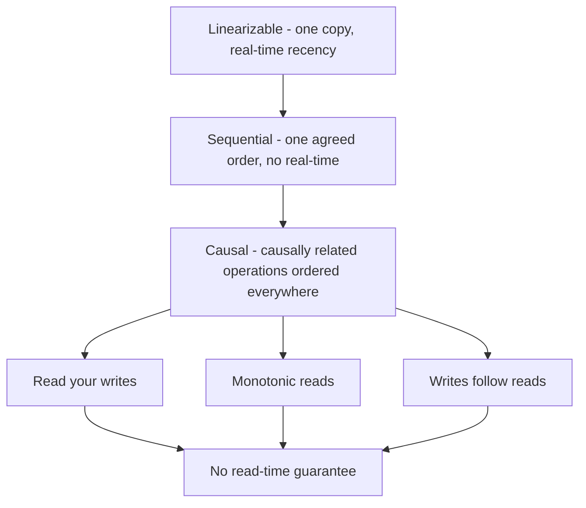

# Consistency Models

A **consistency model** is a contract between a replicated datastore and its clients: "if you follow my rules, here is what reads are allowed to return." It is not a binary of "strong vs eventual" but a spectrum, and "strong consistency" is a sloppy umbrella term that different vendors use for different points on it. This note defines the levels you'll actually meet — linearizability, sequential, causal, eventual — plus the session guarantees that patch the gaps, each with a two-client example small enough to hold in your head.

## Why this matters

The moment data has more than one copy ([[Replication]]), reads can disagree with writes. The consistency model tells you *which* disagreements are possible, which determines what application bugs you can have: a user not seeing their own comment, a reply appearing before the question it answers, a balance check passing on stale data. Choosing a weaker model is how systems buy latency and availability ([[PACELC]]) — which is fine *only* when you know precisely what anomalies you've signed up for. Engineers who can't name the model end up debugging it in production instead.

## How it works

Running example: two clients, Alice and Bob. Alice writes `x = 1` (initially `x = 0`), then the clients read.

The models form a **partial order by strength**: an arrow means "guarantees everything below it, and more". Reading downward is reading cheaper and weaker.

Three things the picture teaches that a list does not. The session guarantees sit *below* causal consistency and *beside* each other — causal consistency implies all of them, but each can be bought on its own, which is why they are so much cheaper than the model above them. The only path upward is through coordination: every arrow costs a round trip to somebody, which is the entire content of [[PACELC]]'s ELC half.

And note where eventual consistency is *not*: it has no box, because it is not a point on this safety ordering at all. Eventual consistency is the bottom of this diagram — no read-time guarantee — *plus* a separate promise about liveness, that replicas converge once writes stop. The two halves are independent, which is why a system can honour read-your-writes and still never converge, or converge reliably and still show you your own write missing.

### Linearizability (single-copy atomicity)

**The system behaves as if there is exactly one copy of `x`,** and each operation takes effect atomically at some instant between its start and its completion. Once *any* read returns `x = 1`, every later read (by anyone, on any node) must return `x = 1` — values never flicker backwards in real time.

*Two-client example:* Alice's write of `x=1` completes at 10:00:00. Bob reads at 10:00:01 and **must** see `1`. If Carol reads `1` while Alice's write is still in flight, then Bob, reading after Carol, must also see `1`.

This is the C in [[CAP Theorem]], the model consensus systems provide for their state ([[Consensus and Raft]]), and the most expensive model: it requires coordination on the critical path, so it costs latency and partition-availability. Note it is *not* the same as serializability in [[Transaction Isolation Levels]] — linearizability is about single-object recency, serializability about multi-object transactions; "strict serializability" is both at once (what [[Google Spanner Deep Dive]] offers).

### Sequential consistency

**All clients see all operations in the same order, and each client's own operations appear in the order it issued them** — but that agreed order need not match real time.

*Two-client example:* Alice writes `x=1` at 10:00:00 (completed). Bob reads `0` at 10:00:05. Legal under sequential consistency (the agreed global order simply places Bob's read before Alice's write); illegal under linearizability. What sequential consistency *forbids* is disagreement: if Bob once reads `1`, he can never again read `0`, and Bob and Carol can't see Alice's writes in different orders.

### Causal consistency

**If operation B could have been influenced by operation A (A "happens-before" B), everyone sees A before B.** Operations with no causal relationship — **concurrent** operations — may be seen in different orders by different clients. Happens-before is the key concept, defined properly in [[Logical Clocks and Ordering]].

*Two-client example:* Alice posts "Is the payment service down?"; Bob *reads it* and replies "No, it recovered." Causal consistency guarantees nobody sees Bob's reply without Alice's question (reply causally depends on question). But if Alice and Carol post two unrelated messages concurrently, Bob and Dave may see them in opposite orders — allowed.

Causal is the sweet spot in theory: it is the strongest model that can remain available during partitions, which linearizability cannot. Few general-purpose stores implement it fully (tracking causality is bookkeeping-heavy); MongoDB offers opt-in causally consistent sessions.

### Eventual consistency

**If writes stop, all replicas eventually converge to the same value.** That's the entire guarantee — "eventually" is unbounded, and *while* writes continue you may read anything stale, including values flickering back and forth across replicas.

*Two-client example:* Alice writes `x=1`. Bob reads `1` from replica A, then reads `0` from replica B two seconds later. All legal. Eventual consistency is a liveness promise ("convergence will happen"), not a safety promise ("reads are never surprising") — which is why it's best understood as the *absence* of a read-time guarantee. It's the native model of [[The Dynamo Paper]] descendants and of async-replica reads everywhere.

### Session guarantees — patching eventual consistency per client

Four classic guarantees (from the Bayou project, Terry et al., 1994) scoped to one client's **session** — much cheaper than global guarantees and usually what users actually notice:

| Guarantee | Promise | Anomaly it kills |
|---|---|---|
| **Read-your-writes** | After I write, my own reads see that write | "I posted a comment and it vanished" |
| **Monotonic reads** | Once I've seen a value, I never see an older one | Balance shows ₹500, refresh shows ₹400, refresh shows ₹500 |
| **Monotonic writes** | My writes apply in the order I issued them | Profile update #2 overwritten by delayed update #1 |
| **Writes-follow-reads** | My writes land after the data I had read | My reply ordered before the post I was replying to |

Implementation sketches and the replica-lag anomalies behind them live in [[Read Your Own Writes and Replica Lag Anomalies]] — typical tricks: route a user's reads to the leader briefly after their writes, or have clients carry a last-seen version/timestamp.

### Where popular systems sit (defaults, tunable per operation)

| System | Default model | Stronger options |
|---|---|---|
| ZooKeeper / etcd | Linearizable writes; etcd linearizable reads by default, ZooKeeper reads can be stale (`sync` to upgrade) | — |
| Spanner | External consistency (strict serializability) | — ([[Bigtable and Spanner]]) |
| MongoDB | Primary reads are recent; secondary reads eventual | `readConcern: linearizable`, causal sessions ([[MongoDB Architecture]]) |
| DynamoDB | Eventually consistent reads | Strongly consistent reads per request; transactions ([[DynamoDB Design]]) |
| Cassandra | Tunable per query | `QUORUM`/`ALL` approximate strong recency, not full linearizability without paxos-based LWT ([[Cassandra and Wide-Column Stores]], [[Quorum Reads and Writes]]) |
| Read replicas (MySQL/Postgres) | Eventual w.r.t. the leader | Read from leader |
| Redis replica reads | Eventual (async replication) | Read from master ([[Redis Cluster and Sentinel]]) |

### Which anomaly does each model still permit?

Models are easier to choose by what they *allow* than by their definitions. Each row is a concrete user-visible symptom; a tick means the model permits it.

| Anomaly, in user terms | Linearizable | Sequential | Causal | Eventual |
|---|---|---|---|---|
| "My colleague's change hasn't shown up yet" — a *different* client missing a completed write | No | **Yes** | Yes | Yes |
| "Two colleagues see the feed in different orders" — for *unrelated*, concurrent posts | No | No | **Yes** | Yes |
| "Alice's edit won on one replica and Bob's won on another" — concurrent writes resolved inconsistently | No | No | **Yes** | Yes |
| "I posted a comment and it vanished" — missing *your own* write | No | No | No | **Yes** |
| "The balance went 500, then 400, then 500" — your reads going backwards | No | No | No | **Yes** |
| "The reply appears above the question" — effect visible before its cause | No | No | No | **Yes** |

Read the first column downward and you see what linearizability is really selling: it is the only model where **no answer you can give a confused user is "that's allowed"**. Read the last column and you see why eventual consistency is both ubiquitous and dangerous — everything is permitted, so the model itself cannot tell you whether what you are seeing is a bug.

The split between the table's top and bottom halves is the one to remember. The top three anomalies involve *other people's* operations and are what you give up by stepping down from linearizability — mostly invisible to any single user. The bottom three involve **one user's own sequence of actions**, are what users actually report as bugs, and are excluded by causal consistency and by the much cheaper session guarantees below it. That is the whole argument for session guarantees: they remove the complaints without paying for global coordination.

The practical move is to run this table backwards. Rather than asking "what consistency do we need?", list the symptoms a user could report, decide which ones you are willing to have on the support queue, and read off the weakest model that excludes the rest. That conversation produces agreement; the abstract one rarely does.

### How to tell which model you actually have

Documentation describes the datastore; your *system* is the datastore plus every cache, replica, index and projection in front of it, and the weakest link sets the contract. Three practical checks:

- **Trace the full path a value travels.** From the write that acknowledged it to the pixel the user sees, list every hop that stores a copy. Each hop can only weaken what the previous one offered. One un-invalidated cache turns a majority-committed write into an eventually consistent read.
- **Ask what happens with two clients, not one.** Almost every model is indistinguishable with a single client. The anomalies live in sequences across clients — Carol reads new, Bob reads old — which is why every definition in this note is stated with two.
- **Test it, do not reason about it.** The **Jepsen** project exists because vendor claims and measured behaviour diverge routinely, especially under failure: its method is to generate concurrent operations, inject partitions and pauses, record a history, and check that history against a formal model. You will not run Jepsen on your own stack, but you can borrow the posture — any consistency claim that has never been observed under a partition is a claim about the happy path only.

## Common misconceptions

- **"Strong consistency" has one meaning.** Vendors use it for linearizability (etcd), for quorum-recency (DynamoDB "strongly consistent reads"), and loosely for "reads from primary". Always ask: *which anomalies are excluded?*
- **Eventual consistency means "slightly delayed but orderly".** No — it permits reordering, flicker, and unbounded staleness until convergence. Order needs causal or stronger.
- **Linearizability = serializability.** Different axes: recency of single objects vs isolation of multi-object transactions ([[Transaction Isolation Levels]]).
- **Quorums give linearizability automatically.** They don't — see the anomaly walkthrough in [[Quorum Reads and Writes]].
- **You must pick one model for the whole system.** The craft is per-operation: linearizable where a decision is gated, eventual where a display is rendered.

## In your stack

- MongoDB secondary reads are eventual consistency; if a service writes KYC status and immediately reads it back from a secondary, it can miss its own write — that's a missing read-your-writes guarantee, not a Mongo bug. Causally consistent sessions or primary reads fix it.
- Redis cache-aside gives *no* session guarantees across the cache/DB pair: write Mongo then read a not-yet-invalidated Redis key and you've lost read-your-writes at the architecture level. [[Cache Invalidation]] strategy decides your effective consistency model.
- Kafka/SQS consumers see events after a delay by design; any screen fed by a consumer-updated projection is eventually consistent, and product should know ([[CQRS]] makes this explicit).
- Fintech rule of thumb: ledger writes and balance-gated decisions → linearizable path (Mongo majority, primary reads); notification feeds, dashboards, analytics → eventual is fine and cheaper.
- JWT validation is a consistency model nobody labels. A token carries authorisation state as of issuance, so every request between a permission change and token expiry reads stale authorisation — eventual consistency with the staleness bound set by token lifetime. For a revoked or frozen account that bound is a security property, which is why revocation lists or short lifetimes exist ([[JWT Pitfalls]], [[Refresh Tokens and Token Rotation]]).
- The anomaly most likely to reach your support queue is monotonic-reads, not read-your-writes, and it comes from load balancing: two requests from the same app session land on different pods, which read different secondaries with different lag, so a screen refresh shows older data than the screen before it. Users report this as "the app is showing wrong data", never as a consistency model. Pinning a session's reads to one source, or carrying a last-seen version, fixes it far more cheaply than strengthening the datastore.
- Write the model into the API contract, not just the design doc. An endpoint that may return stale data should say so — a response field carrying "as of" information costs nothing and converts an invisible anomaly into something the client can render honestly and the next engineer can reason about.

## Interview angle

The probe is usually indirect: "user posts a comment and doesn't see it — what happened?" (replica lag; fix with read-your-writes) or "do you need strong consistency here?" (answer per operation, name the model, name the anomaly you're tolerating).

The 60-second version: "Consistency models form a spectrum of contracts. Linearizability: the system acts like one copy, reads never miss completed writes — costly, needs coordination. Sequential: everyone agrees on one order, but it may lag real time. Causal: causally related operations appear in order everywhere; concurrent ones may differ — the strongest model compatible with partition-availability. Eventual: replicas converge if writes stop, no read-time promise at all. In between, session guarantees — read-your-writes, monotonic reads — fix the anomalies individual users actually notice, cheaply. 'Strong consistency' is marketing until you pin which of these is meant."

Classic follow-ups: linearizability vs serializability; "how would you implement read-your-writes on top of read replicas?"; "which model does your cache give you?" (trick question — see above).

## Check yourself

> [!question]- Q: Explain the difference between linearizability and sequential consistency with the Alice/Bob example.
> Both require a single agreed order of operations consistent with each client's own program order. Linearizability additionally pins that order to real time: once Alice's write of `x=1` has completed, any read that *starts afterwards* must return 1. Sequential consistency drops the real-time requirement: Bob reading stale `0` five seconds after Alice's completed write is legal, as long as the global order everyone perceives is the same. Linearizability = sequential consistency + real-time recency.

> [!question]- Q: Scenario — users complain their new profile photo disappears for a few minutes after upload, then comes back. Diagnose and name the fix.
> Classic replica-lag anomaly: the write went to the leader, subsequent reads hit lagging replicas (or a stale cache). The missing contract is read-your-writes, possibly also monotonic reads (photo flickering old/new across refreshes). Fixes: pin the uploading user's reads to the leader for a window after their write, route reads by last-written timestamp, or have the client carry a version and reject older reads — see [[Read Your Own Writes and Replica Lag Anomalies]].

> [!question]- Q: Why is causal consistency called the strongest model you can have while staying available during partitions?
> Linearizability forces coordination: a replica cannot safely answer a read without knowing it has the latest completed write, which requires communication — impossible across a partition without refusing service ([[CAP Theorem]]). Causal consistency only requires each replica to apply operations after their known causes, which it can verify from metadata (vector clocks — [[Logical Clocks and Ordering]]) carried with the data. No cross-partition round trip is needed at read time, so both sides of a partition can keep serving. The result that real-time ordering is precisely what makes availability impossible was formalized by Mahajan, Alvisi and Dahlin in 2011, who showed that real-time causal consistency is the strongest model achievable by a system that is always available and converges.

> [!question]- Q: Scenario — a service writes to MongoDB with `w: majority`, then publishes an event; a consumer updates a Redis-backed read model that the mobile app queries. A tester writes a value and immediately reads it back through the app, and sees the old one. Which guarantee is missing, where exactly, and what are the fix options ranked by cost?
> The write path is strong and irrelevant: majority acknowledgement says the write survives failures, not that any *other* copy has it yet. The missing guarantee is read-your-writes, and it is missing at the architecture level rather than inside any component — the value the app reads travels Mongo → event → consumer → Redis, and the read can overtake the event at any of those hops. Each hop contributes its own delay: publish latency, queue latency, consumer processing, cache write. Nothing here is a bug; the system is behaving exactly as a [[CQRS]] read model behaves, and the tester has found the lag, not a defect. Fixes, cheapest first. (1) *Make the client not need it*: after a successful write, render the value the client already has rather than re-fetching — no backend change, and it is what most well-built apps do. (2) *Write-through on the authoring path*: the service updates the read model synchronously for the writer's own key in addition to publishing, so the author sees their write while everyone else waits for the event. (3) *Version-carrying reads*: the write returns a version, the client sends it with subsequent reads, and the read path either waits for the projection to reach that version or falls back to the primary. (4) *Abandon the projection for this screen* and read Mongo directly — correct, and it discards the scalability the projection existed to provide. The ordering is the lesson: the right fix for a consistency complaint is usually the cheapest guarantee that removes the symptom, not the strongest model that makes it impossible.

> [!question]- Q: Mini design prompt — a money-transfer screen shows balance, recent transactions, and a "Send" button. Assign a consistency model to each read and justify.
> Balance *display*: eventual/monotonic-reads is acceptable with an "as of" hint — stale display is annoying, not dangerous; monotonic reads prevent the backwards flicker users report as bugs. Recent transactions list: causal or read-your-writes per session — a user must see the transfer they just made. The balance check that *authorizes* "Send": linearizable (or a conditional write that enforces the invariant atomically at the datastore — effectively pushing consistency into the write path, see [[Idempotency]] for the retry side). Splitting models per operation is the entire game.

## Sources

- Martin Kleppmann, *DDIA*, Chapter 9 "Consistency and Consensus" — linearizability, causality, ordering; Chapter 5 for replication-lag anomalies.
- Maurice Herlihy, Jeannette Wing, "Linearizability: A Correctness Condition for Concurrent Objects", ACM TOPLAS, 1990 — the original definition.
- Leslie Lamport, "How to Make a Multiprocessor Computer That Correctly Executes Multiprocess Programs", IEEE ToC, 1979 — sequential consistency.
- Douglas Terry et al., "Session Guarantees for Weakly Consistent Replicated Data", PDIS 1994 — the four session guarantees (Bayou).
- Jepsen, "Consistency Models" map (jepsen.io/consistency) — the full lattice, including the models between the ones covered here; the Jepsen analyses themselves are the best available record of claimed versus measured behaviour.
- Lloyd et al., "Don't Settle for Eventual: Scalable Causal Consistency for Wide-Area Storage with COPS", SOSP 2011 — causal consistency built and measured.
- Mahajan, Alvisi, Dahlin, "Consistency, Availability, and Convergence", UT Austin TR-11-22, 2011 — the proof that real-time causal consistency is the strongest always-available convergent model.
- Bailis, Ghodsi, "Eventual Consistency Today: Limitations, Extensions, and Beyond", ACM Queue, 2013 — what "eventual" means in practice and how it is strengthened.
