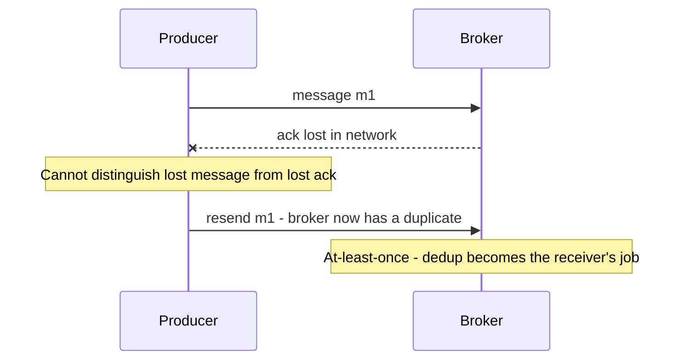

# Exactly-Once Delivery Is a Lie

Every messaging system must answer one question: when a delivery is unacknowledged, do you send again? Answer "no" and messages can vanish (**at-most-once**); answer "yes" and messages can duplicate (**at-least-once**). There is no third answer — "exactly-once delivery" over an unreliable network is impossible, and vendors claiming it are (at best) describing something narrower. The working engineer's mental model: **assume at-least-once, dedup at the consumer** ([[Idempotency]]). This note explains why the impossibility is fundamental, and decodes what Kafka's famous "exactly-once semantics" actually buys you.

## Why this matters

Teams that believe a broker gives them exactly-once delivery skip consumer-side dedup — and ship double-charges, double-emails, and double-decrements that surface weeks later in reconciliation. Teams that understand the limit design idempotent consumers from day one and treat duplicates as routine. The distinction also decides architecture: it's why [[Delivery Semantics]] is a first-class section in every broker comparison ([[Choosing a Message Broker]]), and why "how do you handle duplicates?" is a standard interview probe behind any queue in a design.

## How it works

### The two honest guarantees

- **At-most-once:** fire and forget — send, don't wait, never resend. A lost packet, a crashed consumer, a full buffer = a lost message, silently. Acceptable for telemetry and metrics where the next data point supersedes the last; unacceptable anywhere a message *means* something that must happen.
- **At-least-once:** send, await acknowledgement, resend until acked. Nothing is lost (given retries and durable storage), but every ambiguous ack becomes a duplicate: the consumer processed the message and the ack got lost → redelivery → processed twice. This is the default contract of every serious broker — SQS standard queues, Kafka consumers, RabbitMQ with acks, Redis Streams PEL ([[Delivery Semantics]]).

Pick your failure: at-most-once loses, at-least-once repeats. "Exactly-once delivery" would require the sender to *know* the receiver's state at the moment of ambiguity — and that knowledge is exactly what an unreliable network denies you.

### Two Generals, in one paragraph

The **Two Generals Problem** (1975, Akkoyunlu et al.; popularized by Gray) makes the impossibility crisp: two generals on opposite hills must attack *together* to win, coordinating only by messengers who may be captured. General A sends "attack at dawn" — but won't act without knowing B received it, so B must acknowledge; but B won't act without knowing A received the ack (else A might not attack); so A must ack the ack... Every message that would create common knowledge needs one more confirmation, forever. No finite protocol over a lossy channel lets both sides *know* they agree. Message delivery is the same structure: producer, consumer, lossy link — the producer can never distinguish "message lost" from "ack lost", so it must choose between not resending (loss) and resending (duplication). That choice *is* the at-most-once/at-least-once dichotomy. (Two Generals is the deterministic-certainty cousin of FLP — see [[Consensus and Raft]] — both are theorems about what asynchrony and loss forbid.)

### Where duplicates actually come from

"At-least-once" is an abstract label; in an incident you need the concrete list, because each source produces a different *shape* of duplicate and some bypass the dedup you already have.

| Source | Mechanism | Shape of the duplicate |
|---|---|---|
| **Producer retry** | Send succeeded, ack lost, client resends | Two near-identical messages, milliseconds apart, same payload |
| **Consumer crash after effect, before ack** | Work done, offset/delete never recorded | Redelivery of one message, seconds to minutes later |
| **Visibility timeout expiry** | Processing took longer than the timeout; the broker assumes failure and re-dispatches | *Concurrent* duplicates — two workers in the same message at once |
| **Consumer group rebalance** | Partitions reassigned mid-batch; uncommitted offsets replay on the new owner ([[Consumer Groups and Rebalancing]]) | A burst of duplicates after every deploy or scale event |
| **DLQ redrive** | Operator replays a dead-letter batch, some of which did succeed | Duplicates hours or days later, outside any short dedup window |
| **Upstream replay** | A fix re-emits a day of events from the source system | Mass duplication, often with regenerated message IDs |

Two consequences fall out of the table. First, the **visibility-timeout row is the dangerous one**: it produces *simultaneous* duplicates, so any dedup built as "check, then act" rather than an atomic reservation will let both copies through ([[Idempotency]]). Second, the **last two rows defeat broker-level dedup entirely** — windows measured in minutes cannot help with a replay measured in days, and a regenerated message ID is a different message as far as the broker is concerned. This is the structural argument for deduplicating on a *business* identifier in your own store rather than on the transport's message ID.

### What Kafka "exactly-once semantics" actually is

Kafka 0.11 (2017, KIP-98) shipped "EOS" — exactly-once *semantics*, a deliberate word choice. Its two components:

1. **Idempotent producer** (`enable.idempotence=true`, default since Kafka 3.0): each producer gets a producer ID; every batch carries a sequence number per partition; brokers discard already-seen sequences. This closes exactly one hole — *producer-retry duplicates into the log* ("ack lost, producer resent"). It is server-side dedup of the producer's own retries: at-least-once sending made to *look* exactly-once at the log. Note the scope: per producer session, per partition.
2. **Transactions:** a producer can atomically write to several partitions *and* commit consumer offsets in the same transaction (offsets are themselves stored in an internal Kafka topic — that's the trick that makes "consume + produce" one atomic unit). Consumers in `read_committed` mode skip aborted data. This makes the **consume → transform → produce** loop atomic: a stream processor (Kafka Streams with `processing.guarantee=exactly_once_v2`) either commits its output *and* its input offsets, or neither — so reprocessing after a crash can't double its *in-Kafka* outputs.

So Kafka EOS = **exactly-once stream processing within Kafka's own ecosystem**: topic-to-topic pipelines where inputs, outputs, and offsets all live in Kafka.

### What it doesn't cover

The boundary is **side effects to external systems**. The moment your consumer calls a bank API, writes MongoDB, sends an email, or pushes to SQS, Kafka's transaction cannot enclose that effect — the external system doesn't participate in Kafka's commit protocol. (Since Kafka 4.1, KIP-939 lets a transactional producer join an *externally* coordinated two-phase commit via `transaction.two.phase.commit.enable` — useful only when something else runs a 2PC coordinator, and still no help for an email or a partner API call.) Crash after the HTTP call but before the offset commit → redelivery → the call happens again. Kafka's own documentation is explicit that EOS applies to Kafka-to-Kafka processing. For external effects, you're back to the only general answer: **at-least-once delivery + consumer-side dedup** — idempotency keys, conditional writes, or transactional "process + record offset" in the *destination* datastore (store the consumed offset in Mongo in the same transaction as the business write, and skip already-recorded offsets on replay). That last pattern is sometimes called the "transactional inbox" — the mirror image of [[The Outbox Pattern]].

### What each mechanism actually covers

Every product feature in this space is real; every one is narrower than its name. The useful exercise is mapping each to the *boundary* it protects.

| Mechanism | Covers | Does not cover |
|---|---|---|
| Kafka idempotent producer | Producer retries into the log, per producer session per partition | Anything on the consumer side; a new producer session |
| Kafka transactions + `read_committed` | Consume-transform-produce entirely inside Kafka, including offset commits | Any write or call to a system outside Kafka |
| SQS FIFO content-based dedup | Repeated *sends* of identical content within a 5-minute window | Consumer redelivery; DLQ redrive; replays past the window |
| Broker durability settings — `acks=all`, replication | Message *loss* on broker failure | Duplication; that is the opposite knob |
| Transactional inbox in the destination store | The effect, because "processed" is recorded atomically with the business write | Side effects outside that transaction — emails, partner API calls |
| Idempotency key propagated downstream | The downstream effect, because the partner dedups on the key | Hops that neither dedup nor are naturally idempotent |

Read the table top to bottom and the pattern is unmistakable: **protection weakens as you move away from the broker and strengthens as you move toward the effect.** That is the whole thesis of this note in one column.

### The shape that always works

Whatever the transport, the same three-part structure gives exactly-once *effects*, and it is worth being able to draw it from memory:

1. **One durable identity per logical operation**, minted at the origin and carried unchanged through every hop and every retry. Not a message ID, not a timestamp, not a hash of the payload — a business identity for "this transfer", which survives redrives and replays because it was never the transport's property.
2. **An atomic reservation on that identity in the system that holds the effect.** Atomic is the load-bearing word: a unique-index insert or a conditional update, never a read followed by a write. The design of that store is [[Idempotency]]'s subject and is not repeated here.
3. **Every outbound effect either dedups on a derived identity or is naturally idempotent.** Database write, partner API call, email, downstream publish — enumerate them and account for each. The one you forget is the one that duplicates.

The "transactional inbox" is this shape applied to a stream consumer: record the consumed event's identity in the *destination* datastore, in the same transaction as the business write, and skip identities already present on replay. It is the mirror of [[The Outbox Pattern]] — outbox makes publishing atomic with a write, inbox makes consuming atomic with a write — and between them they close the dual-write problem at both ends of a pipeline without any distributed transaction ([[Two-Phase Commit and Distributed Transactions]]).

## Common misconceptions

- **"Kafka delivers exactly once now."** Kafka *processes* exactly once, within Kafka, under transactions. Delivery to your consumer remains at-least-once; effects outside Kafka remain your problem. The phrase "semantics" is doing legal work.
- **"FIFO/dedup queues solve it."** SQS FIFO deduplicates *producer sends* within a 5-minute window — same scope as Kafka's idempotent producer. Consumer-side redelivery after a visibility timeout still duplicates ([[SQS and SNS]]).
- **"We'll just not retry."** Then you've chosen at-most-once and will lose messages — a valid choice for metrics, a silent-data-loss bug for anything else. Not retrying doesn't dodge the theorem; it picks the other horn.
- **"TCP gives exactly-once, so the network layer solved it."** TCP dedups *within one connection*; the ambiguity reappears at every boundary above it — process crashes, connection re-establishment, application-level acks. The theorem recurs at each layer where state must survive failure.
- **"Exactly-once and ordering are the same problem."** They are independent. A system can deliver every message exactly once in effect and still apply them out of order, or preserve perfect per-key order and duplicate freely. Ordering is [[Message Ordering]]'s subject; dedup does not give it to you, and a strict order does not give you dedup.
- **"If we see no duplicates in staging, we don't have the problem."** Duplicates are produced by failure, and staging has fewer failures: shorter queues, faster downstreams, no DLQ redrives, no 3am deploys. Absence of duplicates in a healthy environment is evidence about the environment, not about the code.
- **"Dedup belongs in the broker."** Broker dedup (producer-side) is a useful optimization, but only the consumer knows the *effect* boundary — what "already done" means in business terms. The correct mental model: the consumer owns exactly-once-ness of effects; everything upstream merely reduces duplicate volume.

## Failure modes

- **Dedup on the transport's message ID.** It changes on redrive, differs per broker, and is absent after a source replay. The identifier must come from the business event, minted once at the origin.
- **Dedup window shorter than the replay horizon.** A 24-hour TTL against a DLQ that is redriven on Monday after a Friday incident: every redriven message re-executes. Size the window from your longest realistic replay, not from a default.
- **Processing slower than the visibility timeout.** The broker redelivers while the first worker is still running; two workers now race inside the same operation. Symptom: duplicates correlate with slow downstream dependencies, so they cluster exactly when you are already degraded.
- **Offsets committed before the effect.** A consumer that acknowledges first and works second has quietly chosen at-most-once: a crash loses the message with no trace. This is the mirror-image bug of duplication and is far harder to detect, because nothing anywhere records the loss.
- **Partial batch failure with batch-level acks.** Ten messages consumed, seven processed, the batch fails: all ten redeliver and the seven re-execute. Per-message dedup is the only thing standing between that and seven duplicate effects.
- **Dedup state in a volatile store.** A Redis-only `SETNX` dedup set that is evicted under memory pressure, or lost on failover, reopens the window with no error anywhere ([[Redis Internals]]).
- **An idempotent handler with one non-idempotent tail.** The database write dedups correctly and the push notification does not. Every externally visible effect needs its own protection ([[Idempotency]]).

### What this looks like at 3am

Duplicates almost never page you directly — there is no "duplicate detected" alarm, because from the system's perspective nothing failed. The page is **"partner reconciliation is off by eleven transactions"**, or a support escalation reading "charged twice". You go to the logs and find two complete, successful, well-formed processing runs for the same business event, separated by anywhere from 40 milliseconds to two days. The 40-millisecond gap points at a producer retry or a visibility-timeout race; the two-day gap points at a DLQ redrive or a replay.

The instinct to resist is treating this as a bug in the broker. Nothing in the transport misbehaved — it delivered at least once, exactly as documented. The questions that actually resolve the incident are: *what business key identifies this operation, is there an atomic reservation on it, and does that reservation live somewhere durable for longer than our longest replay?* The follow-up work is almost always the same: move dedup from the transport's identity to the operation's identity, and from a cache to the system of record. Reconciliation against the partner's statement is the backstop that found the problem and should stay in place regardless — it is the only control that catches duplicates your dedup logic itself got wrong.

## In your stack

- Your SQS consumers live under plain at-least-once: visibility-timeout expiries and DLQ redrives both redeliver. Dedup on a business key in Mongo per [[Idempotency]] — treat SQS FIFO's dedup window as producer convenience, not consumer protection.
- Redis Streams (your planned direction) is at-least-once by construction: entries stay in the PEL until `XACK`, and `XAUTOCLAIM` hands crashed consumers' messages to others — guaranteed duplicates under failure ([[Redis Streams]]).
- If you run Kafka-to-Kafka enrichment (e.g., Streams jobs on MSK), EOS v2 is worth enabling — modest overhead for real atomicity. The moment the pipeline's last hop writes Mongo or calls a partner API, that hop needs inbox/idempotency regardless ([[Kafka Architecture]], [[Kafka Operations]]).
- Fintech framing: a duplicated "debit customer" event that reaches a non-idempotent consumer is customer harm with a regulator attached. Design reviews at Niyo should ask one question of every consumer: *"show me the dedup."* An auditor-friendly answer is a keyed `processed_events` record written in the same Mongo transaction as the effect.
- Your migration history is a tour of this note. RabbitMQ gave per-message acks and redelivery on channel loss; Kafka gave offsets whose commit timing you control; SQS gives visibility timeouts and redrive. **The duplicate sources changed names at every hop, but at-least-once never changed** — which is the argument for putting dedup in your own Mongo-backed code rather than re-deriving it per broker. Code written against the operation's identity survives the next migration unchanged.
- Sizing matters more than it looks: SQS's visibility timeout defaults to 30 seconds and can extend to 12 hours, and standard-queue retention defaults to 4 days with a 14-day maximum (AWS documented values, as of 2026). If a handler's p99 exceeds the visibility timeout, you have *configured* concurrent duplicates — either raise it, or extend it from inside the handler via a heartbeat ([[SQS and SNS]]).
- Deploys are a duplicate generator in your environment specifically: with services at 1 replica, every rollout is a consumer stop-and-start, so any in-flight message is redelivered to the new pod. Graceful shutdown that finishes in-flight work before exiting narrows the window but never closes it ([[Graceful Shutdown and Deployment Safety]]) — the pod can still be killed after the effect and before the ack.

## Interview angle

This topic is a shibboleth: interviewers drop "we need exactly-once delivery" into requirements to see whether you correct it. The right move: rename it to exactly-once *effect*, then show the machinery.

The 60-second version: "Exactly-once delivery is impossible over a lossy network — Two Generals: the sender can never distinguish a lost message from a lost ack, so it must either not resend (at-most-once, loses data) or resend (at-least-once, duplicates). Kafka's 'exactly-once semantics' is real but scoped: an idempotent producer dedups producer retries into the log, and transactions make consume-transform-produce atomic by committing offsets and outputs together — exactly-once *processing within Kafka*. It doesn't cover side effects to external systems: crash between external call and offset commit, and the call repeats. So the universal model is at-least-once delivery plus consumer-side dedup — idempotency keys or storing processed offsets/IDs in the destination store, atomically with the effect. Delivery guarantees belong to transports; effect guarantees belong to consumers."

Classic follow-ups: "How does Kafka's transactional consume-produce actually commit offsets?" (offsets are writes to an internal topic, included in the transaction); "What's the SQS equivalent of the idempotent producer?" (FIFO content-based dedup, 5-minute window); "Design the consumer for a payment event" (→ [[Idempotency]]'s keyed store, same-transaction inbox).

## Check yourself

> [!question]- Q: Explain, via Two Generals, why the producer's dilemma can't be engineered away with more acknowledgements.
> Each ack only relocates the uncertainty: if the consumer acks, the producer knows — but the consumer doesn't know the ack arrived, so *it* can't safely discard its dedup state or assume no resend; an ack-of-ack gives the producer's knowledge to the consumer but reopens the same question one level up. No finite exchange over a lossy channel ends with both sides *knowing* they agree on what was delivered. Therefore ambiguity always survives at some layer, and the design question is only *who absorbs it* — and the answer that works is the consumer, via idempotent processing.

> [!question]- Q: Scenario — a Kafka Streams job with EOS v2 enriches transactions topic-to-topic; a downstream consumer of the enriched topic calls a partner bank API. The downstream pod crashes mid-batch. Where exactly can duplicates appear, and where can't they?
> Can't: in the enriched topic — the Streams job's outputs and input offsets commit atomically, so its reprocessing after crashes never double-writes committed records (and `read_committed` consumers never see aborted ones). Producer retries into either topic are also deduped (idempotent producer). Can: at the bank API — the downstream consumer processed some records and crashed before committing offsets; on restart (or partition reassignment) those records are redelivered and the API gets called again. Kafka's transaction boundary ends at Kafka; the API call needs an idempotency key derived from the event ID.

> [!question]- Q: When is at-most-once genuinely the right choice? Give an example and the test for it.
> When a lost message costs less than the machinery to retry it, and the next message supersedes the lost one: metrics samples, heartbeat pings, presence updates, tick-by-tick dashboards. The test: "if this message silently vanished, would any *state* be wrong, or would it just be refreshed a moment later?" If only the latter, at-most-once buys simplicity and lowest latency. Anything that *changes state someone depends on* — orders, payments, status transitions — fails the test.

> [!question]- Q: Scenario — a vendor pitches a broker advertising "true exactly-once delivery, no application changes required". What do you ask them, and what answer would actually be acceptable?
> Ask where the guarantee's boundary is, in three questions. (1) *Does it cover effects outside your broker?* If the consumer calls our partner bank, can your protocol roll that call back? It cannot — no broker can enlist a third party's API in its commit protocol, so the honest answer is no. (2) *What happens between my side effect and your acknowledgement if my process dies there?* Either they redeliver (at-least-once, duplicates — fine, but then the claim is marketing) or they do not (at-most-once, silent loss — much worse). There is no third behaviour; the dichotomy is a theorem, not an implementation gap. (3) *What is the dedup scope and window?* An answer in minutes cannot survive a DLQ redrive days later. An acceptable pitch sounds like Kafka's: "exactly-once *processing* within our system, under transactions, when inputs, outputs, and offsets all live here" — a real and useful guarantee, honestly scoped. An unacceptable one is any claim that your consumer no longer needs [[Idempotency]]; that claim is false for every broker that has ever existed, and believing it is how double charges ship.

> [!question]- Q: Mini design prompt — your notification consumer reads "payment succeeded" events from SQS and sends a push notification. Users complain about occasional double notifications. Fix it end-to-end.
> Root cause: at-least-once redelivery (visibility timeout expiry, crash-after-send-before-delete) hitting a non-idempotent side effect (push send). Fix: (1) derive a dedup key from the event's operation ID (the payment's idempotency key, not the SQS message ID — redrives can mint new message IDs); (2) atomically reserve it in a `sent_notifications` collection with a unique index before sending; (3) send, then mark completed; (4) a sweeper resolves stuck reservations by checking the push provider's receipt API if available, else policy-decides (for notifications, erring toward "don't resend" is fine — a missed push is cheaper than a duplicate). Note the asymmetry with money: here at-most-once *effect* is an acceptable resolution for ambiguity; for a debit it never is.

## Sources

- E. A. Akkoyunlu, K. Ekanadham, R. V. Huber, "Some Constraints and Tradeoffs in the Design of Network Communications", SOSP 1975 — origin of the Two Generals problem (named and popularized by Jim Gray, 1978).
- Apache Kafka documentation and KIP-98 ("Exactly Once Delivery and Transactional Messaging") — the design itself; Neha Narkhede's Confluent post "Exactly-once Semantics are Possible: Here's How Kafka Does it" (2017) — read with this note's scope caveats.
- Martin Kleppmann, *DDIA*, Chapter 8 (unreliable networks and the knowledge problem) and Chapter 11 (fault tolerance and exactly-once in stream processing).
- Tyler Treat, "You Cannot Have Exactly-Once Delivery", bravenewgeek.com, 2015 — the essay this note's title nods to.
- AWS SQS documentation — standard vs FIFO delivery guarantees, visibility timeout and retention limits, and dedup window scope.
- Pat Helland, "Idempotence Is Not a Medical Condition", ACM Queue, 2012 — why repeated delivery is the normal case and what receivers owe it.
