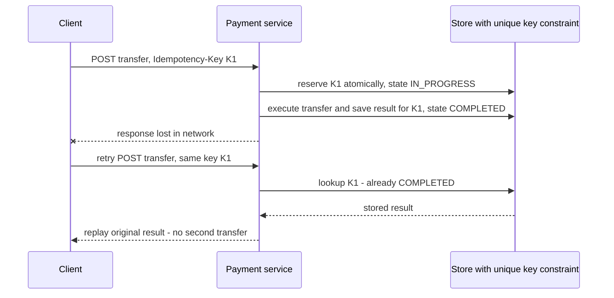

# Idempotency

An operation is **idempotent** if performing it once and performing it several times produce the same end state. This is the single most practical idea in distributed systems theory, because it dissolves the third outcome of every network call — "unknown" ([[The Fallacies of Distributed Computing]]) — into a safe instruction: *just retry*. Retries without idempotency double-charge customers; retries with it are boring. If you internalize one note from this module for day-to-day fintech work, make it this one.

## The problem that created it

Your payment service calls a transfer API. The call times out. Did the money move? You cannot know ([[Network Partitions and Timeouts]]): the request may have died en route (transfer never happened) or the response may have died on the way back (transfer happened). Every option is bad: don't retry and maybe the customer's rent never arrives; retry and maybe they pay rent twice. Meanwhile every layer of a modern stack *already* retries without asking you — HTTP clients, service meshes, Kafka/SQS redelivery ([[Delivery Semantics]]), job schedulers, and the user's own thumb on a spinner. **Duplicates are not an edge case; they are the steady state.** At-least-once delivery is the only delivery guarantee you can really have ([[Exactly-Once Delivery Is a Lie]]), so the receiving side must make "at least once" indistinguishable from "exactly once". That property is idempotency.

## What it solves

- **Safe retries** after timeouts, crashes, and redeliveries — no double charges, double emails, double shipments.
- **Composability with [[Timeouts Retries and Exponential Backoff]]:** aggressive retry policies become safe instead of dangerous.
- **Exactly-once *effects*:** the industry's working formula — **at-least-once delivery + idempotent processing = exactly-once effect**. Delivery stays duplicated; outcomes don't.
- **Crash recovery without forensic analysis:** a worker that dies mid-batch can simply reprocess the batch.
- **Safe [[Saga Pattern]] steps:** each saga step and each compensation gets retried until acknowledged; idempotency is what makes that loop terminate correctly.

## How it works

Three mechanisms, in increasing order of machinery.

### 1. Naturally idempotent operations

Some operations are idempotent by their own math: setting a value (`status = "KYC_VERIFIED"`), deleting by ID, upserting a full record, `PUT` semantics in HTTP. Repeating them converges on the same state. Contrast **inherently non-idempotent** operations: increments (`balance += 500`), appends, "send email", `POST /transfers`. The first design move is always: *can I restate this operation as a set instead of a delta?* ("set balance to 1500, expected previous 1000" rather than "add 500").

### 2. Conditional writes (compare-and-set)

Make the datastore enforce execute-at-most-once: attach a condition that is true only before first execution.

- MongoDB: `updateOne({_id, version: 7}, {$set: {...}, $inc: {version: 1}})` — the second application matches zero documents. Or `findOneAndUpdate({txnId, state: "PENDING"}, {$set: {state: "DONE"}})`.
- SQL: `UPDATE ... WHERE id = ? AND state = 'PENDING'`; unique constraints as duplicate-rejectors (`INSERT` of txnId fails the second time — cleanest of all).
- DynamoDB condition expressions, etcd compare-and-swap — same shape everywhere.

Conditional writes also defeat the *interleaving* problem that plain "check then write" has: the check and the write are atomic at the store, so two racing duplicates can't both pass the check. Versioned CAS is likewise the fix for lost updates from concurrent writers ([[Logical Clocks and Ordering]]).

### 3. Idempotency keys — the end-to-end protocol

For operations that are irreducibly "do a thing once" (move money, create an order), the standard protocol — popularized by Stripe's API — spans client and server:

1. **Client generates a unique key** (UUIDv4, or deterministically from business identity like `userId + orderId + purpose`) *before* the first attempt, persists it with the pending action, and sends it on every retry of that same logical operation — typically an `Idempotency-Key` header. Regenerating the key on retry defeats the entire mechanism.
2. **Server dedups on the key atomically.** First arrival: *reserve* the key (insert with unique constraint, state `IN_PROGRESS`) — this reservation must be atomic so concurrent duplicates collapse to one winner; losers either wait or get `409 Conflict`/retry-later.
3. **Execute the operation once**, then **store the keyed result** (status code + response body, or a reference to the created resource) against the key, state `COMPLETED` — ideally in the same transaction as the business write so "done but not recorded" can't happen.
4. **Replay the stored result** to any later request with the same key. The retrying client can't tell it's a replay — which is the point. Key reuse with a *different* payload should be rejected (`422`), catching client bugs.

**Scope and TTL of dedup state.** The key store is state and needs decisions: *Scope* — per endpoint + per credential/user (so two users' identical UUIDs never collide, and a key for `/transfers` can't suppress a call to `/cards`). *TTL* — the window must comfortably exceed the longest possible retry horizon: client retries + queue redelivery + DLQ replay + "support re-pushes it next day". Stripe's documented behaviour is to prune a key once it is at least 24 hours old (API v1; its v2 namespace treats same-key requests within 30 days as replays, as of 2026); many fintech flows keep dedup state for 30–90 days and rely on business-level reconciliation beyond that. Too short a TTL silently re-opens the double-charge window on late replays; unbounded state is a cost/cleanup problem — pick the TTL from your replay horizon, not from a default. *Crash handling* — keys stuck `IN_PROGRESS` past a deadline need a sweeper that verifies the true outcome (query downstream, then complete or release), otherwise one crash wedges that operation forever.

**Propagation.** Idempotency must hold end-to-end: if your service dedups but then calls a downstream charge API, pass a derived key downstream too — otherwise *your* internal retry duplicates the downstream effect. Every hop either dedups or is naturally idempotent, or the chain is broken at that hop.

**Concurrent duplicates.** Two copies of the same request can arrive milliseconds apart — a double-tap, or a client retry that fires while the first attempt is still in flight. Exactly one wins the atomic reservation; the loser finds state `IN_PROGRESS` and must be answered *without executing anything*. Three defensible answers, in rising order of politeness and cost:

| Answer to the loser | What the client sees | Cost | Fits |
|---|---|---|---|
| `409 Conflict` plus `Retry-After` | "a request with this key is in flight" | Cheapest; nothing held | Public APIs whose callers already retry |
| Block briefly, poll the record, replay the stored result | One slightly slow success | Holds a request thread — risky on a fixed pool | Short operations, internal callers |
| `202 Accepted` plus a status URL | "processing", then poll | Needs a status endpoint and client support | Long operations, partner-bank calls |

What is never acceptable is proceeding anyway, or answering "already exists" as a bare success with no result body — the client is then left without the resource ID it came for.

**The record's lifecycle** is a small state machine, and writing it down explicitly is what makes the crash cases tractable. The atomic reservation creates the record as `IN_PROGRESS`. Successful execution moves it to `COMPLETED` with the response stored; a deterministic business rejection ("insufficient balance") moves it to `FAILED`, also with the response stored — a rejection is a real outcome and must be replayed, not re-evaluated. Both terminal states are absorbing: every later duplicate reads the stored result and returns it. The subtlety is that `IN_PROGRESS` means two different things depending on the clock. Within the operation's execution deadline it means "a peer is working on this", and duplicates get told to wait. Past that deadline it means "nobody knows what happened", and the only legal move on it — whether made by a background sweeper or by the retrying consumer itself — is to *verify* the true outcome and write a terminal state. Nobody may promote a stale `IN_PROGRESS` by assuming an answer.

### When the first attempt's outcome is genuinely unknown

This is the case the whole pattern exists for, and the one most designs skip. Your service reserved the key, called the partner bank, and the call timed out. The record says `IN_PROGRESS` and nobody in your process knows whether money moved.

The first rule is that **a timeout is not a failure.** Returning "transfer failed" to the customer on a read timeout is how a system manufactures a duplicate: the customer taps again, and if the client regenerates its key you now have two live operations against one intent. Surface "processing" and resolve out of band.

Resolution, in order of preference:

1. **Status-check the downstream using the reference you sent it.** This works only if you generated a durable, derived reference *before* the call and persisted it with the record — which is exactly why the reservation write must precede the side effect rather than follow it. Bank and card rails expose enquiry APIs precisely because the ambiguous timeout is their steady state too.
2. **Make the downstream call itself idempotent** so a blind retry is safe. If the partner dedups on your reference, "unknown" collapses back into "just retry" and the enquiry is never needed. Negotiating this into the integration contract is cheaper than every mitigation below it.
3. **Reconcile against the settlement file.** Authoritative, but T+1 — a full day of customer-visible uncertainty.
4. **Escalate to a human with the evidence attached.** For the residue that 1–3 cannot resolve, a work queue carrying the key, the reference, the amount and the timeline is the correct output. A money movement whose outcome is unknown is the textbook case for failing closed and involving a person.

The one thing never to do is release the key and re-execute on the assumption that the first attempt failed. That converts an uncertainty into a guaranteed duplicate whenever the first attempt actually succeeded.

### Choosing a mechanism

| Mechanism | What makes it atomic | Replays the original response? | State you carry | Reach for it when |
|---|---|---|---|---|
| Natural idempotency — set, full upsert, delete by ID | The write *is* the whole operation | No; it recomputes one | None | The operation can be restated as a set rather than a delta |
| Conditional write on state or version | Store evaluates predicate and write as one step | No | Only the row's own state or version field | A state machine with one legal transition, e.g. PENDING to DONE |
| Unique constraint on a business identifier | The index rejects the second insert | No | The business row itself | A natural one-per-X rule exists, e.g. one mandate per user per merchant |
| Idempotency key plus stored result | Unique insert reserves the key | Yes — this is the point of it | A record per operation, with TTL and a sweeper | Irreducible one-shot operations: transfers, charges, order creation |
| Broker-level dedup — SQS FIFO window, Kafka idempotent producer | The broker's own bookkeeping | No | None of yours | Only ever as a narrow extra layer, never as the dedup you rely on |

## Common misconceptions

- **"Idempotent means the retry gets the same response."** It means the same *end state*. Replaying the original response body is a second, stronger guarantee you have to build deliberately — and it is the one clients actually need, because a retry that merely "succeeded" hands them no resource ID. A handler that applies the effect once but answers duplicates with `409` is still idempotent at the state level; whether that is an acceptable API contract is a separate decision.
- **"Deduplication and idempotency are the same thing."** Dedup *drops* the repeat; idempotency *answers* it with the original outcome. To a caller those are wildly different: one leaves them retrying into silence, the other ends their retry loop.
- **"My POST is idempotent because I check whether the record already exists."** Check-then-act is two operations with a gap between them, and the gap matters under exactly the conditions that produce duplicates — concurrency. Both copies read "absent", both write. Only a single atomic step counts: a unique-index insert, a conditional update, a Redis `SET` with `NX`.
- **"HTTP says PUT is idempotent, so I am covered."** RFC 9110 defines idempotency as a property of a method's *intended semantics* — a promise to clients and intermediaries that an automatic retry is permitted. It is a contract, not an implementation: your `PUT` handler is idempotent only if you wrote it that way. And it says nothing about concurrency, since two *different* `PUT`s racing still resolve to last-writer-wins.
- **"Kafka exactly-once or SQS FIFO dedup means I don't need this."** Kafka's idempotent producer dedups a producer's *own* retries using a producer ID plus a per-partition sequence number, and Kafka transactions make read-process-write atomic *within Kafka*. Neither covers an effect outside Kafka — a card charge, an email, a write down a non-transactional path ([[Exactly-Once Delivery Is a Lie]]). SQS FIFO content-based dedup is a 5-minute producer-side window, shorter than nearly any redelivery horizon that matters.
- **"The correlation ID is my idempotency key."** `x-correlation-id` identifies one *request*; a retry is a new request and normally carries a new correlation ID, which is what keeps traces readable ([[Distributed Tracing]]). An idempotency key identifies one *logical operation* across every attempt. Conflate them and you get either dedup that never fires or traces that collapse into an unreadable blob.
- **"Idempotency makes concurrency safe."** It makes repeats of the *same* operation safe. Two genuinely different operations racing for the same balance still need [[Distributed Locking|a lock]] or a version-conditional write, and out-of-order arrival is still [[Message Ordering]]'s problem, not this one's.

## Trade-offs

| You gain | You pay |
|---|---|
| Safe retries everywhere; exactly-once effects | A keyed state store with atomicity, TTL, and sweeper logic |
| Calm incident response (reprocess, don't forensically dedupe) | Extra read/write per request on the hot path |
| Client bugs (double-tap) neutralized server-side | Contract burden: clients must generate and persist keys correctly |
| Audit-friendly record of every attempted operation | Replay semantics to define: same key + changed payload, concurrent in-flight duplicates |

## Failure modes

Each of these has a distinguishing signal. At 3am the hard part is never noticing that duplicates exist — it is working out *which* of these produced them, because the fixes point in opposite directions.

- **Key generated per attempt, not per operation** (client regenerates UUID on retry): dedup never triggers. Detected only by downstream duplicates — reconciliation catches it; contract tests prevent it. *Signal:* the dedup-hit rate sits near 0% while the client-side retry rate is plainly non-zero, and the key store holds about one record per request instead of one per operation. *Confirm:* pull both records for a known duplicated operation — different key, identical `requestHash`.
- **Check-then-act race:** `SELECT` then `INSERT` without a unique constraint lets two concurrent duplicates both pass. The reservation must be a single atomic operation. *Signal:* paired duplicates whose timestamps are milliseconds apart, appearing only under load and never in UAT. *Confirm:* the delta between the two records is smaller than one round trip to your own store — no sequential execution could have produced it.
- **Result not stored atomically with the effect:** crash between "transferred" and "recorded result" leaves a key that will re-execute on retry. Same-transaction writes or an outcome-verification sweeper close it. *Signal:* records stuck `IN_PROGRESS` whose downstream reference, when queried, reports success. *Confirm:* a status check against the partner contradicts your own record — that contradiction *is* the bug, and it is also the repair instrument.
- **Dedup store flushed or expired early:** Redis-only dedup state lost on restart/eviction re-opens the duplicate window silently. Money-grade dedup belongs in the durable store ([[MongoDB Architecture]]), with Redis at most as a fast-path cache in front. *Signal:* the dedup-hit rate steps to zero at the exact minute a Redis node restarted, or `evicted_keys` in `INFO stats` starts climbing under memory pressure. *Confirm:* line the hit-rate cliff up against the instance's uptime counter.
- **TTL shorter than the real replay horizon:** the keys were there, and then they were not. *Signal:* every duplicate's first attempt is older than the TTL, and the gap between first and second attempt clusters just above it. *Confirm:* compute `secondAttemptAt - firstAttemptAt` across a sample — if the distribution *begins* at the configured TTL, that is the entire story.
- **Scope collisions:** keys shared across endpoints or tenants suppress legitimate operations — rare, maddening to debug ("the API ate my request and returned someone's old response"). *Signal:* a `200` whose body references a resource the caller never created, or an operation that silently never happened. *Confirm:* the stored `requestHash` does not match the request just replayed — which is why you store the hash even when you intend to accept the replay.
- **Non-idempotent side effects inside an idempotent wrapper:** the handler dedups the DB write but still sends the email/webhook on every attempt. Every side effect needs its own dedup or must move behind the outbox ([[The Outbox Pattern]]). *Signal:* notification or webhook counts exceed operation counts while the ledger stays perfectly correct — the money is fine and the customer is furious.
- **A sweeper that releases instead of resolving:** a job that finds stale `IN_PROGRESS` records and deletes them "so the operation can be retried" is a duplicate generator on a cron schedule. *Signal:* duplicate effects clustering immediately after each sweeper run. *Confirm:* the duplicate timestamps align to the sweeper's interval.

### What this looks like at 3am

A worked scenario, assembled from the shapes above. A partner bank's debit API degrades for 40 minutes; your transfer consumer's calls time out, the messages exhaust their receive count, and **8,400** of them land in the DLQ. Nobody is paged in anger — the DLQ alarm fires, live traffic is healthy again, and the on-call defers the redrive to business hours. Three days later an automated redrive job runs at 02:50.

The dedup records lived in Redis with a 24-hour TTL. The redrive happens at **72 hours**, so all 8,400 keys are gone and each message is, as far as the consumer can tell, brand new. Of the 8,400 timed-out calls, **2,310** had in fact completed at the bank — the debit happened, only the response died. Those 2,310 now execute a second time. At an average ticket of **₹1,850** that is `2,310 × 1,850 = ₹4,273,500` of duplicate debits.

The dashboard at 03:05 does not say "duplicates". It says: partner-bank call volume at roughly double the overnight baseline; debit success rate *up*; your own error rate flat and green; and — the only real tell — the reconciliation break count against the previous day's file jumping into four digits. The first customer complaint arrives around 07:30. The root cause is one line of config: a TTL chosen out of Redis-cache habit rather than from the replay horizon, which in a system with 14-day SQS retention and a manual DLQ redrive policy is measured in weeks, not hours.

Two fixes, and they are not interchangeable. Moving the dedup state to the durable store with a TTL that exceeds the longest redrive policy stops the recurrence. The 2,310 that already happened are resolved only by status-checking each one against the bank using the reference you sent, then reversing — and that is possible only because the reference was persisted before the call. If it was not, the remaining instrument is the settlement file and a long week.

## When NOT to use it

- **Don't build key infrastructure where natural idempotency suffices:** full-state upserts, set-based status transitions, and unique business constraints often make a separate key store redundant — the business ID *is* the key.
- **Deliberately non-idempotent semantics:** a metrics counter where every increment is a real event, or appending telemetry — dedup there would *lose* data; dedupe at a different layer (event IDs) if needed.
- **Read-only endpoints:** GETs are idempotent by definition; adding key machinery is noise.
- **As a substitute for ordering or locking:** if the symptom is a race between two *different* operations, or a replay arriving out of sequence, a key store is the wrong instrument — reach for [[Distributed Locking]] / CAS and [[Message Ordering]] instead.

## In your stack

- **SQS is at-least-once, full stop** — visibility-timeout expiry, consumer crash after processing-before-delete, and DLQ redrives all produce duplicates. Every SQS consumer you own must be idempotent; FIFO queues' 5-minute dedup window helps the producer side only and is far shorter than a DLQ replay horizon ([[SQS and SNS]], [[Dead Letter Queues and Poison Messages]]).
- The same holds for your Redis Streams move: `XAUTOCLAIM`/PEL redelivery is at-least-once by design ([[Redis Streams]]).
- MongoDB gives you the two best primitives free: unique indexes (reserve the key) and `findOneAndUpdate` with state conditions (atomic transitions). A `processed_operations` collection with `{key: 1, unique: true}`, result payload, state, and a TTL index is a complete dedup store in one document design. Three mechanics worth knowing before you write the code: the duplicate-key error `E11000` *is* your dedup signal, so catch it and branch to replay rather than letting it surface as a 500; concurrent upserts against a unique index can also raise `E11000`, and the correct handling is the same "another attempt won the reservation" branch; and the TTL monitor sweeps roughly once a minute, so expiry is approximate — never size a TTL where a minute of slack is load-bearing. If the business write and the idempotency record must commit together, that is a multi-document transaction on the replica set; if you would rather avoid one, write the record first and let the sweeper resolve the gap.
- At the edge, two things have to hold. The `Idempotency-Key` header must actually survive Kong — header allowlists drop unknown headers silently, so verify it arrives rather than assuming it does, and check the upstream Service's `retries` setting (Kong defaults it to 5, as of 2026), since a gateway retry is one more duplicate source your service absorbs. And scope keys by the JWT's `sub` (oneAppUserId), never by a user ID taken from the request body: otherwise a caller can present someone else's key and be handed their stored response, which is an ownership-check failure wearing a dedup costume. `sub` and `jti` are system identifiers rather than PII, so they belong in both the key and the logs.
- Pattern that fits your flows: mobile app generates the key at "confirm payment" tap → gateway/service reserves it in Mongo → partner-bank call carries a derived reference (their `customerRefNo`-style field) → result stored against the key → SQS event emitted via outbox with the same operation ID → consumers dedup on it. One logical ID threads the whole saga; your `x-correlation-id` traces it ([[Distributed Tracing]]) but is per-request, not per-operation — don't conflate the two.
- **One replica changes the calculus twice.** With a single pod, an in-process dedup cache — a map of recently seen keys — appears to work flawlessly in UAT and is *accidentally* global today; a restart or a scale to two reopens the duplicate window with no error anywhere, which is why durable dedup state is not an optimisation to defer. And with no peer to absorb a rolling deploy, every in-flight money call is killed at pod termination and becomes an unknown-outcome record. Deploys are therefore a routine generator of the ambiguous case rather than an exception — which makes the sweeper load-bearing rather than defensive, and makes draining in-flight requests before the pod exits worth the grace period it costs.
- RBI-adjacent framing: a duplicate debit is customer money moved without authorisation, so it belongs in the grievance-and-compensation process rather than a bug tracker — treat the exact reporting obligation as a question for compliance, not an engineering assumption. Idempotency keys + daily reconciliation against partner statements is both the engineering fix and the audit answer; the keyed-result store doubles as evidence of exactly-once effect.

## Interview angle

This is the most bankable topic in the module: nearly every design ("design a payment system", "consumer reads from a queue") has a "what about duplicates?" probe, and interviewers at fintechs treat it as a hiring bar.

The 60-second version: "Networks give you three outcomes — success, failure, unknown — and retries plus queue redelivery make duplicates the steady state, since exactly-once delivery is impossible. The fix is idempotent processing: the same operation applied twice leaves the same state. Three tools: restate deltas as sets where possible; let the store enforce once-ness with conditional writes and unique constraints; and for true one-shot operations, idempotency keys — client generates a key per logical operation and reuses it on retries, server atomically reserves it, executes once, stores the keyed result, and replays that result to duplicates. Scope keys per user and endpoint, TTL them beyond your longest replay horizon, and propagate derived keys downstream. Then at-least-once delivery plus idempotent processing gives exactly-once *effect* — which is the only exactly-once that exists."

Classic follow-ups: "Where does the key come from — why must the *client* generate it?" (only the client can identify two attempts as the same logical operation across its own crashes); "What if two requests with the same key arrive concurrently?" (atomic reservation; loser waits or 409s); "How long do you keep keys?" (replay horizon argument); "What about the email you send after the charge?" (every side effect needs its own dedup/outbox).

## Check yourself

> [!question]- Q: Explain why "at-least-once delivery + idempotent processing = exactly-once effect", and why no messaging system can just deliver exactly once instead.
> Delivery is exactly-once-impossible because an un-acked message is ambiguous — the sender can't distinguish "lost before processing" from "processed, ack lost" ([[Exactly-Once Delivery Is a Lie]]) — so any correct system must redeliver, producing duplicates. Idempotent processing makes the Nth application of a message a no-op that returns the first outcome, so duplicated *delivery* collapses to single *effect*. The guarantee moves from the transport (impossible) to the state transition (achievable with atomic dedup).

> [!question]- Q: Scenario — your SQS consumer charges a card, then crashes before deleting the message. SQS redelivers. Walk through what happens with and without idempotency keys.
> Without: the second consumer charges again — double charge; you'll find it in reconciliation or a complaint. With: first attempt reserved key K and (if it got that far) stored the charge result; redelivery looks up K — if `COMPLETED`, it replays the result, deletes the message, done; if `IN_PROGRESS` (crash mid-flight), the consumer must verify the true outcome with the charge provider (or wait for the sweeper to), then complete or release K. Note the subtle case: if the crash was *after* charging but *before* storing the result, only outcome-verification against the provider (using the key you passed them) resolves it — which is why the key must propagate downstream.

> [!question]- Q: Scenario — your transfer service reserved key K, called the partner bank, and the HTTP call timed out after 30 seconds. The record says `IN_PROGRESS`. What do you do next, and what had to be true earlier for you to be able to do it?
> Neither retry nor tell the customer it failed — a timeout is not a failure, and both of those actions manufacture a duplicate. Leave the record `IN_PROGRESS`, show the customer "processing", and resolve out of band: call the bank's status/enquiry API with the reference you sent on the original attempt, then move the record to `COMPLETED` with their result stored, or to `FAILED` and release the customer's funds hold. What had to be true earlier: you generated a durable derived reference for that attempt and persisted it *before* making the call, so there is something to enquire with. Had the reference been generated inside the call, or the record written only on success, nothing would link your uncertainty to their system and the only instrument left would be the T+1 settlement file. The better long-term fix is getting the bank to dedup on that reference, which turns the whole ambiguous case back into "just retry".

> [!question]- Q: Why is a unique index a better dedup primitive than "query for the key, then insert if absent"?
> The query-then-insert pair is two operations; two concurrent duplicates can both run the query (absent), then both insert — double execution. A unique index makes reservation a single atomic event decided by the storage engine: exactly one insert wins, the other receives a duplicate-key error and switches to replay/wait. Any correct dedup needs that atomicity; the unique constraint is the cheapest, least-cleverness way to get it.

> [!question]- Q: Mini design prompt — design the dedup store for a transfers API: schema, scope, TTL, and the crash sweeper.
> Collection `idempotency_records`: `{ _id: hash(userId, endpoint, key), state: IN_PROGRESS|COMPLETED|FAILED, requestHash, responseCode, responseBody, operationRef, createdAt, expiresAt }` with a unique index on `_id` (scope = user + endpoint baked into the id) and a TTL index on `expiresAt`. TTL: ≥ max(client retry horizon, SQS retention + DLQ redrive window, support replay policy) — e.g. 90 days for money movement, with reconciliation as the backstop beyond. Reject same-key-different-`requestHash` with 422. Sweeper: every N minutes, find `IN_PROGRESS` older than the execution deadline, query the downstream system by `operationRef`/derived key for the true outcome, then mark COMPLETED/FAILED or release for re-execution — never just delete, that re-opens the duplicate window.

## Sources

- Stripe engineering blog, "Designing robust and predictable APIs with idempotency" (Brandur Leach, 2017) — the canonical idempotency-key design, and brandur.org's "Implementing Stripe-like Idempotency Keys in Postgres".
- Martin Kleppmann, *DDIA*, Chapter 11 ("exactly-once" and fault tolerance in stream processing) and Chapter 8, "The Trouble with Distributed Systems" (why a timed-out request is ambiguous — lost request or lost response).
- AWS Builders' Library, "Making retries safe with idempotent APIs" — the end-to-end production treatment.
- IETF draft "The Idempotency-Key HTTP Header Field" (HTTPAPI WG) — proposed standardization of the header semantics; still an Internet-Draft, not an RFC (latest revision -07, October 2025, expired as of 2026).
- RFC 9110, *HTTP Semantics*, §9.2.2 — the precise definition of an idempotent method, and why it is a semantic contract rather than an implementation guarantee.
- AWS documentation on SQS FIFO queues (content-based deduplication and its 5-minute window) and the Kafka documentation on the idempotent producer — useful mainly for seeing what broker-level dedup does *not* cover.
- Pat Helland, "Idempotence Is Not a Medical Condition", ACM Queue, 2012 — the classic essay on messaging and repeated delivery.
