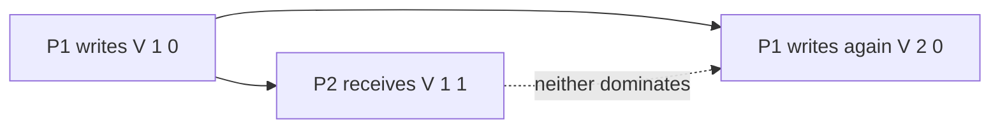

# Logical Clocks and Ordering

"Which of these two events happened first?" is a question single-machine code answers trivially and distributed systems cannot answer with wall clocks at all. This note builds the replacement toolkit: the **happens-before** relation (what "before" even means without trusted time), **Lamport clocks** (cheap total ordering consistent with causality), **vector clocks** (detecting that two updates were concurrent), and **TrueTime** (Google's hardware route back to usable physical time). Every conflict-resolution and ordering mechanism in Modules 6–9 stands on one of these.

## Why this matters

Ordering decides real outcomes: which of two concurrent profile updates wins, whether a replica applies a credit before the debit that funded it, whether a lease has "really" expired ([[Split Brain and Fencing]]). If you order by machine timestamps, you get silent data loss: **last-write-wins with skewed clocks discards the causally newer write** and nothing errors. Cassandra's default LWW conflict resolution has exactly this failure mode, documented in DDIA. You need to know which ordering tool gives which guarantee before you let any of them arbitrate your data.

## How it works

### Why wall clocks lie

- **Skew:** every machine's quartz clock drifts (commonly parts-per-million — order of milliseconds per hour unmanaged). Two "synchronized" servers legitimately disagree by milliseconds; Google's Spanner paper treats hundreds of microseconds to milliseconds of uncertainty as the *good* case.
- **NTP corrections:** NTP can *step* a clock backwards or slew it faster/slower. A timestamp taken after another can be numerically smaller on the same machine. `System.currentTimeMillis()` is not monotonic; Java's `System.nanoTime()` is monotonic but meaningless across machines.
- **Leap seconds and smearing:** UTC occasionally inserts a leap second; providers "smear" it across hours (Google/AWS style), meaning different infrastructures literally run different clocks that day. Unsmeared leap seconds have crashed production systems (the 2012 Linux leap-second bug took down several major sites).
- **Pauses:** between reading the clock and acting on it, a GC pause or VM migration can freeze a process for seconds — the timestamp is stale before it's used (the lease problem in [[Split Brain and Fencing]]).

Conclusion: timestamps from different machines must never be compared to decide causality or uniqueness unless the uncertainty is explicitly bounded (TrueTime) — and even same-machine timestamps need the monotonic clock, not wall time, for measuring durations ([[Timeouts Retries and Exponential Backoff]]).

### Happens-before — defining "before" without time

Lamport's 1978 insight: drop physical time, define order by **information flow**. Event A **happens-before** event B (written A → B) iff:

1. A and B are in the same process and A precedes B in program order, or
2. A is the send of a message and B is its receipt, or
3. Transitivity: A → C and C → B.

If neither A → B nor B → A, the events are **concurrent** — not "simultaneous", but *causally independent*: no information could have flowed from one to the other. This relation is the definition of causality used by causal consistency in [[Consistency Models]] and is the only "before" a distributed system can know for sure.

### Lamport clocks — a counter consistent with causality

Each process keeps an integer counter `L`:

- Before each local event: `L = L + 1`.
- On send: attach `L` to the message.
- On receive: `L = max(L_local, L_message) + 1`.

**Guarantee:** if A → B then `L(A) < L(B)`. **Not guaranteed (the converse):** `L(A) < L(B)` does *not* imply A → B — the events may be concurrent. So Lamport timestamps can **order** (break ties by process ID to get a total order consistent with causality — useful for e.g. fair distributed mutexes, Lamport's original application) but can **never detect concurrency**: given two timestamps you cannot tell "ordered" from "concurrent". That missing bit is exactly what vector clocks add.

**Worked trace.** Three processes, one message exchange. Follow the counter column by column:

| Step | P1 | P2 | P3 | What happened |
|---|---|---|---|---|
| 1 | 1 | 0 | 0 | P1 does local work |
| 2 | 2 | 0 | 0 | P1 does more local work, then sends a message stamped 2 |
| 3 | 2 | 0 | 1 | P3 does unrelated local work — nothing to do with P1 |
| 4 | 2 | 3 | 1 | P2 receives P1's message: `max(0, 2) + 1 = 3` |
| 5 | 2 | 4 | 1 | P2 does local work after the receive |

Now read the results. P2's event at step 5 has timestamp 4 and P1's send has timestamp 2, and indeed P1's send **did** happen-before it — information flowed. But P3's event at step 3 has timestamp 1, lower than P2's 3, and *no* causal relationship exists between them whatsoever; the numbers merely happen to be ordered. That is the whole limitation in one row: a smaller Lamport timestamp is consistent with having happened before, but is not evidence of it. The guarantee runs one way only.

**What that one-way guarantee is still good for.** Plenty, as long as you use it for what it is: a deterministic tie-break everyone agrees on. Sorting by `(L, processId)` gives every node the *same* total order over all events, which is enough to make replicated state machines deterministic, to break ties fairly in mutual exclusion (Lamport's original application), and to ensure two replicas resolving the same conflict pick the same winner. What it cannot do is tell you whether picking a winner was the right thing to do at all.

### Vector clocks — detecting concurrency

Each of N processes keeps a vector `V[1..N]`. Process `i` increments `V[i]` on local events; messages carry the whole vector; on receive you take the element-wise max, then increment your own slot.

Comparison rules: `V(A) < V(B)` (every element ≤, at least one <) means A → B. If neither vector dominates — some elements larger on each side — **A and B are concurrent, provably**.

Here `(1,1)` vs `(2,0)`: P2's event and P1's second write are concurrent — a real conflict needing resolution, not an ordering.

**Where they appear:** [[The Dynamo Paper]] used vector clocks per key to detect conflicting shopping-cart versions and return *both* siblings to the client for merging; Riak did the same (later evolving to "dotted version vectors"). Costs: vector size grows with the number of writers (Dynamo truncated old entries, trading accuracy), and somebody must write the merge logic — which is why many systems (Cassandra) punted to LWW and accepted the lost-update risk. Version vectors (the per-replica variant for storage) power anti-entropy in leaderless [[Replication]].

**Detection is half the job.** Once two writes are proven concurrent, something must decide what the value becomes, and there are only four honest options: keep both and ask the user (Dynamo's siblings), merge by a type-specific rule, pick a winner by a deterministic tie-break and accept the loss (LWW), or refuse the write that was not based on the current version (compare-and-set, which converts the conflict into a retryable error before it exists). The fourth is the one most application code should use, because it turns an invisible data-loss event into a visible failure the caller must handle.

**CRDTs, in one paragraph.** A **conflict-free replicated data type** is a data structure whose merge rule is designed to be commutative, associative and idempotent, so replicas that applied the same updates in any order converge to the same value without coordination. Counters that only grow, sets that only add, registers with a defined tie-break, and the text structures behind collaborative editors are the common families. The trade is expressive power: not every type has such a merge, and encoding one usually means keeping extra metadata (tombstones for removals, per-replica counters) that must be garbage-collected. Where a CRDT fits, concurrency stops being a conflict at all; where it does not, no amount of clock machinery creates the merge for you.

### TrueTime — the hardware alternative

Google's Spanner asked: what if we *bound* clock error instead of eliminating it? **TrueTime** (GPS receivers + atomic clocks in every datacenter) exposes `TT.now()` returning an **interval** `[earliest, latest]` guaranteed to contain true time. The 2012 paper reports the uncertainty half-width as a sawtooth varying from roughly 1 to 7 ms across each poll interval, averaging about 4 ms in their production fleet — so the interval itself is roughly twice that wide. Spanner assigns a commit timestamp and then **commit-waits**: it holds the commit until `latest` has passed, guaranteeing the timestamp is in the past everywhere. Result: **external consistency** (strict serializability) across the globe using physical time — trading a small, bounded latency on every commit plus serious hardware investment. Details in [[Bigtable and Spanner]] and [[Google Spanner Deep Dive]]. AWS has since offered high-accuracy clocks via Amazon Time Sync (microsecond-range hardware clocks, announced 2023), and hybrid designs (HLC — hybrid logical clocks, used by CockroachDB) combine physical time with logical counters to get close without the wait.

### Choosing the right clock

Six tools, one question each. The mistake that costs data is reaching for a weaker one than the question requires.

| Tool | Answers | Cannot answer | Cost |
|---|---|---|---|
| Wall clock | "What time is it, roughly, for humans?" | Anything about order across machines | Free, and dangerous when trusted |
| Monotonic clock | "How long did this take, on this machine?" | Anything comparable across machines | Free; use it for every duration |
| Lamport clock | "Give me one agreed order" | "Were these concurrent?" | One integer per message |
| Vector clock | "Were these concurrent?" — provably | "Which concurrent write should win?" | One counter per writer, carried everywhere |
| Sequencer — a single assigner of numbers | "What is the definitive order?" | Nothing, but it is a single point of coordination | A round trip, and a bottleneck to scale |
| TrueTime or equivalent | "Real time, globally, with bounded error" | Nothing relevant | Hardware, plus commit-wait on every commit |

The practical rule: **if a human will read it, use a wall clock; if a machine will decide with it, use anything else.** And note the row people skip — a sequencer. Most application-level ordering problems are solved not by clever clocks but by funnelling the writes for one key through one orderer: a Kafka partition, a per-account version counter, a database sequence. That is less elegant than vector clocks and far more commonly correct.

## Common misconceptions

- **"NTP makes clocks safe to compare."** NTP bounds *typical* error, not worst-case, offers no error signal when it's wrong (asymmetric network paths, misconfigured servers), and can step clocks backwards.
- **"Lamport clocks tell you what happened first."** They give an ordering *consistent with* causality; between concurrent events the order is an arbitrary (deterministic) tie-break, not truth.
- **"Vector clocks order events."** Their unique power is the opposite: proving two events had *no* order. Ordering concurrent writes still requires a policy (merge, LWW, ask the user).
- **"TrueTime eliminated logical clocks."** It bounded physical uncertainty with hardware and pays commit-wait for it; without that hardware (i.e., everywhere else), logical/hybrid clocks remain the tool.
- **"Timestamps make good unique IDs."** Collisions and backwards steps break this; see [[Design a Distributed ID Generator]] for how Snowflake mixes time with sequence + node bits precisely because time alone is unsafe.

## Failure modes

- **Last-write-wins with skewed clocks.** The headline failure: a causally newer write is discarded because the node that accepted it had a slower clock. There is no error, no log line, and no way to detect it after the fact except by noticing the data is wrong — which is why this is the most expensive mistake in the note.
- **Clock stepped backwards mid-operation.** An NTP correction between two timestamp reads produces a negative duration. Code that assumes elapsed time is non-negative does surprising things: negative TTLs, instant lease expiry, retry loops that fire immediately. The fix is mechanical — measure durations with a monotonic clock, always.
- **Deduplication keyed on a timestamp.** Two events in the same millisecond collapse into one, or a backwards step makes a new event look like an old one. Dedup keys must be identities, not times ([[Idempotency]]).
- **Vector clocks growing without bound.** One entry per writer means a system with many ephemeral clients accumulates entries forever, and the metadata outgrows the data. Dynamo truncated the oldest entries, which trades a small chance of a missed conflict for bounded size; version vectors keyed per *replica* rather than per client avoid the growth entirely and are the right default for storage systems.
- **Merge logic that never ran.** A system detects conflicts correctly and hands siblings to an application that only ever reads the first one. Detection without resolution is detection in name only.
- **Ordering by event timestamp across partitions.** Events are correctly ordered within each partition and interleaved arbitrarily across them; sorting the merged stream by timestamp produces a plausible-looking sequence that is not the real one ([[Message Ordering]]).

### What this looks like at 3am

Clock incidents are quiet. The page, when it comes, is usually about something else — an expiry job firing on everything at once, or a scheduler that ran twice, or a reconciliation mismatch — and the clock is discovered two hours into the investigation.

The shape to recognise: **the data is internally inconsistent in a way no single code path could produce.** A record shows a `updatedAt` earlier than its `createdAt`. An event arrives at a consumer with a timestamp in the future. A lease that should have had twenty seconds left expires immediately. One account shows an update applied and then un-applied with no corresponding write. Each of these is a clock symptom, and each is routinely misdiagnosed as a logic bug because the code genuinely looks right.

Two diagnostics are worth running early. First, compare `date` across the involved hosts — not "are they synchronised?" but "by how much do they differ right now?"; NTP offset metrics, where you collect them, answer this faster. Second, ask what would be true if the two timestamps you are comparing came from different machines, and check whether the code path actually guarantees they did not. The permanent fix is almost never "sync the clocks better" — it is removing the cross-machine timestamp comparison from the decision, replacing it with a version, a sequence, or a log position.

## In your stack

- MongoDB internally orders replica-set operations with a logical clock (oplog positions / cluster time, an HLC-style mechanism) — replication correctness does not trust server wall clocks; causally consistent sessions ride on that cluster time ([[MongoDB Architecture]]).
- Kafka ordering is positional, not temporal: offsets within a partition are the happens-before you actually get; event `timestamp` fields are producer wall clocks and may interleave misleadingly across partitions — order by offset per key, never by timestamp ([[Kafka Architecture]], [[Message Ordering]]).
- Your `x-correlation-id` tracing reconstructs causality the Lamport way — by propagation through calls — which is why traces remain correct even when pod clocks disagree ([[Distributed Tracing]]).
- Fintech caution: ordering a ledger by client-supplied or server wall-clock timestamps invites skew-induced misordering of debit/credit pairs. Use a single sequencer (DB auto-increment, per-account version) or per-key log order instead; reserve timestamps for display and reporting.
- Redis is the easiest place in your stack to make a clock mistake, because its operations look atomic and its TTLs look authoritative. A lock whose safety rests on "the TTL expired, so the previous holder has stopped" is trusting a clock to bound a *pause* it cannot observe — exactly the hole [[Split Brain and Fencing]] closes with monotonic tokens. The lesson transfers: a TTL bounds a key's lifetime in Redis, never a client's behaviour.
- A concrete pattern that fits your Mongo-primary world: give every mutable document a monotonically increasing `version` and make every update conditional on it (`{_id, version: n}` → `$set` plus `$inc`). That single field is a per-document logical clock. It costs one integer, turns lost updates into visible zero-match failures the caller must handle, and removes any need to compare timestamps across pods.
- Because many of your services run at 1 replica, "two writers raced" feels impossible and therefore goes unguarded. It is not: a rolling deploy overlaps old and new pods, a reschedule can leave a terminating pod working, and a retried request from the client is a second writer by any other name. Version conditions cost nothing and are the cheapest insurance against all three.

## Interview angle

This topic is probed via design side-doors: "two users update the same document simultaneously — who wins?", "can you use timestamps to dedupe?", "how does Dynamo know two versions conflict?". The grading line is whether you distinguish *detecting* concurrency (vector clocks) from *imposing* order (Lamport/LWW/sequencer).

The 60-second version: "Wall clocks across machines disagree — drift, NTP steps, leap smearing — so they can't define 'before'. Lamport's happens-before defines order by information flow: program order plus message passing, transitively. Lamport clocks are counters that respect that order — great for a causality-consistent total order, but they can't detect concurrency. Vector clocks carry one counter per writer and can prove two updates were concurrent — that's how Dynamo detected conflicting cart versions. If you genuinely need globally ordered physical time, you buy it: Spanner's TrueTime returns a bounded uncertainty interval and commit-waits it out. Pick by question: 'is there a conflict?' → vector clocks; 'give me an order' → Lamport or a sequencer; 'real time, globally' → TrueTime-class hardware."

Classic follow-ups: why LWW loses data; vector clock growth and truncation; what commit-wait costs; HLC as the middle ground.

## Check yourself

> [!question]- Q: Explain happens-before and why "concurrent" doesn't mean "at the same time".
> A → B if they're in one process with A first, if A sends a message B receives, or transitively through such links. It captures *potential information flow*: A → B means A could have influenced B. Concurrent means neither A → B nor B → A — no path for influence existed. Two events hours apart on partitioned nodes are still "concurrent" causally: neither could have known about the other, so no correct system may pretend one observed the other.

> [!question]- Q: Lamport clock says L(A)=4 and L(B)=9. What do you know? What don't you know?
> You know B did not happen-before A (if B → A then L(B) < L(A) — contrapositive of the guarantee). You do not know that A → B: A and B may be concurrent, since Lamport timestamps of concurrent events are arbitrary relative to each other. To distinguish "A → B" from "concurrent" you'd need vector clocks.

> [!question]- Q: Scenario — a Cassandra-style store resolves conflicts by last-write-wins using node wall clocks. Node N2's clock runs 3 seconds fast. Walk through a lost update.
> Alice updates a row via N1 at true time T (timestamp T). Two seconds later Bob reads Alice's value and updates the row via N2 — causally *after* Alice — but N2 stamps it T+5... fine so far. Reverse the nodes instead: Alice writes via N2 (stamped T+3 due to skew); two seconds later Bob writes via N1, stamped T+2. LWW compares T+3 > T+2 and silently discards Bob's causally newer write. No error is raised; the data is simply gone. Fixes: per-key single-writer ordering, vector clocks with merge, or CAS/conditional writes ([[Idempotency]]).

> [!question]- Q: Scenario — a nightly job expires sessions older than 24 hours by comparing each session's stored `createdAt` to the job host's current time. One morning it expires every session in the system. Explain the mechanism, and give a fix that does not depend on clock accuracy.
> The job host's clock jumped forward — an NTP step after a long drift, a VM resumed from a snapshot with a stale clock that then corrected, or a misconfigured time source. Every stored `createdAt` is now more than 24 hours in the past relative to the host's belief about now, so the predicate matches everything. Note two things that make this worse than it first looks. The timestamps being compared came from *different machines* — the app pods that wrote `createdAt` and the job host that reads the clock — so the comparison was never sound, merely usually close enough. And the job did exactly what it was told: there is no bug to find in the code, which is why these incidents eat hours. Clock-independent fixes: (1) have the session store own expiry — a TTL index or the store's own expiry mechanism, so one system's clock governs both the write and the expiry; (2) bound the blast radius structurally — refuse to expire more than a sane fraction of sessions in one run and alert instead, which turns a catastrophe into a page; (3) where the decision must be relative, derive it from a sequence or a monotonic counter rather than two wall-clock readings. Option 2 is worth adopting even alongside 1: any job that can delete everything should be required to explain itself first.

> [!question]- Q: Mini design prompt — multi-device note-taking app with offline edits. How do you detect and handle two devices editing the same note offline?
> Each note carries a version vector with one entry per device (or per replica). On sync, compare vectors: if one dominates, it's a simple fast-forward; if neither dominates, the edits were concurrent — a true conflict. Handling options: keep both as siblings and ask the user (Dynamo-style), field-level merge, or move to CRDTs for automatic convergence. Wall-clock "newest wins" is the one wrong answer: offline devices have the least trustworthy clocks of all.

## Sources

- Leslie Lamport, "Time, Clocks, and the Ordering of Events in a Distributed System", CACM, 1978 — happens-before and Lamport clocks.
- Colin Fidge (1988) and Friedemann Mattern (1989) — vector clocks, independently.
- DeCandia et al., "Dynamo: Amazon's Highly Available Key-value Store", SOSP 2007 — vector clocks for conflict detection in production.
- Corbett et al., "Spanner: Google's Globally-Distributed Database", OSDI 2012 — TrueTime and commit-wait.
- Martin Kleppmann, *DDIA*, Chapter 8 — "Unreliable Clocks" (the LWW data-loss discussion) and "Ordering and Causality".
- Kulkarni et al., "Logical Physical Clocks" (HLC paper), OPODIS 2014 — the hybrid used by CockroachDB.
- Shapiro et al., "Conflict-free Replicated Data Types", SSS 2011 — the formal treatment of merge-without-coordination.
