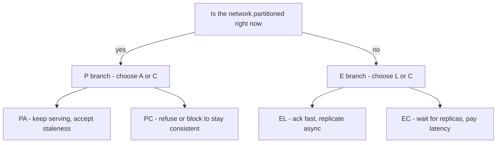

# PACELC

[[CAP Theorem]] only speaks about the rare moments when the network is partitioned. PACELC (pronounced "pass-elk"), proposed by Daniel Abadi, adds the missing half: **even when the network is healthy, a replicated system must trade latency against consistency on every single operation**. The full statement: **if Partition, choose Availability or Consistency; Else, choose Latency or Consistency.** The "Else" clause describes 99.99% of your system's life, which is why PACELC predicts real design decisions far better than CAP does.

## Why this matters

Partitions are rare; replication is constant. Every write to a replicated system faces the same question *all the time*: do we wait for replicas to confirm (consistent, slow) or acknowledge immediately and replicate in the background (fast, temporarily inconsistent)? That is a **latency vs consistency** trade, and it exists with a perfectly healthy network because confirmation takes at least one network round trip — and cross-region, that's tens to hundreds of milliseconds of physics ([[Latency Numbers Every Engineer Should Know]]).

CAP cannot explain why Dynamo-style systems ([[The Dynamo Paper]]) chose eventual consistency: Amazon's motivation was *latency during normal operation* (shopping-cart writes had to be fast, always), not partition behaviour. PACELC names that motivation. When you see a system default to asynchronous [[Replication]], you are looking at an EL decision, not a PA one.

## How it works

PACELC splits a system's behaviour into two regimes and asks one question per regime:

- **P branch (partition):** same forced choice as CAP — availability (PA) or consistency (PC).
- **E branch (else / normal operation):** acknowledge writes before replication completes and serve reads from any replica (EL — low latency, weaker consistency), or coordinate synchronously — quorum writes, leader round trips, commit waits (EC — consistent, higher latency). The mechanics of that coordination are [[Quorum Reads and Writes]] and [[Consensus and Raft]].

A system gets a two-part label: **PA/EL** (available under partition, fast normally), **PC/EC** (consistent in both regimes), **PA/EC**, or **PC/EL**. The labels describe *default baseline behaviour* — most systems are tunable per operation.

### Classifying well-known systems (per Abadi, plus noted updates)

| System | Partition | Else | Reasoning |
|---|---|---|---|
| Dynamo / Cassandra / Riak | **PA** | **EL** | Built for always-writable, low-latency operation; conflicts resolved after the fact ([[Cassandra and Wide-Column Stores]]) |
| DynamoDB | **PA** | **EL** | Default eventually consistent reads are cheaper and faster; strongly consistent reads are an opt-in per request ([[DynamoDB Design]]) |
| MongoDB | **PA** | **EC** | Abadi's original classification: the baseline design routes through a primary (consistent when healthy), but un-replicated writes could be rolled back around partitions. With majority write/read concern it behaves PC/EC — a good example of configuration moving the label ([[MongoDB Architecture]]) |
| Spanner / Bigtable-era Google stack | **PC** | **EC** | Spanner pays commit-wait and synchronous Paxos replication for external consistency ([[Bigtable and Spanner]], [[Google Spanner Deep Dive]]) |
| Yahoo PNUTS | **PC** | **EL** | The famous odd quadrant: relaxes consistency for latency normally (timeline consistency via a master per record), but under partition sacrifices availability rather than consistency |
| ZooKeeper / etcd | **PC** | **EC** | Consensus systems: a quorum round trip on every write ([[Consensus and Raft]]) |

Two honest qualifications: these labels are from Abadi's 2012 analysis plus vendor documentation since, and systems evolve; and a single label flattens per-operation tunability (Cassandra at `ALL` is EC-ish; DynamoDB with strongly consistent reads is EC-ish on reads). Use the label as the *default posture*, then check the configuration.

### What consistency actually costs, in round trips

The ELC trade is not philosophical; it is arithmetic you can do in an interview. Coordination costs **round trips**, and round trips have a floor set by distance. Approximate, order-of-magnitude figures (see [[Latency Numbers Every Engineer Should Know]] for the full table):

| Coordination scope | One round trip, roughly | What an EC write costs |
|---|---|---|
| Same host, process to process | tens of microseconds | negligible |
| Same availability zone | under a millisecond | sub-millisecond — EC is nearly free here |
| Across AZs in one region | ~1 millisecond, low single digits | a few milliseconds per quorum write |
| Mumbai to Singapore | tens of milliseconds | tens of milliseconds, per write |
| Mumbai to Virginia | roughly 180 to 250 ms round trip | the write latency budget is gone |

Read the table as a *rule for where to put your quorum*. Intra-region EC is so cheap that choosing EL inside one region is usually a false economy — you give up recency to save a couple of milliseconds. Cross-continent EC is so expensive that it forces an architectural answer rather than a configuration one: either accept the latency (what [[Google Spanner Deep Dive]] does, deliberately, for workloads that need it), keep each quorum regional and replicate between regions asynchronously, or partition the data so each record has a home region and is written only there.

That last option deserves a name because it resolves more real arguments than any knob: **put the data where the writes are.** A user's records live in their own region's quorum, so their writes are EC and fast; the other region holds an async copy used for reads and disaster recovery. You have not escaped PACELC — you have scoped the EC decision to a distance where it is affordable.

Two caveats so the arithmetic stays honest. These are propagation floors between data centres, not measured numbers for any specific path — measure your own. And a quorum write waits for the *Wth fastest* replica plus disk persistence plus queueing, so the round trip is a lower bound on latency, never an estimate of it.

### Why the ELC half explains more than CAP

- It applies **continuously**, not only during rare faults.
- It explains **product defaults**: DynamoDB's eventually-consistent-by-default reads (EL) are priced lower than strongly consistent ones — the trade-off is literally on the bill.
- It explains **geo-replication designs**: multi-region active-active with async replication is an EL choice made for user-perceived latency, accepted long before any partition happens.
- It gives interview answers teeth: "I'll replicate asynchronously to the second region" *is* an EL decision with a named cost — potential data loss window on regional failover ([[Disaster Recovery]], [[Failover]]).

### PACELC beyond databases

The framework is usually taught on datastores, but it classifies anything that keeps a copy of a fact somewhere other than where the fact is decided — which is most of a modern stack. Applying it widely is where it earns its keep in design reviews.

| Component | The copy it keeps | Normal-operation posture | What the staleness bound is |
|---|---|---|---|
| DNS | Name to address mapping | EL, aggressively | The record's TTL ([[How DNS Works]]) |
| CDN edge cache | Response bodies | EL | TTL, or until an explicit purge ([[CDN]]) |
| Application cache | Database rows | EL | TTL, or until invalidation fires ([[Caching Strategies]]) |
| Service registry | Which instances are healthy | EL | Health-check interval plus propagation ([[Health Checks and Service Discovery]]) |
| JWT claims | Authorisation state at issuance | EL | Token lifetime — a revoked user stays valid until expiry ([[JWT Pitfalls]]) |
| Read model in CQRS | A projection of events | EL | Consumer lag ([[CQRS]]) |
| Consensus store — etcd, ZooKeeper | Cluster and config state | EC | None; that is what you pay the quorum for ([[Consensus and Raft]]) |

The row most people have never thought of as a consistency decision is the JWT one, and it is the one that bites hardest in a regulated system: a short-lived token is an EC-leaning choice (revocation propagates fast, every request pays more IAM traffic), a long-lived token is EL (cheap, but a disabled account keeps working until expiry). Token lifetime is not a security setting with a conventional value — it is where you placed this system on the ELC axis, and it should be argued that way ([[Refresh Tokens and Token Rotation]]).

## Common misconceptions

- **"PACELC replaces CAP."** It contains CAP (the PAC part) and extends it. The proof burden is CAP's; PACELC is a design taxonomy, not a theorem.
- **"EL means inconsistent."** EL means *weaker than linearizable by default* — usually still with strong session guarantees available ([[Consistency Models]]). Most EL systems let you buy consistency per operation.
- **"EC means slow."** EC means you pay coordination latency — a quorum round trip within a region is single-digit milliseconds. It's cross-region EC (like Spanner's commit wait) that gets expensive.
- **"One label per database, forever."** Same trap as calling databases CP or AP — configuration (write concern, read concern, consistency level, replication mode) moves a system across quadrants per operation.
- **"EL is a performance optimisation."** It is a correctness *concession* bought with latency. The distinction matters because optimisations can be applied late and reverted freely, whereas a concession changes what application code may assume — code written against an EC path and later moved to EL does not get slower, it gets wrong.
- **"We chose EC, so our reads are fresh."** Consistency is per *path*, not per system. A majority-committed write read back through a cache, a search index, a read replica, or a consumer-updated projection arrives through an EL path regardless of how the write was acknowledged. Trace the whole path a value travels before claiming anything about it ([[Cache Invalidation]], [[CQRS]]).

### Deriving the choice instead of arguing about it

A short procedure that converts the debate into a decision, per operation:

1. **Does this read gate a decision or render a screen?** Gating a decision — authorisation, uniqueness, balance sufficiency — means EC or a conditional write that enforces the invariant atomically. Rendering a screen means EL is on the table.
2. **What is the blast radius of staleness measured in seconds?** A stale KYC status for 200 ms harms nobody. A stale balance for 200 ms can authorise an overdraft. Put a number and a consequence next to the word "stale" or the discussion stays aesthetic.
3. **How far must coordination travel?** Use the table above. Intra-AZ and intra-region EC is cheap enough that EL needs a real justification; cross-region EC needs an architecture, not a flag.
4. **If EL, which session guarantee do you owe the user?** Almost every "eventual consistency bug" users report is actually a missing read-your-writes or monotonic-reads guarantee, which is far cheaper than full consistency ([[Consistency Models]], [[Read Your Own Writes and Replica Lag Anomalies]]).
5. **Write the choice down next to the endpoint.** "This read is EL, bounded by replica lag, with read-your-writes for the authoring session" is reviewable. "We use Mongo" is not.

### What this looks like at 3am

EL incidents do not look like outages; they look like **disagreement between two screens**. A support agent's dashboard says the transfer completed, the customer's app says pending, and both are querying "the same system". The page, if there is one, is usually replica lag crossing a threshold — and the first instinct, to restart something, is almost always wrong.

The productive question is *which path does each screen read through?* Typically the agent tool reads the primary and the app reads a cache or a secondary, so the two are separated by exactly one EL hop that nobody documented. The second question is what *caused* the lag, because lag is a symptom with a small number of causes: a long-running write that the secondary is replaying, an index build, a saturated replication link, or a consumer that fell behind and is still catching up ([[Backpressure and Flow Control]]). The tell that distinguishes an EL anomaly from genuine data loss is that it **heals on its own**: query again in thirty seconds and the disagreement is gone. If it does not heal, you are no longer looking at an ELC trade — you are looking at a write that was never applied, and that is a different and more serious investigation.

## In your stack

- MongoDB with `w: majority` + `readConcern: majority` is you choosing EC: every acknowledged write has survived a majority — the latency cost is the replication round trip. Default `w: 1` writes are the EL corner, and their cost is the rollback window on failover. For ledger-like data, majority is the only defensible setting.
- Redis cache-aside is a deliberate EL architecture: you serve possibly-stale values with sub-millisecond latency because MongoDB holds the truth — see [[Caching Strategies]] and [[Cache Invalidation]].
- Kafka's `acks=all` vs `acks=1` producer setting is PACELC-in-miniature for the broker: wait for in-sync replicas (EC) or ack fast and risk loss on leader failure (EL) — see [[Kafka Architecture]].
- When a design review asks "should this read go to a Mongo secondary?", translate it: "is this operation EL-tolerant?" For displaying KYC status, probably yes. For deciding whether to release funds, no — see the operation-splitting logic in [[CAP Theorem]]'s check-yourself section.
- Your single largest EL surface is not a database setting at all — it is **Redis in front of Mongo**. Every cache-aside read is an EL decision whose staleness bound is the TTL, and every TTL in the codebase is therefore an unlabelled consistency parameter. Reviewing TTLs as consistency decisions rather than memory decisions usually finds at least one read that should never have been cached.
- Because your replicas live within one region, the EC option is genuinely cheap for you: majority write concern costs a cross-AZ round trip in the low single-digit milliseconds, not a cross-continent one. That makes "we used `w: 1` for speed" hard to defend on a money path — the saving is small and the exposure is a rollback window on failover ([[Failover]]).
- Each hop of a flow gets its own label, and the weakest hop sets the user-visible behaviour. Kong to service to Mongo to SQS to consumer to projection: a majority-committed write followed by an async event followed by a consumer-updated read model is EL end to end, no matter how strong the first hop was. Say it in design docs as a chain, not a single verdict.
- Partner-bank calls are the one hop where neither label applies cleanly: you cannot choose their consistency, only your handling of ambiguity. That is why those hops get status-check and reconciliation jobs instead of consistency settings ([[Idempotency]]).

## Interview angle

PACELC is a strong differentiator: most candidates know CAP; few can say why Dynamo was *actually* designed the way it was. Lead with the one-liner, then classify the system under discussion.

The 60-second version: "PACELC, from Daniel Abadi, extends CAP: if a Partition occurs, trade Availability vs Consistency; Else — in normal operation — trade Latency vs Consistency, because waiting for replicas costs round trips. The ELC half matters more in practice since partitions are rare but replication is constant. Dynamo-family systems are PA/EL — always writable and fast, eventually consistent. Spanner is PC/EC — it pays commit-wait latency for external consistency. PNUTS is the interesting PC/EL corner. And the labels really attach to configurations, not databases — Cassandra at QUORUM and at ONE are different animals."

Classic follow-ups: "Why did Amazon pick eventual consistency for the cart?" (EL — latency SLA on writes, plus always-writable; partition tolerance came along). "Show me a PACELC decision in a system you've built" — have your MongoDB write-concern or cache-aside story ready.

## Check yourself

> [!question]- Q: State PACELC and explain why the second half applies even on a perfectly healthy network.
> If a Partition occurs, choose Availability or Consistency; Else, choose Latency or Consistency. The second half applies always because replication requires communication: a write is either acknowledged after replicas confirm (consistent, at least one round trip slower) or before (fast, with a window where replicas disagree). Physics makes the round trip non-zero, so the trade-off exists on every operation, not just during faults.

> [!question]- Q: Scenario — a product team wants global p99 write latency under 50 ms for a user-profile service with users in India and Europe. What PACELC posture does that force, and what is the cost?
> Cross-region synchronous replication costs 100+ ms round trips, so 50 ms forces EL: acknowledge writes in the local region and replicate asynchronously. Costs: a replication-lag window where the other region reads stale profiles (mitigate with session guarantees like read-your-writes — [[Read Your Own Writes and Replica Lag Anomalies]]), and a small data-loss window if a region fails before replicating ([[Disaster Recovery]]). For user profiles that's usually acceptable; for balances it wouldn't be.

> [!question]- Q: What makes PNUTS the "interesting quadrant", and can you reason out why a system would choose PC/EL?
> PC/EL relaxes consistency in normal operation for latency, yet refuses availability during partitions. PNUTS routed each record's writes through a per-record master and gave timeline (not linearizable) consistency normally — that's EL. During a partition, a record whose master is unreachable can't be written — sacrificing availability rather than allowing conflicting writes — that's PC. The combination says: "we never want conflicting versions to exist (no merge logic), but we also won't pay synchronous replication on every write."

> [!question]- Q: Scenario — a team moves a read from the Mongo primary to a secondary and p99 read latency improves slightly. A week later, support tickets appear saying a status "reverts" on refresh. What happened, what is the cheap fix, and what is the lesson about EL choices?
> The move swapped an EC-ish read for an EL read. Two anomalies are now possible and both are showing. The user writes, then reads a secondary that has not applied the write yet — no read-your-writes — so the new status is missing; and because requests land on different secondaries with different lag, consecutive refreshes can show new, then old, then new — no monotonic reads. Nothing is broken; the contract changed and nobody wrote the contract down. The cheap fix is not to revert but to buy back only the guarantee users notice: a causally consistent session, or pinning that user's reads to the primary for a short window after their own write, or carrying a last-seen version and rejecting older reads ([[Read Your Own Writes and Replica Lag Anomalies]]). The lesson is that the EL benefit was tiny and local — a couple of milliseconds intra-region — while the cost was a user-visible anomaly class. EL pays well across distance and poorly across an availability zone; before trading consistency, check that the latency you are buying is actually worth something.

> [!question]- Q: Mini design prompt — classify your notification system: Kafka topic consumed by a service that writes delivery status to MongoDB. Where are the PACELC decisions?
> Producer → Kafka: `acks=all` with `min.insync.replicas=2` is EC (durable, slower); `acks=1` is EL. Kafka itself under partition favours consistency for committed records (only in-sync replicas can lead, unless unclean election is enabled — a PA override). Service → MongoDB: `w: majority` is EC; `w: 1` is EL with rollback risk. Consumer reads are at-least-once either way, so [[Idempotency]] in the status writer matters more than any of these knobs. The exercise shows PACELC is decided per hop, not per system.

## Sources

- Daniel J. Abadi, "Consistency Tradeoffs in Modern Distributed Database System Design: CAP is Only Part of the Story", IEEE Computer, 45(2), 2012 — the PACELC paper (the idea first appeared on his DBMS Musings blog, 2010).
- Daniel Abadi, DBMS Musings blog, "Problems with CAP, and Yahoo's little known NoSQL system" (2010) — the PNUTS discussion.
- Martin Kleppmann, *DDIA*, Chapter 9 — linearizability's latency cost (and the Attiya–Welch result showing linearizability is inherently slow).
- Amazon, "Dynamo: Amazon's Highly Available Key-value Store", SOSP 2007 — the canonical PA/EL design rationale.
- Brian F. Cooper et al., "PNUTS: Yahoo!'s Hosted Data Serving Platform", VLDB 2008.
