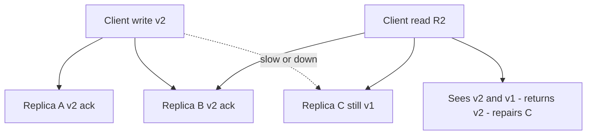

# Quorum Reads and Writes

A **quorum** is a minimum number of nodes that must participate in an operation for it to count. The tunable version — N replicas, W acknowledgements per write, R responses per read — is the control panel of leaderless replication systems (Dynamo, Cassandra, Riak), and the intuition **R + W > N** ("reads and writes must overlap on at least one node") is one of the most-quoted formulas in system design. This note gives you the formula, a worked N=3 example, and — just as important — the fine print: why quorum overlap alone does *not* give you linearizability.

## Why this matters

Leaderless [[Replication]] has no primary deciding the order of writes; clients (or coordinators) write to many replicas directly. Quorums are what stand between that design and chaos: they let you dial each operation anywhere from "fast and sloppy" (R=1, W=1) to "safe and slow" (R=N or W=N), per query. Every Cassandra consistency level, every DynamoDB internal setting, every etcd majority rule is an instance of this arithmetic — and interviews love it because the math is checkable in your head. Misunderstanding the fine print, though, produces systems that *look* strongly consistent in tests and return stale data under concurrency and failure.

## How it works

Parameters:

- **N** — replication factor: how many nodes store a copy of this key (often 3).
- **W** — write quorum: acknowledgements required before the write is reported successful.
- **R** — read quorum: replicas consulted per read; the newest version among them (by version number) wins.

**The overlap intuition.** If R + W > N, the set of nodes that acknowledged any successful write and the set consulted by any later read must intersect (two subsets of N nodes with sizes summing past N always share a member). So at least one replica in every read set holds the latest successful write; version numbers let the reader pick it.

**Worked example, N = 3.** Replicas A, B, C hold key `k`, version v1.

- **W=2, R=2 (classic quorum):** a write of v2 succeeds after A and B acknowledge; C is lagging. A read consults any 2 of {A, B, C}: {A,C} → sees v2 and v1, returns v2; {B,C} → returns v2; {A,B} → v2. Overlap guarantees every pair includes A or B. The read also learns C is stale and can write v2 back to it — **read repair**.
- **W=1, R=1:** write acks after just A. Reads of {B} or {C} return v1 — stale. Fast, available, eventually consistent ([[Consistency Models]]); anti-entropy must catch C and B up in the background.
- **W=3, R=1:** every replica has each write before ack, so any single-replica read is current — until one node is down, and then *all writes fail*. High W trades write availability for read cheapness; W=1/R=3 trades the other way.
- **Tolerating failures:** with N=3, W=2, R=2 you tolerate one node down for both reads and writes. Availability math for more nines lives in [[Availability Reliability Durability]].

**The dial, tabulated.** With N = 3 fixed, every setting is a different product decision:

| W | R | Overlap? | Tolerates | Write cost | Read cost | Fits |
|---|---|---|---|---|---|---|
| 1 | 1 | No | 2 nodes down | Lowest | Lowest | Telemetry, view counters, anything self-correcting |
| 2 | 2 | Yes | 1 node down either way | Balanced | Balanced | The default for most workloads |
| 1 | 3 | Yes | 2 down for writes, 0 for reads | Lowest | Highest | Write-heavy ingest read rarely and carefully |
| 3 | 1 | Yes | 0 down for writes, 2 for reads | Highest | Lowest | Read-heavy reference data that changes rarely |
| 2 | 1 | No | 1 down for writes, 2 for reads | Balanced | Lowest | Explicitly eventual; convergence by anti-entropy |

Two readings worth internalising. First, **W and R are a seesaw**: making one side cheap makes the other expensive or makes the overlap vanish — there is no setting that is simultaneously fast to write, fast to read, and overlap-guaranteed. Second, **high W is an availability tax on writes**: at W = N a single slow node (not even a dead one) stalls every write, which is why W = N is rare outside configuration data.

**Anti-entropy — what repairs the replicas you did not read.** Read repair only fixes keys someone happened to read; cold keys would drift forever. Dynamo-descended systems therefore run a background **anti-entropy** process that compares replicas pairwise and ships the differences. Comparing every key would be prohibitive, so replicas exchange **Merkle trees**: a hash tree over the key range, where two replicas descend only into subtrees whose hashes differ, so the comparison cost scales with the amount of divergence rather than the amount of data. Gossip ([[The Dynamo Paper]]) spreads membership and failure information on the same background path. The practical consequence: "eventually consistent" has a concrete, tunable *eventually* — it is the anti-entropy cycle time, and if that job is broken or throttled, "eventually" quietly becomes "never".

**How stale is a partial quorum, really?** When R + W ≤ N you have given up the overlap guarantee, but not necessarily much freshness. Bailis et al.'s **Probabilistically Bounded Staleness** work (VLDB 2012) modelled exactly this: given replication latencies, what is the probability a partial-quorum read is stale, and by how much? Their finding, and the reason Dynamo-style defaults are tolerable in practice, is that real systems converge far faster than the worst case — staleness windows measured in milliseconds for well-connected clusters. Treat that as a *reason the defaults feel fine*, never as a guarantee: a probability is not a contract, and the tail is where money lives.

**Sloppy quorums and hinted handoff.** Strict quorums fail writes when fewer than W of the *home* replicas are reachable. Dynamo-style systems ([[The Dynamo Paper]]) prefer availability: a **sloppy quorum** accepts the write on W reachable nodes *even if some aren't home replicas*; the stand-ins store a **hint** ("this belongs to C") and hand the data off when C recovers. Crucial consequence: during the sloppy period, R + W > N **no longer guarantees overlap** — the read quorum consults home replicas while the latest write sits on a neighbour. Sloppy quorums are an explicit PA/EL move ([[PACELC]]): durability and availability up, read-latest guarantee gone.

**Witness replicas.** A full replica costs storage and write bandwidth. A **witness** participates in quorum *voting* (and typically stores logs/metadata or acts as a tiebreaker) without storing a full data copy — letting you keep quorum sizes (e.g., 2-of-3 across three sites) at closer to two copies' storage cost. Variants appear in Spanner (witness regions in multi-region configs), Cassandra's experimental "transient replication", and classic replicated-voting literature (Pâris, 1986). The trade: lose a data-bearing replica and the witness can vote but cannot serve the data — recovery options narrow.

**Three things called "quorum".** The word is overloaded, and conflating the three is the most common source of wrong answers in interviews and design docs:

| Flavour | Who orders writes | What the quorum decides | Guarantee you get | Examples |
|---|---|---|---|---|
| **Leaderless N/R/W** | Nobody — clients or coordinators write replicas directly | Whether an individual operation counts | Recency heuristic; conflicts possible | Dynamo, Cassandra, Riak |
| **Leader-based majority ack** | A single elected primary | How many replicas must hold a write before it is durable | Acknowledged writes survive minority loss; no concurrent-write conflicts | MongoDB `w: majority`, Kafka `acks=all` with `min.insync.replicas` |
| **Consensus quorum** | An elected leader whose log *is* the order | The contents and order of one replicated log | Linearizable state | Raft in etcd, ZAB in ZooKeeper |

All three rely on the same arithmetic — two majorities of a set must intersect — but only the third turns that arithmetic into an ordering authority. When someone says "we use quorums so we're consistent", the useful question is: *which of these three, and what orders the writes?*

## Common misconceptions

The big one: **R + W > N does not make the system linearizable.** DDIA Chapter 9 is blunt about this. The holes:

- **Concurrent writes have no agreed order.** Two clients writing simultaneously may land in different orders on different replicas; version conflicts need vector clocks or LWW ([[Logical Clocks and Ordering]]), and LWW silently drops one write even with perfect quorums.
- **Read-during-write races.** While a write sits on 1 of 3 replicas mid-flight, one reader (hitting the written node) can return the new value while a *later* reader (hitting two untouched nodes) returns the old one — new-then-old across two clients violates linearizability even though both met R=2.
- **Partial write failure.** A write that reaches 1 node then fails (W unmet) is reported failed but **not rolled back** — later reads may or may not surface the "failed" value depending on which replicas they hit.
- **Read repair timing.** To approach linearizable reads, a reader must synchronously write back the newest value to stale quorum members *before* returning, and writers must read versions first — and even then, cross-client linearizability isn't fully achieved without consensus-grade machinery. Quorum overlap is a recency *heuristic*, not a consistency *proof*.
- **"Quorum" in Raft/etcd is the same thing.** Related but different: consensus quorums ([[Consensus and Raft]]) vote on *one agreed log order* under a leader and genuinely give linearizability; leaderless N/R/W quorums have no ordering authority — that's precisely what they gave up for availability.

Also commonly missed: R and W are per-operation dials, so one table can serve `R=1` dashboards and `R=QUORUM` decision reads simultaneously.

### The read-during-write race, step by step

This is the anomaly most people nod past, so walk it concretely. N=3 over replicas A, B, C; W=2, R=2; key `k` starts at v1. Alice writes v2; Bob and Carol read.

| Time | Event | State |
|---|---|---|
| t0 | Alice's write of v2 starts; reaches A only so far | A=v2, B=v1, C=v1 |
| t1 | Carol reads, coordinator consults {A, B} | sees v2 and v1 → **returns v2** |
| t2 | Bob reads, coordinator consults {B, C} | sees v1 and v1 → **returns v1** |
| t3 | Alice's write reaches B; W=2 satisfied, write acknowledged | A=v2, B=v2, C=v1 |

Carol read the new value at t1; Bob, reading *later* at t2, read the old one. Both reads honoured R=2. Nothing failed and nothing was misconfigured. Raising R to 3 closes *this* window — every read would then see A's v2 — but it costs you the ability to read at all while any replica is down, and the mirror configuration brings the anomaly straight back: at W=3, R=1 (also satisfying R+W>N) a write in flight has reached A but not C, so Carol reading A sees v2 and Bob, reading C later, sees v1. Under linearizability ([[Consistency Models]]) this sequence is simply illegal: once any read has observed v2, no later read may observe v1. Quorums do not forbid it, because no node is responsible for knowing that Carol's read happened. That responsibility — a single authority ordering operations in real time — is what consensus provides and what leaderless quorums deliberately traded away.

### Choosing N, R and W from requirements

A short derivation beats memorised defaults:

1. **Start from durability.** How many simultaneous copies can you afford to lose? That sets N and, more importantly, their placement across failure domains.
2. **Set W from the write-availability target.** W = N minus the number of node failures writes must survive. Money paths usually want W = majority so an acknowledged write is on a quorum and cannot be lost to a single failure.
3. **Set R from the recency requirement, then check overlap.** If the read gates a decision, demand R + W > N and verify the arithmetic against the *current* N. If the read only renders a screen, R = 1 is a legitimate, cheaper answer.
4. **Write down what you gave up.** "This path is eventually consistent, bounded by the anti-entropy cycle" is a design statement someone can review. "We use quorums" is not.

## Failure modes

- **The slowest replica sets your latency.** A quorum waits for the *Wth fastest* response, so at W=2, N=3 you are always paying the second-fastest node's latency. One degraded disk or a GC-pausing node moves your p99 even though nothing is "down" — the classic grey failure, and the reason coordinators use speculative/hedged requests to extra replicas.
- **Quorum arithmetic broken by topology.** N=3 with two replicas in one availability zone means losing that AZ loses the quorum, even though "we tolerate one node failure" is technically true. Count *failure domains*, not nodes ([[Availability Reliability Durability]]).
- **Replication factor changed without re-deriving R and W.** Growing N from 3 to 5 while leaving W=2, R=2 silently drops you from overlap (2+2 > 3) to no overlap (2+2 < 5). Nothing errors; reads simply begin missing writes.
- **Anti-entropy disabled or starved.** Repair jobs are often throttled to protect foreground latency, then forgotten. Divergence accumulates on cold keys and surfaces months later as "this record has two different values depending on which node answered".
- **Sloppy-quorum writes stranded.** A node holding hints dies before handing them off; those writes exist nowhere else. Acknowledged-and-then-lost is the ugliest failure in this family because the client was told "success".
- **Tombstone and conflict debris.** Deletes must be stored as tombstones (otherwise an un-repaired replica resurrects the row during anti-entropy); they then need their own expiry policy, and expiring them too early resurrects data.

### What this looks like at 3am

The page is not "quorum failure" — quorum failures are explicit and legible. It is **"support says a customer's status keeps flipping"**. You query the API five times and get the new value three times and the old value twice. Logs show no errors; every read returned `200`. What happened: a write was acknowledged at W=1 (or the overlap was lost by an N change, or a sloppy quorum stashed it on a stand-in), so some replicas have v2 and some have v1, and your load balancer is round-robining between coordinators that consult different read sets. The tell is **non-determinism without errors** — the same request, repeated, returning different answers. The fix at 3am is to raise the read consistency level for that path (turn R up) to stop the bleeding; the fix the next morning is to work out *why* the write never reached a quorum, because raising R hides the symptom while the underlying replica stays stale.

## In your stack

- MongoDB's `w: majority` write concern and `readConcern: majority` are quorum mechanics riding on a *leader-based* replica set — the primary orders writes, which closes the concurrent-write hole leaderless quorums have ([[MongoDB Architecture]]). The overlap math still explains why majority/majority reads don't see rolled-back data.
- Cassandra at `LOCAL_QUORUM` read + write is the direct N/R/W implementation if you adopt it for any workload ([[Cassandra and Wide-Column Stores]]); remember the linearizability caveats above before using it to gate decisions — that's what its (Paxos-based) lightweight transactions are for.
- Kafka's `acks=all` + `min.insync.replicas=2` with RF=3 is quorum-overlap durability for the log: a committed record survives one broker loss ([[Kafka Architecture]]).
- Redis gives you *no* quorum options on the data path — replication is async, full stop; quorum there only elects who fails over ([[Redis Cluster and Sentinel]]). Don't map N/R/W intuitions onto it.
- Fintech angle: quorum-stale reads are fine for dashboards, never for authorization. The "can this account go negative?" check belongs on a single-writer, majority-committed path, with [[Idempotency]] handling the retries.
- A practical Mongo detail that *is* quorum arithmetic: a 3-member replica set with one arbiter has only two data-bearing members, so `w: majority` means "both data nodes" — lose either and acknowledged writes stop. Arbiters make elections cheaper and durability worse; count voting members and data-bearing members separately. (As of MongoDB 5.0 the default write concern is `majority`, with documented exceptions when arbiters are present — check the deployment rather than assuming either way.)
- The quorum you depend on most is one you do not operate: **etcd behind EKS**. Its majority rule is why a control-plane quorum loss stops reschedules even though running pods survive — and with services pinned at 1 replica, "cannot reschedule" *is* an outage for anything that happens to restart during that window ([[Consensus and Raft]]).
- A cheap habit for design reviews: whenever someone says "we have 3 copies", ask the three follow-ups — *how many must ack a write, how many are read, and how many are in one AZ?* Most "we're replicated" claims fall apart on the third question.

## Interview angle

Quorums come up two ways: directly ("explain R+W>N") and embedded ("how does Dynamo stay available when a node dies?" → sloppy quorums + hinted handoff). Scoring well means doing the N=3 arithmetic instantly *and* volunteering the limits unprompted — the second half is what separates memorization from understanding.

The 60-second version: "Leaderless stores replicate each key to N nodes; writes need W acks, reads consult R and take the newest version. R+W>N forces the read set to overlap every successful write set, so some replica in each read holds the latest write — with read repair patching stragglers. N=3, R=W=2 tolerates one node down either way. But overlap is weaker than linearizability: concurrent writes still conflict, failed partial writes linger, and a read racing a write can give new-then-old to successive readers. Dynamo-style sloppy quorums go further — any W reachable nodes accept the write with hints for the home replicas — buying availability at the cost of even the overlap guarantee. If I need actual linearizability I use consensus, not arithmetic."

Classic follow-ups: "What does R=3,W=1 optimize for?" (write latency/availability; read-heavy correctness); "Why is W=2,R=2,N=4 weaker than it looks?" (R+W=N, no overlap); "Sloppy vs strict quorum?"; "How do witnesses cut cost?"

## Check yourself

> [!question]- Q: Explain why R + W > N guarantees a read sees the latest successful write — and name two situations where the guarantee still fails.
> Any successful write landed on a set of ≥W replicas; any read consults ≥R. Since W + R exceeds N, the two sets must share at least one node, which holds the latest write; versioning lets the reader prefer it. Failures: (1) sloppy quorums — the write's W nodes may include stand-ins outside the home set the reader consults; (2) a partially-failed write (reached <W nodes, reported failed, not rolled back) can surface or vanish depending on read set; (3) two concurrent writes both "succeed" with no agreed order — overlap can't rank them.

> [!question]- Q: Scenario — N=3, W=2, R=2. A write of v2 reaches replica A, then the client crashes; B and C still have v1. Three reads follow: {A,B}, {B,C}, {A,C}. What does each return, and what's the system-level verdict?
> {A,B}: sees v2 (A) and v1 (B) → returns v2, likely repairs B. {B,C}: sees only v1 → returns v1. {A,C}: returns v2, repairs C. So a *failed* write (never met W=2) is visible to some readers and not others, and read order across clients can go v2-then-v1 — exactly the anomaly that makes quorum systems non-linearizable without extra care. Mitigations: synchronous read repair before responding, and clients treating "write failed" as "state unknown, retry idempotently" — see [[Idempotency]].

> [!question]- Q: Your team proposes N=2, W=1, R=1 "for speed" on a user-preferences store. What are they actually signing up for?
> R+W = 2 = N: no overlap guarantee at all. Any read may miss any write until anti-entropy converges — pure eventual consistency. One node down: writes still succeed (W=1) but half the reads go stale or fail. Also, failed-write residue and concurrent-write conflicts with no quorum to arbitrate. For preferences this may be perfectly fine — but it should be chosen as "eventual consistency is acceptable here", not as "quorums make it safe", because no quorum property is in effect.

> [!question]- Q: Scenario — a growing cluster is resized from N=3 to N=5 for durability. Client config still says W=2, R=2. A week later, support reports intermittently stale profile reads. Explain the mechanism and the two candidate fixes.
> The resize silently broke overlap: 2 + 2 = 4, which is not greater than 5, so a write's ack set and a read's consult set can be disjoint — a read can legitimately consult three replicas that never received the write. Nothing errors, and it is intermittent because it depends on which replicas each coordinator happens to contact. Fix A: restore overlap by raising the quorum to the new N — W=3, R=3 (or W=3, R=2 if reads matter more than write latency); the cost is extra latency and less failure tolerance per operation. Fix B: decide this data does not need recency, document it as eventually consistent, and make the staleness bounded and visible — rely on anti-entropy plus a session guarantee (read-your-writes) for the user's own edits, per [[Read Your Own Writes and Replica Lag Anomalies]]. The wrong fix is leaving W and R alone and adding retries: retries re-roll the dice on which replicas answer, which makes the anomaly rarer and much harder to diagnose.

> [!question]- Q: Mini design prompt — three datacenters, you want writes to survive a full DC loss but can only afford two full data copies. Sketch a quorum design.
> Place full replicas in DC1 and DC2 and a witness in DC3: N=3 for voting, 2 data-bearing. Writes require W=2 acks — both data replicas, or one data replica plus the witness (which records the vote/log but not full data). Lose any one DC and a 2-of-3 quorum survives, so writes continue. Cost honestly stated: if the surviving quorum is "one data node + witness", you're down to one full copy until recovery — durability risk is elevated, and reads must target the surviving data node. This is the Spanner witness-region pattern at small scale.

## Sources

- DeCandia et al., "Dynamo: Amazon's Highly Available Key-value Store", SOSP 2007 — N/R/W, sloppy quorums, hinted handoff.
- Martin Kleppmann, *DDIA*, Chapter 5 "Replication" (quorums, read repair, sloppy quorums) and Chapter 9 ("Linearizability and quorums" — the race anomaly).
- Gifford, "Weighted Voting for Replicated Data", SOSP 1979 — the original quorum voting scheme.
- Pâris, "Voting with Witnesses: A Consistency Scheme for Replicated Files", ICDCS 1986 — witness replicas.
- Bailis et al., "Probabilistically Bounded Staleness for Practical Partial Quorums", VLDB 2012 — how stale partial quorums actually are, measured rather than assumed.
- Google Cloud Spanner documentation — witness regions in multi-region configurations.
