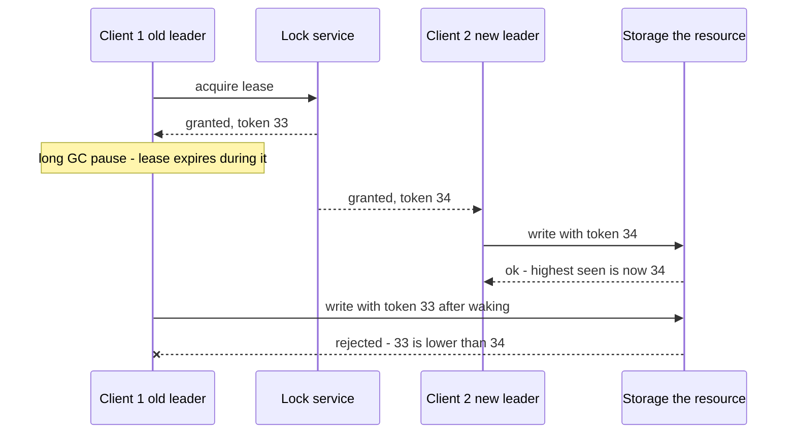

# Split Brain and Fencing

**Split brain** is the condition where two nodes simultaneously believe they hold an exclusive role — two database primaries, two lock holders, two active schedulers — and both act on it. It is the single most destructive failure in replicated systems because both sides accept writes, histories diverge, and *there is no clean merge afterwards*. The defenses come in two layers: **prevention** (quorum-based election — only one side can win) and **containment** (**fencing** — even if a stale leader exists, the resources it touches reject it). The deep lesson of this note: you can never fully trust a node's *own belief* that it holds a role, so the *resource being protected* must be able to say no.

## The problem that created it

Your system grew a high-availability pair: primary database, standby watching it, automatic [[Failover]]. One day a switch hiccups for 20 seconds ([[Network Partitions and Timeouts]]). The standby, hearing no heartbeats, concludes the primary is dead and promotes itself. But the primary never died — it's serving clients on its side of the partition. Now two primaries accept writes: account 42 is debited ₹5,000 on one and ₹3,000 on the other. When the partition heals, you don't have a database, you have two contradictory histories and a manual reconciliation project — some updates must be discarded (this is exactly how real incidents like GitHub's 2012 split-brain failover played out, and the class of incident MySQL/Redis async-failover setups are prone to; DDIA ch. 5 and 8 document the pattern).

The root cause is epistemic, not mechanical: **a timeout cannot distinguish a dead node from a slow or partitioned one** (fallacy 1, [[The Fallacies of Distributed Computing]]). Any failover triggered by silence is a *guess*. Worse, the same wrong-belief arises with no partition at all — a long GC pause can freeze a leader mid-flight; it wakes up and continues *believing it is still leader*, because from its perspective no time passed. Kleppmann's canonical example (DDIA ch. 8, and his 2016 Redlock analysis): a client acquires a lock with a lease (say 30 seconds — the post itself gives no duration), pauses for a stop-the-world GC longer than the lease, and then — lease expired, lock granted to someone else — wakes and writes to the protected resource anyway. Two writers, no partition, pure pause.

## What it solves

What the defenses buy you:

- **Quorum-based election** prevents two *legitimate* leaders: a candidate needs majority assent, and two disjoint majorities cannot exist ([[Consensus and Raft]], [[Quorum Reads and Writes]]).
- **Fencing tokens** contain *illegitimate* leftovers: a deposed or paused ex-leader's writes are rejected by the resource itself, closing the GC-pause hole that elections alone cannot close.
- **STONITH** physically removes ambiguity by making sure the old leader is actually dead before the new one proceeds.
- Together they convert "two histories to reconcile" into "brief unavailability or a few rejected writes" — a trade any auditor will take.

## How it works

### Layer 1 — quorum-based election (prevention)

Make leadership a majority decision, not self-declaration. A node may act as leader only while it holds evidence of majority support: an elected term in Raft, a majority-granted lease from ZooKeeper/etcd, a MongoDB replica-set election. During a partition, at most one side has a majority; the minority side's candidate gets no quorum and *stays* a follower, and a minority-stranded old leader loses its lease/term and must step down. This is why serious HA systems deploy **odd numbers of nodes across three failure domains** — with two sites, a 50/50 split has no majority anywhere and the whole system halts (the honest cost of preferring consistency, per [[CAP Theorem]]).

Election prevents two *current* leaders. It cannot prevent a *stale* one acting on yesterday's belief — the deposed leader hasn't yet *heard* it was deposed, or is paused and will act later. Hence layer 2.

### Layer 2 — fencing tokens (containment)

Attach a **monotonically increasing number** to every grant of the role — Raft's term, ZooKeeper's zxid-derived epoch, the revision etcd assigns the lock key, an incrementing `epoch` column. Every request the leader makes to a protected resource (storage, database, partner API wrapper) carries its token. **The resource remembers the highest token it has seen and rejects anything lower.**

The design's crucial property: correctness no longer depends on the old leader *knowing* anything — it can be paused, partitioned, or deluded, and its writes still bounce. This is Kleppmann's core argument for why a lock/lease without fencing is unsafe for correctness-critical resources, and why Redis-based locks (Redlock) are contested: Redis can hand you a lock, but nothing issues a monotonic token the storage layer verifies — see [[Distributed Locking]] and [[Redis Beyond Caching]]. The requirement it imposes: *the resource must participate* — it needs a token check (a conditional write comparing epochs is often enough: `UPDATE ... WHERE epoch <= 34`). A resource that can't check tokens can't be fenced by tokens — which leads to the blunter instrument.

**Picking a token source.** Any monotonically increasing number works, but the sources differ in what they cost and what they assume:

| Source | Monotonic because | Good when | Watch out for |
|---|---|---|---|
| A consensus store's counter — etcd key revision, ZooKeeper zxid | Consensus guarantees it | You already run a consensus store | An operational dependency on that store being reachable |
| A Kubernetes Lease's `leaseTransitions` counter | It increments each time the lease changes holder | Your workloads already talk to the API server | Kubernetes documents `resourceVersion` as opaque, so use the transitions counter rather than comparing versions arithmetically |
| A counter incremented by a conditional write in your primary datastore | The store serialises the increment | You want no new infrastructure | The increment must be majority-durable, or a failover can reissue a token |
| A timestamp | **It is not monotonic** | Never, for fencing | Clock steps and skew reissue or reorder tokens ([[Logical Clocks and Ordering]]) |

The last row is the one people reach for, and it is the one that silently fails: a clock that steps backwards reissues a token already in use, and two hosts with skewed clocks issue tokens that compare in the wrong order. Fencing needs a *counter*, not a *clock*.

**What "the resource rejects it" means in code.** Often less work than it sounds. If the protected resource is a document in your primary store, fencing is a conditional update — the write carries the epoch and the predicate refuses anything lower than what the document already records. If it is a file in object storage, it is a precondition on the write. If it is an external API, it is whatever idempotency or sequence field the partner exposes. The pattern to avoid is a check that lives in the *caller*: `if (myEpoch >= currentEpoch) write()` reintroduces the race the whole mechanism exists to close, because the caller can be paused between the check and the write. The comparison must be executed by the thing being protected, atomically with the write it guards.

### Layer 3 — STONITH (containment by force)

**STONITH** — "Shoot The Other Node In The Head", from the Linux-HA/Pacemaker world — makes the dead-or-slow question moot by *making* the node dead: the cluster manager power-cycles the old primary via IPMI/PDU, detaches its virtual NIC or EBS volume, or revokes its security-group access before promoting the standby. Classic deployments pair it with resource-level exclusivity like SCSI-3 persistent reservations on shared disks. It's the right tool when the protected resource is dumb (a shared disk can't check epochs) — at the cost of needing an out-of-band control channel that must itself not be partitioned away, and the risk of mutual shooting in a symmetric partition (which is why STONITH setups also want a quorum or tiebreaker device).

## Trade-offs

| You gain | You pay |
|---|---|
| No divergent histories; failover becomes safe | Minority-side unavailability during partitions (quorum's price) |
| GC-pause/zombie-leader hole closed (fencing) | Every protected resource must store and check tokens — a real integration cost |
| Works even when the old leader is unreachable | Token checks add a conditional step to the write path |
| STONITH protects token-oblivious resources | Out-of-band kill infrastructure; false-positive shootings reduce availability |

## Failure modes

- **Fencing skipped "because we have elections":** the paused ex-leader writes after waking — the exact Kleppmann scenario. Detection is ugly: divergent data found later. Prevention is the whole point; retrofit via epoch columns + conditional writes.
- **Token checked in the app but not at the resource:** a second code path (cron job, support script) bypasses the check. The check must live at the resource/storage boundary, not in the well-behaved client.
- **Lease clock assumptions:** lease validity judged by the *client's* clock while the service uses its own — skew reopens the window ([[Logical Clocks and Ordering]]). Leases should be generous relative to pause/skew scales, and renewed well before expiry.
- **Two-node clusters:** no possible majority on a split; whichever side an operator (or a race) promotes, you've built split brain in. Add a third member or witness/tiebreaker ([[Quorum Reads and Writes]]).
- **STONITH misfire:** both sides try to shoot each other across the partition; or the kill channel shares fate with the partitioned network and nobody can shoot. Symptom: failover stalls at "fencing pending" — which is still better than diverging.
- **Fencing at the wrong granularity:** token guards the database but the leader also emits events/calls partner APIs unfenced — side effects diverge even though storage didn't. Every externally visible effect of the role needs fencing or [[Idempotency]].
- **Token acquired once and cached for the process lifetime:** a long-lived worker fetches its epoch at startup and reuses it for hours. It is now fenced against *other* holders but not against its own staleness — the epoch must be refreshed with the lease, and work must stop when renewal fails.
- **An operator manually promoting during a partition:** every automated safeguard can be overridden by a human who believes the other side is dead. Promotion runbooks need the same quorum or confirmed-death precondition the automation has, written down, because this decision is made under pressure at 3am.

### What this looks like at 3am

Split brain almost never pages you *as* split brain. It pages as a failover that looked successful — the alert cleared, the new primary is serving, someone posts "we're back" — and the real incident starts hours later when two records disagree, or a reconciliation job reports a count that cannot be right, or a customer is debited twice by a scheduler that ran in two places.

The diagnostic question is **"was anything writable on both sides during the window?"** Answer it before anything else, because it decides whether you are running a routine failover post-mortem or a data-divergence investigation. Three checks get you there: whether the old primary was reachable by clients during the gap (its own request logs answer this better than any monitoring, since it was by definition isolated from your monitoring's point of view), whether the promotion required a quorum or was forced, and whether writes acknowledged before the switch appear in the surviving history — in MongoDB terms, whether anything landed in rollback.

If both sides took writes, the instinct to resist is **fixing the data before you freeze it**. Stop writes to the affected keys first, snapshot both histories, and only then reconcile; otherwise ongoing traffic interleaves with your repair and you lose the ability to say what the state was. And write down the window's exact boundaries — start and end, to the second — because every downstream team, every reconciliation job, and the eventual incident report will need it, and reconstructing it later from logs is far harder than noting it now.

## When NOT to use it

- **Stateless workloads:** two replicas serving reads behind a load balancer is the *goal*, not split brain — role-exclusivity machinery only applies where exactly-one semantics matter ([[Stateless vs Stateful Services]]).
- **Naturally idempotent/commutative work:** if double execution is harmless (CRDT-merged data, set-based upserts, dedup-protected consumers — [[Idempotency]]), a brief double-leader costs little; heavy fencing may be over-engineering. Honest check: *every* effect must be safe, not just the main one.
- **Efficiency-only locks:** Kleppmann's own distinction — a lock that merely avoids duplicate *work* (two crons both warming a cache) can use a simple Redis lock without fencing; a lock protecting *correctness* (money, uniqueness) cannot.
- **When you can serialize at the datastore instead:** a single conditional write (CAS) on a majority-replicated store often replaces the entire leader-election apparatus for small coordination jobs — see the payout-job design in [[Consensus and Raft]].

## In your stack

- MongoDB replica sets are your built-in case study: elections are majority-based, terms act as epochs, and a stale primary stepping down discards un-replicated writes — with `w: majority` your acknowledged writes survive the transition; with `w: 1` they may be rolled back. That write-concern choice *is* your split-brain exposure ([[MongoDB Architecture]], [[Replication]]).
- Redis Sentinel failover can promote a replica while the old master still holds client connections — async replication means acknowledged writes can be lost, and a Redis lock "owned" across that failover may silently have two holders. Treat Redis locks as efficiency locks unless fenced ([[Redis Cluster and Sentinel]], [[Distributed Locking]]).
- Kubernetes leases (used for controller leader election, and available to your services via the coordination API backed by etcd) give you quorum-granted leadership, with the Lease's holder-transition counter as the monotonic value to fence on — a sound token source for "exactly one instance runs X" needs.
- Your 1-replica services dodge *concurrent-replica* split brain but not the zombie variant: during a reschedule, the old pod can linger past grace while the new one starts (or a human scales to 2 "temporarily"). Any job with money side effects needs an epoch/conditional-claim pattern in Mongo regardless of replica count — `replicas: 1` is a cost setting, not a mutex ([[Graceful Shutdown and Deployment Safety]]).
- Fintech framing: a double-running payout scheduler is duplicate money movement. The auditable control is deterministic — unique claim per (job, date) via unique index, epoch checked on every write — not "we monitor for it".
- The zombie window in your environment has a concrete, measurable length: the termination grace period plus however long the old pod keeps working after receiving its shutdown signal. A job that checks its claim at startup and never again can run for the whole of that window alongside its replacement. Checking the epoch on *every* write, rather than once at the top of the job, is what turns that window from a correctness problem into a few rejected writes ([[Graceful Shutdown and Deployment Safety]]).
- A practical audit you can run on your own services: list every scheduled job and every consumer that performs a money effect, and for each one answer two questions — what makes it exclusive, and what does the resource check? A surprising number answer "the replica count" and "nothing", which is the configuration this note exists to argue against.
- Kong and the IAM service sit outside this machinery entirely and should: they are stateless request paths where two instances serving simultaneously is the design goal, not a hazard. Keep the exclusivity apparatus confined to the places that genuinely need exactly-one semantics — schedulers, migrations, file deliveries, anything that mutates a ledger — and out of everything else ([[Stateless vs Stateful Services]]).

## Interview angle

Split brain is the standard probe behind any HA design: propose auto-failover and the interviewer asks "what if the old primary isn't actually dead?" Fencing tokens are the differentiator answer; the GC-pause variant is the follow-up that separates reading from understanding.

The 60-second version: "Split brain: a partition or a pause makes two nodes both believe they're the exclusive leader, both take writes, histories diverge — and unlike unavailability, divergence has no clean recovery. Prevention: leadership must be granted by a majority quorum — two majorities can't coexist, so a partition yields one leader plus an unavailable minority. But elections can't stop a *stale* leader — one that's paused through its lease and wakes up still believing. Containment: fencing tokens — every leadership grant carries a monotonically increasing epoch, every write carries it, and the resource rejects tokens lower than the highest seen. Correctness stops depending on the zombie's beliefs. For resources too dumb to check tokens, STONITH: forcibly kill or isolate the old node before promoting. Kleppmann's lease-plus-GC-pause example is the proof that you need fencing even with perfect locks."

Classic follow-ups: "Why does Redlock not give you this?" (no monotonic token verified at the resource; timing assumptions); "Two datacenters, HA pair — where's the flaw?" (no majority on split; add a third-site witness); "How does Raft encode fencing?" (terms rejected if stale — see [[Consensus and Raft]]).

## Check yourself

> [!question]- Q: Explain why quorum-based election alone doesn't prevent a stale leader from corrupting data, and what fencing adds.
> Election guarantees at most one *currently legitimate* leader, but legitimacy is knowledge the old leader may lack: it may be partitioned (hasn't heard it lost) or paused (GC/VM freeze) and will act later on expired authority. Its writes are issued in good faith under a dead epoch. Fencing moves enforcement from the leader's knowledge to the resource's memory: each grant carries a higher token, the resource tracks the max seen and rejects lower — so stale actions bounce regardless of what the zombie believes. Election controls who *becomes* leader; fencing controls whose *writes land*.

> [!question]- Q: Scenario — walk through Kleppmann's lease example: client A holds a 30 s lock lease, pauses 45 s for GC, client B acquires the lock at expiry. No fencing. What happens, and what single change fixes it?
> During A's pause the lease expires; the lock service (correctly) grants B the lock; B starts writing. A's JVM resumes exactly where it stopped — its next instruction is the protected write, issued with no awareness that 45 seconds passed; checking the lease *before* the pause was useless, and even re-checking after is race-prone (a pause can strike between check and write). Both A and B write: corruption. Fix: the lock service issues monotonically increasing tokens (A: 33, B: 34); the storage system records 34 at B's first write and rejects A's 33. The fix lives in the *storage*, which is the point — no amount of client-side discipline closes a window the client can't perceive.

> [!question]- Q: Your HA design has two nodes in two datacenters with automatic failover. An interviewer says "this will split-brain." Why is two of everything the problem, and what are two fixes?
> A partition between the sites leaves each node seeing a silent peer; with no third voice, neither side can distinguish "peer died" from "link died", and any self-promotion rule that keeps availability promotes both — 1 vote vs 1 vote has no majority. Fixes: (1) add a third member or lightweight witness/tiebreaker in a third failure domain so a true majority (2 of 3) exists — only one side can ever assemble it ([[Quorum Reads and Writes]]); (2) if stuck with two nodes, require out-of-band fencing before promotion — STONITH the old primary (power/NIC/volume kill) so promotion is conditional on confirmed death — accepting that failover now blocks when the kill channel is unreachable. Choosing to stay available on both sides is choosing divergence ([[CAP Theorem]]).

> [!question]- Q: Scenario — a reconciliation job runs on a schedule, takes an etcd lease, and writes results to Mongo. During a deploy, the terminating pod pauses for 90 seconds; its lease expires at 30 and the new pod acquires it and runs. The old pod then resumes and finishes its work. Each write is conditional on `{jobId, state: "RUNNING"}`. Does that condition save you?
> No, and the reason is precise: the condition checks *state*, not *ownership*. When the old pod resumes, the job is still in `RUNNING` — the new pod put it there — so the predicate matches and the old pod's writes land, interleaved with the new pod's. You now have one job's results composed of two partial runs, which is worse than either run alone because neither is complete and nothing records that. The condition created an appearance of safety that made nobody look harder. The fix is to make the predicate test *who*, not *what*: every write carries the lease epoch, and the document records the highest epoch it has accepted, so the condition is `epoch >= 34` and the old pod's epoch-33 writes are rejected. Three refinements worth stating. The epoch must be re-read, not cached — a pod that fetched its epoch at startup is fencing against other holders but not against its own staleness. The rejection must be *handled*, not swallowed: a write bouncing on a stale epoch means this process no longer owns the job and should stop immediately rather than continue and bounce on every subsequent write. And any side effect outside Mongo — a file written, an event published — is unprotected by this and needs its own determinism, typically a deterministic name plus write-if-absent. The general lesson is that a conditional write is only a fence if the condition encodes identity; conditions on state alone are a correctness illusion that reads convincingly in review.

> [!question]- Q: Mini design prompt — "exactly one instance sends the daily settlement file to the partner bank." Design the full control, including the zombie case and the file side effect.
> Claim: a Mongo document per (job, date) acquired by `findOneAndUpdate({_id, state: "UNCLAIMED"}, {$set: {state: "CLAIMED", owner, epoch: <monotonic from a counter or term>}})` — unique index makes the claim atomic; majority write concern makes it durable across failover. Fencing: the claim's epoch accompanies every subsequent step; each state transition is a conditional write (filter `{epoch: {$lte: myEpoch}}`, then `$set` epoch to `myEpoch` — a lower epoch matches nothing), so a paused ex-owner's resumed steps bounce. The file upload itself can't check epochs — so make it idempotent instead: deterministic filename (`settlement-2026-10-01.csv`), upload-if-absent semantics (or partner-side dedup on filename), and record the completed upload in Mongo conditionally before acknowledging. Sweeper for claims stuck in CLAIMED past deadline re-opens them with epoch+1. Every leg is deterministic — no human in the loop except the alert when the sweeper fires ([[Idempotency]], [[Consensus and Raft]]).

## Sources

- Martin Kleppmann, "How to do distributed locking", martin.kleppmann.com, February 2016 — the Redlock critique, the GC-pause lease example, and fencing tokens (and Salvatore Sanfilippo's reply, "Is Redlock safe?", for the counterpoint).
- Martin Kleppmann, *DDIA*, Chapter 8 — process pauses, truth defined by majority, fencing; Chapter 5 — split brain in failover.
- Linux-HA / ClusterLabs (Pacemaker) documentation — STONITH and fencing agents in practice.
- GitHub engineering post-mortem, September 2012 — a production split-brain failover incident writeup.
- Mike Burrows, "The Chubby lock service for loosely-coupled distributed systems", OSDI 2006 — lock sequencers (fencing tokens' ancestor) at Google.
