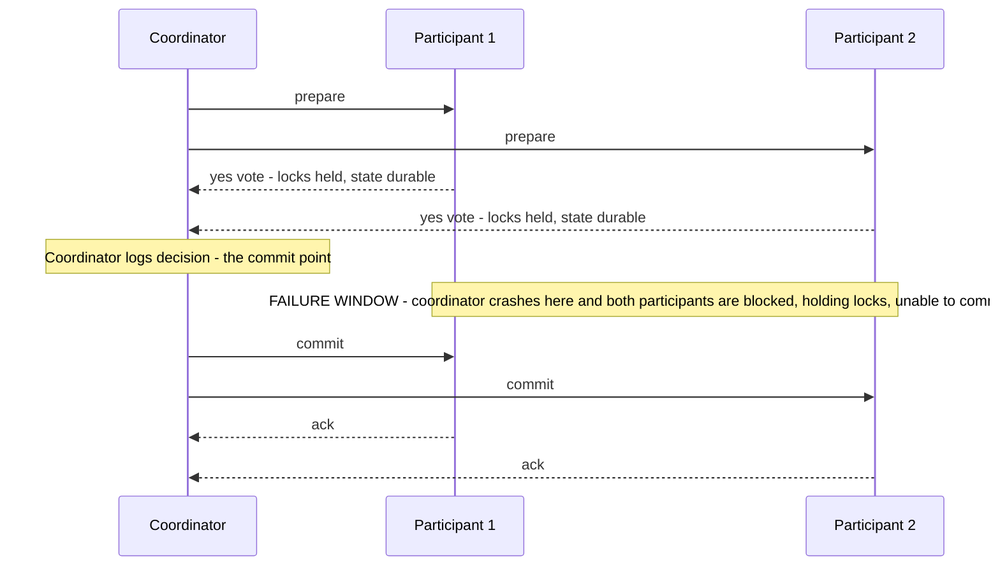

# Two-Phase Commit and Distributed Transactions

**Two-phase commit (2PC)** is the classic protocol for making one logical transaction atomic across multiple machines: either every participant commits or every participant aborts. It works — and it is also the most famous cautionary tale in distributed systems, because its safety comes from *blocking*: when the coordinator dies at the wrong moment, participants must sit frozen, holding locks, able to go neither forward nor back. Understanding exactly where that window is tells you why modern architectures replaced distributed transactions with [[Saga Pattern]] and [[Idempotency]].

## The problem that created it

Your growing system splits data across stores: the order lands in the orders database, the payment in the payments database (or another shard — [[Sharding]]). A business operation now spans both, and [[ACID Transactions]] stop at each database's edge. Writing to both sequentially creates the **dual-write problem**: crash after the first write and you have an order with no payment — or worse, money moved with no record. Atomicity across machines doesn't exist by default; some protocol must manufacture it. 2PC (described by Jim Gray in 1978 and by Lampson and Sturgis in 1976, standardized as **X/Open XA** in 1991) was the database industry's answer, and for two decades "distributed transaction" simply meant 2PC.

## What it solves

- **Atomic commit across resources:** all-or-nothing outcomes spanning multiple databases, a database plus a message broker (classic XA pairing), or multiple shards.
- **No divergent outcomes in the happy path and most failure paths:** a participant that voted yes will never unilaterally commit while another aborts.
- **Abstraction for app code:** with XA, the app demarcates one transaction; resource managers (JDBC drivers, JMS brokers) and a transaction manager run the protocol underneath.

## How it works

Roles: one **coordinator** (transaction manager) and multiple **participants** (resource managers). Two phases:

1. **Prepare (voting) phase.** Coordinator sends `prepare`. Each participant does all the work — executes the statements, acquires/holds locks, writes redo/undo information *durably to disk* — and then votes. Voting **yes** is a binding promise: "I can commit this even if I crash and recover." A participant that voted yes may no longer abort on its own.
2. **Commit (decision) phase.** If every vote is yes, the coordinator durably logs the decision `commit` (this log record *is* the commit point), then tells everyone to commit. Any no vote, or a timeout waiting for votes, → decision is `abort`. Participants execute the decision, release locks, and acknowledge.

**The blocking window.** Before voting, a participant can abort freely (e.g., on timeout). *After* voting yes but before hearing the decision, it is **in doubt**: it cannot commit (maybe someone voted no) and cannot abort (maybe the decision was commit, and a unilateral abort would break atomicity). If the coordinator crashes after collecting yes votes but before broadcasting the decision, every participant is stuck in doubt — **holding row locks** — until the coordinator recovers and replays its log, or a human intervenes with a heuristic decision. Minutes of a wedged coordinator = minutes of locked rows = application-wide stalls on anything touching those rows. This is 2PC's defining flaw: it has a single point of failure *by design*, at the worst possible moment.

**Every place the coordinator can die.** The protocol's reputation rests on one of these rows, so it is worth seeing all of them next to each other. "Safe" below means atomicity is preserved; "blocking" means participants hold locks waiting.

| Coordinator crashes… | Participants' state | Outcome on recovery | Safe? |
|---|---|---|---|
| Before sending any `prepare` | Nothing happened | Nothing to do; the transaction never existed | Safe, no blocking |
| After some `prepare` messages, before all | Some prepared and holding locks, some untouched | Those that already voted yes block awaiting a decision; on recovery the coordinator finds no decision record and aborts | Safe, blocking until recovery |
| After collecting votes, **before** logging the decision | All prepared, all in doubt | No decision exists anywhere; on recovery the coordinator finds no decision record and aborts | Safe, blocking until recovery |
| After logging `commit`, before sending any | All in doubt | Recovery reads the log and broadcasts `commit` | Safe, blocking until recovery |
| After sending `commit` to some | Mixed: some committed, some in doubt | Recovery re-sends `commit` to the rest | Safe, blocking for the rest |
| Permanently, with its log lost | All in doubt forever | No automated resolution exists; an operator guesses | **Unsafe** — atomicity can break |

Two readings. First, the protocol is *safe* in every row where the coordinator's log survives — the price of safety is paid entirely in blocking, not in correctness. Second, the last row is why the coordinator's log is the most precious durable state in the system and why coordinators are the thing people replicate first. Note also what makes the third row subtle: there is no decision to recover, so recovery must abort — meaning participants that held locks for the whole outage held them for a transaction that was always going to abort.

**Why 2PC is not consensus.** Easy to conflate, importantly different. Consensus ([[Consensus and Raft]]) tolerates the failure of its "leader" — a new one is elected from a majority and progress resumes; any quorum of nodes can carry the decision. In 2PC, only the coordinator knows the decision during the window, there is no election, and participants cannot form a quorum to decide — one node's death halts everyone. Also, consensus decides on *one proposed value* among many; 2PC requires *unanimity* (any participant can veto). Formally, atomic commit is a different, in some ways harder, problem — and practical fixes run the coordinator's decision *through* consensus (a replicated coordinator log), which is exactly how Spanner does cross-shard commits (2PC layered over Paxos groups — [[Google Spanner Deep Dive]]).

**3PC footnote.** Three-phase commit adds a `pre-commit` round so participants can decide without the coordinator, making the protocol non-blocking — but only under a synchronous model with bounded delays and no network partitions. Under real partitions 3PC can produce *divergent outcomes* (one side commits, the other aborts), which is worse than blocking; combined with an extra round trip, it never saw serious production adoption. The honest statement of the limit is FLP territory ([[Consensus and Raft]]): with asynchrony and failures you don't get atomic commit that is simultaneously safe, non-blocking, and partition-tolerant.

**XA in practice.** XA is the standard API binding a transaction manager (Atomikos, Narayana, app-server JTA) to XA-capable resources (most RDBMSs; classic JMS brokers). Real-world experience: throughput collapses under lock hold times; "in-doubt" transactions need DBA tooling (`XA RECOVER` in MySQL) and occasionally heuristic commits/aborts that *break* atomicity and get reported after the fact; many modern datastores and brokers (MongoDB, SQS, Kafka, Redis) simply never implemented XA, so the protocol can't even span the stacks people actually run. Heterogeneous distributed transactions quietly faded as these costs became clear.

## Trade-offs

| You gain | You pay |
|---|---|
| True cross-resource atomicity (happy path) | Blocking window: coordinator crash freezes participants holding locks |
| Familiar ACID programming model | Latency: two sequential round trips + multiple forced disk flushes per transaction |
| Standardized (XA) across vendors | Availability multiplies down: the transaction is up only when coordinator *and all* participants are up ([[Availability Reliability Durability]]) |
| No compensation logic to write | Throughput: locks held across network round trips crush hot rows; doesn't compose with HA goals |

## Failure modes

- **Coordinator crash in the window** — the headline failure: participants in-doubt, locks held, dependent transactions queueing behind them; resolved only by coordinator recovery from its log or manual heuristic resolution. Detection: "in-doubt/prepared transaction" counts and lock-wait alarms.
- **Participant crash after voting yes:** on recovery it finds the prepared state in its log and must ask the coordinator for the verdict; until then its locks persist locally.
- **Lost decision messages:** coordinator decided, participant never heard — participant stays in-doubt; coordinator must retry delivery indefinitely; participants' acknowledgements let it forget.
- **Heuristic decisions:** an operator (or a configured timeout) forces a participant to commit or abort while in-doubt. If the guess contradicts the real decision, atomicity is silently broken — XA literally has error codes (`XA_HEURMIX`) for "we corrupted your invariant, FYI".
- **Throughput collapse under contention:** even with zero crashes, hot-row lock hold times spanning two network round trips cap TPS far below single-node levels; shows up as lock-wait timeouts, not errors in the protocol itself.
- **Coordinator log on ephemeral storage:** a transaction manager running in a container with its log on the container filesystem loses every in-doubt decision when the pod is rescheduled — turning the recoverable rows of the table above into the unrecoverable one. If you ever do run a coordinator, its log needs the same durability treatment as a database's.

### What this looks like at 3am

The page is **"everything touching the accounts table is timing out"**, and the first ten minutes look like a database capacity incident: connections saturated, queue depth climbing, p99 vertical. CPU is low, which is the tell — the database is not working hard, it is waiting.

The diagnostic is to look for *prepared* or *in-doubt* transactions specifically rather than long-running queries: MySQL's `XA RECOVER`, Postgres's prepared-transaction view, or the vendor equivalent. A handful of rows there, each hours old, explains the whole incident — those transactions hold locks, every ordinary transaction that needs the same rows queues behind them, and the queue backs up into connection-pool exhaustion and then into the application tier ([[Connection Pooling]], [[Failure Modes in Distributed Systems]] on how that cascades).

What makes this incident memorable is that **there is no good option at 3am**. Resolving an in-doubt transaction by hand means guessing commit or abort without knowing the coordinator's decision — the heuristic resolution the protocol warns about — and if you guess wrong you have silently broken atomicity in a way nothing will flag. The right move is to find the coordinator and recover it so the real decision is replayed; the move people actually make under pressure is to force-abort the blockers to restore service, and then spend the next day proving which halves of which transactions survived. If you remember one thing from this note during an incident, it is: **write down which transactions you force-resolved and in which direction, before you do it.**

## When NOT to use it

- **Across microservices.** Services owning their own stores, called over HTTP/queues, with independent deploys and failure domains: 2PC couples their availability and holds locks across the exact network described by [[The Fallacies of Distributed Computing]]. Use [[Saga Pattern]] — a sequence of local transactions with compensating actions — coordinated via events ([[The Outbox Pattern]] for the dual-write at each step) and made safe by [[Idempotency]].
- **DB + message broker atomicity.** The old XA use case; today's answer is the outbox pattern plus [[Change Data Capture]] — write the event into the same local transaction as the data, let a relay publish it.
- **Anything needing high availability on the write path** — the blocking window is incompatible with "always writable"; see [[PACELC]].
- Legitimate remaining uses: *inside* single systems that hide 2PC under consensus-replicated coordinators and short-lived internal locks (Spanner cross-shard commits, some Kafka internals), where operators control both halves and the window is engineered small.

**What to use instead, by problem shape:**

| Problem | Pattern | What you give up | What you gain |
|---|---|---|---|
| One write plus one event publish | [[The Outbox Pattern]] | The event is published slightly after the write | No coordinator, no locks across the network, exactly one local transaction |
| A multi-step business process across services | [[Saga Pattern]] | Atomicity — intermediate states are visible | Each service stays autonomous and available; failures compensate |
| Reading one system's changes into another | [[Change Data Capture]] | Freshness, by the capture lag | No application-level coupling at all |
| Making a repeated attempt safe | [[Idempotency]] | Storage for dedup state | Retries become free, which makes everything above workable |
| True atomicity across shards of *one* datastore | The datastore's own transactions | Nothing you control — the vendor runs 2PC internally | Correct, supported, and recoverable by their tooling |

The row worth dwelling on is the last: "do not use 2PC" means do not *operate* 2PC across systems you own separately. Using MongoDB's or Spanner's internal cross-shard transaction is not the anti-pattern — it is the vendor absorbing the coordinator problem, with a replicated decision log and recovery tooling you would otherwise have to build.

## In your stack

- Your stack can't run XA even if it wanted to: MongoDB, SQS, Redis Streams, and Kafka don't speak it. Every cross-service money flow is therefore saga-shaped already — explicit steps, compensations (reversals), and idempotency keys. Name it in design docs: "saga with compensation", not "transaction".
- The recurring Niyo-shaped instance of the dual-write problem: "update Mongo + publish event". Sequential writes leave a crash gap; the fix is [[The Outbox Pattern]] (event written in the same Mongo transaction/document update, relayed to SQS/Kafka), not a distributed transaction.
- MongoDB multi-document transactions *within* a replica set/sharded cluster are fine where needed — that's 2PC-like machinery run by one vendor inside one system (mongos routes the statements, but commit is driven by a designated *coordinator shard* running two-phase commit across the participant shards), with its own recovery; the anti-pattern is only *heterogeneous, cross-service* 2PC.
- Fintech framing for the auditor: a saga's intermediate states are visible (order created, debit pending) — so each step needs a recorded state, a compensation, and reconciliation jobs that sweep for stuck flows. That ledger-of-steps is your audit evidence; 2PC's "all-or-nothing" would have hidden it inside locks anyway.
- Watch for 2PC smuggled in under another name. "We'll call the other service inside our transaction and roll back if it fails" is the dual-write problem with extra confidence: the remote call can succeed while your rollback runs, and you now have a remote effect with no local record of it. The same applies to holding a Mongo transaction open across an HTTP call — it converts a network timeout into a lock held for the duration of that timeout.
- The compensations themselves deserve the same scrutiny as the forward path. A reversal is a money movement, so it needs its own idempotency key, its own state, and its own reconciliation; "we'll just refund it" is an unimplemented step, and in practice compensations fail more often than forward steps because they run during incidents.
- Not every step is compensable, and recognising which is a design-time job. A debit can be reversed; a notification sent to a customer cannot be unsent, and a file delivered to a partner bank usually cannot be withdrawn. Order a saga so the **irreversible steps come last**, after everything that could still fail has already succeeded — that single ordering rule removes most of the hard compensation cases before they exist.

## Interview angle

The question behind the question is judgment: do you know *why* nobody runs cross-service 2PC anymore, and what replaced it? Reciting prepare/commit is table stakes; locating the blocking window precisely is the differentiator.

The 60-second version: "2PC gets atomicity across resources: phase one, every participant durably prepares and votes — yes is a binding promise and locks are held; phase two, the coordinator logs the decision and broadcasts it. The fatal flaw is between those phases: a participant that voted yes can neither commit nor abort on its own, so a crashed coordinator leaves everyone blocked, holding locks — availability and throughput die together. 3PC fixes blocking only by assuming a synchronous, partition-free network, so it's a footnote. It's also not consensus — consensus survives leader failure by election; 2PC's coordinator is a designed-in single point of failure, and systems like Spanner fix it by replicating the coordinator's decision through Paxos. Across microservices the industry answer is sagas: local transactions, compensating actions, outbox for the dual-write, idempotency for the retries."

Classic follow-ups: "Where exactly can the coordinator crash and what happens in each spot?"; "Why not 3PC?"; "How does Spanner still use 2PC safely?"; "Design checkout across order + payment services" (expected answer: saga, not 2PC).

## Check yourself

> [!question]- Q: Explain why a participant that voted "yes" cannot simply abort after waiting a long time for the decision.
> Yes was a durable promise that commit is possible; the coordinator may already have logged `commit` and other participants may already have committed. If this participant unilaterally aborts, the transaction ends mixed — committed in one store, rolled back in another — which is precisely the atomicity 2PC exists to guarantee. Symmetrically it can't unilaterally commit (someone may have voted no). Hence: blocked until the verdict arrives. That asymmetry — pre-vote freedom, post-vote imprisonment — is the whole protocol in one sentence.

> [!question]- Q: Scenario — coordinator collects two yes votes, logs "commit", sends commit to participant 1, then dies. What is the state of the world, and how does it heal?
> P1 committed and released locks. P2 is in-doubt, holding locks. Atomicity is not yet violated — the decision was commit and P1 followed it — but P2 blocks everything touching its locked rows. Healing: the coordinator restarts, reads `commit` from its log, and re-sends commit to P2 (delivery must be retried until acked — which requires P2's commit handling to be idempotent, see [[Idempotency]]). If the coordinator is gone for good and an operator heuristically aborts P2, atomicity is now genuinely broken and must be repaired by hand — the scenario XA's heuristic error codes exist for.

> [!question]- Q: Why did the industry move to sagas instead of fixing 2PC's coordinator with replication everywhere?
> Replicating the coordinator through consensus (the Spanner approach) fixes blocking but keeps the other costs: locks held across round trips (throughput), multiplied availability dependence, unanimous participation, and it requires every participant to implement prepare semantics — which mainstream brokers and NoSQL stores never did. Sagas accept visible intermediate states in exchange for: each step is a fast local transaction, services stay autonomous and available, failures are handled by compensation + retries + idempotency — all of which align with how microservices fail in practice. The trade is explicit: atomicity is replaced by *eventual completion or compensation*, with reconciliation as the backstop.

> [!question]- Q: Scenario — a senior engineer proposes wrapping an order-service write and a payment-service call in one distributed transaction "so we never get an order without a payment". Walk through why this fails, and what guarantee you can actually offer instead.
> Three separate problems, worth separating because each kills the idea on its own. (1) *Nothing to enlist.* 2PC requires every participant to implement prepare semantics — to durably hold work in a promised-but-uncommitted state. The payment service's HTTP endpoint has no such concept, and neither does the partner bank behind it; you cannot make a resource transactional from the outside. (2) *Availability multiplies down.* Even if both sides spoke XA, the transaction would succeed only when the coordinator and both services are all healthy, so the combined availability is strictly worse than either service alone ([[Availability Reliability Durability]]) — the opposite of why the services were split up. (3) *The blocking window becomes cross-team.* An in-doubt transaction now holds locks in a database owned by a different team, who will discover it as an unexplained outage. What you can offer instead is a saga with a stated guarantee: *every initiated order reaches a terminal state — completed, failed, or compensated — within a bounded time, and no payment occurs without a recorded order*. Achieve it with an order row written first in state `INITIATED` (so there is always a local record before any remote effect), an idempotency key carried into the payment call, ambiguous outcomes resolved by status query rather than blind retry, and a sweeper that drives stuck rows to a terminal state. That is a weaker guarantee than atomicity and a much stronger one than "we hope both succeed" — and unlike 2PC, it is one you can actually operate.

> [!question]- Q: Mini design prompt — wallet top-up: debit the user's bank via partner API, credit the Niyo wallet in Mongo. No XA anywhere. Design the flow.
> Saga with the external call isolated: (1) create a top-up record in state `INITIATED` (local Mongo write, with a client-supplied idempotency key so retried user taps dedupe — [[Idempotency]]); (2) call the bank with that key; ambiguous outcomes (timeouts) go to state `PENDING_VERIFY`, resolved by a status-check/reconciliation job — never blind retry on money; (3) on confirmed debit, credit the wallet and mark `COMPLETED` in one local transaction, emitting a `WalletCredited` event via [[The Outbox Pattern]]; (4) on confirmed failure, mark `FAILED`; if the credit can't complete after the debit, compensate (refund) or escalate to manual ops with the full state trail. Every step idempotent, every state persisted, a sweeper for stuck `PENDING_VERIFY` rows — that's the auditable replacement for the 2PC you couldn't run.

## Sources

- Jim Gray, "Notes on Data Base Operating Systems" (1978) and Gray & Reuter, *Transaction Processing: Concepts and Techniques* (1992) — 2PC's canonical treatment.
- X/Open, "Distributed Transaction Processing: The XA Specification", 1991.
- Martin Kleppmann, *DDIA*, Chapter 9 — "Atomic Commit and Two-Phase Commit", "Distributed Transactions in Practice" (the XA post-mortem), and 2PC-vs-consensus.
- Dale Skeen, "NonBlocking Commit Protocols", SIGMOD 1981 — 3PC and why blocking is fundamental to 2PC.
- Corbett et al., "Spanner: Google's Globally-Distributed Database", OSDI 2012 — 2PC over Paxos groups.
- Hector Garcia-Molina, Kenneth Salem, "Sagas", SIGMOD 1987 — the original saga paper (the long-lived-transaction motivation).
- Jim Gray, Leslie Lamport, "Consensus on Transaction Commit", ACM TODS, 2006 — Paxos Commit: replicating the coordinator's decision to remove the single point of failure.
- Pat Helland, "Life beyond Distributed Transactions: An Apostate's Opinion", CIDR 2007 — the argument for entity-scoped, idempotent, at-least-once designs instead.
