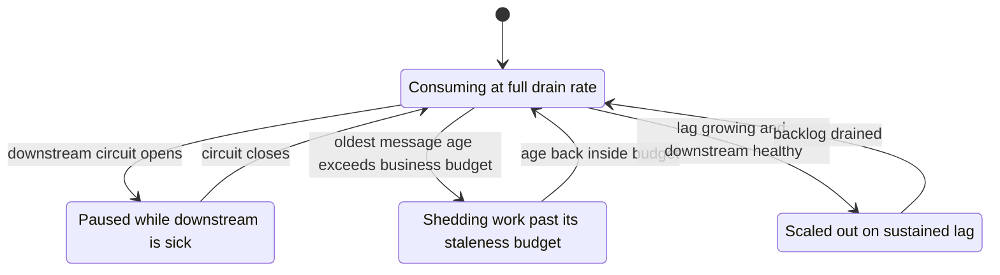

# Backpressure and Flow Control

A queue buys you time; it does not do the work. When producers outpace consumers for long enough, the buffer that was absorbing bursts becomes a backlog that grows without bound — and an unbounded backlog eventually takes down the broker, the consumers, or the business promise ("your transfer will complete shortly"). **Backpressure** is the set of mechanisms by which a slow consumer's inability to keep up propagates *backwards* — slowing or stopping producers — instead of accumulating as unbounded work. **Flow control** is the local version: pacing how fast messages are handed to each consumer. Systems without designed backpressure still have it; it just arrives as an outage.

## The problem that created it

The story is always the same shape. A consumer processes 1,000 msg/s; normal traffic is 600. One day traffic rises to 1,200 — or the consumer's database slows and throughput drops to 400. The queue begins to grow. Nothing *fails*: producers succeed, consumers consume, dashboards are green. The queue is "doing its job". Hours later:

- **Latency promise breaks first.** Work enqueued now waits behind the backlog. A notification queued 4 hours ago is no longer a notification; an OTP delivered late is worse than undelivered. Queue delay silently becomes part of your product.
- **The backlog outlives its usefulness.** Past some age, queued work is worthless (stale price updates) or harmful (retrying a payment the user already retried manually). You are now spending capacity processing garbage before reaching fresh work — which keeps you behind. This is the **insurmountable backlog**: drain rate minus arrival rate is so small that recovery takes days.
- **Resource death.** Memory-backed brokers (RabbitMQ under pressure, Redis) start evicting, paging, or refusing; disk-backed ones hit retention or disk limits. The broker — your decoupling layer — becomes the shared point of failure.
- **The amplifier.** Unbounded queues *amplify* incidents: a 30-minute downstream outage creates a 4-hour backlog-drain tail during which the system runs at max load, timeouts stack, retries add duplicate traffic ([[Timeouts Retries and Exponential Backoff|retry storms]]), and a second small blip tips it over — the signature of [[Failure Modes in Distributed Systems|metastable failure]].

The lesson that created the pattern: **somewhere, something must eventually say "slower, please" or "no" — and you want to choose where, not discover it.**

## What it solves

- Keeps queue delay (and thus end-to-end latency) inside a bound you chose.
- Prevents broker resource exhaustion from becoming the incident.
- Converts "mystery 4-hour degradation" into a visible, alertable signal: **lag**.
- Protects consumers from overload (prefetch limits) and downstream dependencies from being hammered by an over-eager drain.
- Makes load shedding a *decision* (drop the stale, keep the valuable) instead of an accident (broker drops whatever it must).

## How it works

### Lag: THE metric

**Consumer lag** is the amount of work accepted but not yet processed — queue depth (SQS `ApproximateNumberOfMessages`, RabbitMQ queue length), offset lag (Kafka: newest offset minus committed offset, per partition), or PEL size + unread entries ([[Redis Streams]]). Depth alone is ambiguous (10K messages is fine at 5K/s drain, fatal at 10/s); the derived numbers that matter:

- **Lag trend** — growing lag means arrival rate > drain rate *right now*; sustained growth is the alarm, not any absolute number.
- **Time-to-drain** — lag ÷ (drain − arrival); if negative or hours, you are in trouble regardless of absolute depth.
- **Oldest-message age** — the direct measure of the broken latency promise; often the best thing to alert on because it encodes both depth and slowness, and maps to user impact.

Alert on *lag growth* and *message age*, not just depth. A queue that is big but shrinking is a recovery; a small queue that is growing is an incident being born.

### The drain arithmetic — why a 30-minute outage is a 75-minute incident

This is the single most useful calculation in the note, and almost nobody does it before the incident.

A consumer can process **1,000 msg/s**. Steady arrival rate is **600 msg/s**, so it idles at 60% utilization and the queue sits near empty. A downstream dependency goes down for **30 minutes**, during which the drain rate is zero:

```
backlog at end of outage  =  600 msg/s × 1,800 s   =  1,080,000 messages
surplus capacity          =  1,000 − 600           =    400 msg/s
time to drain the backlog =  1,080,000 ÷ 400       =  2,700 s  =  45 minutes
queue is current again at =  30 + 45               =  75 minutes
```

The outage lasted 30 minutes; the incident lasted 75. The general form is worth memorizing, because it generalizes:

```
total incident duration  =  outage duration × capacity ÷ headroom
                            where headroom = capacity − arrival rate
```

Here that is `1,000 ÷ 400 = 2.5×`. The term that hurts is the denominator. Run the same consumer at **90% utilization** — arrival 900/s against the same 1,000/s capacity — and the amplification becomes `1,000 ÷ 100 = 10×`: the same 30-minute outage now needs **4.5 hours** of draining and becomes a **five-hour incident**. And if arrival ever equals or exceeds capacity, headroom is zero or negative and the backlog never drains at all. That is the **insurmountable backlog**, and the formula shows it is not a cliff you fall off suddenly — the recovery time was already climbing hyperbolically as you approached it.

Two honest caveats make the real number worse, never better: during the drain the consumer runs flat out against a downstream that just recovered, so effective capacity is often below nameplate; and clients that timed out during the outage retry, which raises the arrival rate exactly while headroom is at its thinnest.

The oldest-message age tells the story from the user's side. The message enqueued at the first second of the outage is the one that waits longest — a full 30 minutes — and it is processed *first* when drain resumes. Age therefore **peaks at the moment the outage ends** and then falls linearly to zero at the 75-minute mark. If your age alert fires only during the outage window, it is measuring the dependency, not the damage.

### The control loop

Given lag, a consumer has three levers and ought to move between them deliberately rather than only ever consuming as fast as it can:



The arrow that teams forget to build is `consuming --> paused`. Without it, a sick downstream converts into dead-lettered healthy messages and a hammered dependency; see [[Circuit Breakers]] and [[Dead Letter Queues and Poison Messages]].

### Flow control at the consumer: pull, prefetch, pause

- **Pull-based consumption is implicit flow control.** Kafka and SQS consumers *ask* for messages; a slow consumer simply asks less often, and the backlog accumulates in the broker (which is built for it) rather than in consumer memory. This is why log-model systems rarely crush consumers.
- **Prefetch limits (push systems).** RabbitMQ pushes messages to consumers; without a cap, a fast queue floods a slow consumer's memory with unacked messages. `basic.qos` prefetch (e.g., 10–100) bounds in-flight messages per consumer: the broker stops pushing until acks free slots. Too low starves throughput (round-trip per message); too high recreates the flood and worsens redelivery batches on crash.
- **Fetch tuning (pull systems).** Kafka `max.poll.records` / fetch sizes bound each batch so processing a poll's worth stays under `max.poll.interval.ms` — exceed it and the group kicks you, triggering a [[Consumer Groups and Rebalancing|rebalance]] that makes everything worse. SQS batch size (≤10) and in-flight receive counts play the same role.
- **Pause-resume.** When a downstream dependency degrades, the right move is often to *stop consuming entirely* (Kafka `pause()` on partitions, stop polling SQS) until the [[Circuit Breakers|circuit closes]] — rather than pulling messages you will fail, burning receive counts toward spurious [[Dead Letter Queues and Poison Messages|dead-lettering]]. Pausing moves the backlog to the broker, where it is durable and cheap.

### Backpressure to the producer: the three endgames

When the backlog keeps growing, exactly three things can give. Choose deliberately:

1. **Slow or block the producer.** Bounded queue + blocking publish: the producer waits (RabbitMQ connection-level flow control and credit flow do this automatically when the broker is pressured; memory/disk alarms block publishers outright). Honest, lossless — but it re-couples producer latency to consumer speed, surrendering part of why you [[Why Async Messaging Exists|went async]]. Acceptable when the producer's own caller can tolerate it or has its own shed path.
2. **Shed load.** Reject or drop by *value*: refuse new enqueues with an error the producer handles ([[Load Shedding and Graceful Degradation]]), drop messages past a staleness TTL (RabbitMQ per-message/queue TTL; a consumer-side "too old, skip" check), or sample low-value traffic. Turning stale work into deliberate drops is how you avoid spending the recovery processing garbage.
3. **Add capacity.** Scale consumers out — within structural limits: Kafka parallelism caps at partition count; SQS scales until the shared downstream (your database) becomes the real bottleneck, which it usually is. Autoscaling consumers on lag works, but if the constraint is the DB, more consumers just move the queue into lock contention ([[Autoscaling]]).

If you choose none of these, the system picks #2 for you at the worst place: the broker's limits.

### Broker-full behavior compared

| | [[RabbitMQ]] | [[Kafka Architecture\|Kafka]] | [[SQS and SNS\|SQS]] | [[Redis Streams]] |
|---|---|---|---|---|
| Where backlog lives | Broker RAM/disk; queues are the pressure point | Disk log; backlog is just retention being used | AWS-managed, effectively unbounded storage | Redis RAM — the hardest constraint |
| As backlog grows | Memory/disk alarms → **blocks publishers**; credit-based flow control slows them earlier; queue length limits drop/dead-letter overflow | Nothing happens to producers; consumers simply lag. **Retention is the cliff**: messages older than retention are deleted — lag past retention = silent permanent loss | Producers unaffected (effectively unbounded); messages expire after retention (max 14 days). Cost and message age grow | `XADD` grows the stream until Redis hits `maxmemory` → writes fail or eviction havoc; `MAXLEN` trimming drops oldest entries — bounded by *your* explicit choice |
| Built-in producer backpressure | Yes — blocking, automatic | No — only client-side buffer-full blocking (`buffer.memory`) | No — practically never says no on standard queues | No — only failure at the memory wall |
| What to monitor | Queue length, memory/disk alarms, flow-control state | **Consumer lag vs retention window** | Oldest message age, depth, `ApproximateAgeOfOldestMessage` | Stream length vs `MAXLEN`, PEL size, Redis memory |

The deepest contrast: **RabbitMQ pushes back automatically but can fall over; Kafka never pushes back and instead silently ages data out past retention; SQS absorbs almost anything and sends you the bill; Redis Streams hits the memory wall fastest and makes *you* choose what trimming drops.** None of these defaults matches your business's preference by accident — you have to encode it.

### What this looks like at 3am

The page does not come from monitoring. It comes from the support channel: users are requesting an OTP, waiting, requesting two more, and then all three arrive at once several minutes later.

You open the queue dashboard. Depth is 280,000 and rising in a straight line. Consumer error rate is **zero**. Pod CPU is 20%, memory flat, no restarts, no deploys in the window. Every instinct says the consumer is healthy, and it is — it is just slow, and nothing in a queue's vocabulary distinguishes "slow" from "fine" except lag.

The number that localizes it is per-message processing duration. The consumer runs **32 messages in flight**; it used to spend ~120 ms per message, and the SMS vendor's latency has risen to ~2.4 s:

```
drain rate before  =  32 ÷ 0.12 s  ≈  267 msg/s
drain rate now     =  32 ÷ 2.4 s   ≈   13 msg/s
arrival rate       =                   90 msg/s
backlog growth     =  90 − 13      ≈   77 msg/s   →  ~277,000 per hour
```

Arrival now exceeds capacity, so by the formula above there is no drain time: headroom is negative and the backlog grows until something changes. Confirm the diagnosis by checking the vendor's latency directly rather than inferring it — a client-side latency histogram per downstream, or the vendor's own status page.

The instinct is to scale consumers. It is the wrong move twice over: the bottleneck is the vendor's response time, so 10× the pods means 10× the concurrent calls into something already struggling ([[Timeouts Retries and Exponential Backoff|and the retries make it worse]]), and more importantly **an OTP delivered 40 minutes late is worthless** — delivering the backlog is not a recovery, it is sending 280,000 confusing messages to people who already gave up. The correct move is to shed by value: drop anything older than roughly a message's useful life (an OTP's is a couple of minutes), which instantly collapses the backlog to only the work still worth doing, and let the users who are actively waiting be served at 13/s. Then fix or fail over the vendor.

The generalizable lesson: when drain rate collapses below arrival, your first decision is not *how to go faster* but *what is still worth processing*.

## Trade-offs

| Mechanism | You gain | You pay |
|---|---|---|
| Bounded queue / blocking publish | Lossless, honest backpressure | Producer latency re-coupled to consumer speed |
| TTL / staleness drop | Recovery processes only valuable work | Deliberate data loss — needs business sign-off |
| Prefetch/fetch limits | Consumer stability, fair distribution | Throughput ceiling if set too low |
| Pause-resume on downstream failure | No spurious DLQ floods, broker holds backlog | Lag grows during pause; needs resume discipline |
| Autoscale consumers on lag | Absorbs real traffic growth | Useless when downstream is the bottleneck; rebalance churn |

## Failure modes

Each of these has a *specific* signal; the hard part is that none of them turns an error rate red, so you have to have put the signal on a dashboard in advance.

- **Lag discovered by customers.** No lag/age alert; the "queue is async, it's fine" assumption hides a 6-hour OTP delay. **Signal:** oldest-message age, which is the only queue metric denominated in the unit the user feels. **Confirm:** compare age against the queue's documented business tolerance — and if nobody has written that tolerance down, that is the actual finding.
- **Kafka lag exceeds retention.** Consumer down over a weekend, retention 72h (or sized in GB): the log ages out unread records. No error on either side — the offsets just skip. **Signal:** lag expressed *in time* (age of the record at the committed offset) approaching the retention window; and after the fact, a committed offset lower than the partition's `logStartOffset`. **Confirm:** the consumer's `auto.offset.reset` fires and the group's position jumps discontinuously — a lag graph that falls to near-zero without a matching throughput spike is loss, not recovery, and that signature is worth recognizing on sight. **Mitigate:** retention ≥ worst-case outage + drain time, or archive the topic to object storage.
- **Prefetch 1-sized throughput collapse** — someone sets prefetch to 1 "for safety"; every message costs a broker round-trip; drain rate falls to at most one message per (processing time + round trip) per consumer and the backlog grows *because of* the safety setting. **Signal:** consumer CPU and downstream utilization both low while lag grows — the consumer is waiting, not working. **Confirm:** per-message wall time far exceeds the sum of its own spans in a [[Distributed Tracing|trace]]; the missing time is broker round-trip.
- **Poll-loop death spiral (Kafka).** Slow downstream → processing a batch exceeds `max.poll.interval.ms` → rebalance → partitions reassigned → duplicates reprocessed → more load → slower still. **Signal:** rebalance rate above zero on a fleet with no deploys, paired with rising duplicate processing. **Confirm:** `max.poll.interval.ms` exceeded appears in consumer logs, and the rebalance timestamps line up with batch-processing-duration spikes rather than with pod restarts. **Fix:** smaller `max.poll.records`, pause partitions during downstream trouble.
- **Retry amplification during drain.** Draining at max throughput, downstream at its limit, timeouts trip, producers/clients retry, arrival rate rises exactly when headroom is zero — the metastable trap. **Signal:** arrival rate *rising* during a recovery, and a downstream request count that exceeds the upstream request count by a growing multiple. **Confirm:** the ratio of downstream calls to messages processed climbs above 1 — that excess is retries, and it is the quantity that decides whether the system converges. Shed first, drain second.
- **The infinite-queue bill.** SQS "handles it" so nobody notices arrival > drain for weeks; the symptom finally appears as cost and 13-day-old messages near the retention cliff. **Signal:** monotonically rising `ApproximateAgeOfOldestMessage` over days — a slope no human notices without an alert, because any single day looks flat. **Confirm:** plot arrival and deletion rates on one axis over a month; a persistent gap, however small, is the whole story.
- **Trimming silently deletes unread entries (Redis Streams).** A `MAXLEN` trim is applied at write time and, by default, does not consult consumer positions (Redis 8.2 added an `ACKED` option that trims only entries every group has acknowledged): if producers outrun consumers, `XADD` with `MAXLEN` evicts entries nobody has read, and the PEL knows nothing about them. **Signal:** stream length pinned at or just above the `MAXLEN` value while lag is non-zero — approximate trimming with `MAXLEN ~` hovers slightly above the bound rather than landing on it, so look for a flat ceiling rather than an exact number. **Confirm:** track the lowest entry ID in the stream against each group's last-delivered ID; the moment the stream's start ID is greater than a group's position, that group has lost data. This is Kafka's retention cliff with a much shorter fuse, because the bound is your RAM budget rather than days.

## When NOT to use it

Rather than "not use backpressure" (you can't opt out — only choose where it bites), the honest list is where each mechanism is wrong:

- **Blocking producers on a user-facing request path** — never let a queue's fullness hold a user's HTTP request hostage; shed with a fast error instead.
- **TTL-dropping anything money-shaped** — staleness drops are for telemetry, notifications, cache-refresh traffic; a payment instruction is never "too old to bother", it is "too old to auto-process, escalate" ([[Saga Pattern]]).
- **Autoscaling consumers when the bottleneck is the shared database** — you scale the stampede, not the throughput.
- **Over-engineering at low volume** — a queue averaging 3 messages with one consumer needs an age alert and nothing else from this note.

## In your stack

- SQS's unbounded absorption means your fleet's real risk is *silent* lag, not broker failure: alert `ApproximateAgeOfOldestMessage` on every queue, with thresholds tied to each queue's business tolerance (OTP ≈ minute; settlement batch ≈ hours).
- The [[Redis Streams]] migration inverts the problem: from "effectively infinite, AWS's disk" to "your cluster's RAM". Every stream needs an explicit `MAXLEN`/trim policy and a memory budget; unbounded `XADD` is a Redis outage with a fuse — and it shares that RAM with your caches.
- Services pinned at 1 replica have a hard drain ceiling: one consumer's throughput *is* the capacity plan. Lag during any deploy or crash is structural; the honest mitigations are sized retention/age alerts and documented drain math, not pretending the autoscaler will save you. Run the amplification formula for each of them — `capacity ÷ headroom` — and write the answer in the runbook: a single-replica consumer sitting at 80% utilization turns every 10-minute deploy into a 50-minute incident — 10 minutes down, 40 minutes draining — and that number is the one to argue a second replica with, because it is a product commitment, not an infrastructure preference.
- Spring consumers: `max.poll.records`/container concurrency (Kafka days) and SQS `maxConcurrentMessages` are the prefetch knobs; pause-resume on circuit-open for Mongo-bound consumers prevents receive-count burn toward spurious DLQs.

## Interview angle

The 60-second version: *"A queue defers work; if producers outpace consumers for long, the backlog breaks your latency promise, then your broker. The metric is consumer lag — more precisely lag trend and oldest-message age. Flow control paces the consumer: prefetch and fetch limits, pause-resume when downstream is sick. Backpressure makes the imbalance propagate to producers: block them, shed load by value, or add capacity — and if you don't choose, the broker chooses for you: RabbitMQ blocks publishers, Kafka silently ages data out past retention, SQS absorbs it and bills you, Redis Streams hits the memory wall. Design the 'something must give' point explicitly."*

Classic follow-ups:

- "What do you alert on for a queue?" — oldest-message age + lag growth rate, thresholds from business tolerance; depth alone is ambiguous.
- "Consumer lag is growing — walk me through it." — is drain rate down (downstream? GC? deploy?) or arrival up (burst? retry storm?)? Then: pause vs shed vs scale, and check Kafka retention margin.
- "Why not just autoscale consumers?" — partition cap (Kafka), rebalance churn, and the shared-DB bottleneck; scaling consumers scales pressure on the real constraint.
- "How do unbounded queues amplify outages?" — backlog converts a 30-min outage into hours of max-load drain plus retry traffic: the metastable pattern.

## Check yourself

> [!question]- Q: Explain why "queue depth = 50,000" is uninterpretable alone, and name the two numbers that make it interpretable.
> Depth has no time dimension. At 10K msg/s drain with 5K/s arrival it clears in 10 seconds — healthy burst absorption. At 100 msg/s drain with 150/s arrival it never clears — an incident. The numbers that interpret it: time-to-drain = depth ÷ (drain − arrival), and oldest-message age, which directly measures the latency promise being broken. Trend (growing vs shrinking) is the alarm condition.

> [!question]- Q: A Kafka consumer group is down for 4 days; the topic retains 3 days. What happens, what does each side observe, and how should it have been caught?
> Records older than 3 days are deleted by retention regardless of consumption. Producers observe nothing. When the group returns, its committed offsets point below the log's new start; `auto.offset.reset` silently jumps it — with `earliest`, to the oldest retained record, so the missing ~1 day of records is permanently lost; with the default `latest`, to the end of the log, skipping the 3 retained days as well (still on disk, recoverable only by a manual offset reset) — with no error anywhere. Catch it with lag-vs-retention alerting: page when lag in time exceeds some fraction (say half) of the retention window. Prevent: retention ≥ worst-case outage + drain time, or archive the topic to object storage.

> [!question]- Q: Your payment-webhook consumer's downstream partner API starts returning 503s. Compare the outcomes of (a) keep consuming and let messages fail, versus (b) pause consumption, and say which you'd choose.
> (a) Every receive fails; receive counts climb; after maxReceiveCount thousands of *healthy* messages dead-letter — a mass-redrive cleanup job and possible retention risk in the DLQ; plus your retries hammer the already-sick partner. (b) Pause on circuit-open: backlog accumulates in the broker (durable, cheap), nothing dead-letters, the partner gets breathing room; lag and message age grow — acceptable if alerted and within business tolerance. Choose (b), with an age ceiling that escalates to humans if the partner outage outlives the tolerance.

> [!question]- Q: A consumer handles 2,000 msg/s and normally receives 1,600 msg/s. A dependency is down for 20 minutes. How long until the queue is current, what does oldest-message age do, and how do both answers change if normal arrival were 1,900 msg/s instead?
> Backlog at the end of the outage is `1,600 × 1,200 s = 1,920,000` messages. Headroom is `2,000 − 1,600 = 400/s`, so draining takes `1,920,000 ÷ 400 = 4,800 s = 80 minutes`, and the queue is current 100 minutes after the outage began — the amplification factor `capacity ÷ headroom = 2,000 ÷ 400 = 5×`. Oldest-message age *peaks at 20 minutes at the instant the dependency recovers* (the first message enqueued waited the whole outage and is processed first) and then falls linearly to zero across the 80-minute drain; an age alert scoped to the outage window would miss the entire recovery. At 1,900/s arrival the backlog is smaller — `1,900 × 1,200 = 2,280,000` — but headroom is only 100/s, so the drain is `2,280,000 ÷ 100 = 22,800 s ≈ 6.3 hours`: amplification `2,000 ÷ 100 = 20×`. The lesson is that recovery time is governed by headroom, not by backlog size, and it degrades hyperbolically as utilization rises — which is why "we're only at 95% capacity" is a statement about recovery time, not about capacity.

> [!question]- Q: Mini-design — set the backpressure policy for three flows: OTP SMS, daily settlement file processing, and clickstream analytics.
> OTP: tiny staleness tolerance — TTL-drop anything older than ~2 minutes (a late OTP is worthless and confusing), alert on age at seconds-scale, never block the issuing request path, over-provision consumers; low volume makes this cheap. Settlement: zero loss tolerance, hours of latency tolerance — unbounded-ish durable queue, no TTL drops, age alert at hours, drain-time runbook; block/slow the *producer batch job* if backlog exceeds a day. Clickstream: high volume, low per-message value — sample/shed at the producer under pressure, at-most-once acceptable, size retention short; never let it compete for capacity with the other two (separate queues/clusters — [[Bulkheads and Isolation]]).

## Sources

- AWS Builders' Library — "Avoiding insurmountable queue backlogs" (David Yanacek) — the canonical essay on backlog, staleness, and shedding.
- *Designing Data-Intensive Applications*, Kleppmann — Ch. 11 (keeping up with producers, backpressure in message brokers); Ch. 1 (load and performance framing).
- RabbitMQ documentation — flow control (credit flow), memory and disk alarms, consumer prefetch.
- Apache Kafka documentation — consumer configs (`max.poll.records`, `max.poll.interval.ms`, `pause`/`resume`), retention semantics.
- Reactive Streams specification (reactive-streams.org) — the formalization of demand-based backpressure for in-process pipelines.
