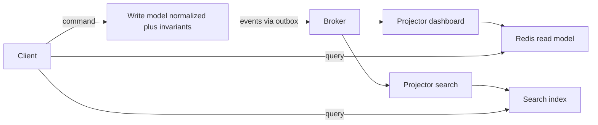

# CQRS

**Command Query Responsibility Segregation (CQRS)** is the idea that the model used to *change* state (commands) and the model used to *read* state (queries) can be different — different code, different shapes, and at the far end, different datastores kept in sync by events. It is not an all-or-nothing architecture but a dial: from "two service classes over one database" to "a normalized write store feeding five denormalized read stores". Turn the dial only as far as your read/write mismatch forces you — every notch adds eventual consistency that your UI and your users will feel.

## The problem that created it

A single model serving both writes and reads is pulled in opposite directions as a system grows:

- **Writes want normalization and invariants.** The transfer-processing path wants a [[Normalization vs Denormalization|normalized]] schema, constraints, and small transactional writes guarded by business rules ([[ACID Transactions]]): "debit cannot exceed balance", "one active KYC per user".
- **Reads want denormalized, query-shaped data.** The dashboard wants "last 10 transactions with merchant names, category icons, and running balance" — a shape that takes five joins on the normalized schema, repeated thousands of times per second. The search page wants full-text; the analytics page wants aggregates; the mobile home screen wants one precomputed document.
- **One model serves both badly.** Indexes added for reads slow every write ([[Database Indexes]]); denormalizing for the dashboard corrupts the invariant-bearing schema; read traffic (usually 10–100× write traffic) contends with the write path for the same database. The ORM entity accretes fields and methods serving neither side well.

Classic first responses — read replicas ([[Database Scaling Patterns]]), caches ([[Caching Strategies]]) — are already CQRS in embryo: a separate, slightly stale copy shaped for reads. CQRS names the pattern and follows it to its conclusion: *design* the read side deliberately instead of letting it emerge from caching accidents.

## What it solves

- **Independent optimization**: normalized, constraint-guarded write model; purpose-shaped read models (one per query pattern — a document for the dashboard, an index for search).
- **Independent scaling**: read stores scale with read traffic, the write store with write traffic — and read load stops contending with transactional writes.
- **Simpler code on both sides**: command handlers hold business rules with no query pollution; query handlers are dumb projections with no rules. (Sometimes CQRS's biggest win is this code clarity, even on one database.)
- **Precomputed reads**: answers computed once at write time, not per request — the [[Twitter Timeline Design|fan-out-on-write]] idea generalized.
- **A natural fit for event flows**: if events already flow ([[Event Sourcing]], [[The Outbox Pattern]], [[Change Data Capture]]), projecting them into read models is the marginal next step.

## How it works

### The dial, from mild to full

1. **Split the code, share the database.** `TransferCommandService` and `TransferQueryService`; commands go through the domain model, queries bypass it with read-optimized SQL/aggregation straight to DTOs. No consistency cost — same data, same instant. This level is almost always worth it and is where most systems should stop.
2. **Split the data within one store.** Materialized views, denormalized summary tables/collections updated transactionally or asynchronously with the write. Small staleness possible; still one engine to operate.
3. **Separate stores, event-fed.** Writes commit to the write store and publish events (via [[The Outbox Pattern|outbox]] or [[Change Data Capture|CDC]] — never dual writes); **projectors** consume events and update read stores (Redis for the home screen, Elasticsearch for search, a warehouse for analytics). Reads are fast, shaped, and *stale by design* — consistency between sides is eventual, bounded by projection lag.



### The arithmetic that justifies level 3

CQRS at level 3 is only worth its complexity when the read/write asymmetry is large, so measure the asymmetry before arguing about architecture. Take a consumer app's home screen:

- **2,000,000 daily active users**, opening the home screen about **8 times a day** → 16,000,000 reads/day.
- Average read rate: `16,000,000 ÷ 86,400 s ≈ 185 reads/s`. At a 5× evening peak: **≈ 925 reads/s**.
- The same app processes **400,000 transfers/day** → `400,000 ÷ 86,400 ≈ 4.6 writes/s`.
- Read-to-write ratio: `16,000,000 : 400,000 = 40 : 1`.

Now price the two designs. Served from the write model, one home screen is roughly **5 queries** — balance, last five transactions, merchant lookups, offers, a card status — so at peak the home screen alone asks the transfer cluster for:

```
925 reads/s × 5 queries  =  ~4,625 queries/s   on the same MongoDB serving money movement
```

Served from a projected read model, the home screen is **one `GET`** against a per-user document, and the projector does its work once per *change* rather than once per *view*:

```
peak read cost:   925 Redis GETs/s, zero queries against the write store
projector cost:   ~4.6 document updates/s, matching the write rate
```

The ratio is the point: `4,625 ÷ 4.6 ≈ 1,000×`. Precomputing at write time does about a thousand times less work than recomputing at read time, purely because the data changes a thousand times less often than it is looked at. That multiple — not elegance, not fashion — is the justification for level 3, and it is why the same argument fails immediately for an admin tool where reads and writes are both measured in dozens per day.

Latency follows the same logic. Assuming roughly 8 ms per indexed Mongo round trip, five sequential queries are already `5 × 8 = 40 ms` of pure database time *before* application work, against a 50 ms p99 budget — and 8 ms is a median, not a tail. A single Redis `GET` is sub-millisecond, which is what turns the budget from impossible into comfortable.

### Eventual consistency and the UI

At level 3 the user can write, refresh, and *not see their own write* — projection lag is usually milliseconds, but tail cases (projector restart, [[Backpressure and Flow Control|backlog]]) stretch to seconds or minutes. This is the same anomaly family as [[Read Your Own Writes and Replica Lag Anomalies|replica lag]], and the mitigations are the same plus some UI craft:

- **Read-your-writes routing**: after a command, serve that user's affected reads from the write model (or a session cache) for a short window, or until the read model's version ≥ the command's version (version-stamped reads).
- **Optimistic UI**: the client already knows what it submitted; render the expected outcome immediately ("Transfer initiated — ₹500 to Asha"), reconcile when projections catch up. Most consumer fintech apps do exactly this.
- **Command acknowledgment as state**: return the new aggregate version/status from the command so the client can poll or subscribe until the read side reflects it.
- **Honesty about lag**: surfaces like "balances update within a few seconds" beat pretending synchrony you don't have.

What you must *not* do: read from a stale read model inside a command handler to enforce an invariant ("balance ≥ amount") — invariants are checked against the **write model only**. Read models are for humans and dashboards, never for guarding money.

### CQRS and event sourcing: paired, not married

[[Event Sourcing]] *requires* CQRS (a fold-per-aggregate store cannot serve queries; every read is a projection). CQRS does **not** require event sourcing: a perfectly ordinary MongoDB write collection + outbox events + Redis read models is full CQRS with CRUD persistence. Conflating the two — "we want CQRS so we must event-source" — is how teams buy the decade-scale costs of [[Event Sourcing]] when all they needed was a denormalized read cache.

## Trade-offs

| You gain | You pay |
|---|---|
| Read and write models each optimally shaped | Two-plus models to design, version, and keep mentally in sync |
| Independent scaling; reads off the write path | Eventual consistency between sides; UI work to hide it |
| Cleaner domain code (rules without query pollution) | Projectors: deployment units with lag, monitoring, rebuild tooling |
| New read models without touching the write side | Event plumbing (outbox/CDC) becomes load-bearing infrastructure |
| Per-model technology choice (Redis, ES, warehouse) | More moving parts per feature: command, event, projector, read model |

## Common misconceptions

- **"CQRS means two databases."** It means two *models*. Separating `TransferCommandService` from `TransferQueryService` over one MongoDB is full CQRS — it is level 1, it costs nothing in consistency, and it is where most systems should stop. The second datastore is one possible consequence of the pattern, not its definition.
- **"CQRS implies eventual consistency."** Only from level 3, where the read data physically lives somewhere else. At levels 1 and 2 reads are as current as writes. The staleness comes from the separate *store*, not from the separation of *models* — so the common objection "we can't do CQRS, we need strong consistency" is usually an argument against level 3 that people mistake for an argument against the pattern.
- **"CQRS requires event sourcing."** No — a CRUD write model emitting events via an [[The Outbox Pattern|outbox]] is complete CQRS. The dependency runs the other way: [[Event Sourcing]] *requires* CQRS, because a per-aggregate fold cannot answer a cross-aggregate query.
- **"A read model is just a cache."** The resemblance is superficial and the operational difference is large. A cache is filled on miss from an authoritative source, so a broken cache degrades to slow; a read model is filled by a stream and has no miss path, so a broken projector degrades to **wrong**, silently, with no fallback to repair it. That asymmetry is why projection lag is an alerted SLI while cache miss rate is merely a dashboard.
- **"We keep the read model in sync by writing to Redis right after Mongo."** That is a dual write wearing CQRS vocabulary. Having two stores is not the pattern; having one *event stream* feed the second store is. A crash between the two writes desynchronizes them permanently, and because no stream exists, there is nothing to replay to fix it.
- **"More read models means more scalability."** Each read model is a consumer with its own lag, schema, rebuild procedure, and owner. The third one is cheap; the ninth, spread across five teams with no registry, is a quarter of coordination every time an event gains a field ([[Event Schema Evolution]]).

## Failure modes

- **Projector down, reads frozen in the past.** Writes succeed; dashboards silently stop moving. Users act on stale balances. Detection: projection lag (event timestamp vs apply time) as a first-class, alerted metric — this is [[Backpressure and Flow Control|consumer lag]] wearing a business costume.
- **Projection bug = systematically wrong reads.** A projector mis-maps a field and every read since is wrong, while the write model stays correct — the divergence is invisible without reconciliation checks. Mitigation: sampled write-vs-read-model reconciliation jobs; rebuild tooling rehearsed ([[Event Sourcing]] shares this).
- **Invariants checked against read models.** The "is balance sufficient?" check against a lagging Redis model approves overdrafts under projection lag. All command-side decisions read the write store, full stop.
- **Dual-write "CQRS".** The read side updated from application code rather than fed from an event stream — the [[The Outbox Pattern|dual-write problem]] reintroduced, and the most common way a CQRS adoption fails in practice. Event-feed the read side or keep both writes inside one transaction; never freehand it.
- **Read-model sprawl.** Five teams, nine read models, no owner for rebuilds or schema upgrades; adding an event field means chasing consumers for a quarter ([[Event Schema Evolution]]). Register projectors like the consumers they are.
- **Premature level 3.** A 50-RPS admin tool with a Kafka-fed read pipeline: all the lag, none of the need. The dial exists; most systems belong at level 1.

### What this looks like at 3am

Support escalates that around 300 customers see a balance that is wrong — not stale, *wrong*, and specifically wrong by exactly one transaction. Everyone else is fine.

Every dashboard is green, and one of them is actively misleading: **projection lag reads zero**. The projector is caught up, processing normally, no errors, no restarts. Mongo holds the correct balance for every affected user. The read model holds a number that will never correct itself, because there is no further event coming to fix it.

The confirming check is to compare versions rather than values. Store the aggregate version alongside each read-model document and compare it with the write model's current version for the affected users: a read model whose version is *lower* than the write model's **while lag is zero** means the projector did not fall behind — it processed the events and landed on the wrong state. That distinction is the whole diagnosis.

The cause traces back to a redrive earlier in the evening. A batch of events was replayed out of their original order, and the projector applies balance updates as an absolute assignment — `balance = event.balanceAfter` — with no guard. Replaying an older `transfer.completed` after a newer one therefore overwrites the current balance with a stale snapshot, permanently. The projector is idempotent in the trivial sense (applying the same event twice is harmless) and still wrong, because idempotence is not the same as order-tolerance, and a redrive supplies exactly the hazard that distinguishes them ([[Message Ordering]], [[Dead Letter Queues and Poison Messages]]).

Two durable fixes, plus one organizational one. Guard every projection write with the aggregate version — apply only when the event's version exceeds the version already stored — so out-of-order replays become no-ops rather than regressions. Prefer incremental deltas over absolute assignments where the domain allows it, since a delta applied twice is caught by event-ID dedup while an absolute assignment applied late is caught by nothing. And run a sampled write-vs-read reconciliation job, because this is the class of bug that lag monitoring structurally cannot see: **projection lag tells you the read model is slow; only reconciliation tells you it is wrong.**

## When NOT to use it

- **Reads and writes share one shape** (CRUD forms, admin panels, settings): one model, one store, no dial-turning.
- **Strong read-after-write is a hard requirement everywhere** (intra-transaction reads, synchronous workflows): the eventual-consistency tax lands on every interaction; stay at level 1–2 where reads are same-instant.
- **Low traffic, small team**: projectors, outbox, and rebuild tooling are standing operational costs; below real read/write tension they purchase nothing.
- **As a gateway drug to event sourcing you don't need**: adopt each level for its own justification.

## In your stack

- You already run informal CQRS: MongoDB as write store, Redis as read-shaped cache. The upgrade path is not more technology — it is *feeding Redis from events* (outbox or Mongo change streams via [[Change Data Capture]]) instead of dual-writing it from service code, which is where the sync bugs you've likely seen come from.
- Mobile-app home screens (balance, recent transactions, offers) are the classic level-3 read model: one precomputed Redis document per user, projected from transaction events — one `GET`, no fan-out of queries at request time.
- Fintech guardrail worth writing on the wall: **money decisions read the write model**. Display balances may ride projections; debit authorization never does.
- Projector services at 1 replica (fleet norm): projection lag during deploys/crashes is structural — alert on lag age per read model, and keep the rebuild-from-events runbook real, because a single bad deploy can corrupt a read model that only a replay can fix. Be honest about what one replica means here: the projector is a single point of staleness for every surface it feeds, so its deploy window *is* a product-visible stale-balance window, and the mitigation is either a second replica or a UI that tells the truth about freshness — not an assumption that deploys are fast.
- Because the read side is fed by SQS today and Redis Streams later, projectors inherit at-least-once delivery and, after any redrive, out-of-order delivery. Make every projection write **version-guarded** — apply only when the event's aggregate version exceeds the version stored on the read document — and dedup on event ID. Idempotent is not sufficient; order-tolerant is the property that matters ([[Delivery Semantics]]).
- Feeding Redis from MongoDB change streams is the lowest-friction path to level 3 in this stack, but it carries one operational obligation: persist the **resume token** with each projection batch. A projector that restarts without one either reprocesses from an arbitrary point or silently skips the gap, and the oplog window bounds how far back it can resume at all — the same retention-cliff shape as a log ([[Change Data Capture]]).
- If a read model ever backs a decision rather than a display, it stops being a read model and becomes an unaudited source of truth for money. Worth stating in the service's own README, because the pressure to "just read the balance from Redis, it's faster" arrives with every latency review.

## Interview angle

The 60-second version: *"CQRS separates the model that changes state from the models that answer queries. Writes go through a normalized, invariant-guarded model; reads come from denormalized, query-shaped models — possibly different stores — kept in sync by events via an outbox or CDC. It's a dial: split code over one DB (free, usually worth it), materialized views, or fully separate event-fed stores — which buys independent scaling and precomputed reads at the price of eventual consistency: users may not see their own write, so you add read-your-writes routing or optimistic UI, and you monitor projection lag like any consumer lag. It pairs naturally with event sourcing but doesn't require it — and most systems should stop at the code split."*

Classic follow-ups:

- "How do you keep the read model in sync?" — events via outbox/CDC + idempotent projectors; never dual writes from the service.
- "User writes then immediately reads — what do they see?" — projection lag; mitigate with version-stamped read-your-writes, session routing to the write model, or optimistic UI.
- "CQRS without event sourcing — possible?" — yes, CRUD write store + events; ES is one write-model choice, not a prerequisite.
- "Where do business invariants live?" — write model only; a read model is never a source of truth for a command decision.
- "When is it overkill?" — symmetric read/write shapes, low scale, hard synchrony needs — then the code-level split alone.

## Check yourself

> [!question]- Q: Explain the CQRS "dial" and where business invariants are enforced at every level.
> Level 1: separate command/query code paths over one database — reads are current, invariants in the command path's transactions. Level 2: denormalized views/summary tables in the same store — invariants still in write transactions; views may lag slightly. Level 3: separate read stores fed by events through projectors — reads eventually consistent. At *every* level, invariants are enforced only against the write model, inside its transactional boundary; read models exist to answer queries, and using one to authorize a command (e.g., checking balance in Redis) is the canonical CQRS bug.

> [!question]- Q: A user completes a transfer, pulls to refresh, and still sees the old balance for 3 seconds. Walk through why, and two fixes with their costs.
> The command committed to the write store and emitted an event; the projector hadn't yet applied it to the Redis read model when the refresh hit — projection lag, the read-side twin of [[Read Your Own Writes and Replica Lag Anomalies|replica lag]]. Fix 1 — version-stamped read-your-writes: the command returns the aggregate version; reads for that user go to the write model (or block/poll) until the read model reaches that version; cost: write-store read load and routing complexity. Fix 2 — optimistic UI: the app renders the expected post-transfer state immediately from the command's acknowledged result and reconciles later; cost: client logic, and care that failures reconcile visibly (the transfer that *didn't* happen must un-render).

> [!question]- Q: What happens if a projector has a mapping bug for a month? Compare the blast radius and recovery with a bug in the write model.
> Projector bug: the write store stays correct; one read model shows wrong data for a month — damage is bounded to decisions made from that surface, and recovery is fix + replay/rebuild the read model from retained events — mechanical, lossless. Write-model bug: wrong *truth* was committed; events emitted were wrong; every read model faithfully projected the wrongness — recovery needs compensating corrections ([[Saga Pattern]]-style reversals, manual adjustments) and possibly customer remediation. This asymmetry is why CQRS pushes complexity toward reads: read-side bugs are rebuildable, write-side bugs are incidents.

> [!question]- Q: The DBA reports that transfer writes slow down every evening. The home screen serves 2M users opening it ~8 times a day, each open costing 5 queries against the same MongoDB that processes 400,000 transfers a day. Make the case for a read model with numbers, and say what you would check before building it.
> Average read rate is `16,000,000 ÷ 86,400 ≈ 185/s`, and at a 5× evening peak about **925 reads/s** — which at 5 queries each is roughly **4,625 queries/s landing on the transfer cluster**, against a write rate of only `400,000 ÷ 86,400 ≈ 4.6 transfers/s`. The read-to-write ratio is 40:1 by request and about 1,000:1 by database work, and the evening slowdown is simply read traffic contending with money movement for the same connections, working set and locks. A projected read model inverts the economics: compute the home-screen document once per change at ~4.6 updates/s and serve it as a single Redis `GET`, removing essentially all of that 4,625/s from the write store. Before building it, check three things. First, that the queries are genuinely necessary work rather than missing indexes or an [[N+1 Queries and ORM Pitfalls|N+1]] — a read model built over an unindexed query hides a bug rather than fixing one, and the index is a day's work against a quarter's. Second, whether a [[Database Scaling Patterns|read replica]] solves it, since that also removes read load from the primary at far lower complexity and keeps one model; the read model wins only if the *shape* is also wrong, which five queries per view suggests. Third, that staleness is acceptable on this surface — display balances, yes; anything authorizing money, no, and that rule has to survive the next feature request. If the shape is wrong and staleness is acceptable, the thousand-fold work reduction justifies level 3; if only the volume is wrong, a replica is the cheaper correct answer.

> [!question]- Q: Mini-design — the app's home screen needs balance, last 5 transactions, and active offers in <50 ms at p99, while transfers run on MongoDB with strict invariants. Sketch it.
> Write side unchanged: transfers commit to Mongo with invariant checks, emitting `transfer.completed` (and offer events) via [[The Outbox Pattern|outbox]]. A projector consumes events and maintains one Redis hash/JSON doc per user: `{balance, last5: [...], offers: [...]}` — updated incrementally, idempotently (dedup on event ID, version guard). Home screen = one Redis `GET`. Read-your-writes: after a transfer, the app optimistically renders and/or the API stamps the response with the new version, with reads falling back to Mongo until Redis catches up. Alerts: projection lag age; sampled Mongo↔Redis balance reconciliation. Display balance from Redis; any *authorization* of money reads Mongo.

## Sources

- Martin Fowler — "CQRS" (martinfowler.com, 2011) — including the explicit warning that most systems don't need the full version.
- Greg Young — "CQRS Documents" / "CQRS, Task Based UIs, Event Sourcing agh!" — the origin of the term and its separation from event sourcing.
- microservices.io — "Pattern: Command Query Responsibility Segregation" (Chris Richardson).
- Microsoft patterns & practices — "CQRS Journey" (a long, honest case study, including what hurt).
- *Designing Data-Intensive Applications*, Kleppmann — Ch. 11 (derived data, maintaining materialized views from event streams).
