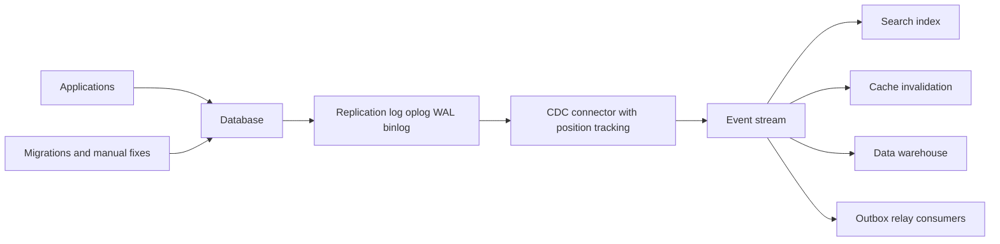

# Change Data Capture

Every serious database already maintains a perfectly ordered, durable stream of every change made to it — the replication/write-ahead log it uses internally for [[Replication]] and crash recovery. **Change data capture (CDC)** taps that log and republishes it as an event stream other systems can consume: every insert, update, and delete, in commit order, without touching application code. It is the most reliable way to answer "tell me whenever this data changes" — because it observes what *actually committed*, not what the application *remembered to announce*.

## The problem that created it

A growing system accumulates consumers of its core data: a search index that must reflect profile edits, a cache that must be invalidated on writes, an analytics warehouse that wants every change, a fraud system watching transactions. The naive approaches all rot:

- **Dual writes from the application** ("save to DB, also write to Elasticsearch, also invalidate Redis…") — every new destination multiplies the [[The Outbox Pattern|dual-write problem]]: partial failures leave destinations divergent, and the code path grows a brittle fan of side effects.
- **Periodic polling** (`SELECT * WHERE updated_at > ?`) — misses deletes entirely, hammers the database, adds polling lag, and relies on applications faithfully maintaining `updated_at` (they don't; bulk updates and manual fixes skip it).
- **Application-emitted events** — honest but incomplete: the DBA's manual correction, the migration script, the other service writing to the same collection, the legacy batch job — none of them emit your event. The event stream silently diverges from the database truth.

Meanwhile the database itself has been keeping the perfect answer all along: its log records every committed change, in order, exactly once, including deletes, no matter who made the change. CDC is the realization that this log is not just an internal mechanism but a *product*.

## What it solves

- **Completeness**: captures every committed change from every writer — applications, migrations, humans — with deletes included.
- **No dual writes**: the application writes only to its database; propagation is someone else's (the CDC pipeline's) problem. One write path, N consumers.
- **Commit-order fidelity**: events arrive in the database's own commit order (per partition/shard of the source), with transactional boundaries available in many implementations.
- **Low, bounded lag**: log tailing is push-shaped and typically sub-second — far fresher than batch ETL, far cheaper than polling.
- **Legacy liberation**: puts an event stream in front of systems that were never designed to emit events — the standard first step of a [[Strangler Fig Migration]].

## How it works

### Log tailing

A CDC connector poses as a replication client: it reads MySQL's binlog, Postgres's WAL via logical decoding, MongoDB's oplog (through change streams — Debezium 2.0 removed direct oplog tailing), and converts each entry into a change event — typically `{operation: insert|update|delete, before: {...}, after: {...}, source: {table, position, timestamp, txId}}` — published to a stream ([[Kafka Architecture|Kafka]] classically; Kinesis, SQS, or [[Redis Streams]] work too). The connector persists its **log position** (binlog offset, resume token, LSN) so restarts resume exactly where they left off — making the pipeline at-least-once ([[Delivery Semantics]]; duplicates on crash-replay, so consumers dedup on source position or key version).

**The main implementations:**

- **Debezium** — the open-source standard: connectors for MySQL, Postgres, MongoDB, SQL Server, Oracle; runs on Kafka Connect (or standalone via Debezium Server); emits a well-defined envelope; includes the outbox event router ([[The Outbox Pattern]]).
- **MongoDB change streams** — CDC built into the database: `watch()` on a collection/db/deployment returns an ordered cursor of changes with **resume tokens**; requires a replica set or sharded cluster (it reads the oplog; a standalone `mongod` has none); your fleet can use this with zero extra infrastructure. The events are *not* the `before/after` envelope above: an update carries only the changed fields (`updateDescription`) unless you ask for `fullDocument: "updateLookup"` — the document's state when the lookup runs, which may be later than the change — and a **delete carries only `documentKey`** (the `_id`, plus the shard key on sharded collections), never the deleted document. Getting the pre-change document needs `changeStreamPreAndPostImages` enabled on the collection and `fullDocumentBeforeChange` on the stream (MongoDB 6.0+).
- **DynamoDB Streams** — a 24-hour change log per table, ordered **per item** (not across the table), each modification appearing exactly once in the stream, consumed by Lambda or the Kinesis adapter; the stream view type (`KEYS_ONLY`, `NEW_IMAGE`, `OLD_IMAGE`, `NEW_AND_OLD_IMAGES`) decides whether before/after images are present. The same idea as a managed feature.
- Postgres logical replication slots, MySQL binlog clients (maxwell, canal) — same family.

### Snapshot + log: bootstrapping

A new consumer needs current state, not just changes-from-now. CDC pipelines therefore run in two phases: an **initial snapshot** (read the full table, emit each row as a synthetic "read/insert" event) followed by **log streaming** from the position captured at snapshot start. Done naively this blocks or double-reads; modern connectors do **incremental snapshots** (interleaving chunked snapshot reads with live log events, deduplicating by key — Debezium's signal-based approach) so you can bootstrap a multi-terabyte table without stopping the stream. The snapshot+log pair is also the replay story: to rebuild a consumer, re-snapshot or reset to a retained log position ([[Message Queues vs Event Logs]]).

### Row-shaped vs intent-shaped: CDC events are not domain events

The deepest design point. CDC emits **row-shaped** facts: "row 42 in `accounts` changed: `balance` 1000→800, `status` unchanged". An application emits **intent-shaped** facts: "transfer T-981 of ₹200 from account 42 to 77 completed, reason: UPI payout". The difference matters:

| | CDC / row-shaped | App events / intent-shaped |
|---|---|---|
| Says | *What* changed in storage | *Why* it changed in the domain |
| Captures all writers | Yes, including migrations and humans | No — only instrumented code paths |
| Exposes | Your table/collection schema — consumers couple to it | A deliberate contract ([[Event Schema Evolution]]) |
| One business action | May appear as N row events across tables, interleaved | One semantic event |
| Best consumers | Mechanical mirrors: caches, search, replicas, warehouses | Domain logic: sagas, notifications, other services' decisions |

Row events make bad domain events: consumers must reverse-engineer intent from column diffs, and every schema migration becomes a breaking change for strangers. The mature combination: **CDC for mechanical replication, outbox (relayed by CDC) for domain events** — the outbox row *is* intent-shaped, and CDC is merely its transport ([[The Outbox Pattern]]).

### Schema drift

The source schema *will* change. CDC pipelines handle it with varying grace: Debezium picks up DDL and updates event schemas (publishing them to a schema registry); Mongo's schemaless documents simply start looking different. Either way the *consumers* bear the impact — a renamed column is a breaking change delivered at stream speed. Treat CDC topics as contracts: schema registry, compatibility checks, and the full discipline of [[Event Schema Evolution]] apply doubly here because the "producer" (your table) never thinks of itself as publishing an API.

### Use cases that fit

- **[[Cache Invalidation]]** — evict/update Redis keys when the underlying rows change, regardless of which code path wrote them.
- **Search indexing** — keep Elasticsearch in lockstep with the primary store.
- **Outbox relay** — the production-grade transport for [[The Outbox Pattern]].
- **Data lake / warehouse feeds** — continuous, low-lag replication to analytics, replacing nightly batch ETL.
- **Cross-store replication and migrations** — feed the new datastore from the old one's changes while both run ([[Strangler Fig Migration]]).
- **Audit-ish trails** — a complete record of changes (with the caveat that it shows *what*, not *who/why*, unless the schema carries it).

## Trade-offs

| You gain | You pay |
|---|---|
| Complete, ordered change stream, all writers | Infrastructure: connectors, Connect cluster, monitoring |
| No application changes to start | Consumers coupled to source schema (unless outbox-mediated) |
| Deletes captured, sub-second lag | Operational intimacy with DB internals: slots, oplog windows, binlog formats |
| Replay via snapshot + retained log | At-least-once duplicates; consumer dedup required |
| One pipeline, N destinations | Source DB load: replication-client overhead, slot/oplog retention pressure |

## Failure modes

- **Log retention outruns the connector.** The connector is down for longer than the oplog window / binlog retention / replication-slot ceiling; its resume position no longer exists. Recovery = full re-snapshot (hours-days on big tables) while consumers see a gap or duplicates. Monitor connector lag against retention with margin — the same cliff as [[Backpressure and Flow Control|Kafka lag vs retention]].
- **The inverse: an abandoned Postgres replication slot** pins WAL forever and fills the primary's disk (by default — Postgres 13+ can cap it with `max_slot_wal_keep_size`, which invalidates the slot instead and turns this into the failure above) — CDC that nobody is consuming can take down the *source* database. Alert on slot lag/WAL retention.
- **Schema change breaks consumers at stream speed.** A column rename ships, and every downstream consumer starts failing within seconds — faster blast radius than any API change, because nobody thinks of `ALTER TABLE` as a deploy to other teams.
- **Event storms from bulk operations.** A backfill touching 50M rows emits 50M events; downstream consumers and the broker get a day of traffic in minutes. Coordinate bulk changes with pipeline owners; consider snapshot-based rebuilds instead of letting the storm flow.
- **Ordering across tables/shards.** CDC preserves order per source partition (one binlog, one oplog shard), but a multi-table transaction fans into per-table topics with no global order, and per-shard capture of a sharded store has none either (a Mongo change stream opened through `mongos` is the exception: it merges shards into one cluster-time order) — consumers wanting transactional wholeness need the transaction markers some connectors emit, or must not need them ([[Message Ordering]]).
- **PII leaks by default.** The log contains *every* column; CDC happily replicates fields the warehouse must never hold. Column filters/masking in the connector are a compliance control, not an optimization.

## When NOT to use it

- **You need intent, not diffs** — domain events driving business logic ([[Saga Pattern]] steps, notifications) should come from the application via an [[The Outbox Pattern|outbox]]; CDC-of-business-tables makes consumers archaeologists of your schema.
- **One consumer, low freshness needs** — a nightly batch export is operationally far cheaper than a streaming pipeline; CDC earns its cost with multiple consumers or sub-minute freshness.
- **The source is tiny or ephemeral** — re-reading the whole table is simpler than streaming its changes.
- **You'd use it to synchronize two services' *writes*** — CDC is one-way propagation of one owner's truth; using it to let two services co-own a table cements the shared-database anti-pattern ([[Service Boundaries and Domain-Driven Design]]).

## In your stack

- MongoDB change streams are your zero-infra CDC: replica sets already run, `watch()` with resume tokens gives ordered change events per collection — a natural relay for an outbox collection to SQS or [[Redis Streams]], and a clean [[Cache Invalidation]] feed for your Redis layer.
- Mind the oplog window: a change-stream consumer down longer than the window loses its resume token and must re-snapshot — size the oplog and alert on consumer lag against it.
- DynamoDB-style thinking applies to your AWS estate: if a table's consumers keep growing, a stream from the source beats more dual writes in Java services.
- Compliance (KYC/PII under RBI + data-localisation expectations): CDC pipelines replicate whole documents by default — field filtering at the connector is part of the design review, and the warehouse's copy is in regulatory scope the moment it lands.

## Interview angle

The 60-second version: *"Databases already keep an ordered log of every committed change for replication and recovery; CDC tails that log — MySQL binlog, Postgres WAL, Mongo oplog via change streams — and republishes it as an event stream. Compared to app-emitted events it's complete (every writer, deletes included) and avoids dual writes; compared to polling it's push-shaped and sub-second. Bootstrapping is snapshot-then-stream from a saved position; the pipeline is at-least-once so consumers dedup. The key design caveat: CDC events are row-shaped — they expose your schema and say what changed, not why — so use CDC for mechanical mirrors like caches, search, and warehouses, and pair it with the outbox pattern when downstream needs intent-shaped domain events."*

Classic follow-ups:

- "CDC vs the outbox pattern?" — complements, not rivals: outbox defines intent-shaped contracts atomically with state; CDC is the best relay for it; raw-table CDC is for mechanical replication.
- "What happens if the connector dies for a day?" — resume from stored position if the log still has it; otherwise re-snapshot — hence retention sizing and lag alerts.
- "How do you keep a cache exactly in sync?" — you don't, exactly: CDC gives at-least-once with small lag; design idempotent, last-writer-wins cache updates keyed by version.
- "Deletes in polling-based sync?" — polling can't see them (the row is gone); CDC's `delete` events are the only honest answer short of tombstone columns.

## Check yourself

> [!question]- Q: Explain why CDC is more complete than application-emitted events, and the price of that completeness.
> CDC reads the database's own log, so it sees every committed change regardless of author — application code, a second service, a migration script, a DBA's manual fix — and includes deletes. App events only cover instrumented code paths and silently miss everything else. The price: events are row-shaped, exposing storage schema as a de facto public API; consumers couple to your tables, every migration becomes a potential breaking change for them, and intent ("why did the balance change?") is absent.

> [!question]- Q: A Mongo change-stream consumer was down for 36 hours; the oplog covers 24. What happens on restart and how do you recover?
> Its resume token points at an oplog position that has rolled off; the resume fails (invalid/expired token). The missed changes are unrecoverable from the stream. Recovery: full re-sync — snapshot the collection (emitting current state) and open a fresh change stream from the snapshot's start position, deduplicating by key; consumers see the world jump to current state. Prevention: oplog sized for worst-case outage + alerting on consumer lag against the window.

> [!question]- Q: Your team proposes driving the loan-approval saga from CDC on the `loans` collection ("status changed to APPROVED → start disbursement"). Argue the better design.
> Status-diff events force the saga to infer intent: a migration flipping statuses, a support tool fixing a typo'd status, or a schema refactor renaming the field would all trigger (or silently stop triggering) disbursements — money movement keyed to storage archaeology. Better: the approval use-case writes an intent-shaped `loan.approved` event to an [[The Outbox Pattern|outbox]] in the same transaction as the status change; CDC (or a poller) relays the outbox. The saga consumes a deliberate contract; raw CDC remains for mechanical mirrors (search, cache, warehouse). Deterministic control over money movement also satisfies the auditor in ways "we diff rows" does not.

> [!question]- Q: Mini-design — keep Redis cache and Elasticsearch in sync with a `merchants` collection updated by three different services. Sketch the pipeline and name the two alerts.
> One Mongo change stream (deployment- or collection-level) consumed by a small CDC service (or Debezium Mongo connector → Kafka/SQS): for each change event, update/evict the Redis key (`merchant:{id}`, last-writer-wins by a version/updatedAt guard) and upsert the ES document (index by `_id`, idempotent) — opening the stream with `fullDocument: "updateLookup"`, since an update event otherwise carries only the changed fields; a delete event carries only `documentKey._id`, which is exactly enough to evict the key and delete the ES document. Resume token checkpointed durably. Bootstrap each new destination by snapshot-then-stream. Alerts: (1) CDC lag — resume-token age / change-stream latency vs oplog window, (2) destination divergence — periodic sampled reconciliation count between Mongo and ES/Redis (catches silent consumer bugs that lag alone misses).

## Sources

- Debezium documentation — architecture, connector guides, incremental snapshots (DDD-3 signal-based snapshotting), Outbox Event Router.
- *Designing Data-Intensive Applications*, Kleppmann — Ch. 11 "Change Data Capture" (and the "turning the database inside out" framing); Ch. 5 on replication logs.
- MongoDB documentation — Change Streams (resume tokens, oplog requirements).
- AWS documentation — DynamoDB Streams (24-hour retention, ordered per item).
- Martin Kleppmann, "Turning the database inside-out" — 2014 talk/essay that popularized the log-centric view.
