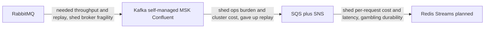

# Choosing a Message Broker

There is no best broker; there are workloads, and brokers that fit or fight them. The decision collapses to a handful of dimensions — and the first question is always the fork from [[Message Queues vs Event Logs]]: do you need a **queue** (deliver, ack, forget) or a **log** (retain, replay, many readers)? Get that wrong and no amount of tuning saves you. This note gives the dimensions, a comparison table, the lessons encoded in your own RabbitMQ → Kafka → SQS → Redis Streams journey, and a migration checklist for the next hop.

## Why this matters

Broker choices are among the stickiest in a system: every producer and consumer couples to the broker's semantics ([[Delivery Semantics]], [[Message Ordering]]), topologies accumulate, and — for logs — history lives there. Migrations are multi-quarter projects (you've done three). Choosing on hype ("Kafka because scale") or on familiarity alone buys either an ops burden you can't staff or a capability ceiling you'll hit in production. Interviewers also test exactly this: not "do you know Kafka" but "can you justify *not* using it".

## How it works

### Before the table: four questions about the workload

Brokers get compared; workloads get forgotten. Answer these about the *workload* first, in writing, because each one eliminates rows before any feature comparison starts:

1. **If an acknowledged message is lost, what is the blast radius?** "A user re-taps a button" and "a ledger diverges from the bank" are different universes — this sets the durability floor.
2. **Will anyone ever need to read these messages again after processing?** New consumers bootstrapping, bug-recovery replay, audit/reconciliation — any yes means log, not queue.
3. **What does the worst backlog look like?** Peak rate × longest plausible consumer outage. The broker must hold that comfortably — it's the broker's actual job.
4. **Who owns the broker at 3 a.m.?** A name, not a team aspiration. No name → managed service, full stop.

### The dimensions, in rough priority order

1. **Queue vs log.** Need replay, multiple independent readers, event history as an asset ([[Event Sourcing]], [[Change Data Capture]])? Log. Need jobs done once, then gone? Queue. This single question eliminates half the table.
2. **Durability floor.** What happens to an acknowledged message when a node dies? Kafka (acks=all/min.insync) and quorum-queue RabbitMQ: replicated-before-ack. SQS: replicated multi-server by contract. [[Redis Streams]]: in-memory ack, async replication — the weakest. Match to blast radius: a lost notification vs a lost ledger entry.
3. **Throughput and backlog shape.** Sustained MB/s, peak multiplier, and — often forgotten — how large backlogs get when consumers stall. Logs shrug at backlogs; [[RabbitMQ]] degrades; Redis pays RAM.
4. **Ordering granularity.** None / per-key ([[Kafka Architecture|partitions]], SQS FIFO groups) / global (one partition — a scalability dead end). Per-key is almost always what the business actually needs ([[Message Ordering]]).
5. **Routing richness.** Content/pattern-based routing to many destinations: RabbitMQ exchanges, SNS filter policies. Kafka and Streams route by key only; consumers filter.
6. **Ops budget.** Who carries the pager for the broker? This is the dimension teams lie to themselves about. [[Kafka Operations]] is a job; SQS is nobody's job; Redis Streams is "whoever owns Redis"'s job — real, but incremental.
7. **Ecosystem.** Connectors, schema registry ([[Event Schema Evolution]]), stream processing, client maturity in your languages.
8. **Cost shape — name what scales with what.** SQS: per-request (and payload size) — cheap idle, linear with traffic, fan-out multiplies it. Kafka self-managed/MSK: per-broker-hour + storage + cross-AZ transfer — flat-ish, traffic-insensitive until resize, people-cost dominates self-managed. Confluent: per-throughput-unit premium. Redis Streams: per-GB-RAM of retention + instance hours — retention, not traffic, is the expensive axis. RabbitMQ: instance hours + people. A cost answer without "what scales with what" is not an answer.

### The comparison table

| | [[RabbitMQ]] | [[Kafka Architecture|Kafka]] | [[SQS and SNS|SQS + SNS]] | [[Redis Streams]] |
|---|---|---|---|---|
| Model | Smart-broker queue | Replicated log | Managed queue + pub/sub | In-memory log, single key |
| Replay | No | Yes (retention window) | No | Yes (RAM-bound window) |
| Throughput ceiling | Moderate | Very high | High (standard); FIFO limited | One shard per stream |
| Ordering | Per-queue | Per-partition key | Per FIFO group | Per stream |
| Routing | Rich (exchanges) | By key only | SNS filters | None built in |
| Durability floor | Quorum queues: strong | acks=all: strong, tunable | Strong by contract | Weakest (async repl, AOF window) |
| Delays/TTL/DLQ built in | TTL + DLX yes; delays via plugin | No | Yes | No |
| Ops burden | Medium, self-run | High (or pay MSK/Confluent) | ~Zero | Low *increment* on owned Redis |
| Cost scales with | Instances + people | Brokers + storage + transfer (+premium) | Requests × fan-out | RAM × retention |
| Sweet spot | Complex routing, moderate scale | Firehoses, replay, many readers | Default cloud queueing | Ephemeral low-latency pipelines |

One line each for the two you'll be asked about: **Pulsar** — Kafka-class log with segmented storage (BookKeeper) separating compute from storage, giving easier rebalancing and tiering, at the cost of operating an even more complex system with a smaller community. **NATS (JetStream)** — featherweight, blazing simple pub/sub with an added persistence layer; superb for service mesh-ish internal messaging and edge/IoT, not built for Kafka-scale retained firehoses.

### Your journey, read as a decision log

Each hop traded something named for something needed — this is the framework applied, not failed:

- **RabbitMQ → Kafka**: bought throughput, replay, consumer independence; paid with the entire [[Kafka Operations]] workload — which is why the Kafka era itself hopped self-managed → MSK → Confluent, each paying more money for fewer pages.
- **Kafka → SQS**: the honest admission that the workloads didn't need a log badly enough to fund one. Bought zero ops and per-request pricing; gave up replay and accepted 14-day/no-history semantics.
- **SQS → Redis Streams (planned)**: buys latency, replay-within-RAM, and removal of per-request cost on already-owned infra; gambles durability and takes on DIY redelivery/DLQ machinery. The [[Redis Streams]] note's "In your stack" section is the pre-flight checklist — the key discipline is *segmenting* workloads: ephemeral traffic moves, money-critical traffic doesn't.

The meta-lesson: the right broker changed as the constraint changed (capability → ops → cost). Expect it to change again; design producers/consumers against thin abstractions so hop #4 is cheaper than hops 1–3.

Red flags to call out in the decision meeting, whichever direction they point: a broker chosen before the workload classification exists; "we'll add idempotency later"; a durability requirement asserted without naming what breaks when a message is lost; and any sentence of the form "X is web-scale / X doesn't scale" without a number attached.

### Migration checklist (any broker → any broker)

Phase 0 — classify: per queue/topic, record durability class, ordering needs, peak/backlog sizes, replay/DLQ usage, consumers and their [[Idempotency|idempotency]] status. Migrate workload-by-workload, easiest class first.

1. **Dual-publish** — producers write to old and new brokers (directly, or via a bridge consumer). Compare counts/checksums for days before trusting. The [[The Outbox Pattern|outbox pattern]] helps here: one outbox, two relays, no producer code churn.
2. **Consumer cutover with dedup** — during overlap every message exists twice, so consumers *must* dedup on a business key before cutover begins (they should already — at-least-once made this mandatory on day one). Cut consumers over one group at a time, old broker still flowing as fallback.
3. **Ordering across the seam** — per-key order is not preserved *across* brokers during overlap: either drain-then-switch per key-space (pause producers for that keyspace, drain old, enable new), or tolerate a bounded reorder window and design consumers for it.
4. **Drain and verify** — stop old-side publishing, let consumers drain old to empty, reconcile counts against the new side, only then decommission. Keep the old DLQ contents exported — they're evidence.
5. **Rollback story** — until drain completes, rollback = flipping consumers back. After decommission, rollback is gone; say so explicitly in the plan.
6. **Carry the invariants** — whatever replaced visibility timeouts/DLQs/retention alarms must exist on day one on the new broker, not as a fast-follow. Migrations die from missing operational parity, not from message formats.

## Trade-offs

The table above *is* the trade-off matrix; the meta-trade-offs of the decision itself:

| Choosing… | You gain | You pay |
|---|---|---|
| One broker for everything | One skillset, one integration | Worst-fit workloads subsidize the fit ones |
| Per-workload brokers | Each workload on its sweet spot | N operational surfaces, N client stacks, migration seams |
| Managed over self-run | Pages become invoices | Cost premium, less control, vendor coupling |
| The familiar over the fit | Velocity now | A migration later — which you'll underestimate |

A sane default for a fintech on AWS: SQS/SNS as the default queue, a log (MSK/Confluent) only for streams whose *history is an asset*, Redis Streams for ephemeral low-latency lanes — three tools, each doing what it's shaped for.

## Common misconceptions

- **"Kafka is the scalable one, so Kafka is the safe default."** Kafka is the *capable* one; safe is the broker whose failure modes your team can actually staff. An unowned Kafka cluster is less reliable than SQS for any workload SQS can carry ([[Kafka Operations]]).
- **"Exactly-once delivery solves our duplicate problem."** No broker delivers exactly-once end-to-end into your side effects; FIFO dedup windows and Kafka transactions each cover one segment of the pipeline. Consumer idempotency is mandatory on every broker in the table ([[Exactly-Once Delivery Is a Lie]]).
- **"We'll migrate later if we outgrow it."** True, but price it: a broker migration is a multi-quarter dual-publish project, not a dependency bump. "Later" is only cheap if producers and consumers were written against thin abstractions and business-key dedup from day one.
- **"Managed means we don't need broker expertise."** Managed removes machine ops, not semantics. Visibility-timeout bugs, hot partitions, lag-vs-retention races, and PEL leaks are all application-layer — present on every tier of management, invoiced to you.
- **"Ordering means FIFO everywhere."** Global FIFO is a scalability dead end (one lane, no parallelism). Interrogate the requirement: it is almost always per-entity order — per account, per user — which every broker here can provide at scale ([[Message Ordering]]).
- **"Latency is the headline number."** For async pipelines, backlog behavior under consumer outage usually matters more than p50 delivery latency — the broker's job is absorbing the bad hour, not shaving the good millisecond ([[Backpressure and Flow Control]]).

## In your stack

- You are at step 0–1 of the checklist right now (SQS → Redis Streams). The single highest-leverage artifact to produce: the per-queue classification table (durability class / backlog peak / replay use / idempotency status). It converts a religious debate into a sorting exercise.
- Correctness-beats-latency (RBI-regulated money movement) pre-answers dimension 2 for a whole class of queues: those stay on SQS (or graduate to a log), regardless of how well the Streams pilot goes.
- Your 1-replica consumers make backlog shape (dimension 3) unusually important: every deploy/restart is a consumption pause, so the broker must absorb hours of backlog as a *normal* event — budget Streams RAM for that, not for the happy path.
- Keep the dedup discipline from the SQS era (business-key idempotency) as a permanent property, not a migration tool — it is what makes hop #4 cheap.
- Cost-shape one-liner for the migration proposal: you are trading a bill that scales with requests (SQS) for one that scales with RAM-hours of retention plus instance size (Redis) — so the savings case is strongest for high-rate/short-retention queues and inverts for low-rate queues, which are nearly free on SQS.

## Interview angle

The 60-second version: *"I pick brokers on a handful of dimensions: queue-vs-log first — replay and multiple readers mean a log, jobs mean a queue — then durability floor, throughput and backlog shape, ordering granularity, routing needs, and honestly-staffed ops budget, with cost shape as the tiebreaker: SQS scales with requests, Kafka with brokers and storage, Redis Streams with RAM-hours of retention. Kafka for firehoses and history-as-asset, SQS as the cloud default, RabbitMQ for routing-rich moderate scale, Redis Streams for ephemeral low-latency lanes on infra you already own. And I'd defend the boring answer: most teams' workloads are SQS-shaped."*

Classic probes:

- "Kafka or RabbitMQ?" — refuse the binary; ask replay? throughput? routing? ops owner? Then answer in one sentence per dimension that discriminates.
- "How would you migrate brokers with zero loss?" — dual-publish, dedup-ready consumers, per-group cutover, drain-verify-decommission, rollback window. Naming *dedup during overlap* is the senior signal.
- "When is Kafka the wrong choice?" — low volume, no replay need, no ops owner, need delays/TTL/routing; this question exists to catch resume-driven design.

## Check yourself

> [!question]- Q: Explain why "queue vs log" is the first question, with one workload that flips the answer each way.
> It's the only dimension that's architectural rather than quantitative: a log retains history for replay and multiple independent readers; a queue deletes on ack. No tuning turns one into the other. "Rebuild the fraud model's feature stream from 60 days of events" demands a log. "Send this OTP SMS once, soon" is pure queue — retaining OTP history in a broker is cost and liability with zero upside.

> [!question]- Q: During a dual-publish migration, what breaks if consumers aren't idempotent, and why is "we'll add dedup during the migration" the wrong framing?
> Overlap means every message arrives via both brokers — non-idempotent consumers double-execute everything (double ledger postings, double notifications). But at-least-once [[Delivery Semantics]] already produced duplicates on the *old* broker alone; a consumer that can't dedup was already broken, the migration just raises the duplicate rate from rare to constant. Dedup on a business key is a day-one property, not migration tooling.

> [!question]- Q: What happens if you pick per-workload brokers (SQS + Kafka + Streams) — name the hidden cost that bites in year two.
> Each broker needs its own operational parity kit: monitoring, DLQ-equivalents, retention alarms, client libraries, on-call knowledge, upgrade cadence. In year two the bite is organizational: the engineer who owned the Streams redelivery sweeps leaves, and "it's just Redis" turns out to be an undocumented mini-broker. Multiple brokers are fine *if* each has a named owner and a written runbook; otherwise consolidation beats fit.

> [!question]- Q: Mini-design — a new "transaction events" stream must feed the ledger (ordered per account, zero loss), analytics (full history, batch), and push notifications (low latency, loss-tolerable). Assign brokers and justify per dimension.
> Ledger + analytics want the same log: Kafka/MSK, keyed by accountId (per-key order), RF=3/min.insync=2/acks=all (durability floor), retention sized for analytics' backfill window — history is an asset here, so a log. Notifications: consume the same topic via a lightweight bridge into SQS or Redis Streams for the dispatch lane (latency, loss-tolerable, no replay need). One log as source of truth, queues as delivery lanes off it — rather than three parallel publishes from the producer.

## Sources

- Kleppmann, *Designing Data-Intensive Applications*, Ch. 11 — the queue-vs-log framing this whole module rests on
- Apache Kafka, RabbitMQ, AWS SQS/SNS, and Redis Streams official documentation (each technology note's sources)
- Apache Pulsar documentation — segmented storage/BookKeeper architecture; NATS JetStream documentation
- Confluent blog — Kafka vs traditional brokers comparisons (read as a vendor's honest-but-interested take)
- AWS Builders' Library — "Avoiding insurmountable queue backlogs" (David Yanacek) for backlog-shape thinking
- Gregor Hohpe & Bobby Woolf, *Enterprise Integration Patterns* — the vocabulary (claim check, dead letter, competing consumers) every broker here implements
