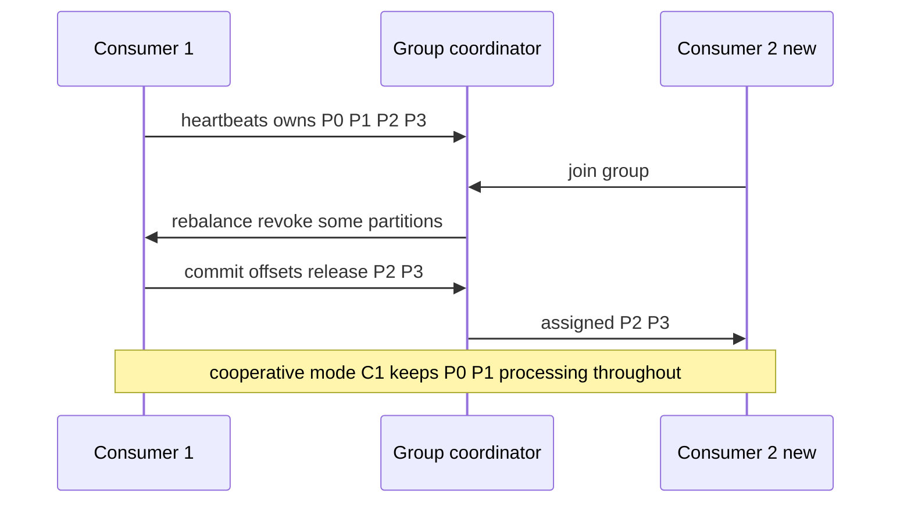

# Consumer Groups and Rebalancing

A single consumer process is a throughput ceiling and a single point of failure, so every messaging system needs an answer to "how do multiple consumer instances share the work?" There are exactly two answers. **Competing consumers** (queues: RabbitMQ, SQS): instances share nothing; each grabs whatever message is available next. **Partitioned ownership** (logs: Kafka consumer groups): the message space is divided into partitions, each owned by exactly one group member, and membership changes trigger a **rebalance** — a redistribution of ownership that is Kafka's most operationally visible behavior and a frequent source of production pain. [[Redis Streams]] groups are a hybrid — log storage, competing-consumer delivery (below). Which answer your broker gives determines how you scale, what ordering you keep, and what happens when a pod dies.

## The problem that created it

Start with one consumer on one queue. Traffic grows; it falls behind ([[Backpressure and Flow Control|lag]]). You start a second instance. Now two problems appear that the broker must solve:

1. **Work must not be processed twice** (both instances grab the same message) — some coordination must assign each message to exactly one worker, at least per group.
2. **Work must keep flowing when an instance dies** — whatever that instance "owned" must be taken over, without losing messages (its unacked/uncommitted work must be redelivered — the origin of at-least-once duplicates, [[Delivery Semantics]]).

Queues solve both with broker-side per-message state: a message delivered to consumer 1 is locked/invisible; if consumer 1 dies, the lock expires and anyone else may take it. Trivial scaling, no coordination — but no [[Message Ordering|ordering]], because any consumer takes any message.

Logs cannot do this: the broker keeps no per-message state, only per-group offsets, and per-key ordering requires that one partition be read by one consumer *sequentially*. So logs need real coordination: a group protocol that assigns partitions to members, detects dead members, and reassigns — and that coordination has a cost, paid at exactly the wrong moments (deploys, crashes, scale events).

## What it solves

- **Horizontal consumer scaling** with exactly-one-owner (log) or exactly-one-delivery-at-a-time (queue) semantics.
- **Automatic failover**: a dead member's work is redistributed without operator action.
- **Independent fan-out** (log model): each named group gets the full stream with its own offsets — parallelism *within* a group, broadcast *across* groups ([[Message Queues vs Event Logs]]).
- **Ordering preservation under parallelism** (log model): per-partition single ownership is what lets Kafka scale *and* keep per-key order — the thing competing consumers fundamentally cannot do.

## How it works

### Kafka: the group protocol

- Each group has a **group coordinator** (a broker, chosen per group). Members send **heartbeats** (background thread, `heartbeat.interval.ms`); missing them past `session.timeout.ms` marks a member dead. Separately, `max.poll.interval.ms` bounds the time between `poll()` calls — a consumer that is alive but stuck processing is also evicted (this catches "healthy but hung").
- On join/leave/death/subscription change, the coordinator triggers a **rebalance**: one member (the group leader) computes an assignment of partitions to members and the coordinator distributes it. That is the **classic** protocol, still the client default (`group.protocol=classic`) in Kafka 4.x; the KIP-848 consumer protocol (GA in Kafka 4.0, 2025; opt in with `group.protocol=consumer`) moves assignment to the broker-side coordinator and reconciles incrementally, with no group-wide barrier.
- **Max useful parallelism = partition count** (for consumer groups). A 12-partition topic feeds at most 12 active members of one group; the 13th idles. The 2026 exception is a different construct: KIP-932 **share groups** (production-ready in Kafka 4.2, 2026; take 4.2.1+ for a share-group deadlock fix; not production-supported on MSK as of Oct 2026 — MSK's 4.2 runs only on Express brokers, which lack KIP-932, and Standard brokers carry only 4.1's preview) let several consumers read one partition with per-record acks and delivery counts — queue semantics, giving up per-partition ordering. Partition count is a capacity decision made at topic-creation time ([[Kafka Architecture]]) — and changing it later breaks key→partition mapping ([[Message Ordering]]).
- **Eager rebalancing (classic):** every member revokes *all* partitions, the world stops, assignments are redistributed, everyone resumes. For that window — typically seconds, worse with slow `onPartitionsRevoked` cleanup — the *entire group* processes nothing. A rolling deploy of 10 pods used to mean up to 20 stop-the-world rebalances back to back — one as each pod leaves, one as it rejoins.
- **Cooperative / incremental rebalancing** (`CooperativeStickyAssignor`, KIP-429): only the partitions that actually need to move are revoked; everyone else keeps processing. Rebalances become small and cheap rather than global pauses. This is the recommended choice — but not the out-of-the-box default: the default `partition.assignment.strategy` (since Kafka 3.0) is `[RangeAssignor, CooperativeStickyAssignor]`, and the group uses the first, eager `RangeAssignor`, until you remove it from the list (the second entry exists to allow a rolling upgrade).
- **Static membership** (`group.instance.id`, KIP-345): a member that restarts within `session.timeout.ms` reclaims its old assignment with *no rebalance at all* — built for Kubernetes rolling restarts, where the pod that left is the pod coming back.
- On reassignment, the new owner resumes from the partition's **last committed offset** — anything the old owner processed-but-didn't-commit is reprocessed: rebalances are a duplicate factory; [[Idempotency]] absorbs them.

### SQS: the contrast — no groups, no rebalancing

SQS has no consumer registry, no membership, no assignment. Any consumer polls; the broker hides each delivered message for the **visibility timeout**; delete-on-success or it reappears. Consequences:

- **Scaling is frictionless**: 10 → 50 consumers instantly shares work; no partitions to size, no rebalance pauses, no idle 13th consumer. Autoscaling on queue depth just works.
- **Failover is passive**: a dead consumer's in-flight messages simply reappear after their visibility timeout — no coordinator, but also *no speed*: recovery latency is the timeout, per message.
- **The price is ordering**: any consumer, any message — per-key ordering is impossible (FIFO queues restore it per message-group by serializing each group: one batch in flight per group at a time, which is a *throughput* constraint rather than an ownership protocol).

This is the cleanest illustration that rebalancing is not a Kafka wart — it is the cost of ordered, owned partitions. Remove ordering and ownership, and rebalancing disappears with them.

### Redis Streams: groups without partition ownership

[[Redis Streams]] consumer groups sit in between:

- A group tracks `last-delivered-id` (the group's read cursor) plus a **PEL** (pending entries list) of delivered-but-unacked entries per named consumer.
- Within a group, `XREADGROUP` hands *different* entries to different consumers as they ask — competing-consumer style, no partition ownership, so parallel consumers sacrifice ordering of effects just like SQS.
- There is **no automatic failover**: if consumer `pod-a` dies, its PEL entries sit assigned to `pod-a` forever until another consumer explicitly claims them with `XCLAIM`/`XAUTOCLAIM` after a min-idle-time. Reclaim is *your* loop to write and run — forgetting it means silently stuck messages.
- No rebalancing exists because there is nothing to rebalance: one stream, one cursor, claim-based recovery. Parallelism beyond one Redis shard means *you* shard into multiple stream keys and assign them to consumers yourself — hand-rolled partitioning without a coordinator.

### Choosing and operating

| | Queue competing consumers | Kafka groups | Redis Streams groups |
|---|---|---|---|
| Max parallelism | Unlimited-ish | Partition count | Consumers per stream; streams per app are manual |
| Add a consumer | Instant | Rebalance | Instant |
| Consumer dies | Visibility timeout expiry | Coordinator detects, rebalance reassigns | Nothing, until your XAUTOCLAIM loop runs |
| Ordering under parallelism | None (FIFO: per group, serialized) | Per partition, preserved | None across consumers |
| Operational sharp edge | Timeout sizing | Rebalance storms | Forgotten reclaim loops, PEL growth |

## Trade-offs

| You gain | You pay |
|---|---|
| Parallelism with failover | Rebalance pauses (Kafka) or timeout-delayed recovery (SQS) or DIY reclaim (Redis) |
| Per-key ordering + scale (log model) | Parallelism hard-capped by partitions; repartitioning is a project |
| Elastic scaling (queue model) | No ordering; per-message broker state |
| Independent groups over one log | Offset/PEL management per group to monitor |
| Automatic membership (Kafka) | Liveness tuning: session timeouts, poll intervals — misconfiguration causes flapping |

## Failure modes

- **Rebalance storms.** A consumer that exceeds `max.poll.interval.ms` (slow DB call, big batch) is evicted → rebalance → duplicates and pause → more load on survivors → another member exceeds the interval → repeat. The group spends more time rebalancing than consuming. Fixes: smaller `max.poll.records`, pause-don't-block on sick dependencies ([[Backpressure and Flow Control]]), cooperative assignor, realistic poll interval.
- **Rolling deploys as self-inflicted outages (eager mode).** N pods restarting = up to 2N stop-the-world rebalances. Fixes: static membership (pods reclaim identity), cooperative assignor, `session.timeout.ms` sized to cover a pod restart.
- **The idle-consumer illusion.** 16 consumers on a 12-partition topic: 4 idle by design; autoscaling on CPU keeps adding pods that do nothing. Scale by *lag per partition*, and know the partition cap.
- **Partition skew / hot partition.** One key dominates → one partition, one consumer saturated while others idle; group-level lag looks mild while per-partition lag explodes ([[Hot Partition Problem]]). Monitor per-partition lag.
- **Redis Streams: PEL as a black hole.** Dead consumer, no reclaim loop → entries pending forever; group cursor advances past them; nobody notices until a customer does. Monitor `XPENDING` depth and max idle age as first-class metrics.
- **SQS: timeout double-processing.** Processing time exceeds visibility timeout → a *live* consumer's message reappears and a second consumer runs it concurrently — rebalancing's absence has its own duplicate factory ([[Delivery Semantics]]).

## When NOT to use it

- **Don't use partitioned groups when you need elastic, bursty worker pools** over unordered tasks — the partition cap and rebalance churn fight you; a plain queue wins ([[Message Queues vs Event Logs]]).
- **Don't run multiple consumers in a Redis Streams group for ordered flows** — in-group parallelism destroys order; use one consumer per stream (or shard by key into multiple streams) if order matters.
- **Don't add a group where a single consumer suffices.** One partition + one consumer + an [[Backpressure and Flow Control|age alert]] is a perfectly good design at modest volume; groups earn their complexity only when parallelism or failover demands it.

## In your stack

- Your SQS present is the no-rebalancing world — frictionless scaling you may not realize you are enjoying. The [[Redis Streams]] migration takes you to the most *manual* of the three models: budget for the `XAUTOCLAIM` reclaim loop, `XPENDING` monitoring, and a sharding story per high-volume stream.
- Services pinned at 1 replica: there is no group to balance — the "group" is one pod. That means zero rebalance churn, free ordering — and zero failover: when the pod restarts, lag is structural. The honest statement is "our consumer HA story is Kubernetes restarting the pod within X seconds plus the broker buffering" — write that X down.
- If you return to Kafka (MSK/Confluent): cooperative assignor + static membership (`group.instance.id` = pod identity) should be default posture on EKS — they exist precisely for rolling-restart environments.
- Spring Kafka note from your Java world: container concurrency > partition count silently idles threads — align `concurrency` with partitions per pod.

## Interview angle

The 60-second version: *"Two models. Queues use competing consumers: no coordination, any consumer takes any message — instant scaling and passive failover via visibility timeouts, but no ordering. Logs use partition ownership: each partition has exactly one owner in the group, giving per-key ordering and offset-based progress, but parallelism caps at partition count and membership changes trigger rebalances. Classic eager rebalancing stops the whole group; cooperative rebalancing moves only affected partitions; static membership lets a restarted pod reclaim its assignment with no rebalance. Redis Streams is a hybrid: competing consumers with a pending-entries list, and failover is manual via XAUTOCLAIM. Rebalancing isn't a flaw — it's the price of ordered ownership."*

Classic follow-ups:

- "Why is max parallelism = partitions?" — one owner per partition preserves sequential per-key reads; two readers of one partition would race effects and wreck offsets/order.
- "What makes rebalances expensive, and what reduced it?" — eager revoke-all stops the world for seconds per membership change; KIP-429 cooperative assignment moves only what must move; KIP-345 static membership eliminates rebalances for restarts.
- "How does a rebalance create duplicates?" — new owner resumes from last *committed* offset; the old owner's processed-but-uncommitted tail is reprocessed.
- "Design consumer scaling for a 100-partition topic at variable load" — scale pods on per-partition lag, cap at 100 consumers, cooperative + static membership, watch skew; past the cap, more partitions or faster per-message processing.

## Check yourself

> [!question]- Q: Explain why SQS needs no rebalancing but Kafka cannot avoid it.
> SQS keeps per-message state (in-flight visibility) and promises no ordering, so consumers need no identity or assignment — any consumer may take any available message, and a dead consumer's messages self-release by timeout. Kafka keeps only per-group offsets and promises per-partition order, which requires exactly one sequential reader per partition — so partition ownership must be assigned, membership tracked, and reassigned on change. Rebalancing is the direct cost of ordered ownership with minimal broker state.

> [!question]- Q: A rolling deploy of your 8-pod Kafka consumer group causes an 8-minute processing gap. Diagnose and fix.
> Diagnosis: eager rebalancing — each pod leaving and each pod joining triggers a stop-the-world revoke-all (up to 16 rebalances), each pausing the full group; slow `onPartitionsRevoked` (offset flush, connection teardown) stretches each pause. Fixes, in order of impact: static membership (`group.instance.id` per pod) so restarts reclaim assignments without any rebalance, provided restart < `session.timeout.ms` (size it to cover pod restart time); cooperative sticky assignor so any residual rebalances move only affected partitions; faster revoke callbacks; deploy pods with enough stagger to let the group stabilize.

> [!question]- Q: In Redis Streams, consumer `pod-b` crashes holding 40 entries in the PEL. Walk through what happens with and without a reclaim loop.
> Without: the 40 entries remain pending, assigned to dead `pod-b`, forever — the group's cursor moves on for new entries, acks never come, `XPENDING` grows silently; the messages are effectively lost-while-stored. With: a periodic `XAUTOCLAIM` (min-idle-time, say, 2× worst processing time) reassigns them to a live consumer, delivery counters increment, and entries exceeding a max delivery count go to a dead-letter stream ([[Dead Letter Queues and Poison Messages]]) — at-least-once restored, duplicates possible, so effects must be idempotent.

> [!question]- Q: Mini-design — 30 partitions, nightly batch doubles traffic for 2 hours. How do you scale the consumer group, and what do you refuse to do?
> Baseline, say, 10 pods at 3 partitions each; autoscale on per-partition lag (or age) up to 30 pods for the window, scale down after drain. Use cooperative + static membership so scale events don't stop the group. Refuse to: scale past 30 (idle pods), scale on CPU (misleading for IO-bound consumers), or bump partition count casually for one nightly peak (breaks key mapping; repartitioning is a planned migration, not an autoscale action). If 30 maxed pods still lag, the fix is per-message cost or downstream capacity, not more consumers.

## Sources

- Apache Kafka documentation — consumer groups, group protocol configs (`session.timeout.ms`, `max.poll.interval.ms`), partition assignors.
- KIP-429 (Incremental Cooperative Rebalancing) and KIP-345 (Static Membership) — Apache Kafka improvement proposals; Confluent blog's companion posts on cooperative rebalancing ("From Eager to Smarter").
- *Designing Data-Intensive Applications*, Kleppmann — Ch. 11 (load balancing vs fan-out in messaging, partitioned consumption).
- AWS SQS Developer Guide — visibility timeout and consumer scaling model.
- Redis documentation — Streams: consumer groups, `XPENDING`, `XCLAIM`, `XAUTOCLAIM`.
