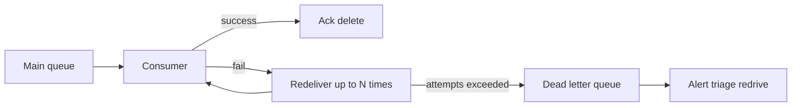

# Dead Letter Queues and Poison Messages

A **poison message** is one that a consumer can never process successfully — malformed payload, a bug tripped by its specific content, a reference to data that no longer exists. Under at-least-once [[Delivery Semantics]], failure means redelivery, so a poison message becomes an infinite loop: deliver, fail, redeliver, fail — burning consumer capacity and, in ordered systems, blocking everything behind it. A **dead letter queue (DLQ)** is the containment mechanism: after N failed attempts, the broker moves the message aside to a separate queue where humans and tooling can deal with it, and the main flow proceeds. The pattern is simple; running it well — alerting, triage, redrive — is where teams fail.

## The problem that created it

Picture a growing payments consumer. One day a producer deploys a change that emits one malformed event among thousands. The consumer throws on deserialization, the broker redelivers (that is its *job* under at-least-once), and the consumer throws again. Depending on the broker and configuration, the consequences escalate differently:

- **Unordered queue, no DLQ policy**: the message loops forever. Each loop wastes a receive, a deserialization attempt, an exception, a log line. Multiply by a few hundred accumulated poison messages and a meaningful fraction of consumer throughput is spent failing — and your error-rate dashboards are permanently red, masking *new* errors.
- **Ordered channel (Kafka partition, SQS FIFO message group)**: far worse — the poison message is the *head of the line*. Nothing behind it in that partition/group processes at all. One bad message halts an entire lane of traffic. [[Message Ordering|Ordering and progress are directly at odds]].
- **With retries but no cap**: a consumer that nacks/requeues on every exception is a self-inflicted infinite loop even if the broker would have given up.

The failure mode that forced the pattern: a single bad message must not be able to stop or degrade the processing of all other messages. Quarantine beats both infinite retry and silent discard.

## What it solves

- **Terminates redelivery loops** — a max-receive/max-retry cap bounds wasted work per message.
- **Unblocks ordered lanes** — the poison head is removed so the partition/group drains (at the cost of an ordering break the consumer must tolerate).
- **Preserves the evidence** — unlike dropping, the message survives for diagnosis and eventual reprocessing; under at-least-once you never silently lose it.
- **Separates failure classes** — transient failures (downstream timeout) get in-band retries; permanent failures (bad schema) get quarantined. Different problems, different lanes.
- **Gives failure a metric** — DLQ depth is a clean, alertable signal that *something systematic* is wrong, distinct from noisy per-message error logs.

## How it works

### Broker mechanics

| Broker | Mechanism |
|---|---|
| [[SQS and SNS\|SQS]] | **Redrive policy** on the source queue: `maxReceiveCount` (e.g., 5); when a message's receive count exceeds it, SQS moves the message to the configured DLQ automatically. Console/API **redrive** moves messages back after a fix. |
| [[RabbitMQ]] | **Dead letter exchange (DLX)**: a queue forwards messages to the DLX when they are rejected/nacked without requeue, expire (TTL), or overflow the queue's length limit. Retry *counting* is on you (commonly via `x-death` header inspection or a retry-queue topology with TTL backoff). |
| [[Kafka Architecture\|Kafka]] | **No native DLQ.** The log is immutable; the broker never moves messages. The *consumer* (or framework: Kafka Connect, Spring Kafka's `DeadLetterPublishingRecoverer`) catches the failure, produces the record to a `topic.DLT`, commits the offset, and moves on. Retry-topic chains (`topic.retry.5s`, `topic.retry.1m`, …) implement backoff without blocking the partition. |
| [[Redis Streams]] | **No native DLQ.** The PEL tracks delivery counts per entry; your reclaim logic (`XAUTOCLAIM`) must check the delivery counter and `XADD` persistent failures to a dead-letter stream, then `XACK` the original. |

The deeper point: in queue-model brokers the DLQ is a broker feature; in log-model brokers it is an *application pattern* you must build and test yourself.



### Distinguish transient from permanent — before the DLQ

A good consumer classifies failures and treats them differently:

- **Transient** (timeout, 5xx from downstream, lock contention): retry in place with [[Timeouts Retries and Exponential Backoff|backoff]]. These should rarely reach the DLQ; if they do, your retry budget is too small — or the "transient" problem is actually an outage, in which case see [[Backpressure and Flow Control]] (pausing beats dead-lettering a flood).
- **Permanent** (deserialization error, validation failure, business-rule violation): retrying is pointless; short-circuit *straight* to the DLQ on first failure. Burning five redeliveries on a message that can never parse is waste.
- **Unknown** (unhandled exception): the max-receive cap is the safety net.

The classifier is the single highest-leverage piece of code in a consumer, and it is usually three lines: a `switch` on exception type that returns `PERMANENT`, `TRANSIENT`, or `UNKNOWN`. Teams that skip it spend their incidents redriving healthy messages and their quiet weeks watching parse errors burn five redeliveries each.

### Choosing where the waiting happens

"Retry" is not one mechanism. Each option parks the wait somewhere different, and that location determines whether other messages keep moving:

| Strategy | Where the wait happens | Blocks the lane? | Fits | Cost |
|---|---|---|---|---|
| **Retry in place** — loop inside the handler with backoff | Consumer thread; the message stays in flight | Yes — it holds the lease or the poll slot | Sub-second to a few seconds of transient failure | Spends the visibility timeout / `max.poll.interval.ms` budget; a long in-place wait *causes* the redelivery it was avoiding |
| **Nack and requeue immediately** | Broker redelivers at once | No, but it hot-loops | Almost nothing | Burns receive counts and CPU at full speed — the classic self-inflicted infinite loop |
| **Delay queues with TTL backoff** ([[RabbitMQ]]) | A separate queue per delay tier, dead-lettering back to the main queue on expiry | No | Minutes-scale transient failures | A topology to build per tier; retried messages return out of order |
| **Retry topics** ([[Kafka Architecture\|Kafka]], Spring Kafka's `RetryTopicConfiguration`) | Separate topics with delay-aware consumers | No — the main partition advances past the record | Minutes-to-hours of transient failure on a log | Several topics and consumers; per-key ordering is abandoned for anything retried |
| **Pause consumption** on an open circuit | Nowhere — nothing is consumed; the backlog sits in the broker | Not applicable | A whole dependency being down | Lag and message age grow; needs resume discipline and an escalation ceiling |
| **Straight to DLQ on first failure** | Not applicable | No | Permanent failures: parse errors, validation, missing references | Depends entirely on the classifier being right |

The rule of thumb: **in-place retries for failures measured in milliseconds, delay queues or retry topics for minutes, pause for outages, DLQ for permanent.** Using the DLQ as a retry tier — or an in-place sleep as an outage strategy — is where most of this note's failure modes come from.

### The mass dead-lettering arithmetic

The default settings are dangerous in a way that only becomes obvious when multiplied out. Take an SQS consumer with `maxReceiveCount: 3`, a 30-second visibility timeout, no backoff, and arrival of **200 msg/s**. The downstream partner API starts returning 503 in ~50 ms — it fails *fast*, which feels harmless and is the trap.

Each message's life is: receive, fail in 50 ms, wait out the 30-second visibility timeout, receive, fail, wait, receive, fail → dead-lettered. **About 60–90 seconds from first receipt to the DLQ.** So after the first minute and a half of a partner outage, essentially the entire message flow is being dead-lettered:

```
60-minute outage × 200 msg/s  =  720,000 healthy messages in the DLQ
```

Not one of them is poison. Every one needs redriving, and every one is a customer's transfer or KYC callback. Compare the three configurations:

- **No backoff, cap 3** — three attempts span ~90 seconds. Anything longer than a 90-second blip dead-letters the whole flow. 720,000 messages.
- **Exponential backoff via retry tiers** at 30 s, 2 min, 8 min, 32 min — four attempts span `0.5 + 2 + 8 + 32 = 42.5 minutes`. A 30-minute blip is absorbed entirely; this 60-minute outage still exhausts the tiers, but on a far smaller fraction of the flow.
- **Pause on open circuit** — zero dead-lettered. The 720,000 messages wait in the source queue, durable and cheap, and you then face an ordinary drain problem ([[Backpressure and Flow Control]]) instead of a 720,000-message redrive project.

One more clock to know about: in SQS a message's 14-day expiry is computed from its **original** enqueue timestamp, and moving it to a DLQ does not reset it. A message that spent 4 days failing in the source queue arrives in the DLQ with 10 days left, not 14. A DLQ is not a fresh two-week window.

### What this looks like at 3am

The DLQ depth alarm fires at 02:40 showing 40,000 messages. The source queue's depth graph is falling toward zero, which on a depth-only dashboard reads as *recovery* — this is the first trap, because the queue is emptying into the DLQ rather than into completed work.

The question that matters in the first two minutes is **poison or environmental**, because the responses are opposite. Pull five messages off the DLQ without deleting them and compare:

- **Poison** looks *structural*: the payloads share something — one schema version, one producer, one malformed field, one tenant — and the exception is a deserialization or validation error. The fix is upstream, and the blast radius is bounded by whatever shares that structure.
- **Environmental** looks *random*: payloads are heterogeneous and perfectly valid, and every one carries the identical downstream exception — a timeout or a 503. The fix is the dependency, and the blast radius is the entire flow.

40,000 messages arriving in minutes is almost always the second. Confirm against the downstream's own error rate and the consumer's exception histogram: a single exception class at ~100% share is environmental; a long-tail mix with one spike is poison. Then **stop the bleeding before triaging** — pause consumption so the next 40,000 stay in the source queue where redrive is not needed — and only then work out whether the partner is down and how to drain.

### What belongs in a DLQ message

A raw failed payload is nearly useless at 3 a.m. Enrich the dead-lettered message (headers/attributes, or an envelope) with:

- **Error context**: exception class and message, stack-trace hash or truncated trace, failing consumer name and version.
- **Provenance**: source queue/topic and partition/offset or message ID, first-seen and dead-lettered timestamps, delivery/receive count.
- **Correlation**: the `x-correlation-id` / trace ID so the failure links to logs and [[Distributed Tracing|traces]].
- **The original payload, unmodified** — redrive must be able to reconstruct the exact original message.

SQS's automatic redrive preserves the body and increments metadata but does *not* capture your exception — which is why many teams publish an enriched copy from the consumer instead of relying solely on broker-side dead-lettering, or log the error keyed by message ID at failure time.

### Operating the DLQ: alert, triage, redrive

1. **Alert on depth ≥ 1** (or a very low threshold) with age-based escalation. A DLQ is an exception tray, not a buffer; arrival is *news*.
2. **Triage** classifies the batch: producer bug (fix producer, redrive), consumer bug (fix consumer, redrive), genuinely bad data (discard with a recorded decision — in fintech, often a ticket, not a delete).
3. **Redrive** after the fix: SQS has native redrive; elsewhere you run a re-publisher. Redrive consciously: redriven messages are massively out of order ([[Message Ordering]]) and may be duplicates of work someone already fixed manually — [[Idempotency|idempotent consumers]] make redrive safe; non-idempotent ones make it a second incident.
4. **Retention awareness**: SQS retains at most 14 days; a DLQ nobody drains is a time bomb that silently deletes evidence. The DLQ's own retention and its *expiry* behavior are part of the design.

## Trade-offs

| You gain | You pay |
|---|---|
| Bounded wasted work per bad message | Messages exit the normal flow — someone must own the exit |
| Ordered lanes keep moving | An ordering break for every dead-lettered message |
| Evidence preserved for diagnosis | Another queue to monitor, secure, and retain |
| Clean alertable failure signal | Risk of "quarantine culture": DLQ-and-forget replacing root-cause fixes |
| Safe redrive path after fixes | Redrive requires idempotent, order-tolerant consumers |

## Failure modes

- **The write-only graveyard (the anti-pattern).** A DLQ with no alert, no owner, no runbook. Messages — each one a customer's failed transfer or stuck KYC — accumulate until retention deletes them. This is *silent data loss with extra steps*, strictly worse than a loud crash because it feels handled. If you cannot name who drains a DLQ and within what SLA, you do not have a DLQ; you have a trash can. **Signal:** there isn't one, which is the point — the only way to find these is to audit, enumerating every queue with a redrive policy and checking each DLQ for an alarm and an owner. **Confirm:** `ApproximateAgeOfOldestMessage` on the DLQ measured in days rather than minutes.
- **Max-receive too low + transient outage = mass dead-lettering.** A 30-minute downstream outage with `maxReceiveCount: 3` and no backoff shovels the *entire* throughput into the DLQ. Thousands of perfectly good messages now need manual redrive. Mitigations: higher receive cap with real backoff, circuit-breaker pause of consumption ([[Backpressure and Flow Control]], [[Circuit Breakers]]), and redrive tooling rehearsed in advance.
- **Poison message in the DLQ consumer.** If you process DLQ messages automatically and *that* consumer fails, where does the message go? Keep DLQ handling simple — human-driven or trivially safe.
- **Dead-lettering as flow control.** Messages dead-lettered because the consumer is merely slow (visibility timeout too short → receive count climbs with no real failures). Looks like poison, is actually misconfiguration. **Signal:** dead-lettered messages whose consumer logs contain **no exception at all** for the final attempt — the work was still running when the lease expired. **Confirm:** overlay `ApproximateReceiveCount` against the processing-duration histogram; if the receive-count rise tracks the duration tail crossing the visibility timeout, nothing is failing and the timeout is simply too short ([[Delivery Semantics]]).
- **DLQ alarm fatigue.** If "a few messages in the DLQ" is normal, the alert is ignored, and the one day it is a producer bug flooding thousands, nobody looks. **Signal:** a non-zero DLQ depth that has been acknowledged-and-ignored more than once. **Confirm:** look at how long the alarm has been in breach — any DLQ whose steady state is not zero has already trained its on-call to ignore it, and the fix is triage policy, not a higher threshold.
- **Redrive into a still-broken consumer.** The fix is deployed, someone bulk-redrives 40,000 messages, and they fail again — now with receive counts reset and the DLQ refilling, plus a thundering herd against the dependency that just recovered. **Signal:** DLQ depth falling and then rising again within one drain cycle. **Confirm:** canary first — redrive 10 messages, verify they complete successfully end to end, *then* bulk-redrive at a throttled rate.

## When NOT to use it

- **Telemetry/metrics streams** where at-most-once is acceptable: drop-and-count beats quarantine; nobody will ever triage a dead-lettered metric.
- **Strictly ordered money ledgers** where skipping is unacceptable: a poison message in a per-account lane may need to *block that account's lane* and page a human, not slide into a DLQ while later events proceed against wrong state. (Block-the-lane is expensive; use it only where order is truly load-bearing.)
- **As a retry mechanism**: delay/retry topologies with TTL backoff are for *transient* failures; the DLQ is terminal quarantine. Conflating them produces queues that are neither good retries nor good quarantine.
- **When no one will ever look**: if the organization will not fund DLQ ownership, prefer loud failure (alert on consumer error rate and stop) over quiet accumulation.

## In your stack

- SQS redrive policies make the mechanical half trivial — the audit question for your fleet is the operational half: does every DLQ have a non-zero-depth alarm and a named owning team? The 14-day retention clock is running on every stuck KYC callback in there.
- Moving to [[Redis Streams]] means building what SQS gave you free: delivery-count checks in your `XAUTOCLAIM` reclaim loop, a dead-letter stream, trimming policy for it, and redrive tooling. Budget this as real work in the migration, not an afterthought.
- Many services at 1 replica: when the single consumer pod is the thing failing (bad deploy, crash-loop), messages pile up in-queue rather than dead-lettering, because a pod that cannot start never increments a receive count — DLQ depth and consumer lag are *different* alarms and you need both. The inverse is the nastier case: a pod that starts successfully and then fails every message *does* dead-letter at full rate, with no second replica to compare against and no canary to catch it. On a single-replica consumer, a bad deploy and a dependency outage produce the same DLQ graph, so correlate dead-lettering against deploy timestamps before you go looking at partners.
- RabbitMQ in the legacy estate: classic queues have no delivery counter, so retry counting was application-side via `x-death`. Quorum queues (RabbitMQ 3.8+) added `x-delivery-limit`, which dead-letters after N deliveries natively — worth knowing if any legacy flows remain, because the two topologies need different retry code for identical behaviour.
- Fintech triage rule: a dead-lettered money-movement message is an incident artifact. Discarding one should require the same rigor as a manual ledger adjustment — recorded decision, four eyes, audit trail.

## Interview angle

The 60-second version: *"Under at-least-once delivery, a message that always fails redelivers forever — wasting capacity, and in ordered channels blocking everything behind it. A DLQ caps attempts and quarantines the message with its error context so the main flow proceeds and evidence survives. SQS does this natively with redrive policies; Kafka has no broker DLQ, so the consumer publishes failures to a dead-letter topic and commits past them. The hard part is operational: alert on depth, triage with an owner, redrive after fixes — redrive needs idempotent, order-tolerant consumers. The anti-pattern is the write-only graveyard: a DLQ nobody drains is silent data loss."*

Classic follow-ups:

- "Poison message at the head of a Kafka partition with no DLT — options?" — stop the partition (outage), skip by committing past it (data loss), or publish to a DLT and commit (the pattern); pick per data criticality.
- "How is a DLQ different from a retry queue?" — retry queues handle *transient* failures with delay/backoff and feed back automatically; a DLQ is terminal quarantine for *permanent* failures, drained by humans/tooling.
- "What metadata do you attach when dead-lettering?" — exception + consumer version, source coordinates (topic/partition/offset or message ID), timestamps, receive count, correlation ID, untouched original payload.
- "A downstream outage just dead-lettered 40K good messages — walk me through recovery." — fix/wait out downstream, verify with a canary redrive of a small batch, then bulk redrive; idempotency absorbs duplicates with manually-fixed cases; raise receive cap/backoff and add consumption pause so it doesn't recur.

## Check yourself

> [!question]- Q: Explain why a poison message is dramatically worse in an ordered channel than in an unordered queue.
> Unordered: the poison message loops but *other* messages flow around it — the damage is wasted capacity and noisy errors. Ordered (Kafka partition, FIFO message group): delivery cannot proceed past the failing head without violating the ordering contract, so every message behind it in that lane stalls — a single bad message becomes an outage for its whole key range until it is skipped or dead-lettered, and skipping breaks the very ordering the channel was chosen for.

> [!question]- Q: What happens if `maxReceiveCount` is 3, there's no consumer-side backoff, and the downstream dependency goes down for an hour?
> Every message is received, fails fast against the dead dependency, and reappears after the visibility timeout; within three quick cycles it exceeds the cap and is dead-lettered. For the whole hour, close to the full message flow is shoveled into the DLQ — thousands of *healthy* messages requiring manual redrive. The DLQ fills (alarm floods), and if redrive is slow, retention risk begins. Correct design: classify the failure as transient, retry with backoff so three attempts span well past typical blips, and pause consumption entirely when the dependency's [[Circuit Breakers|circuit opens]].

> [!question]- Q: Design the DLQ message envelope for a KYC-event consumer, and justify each field.
> Original payload byte-for-byte (redrive fidelity); exception class + message + truncated stack (triage without re-running); consumer service + version + git SHA (was it a bad deploy?); source queue/stream + message ID/offset (provenance, dedup on redrive); first-received and dead-lettered timestamps + receive count (loop forensics, retention clock); `x-correlation-id` (join to logs/traces of the failing attempt); optionally the user/application ID extracted (lets support find affected customers without parsing payloads).

> [!question]- Q: At 02:40 a DLQ alarm shows 40,000 messages and the source queue's depth is falling toward zero. Your teammate says "good, the queue is draining." What do you check first, in what order, and what do you do before triaging?
> The source queue is not draining into completed work — it is draining into the DLQ, which is why DLQ depth and source depth are moving in opposite directions at the same rate. That correlation is the first check and it takes ten seconds. Second: poison or environmental? Sample five DLQ messages without deleting them. Heterogeneous, valid payloads all carrying one identical downstream exception means environmental — a dependency is down and these are healthy messages. Structurally similar payloads with deserialization or validation errors means poison — a producer or schema problem with a bounded blast radius. Forty thousand in minutes is almost certainly environmental. Third, and before any triage: **stop the bleeding** by pausing consumption, so the next 40,000 accumulate in the source queue where no redrive is needed — every minute of delay here converts another ~12,000 messages at 200/s into manual recovery work. Only then diagnose the dependency. Recovery afterwards is canary redrive of ~10, verify end to end, then throttled bulk redrive — and the config change that prevents a recurrence is backoff plus a pause-on-open-circuit, not a larger `maxReceiveCount`.

> [!question]- Q: Your DLQ has had 12 messages sitting in it for 10 days, no alert fired. What is wrong, in order of severity?
> (1) No depth/age alarm — the DLQ is a write-only graveyard; the mechanism exists but the operation doesn't. (2) Retention: at 14 days (SQS) the evidence self-deletes in 4 days — imminent silent data loss. (3) No owner/runbook, implied by 10 days of inaction. (4) Unknown blast radius: 12 messages might be 12 customers with stuck money. Fix order: alarm now, triage and redrive/record-discard now, then assign ownership and an SLA, then ask why the steady state wasn't zero.

## Sources

- AWS SQS Developer Guide — dead-letter queues, redrive policy and `maxReceiveCount`, DLQ redrive; AWS Builders' Library on queue backlogs.
- RabbitMQ documentation — Dead Letter Exchanges (`x-dead-letter-exchange`, `x-death` header).
- Spring for Apache Kafka documentation — `DeadLetterPublishingRecoverer`, retry topics; Kafka Connect error handling (`errors.tolerance`, DLQ topics).
- Redis documentation — Streams: PEL delivery counters, `XAUTOCLAIM`/`XPENDING`.
- *Enterprise Integration Patterns*, Hohpe & Woolf — Dead Letter Channel, Invalid Message Channel (the original articulation).
