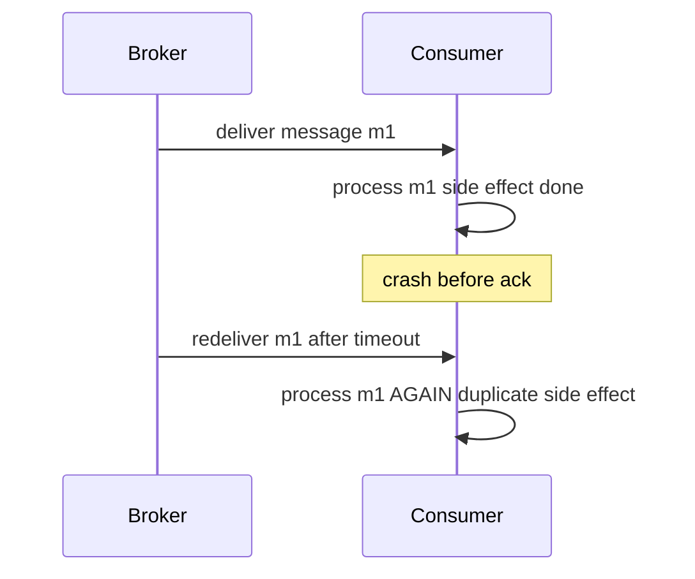

# Delivery Semantics

Delivery semantics answer one question: when a message travels from producer through broker to consumer, how many times might the *processing* happen — zero, one, or more? The honest menu has two real options — **at-most-once** (may be lost, never duplicated) and **at-least-once** (never lost, may be duplicated) — plus a heavily asterisked third, "exactly-once", which is better understood as *effectively-once processing within a carefully fenced boundary* (the full argument lives in [[Exactly-Once Delivery Is a Lie]]). Every broker you will ever use defaults, in practice, to at-least-once, which yields the one design rule this note exists to drill in: **consumers must be idempotent, always.**

## Why this matters

Duplicates are not a rare edge case; they are the steady-state behavior of any correctly configured messaging system under failure. If your consumer charges a card, credits a wallet, or sends an SMS, and it is not [[Idempotency|idempotent]], then a crashed pod, a slow GC pause, or a network blip *will* eventually produce a double charge — not might, will. Conversely, teams that fear duplicates sometimes flip to ack-before-process and silently lose messages instead, which in fintech is usually the worse sin. You cannot pick the right ack mode, visibility timeout, or offset-commit strategy without understanding exactly where in the pipeline each failure creates loss or duplication.

## How it works

### The fundamental dilemma: ack before or after processing

A consumer receives a message, processes it, and acknowledges it. The order of the last two steps *is* the semantics:

- **Ack, then process** → **at-most-once.** If the consumer crashes between ack and finishing the work, the broker believes the message is handled and never redelivers. Work lost, never duplicated.
- **Process, then ack** → **at-least-once.** If the consumer crashes after finishing the work but before the ack arrives (or the ack is lost in the network), the broker redelivers. Work duplicated, never lost.

There is no third ordering. The crash window between "work done" and "broker knows" can be shrunk but never closed — this is a restatement of the Two Generals problem, and it is why *delivery* exactly-once is unachievable over an unreliable network.



### How each broker implements "not yet acked"

The same at-least-once contract wears three different mechanisms:

| Broker | Mechanism | Redelivery trigger | Granularity |
|---|---|---|---|
| [[RabbitMQ]] | Per-message ack/nack over a channel | Consumer channel/connection closes with unacked messages | Per message |
| [[SQS and SNS\|SQS]] | **Visibility timeout**: received message is hidden, not deleted; consumer must delete it | Timeout expires before delete | Per message |
| [[Kafka Architecture\|Kafka]] | **Committed offset** per group per partition | Rebalance or restart resumes from last committed offset | Positional — everything after the offset |
| [[Redis Streams]] | **PEL** (pending entries list) per consumer group: delivered-but-unacked IDs | Another consumer claims via `XCLAIM`/`XAUTOCLAIM` after idle time | Per entry |

Two of these deserve elaboration:

- **SQS visibility timeout** is a lease, not a lock. If processing takes longer than the timeout (slow downstream call, GC pause), the message becomes visible again and a *second consumer processes it in parallel with the first* — a duplicate created with no crash anywhere. Fix: size the timeout well above worst-case processing time, or extend it via `ChangeMessageVisibility` heartbeats while working. The default timeout is 30 seconds and the maximum is 12 hours.
- **Kafka offset commit** is positional, which changes the failure shape. Committing offset 100 declares *everything through 100* done (Kafka physically stores this as the offset of the next record to read, 101). Auto-commit on a timer can commit offsets for messages still in flight (→ loss on crash: effectively at-most-once) or lag behind completed work (→ duplicates on rebalance). Manual commit-after-process gives clean at-least-once, but a batch of 50 processed with a crash before commit means all 50 redeliver. Per-message "acks" don't exist; the unit of progress is the offset.

### Slow is not the same as crashed

The textbook story of duplication is a consumer crash. In production, the far more common trigger is a consumer that is merely *slow* — and each broker converts slowness into duplication by a different route:

- **SQS**: the lease expires mid-work. The original consumer is alive and still processing; a second consumer receives the same message and runs it **concurrently**. Two in-flight executions of the same side effect, interleaved.
- **Kafka**: the consumer fails to call `poll()` within `max.poll.interval.ms`, so the group coordinator declares it dead and triggers a [[Consumer Groups and Rebalancing|rebalance]]. Its partitions move to another member, which resumes from the last *committed* offset — replaying everything processed-but-uncommitted. Slowness becomes a batch of duplicates plus a stop-the-world pause for the group.
- **RabbitMQ**: nothing is redelivered while the connection holds, but unacked messages accumulate against the consumer's prefetch limit until the broker stops pushing. The duplicate arrives later, all at once: if the channel or connection drops, *every* unacked message is requeued together.
- **Redis Streams**: the entry sits in the consumer's PEL accruing idle time. Once idle time passes the threshold your `XAUTOCLAIM` loop uses, another consumer claims it — while the first may still be working on it, exactly like SQS.

The practical consequence: duplicate rates track your *processing-time tail*, not your crash rate. A p99.9 that drifts past the timeout produces duplicates continuously on a perfectly healthy fleet.

### Producer-side duplicates: the half everyone forgets

The broker is only one source of duplication. A producer that publishes, then times out waiting for the broker's acknowledgment, must retry — and if the original publish actually succeeded, the broker now holds the message twice. This happens *before* any consumer is involved. Mitigations:

- **Kafka idempotent producer** (`enable.idempotence=true`, default in modern clients): broker deduplicates retries within a producer session using a producer ID and sequence numbers. Closes this window for Kafka.
- **SQS standard queues** offer no producer dedup; **FIFO queues** deduplicate by `MessageDeduplicationId` within a 5-minute window — note the window, it is not forever. A retry 6 minutes later is a brand-new message.
- **RabbitMQ** publisher confirms tell you the broker got it, but a lost confirm still forces a retry you cannot distinguish from a failure — no broker-side dedup.
- And above all of it: the *business operation* may be retried by the user or an upstream service, producing semantically duplicate messages with different IDs. No broker feature can see those.

### "Exactly-once": what the asterisk hides

What vendors legitimately offer is **exactly-once processing within a bounded system**, built from at-least-once delivery plus deduplication or transactions:

- **Kafka transactions / EOS**: idempotent producer + transactional writes of output records *and* offset commits, with `read_committed` consumers. This genuinely gives effectively-once for **Kafka-in → process → Kafka-out** pipelines (Kafka Streams). The moment your side effect leaves Kafka — an HTTP call, a MongoDB write, an SMS — the guarantee ends at the boundary.
- **SQS FIFO "exactly-once processing"**: producer-side dedup on `MessageDeduplicationId` within a 5-minute window, plus strict ordering *within* each message group (different message groups still proceed in parallel). It narrows the producer-retry duplicate window and serializes a group's work; it does **not** eliminate consumer-side redelivery when a visibility timeout expires.
- The general pattern behind all of them: **at-least-once + idempotent effect = effectively once.** That last mile is always yours to build.

See [[Exactly-Once Delivery Is a Lie]] for the theory and [[The Outbox Pattern]] for the matching producer-side problem (making the DB write and the publish atomic).

### Putting a number on it

Duplicates feel theoretical until you multiply them out. Take a wallet-credit consumer on SQS handling **2,000,000 messages/day** with a **30-second visibility timeout**, and suppose measurement shows that **0.1% of messages take longer than 30 seconds** to process — one slow Mongo query, one unlucky GC pause, one sluggish partner call:

```
2,000,000 × 0.001  =  2,000 lease expiries per day
                   →  2,000 concurrent duplicate processings per day
```

Now add the producer side. If 0.01% of publishes time out waiting for the broker's acknowledgment, and half of those had actually succeeded before the timeout fired, the retry duplicates them:

```
2,000,000 × 0.0001 × 0.5  =  100 producer-born duplicates per day
```

Roughly **2,100 duplicate executions per day**, on a fleet with zero crashes and a green dashboard. If each credits ₹500 to a wallet and the consumer is not idempotent, that is **₹10,50,000 of wrongly created money every day** — and unlike a 500 error, nobody is paged for it. This arithmetic is the entire argument for the design rule below.

### What this looks like at 3am

The symptom arrives through support, not monitoring: a handful of customers report being credited twice for one transfer. Nothing is red. Consumer error rate is zero — both executions *succeeded*. Queue depth and `ApproximateAgeOfOldestMessage` look normal. There is no crash in any pod's logs, no restart, no deploy in the window.

The signal that actually reveals it is `ApproximateReceiveCount`: pull the distribution and the share of messages received more than once has moved from near-zero to a percent or so. Confirm by overlaying it on the consumer's processing-duration histogram — the receive-count rise starts exactly when the upper percentile of processing duration crosses the visibility timeout. The usual proximate cause is downstream: a Mongo index that stopped being used after a query shape changed, a partner API whose p99 drifted, a heap that started spending seconds in GC. Nothing in the messaging layer is broken; the *lease* simply became shorter than the work.

The fix has three parts and you need all three: raise the visibility timeout above the real worst case (or heartbeat-extend it), fix whatever made processing slow, and — the only one that is actually load-bearing — make the effect idempotent so the next time this happens it is a log line instead of an incident.

### The design rule

Because at-least-once is the realistic contract everywhere, the rule is unconditional:

> **Every consumer must be safe to run twice with the same message.**

In practice, one of:

1. **Natural idempotency** — the operation is a pure overwrite ("set status = SETTLED") or otherwise self-deduplicating.
2. **Idempotency key** — extract a stable business key (payment ID, event ID), record it in the same datastore transaction as the side effect, and skip on conflict. The unique constraint *is* the dedup. Details and pitfalls: [[Idempotency]].
3. **Fencing/versioning** — reject the message if the entity has already moved past the state this message belongs to (also protects against [[Message Ordering|reordering]]).

Dedup caches with TTLs (e.g., Redis `SET NX EX`) are a pragmatic layer but are only as strong as their TTL and their atomicity with the side effect — a cache-says-new / crash-before-effect race still duplicates. Where money moves, the dedup record and the effect must commit together.

## Trade-offs

| Semantics | Loses messages | Duplicates | Cost | Use when |
|---|---|---|---|---|
| At-most-once | Yes | No | Cheapest, lowest latency | Metrics, logs, telemetry — where a gap is cheaper than dedup |
| At-least-once | No | Yes | Requires idempotent consumers | Default for anything that matters |
| Effectively-once (fenced) | No | Absorbed inside boundary | Transactions/dedup infrastructure, throughput cost | Stream processing within Kafka; money paths via idempotency keys |

## Common misconceptions

- **"Our broker supports exactly-once, so we're covered."** Every such feature is scoped to a boundary. Kafka's EOS covers Kafka-in → process → Kafka-out, because the broker can make the output records and the offset commit one atomic unit. The instant your side effect is an HTTP call to a payment rail, a Mongo write, or an SMS, the broker has no say in whether it happened twice.
- **"Duplicates only happen when something crashes."** The arithmetic above says otherwise: the dominant source in a healthy fleet is a lease or poll interval expiring because processing got slow. Crash-free duplication is the normal case, which is why "we've never seen a consumer crash" is not evidence of anything.
- **"FIFO queues give exactly-once."** FIFO gives *ordering within a message group* plus producer dedup inside a 5-minute window. Ordering is not deduplication, and the window is not forever. A consumer-side visibility-timeout expiry redelivers a FIFO message exactly like a standard one.
- **"The message ID is the idempotency key."** A broker redelivery preserves the message ID (SQS keeps `MessageId` and changes only the receipt handle; Kafka keeps topic-partition-offset), so it catches *that* class of duplicate. It catches nothing when an upstream service retries the business operation — that produces a new message, a new ID, and the same money movement. Dedup on a key derived from the business entity.
- **"At-most-once is safer, because duplicates are dangerous."** In money systems the ranking is usually inverted: a duplicate is a reconcilable error you can design away with a unique index; a silently dropped settlement instruction is a missing payment nobody knows to look for. Choose at-most-once only where a gap is genuinely cheaper than dedup — telemetry, not transfers.
- **"A Redis `SET NX` check makes my consumer idempotent."** Only if the dedup record and the effect commit together. If the consumer marks the key as seen and then crashes before the effect, you have converted at-least-once into at-most-once and lost the work; if it performs the effect and then marks the key, the crash window duplicates. Atomicity between dedup and effect is the whole trick — see [[Idempotency]].

## In your stack

- Your SQS consumers live with visibility-timeout semantics today: the classic incident is a slow MongoDB call pushing processing past the timeout, creating *concurrent* duplicate processing with zero crashes. Alert on `ApproximateReceiveCount > 1` rates as an early duplicate signal.
- Moving to [[Redis Streams]] swaps visibility timeout for the PEL + `XAUTOCLAIM` idle-time claim — same at-least-once shape, but reclaiming is *your* code's job now; forget to run claim logic and crashed consumers' messages sit in the PEL forever (a silent loss-equivalent).
- Kafka days: if any consumer still uses auto-commit with at-most-once-shaped loss windows, that is a latent money-path bug — manual commit after effect is the fintech default.
- RBI-regulated money movement makes the choice stark: at-least-once + an idempotency key persisted in the same Mongo write as the transaction state. A double-debit is a regulatory incident; a deduped retry is a log line.
- `x-correlation-id` is for tracing, not dedup — it changes on retries from upstream. Dedup needs a *business* key that is stable across every retry path.
- **The 1-replica implication, honestly.** A consumer pinned at one replica cannot produce the two-pods-at-once duplicate — except in the one window where it can: a rolling deploy, when the terminating pod and the starting pod briefly coexist. The old pod is mid-message, its lease expires during the termination grace period, the new pod picks the message up, and both finish. So the duplicate risk on these services is *concentrated into deploys*, which is also when nobody is watching the receive-count metric. The mitigations are [[Graceful Shutdown and Deployment Safety|graceful shutdown that stops polling first and drains in-flight work]], a termination grace period longer than the worst-case message, and — again — idempotency, because the grace period is a budget, not a guarantee.
- 1 replica also means a *single* slow message stalls that consumer entirely: there is no second pod to keep the queue moving while one is stuck on a 40-second Mongo call. Processing-time tail and duplicate rate are the same metric here, and both are capacity questions ([[Backpressure and Flow Control]]).

## Interview angle

The 60-second version: *"At-most-once is ack-before-process: crash means loss. At-least-once is process-before-ack: crash means redelivery, so duplicates. Exactly-once delivery over a network is impossible — the ack can always be lost after the work is done — so real systems do at-least-once plus idempotency, or transactions within a closed boundary like Kafka Streams. Duplicates also come from producer retries and user retries, not just redelivery. So the rule is: every consumer idempotent, keyed on a stable business ID, with the dedup record committed atomically with the side effect."*

Classic follow-ups:

- "Where exactly can a duplicate be born?" — producer retry after lost ack; broker redelivery after consumer crash; visibility timeout expiry during slow processing; rebalance replaying uncommitted offsets; upstream/user-level business retries.
- "How does Kafka's exactly-once work and where does it stop?" — idempotent producer + transactions covering output records and offset commits; stops at any non-Kafka side effect.
- "Design the dedup for a payment consumer" — unique index on payment ID in the transactional store, insert-or-skip in the same transaction as the ledger write; TTL caches alone are insufficient.
- "When would you *choose* at-most-once?" — high-volume telemetry where processing cost of dedup exceeds the value of any single message.
- "What's the most common cause of duplicates in a healthy system?" — not crashes: processing time crossing a lease or poll deadline. Naming this unprompted signals production experience, as does knowing the metric that reveals it (`ApproximateReceiveCount` on SQS, rebalance rate on Kafka, PEL idle time on Redis Streams).

## Check yourself

> [!question]- Q: Explain why exactly-once delivery is impossible but exactly-once processing is achievable.
> Delivery: after the consumer finishes the work, the ack must cross an unreliable network; if it is lost, the broker must choose redeliver (duplicate) or not (potential loss) — no protocol can distinguish "work done, ack lost" from "consumer died mid-work". Processing: the *effect* can be made to happen once by making re-execution harmless — dedup on a stable key committed atomically with the effect, or transactions within one system (Kafka EOS). You don't prevent the second delivery; you make it a no-op.

> [!question]- Q: An SQS consumer takes 90 seconds on a message; the visibility timeout is 60 seconds. Walk through what happens.
> At 60s the message reappears on the queue while consumer 1 is still working. Consumer 2 receives it and processes in parallel. Both complete; both call delete — and the delete calls are not equivalent, because each receive issues a *new* receipt handle. Consumer 2 holds the most recent one, so its delete removes the message; consumer 1's delete carries the stale handle from the first receive, and SQS accepts that request without necessarily deleting anything — only the delete carrying the most recent handle reliably removes the message. Net: the side effect ran twice, concurrently — possibly interleaved. No crash occurred anywhere. Fixes: raise the timeout above worst-case processing, heartbeat-extend it while working, and make the effect idempotent anyway.

> [!question]- Q: A Kafka consumer processes messages 101–150, then crashes. Its last committed offset is 100. What happens, and how would the damage differ with auto-commit?
> On rebalance, the partition's new owner resumes from offset 101 and reprocesses all 50 — at-least-once, 50 potential duplicates, absorbed if the consumer is idempotent. With auto-commit, the timer might have committed 150 *before* processing finished, in which case the crash loses up to 50 messages instead — silent at-most-once. Loss is usually worse than duplication, which is why manual commit-after-process is the default for anything important.

> [!question]- Q: A teammate says: "We've enabled `enable.idempotence=true` on the producer and we commit offsets manually after processing. That's exactly-once, so let's drop the dedup collection from the wallet-credit consumer." What is your answer?
> No — those two settings close two different windows, and neither is the one that matters. The idempotent producer stops the *broker* holding a duplicate copy when a publish retry follows a lost ack; it says nothing about how many times a consumer runs. Manual commit-after-process chooses at-least-once deliberately: it guarantees you never *lose* a record, and its explicit price is that a crash or a rebalance between the effect and the commit replays the batch. So the arrangement he describes is precisely a correctly configured at-least-once pipeline — duplicates are the designed behaviour, not a bug. Kafka's exactly-once would only apply if the side effect were a transactional write back into Kafka alongside the offset commit; a Mongo wallet credit is outside that boundary. The dedup collection *is* the exactly-once mechanism here. Concretely, dropping it means the next rebalance — which a routine deploy causes — re-credits every wallet in the uncommitted batch.

> [!question]- Q: Mini-design — a "disburse loan" consumer must never double-pay even though the upstream service retries requests and the broker redelivers. Sketch the consumer.
> Derive the idempotency key from the business entity (loan ID + disbursement number), not the message ID (which changes across upstream retries). In one MongoDB transaction: insert the key into a dedup/ledger collection with a unique index, write the disbursement record, update loan state. On duplicate-key error, ack and exit (optionally return the recorded outcome). Call the payment rail with its own idempotency key ([[Idempotency]]) so even a crash between DB commit and rail call is safe to retry. Ack only after the transaction commits.

## Sources

- *Designing Data-Intensive Applications*, Kleppmann — Ch. 11 (acknowledgments, redelivery, "and/or" of fault tolerance); Ch. 8 (Two Generals, unreliable networks).
- Confluent blog: "Exactly-Once Semantics Are Possible: Here's How Apache Kafka Does It" (Neha Narkhede, 2017) — the EOS design and its boundary.
- AWS SQS Developer Guide — visibility timeout; FIFO queue deduplication (5-minute dedup window).
- Redis documentation — Streams intro: consumer groups, PEL, `XCLAIM`/`XAUTOCLAIM`.
- [[Exactly-Once Delivery Is a Lie]] — the theory companion to this note.
