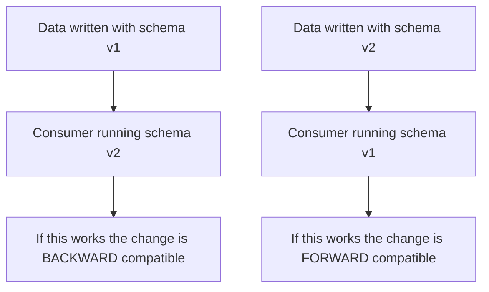
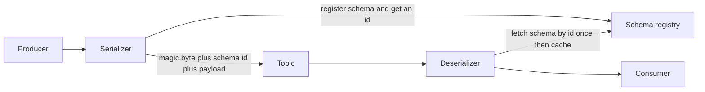
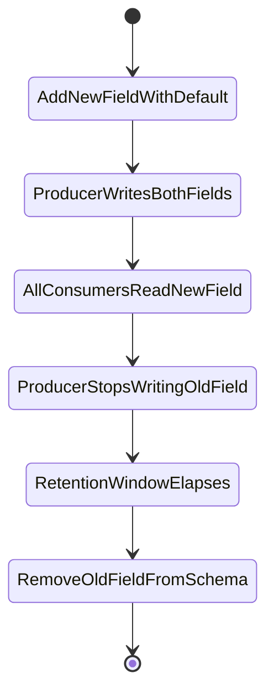

# Event Schema Evolution

A REST response is consumed and forgotten within milliseconds; if you change its shape, the old shape ceases to exist the moment you deploy. An **event** is the opposite: it is written down, kept, and read again — by a consumer that lags, by a new service built next year, by an operator replaying a partition after an incident. The bytes you published in January are still sitting in the log in July, and *they still have January's schema*. **Schema evolution** is the discipline of changing event shapes such that every reader — past, present and future — can still make sense of every writer's bytes. Get it wrong and the failure does not land on the team that made the change; it lands on a stranger, at 3am, during a replay.

## The problem that created it

A team ships its first event. `OrderPlaced` goes onto a topic as JSON, one producer, one consumer, both in the same repo. Changing it is a two-file edit.

Six months later there are nine consumers, three of them owned by other teams, one of them a data pipeline nobody remembers writing. Someone needs a `channel` field, so they add it. Nothing breaks that day, so the lesson learned is "adding fields is free". Later someone renames `amount` to `amountPaise` because the old name was ambiguous. Three consumers start reading `null` where money used to be — silently, because JSON has no opinion about missing fields. Then a fourth consumer, compiled against a generated class that *requires* `amountPaise`, is asked to reprocess last quarter's partition for a reconciliation dispute. Every record from before the rename fails deserialization. The consumer is correct, the producer is correct, the log is correct, and the pipeline is dead.

Three structural facts made this inevitable:

- **Producers and consumers deploy independently.** There is no moment when "everyone is on the new version". During every rollout, both versions are live simultaneously — in both directions.
- **Old bytes do not get upgraded.** A [[Kafka Architecture|Kafka]] topic configured for 30 days of retention, a compacted topic, or an [[Event Sourcing|event-sourced]] store that keeps events forever all mean yesterday's encoding is still load-bearing. There is no `ALTER TABLE` for a log. This is the sharpest difference between a queue and a log ([[Message Queues vs Event Logs]]): a queue's message is consumed and gone, so its schema lives for seconds, while a log's record is *retained and re-readable*, so its schema lives as long as the retention window — which on a compacted or event-sourced topic is forever.
- **Nobody owns the contract.** A REST API has a URL, a version prefix, docs and an obvious owner. An event is a struct that someone pasted into a Kafka producer — which makes it an *undeclared* public API, and undeclared APIs break.

Schema registries, compatibility checks and versioning strategies all exist to make that contract explicit and machine-checked, so the break happens in CI rather than in production.

## What it solves

- **Independent deployability**: producers and consumers can roll out in any order (or at least in a known, enforced order) without a coordinated big-bang release.
- **Safe replay**: a consumer started from offset 0 can read every schema version the topic has ever carried.
- **Machine-checked contracts**: incompatible changes are rejected at build or publish time, not discovered by a downstream team's pager.
- **Payload efficiency**: binary formats drop field names from the wire and carry a small schema id instead — meaningful at log volumes.
- **Discoverability**: the registry becomes the catalogue of what events exist and what they look like, which no amount of Confluence pages achieves.

## How it works

### Compatibility, defined precisely

The word "compatible" is useless without a direction. Fix the two populations:

- **Backward compatible** — a reader on the **new** schema can read data written with the **old** one. This is what makes replay and consumer lag survivable.
- **Forward compatible** — a reader still on the **old** schema can read data written with the **new** one. This is what makes a producer deploy safe while consumers are still catching up.
- **Full** — both of the above.
- **Transitive** variants — the check runs against *all previous versions*, not just the immediately preceding one.

Confluent Schema Registry formalises this as a per-subject setting, and the column that actually changes your release plan is the last one:

| Mode | Changes allowed | Checked against | Upgrade first |
|---|---|---|---|
| `BACKWARD` (default) | delete fields, add optional fields | last version only | **consumers** |
| `BACKWARD_TRANSITIVE` | delete fields, add optional fields | all previous versions | **consumers** |
| `FORWARD` | add fields, delete optional fields | last version only | **producers** |
| `FORWARD_TRANSITIVE` | add fields, delete optional fields | all previous versions | **producers** |
| `FULL` | add optional fields, delete optional fields | last version only | either order |
| `FULL_TRANSITIVE` | add optional fields, delete optional fields | all previous versions | either order |
| `NONE` | anything | nothing | nothing is guaranteed |

"Optional" here means **a field that has a default value** — that is the mechanical definition, not a vibe. Reading the table the practical way: *if you cannot control the deploy order, you need `FULL`*. If you can upgrade all consumers first — the normal case for a log where you control the consumer fleet — `BACKWARD` is enough, which is why it is the default.

**The transitive distinction is the whole point of this note.** Plain `BACKWARD` only promises that v5 can read v4. A consumer replaying a topic from offset 0 meets v1, v2, v3 and v4, and nothing ever checked v5 against v1. On a short-retention topic that is an acceptable bet. On a compacted topic, a long-retention topic, or anything [[Event Sourcing|event-sourced]], it is a time bomb: choose `BACKWARD_TRANSITIVE` or `FULL_TRANSITIVE` and accept that the set of permitted changes narrows forever.

### What a schema registry actually does

The registry is a small HTTP service holding versioned schemas, keyed by **subject**. The default `TopicNameStrategy` derives the subject from the topic — `payments-value` and `payments-key` — so a topic carries one evolving value schema; `RecordNameStrategy` and `TopicRecordNameStrategy` exist for topics that legitimately carry several event types. Confluent's implementation stores its own data in a compacted Kafka topic called `_schemas`, so the registry's durability is Kafka's.

The runtime path is not "look up a schema per message":

1. On first use of a schema, the producer's serializer **registers** it under the subject. The registry runs the compatibility check for that subject and either returns a **schema id** or rejects the registration — this is the gate.
2. Every message is framed as a **magic byte `0`**, then the **4-byte big-endian schema id**, then the encoded payload. With the binary formats, field names are not on the wire at all; the JSON Schema serializer uses the same header but still ships a readable document behind it.
3. The consumer's deserializer reads the id, fetches that schema **once**, caches it in memory, and uses it as the **writer schema** alongside its own compiled **reader schema** to resolve the record.

Consequences worth internalising: the registry is on the hot path only for cache misses, but a cold consumer with an unreachable registry cannot deserialize anything — it is a hard dependency at startup, and it belongs in your DR plan. Also, the id is global and immutable; you cannot "fix" a published schema, only publish a new version. AWS Glue Schema Registry and others implement the same idea with a different envelope (Glue embeds a schema-version UUID rather than Confluent's 4-byte int), so the framing is format-specific, not universal.

### Avro vs Protobuf vs JSON Schema

Confluent Schema Registry supports all three (Protobuf and JSON Schema were added in Confluent Platform 5.5, in 2020); the choice changes what "a safe change" even means.

| | **Avro** | **Protobuf** | **JSON Schema** |
|---|---|---|---|
| Wire form | compact binary, no field names | compact binary, numeric tags | text, names repeated every message |
| Field identity | **name**, with `aliases` for renames | **field number**; the name is cosmetic on the wire | name |
| Resolution rule | explicit writer-schema plus reader-schema resolution; reader-only fields need defaults | unknown tags ignored; absent fields take implicit defaults | validation of the document against constraints |
| Optionality | union with `null` plus a default | proto3 implicit zero defaults; explicit `optional` for true presence, generally available from 3.15 onward | `required` list plus `additionalProperties` |
| Code generation | optional — `GenericRecord` reads anything | required in practice | optional |
| Debuggability | unreadable without the schema | unreadable without the schema | readable in any console |
| Relative size | smallest | close behind | largest |

Two format-specific traps are worth memorising. In **Avro**, the default of a union must match its **first** branch, so `["null","string"]` with `default: null` is valid and `["string","null"]` with `default: null` is not — an invalid schema produced by reordering two words, and an easy one to miss in review. In **Protobuf**, renaming a field is wire-safe because the number is the identity, but it still breaks generated-code call sites and the JSON mapping; and deleting a field without marking its number `reserved` lets a future developer reuse that number for a different type, which silently misinterprets every old message.

### Safe changes, breaking changes

Reasoning from reader/writer resolution rather than memorising rules:

| Change | New consumer reads old data | Old consumer reads new data |
|---|---|---|
| Add a field **with** a default | safe — default fills the gap | safe — unknown field ignored |
| Add a field **without** a default | **breaks** — nothing to fill it with | safe — unknown field ignored |
| Remove a field that **had** a default | safe — reader ignores it | safe — default fills the gap |
| Remove a field with **no** default | safe — reader ignores it | **breaks** — reader needs it, writer stopped sending it |
| Rename a field | **breaks** in Avro and JSON unless an `alias` maps the old name; wire-safe in Protobuf, source-breaking everywhere | **breaks** if the old field was required; if it had a default the reader silently substitutes that default — the null-where-money-used-to-be failure from the story above |
| Widen a type, e.g. int to long | safe in Avro — the spec permits int to long, float, double; long to float, double; float to double; string and bytes interchange | **breaks** — the numeric promotions run one way only; string and bytes are the exception, promotable in both directions |
| Narrow a type, e.g. long to int | **breaks** — there is no demoting promotion | safe — the exact mirror of the row above, since the old reader still accepts an int as a long |
| Add a symbol to an enum | safe | **breaks** unless the reader's enum declares a `default` symbol, which Avro supports from 1.9 onward; proto3 enums are open and surface the raw number |
| Reorder fields | safe — Avro and JSON match by name, Protobuf by number | safe |
| Change a field's **meaning or unit** | **undetectable** — passes every check, corrupts every consumer | undetectable |

That last row is the one that costs real money. A registry checks **structure**, not **semantics**. Changing `amount` from paise to rupees, or reusing `status` to carry a new state machine's values, is a fully compatible change by every automated measure and a catastrophic one in production.

### Versioning strategies

**1. Additive-only discipline.** The default and the one that works: only ever add optional fields with defaults, and never remove or repurpose. It is boring and it makes schemas accumulate dead fields — which is a far cheaper problem than a broken replay.

**2. Expand and contract** (the event-shaped version of Danilo Sato's *parallel change*). Removing or replacing a field is a sequence, never an edit:

The step everyone forgets is `RetentionWindowElapses`: the old field cannot leave the schema while data containing it is still replayable. On an infinite-retention topic, that step never completes — the field is permanent.

**3. Upcasters.** Borrowed from the event-sourcing world: keep every historical version readable by registering a chain of pure functions that transform a v1 payload into v2, v2 into v3, at **read** time. The consumer's domain code only ever sees the latest shape. This is the right answer when events are the source of truth and rewriting history is not an option; the cost is a growing, permanently-tested library of migrations that nobody may delete. See [[Event Sourcing]].

**4. A new topic for genuinely breaking changes.** When the event's *meaning* changes — not its shape — version the stream, not the schema: `payments.completed.v2`. Producers **dual-publish** to both topics during the transition, consumers migrate one at a time, and v1 is retired only after its retention window has drained. It costs double writes and double storage for a quarter, and it is the only honest option when old and new cannot coexist in one schema. This is the direct analogue of a major version bump in [[API Design and Versioning]].

**5. A stable envelope.** Separate the parts that never change from the part that does: `eventId`, `eventType`, `occurredAt`, `schemaVersion`, `correlationId` in a fixed envelope, with the domain payload nested inside. Routing, [[Dead Letter Queues and Poison Messages|dead-lettering]], [[Idempotency|dedup]] and [[Distributed Tracing|tracing]] then work on every event regardless of payload version — including events the consumer cannot parse.

### Consumer-driven contracts

A registry check is producer-side and structural: it proves v5 parses against v4, nothing more. It cannot know that the fraud service treats an empty `merchantId` as a hard failure, or that reconciliation assumes `amount` is in paise. **Consumer-driven contract testing** closes that gap: each consumer publishes the expectations it actually relies on — Pact calls these *message pacts* for async flows — and the producer's CI fails if a change violates any of them. You get the list of real dependencies on your event, which is strictly more information than "nine services subscribe to this topic". Where a registry is cheap and mandatory, contract tests are expensive and selective: apply them to the handful of events on money paths.

### Event design that ages well

- **Name the fact, in the past tense, at the business level.** `PaymentCaptured`, not `PaymentUpdated` and certainly not `PaymentStateChanged`. A generic name invites every future change to be crammed into the same schema.
- **Do not leak internal enums or internal identifiers.** Publishing your service's internal status enum means that refactoring your state machine is a breaking change for nine other teams. Map internal values to a deliberately small published vocabulary, and let consumers tolerate unknown values.
- **Do not let one schema serve unrelated consumers.** A shared `CustomerEvent` consumed by billing, notifications and analytics is pulled in three directions; each team's additive change is dead weight to the others, and nobody can ever remove anything. Separate events per bounded context ([[Service Boundaries and Domain-Driven Design]]) age better than one god-schema.
- **Decide thin versus fat deliberately.** An event carrying only ids forces consumers to call back to the producer, re-coupling what you decoupled; an event carrying full state is self-contained but makes *every field* a contract. Carry the fields the business fact is actually about.
- **Never reuse a name, a field number, or a code.** Add a new one and leave the old one dead.

## Trade-offs

| You gain | You pay |
|---|---|
| Breaking changes caught in CI instead of production | A registry to run, monitor and include in DR |
| Independent producer and consumer deploys | A deploy-order rule the whole org must actually follow |
| Smaller payloads and no field names on the wire | Messages are unreadable without tooling; `kafka-console-consumer` shows binary |
| Replay of old data keeps working | Schemas accumulate deprecated fields that can never be deleted |
| A real catalogue of events | Code generation and a build step in every consumer |
| Structural guarantees | Zero semantic guarantees — meaning changes pass every check |

## Failure modes

- **The strict-consumer trap, direction one — new data, old consumer.** A producer adds a field. Under registry rules this is the safest change there is. But a consumer deserializing JSON with a hand-rolled `new ObjectMapper()` fails immediately, because Jackson's `FAIL_ON_UNKNOWN_PROPERTIES` defaults to **true**. The confusion is that Spring Boot's auto-configured `ObjectMapper` *disables* it — so "Spring Boot is lenient about unknown fields" is folklore everyone believes, and the one service that constructs its own mapper, or generates a closed class, is the one that pages. The JSON Schema equivalent is `additionalProperties: false`: a closed content model makes field addition forward-breaking by construction.
- **The strict-consumer trap, direction two — old data, new consumer.** This is the 3am one. A team adds a field "just for us" and marks it required because their code genuinely needs it. Live traffic is fine: every message in flight has the field. Months later someone replays a six-month-old partition — a reconciliation dispute, a rebuilt read model ([[CQRS]]), a [[Dead Letter Queues and Poison Messages|DLQ]] drain — and every record written before the change lacks the field. Deserialization fails, the consumer crash-loops, and the on-call engineer is debugging a change made by a different team two quarters ago. Worse, under [[Delivery Semantics|at-least-once]] the failed record is redelivered forever — a schema break is a poison message, and without a DLQ it blocks the partition behind it. `BACKWARD` compatibility exists precisely to make this registration fail; a required field with no default is the change it rejects.
- **Semantic drift that passes every check.** A unit change, a reused status code, a field that quietly starts meaning something else. Structurally compatible, financially disastrous. Only consumer-driven contracts, a human review step on money-path events, or an explicit new field name catch this.
- **`compatibility: NONE` set during an incident and never reverted.** A classic way a registry quietly stops providing any value at all. Audit subject-level compatibility settings; they drift.
- **The replay that nobody tests.** Compatibility is asserted, never exercised. Teams discover at the worst moment that the oldest surviving schema version was never checked against today's code. The cheap fix: a scheduled job that reads from the earliest retained offset into a canary consumer, and fails loudly.
- **Registry unavailable at consumer startup.** Schemas are cached in memory, so a running fleet survives a registry outage and a restarting fleet does not — the failure appears during a rolling deploy, which is exactly when you least want it. This is sharper on a fleet pinned to one replica per service, where a restart is a full outage of that consumer.
- **No registry at all.** [[SQS and SNS|SQS]] bodies and [[Redis Streams]] entries are opaque — there is no broker-side schema enforcement to inherit, so the discipline has to live in a shared serialization library plus a CI check, or it does not exist.

## When NOT to use it

- **A single producer and a single consumer in one deployable** — the contract is a compile-time type; adding registry infrastructure buys nothing until a second team appears.
- **Short-lived, low-value streams** — a metrics or telemetry firehose with hours of retention and a tolerant consumer does not need transitive guarantees; a gap is cheaper than the ceremony.
- **Genuinely unstructured payloads** — a blob store reference, an opaque encrypted envelope. Schematise the envelope, not the blob.
- **Internal command queues inside one service** — a work queue where producer and consumer ship together is not a public contract; treating it as one is overhead with no reader to protect.
- Do not reach for a *new topic version* when an additive field would do. Topic versioning is expensive and permanent; most changes are additive and should stay that way.

## In your stack

- Today's [[SQS and SNS|SQS]] queues carry JSON with no registry between you and disaster. The equivalent control is a shared serialization library plus a CI-run compatibility check on a committed schema file, and an envelope carrying `eventType`, `schemaVersion` and `x-correlation-id` so that an unparseable payload can still be routed and traced.
- The planned move to [[Redis Streams]] makes this sharper, not softer: stream entries are flat field-value pairs, so a nested domain object collapses into one serialized field, and Redis offers no schema services whatsoever. Decide the format and the enforcement point *before* the migration, not after ([[Choosing a Message Broker]]).
- If any MSK or Confluent topic returns, set `BACKWARD_TRANSITIVE` on money-path subjects rather than taking the `BACKWARD` default — replay of old partitions is a routine fintech activity, not an exotic one ([[Kafka Operations]]).
- Spring Kafka's `JsonSerializer` writes a `__TypeId__` header containing the fully-qualified Java class name, and `JsonDeserializer` maps it back through `spring.json.trusted.packages`. That makes a package move or class rename a wire-breaking change for consumers — an evolution constraint hidden in a header nobody reviews. Pin it with explicit type mappings instead of inheriting the default.
- MongoDB being the primary store means documents drift without any DDL to review; events derived from those documents inherit the drift silently, which is the reason to shape events from domain intent rather than from document fields ([[Change Data Capture]], [[The Outbox Pattern]]).
- Money and KYC events are audit evidence. If an auditor can be asked to replay a quarter-old stream, then "can the current consumer read the oldest retained event" is a compliance property, not an engineering nicety — and it is testable.

## Interview angle

The 60-second version: *"Unlike a REST response, an event is durable — old bytes stay in the log and get replayed, so the schema is a long-lived public contract. Compatibility has a direction: backward means a new consumer can read old data, forward means an old consumer can read new data, full means both. Which one you need falls out of deploy order — backward lets you upgrade consumers first, forward lets you upgrade producers first, full lets you do either. A schema registry enforces this: the producer registers a schema, gets an id, embeds that id in every message, and consumers fetch and cache the writer schema to resolve against their own. Adding an optional field with a default is safe in both directions; renaming, retyping or removing a required field is not. And for anything replayable you want the transitive variant, because plain backward only checks against the previous version, while a replay from offset zero meets every version ever written."*

Classic follow-ups:

- **"Which compatibility mode, and why?"** — the answer is a question about deploy order and retention, not a preference. Short retention and a consumer fleet you control: `BACKWARD`. Replayable or compacted: `BACKWARD_TRANSITIVE`. Consumers you do not control: `FULL`.
- **"How does the consumer know which schema to use?"** — the schema id in the message frame; fetched once from the registry and cached; resolved against the consumer's own compiled schema.
- **"Avro or Protobuf?"** — Avro if the registry is always present and you want schema-driven resolution with no code-gen requirement; Protobuf if you already have IDLs for gRPC and want one toolchain; JSON Schema when humans debugging the stream matters more than bytes.
- **"How do you make a genuinely breaking change?"** — new topic, dual-publish, migrate consumers one at a time, retire the old topic after its retention drains. Never mutate the old schema.
- **"What can't the registry catch?"** — semantics: units, reused codes, changed meanings. That is what consumer-driven contracts and code review are for.

## Check yourself

> [!question]- Q: Explain backward versus forward compatibility, and derive which one you need from your deploy order.
> Backward: a consumer on the **new** schema can read data written with the **old** one — so you can upgrade consumers while producers are still emitting the old shape, and replay of historical data keeps working. Forward: a consumer still on the **old** schema can read data written with the **new** one — so you can upgrade producers while consumers lag behind. Deploy order decides it: if consumers go first you need backward; if producers go first you need forward; if you cannot control the order — external teams, slow-moving consumers — you need full, which restricts you to adding and removing fields that have defaults. Separately, if the topic is replayable, take the transitive variant, because the non-transitive check only compares against the immediately previous version.

> [!question]- Q: A producer adds a required field `settlementMode` with no default. The registry subject is on `BACKWARD`. What happens, and what would have happened under `NONE`?
> Under `BACKWARD` the registration is **rejected**: a reader on the new schema meeting old data would find no value and no default for `settlementMode`, so the change fails its compatibility check in CI or at first publish. That is the system working. Under `NONE` the schema registers and live traffic is completely healthy, because every message in flight carries the field. The failure surfaces later and elsewhere — on a replay from an older offset, a rebuilt read model, or a DLQ drain — where every pre-change record fails to deserialize and the consumer crash-loops. The correct fix in both cases is the same: make the field optional with a sensible default, and have the consumer treat the default as "unknown" rather than as a value.

> [!question]- Q: Your `payment.completed` event has `amount` in paise. A team changes the producer to emit rupees and the registry accepts it. Why, and what would have caught it?
> The registry validates **structure**, not **meaning**. The field is still the same name and the same type, so by every automated measure nothing changed — while every consumer is now off by a factor of 100, in a direction that under-reports. Nothing in Avro, Protobuf or JSON Schema can express "this integer is denominated in paise". What catches it: a consumer-driven contract test asserting a semantic expectation; a review rule that money-path schema changes need the consuming teams' sign-off; or, structurally, never changing a field's meaning at all — add `amountRupees` as a new optional field and run expand-and-contract, so the two meanings never share a name. For a regulated money path, the third option is the only defensible one.

> [!question]- Q: Mini-design — you must replace `customerId`, currently an internal Mongo ObjectId string, with a stable public `customerRef`, across an event consumed by six services on a topic with 90-day retention. Sketch the migration.
> Expand: add `customerRef` as an optional field with a default, leaving `customerId` untouched; register under `BACKWARD_TRANSITIVE`. Producer then writes **both** fields on every event, so old consumers keep working untouched. Migrate: each of the six consumers switches to `customerRef`, independently, at its own pace; track completion explicitly rather than assuming — a consumer-driven contract test per service turns "has everyone migrated" into a CI fact. Contract: once all six are confirmed migrated, the producer stops populating `customerId`, but the field stays in the schema. Only after a full 90-day retention window has elapsed — so that no replayable record still needs it — may the field be removed, and even then only if no [[Event Sourcing|event-sourced]] or archived copy outlives the topic. If any consumer is outside your control, skip the removal entirely: a permanently deprecated field is cheaper than a breaking change. If the semantics changed rather than just the encoding, this stops being a field migration and becomes a new topic version with dual-publish.

## Sources

- *Designing Data-Intensive Applications*, Kleppmann — Ch. 4 "Encoding and Evolution": writer/reader schema resolution, backward and forward compatibility, Avro and Protobuf compared in depth.
- Confluent Schema Registry documentation — compatibility types and the upgrade-order summary table; subject naming strategies; the wire format and the `_schemas` topic.
- Apache Avro specification — "Schema Resolution" (field matching by name, aliases, permitted type promotions) and the union-default rule.
- Protocol Buffers documentation — "Updating A Message Type": field numbers as identity, `reserved`, which type changes are wire-compatible.
- Greg Young, *Versioning in an Event Sourced System* (2017) — upcasters, copy-and-replace, and why weak schemas age better in event-sourced stores.
- Pact documentation — message pacts for asynchronous consumer-driven contracts.
- martinfowler.com bliki, "ParallelChange" (Danilo Sato) — the expand, migrate, contract sequence this note applies to event fields.
