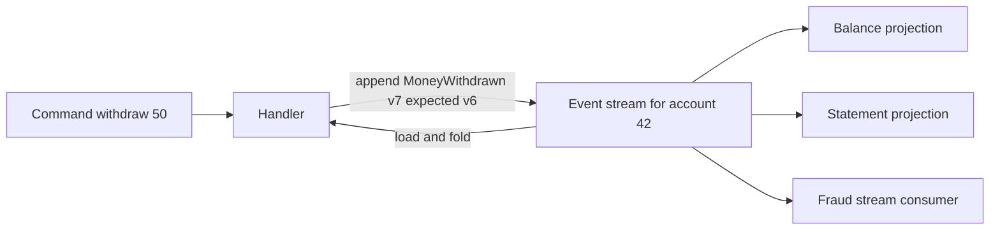

# Event Sourcing

Conventional persistence stores *current state*: an `accounts` row holds today's balance, and every update overwrites yesterday's truth. **Event sourcing** inverts this: the system of record is an **append-only log of events** — `AccountOpened`, `MoneyDeposited {200}`, `MoneyWithdrawn {50}` — and current state is *derived* by replaying (folding over) those events. State becomes a cache; the history becomes the truth. It is the most powerful and most over-recommended pattern in this module: brilliant where history *is* the domain (ledgers, audit-heavy fintech), a long-term trap where it is adopted for architectural fashion.

## The problem that created it

Three recurring pains with state-overwriting systems created the pattern:

1. **Destroyed history.** `UPDATE accounts SET balance = 800` erases the fact that it was 1000 and *why* it changed. When support asks "how did this balance happen?", when an auditor asks "show every change to this KYC record and who made it", when a bug corrupted data three weeks ago and you need to know what was true before — the information is simply gone. Teams bolt on audit tables, but bolt-on audit is written by the same code it audits: incomplete (only instrumented paths), unordered, and routinely divergent from the real state.
2. **Lost intent.** The row says `status = CLOSED`; it cannot say whether the account was closed by the customer, by compliance, or by a bug. Downstream decisions (win-back campaigns vs regulatory reporting) need the *reason*, and a state store structurally cannot hold a reason per transition.
3. **Irreversible bugs.** When business logic mis-computes state, a state store holds only the wrong answer. If you instead had every input event, you could fix the code and recompute the right answer from history.

The accounting profession solved all three centuries ago: ledgers are append-only; you never erase an entry, you add a correcting one; the balance is whatever the entries sum to. Event sourcing is that idea generalized to software state.

## What it solves

- **Audit for free — and better than free**: the audit log *is* the system of record, so it cannot diverge from state (fintech relevance: this is approximately what an RBI auditor wishes your systems looked like).
- **Temporal queries**: "what was this account's state on March 31?" = fold events up to that date. Reconstructing any past state is a replay, not a forensic project.
- **Rebuild and reinterpretation**: new read models, fixed projections after a bug, entirely new questions asked of old data — all served by replaying the log ([[Message Queues vs Event Logs|the log model's replay superpower]], applied to your own state).
- **Intent preserved**: events are named business facts with reasons attached; the "why" survives.
- **Natural event publication**: the events you store are the events you publish — the [[The Outbox Pattern|dual-write problem]] shrinks (the store is the outbox).
- **Write-path concurrency control**: appending with an expected-version check (optimistic concurrency per aggregate) gives clean conflict detection without long locks.

## How it works

### The core loop

State lives per **aggregate** (one account, one loan — the consistency boundary). To handle a command:

1. **Load**: read the aggregate's events from its stream; fold them (`state = f(state, event)` for each) to get current state.
2. **Decide**: run business rules against that state; reject or produce new event(s). Rules run *here*, at write time — events, once appended, are facts and are never validated again.
3. **Append**: write the new events with an **expected-version** check (fails if someone appended concurrently — retry the loop).
4. **Publish/project**: downstream [[CQRS|read models]] and subscribers consume the new events.

### Snapshots

Folding 2 million events to load one busy aggregate is too slow, so you periodically persist a **snapshot** (state + version) and load snapshot-plus-tail instead. Snapshots are pure optimization — disposable, rebuildable, never the source of truth. They add real machinery: snapshot schedules, storage, invalidation when the fold logic changes (a changed `f` makes old snapshots wrong — version them).

Work the numbers, because they decide whether you need snapshots at all. **Assume applying one event to in-memory state costs about 1 µs** — a few field updates on a small object. That figure is a placeholder to reason with; measure your own before relying on it.

- A **typical retail wallet** sees perhaps 20 events a month. Over 15 years: `20 × 12 × 15 = 3,600 events`, which folds in about `3,600 µs ≈ 3.6 ms`. No snapshot needed, ever. The median aggregate in most systems is in this range, which is why "event sourcing is slow to load" is usually a claim about an atypical entity.
- A **high-volume merchant settlement account** with **2,000,000 events** folds in `2,000,000 µs = 2 seconds` — unusable on a request path, and it gets worse every day.
- Snapshot every **1,000 events** and the worst-case tail is `1,000 µs ≈ 1 ms` plus one snapshot read. Snapshot every **100,000** events and it is `100 ms`. The snapshot interval is a direct latency dial: worst-case fold time ≈ interval × per-event cost.

The implication is that snapshots are a **per-aggregate-class decision**, not a system-wide one. Applying them everywhere adds schedules, storage and an invalidation hazard to 99% of entities that fold in milliseconds anyway.

### Query models

A folded aggregate answers questions about *one* aggregate. "All accounts with balance > ₹1L" would mean folding every stream — absurd. So event-sourced systems project events into separate **read models** (tables, documents, indexes) built for each query shape. This is why event sourcing in practice almost always arrives bundled with [[CQRS]]: the write side is the log; every read is a projection, and projections are eventually consistent with the log.

### The hard parts (the decade view)

- **Schema evolution over years.** Events are immutable and live forever; code must read *every version ever written*. The playbook ([[Event Schema Evolution]]): additive-only changes where possible; **upcasters** that transform old event versions to current shape at read time (chains of them, accumulating for a decade); never mutate stored events. Renaming a concept in your domain means supporting its old name in perpetuity.
- **Erasure (GDPR/DPDP) vs immutability.** "Delete my personal data" collides with "we never delete events". Real answers: **crypto-shredding** (encrypt each person's PII with a per-person key; erasure = destroying the key, leaving ciphertext tombstones), segregating PII into a mutable store referenced by events, or rewriting streams (operationally brutal, breaks positions/consumers). None is free; choose before the first event is written, not after the first regulator letter.
- **Projection rebuild operations.** Rebuilding a big read model takes hours while the business runs — you need dual projections, cutovers, and replay infrastructure as rehearsed tooling, not aspiration.
- **Discipline at the boundaries.** Events must be *facts* ("MoneyWithdrawn"), not commands ("WithdrawMoney") and not CRUD diffs ("BalanceUpdated") — modeling skill that teams learn by making the mistake.

## Trade-offs

| You gain | You pay |
|---|---|
| Complete, non-divergent audit; temporal queries | Every read needs a projection; [[CQRS]] complexity is mandatory, not optional |
| Replay: fix bugs by recomputation, new models from old data | Eternal schema-compatibility burden ([[Event Schema Evolution]]) |
| Intent-rich domain history | Steep modeling and team-skill curve; easy to do badly |
| Natural event publication, optimistic concurrency | Snapshots, rebuild tooling, projection lag monitoring — standing infrastructure |
| Append-only writes (fast, lock-light) | Erasure/retention compliance is structurally hard |

## Common misconceptions

- **"Event sourcing means using Kafka."** Kafka is a log, and a log is not an event store. An event store needs per-aggregate streams and an **atomic append with an expected-version check** — the primitive that makes optimistic concurrency work. Kafka has no such primitive per key, and its retention and compaction semantics are built around *forgetting*, which is the opposite of what a system of record needs. Plenty of event-sourced systems run on an ordinary database table with a unique index on `{aggregateId, version}`; the log is for *publishing* the events, not storing them.
- **"Event sourcing is the same as publishing events."** Publishing events from a CRUD service through the [[The Outbox Pattern|outbox]] is an *integration* technique: the state is still the truth, and the events describe it. Event sourcing moves the truth into the events themselves. The two have different sources of truth and wildly different costs, and conflating them is how teams accidentally buy the expensive one.
- **"Events are immutable, so schema is simpler."** Exactly backwards. Immutability is *why* the schema burden is permanent: you can never stop being able to read the version you wrote in 2019, because that event is still the truth and still has to fold. A CRUD table migrates once and forgets; an event store carries every past shape forever ([[Event Schema Evolution]]).
- **"Replaying the log always reproduces the same state."** Only if the fold is a **pure function of the events**. A fold that reads the clock, calls a service, or consults a config value that has since changed will quietly produce a different answer on replay — see the 3am story below, because this is the failure that turns "we can always rebuild" into a reconciliation project. All decisions belong at *append* time; the fold must only apply recorded facts.
- **"You can fix a bad event by editing it."** You cannot, and the reason is structural rather than philosophical: every snapshot, projection and consumer position downstream was derived from the bytes you are about to change, and none of them will know. Corrections are appended, exactly as an accountant posts a reversing entry.
- **"Event sourcing gives you an audit log for free."** It gives you a complete *technical* history of state changes. An auditor wants to know **who** acted, under **what authority**, on **what evidence** — and those are only present if you deliberately modeled actor, reason and source document into the events. An event stream of `BalanceChanged {delta}` is perfect replay and useless audit.

## Failure modes

- **The CRUD-in-disguise failure.** Events like `UserUpdated {all 40 fields}` — all cost, no intent, no audit value. If your events mirror your tables, you have built an expensive [[Change Data Capture|CDC]] of yourself.
- **Projection lag surprises users.** Write succeeds (event appended), read model hasn't caught up; the user's refresh shows the old balance. Without read-your-writes handling ([[CQRS]], [[Read Your Own Writes and Replica Lag Anomalies]]), trust erodes one refresh at a time.
- **Upcaster rot.** Five years of event versions, upcasters written by departed engineers, a replay that crashes on an event from 2021 nobody remembers. Mitigation: versioned event schemas in a registry, replay tests over *production history samples* in CI.
- **Snapshot/fold divergence.** Fold logic changes, old snapshots silently embody the old logic; aggregates behave differently depending on snapshot age. Mitigation: version snapshots with the fold; invalidate on mismatch.
- **Unbounded streams for immortal aggregates.** An account active for 15 years accumulates events forever; load times and storage grow without the natural archival point a state store has. Mitigations: snapshots, stream-splitting ("close the book" yearly — explicit closing-balance events, like accountants do).
- **The whole company reads your events.** Internal event store schemas leak into other teams' consumers; now your private history is a public API you can never change — the event-store version of the shared-database anti-pattern. Publish deliberate external events; keep the store private ([[Service Boundaries and Domain-Driven Design]]).

### What this looks like at 3am

The page is not from the application. It is from the nightly reconciliation job, which compares the freshly rebuilt balance projection against the live one and has reported **12,000 accounts disagreeing**, mostly by single-digit rupees, a few by thousands.

Nothing errored. The rebuild ran clean and finished early. Both numbers were produced by the same code from the same events, which is the detail that makes it feel impossible.

Pick one account and fold its stream by hand. The balance is right until April, then drifts. Read the fold: it applies `FeeCharged` events by **recomputing** the fee — `amount × feeRateFromConfig()` — rather than applying the fee amount recorded in the event. The fee rate changed in April. The live projection was built incrementally, so each historical event was folded with the rate that was current *at the time*; the rebuild folded all of history with today's rate. Both are "correct" executions of the same function; the function simply is not a function of the events.

The signal that distinguishes this class from an ordinary projection bug is its **shape**: a projection bug diverges from a point in time forward for *everyone*; a non-deterministic fold diverges wherever the ambient input changed, which here means every account with pre-April fee events and no others. Confirm it by replaying one stream twice with the config pinned to the old value and the new one — if the two folds differ, the fold reads ambient state, and the rebuild you were relying on as your recovery mechanism has been lying for however long the drift has existed.

The repair is in two parts, and the order matters. First make the fold pure: `FeeCharged` must carry the computed `feeAmount`, because the *decision* was made at append time and the event is supposed to record what happened, not the inputs from which it could be re-derived. Backfilling that into historical events is not permitted — they are facts — so the fold needs a versioned branch that uses the recorded amount when present and an [[Event Schema Evolution|upcaster-supplied]] historical rate when absent. Second, correct the money: append compensating adjustment events for the affected accounts, never by editing history, and with the same four-eyes rigour as any manual ledger adjustment. The lesson to take away is blunt — **if `fold(events)` can return two different answers at two different times, you do not have event sourcing; you have a replay that lies**, and every recovery story in this note depends on that not being true.

## When NOT to use it

Honest default: **most entities should not be event-sourced.** A plain CRUD table plus a decent audit log is the right call when:

- History is *useful* but not *load-bearing*: "who changed this setting?" needs an audit trail, not a rebuildable fold. An append-only audit table (or [[Change Data Capture|CDC]] into cold storage) delivers 80% of the value at 10% of the cost.
- The domain is genuinely CRUD: profiles, preferences, catalog entries — no business-meaningful transitions, no temporal queries.
- The team hasn't run one before and the entity is mission-critical: the modeling mistakes are expensive precisely where event sourcing is most attractive.
- You "just need events for integration": use the [[The Outbox Pattern|outbox]] — publishing events ≠ event-sourcing your state.
- Regulatory erasure dominates and the PII strategy isn't settled — don't append what you can't later un-know.

Where it *earns* its cost: ledgers and money movement (balances are literally folds over transactions — double-entry *is* event sourcing), anything where auditors demand full reconstructable history, domains with rich lifecycle semantics (loan origination, KYC workflows), and systems where "recompute from history after a bug" is a plausible, valuable operation.

## In your stack

- Your true ledger (or your banking partners') is already event-sourced in spirit: double-entry postings are immutable events; balances are projections. If you build an internal ledger, event-source *that* — it is the one entity where the pattern's costs are all repaid.
- KYC lifecycle (submitted → verified → re-verified → expired, each with documents and reasons) is a strong candidate: RBI audit queries are temporal by nature ("state of this KYC on the date of the transaction").
- MongoDB as event store is workable (events collection, `{aggregateId, version}` unique index for optimistic concurrency, change streams to feed projections) — but it is DIY; dedicated stores (EventStoreDB, or Kafka-as-source-of-truth with compaction caveats) exist for a reason. Count the tooling you'd build.
- Don't event-source your user-preferences service because the ledger team did. Per-aggregate decision, not per-company.
- Erasure planning: DPDP-era India + event-sourced KYC → crypto-shredding designed in from day one, with per-customer keys in your KMS.
- The fold-purity rule has a concrete shape in a Spring service: a fold function must not be able to reach a `@Value` config property, a `Clock`, or an injected client. Make the event applier a static or stateless method taking only `(state, event)`, and the compiler stops the 3am story above from being written. If the current code does have ambient reads in its applier, that is a finding worth writing down regardless of whether anything has diverged yet.
- Projector services at 1 replica make the rebuild story worse than it sounds. A rebuild is a single-threaded replay through one pod: at 2,000 events/s a 50-million-event history takes about `50,000,000 ÷ 2,000 = 25,000 s ≈ 7 hours`, during which that pod is also not keeping the live projection current unless you run the rebuild as a separate deployment writing to a shadow model. "We can always rebuild" is only true if someone has measured the rebuild and the answer fits inside the business's tolerance — so measure it on real production history before the pattern is load-bearing, not during the incident that needs it.
- Audit note worth raising early with compliance: an RBI auditor's questions are temporal and actor-shaped, so model `actorId`, `onBehalfOf`, authority/approval reference and source-document ID into the events from the first version. Adding them later means a decade of events that structurally cannot answer the question, and no upcaster can invent data that was never captured.

## Interview angle

The 60-second version: *"Event sourcing stores an append-only log of domain events as the system of record and derives state by folding over them — like a bank ledger, where the balance is the sum of postings, not a cell someone overwrites. You get a non-divergent audit trail, temporal queries, and the ability to rebuild or reinterpret state by replay; snapshots keep loads fast, and reads come from projections, which is why it pairs with CQRS and eventual consistency. The costs are long-haul: event schemas must stay readable forever — upcasters, registries; GDPR erasure fights immutability — crypto-shredding; projections and rebuild tooling are standing infrastructure. I'd use it for ledgers and audit-heavy lifecycles, and a CRUD table with an audit log everywhere else."*

Classic follow-ups:

- "How do you query across aggregates?" — you don't fold; you project into read models ([[CQRS]]), accepting staleness.
- "How do you handle a bug that wrote wrong *events*?" — events are facts: append compensating/correction events (like accounting reversals); you only replay-recompute when the *fold/projection* was wrong, not the events.
- "GDPR delete?" — crypto-shredding or PII-segregation; show you knew before being asked.
- "Event sourcing vs CDC vs outbox?" — ES: events *are* the state; outbox: state is primary, events published atomically; CDC: derive change events from a state store's log. Three different sources of truth.
- "Concurrent writes to one aggregate?" — optimistic append with expected version; conflict → reload, re-decide, retry.

## Check yourself

> [!question]- Q: Explain "state as a fold over events" to a teammate using a bank account, and say what a snapshot is in those terms.
> The account's stream holds facts: `Opened`, `Deposited 1000`, `Withdrawn 200`, `Deposited 100`. Current balance = fold: start at 0, apply each event → 900. Nothing stores "900" authoritatively; any state is recomputable at any point in history by stopping the fold early. A snapshot is a memoized prefix of the fold — "after event 3, balance was 900" — stored so loading doesn't replay from event 1; it is disposable cache, never truth, and must be invalidated when the fold function changes.

> [!question]- Q: Your projection shows wrong balances for ~2% of accounts due to a projection bug deployed last month. Walk through recovery, and contrast with the same bug in a CRUD system.
> Fix the projection code; rebuild the read model by replaying events from the start (or from a pre-bug snapshot position) into a fresh model; verify on known cases; cut reads over; discard the bad model. The events were never wrong, so no data is lost and no guesswork is needed. In a CRUD system the wrong computation *overwrote* the truth: recovery means forensic reconstruction from backups plus re-derivation of a month of mutations — often ending in "best-effort adjustment entries" and apology emails.

> [!question]- Q: A customer invokes erasure of their personal data; their KYC aggregate has 4 years of events, and the stream also feeds a fraud model. Design the response.
> This only goes well if designed up front: PII fields in events encrypted with a per-customer key (crypto-shredding). Erasure = destroy the key in KMS and record an `ErasureExecuted` event; historical events remain structurally intact (versions, counts, non-PII facts) so folds, projections, and the fraud model's aggregate features keep working, but names/documents/addresses are irrecoverable ciphertext. Downstream read models must also drop/re-project the PII they materialized. Check the legal carve-outs first: RBI/PMLA retention duties may *override* erasure for KYC records for a mandated period — the design must support "erase except where law requires retention", which is a policy engine, not just a key deletion.

> [!question]- Q: One high-volume merchant's settlement aggregate has reached 2 million events. Loading it now takes about 2 seconds and the API is timing out, while every other merchant loads in milliseconds. Walk through your options and pick one.
> First, confirm the diagnosis rather than assuming: 2,000,000 events at roughly 1 µs each is ~2 seconds of pure fold, so the time is in replay, not in I/O — check that before optimizing the wrong layer. The options, in increasing order of commitment. **(1) Snapshots for this aggregate class.** Snapshot every 1,000 events and the worst-case tail becomes ~1 ms plus one snapshot read; this is the right first move because it is pure optimization, reversible, and changes no semantics. Its cost is a snapshot schedule, storage, and a versioning discipline so a change to the fold invalidates old snapshots instead of silently embodying old logic. **(2) Close the book.** Append an explicit `PeriodClosed` event carrying the closing balance at each month or year end and start folding from there — which is what accountants have always done, and it bounds the stream's *relevant* length permanently rather than just memoizing an ever-growing prefix. Snapshots make a long stream fast; closing the book makes it short, and only the second one stops the problem recurring. **(3) Re-examine the aggregate boundary.** Two million events on one aggregate usually means the consistency boundary is too coarse — if settlements per currency or per settlement cycle never need to be transactionally consistent with each other, they are separate aggregates and the stream was never meant to be one stream. That is the real fix but also a modeling migration, so it is the third answer rather than the first. Pick (1) now to stop the bleeding and (2) as the permanent design, and raise (3) if the aggregate is also seeing optimistic-concurrency conflicts, which is the symptom that proves the boundary is wrong.

> [!question]- Q: Mini-design — would you event-source (a) the internal wallet ledger, (b) the user notification-preferences service? Justify each in two sentences.
> (a) Yes: a ledger's domain *is* its history — balances are folds over postings, auditors demand reconstruction, corrections are naturally compensating entries, and intent per movement is regulatory table stakes. The pattern's costs (projections, schema discipline) are exactly the investments a money store warrants. (b) No: preferences are current-state-only, transitions carry no business meaning, and nobody queries "preferences as of March". A CRUD document with an audit log (or CDC to cold storage) answers every real question at a fraction of the complexity.

## Sources

- Martin Fowler — "Event Sourcing" (martinfowler.com, 2005) — the canonical description and caveats.
- Greg Young — "Versioning in an Event Sourced System" (free ebook) — upcasters, immutability, and the decade-scale schema problem; his CQRS/ES talks originated much of the practice.
- *Designing Data-Intensive Applications*, Kleppmann — Ch. 11, "Event Sourcing" and "State, Streams, and Immutability".
- microservices.io — "Pattern: Event sourcing" (Chris Richardson).
- EventStoreDB documentation — streams, expected-version concurrency, projections (a reference implementation's vocabulary).
