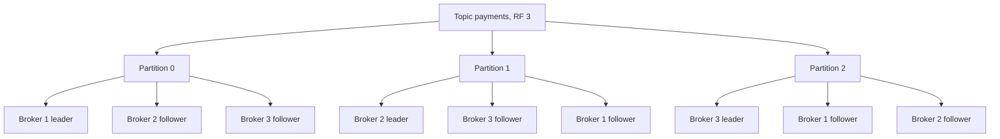

# Kafka Architecture

Kafka is not a queue — it is a **distributed, replicated, append-only commit log** that happens to be usable as a messaging system. Producers append records to the end of partitioned logs; consumers read at their own pace by position (**offset**) and the broker deletes nothing on consumption. Almost everything distinctive about Kafka — replay, consumer independence, massive throughput, massive backlogs costing nothing — falls out of that one design decision. Read [[Message Queues vs Event Logs]] first; this note is the "how".

## The problem that created it

LinkedIn, around 2010. Dozens of systems need the same data: page views feed search relevance, metrics, security, a Hadoop warehouse. The existing shape was point-to-point pipelines — N producers × M consumers of bespoke plumbing, each fragile and each losing data differently. Traditional brokers (ActiveMQ, RabbitMQ-style) buckled for this use because:

1. **Throughput.** Activity streams are firehoses — far beyond what per-message-bookkeeping brokers handled on reasonable hardware.
2. **Multiple independent readers.** A queue delivers each message once, to one consumer. LinkedIn needed five systems to each read *everything*, at different speeds, including a batch system reading hours late.
3. **Backlogs and replay.** Rebuilding the search index meant re-reading days of events. Queues delete on ack; there was nothing to re-read.

Jay Kreps' team asked: what if the pipeline *is* a log — the same structure as a database's write-ahead log ([[How Databases Store Data]]), distributed and retained? Consumers become cursors over the log. Adding a reader costs the broker almost nothing. That became Kafka (open-sourced 2011).

## What it solves

- **One pipeline, many readers** — each consumer group gets the full stream independently; adding a reader never slows producers or other readers.
- **Throughput at commodity cost** — on the order of millions of messages/sec per cluster (rough, 2026; message size dominates) via sequential IO and batching.
- **Replay** — bugs happen; re-consume from an old offset instead of restoring backups. Foundation of [[Event Sourcing]] and [[Change Data Capture]].
- **Durable buffering** — a consumer down for six hours just resumes at its offset; the backlog is invisible to the broker ([[Backpressure and Flow Control]]).
- **Per-key ordering at scale** — order within a partition, parallelism across partitions ([[Message Ordering]]).

## How it works

### Topics → partitions → segments

A **topic** is a named stream. It is split into **partitions**, each a totally ordered, append-only log; records with the same key hash to the same partition, which is the entire ordering guarantee ([[Sharding]] applied to a log — and the same [[Hot Partition Problem]] applies to skewed keys). Each partition is stored as a sequence of **segment files** (default 1 GiB); only the last segment is written, old segments are deleted whole or rewritten by compaction — which is why retention is cheap.

Each record in a partition gets a monotonically increasing **offset**. An offset is a dumb long — the consumer's entire state is "I have read partition 3 up to offset 182,440", stored in an internal topic (`__consumer_offsets`).

### Replication: leaders, ISR, and the durability math

Each partition is [[Replication|replicated]] across brokers: one **leader** (serves all produce and, normally, fetch traffic) and N−1 **followers** that pull from it. Followers that are caught up form the **ISR — in-sync replicas**. A record is **committed** once every ISR member has it; only committed records are readable.

Producer `acks` setting:

| acks | Waits for | Loses data when |
|---|---|---|
| `0` | Nothing | Any blip — fire and forget |
| `1` | Leader has written it | Leader dies before followers fetch |
| `all` | Every current ISR member has it | Only if *all* ISR replicas die together |

The trap: `acks=all` alone is weaker than it sounds, because the ISR can *shrink*. If followers fall behind and drop out, the ISR can become just the leader — and `acks=all` then means "the leader has it", i.e. `acks=1`. The guard is **`min.insync.replicas`**: with replication factor 3 and `min.insync.replicas=2`, a produce with `acks=all` fails (producer retries) rather than being accepted under-replicated.

Durability math for the standard config (RF=3, min.insync=2, acks=all): every acked write exists on ≥2 brokers, so you tolerate **1 broker failure with zero acknowledged-write loss**, and the cluster keeps accepting writes with one broker down. Lose 2 of 3 simultaneously and acked-but-only-on-two-dead-brokers data is gone unless `unclean.leader.election.enable=false` holds the partition offline until a dead replica returns — the classic consistency-vs-availability choice ([[CAP Theorem]]). Note this is primary-backup replication gated on the ISR set, not a [[Quorum Reads and Writes|majority quorum]] — RF=3/min.insync=2 resembles a quorum but ISR membership itself is changed by the partition leader and recorded by the controller.

Leaders are spread so every broker leads some partitions — leadership is the unit of load balancing.

### Consumer groups

Consumers sharing a `group.id` form a **consumer group**: each partition is assigned to exactly one consumer in the group (computed by an elected group-leader consumer in the classic protocol, by the broker-side coordinator under KIP-848, GA in 4.0), so the group collectively reads everything, each partition in order, with parallelism ≤ partition count. Two different groups each independently read the full topic. Members joining/leaving trigger a **rebalance** — disruptive enough to deserve its own note: [[Consumer Groups and Rebalancing]]. Consumers commit offsets; commit-after-process gives at-least-once, commit-before-process gives at-most-once ([[Delivery Semantics]], [[Exactly-Once Delivery Is a Lie]]).

### Producer mechanics: batching, idempotence, transactions

Producers don't send messages one at a time. Records accumulate per-partition in batches (`batch.size`), and `linger.ms` adds a small wait to let batches fill — trading single-digit milliseconds of latency for large throughput and compression gains (compression works per batch). The **idempotent producer** (default since Kafka 3.0: `enable.idempotence=true` — effectively applied only from 3.0.1/3.1.1/3.2.0, since bug KAFKA-13598 left it off in 3.0.0 and 3.1.0) attaches a producer ID and sequence number to each batch, so broker-side dedup makes retries safe — no duplicates from the produce path, no reordering. **Transactions** extend this: a producer can atomically write to several partitions *and* commit consumer offsets, which is what Kafka Streams' exactly-once processing (`read-process-write` within Kafka) is built on. In one paragraph that's the honest scope: exactly-once *inside* a Kafka-to-Kafka pipeline; the moment a side effect leaves Kafka (a DB write, an HTTP call), you are back to at-least-once plus [[Idempotency]].

### Retention vs log compaction

- **Retention** (time or size, e.g. 7 days): segments older than the limit are deleted whole. The default consumption-independent cleanup — consumers must keep up within the window or lose data they never read.
- **Log compaction**: instead of deleting by age, keep *the latest record per key* forever. Turns a topic into a durable changelog — ideal for CDC streams, state restoration, and `__consumer_offsets` itself. A compacted topic answers "what is the current value of every key", not "what happened lately".

### ZooKeeper → KRaft

Classically, cluster metadata and controller election lived in ZooKeeper — a second distributed system to size, secure, and page on, and a scalability ceiling on partition counts. **KRaft** (KIP-500) moves metadata into Kafka itself: a [[Consensus and Raft|Raft]]-replicated internal metadata log managed by a controller quorum. KRaft became production-ready in Kafka 3.3 (2022), and **Kafka 4.0 (2025) removed ZooKeeper entirely**. Operationally: one system instead of two, much faster controller failover, and metadata scales to far more partitions.

### Why it's fast

- **Sequential IO**: appends and linear reads are what disks (even SSDs) do best; Kafka avoids random IO almost entirely and leans on the OS **page cache** instead of an in-process cache.
- **Zero-copy**: `sendfile()` moves bytes from page cache to socket without copying through user space — a tail-reading consumer is served almost entirely from memory. (Caveat: TLS forces copies through userspace, so zero-copy's benefit shrinks on encrypted listeners.)
- **Batching + compression end to end**: producer batches are stored and fetched as batches; the broker mostly shuffles opaque byte chunks and does no per-message bookkeeping — the exact inverse of [[RabbitMQ]].

## Trade-offs

| You gain | You pay |
|---|---|
| Replay, multiple independent readers, cheap backlogs | Consumers must manage offsets, rebalances, lag — smart-consumer complexity |
| Typically far more throughput than smart brokers on the same hardware | Latency is good but batching-oriented; not the tool for lowest-possible per-message latency |
| Tunable, well-defined durability (acks/ISR/min.insync) | You must actually understand that math — defaults alone don't guarantee it |
| Per-key ordering with horizontal scale | Partition count is semi-permanent: increasing it breaks key→partition mapping for existing keys |
| Ecosystem: Connect, Streams, Schema Registry | Heavy operational footprint ([[Kafka Operations]]) |

## Failure modes

- **ISR shrink → under-replicated partitions (URP)**: a slow or dead broker drops from ISRs; durability degrades silently until the metric is watched. URP > 0 is the single most important Kafka alert.
- **Unclean leader election**: if enabled, an out-of-sync replica becomes leader and acked records vanish (log truncation on the old leader's return). Keep it disabled for anything that matters; accept unavailability instead.
- **Consumer lag storms**: a slow consumer falls behind; if lag crosses retention, data is deleted unread — permanent loss with no broker error ([[Kafka Operations]]).
- **Hot partitions**: skewed keys overload one leader; throughput caps at one broker's capacity for that key ([[Hot Partition Problem]]).
- **Rebalance churn**: crash-looping consumers trigger repeated rebalances; the group spends more time reassigning than consuming ([[Consumer Groups and Rebalancing]]).

## When NOT to use it

- **Low volume, simple work queues**: a few hundred messages/sec with no replay need is [[SQS and SNS|SQS]] territory; Kafka's ops cost buys nothing.
- **Complex per-message routing** (route by content/headers to many queues): that's [[RabbitMQ]]'s exchange model; Kafka routes only by partition key.
- **Per-message scheduling, delays, priorities**: a log has no "deliver this one later" or "this one first".
- **Request-reply RPC**: possible, wrong tool.
- **Tiny teams with no ops budget** self-managing it — the cluster will run you, not the reverse ([[Kafka Operations]]).

## In your stack

- You've run Kafka three ways — self-managed, AWS MSK, Confluent. The architecture above is identical in all three; what differs is who handles brokers, upgrades, and scaling ([[Kafka Operations]]).
- For fintech event streams (transactions, KYC state changes), the config that matches "correctness beats latency" is: RF=3, `min.insync.replicas=2`, `acks=all`, idempotent producer, `unclean.leader.election.enable=false` — and consumer-side [[Idempotency]] keyed on a business ID, because at-least-once still duplicates.
- Partition key choice is a design decision with regulator-visible consequences: keying payment events by `accountId` gives per-account ordering — usually exactly what a ledger needs — but a whale account becomes a hot partition.
- The [[The Outbox Pattern|outbox pattern]] + [[Change Data Capture|CDC]] into Kafka is the standard answer to "update Mongo and publish an event atomically" — relevant if Kafka re-enters your stack.

## Interview angle

The 60-second version: *"Kafka is a replicated append-only log. Topics split into partitions; each partition is totally ordered and replicated with one leader and an in-sync replica set. Producers append — batched, idempotent, with acks=all waiting for the full ISR; min.insync.replicas makes that meaningful. Consumers track their own offsets, organized into groups where each partition goes to one member. Nothing is deleted on consumption — retention or compaction governs cleanup — so you get replay and many independent readers. It's fast because everything is sequential IO, page cache, zero-copy, and batch-granularity work."*

Classic probes:

- "acks=all — can you still lose data?" — yes, if ISR shrank to 1 and min.insync permits it, or via unclean leader election. Interviewers love this because most candidates stop at "acks=all = safe".
- "How does Kafka order messages?" — only within a partition; by key. Global order = 1 partition = no parallelism.
- "Why is Kafka fast?" — sequential IO, page cache, zero-copy, batching. Say "it avoids per-message broker state", not "it's written in Scala".
- "What did KRaft change?" — ZooKeeper removed; metadata is a Raft log inside Kafka; faster failover, higher partition ceilings, one system to run.

## Check yourself

> [!question]- Q: Explain why RF=3 + acks=all + min.insync.replicas=2 tolerates exactly one broker failure without losing acknowledged writes.
> Every acked write is on all current ISR members, and min.insync=2 refuses acks unless the ISR has ≥2 members — so every acked write exists on at least 2 brokers. One broker dying leaves at least one surviving copy, and a surviving ISR member becomes leader. Two simultaneous failures can kill both copies of records not yet on the third (possibly lagging/evicted) replica. Meanwhile writes continue with one broker down (ISR=2 ≥ min.insync) but stop with two down — durability preserved by failing closed.

> [!question]- Q: What happens if a consumer group's lag exceeds the topic's retention window?
> The broker deletes aged-out segments regardless of who has read them. The consumer's committed offset now points below the log start; depending on `auto.offset.reset` it jumps to earliest (silently skipping the deleted gap) or latest (skipping even more). Either way data was lost unread, with no error at delete time — only lag/offset monitoring catches it beforehand.

> [!question]- Q: Why can't you just increase partition count later if you chose by-key ordering?
> Partition = hash(key) mod partition-count. Changing the count remaps keys to different partitions, so new records for key K land on a different partition than K's history — per-key ordering breaks across the boundary, and compacted topics end up with the same key in two partitions. You either over-provision partitions up front or migrate to a new topic with re-keyed copy.

> [!question]- Q: Mini-design — a transactions topic needs per-account ordering, 30-day replay for a reconciliation job, and no acked-write loss on single-broker failure. Name the settings.
> Partitions keyed by `accountId` (count sized for peak throughput ÷ per-partition capacity, with headroom since it's hard to change); RF=3, `min.insync.replicas=2`, producer `acks=all` + idempotence; `retention.ms` = 30 days (size the disks: rate × 30d × RF); `unclean.leader.election.enable=false`; reconciliation runs as its own consumer group reading from a chosen offset/timestamp.

## Sources

- Apache Kafka official documentation — Design section (replication, ISR, log compaction, protocol)
- KIP-500 (ZooKeeper removal / KRaft); Kafka 3.3 and 4.0 release notes
- Jay Kreps, "The Log: What every software engineer should know about real-time data's unifying abstraction" (LinkedIn Engineering, 2013)
- Kreps, Narkhede, Rao — "Kafka: a Distributed Messaging System for Log Processing" (NetDB 2011)
- Kleppmann, *Designing Data-Intensive Applications*, Ch. 11 (log-based message brokers)
- Confluent blog — "Exactly-once semantics in Apache Kafka" (idempotent producer, transactions)
